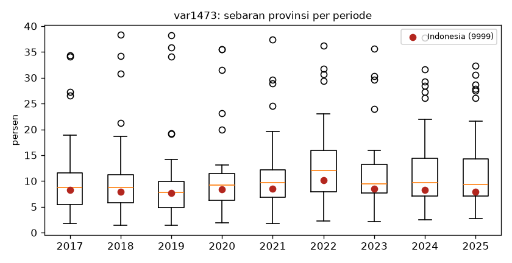
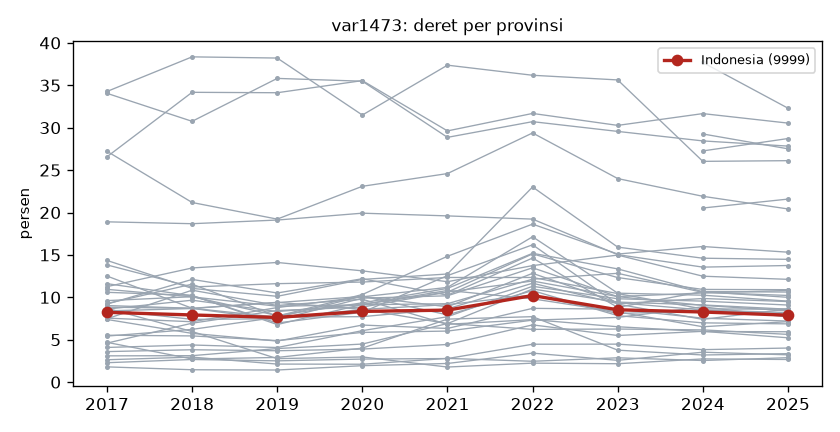
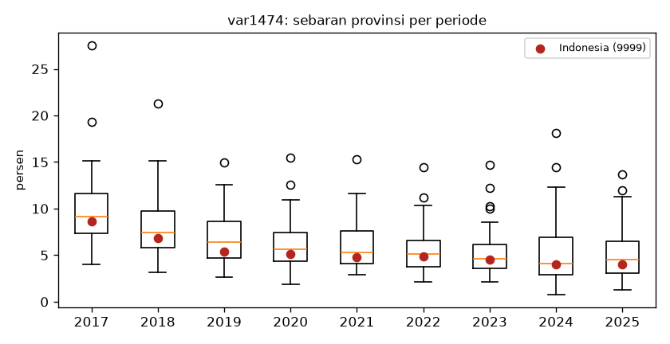
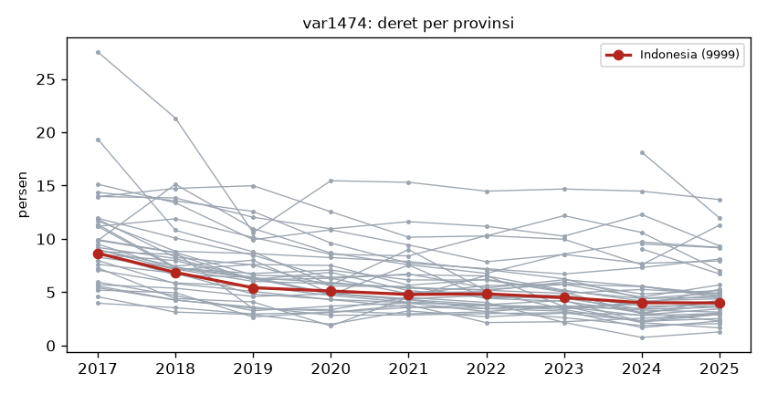

# Profil dan calon anomali seri utama

Dihasilkan `python pipeline.py` (`src/silver/profil.py`). Hanya baris provinsi deret utama (rincian `total`, atau rincian yang didaftar di `DERET` untuk seri yang terbit per rincian; label `kode [rincian]`); baris Indonesia ditampilkan terpisah dan tidak ikut statistik antarprovinsi.

## Banyak periode per provinsi (menentukan arah pembanding)

| seri_kode | min_periode_per_provinsi | maks_periode_per_provinsi |
|---|---|---|
| var1473 | 2 | 9 |
| var1474 | 2 | 9 |

- var1473: tiga arah (periode per provinsi 2–9)
- var1474: tiga arah (periode per provinsi 2–9)

Metode: IQR dengan pengali 1.5; arah ke samping hanya bila satu provinsi punya paling sedikit 6 periode. Sel yang ditandai lebih dari satu arah ditulis satu baris. Provinsi yang di luar batas ke bawah pada ≥ 50% periode diberi tanda `berulang`: itu perbedaan struktural antarprovinsi, bukan kejadian satu tahun. Lihat log untuk alasan memilih IQR.

## Statistik deskriptif per seri per periode (provinsi)

| seri_kode | periode | n | rerata | simpangan | minimum | q1 | median | q3 | maksimum |
|---|---|---|---|---|---|---|---|---|---|
| var1473 | 2017 | 34 | 10.78 | 8.31 | 1.80 | 5.46 | 8.78 | 11.52 | 34.27 |
| var1473 | 2018 | 34 | 10.72 | 8.65 | 1.46 | 5.80 | 8.71 | 11.18 | 38.35 |
| var1473 | 2019 | 34 | 10.23 | 9.13 | 1.43 | 4.86 | 7.81 | 9.94 | 38.21 |
| var1473 | 2020 | 34 | 11.02 | 8.55 | 1.94 | 6.24 | 9.16 | 11.43 | 35.55 |
| var1473 | 2021 | 34 | 11.32 | 8.03 | 1.78 | 6.90 | 9.71 | 12.21 | 37.37 |
| var1473 | 2022 | 34 | 13.68 | 8.32 | 2.24 | 7.96 | 12.03 | 15.94 | 36.18 |
| var1473 | 2023 | 34 | 11.49 | 7.81 | 2.17 | 7.68 | 9.40 | 13.22 | 35.63 |
| var1473 | 2024 | 38 | 12.56 | 8.87 | 2.55 | 7.09 | 9.71 | 14.35 | 37.69 |
| var1473 | 2025 | 38 | 12.20 | 8.41 | 2.67 | 7.15 | 9.29 | 14.30 | 32.30 |
| var1474 | 2017 | 34 | 10.02 | 4.56 | 3.97 | 7.38 | 9.11 | 11.61 | 27.54 |
| var1474 | 2018 | 34 | 8.45 | 3.96 | 3.14 | 5.82 | 7.40 | 9.77 | 21.32 |
| var1474 | 2019 | 34 | 6.88 | 3.05 | 2.68 | 4.67 | 6.37 | 8.59 | 14.99 |
| var1474 | 2020 | 34 | 6.15 | 3.07 | 1.84 | 4.31 | 5.62 | 7.40 | 15.46 |
| var1474 | 2021 | 34 | 6.04 | 2.73 | 2.87 | 4.12 | 5.27 | 7.57 | 15.31 |
| var1474 | 2022 | 34 | 5.61 | 2.68 | 2.16 | 3.77 | 5.11 | 6.56 | 14.48 |
| var1474 | 2023 | 34 | 5.43 | 2.88 | 2.17 | 3.58 | 4.64 | 6.12 | 14.68 |
| var1474 | 2024 | 38 | 5.35 | 3.78 | 0.76 | 2.90 | 4.13 | 6.88 | 18.13 |
| var1474 | 2025 | 38 | 5.21 | 2.97 | 1.28 | 3.10 | 4.52 | 6.46 | 13.69 |

## Baris Indonesia

| seri_kode | periode | nilai | rujukan_tahun |
|---|---|---|---|
| var1473 | 2017 | 8.23 | <NA> |
| var1473 | 2018 | 7.92 | <NA> |
| var1473 | 2019 | 7.63 | <NA> |
| var1473 | 2020 | 8.34 | <NA> |
| var1473 | 2021 | 8.49 | <NA> |
| var1473 | 2022 | 10.21 | <NA> |
| var1473 | 2023 | 8.53 | <NA> |
| var1473 | 2024 | 8.27 | <NA> |
| var1473 | 2025 | 7.89 | <NA> |
| var1474 | 2017 | 8.66 | <NA> |
| var1474 | 2018 | 6.86 | <NA> |
| var1474 | 2019 | 5.42 | <NA> |
| var1474 | 2020 | 5.12 | <NA> |
| var1474 | 2021 | 4.79 | <NA> |
| var1474 | 2022 | 4.85 | <NA> |
| var1474 | 2023 | 4.50 | <NA> |
| var1474 | 2024 | 4.02 | <NA> |
| var1474 | 2025 | 4.00 | <NA> |

## Calon anomali (114)

Daftar lengkap di `reports/calon-anomali.csv`; kategorinya di `reports/anomali.csv`.

| seri_kode | wilayah_kode | nama_wilayah | periode | nilai | arah | alasan | berulang |
|---|---|---|---|---|---|---|---|
| var1473 | 1700 | Bengkulu | 2017 | 12.51 | ke samping | di luar [6.81, 11.69] dibanding 9 tahun di provinsi ini | False |
| var1473 | 5200 | Nusa Tenggara Barat | 2017 | 8.71 | ke samping | di luar [1.15, 4.07] dibanding 9 tahun di provinsi ini | False |
| var1473 | 7200 | Sulawesi Tengah | 2017 | 4.60 | ke samping | di luar [5.15, 13.92] dibanding 9 tahun di provinsi ini | False |
| var1473 | 8100 | Maluku | 2017 | 26.57 | ke bawah | di luar [-3.65, 20.62] (IQR x 1.5) dibanding 34 provinsi tahun itu | True |
| var1473 | 8200 | Maluku Utara | 2017 | 34.05 | ke bawah | di luar [-3.65, 20.62] (IQR x 1.5) dibanding 34 provinsi tahun itu | True |
| var1473 | 9100 | Papua Barat | 2017 | 27.22 | ke bawah | di luar [-3.65, 20.62] (IQR x 1.5) dibanding 34 provinsi tahun itu | True |
| var1473 | 9400 | Papua | 2017 | 34.27 | ke bawah | di luar [-3.65, 20.62] (IQR x 1.5) dibanding 34 provinsi tahun itu | True |
| var1473 | 5200 | Nusa Tenggara Barat | 2018 | 5.97 | ke samping | di luar [1.15, 4.07] dibanding 9 tahun di provinsi ini | False |
| var1473 | 8100 | Maluku | 2018 | 34.17 | ke bawah + perubahan | di luar [-2.25, 19.24] (IQR x 1.5) dibanding 34 provinsi tahun itu; perubahan 2017→2018 sebesar +7.60 di luar [-4.44, 3.79] | True |
| var1473 | 8200 | Maluku Utara | 2018 | 30.75 | ke bawah | di luar [-2.25, 19.24] (IQR x 1.5) dibanding 34 provinsi tahun itu | True |
| var1473 | 9100 | Papua Barat | 2018 | 21.18 | ke bawah + perubahan | di luar [-2.25, 19.24] (IQR x 1.5) dibanding 34 provinsi tahun itu; perubahan 2017→2018 sebesar -6.04 di luar [-4.44, 3.79] | True |
| var1473 | 9400 | Papua | 2018 | 38.35 | ke bawah + perubahan | di luar [-2.25, 19.24] (IQR x 1.5) dibanding 34 provinsi tahun itu; perubahan 2017→2018 sebesar +4.08 di luar [-4.44, 3.79] | True |
| var1473 | 6100 | Kalimantan Barat | 2019 | 19.11 | ke bawah | di luar [-2.78, 17.57] (IQR x 1.5) dibanding 34 provinsi tahun itu | False |
| var1473 | 8100 | Maluku | 2019 | 34.12 | ke bawah | di luar [-2.78, 17.57] (IQR x 1.5) dibanding 34 provinsi tahun itu | True |
| var1473 | 8200 | Maluku Utara | 2019 | 35.81 | ke bawah + perubahan | di luar [-2.78, 17.57] (IQR x 1.5) dibanding 34 provinsi tahun itu; perubahan 2018→2019 sebesar +5.06 di luar [-4.00, 3.07] | True |
| var1473 | 9100 | Papua Barat | 2019 | 19.22 | ke bawah | di luar [-2.78, 17.57] (IQR x 1.5) dibanding 34 provinsi tahun itu | True |
| var1473 | 9400 | Papua | 2019 | 38.21 | ke bawah | di luar [-2.78, 17.57] (IQR x 1.5) dibanding 34 provinsi tahun itu | True |
| var1473 | 6100 | Kalimantan Barat | 2020 | 19.92 | ke bawah | di luar [-1.56, 19.23] (IQR x 1.5) dibanding 34 provinsi tahun itu | False |
| var1473 | 7300 | Sulawesi Selatan | 2020 | 10.14 | ke samping | di luar [5.28, 9.52] dibanding 9 tahun di provinsi ini | False |
| var1473 | 8100 | Maluku | 2020 | 35.55 | ke bawah | di luar [-1.56, 19.23] (IQR x 1.5) dibanding 34 provinsi tahun itu | True |
| var1473 | 8200 | Maluku Utara | 2020 | 35.48 | ke bawah | di luar [-1.56, 19.23] (IQR x 1.5) dibanding 34 provinsi tahun itu | True |
| var1473 | 9100 | Papua Barat | 2020 | 23.09 | ke bawah + perubahan | di luar [-1.56, 19.23] (IQR x 1.5) dibanding 34 provinsi tahun itu; perubahan 2019→2020 sebesar +3.87 di luar [-1.95, 3.79] | True |
| var1473 | 9400 | Papua | 2020 | 31.49 | ke bawah + perubahan | di luar [-1.56, 19.23] (IQR x 1.5) dibanding 34 provinsi tahun itu; perubahan 2019→2020 sebesar -6.72 di luar [-1.95, 3.79] | True |
| var1473 | 1100 | Aceh | 2021 | 6.90 | ke samping | di luar [7.33, 10.66] dibanding 9 tahun di provinsi ini | False |
| var1473 | 5100 | Bali | 2021 | 7.43 | ke samping | di luar [0.96, 6.93] dibanding 9 tahun di provinsi ini | False |
| var1473 | 8100 | Maluku | 2021 | 29.62 | ke bawah + perubahan | di luar [-1.07, 20.18] (IQR x 1.5) dibanding 34 provinsi tahun itu; perubahan 2020→2021 sebesar -5.93 di luar [-4.89, 5.50] | True |
| var1473 | 8200 | Maluku Utara | 2021 | 28.86 | ke bawah + perubahan | di luar [-1.07, 20.18] (IQR x 1.5) dibanding 34 provinsi tahun itu; perubahan 2020→2021 sebesar -6.62 di luar [-4.89, 5.50] | True |
| var1473 | 9100 | Papua Barat | 2021 | 24.59 | ke bawah | di luar [-1.07, 20.18] (IQR x 1.5) dibanding 34 provinsi tahun itu | True |
| var1473 | 9400 | Papua | 2021 | 37.37 | ke bawah + perubahan | di luar [-1.07, 20.18] (IQR x 1.5) dibanding 34 provinsi tahun itu; perubahan 2020→2021 sebesar +5.88 di luar [-4.89, 5.50] | True |
| var1473 | 1100 | Aceh | 2022 | 10.98 | ke samping | di luar [7.33, 10.66] dibanding 9 tahun di provinsi ini | False |
| var1473 | 1400 | Riau | 2022 | 15.12 | ke samping | di luar [6.51, 13.58] dibanding 9 tahun di provinsi ini | False |
| var1473 | 1900 | Kepulauan Bangka Belitung | 2022 | 15.19 | ke samping | di luar [7.45, 13.21] dibanding 9 tahun di provinsi ini | False |
| var1473 | 3400 | DI Yogyakarta | 2022 | 13.48 | ke samping | di luar [6.63, 12.15] dibanding 9 tahun di provinsi ini | False |
| var1473 | 3500 | Jawa Timur | 2022 | 10.27 | ke samping | di luar [7.26, 9.38] dibanding 9 tahun di provinsi ini | False |
| var1473 | 5100 | Bali | 2022 | 7.72 | ke samping | di luar [0.96, 6.93] dibanding 9 tahun di provinsi ini | False |
| var1473 | 6200 | Kalimantan Tengah | 2022 | 12.83 | ke samping | di luar [7.71, 10.39] dibanding 9 tahun di provinsi ini | False |
| var1473 | 6500 | Kalimantan Utara | 2022 | 23.01 | perubahan + ke samping | perubahan 2021→2022 sebesar +10.26 di luar [-3.89, 8.33]; di luar [8.36, 18.36] dibanding 9 tahun di provinsi ini | False |
| var1473 | 7300 | Sulawesi Selatan | 2022 | 10.79 | ke samping | di luar [5.28, 9.52] dibanding 9 tahun di provinsi ini | False |
| var1473 | 7400 | Sulawesi Tenggara | 2022 | 17.14 | ke samping | di luar [6.24, 13.04] dibanding 9 tahun di provinsi ini | False |
| var1473 | 8100 | Maluku | 2022 | 31.68 | ke bawah | di luar [-4.00, 27.90] (IQR x 1.5) dibanding 34 provinsi tahun itu | True |
| var1473 | 8200 | Maluku Utara | 2022 | 30.71 | ke bawah | di luar [-4.00, 27.90] (IQR x 1.5) dibanding 34 provinsi tahun itu | True |
| var1473 | 9100 | Papua Barat | 2022 | 29.38 | ke bawah | di luar [-4.00, 27.90] (IQR x 1.5) dibanding 34 provinsi tahun itu | True |
| var1473 | 9400 | Papua | 2022 | 36.18 | ke bawah | di luar [-4.00, 27.90] (IQR x 1.5) dibanding 34 provinsi tahun itu | True |
| var1473 | 1900 | Kepulauan Bangka Belitung | 2023 | 13.35 | ke samping | di luar [7.45, 13.21] dibanding 9 tahun di provinsi ini | False |
| var1473 | 8100 | Maluku | 2023 | 30.27 | ke bawah | di luar [-0.62, 21.53] (IQR x 1.5) dibanding 34 provinsi tahun itu | True |
| var1473 | 8200 | Maluku Utara | 2023 | 29.56 | ke bawah | di luar [-0.62, 21.53] (IQR x 1.5) dibanding 34 provinsi tahun itu | True |
| var1473 | 9100 | Papua Barat | 2023 | 24.00 | ke bawah | di luar [-0.62, 21.53] (IQR x 1.5) dibanding 34 provinsi tahun itu | True |
| var1473 | 9400 | Papua | 2023 | 35.63 | ke bawah | di luar [-0.62, 21.53] (IQR x 1.5) dibanding 34 provinsi tahun itu | True |
| var1473 | 8100 | Maluku | 2024 | 31.66 | ke bawah | di luar [-3.79, 25.23] (IQR x 1.5) dibanding 38 provinsi tahun itu | True |
| var1473 | 8200 | Maluku Utara | 2024 | 28.44 | ke bawah | di luar [-3.79, 25.23] (IQR x 1.5) dibanding 38 provinsi tahun itu | True |
| var1473 | 9400 | Papua | 2024 | 26.03 | ke bawah + perubahan | di luar [-3.79, 25.23] (IQR x 1.5) dibanding 38 provinsi tahun itu; perubahan 2023→2024 sebesar -9.60 di luar [-4.22, 3.16] | True |
| var1473 | 9500 | Papua Selatan | 2024 | 29.26 | ke bawah | di luar [-3.79, 25.23] (IQR x 1.5) dibanding 38 provinsi tahun itu | True |
| var1473 | 9600 | Papua Tengah | 2024 | 37.69 | ke bawah | di luar [-3.79, 25.23] (IQR x 1.5) dibanding 38 provinsi tahun itu | True |
| var1473 | 9700 | Papua Pegunungan | 2024 | 27.26 | ke bawah | di luar [-3.79, 25.23] (IQR x 1.5) dibanding 38 provinsi tahun itu | True |
| var1473 | 6400 | Kalimantan Timur | 2025 | 8.62 | perubahan | perubahan 2024→2025 sebesar +1.22 di luar [-1.66, 1.09] | False |
| var1473 | 8100 | Maluku | 2025 | 30.54 | ke bawah | di luar [-3.58, 25.02] (IQR x 1.5) dibanding 38 provinsi tahun itu | True |
| var1473 | 8200 | Maluku Utara | 2025 | 27.83 | ke bawah | di luar [-3.58, 25.02] (IQR x 1.5) dibanding 38 provinsi tahun itu | True |
| var1473 | 9400 | Papua | 2025 | 26.11 | ke bawah | di luar [-3.58, 25.02] (IQR x 1.5) dibanding 38 provinsi tahun itu | True |
| var1473 | 9500 | Papua Selatan | 2025 | 27.51 | ke bawah + perubahan | di luar [-3.58, 25.02] (IQR x 1.5) dibanding 38 provinsi tahun itu; perubahan 2024→2025 sebesar -1.75 di luar [-1.66, 1.09] | True |
| var1473 | 9600 | Papua Tengah | 2025 | 32.30 | ke bawah + perubahan | di luar [-3.58, 25.02] (IQR x 1.5) dibanding 38 provinsi tahun itu; perubahan 2024→2025 sebesar -5.39 di luar [-1.66, 1.09] | True |
| var1473 | 9700 | Papua Pegunungan | 2025 | 28.72 | ke bawah + perubahan | di luar [-3.58, 25.02] (IQR x 1.5) dibanding 38 provinsi tahun itu; perubahan 2024→2025 sebesar +1.46 di luar [-1.66, 1.09] | True |
| var1474 | 1100 | Aceh | 2017 | 11.35 | ke samping | di luar [1.36, 9.44] dibanding 9 tahun di provinsi ini | False |
| var1474 | 1200 | Sumatera Utara | 2017 | 9.94 | ke samping | di luar [3.02, 8.81] dibanding 9 tahun di provinsi ini | False |
| var1474 | 1300 | Sumatera Barat | 2017 | 11.18 | ke samping | di luar [3.94, 7.78] dibanding 9 tahun di provinsi ini | False |
| var1474 | 3200 | Jawa Barat | 2017 | 9.52 | ke samping | di luar [3.92, 7.28] dibanding 9 tahun di provinsi ini | False |
| var1474 | 3300 | Jawa Tengah | 2017 | 5.43 | ke samping | di luar [1.78, 4.71] dibanding 9 tahun di provinsi ini | False |
| var1474 | 3400 | DI Yogyakarta | 2017 | 4.58 | ke samping | di luar [2.01, 3.82] dibanding 9 tahun di provinsi ini | False |
| var1474 | 3500 | Jawa Timur | 2017 | 5.58 | ke samping | di luar [1.31, 4.79] dibanding 9 tahun di provinsi ini | False |
| var1474 | 3600 | Banten | 2017 | 8.54 | ke samping | di luar [4.36, 7.48] dibanding 9 tahun di provinsi ini | False |
| var1474 | 5300 | Nusa Tenggara Timur | 2017 | 27.54 | ke bawah + ke samping | di luar [1.03, 17.95] (IQR x 1.5) dibanding 34 provinsi tahun itu; di luar [13.01, 16.93] dibanding 9 tahun di provinsi ini | True |
| var1474 | 6200 | Kalimantan Tengah | 2017 | 7.98 | ke samping | di luar [1.06, 7.50] dibanding 9 tahun di provinsi ini | False |
| var1474 | 6300 | Kalimantan Selatan | 2017 | 5.96 | ke samping | di luar [1.99, 5.19] dibanding 9 tahun di provinsi ini | False |
| var1474 | 7300 | Sulawesi Selatan | 2017 | 7.63 | ke samping | di luar [1.83, 6.63] dibanding 9 tahun di provinsi ini | False |
| var1474 | 7500 | Gorontalo | 2017 | 19.36 | ke bawah + ke samping | di luar [1.03, 17.95] (IQR x 1.5) dibanding 34 provinsi tahun itu; di luar [-0.62, 14.77] dibanding 9 tahun di provinsi ini | False |
| var1474 | 3600 | Banten | 2018 | 7.97 | ke samping | di luar [4.36, 7.48] dibanding 9 tahun di provinsi ini | False |
| var1474 | 5300 | Nusa Tenggara Timur | 2018 | 21.32 | ke bawah + perubahan + ke samping | di luar [-0.09, 15.69] (IQR x 1.5) dibanding 34 provinsi tahun itu; perubahan 2017→2018 sebesar -6.22 di luar [-4.39, 1.63]; di luar [13.01, 16.93] dibanding 9 tahun di provinsi ini | True |
| var1474 | 7300 | Sulawesi Selatan | 2018 | 6.78 | ke samping | di luar [1.83, 6.63] dibanding 9 tahun di provinsi ini | False |
| var1474 | 7500 | Gorontalo | 2018 | 10.81 | perubahan | perubahan 2017→2018 sebesar -8.55 di luar [-4.39, 1.63] | False |
| var1474 | 9400 | Papua | 2018 | 15.12 | perubahan + ke samping | perubahan 2017→2018 sebesar +5.27 di luar [-4.39, 1.63]; di luar [6.68, 11.75] dibanding 9 tahun di provinsi ini | False |
| var1474 | 5300 | Nusa Tenggara Timur | 2019 | 10.59 | perubahan + ke samping | perubahan 2018→2019 sebesar -10.73 di luar [-4.06, 1.60]; di luar [13.01, 16.93] dibanding 9 tahun di provinsi ini | True |
| var1474 | 6500 | Kalimantan Utara | 2019 | 3.45 | perubahan | perubahan 2018→2019 sebesar -5.26 di luar [-4.06, 1.60] | False |
| var1474 | 8200 | Maluku Utara | 2019 | 14.99 | ke bawah | di luar [-1.23, 14.48] (IQR x 1.5) dibanding 34 provinsi tahun itu | False |
| var1474 | 9400 | Papua | 2019 | 10.98 | perubahan | perubahan 2018→2019 sebesar -4.14 di luar [-4.06, 1.60] | False |
| var1474 | 3400 | DI Yogyakarta | 2020 | 2.00 | ke samping | di luar [2.01, 3.82] dibanding 9 tahun di provinsi ini | False |
| var1474 | 5300 | Nusa Tenggara Timur | 2020 | 15.46 | ke bawah + perubahan | di luar [-0.32, 12.03] (IQR x 1.5) dibanding 34 provinsi tahun itu; perubahan 2019→2020 sebesar +4.87 di luar [-4.15, 2.63] | True |
| var1474 | 8200 | Maluku Utara | 2020 | 12.55 | ke bawah | di luar [-0.32, 12.03] (IQR x 1.5) dibanding 34 provinsi tahun itu | False |
| var1474 | 2100 | Kepulauan Riau | 2021 | 7.55 | perubahan | perubahan 2020→2021 sebesar +2.78 di luar [-2.29, 1.99] | False |
| var1474 | 5100 | Bali | 2021 | 4.51 | perubahan | perubahan 2020→2021 sebesar +2.67 di luar [-2.29, 1.99] | False |
| var1474 | 5300 | Nusa Tenggara Timur | 2021 | 15.31 | ke bawah | di luar [-1.05, 12.74] (IQR x 1.5) dibanding 34 provinsi tahun itu | True |
| var1474 | 7500 | Gorontalo | 2021 | 9.00 | perubahan | perubahan 2020→2021 sebesar +3.33 di luar [-2.29, 1.99] | False |
| var1474 | 8200 | Maluku Utara | 2021 | 10.16 | perubahan | perubahan 2020→2021 sebesar -2.39 di luar [-2.29, 1.99] | False |
| var1474 | 2100 | Kepulauan Riau | 2022 | 4.45 | perubahan | perubahan 2021→2022 sebesar -3.10 di luar [-2.20, 1.51] | False |
| var1474 | 5300 | Nusa Tenggara Timur | 2022 | 14.48 | ke bawah | di luar [-0.41, 10.74] (IQR x 1.5) dibanding 34 provinsi tahun itu | True |
| var1474 | 6500 | Kalimantan Utara | 2022 | 6.57 | perubahan | perubahan 2021→2022 sebesar +2.03 di luar [-2.20, 1.51] | False |
| var1474 | 7500 | Gorontalo | 2022 | 5.15 | perubahan | perubahan 2021→2022 sebesar -3.85 di luar [-2.20, 1.51] | False |
| var1474 | 8100 | Maluku | 2022 | 11.18 | ke bawah | di luar [-0.41, 10.74] (IQR x 1.5) dibanding 34 provinsi tahun itu | False |
| var1474 | 9100 | Papua Barat | 2022 | 10.31 | perubahan | perubahan 2021→2022 sebesar +1.90 di luar [-2.20, 1.51] | False |
| var1474 | 5100 | Bali | 2023 | 2.17 | perubahan | perubahan 2022→2023 sebesar -1.87 di luar [-1.83, 1.63] | False |
| var1474 | 5300 | Nusa Tenggara Timur | 2023 | 14.68 | ke bawah | di luar [-0.23, 9.93] (IQR x 1.5) dibanding 34 provinsi tahun itu | True |
| var1474 | 6500 | Kalimantan Utara | 2023 | 3.65 | perubahan | perubahan 2022→2023 sebesar -2.92 di luar [-1.83, 1.63] | False |
| var1474 | 8100 | Maluku | 2023 | 10.26 | ke bawah | di luar [-0.23, 9.93] (IQR x 1.5) dibanding 34 provinsi tahun itu | False |
| var1474 | 8200 | Maluku Utara | 2023 | 12.18 | ke bawah + perubahan | di luar [-0.23, 9.93] (IQR x 1.5) dibanding 34 provinsi tahun itu; perubahan 2022→2023 sebesar +1.90 di luar [-1.83, 1.63] | False |
| var1474 | 9100 | Papua Barat | 2023 | 9.97 | ke bawah | di luar [-0.23, 9.93] (IQR x 1.5) dibanding 34 provinsi tahun itu | False |
| var1474 | 9400 | Papua | 2023 | 8.58 | perubahan | perubahan 2022→2023 sebesar +1.81 di luar [-1.83, 1.63] | False |
| var1474 | 5300 | Nusa Tenggara Timur | 2024 | 14.48 | ke bawah | di luar [-3.06, 12.85] (IQR x 1.5) dibanding 38 provinsi tahun itu | True |
| var1474 | 8100 | Maluku | 2024 | 12.28 | perubahan | perubahan 2023→2024 sebesar +2.02 di luar [-3.08, 1.53] | False |
| var1474 | 9500 | Papua Selatan | 2024 | 18.13 | ke bawah | di luar [-3.06, 12.85] (IQR x 1.5) dibanding 38 provinsi tahun itu | True |
| var1474 | 5300 | Nusa Tenggara Timur | 2025 | 13.69 | ke bawah | di luar [-1.96, 11.51] (IQR x 1.5) dibanding 38 provinsi tahun itu | True |
| var1474 | 6300 | Kalimantan Selatan | 2025 | 1.66 | ke samping | di luar [1.99, 5.19] dibanding 9 tahun di provinsi ini | False |
| var1474 | 8100 | Maluku | 2025 | 9.34 | perubahan | perubahan 2024→2025 sebesar -2.94 di luar [-2.16, 2.25] | False |
| var1474 | 8200 | Maluku Utara | 2025 | 7.03 | perubahan | perubahan 2024→2025 sebesar -3.57 di luar [-2.16, 2.25] | False |
| var1474 | 9100 | Papua Barat | 2025 | 11.29 | perubahan | perubahan 2024→2025 sebesar +3.71 di luar [-2.16, 2.25] | False |
| var1474 | 9500 | Papua Selatan | 2025 | 11.97 | ke bawah + perubahan | di luar [-1.96, 11.51] (IQR x 1.5) dibanding 38 provinsi tahun itu; perubahan 2024→2025 sebesar -6.16 di luar [-2.16, 2.25] | True |
| var1474 | 9700 | Papua Pegunungan | 2025 | 6.72 | perubahan | perubahan 2024→2025 sebesar -2.34 di luar [-2.16, 2.25] | False |

## Gambar

