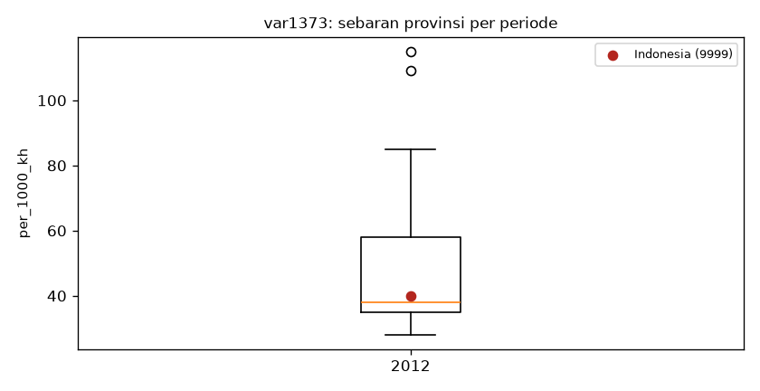
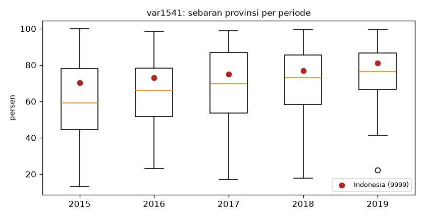
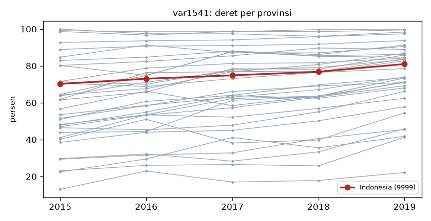
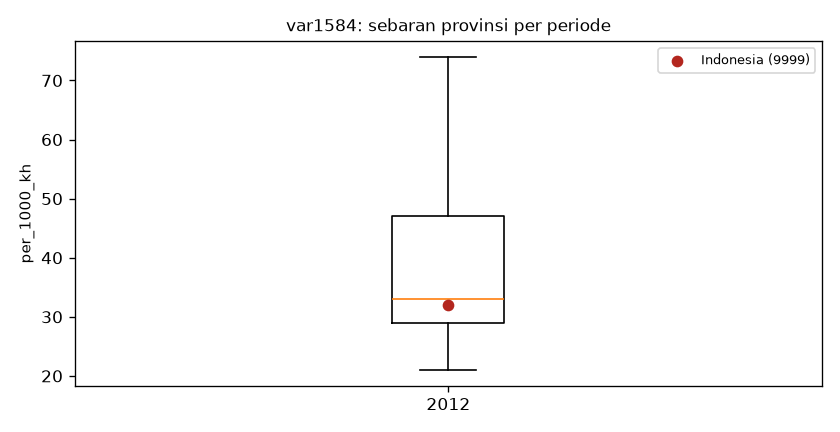

# Profil dan calon anomali seri utama

Dihasilkan `python pipeline.py` (`src/silver/profil.py`). Hanya baris provinsi deret utama (rincian `total`, atau rincian yang didaftar di `DERET` untuk seri yang terbit per rincian; label `kode [rincian]`); baris Indonesia ditampilkan terpisah dan tidak ikut statistik antarprovinsi.

## Banyak periode per provinsi (menentukan arah pembanding)

| seri_kode | min_periode_per_provinsi | maks_periode_per_provinsi |
|---|---|---|
| var1373 | 1 | 1 |
| var1541 | 5 | 5 |
| var1584 | 1 | 1 |

- var1373: hanya arah ke bawah dan perubahan (periode per provinsi 1–1)
- var1541: hanya arah ke bawah dan perubahan (periode per provinsi 5–5)
- var1584: hanya arah ke bawah dan perubahan (periode per provinsi 1–1)

Metode: IQR dengan pengali 1.5; arah ke samping hanya bila satu provinsi punya paling sedikit 6 periode. Sel yang ditandai lebih dari satu arah ditulis satu baris. Provinsi yang di luar batas ke bawah pada ≥ 50% periode diberi tanda `berulang`: itu perbedaan struktural antarprovinsi, bukan kejadian satu tahun. Lihat log untuk alasan memilih IQR.

## Statistik deskriptif per seri per periode (provinsi)

| seri_kode | periode | n | rerata | simpangan | minimum | q1 | median | q3 | maksimum |
|---|---|---|---|---|---|---|---|---|---|
| var1373 | 2012 | 33 | 50.76 | 22.85 | 28.00 | 35.00 | 38.00 | 58.00 | 115.00 |
| var1541 | 2015 | 34 | 59.44 | 23.39 | 13.06 | 44.52 | 59.12 | 78.09 | 99.98 |
| var1541 | 2016 | 34 | 63.84 | 21.60 | 22.96 | 51.61 | 66.06 | 78.20 | 98.57 |
| var1541 | 2017 | 34 | 67.17 | 22.51 | 17.00 | 53.47 | 69.60 | 86.76 | 98.76 |
| var1541 | 2018 | 34 | 68.89 | 21.62 | 17.84 | 58.34 | 73.04 | 85.43 | 99.72 |
| var1541 | 2019 | 34 | 74.28 | 19.01 | 22.14 | 66.70 | 76.25 | 86.71 | 99.67 |
| var1584 | 2012 | 33 | 38.88 | 14.21 | 21.00 | 29.00 | 33.00 | 47.00 | 74.00 |

## Baris Indonesia

| seri_kode | periode | nilai | rujukan_tahun |
|---|---|---|---|
| var1373 | 2012 | 40.00 | 5 |
| var1373 | 2017 | 32.00 | 5 |
| var1584 | 2012 | 32.00 | 5 |
| var1584 | 2017 | 24.00 | 5 |
| var1541 | 2015 | 70.25 | <NA> |
| var1541 | 2016 | 73.05 | <NA> |
| var1541 | 2017 | 74.89 | <NA> |
| var1541 | 2018 | 76.82 | <NA> |
| var1541 | 2019 | 81.02 | <NA> |

## Calon anomali (5)

Daftar lengkap di `reports/calon-anomali.csv`; kategorinya di `reports/anomali.csv`.

| seri_kode | wilayah_kode | nama_wilayah | periode | nilai | arah | alasan | berulang |
|---|---|---|---|---|---|---|---|
| var1373 | 9100 | Papua Barat | 2012 | 109.00 | ke bawah | di luar [0.50, 92.50] (IQR x 1.5) dibanding 33 provinsi tahun itu | False |
| var1373 | 9400 | Papua | 2012 | 115.00 | ke bawah | di luar [0.50, 92.50] (IQR x 1.5) dibanding 33 provinsi tahun itu | False |
| var1541 | 9100 | Papua Barat | 2017 | 38.17 | perubahan | perubahan 2016→2017 sebesar -12.85 di luar [-11.04, 19.25] | False |
| var1541 | 8100 | Maluku | 2019 | 22.14 | ke bawah | di luar [36.68, 116.73] (IQR x 1.5) dibanding 34 provinsi tahun itu | False |
| var1541 | 8200 | Maluku Utara | 2019 | 41.32 | perubahan | perubahan 2018→2019 sebesar +15.55 di luar [-5.49, 14.90] | False |

## Gambar

