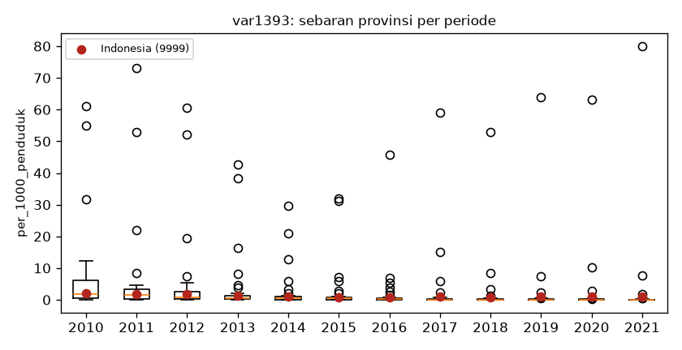
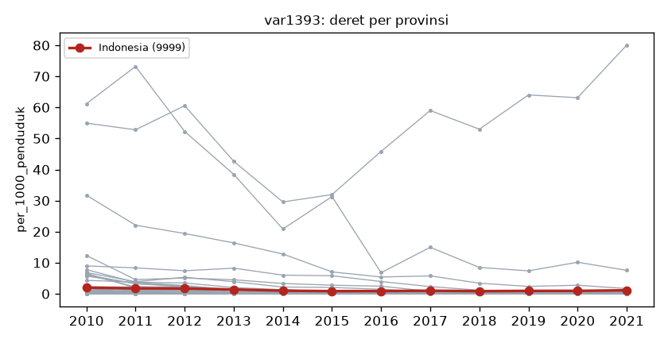
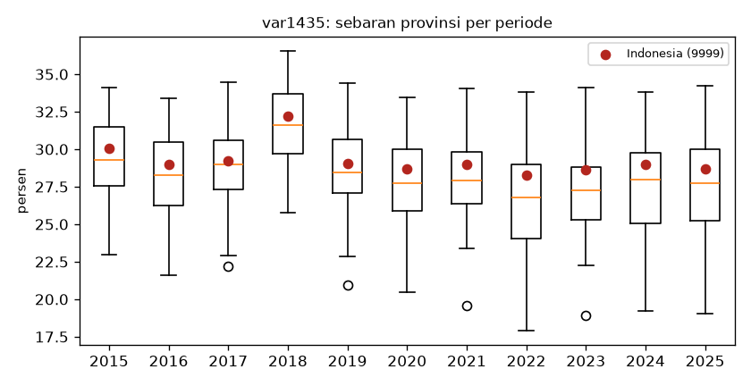
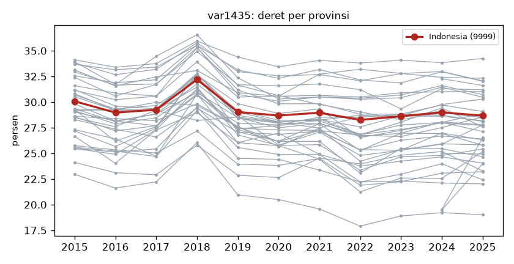
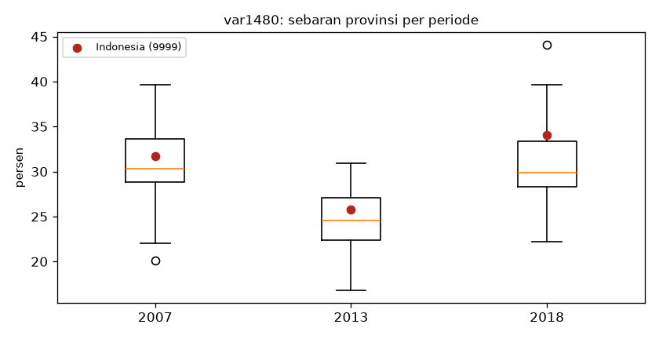
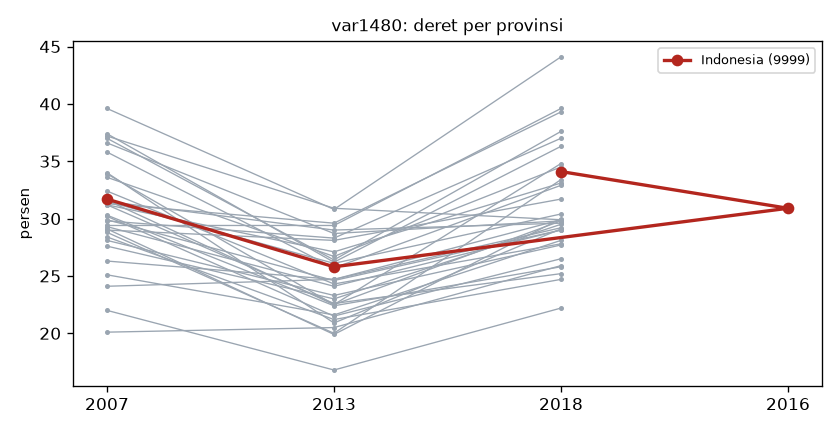

# Profil dan calon anomali seri utama

Dihasilkan `python pipeline.py` (`src/silver/profil.py`). Hanya baris provinsi deret utama (rincian `total`, atau rincian yang didaftar di `DERET` untuk seri yang terbit per rincian; label `kode [rincian]`); baris Indonesia ditampilkan terpisah dan tidak ikut statistik antarprovinsi.

## Banyak periode per provinsi (menentukan arah pembanding)

| seri_kode | min_periode_per_provinsi | maks_periode_per_provinsi |
|---|---|---|
| var1393 | 8 | 12 |
| var1435 | 2 | 11 |
| var1480 | 1 | 3 |

- var1393: tiga arah (periode per provinsi 8–12)
- var1435: tiga arah (periode per provinsi 2–11)
- var1480: hanya arah ke bawah dan perubahan (periode per provinsi 1–3)

Metode: IQR dengan pengali 1.5; arah ke samping hanya bila satu provinsi punya paling sedikit 6 periode. Sel yang ditandai lebih dari satu arah ditulis satu baris. Provinsi yang di luar batas ke bawah pada ≥ 50% periode diberi tanda `berulang`: itu perbedaan struktural antarprovinsi, bukan kejadian satu tahun. Lihat log untuk alasan memilih IQR.

## Statistik deskriptif per seri per periode (provinsi)

| seri_kode | periode | n | rerata | simpangan | minimum | q1 | median | q3 | maksimum |
|---|---|---|---|---|---|---|---|---|---|
| var1393 | 2010 | 33 | 7.02 | 14.45 | 0.00 | 0.54 | 1.80 | 6.18 | 61.18 |
| var1393 | 2011 | 33 | 5.99 | 15.45 | 0.00 | 0.15 | 1.46 | 3.35 | 73.21 |
| var1393 | 2012 | 33 | 5.33 | 13.69 | 0.00 | 0.19 | 0.85 | 2.49 | 60.56 |
| var1393 | 2013 | 33 | 3.92 | 9.97 | 0.00 | 0.23 | 0.49 | 1.30 | 42.65 |
| var1393 | 2014 | 34 | 2.54 | 6.31 | 0.00 | 0.11 | 0.43 | 0.92 | 29.57 |
| var1393 | 2015 | 34 | 2.63 | 7.51 | 0.00 | 0.09 | 0.41 | 0.68 | 31.93 |
| var1393 | 2016 | 34 | 2.09 | 7.89 | 0.00 | 0.04 | 0.17 | 0.48 | 45.85 |
| var1393 | 2017 | 34 | 2.56 | 10.33 | 0.00 | 0.03 | 0.12 | 0.35 | 59.00 |
| var1393 | 2018 | 34 | 2.06 | 9.13 | 0.00 | 0.02 | 0.10 | 0.29 | 52.99 |
| var1393 | 2019 | 34 | 2.28 | 10.99 | 0.00 | 0.02 | 0.07 | 0.20 | 64.03 |
| var1393 | 2020 | 34 | 2.33 | 10.89 | 0.00 | 0.01 | 0.06 | 0.14 | 63.12 |
| var1393 | 2021 | 34 | 2.70 | 13.73 | 0.00 | 0.01 | 0.06 | 0.12 | 80.05 |
| var1435 | 2015 | 34 | 29.48 | 2.97 | 22.96 | 27.55 | 29.30 | 31.50 | 34.12 |
| var1435 | 2016 | 34 | 28.35 | 2.93 | 21.62 | 26.24 | 28.27 | 30.50 | 33.39 |
| var1435 | 2017 | 34 | 28.85 | 3.02 | 22.22 | 27.35 | 29.02 | 30.59 | 34.46 |
| var1435 | 2018 | 34 | 31.78 | 2.87 | 25.80 | 29.71 | 31.61 | 33.71 | 36.56 |
| var1435 | 2019 | 34 | 28.43 | 2.98 | 20.96 | 27.07 | 28.45 | 30.68 | 34.39 |
| var1435 | 2020 | 34 | 27.73 | 2.87 | 20.50 | 25.89 | 27.74 | 30.02 | 33.43 |
| var1435 | 2021 | 34 | 28.00 | 3.06 | 19.58 | 26.40 | 27.91 | 29.82 | 34.07 |
| var1435 | 2022 | 34 | 26.76 | 3.73 | 17.91 | 24.04 | 26.78 | 28.98 | 33.81 |
| var1435 | 2023 | 34 | 27.24 | 3.38 | 18.90 | 25.30 | 27.28 | 28.83 | 34.08 |
| var1435 | 2024 | 38 | 27.40 | 3.85 | 19.22 | 25.05 | 27.99 | 29.75 | 33.84 |
| var1435 | 2025 | 38 | 27.44 | 3.33 | 19.02 | 25.23 | 27.73 | 29.99 | 34.25 |
| var1480 | 2007 | 33 | 30.71 | 4.40 | 20.10 | 28.80 | 30.30 | 33.60 | 39.60 |
| var1480 | 2013 | 33 | 24.67 | 3.51 | 16.80 | 22.40 | 24.60 | 27.10 | 30.90 |
| var1480 | 2018 | 34 | 31.07 | 4.76 | 22.20 | 28.33 | 29.85 | 33.33 | 44.10 |

## Baris Indonesia

| seri_kode | periode | nilai | rujukan_tahun |
|---|---|---|---|
| var1393 | 2010 | 1.96 | <NA> |
| var1393 | 2011 | 1.75 | <NA> |
| var1393 | 2012 | 1.69 | <NA> |
| var1393 | 2013 | 1.38 | <NA> |
| var1393 | 2014 | 0.99 | <NA> |
| var1393 | 2015 | 0.85 | <NA> |
| var1393 | 2016 | 0.88 | <NA> |
| var1393 | 2017 | 0.99 | <NA> |
| var1393 | 2018 | 0.84 | <NA> |
| var1393 | 2019 | 0.93 | <NA> |
| var1393 | 2020 | 0.94 | <NA> |
| var1393 | 2021 | 1.12 | <NA> |
| var1480 | 2007 | 31.70 | <NA> |
| var1480 | 2013 | 25.80 | <NA> |
| var1480 | 2016 | 30.90 | <NA> |
| var1480 | 2018 | 34.10 | <NA> |
| var1435 | 2015 | 30.08 | <NA> |
| var1435 | 2016 | 28.97 | <NA> |
| var1435 | 2017 | 29.25 | <NA> |
| var1435 | 2018 | 32.20 | <NA> |
| var1435 | 2019 | 29.03 | <NA> |
| var1435 | 2020 | 28.69 | <NA> |
| var1435 | 2021 | 28.96 | <NA> |
| var1435 | 2022 | 28.26 | <NA> |
| var1435 | 2023 | 28.62 | <NA> |
| var1435 | 2024 | 28.99 | <NA> |
| var1435 | 2025 | 28.68 | <NA> |

## Calon anomali (154)

Daftar lengkap di `reports/calon-anomali.csv`; kategorinya di `reports/anomali.csv`.

| seri_kode | wilayah_kode | nama_wilayah | periode | nilai | arah | alasan | berulang |
|---|---|---|---|---|---|---|---|
| var1393 | 1300 | Sumatera Barat | 2010 | 0.38 | ke samping | di luar [-0.09, 0.37] dibanding 12 tahun di provinsi ini | False |
| var1393 | 1400 | Riau | 2010 | 1.02 | ke samping | di luar [-0.24, 0.48] dibanding 12 tahun di provinsi ini | False |
| var1393 | 1600 | Sumatera Selatan | 2010 | 1.80 | ke samping | di luar [-0.26, 0.64] dibanding 12 tahun di provinsi ini | False |
| var1393 | 1900 | Kepulauan Bangka Belitung | 2010 | 7.77 | ke samping | di luar [-2.17, 3.90] dibanding 12 tahun di provinsi ini | False |
| var1393 | 2100 | Kepulauan Riau | 2010 | 6.59 | ke samping | di luar [-1.01, 1.96] dibanding 12 tahun di provinsi ini | False |
| var1393 | 3200 | Jawa Barat | 2010 | 0.43 | ke samping | di luar [-0.02, 0.03] dibanding 12 tahun di provinsi ini | False |
| var1393 | 3300 | Jawa Tengah | 2010 | 0.10 | ke samping | di luar [-0.02, 0.08] dibanding 12 tahun di provinsi ini | False |
| var1393 | 3500 | Jawa Timur | 2010 | 0.10 | ke samping | di luar [-0.02, 0.03] dibanding 12 tahun di provinsi ini | False |
| var1393 | 5100 | Bali | 2010 | 0.03 | ke samping | di luar [-0.01, 0.03] dibanding 12 tahun di provinsi ini | False |
| var1393 | 5200 | Nusa Tenggara Barat | 2010 | 2.08 | ke samping | di luar [-0.74, 1.71] dibanding 12 tahun di provinsi ini | False |
| var1393 | 5300 | Nusa Tenggara Timur | 2010 | 31.72 | ke bawah | di luar [-7.92, 14.64] (IQR x 1.5) dibanding 33 provinsi tahun itu | True |
| var1393 | 6100 | Kalimantan Barat | 2010 | 6.18 | ke samping | di luar [-0.54, 0.94] dibanding 12 tahun di provinsi ini | False |
| var1393 | 6400 | Kalimantan Timur | 2010 | 1.92 | ke samping | di luar [-0.00, 1.22] dibanding 12 tahun di provinsi ini | False |
| var1393 | 7100 | Sulawesi Utara | 2010 | 6.11 | ke samping | di luar [-1.28, 3.04] dibanding 12 tahun di provinsi ini | False |
| var1393 | 7200 | Sulawesi Tengah | 2010 | 5.69 | ke samping | di luar [-2.06, 3.59] dibanding 12 tahun di provinsi ini | False |
| var1393 | 7300 | Sulawesi Selatan | 2010 | 0.54 | ke samping | di luar [-0.06, 0.36] dibanding 12 tahun di provinsi ini | False |
| var1393 | 8200 | Maluku Utara | 2010 | 12.32 | ke samping | di luar [-5.68, 10.65] dibanding 12 tahun di provinsi ini | False |
| var1393 | 9100 | Papua Barat | 2010 | 61.18 | ke bawah | di luar [-7.92, 14.64] (IQR x 1.5) dibanding 33 provinsi tahun itu | True |
| var1393 | 9400 | Papua | 2010 | 54.94 | ke bawah | di luar [-7.92, 14.64] (IQR x 1.5) dibanding 33 provinsi tahun itu | True |
| var1393 | 5300 | Nusa Tenggara Timur | 2011 | 22.09 | ke bawah + perubahan | di luar [-4.66, 8.16] (IQR x 1.5) dibanding 33 provinsi tahun itu; perubahan 2010→2011 sebesar -9.63 di luar [-5.27, 3.08] | True |
| var1393 | 6100 | Kalimantan Barat | 2011 | 2.21 | ke samping | di luar [-0.54, 0.94] dibanding 12 tahun di provinsi ini | False |
| var1393 | 6400 | Kalimantan Timur | 2011 | 1.46 | ke samping | di luar [-0.00, 1.22] dibanding 12 tahun di provinsi ini | False |
| var1393 | 7100 | Sulawesi Utara | 2011 | 3.21 | ke samping | di luar [-1.28, 3.04] dibanding 12 tahun di provinsi ini | False |
| var1393 | 7300 | Sulawesi Selatan | 2011 | 0.38 | ke samping | di luar [-0.06, 0.36] dibanding 12 tahun di provinsi ini | False |
| var1393 | 7400 | Sulawesi Tenggara | 2011 | 1.48 | ke samping | di luar [-0.30, 1.24] dibanding 12 tahun di provinsi ini | False |
| var1393 | 7600 | Sulawesi Barat | 2011 | 2.22 | ke samping | di luar [-0.58, 1.26] dibanding 12 tahun di provinsi ini | False |
| var1393 | 8100 | Maluku | 2011 | 8.34 | ke bawah | di luar [-4.66, 8.16] (IQR x 1.5) dibanding 33 provinsi tahun itu | True |
| var1393 | 8200 | Maluku Utara | 2011 | 4.57 | perubahan | perubahan 2010→2011 sebesar -7.75 di luar [-5.27, 3.08] | False |
| var1393 | 9100 | Papua Barat | 2011 | 73.21 | ke bawah + perubahan | di luar [-4.66, 8.16] (IQR x 1.5) dibanding 33 provinsi tahun itu; perubahan 2010→2011 sebesar +12.03 di luar [-5.27, 3.08] | True |
| var1393 | 9400 | Papua | 2011 | 52.80 | ke bawah | di luar [-4.66, 8.16] (IQR x 1.5) dibanding 33 provinsi tahun itu | True |
| var1393 | 1700 | Bengkulu | 2012 | 5.32 | perubahan | perubahan 2011→2012 sebesar +1.43 di luar [-1.76, 1.10] | False |
| var1393 | 2100 | Kepulauan Riau | 2012 | 2.47 | ke samping | di luar [-1.01, 1.96] dibanding 12 tahun di provinsi ini | False |
| var1393 | 3400 | DI Yogyakarta | 2012 | 0.06 | ke samping | di luar [-0.01, 0.04] dibanding 12 tahun di provinsi ini | False |
| var1393 | 5300 | Nusa Tenggara Timur | 2012 | 19.41 | ke bawah + perubahan | di luar [-3.26, 5.94] (IQR x 1.5) dibanding 33 provinsi tahun itu; perubahan 2011→2012 sebesar -2.67 di luar [-1.76, 1.10] | True |
| var1393 | 8100 | Maluku | 2012 | 7.42 | ke bawah | di luar [-3.26, 5.94] (IQR x 1.5) dibanding 33 provinsi tahun itu | True |
| var1393 | 9100 | Papua Barat | 2012 | 52.27 | ke bawah + perubahan | di luar [-3.26, 5.94] (IQR x 1.5) dibanding 33 provinsi tahun itu; perubahan 2011→2012 sebesar -20.94 di luar [-1.76, 1.10] | True |
| var1393 | 9400 | Papua | 2012 | 60.56 | ke bawah + perubahan | di luar [-3.26, 5.94] (IQR x 1.5) dibanding 33 provinsi tahun itu; perubahan 2011→2012 sebesar +7.76 di luar [-1.76, 1.10] | True |
| var1393 | 1700 | Bengkulu | 2013 | 3.89 | ke bawah | di luar [-1.38, 2.91] (IQR x 1.5) dibanding 33 provinsi tahun itu | False |
| var1393 | 5300 | Nusa Tenggara Timur | 2013 | 16.37 | ke bawah | di luar [-1.38, 2.91] (IQR x 1.5) dibanding 33 provinsi tahun itu | True |
| var1393 | 8100 | Maluku | 2013 | 8.25 | ke bawah | di luar [-1.38, 2.91] (IQR x 1.5) dibanding 33 provinsi tahun itu | True |
| var1393 | 8200 | Maluku Utara | 2013 | 4.51 | ke bawah | di luar [-1.38, 2.91] (IQR x 1.5) dibanding 33 provinsi tahun itu | False |
| var1393 | 9100 | Papua Barat | 2013 | 38.44 | ke bawah + perubahan | di luar [-1.38, 2.91] (IQR x 1.5) dibanding 33 provinsi tahun itu; perubahan 2012→2013 sebesar -13.83 di luar [-3.09, 1.86] | True |
| var1393 | 9400 | Papua | 2013 | 42.65 | ke bawah + perubahan | di luar [-1.38, 2.91] (IQR x 1.5) dibanding 33 provinsi tahun itu; perubahan 2012→2013 sebesar -17.91 di luar [-3.09, 1.86] | True |
| var1393 | 1700 | Bengkulu | 2014 | 2.17 | ke bawah + perubahan | di luar [-1.11, 2.14] (IQR x 1.5) dibanding 34 provinsi tahun itu; perubahan 2013→2014 sebesar -1.72 di luar [-1.04, 0.60] | False |
| var1393 | 5300 | Nusa Tenggara Timur | 2014 | 12.81 | ke bawah + perubahan | di luar [-1.11, 2.14] (IQR x 1.5) dibanding 34 provinsi tahun itu; perubahan 2013→2014 sebesar -3.56 di luar [-1.04, 0.60] | True |
| var1393 | 8100 | Maluku | 2014 | 6.00 | ke bawah + perubahan | di luar [-1.11, 2.14] (IQR x 1.5) dibanding 34 provinsi tahun itu; perubahan 2013→2014 sebesar -2.25 di luar [-1.04, 0.60] | True |
| var1393 | 8200 | Maluku Utara | 2014 | 3.32 | ke bawah + perubahan | di luar [-1.11, 2.14] (IQR x 1.5) dibanding 34 provinsi tahun itu; perubahan 2013→2014 sebesar -1.19 di luar [-1.04, 0.60] | False |
| var1393 | 9100 | Papua Barat | 2014 | 20.85 | ke bawah + perubahan | di luar [-1.11, 2.14] (IQR x 1.5) dibanding 34 provinsi tahun itu; perubahan 2013→2014 sebesar -17.59 di luar [-1.04, 0.60] | True |
| var1393 | 9400 | Papua | 2014 | 29.57 | ke bawah + perubahan | di luar [-1.11, 2.14] (IQR x 1.5) dibanding 34 provinsi tahun itu; perubahan 2013→2014 sebesar -13.08 di luar [-1.04, 0.60] | True |
| var1393 | 1700 | Bengkulu | 2015 | 2.03 | ke bawah | di luar [-0.81, 1.57] (IQR x 1.5) dibanding 34 provinsi tahun itu | False |
| var1393 | 5300 | Nusa Tenggara Timur | 2015 | 7.04 | ke bawah + perubahan | di luar [-0.81, 1.57] (IQR x 1.5) dibanding 34 provinsi tahun itu; perubahan 2014→2015 sebesar -5.77 di luar [-0.44, 0.27] | True |
| var1393 | 6200 | Kalimantan Tengah | 2015 | 0.42 | perubahan | perubahan 2014→2015 sebesar -0.90 di luar [-0.44, 0.27] | False |
| var1393 | 6300 | Kalimantan Selatan | 2015 | 0.68 | perubahan | perubahan 2014→2015 sebesar -0.67 di luar [-0.44, 0.27] | False |
| var1393 | 8100 | Maluku | 2015 | 5.81 | ke bawah | di luar [-0.81, 1.57] (IQR x 1.5) dibanding 34 provinsi tahun itu | True |
| var1393 | 8200 | Maluku Utara | 2015 | 2.77 | ke bawah + perubahan | di luar [-0.81, 1.57] (IQR x 1.5) dibanding 34 provinsi tahun itu; perubahan 2014→2015 sebesar -0.55 di luar [-0.44, 0.27] | False |
| var1393 | 9100 | Papua Barat | 2015 | 31.29 | ke bawah + perubahan | di luar [-0.81, 1.57] (IQR x 1.5) dibanding 34 provinsi tahun itu; perubahan 2014→2015 sebesar +10.44 di luar [-0.44, 0.27] | True |
| var1393 | 9400 | Papua | 2015 | 31.93 | ke bawah + perubahan | di luar [-0.81, 1.57] (IQR x 1.5) dibanding 34 provinsi tahun itu; perubahan 2014→2015 sebesar +2.36 di luar [-0.44, 0.27] | True |
| var1393 | 1700 | Bengkulu | 2016 | 1.45 | ke bawah + perubahan | di luar [-0.64, 1.16] (IQR x 1.5) dibanding 34 provinsi tahun itu; perubahan 2015→2016 sebesar -0.58 di luar [-0.57, 0.34] | False |
| var1393 | 1900 | Kepulauan Bangka Belitung | 2016 | 0.11 | perubahan | perubahan 2015→2016 sebesar -0.97 di luar [-0.57, 0.34] | False |
| var1393 | 5300 | Nusa Tenggara Timur | 2016 | 5.41 | ke bawah + perubahan | di luar [-0.64, 1.16] (IQR x 1.5) dibanding 34 provinsi tahun itu; perubahan 2015→2016 sebesar -1.63 di luar [-0.57, 0.34] | True |
| var1393 | 8100 | Maluku | 2016 | 3.95 | ke bawah + perubahan | di luar [-0.64, 1.16] (IQR x 1.5) dibanding 34 provinsi tahun itu; perubahan 2015→2016 sebesar -1.86 di luar [-0.57, 0.34] | True |
| var1393 | 8200 | Maluku Utara | 2016 | 2.44 | ke bawah | di luar [-0.64, 1.16] (IQR x 1.5) dibanding 34 provinsi tahun itu | False |
| var1393 | 9100 | Papua Barat | 2016 | 6.79 | ke bawah + perubahan | di luar [-0.64, 1.16] (IQR x 1.5) dibanding 34 provinsi tahun itu; perubahan 2015→2016 sebesar -24.50 di luar [-0.57, 0.34] | True |
| var1393 | 9400 | Papua | 2016 | 45.85 | ke bawah + perubahan | di luar [-0.64, 1.16] (IQR x 1.5) dibanding 34 provinsi tahun itu; perubahan 2015→2016 sebesar +13.92 di luar [-0.57, 0.34] | True |
| var1393 | 1700 | Bengkulu | 2017 | 0.53 | perubahan | perubahan 2016→2017 sebesar -0.92 di luar [-0.41, 0.28] | False |
| var1393 | 5300 | Nusa Tenggara Timur | 2017 | 5.76 | ke bawah + perubahan | di luar [-0.44, 0.83] (IQR x 1.5) dibanding 34 provinsi tahun itu; perubahan 2016→2017 sebesar +0.35 di luar [-0.41, 0.28] | True |
| var1393 | 8100 | Maluku | 2017 | 2.30 | ke bawah + perubahan | di luar [-0.44, 0.83] (IQR x 1.5) dibanding 34 provinsi tahun itu; perubahan 2016→2017 sebesar -1.65 di luar [-0.41, 0.28] | True |
| var1393 | 8200 | Maluku Utara | 2017 | 0.79 | perubahan | perubahan 2016→2017 sebesar -1.65 di luar [-0.41, 0.28] | False |
| var1393 | 9100 | Papua Barat | 2017 | 14.97 | ke bawah + perubahan | di luar [-0.44, 0.83] (IQR x 1.5) dibanding 34 provinsi tahun itu; perubahan 2016→2017 sebesar +8.18 di luar [-0.41, 0.28] | True |
| var1393 | 9400 | Papua | 2017 | 59.00 | ke bawah + perubahan | di luar [-0.44, 0.83] (IQR x 1.5) dibanding 34 provinsi tahun itu; perubahan 2016→2017 sebesar +13.15 di luar [-0.41, 0.28] | True |
| var1393 | 1700 | Bengkulu | 2018 | 0.16 | perubahan | perubahan 2017→2018 sebesar -0.37 di luar [-0.29, 0.18] | False |
| var1393 | 5200 | Nusa Tenggara Barat | 2018 | 0.34 | perubahan | perubahan 2017→2018 sebesar +0.19 di luar [-0.29, 0.18] | False |
| var1393 | 5300 | Nusa Tenggara Timur | 2018 | 3.42 | ke bawah + perubahan | di luar [-0.39, 0.71] (IQR x 1.5) dibanding 34 provinsi tahun itu; perubahan 2017→2018 sebesar -2.34 di luar [-0.29, 0.18] | True |
| var1393 | 6400 | Kalimantan Timur | 2018 | 0.63 | perubahan | perubahan 2017→2018 sebesar +0.19 di luar [-0.29, 0.18] | False |
| var1393 | 8100 | Maluku | 2018 | 1.16 | ke bawah + perubahan | di luar [-0.39, 0.71] (IQR x 1.5) dibanding 34 provinsi tahun itu; perubahan 2017→2018 sebesar -1.14 di luar [-0.29, 0.18] | True |
| var1393 | 8200 | Maluku Utara | 2018 | 0.39 | perubahan | perubahan 2017→2018 sebesar -0.40 di luar [-0.29, 0.18] | False |
| var1393 | 9100 | Papua Barat | 2018 | 8.49 | ke bawah + perubahan | di luar [-0.39, 0.71] (IQR x 1.5) dibanding 34 provinsi tahun itu; perubahan 2017→2018 sebesar -6.48 di luar [-0.29, 0.18] | True |
| var1393 | 9400 | Papua | 2018 | 52.99 | ke bawah + perubahan | di luar [-0.39, 0.71] (IQR x 1.5) dibanding 34 provinsi tahun itu; perubahan 2017→2018 sebesar -6.01 di luar [-0.29, 0.18] | True |
| var1393 | 1800 | Lampung | 2019 | 0.18 | perubahan | perubahan 2018→2019 sebesar -0.20 di luar [-0.16, 0.10] | False |
| var1393 | 5300 | Nusa Tenggara Timur | 2019 | 2.37 | ke bawah + perubahan | di luar [-0.25, 0.46] (IQR x 1.5) dibanding 34 provinsi tahun itu; perubahan 2018→2019 sebesar -1.05 di luar [-0.16, 0.10] | True |
| var1393 | 6200 | Kalimantan Tengah | 2019 | 0.07 | perubahan | perubahan 2018→2019 sebesar -0.18 di luar [-0.16, 0.10] | False |
| var1393 | 6400 | Kalimantan Timur | 2019 | 0.55 | ke bawah | di luar [-0.25, 0.46] (IQR x 1.5) dibanding 34 provinsi tahun itu | False |
| var1393 | 8100 | Maluku | 2019 | 0.72 | ke bawah + perubahan | di luar [-0.25, 0.46] (IQR x 1.5) dibanding 34 provinsi tahun itu; perubahan 2018→2019 sebesar -0.44 di luar [-0.16, 0.10] | True |
| var1393 | 9100 | Papua Barat | 2019 | 7.38 | ke bawah + perubahan | di luar [-0.25, 0.46] (IQR x 1.5) dibanding 34 provinsi tahun itu; perubahan 2018→2019 sebesar -1.11 di luar [-0.16, 0.10] | True |
| var1393 | 9400 | Papua | 2019 | 64.03 | ke bawah + perubahan | di luar [-0.25, 0.46] (IQR x 1.5) dibanding 34 provinsi tahun itu; perubahan 2018→2019 sebesar +11.04 di luar [-0.16, 0.10] | True |
| var1393 | 1400 | Riau | 2020 | 0.24 | perubahan | perubahan 2019→2020 sebesar +0.22 di luar [-0.12, 0.09] | False |
| var1393 | 1800 | Lampung | 2020 | 0.05 | perubahan | perubahan 2019→2020 sebesar -0.13 di luar [-0.12, 0.09] | False |
| var1393 | 5200 | Nusa Tenggara Barat | 2020 | 0.05 | perubahan | perubahan 2019→2020 sebesar -0.14 di luar [-0.12, 0.09] | False |
| var1393 | 5300 | Nusa Tenggara Timur | 2020 | 2.76 | ke bawah + perubahan | di luar [-0.17, 0.32] (IQR x 1.5) dibanding 34 provinsi tahun itu; perubahan 2019→2020 sebesar +0.39 di luar [-0.12, 0.09] | True |
| var1393 | 6400 | Kalimantan Timur | 2020 | 0.62 | ke bawah | di luar [-0.17, 0.32] (IQR x 1.5) dibanding 34 provinsi tahun itu | False |
| var1393 | 7100 | Sulawesi Utara | 2020 | 0.36 | ke bawah + perubahan | di luar [-0.17, 0.32] (IQR x 1.5) dibanding 34 provinsi tahun itu; perubahan 2019→2020 sebesar +0.16 di luar [-0.12, 0.09] | False |
| var1393 | 7400 | Sulawesi Tenggara | 2020 | 0.14 | perubahan | perubahan 2019→2020 sebesar -0.16 di luar [-0.12, 0.09] | False |
| var1393 | 8100 | Maluku | 2020 | 0.42 | ke bawah + perubahan | di luar [-0.17, 0.32] (IQR x 1.5) dibanding 34 provinsi tahun itu; perubahan 2019→2020 sebesar -0.30 di luar [-0.12, 0.09] | True |
| var1393 | 8200 | Maluku Utara | 2020 | 0.16 | perubahan | perubahan 2019→2020 sebesar -0.30 di luar [-0.12, 0.09] | False |
| var1393 | 9100 | Papua Barat | 2020 | 10.15 | ke bawah + perubahan | di luar [-0.17, 0.32] (IQR x 1.5) dibanding 34 provinsi tahun itu; perubahan 2019→2020 sebesar +2.77 di luar [-0.12, 0.09] | True |
| var1393 | 9400 | Papua | 2020 | 63.12 | ke bawah + perubahan | di luar [-0.17, 0.32] (IQR x 1.5) dibanding 34 provinsi tahun itu; perubahan 2019→2020 sebesar -0.91 di luar [-0.12, 0.09] | True |
| var1393 | 1200 | Sumatera Utara | 2021 | 0.17 | perubahan | perubahan 2020→2021 sebesar +0.10 di luar [-0.13, 0.10] | False |
| var1393 | 5300 | Nusa Tenggara Timur | 2021 | 1.69 | ke bawah + perubahan | di luar [-0.16, 0.29] (IQR x 1.5) dibanding 34 provinsi tahun itu; perubahan 2020→2021 sebesar -1.07 di luar [-0.13, 0.10] | True |
| var1393 | 6400 | Kalimantan Timur | 2021 | 0.61 | ke bawah | di luar [-0.16, 0.29] (IQR x 1.5) dibanding 34 provinsi tahun itu | False |
| var1393 | 8100 | Maluku | 2021 | 0.45 | ke bawah | di luar [-0.16, 0.29] (IQR x 1.5) dibanding 34 provinsi tahun itu | True |
| var1393 | 9100 | Papua Barat | 2021 | 7.56 | ke bawah + perubahan | di luar [-0.16, 0.29] (IQR x 1.5) dibanding 34 provinsi tahun itu; perubahan 2020→2021 sebesar -2.59 di luar [-0.13, 0.10] | True |
| var1393 | 9400 | Papua | 2021 | 80.05 | ke bawah + perubahan | di luar [-0.16, 0.29] (IQR x 1.5) dibanding 34 provinsi tahun itu; perubahan 2020→2021 sebesar +16.93 di luar [-0.13, 0.10] | True |
| var1435 | 1100 | Aceh | 2015 | 29.82 | ke samping | di luar [27.28, 29.67] dibanding 11 tahun di provinsi ini | False |
| var1435 | 3200 | Jawa Barat | 2015 | 33.82 | ke samping | di luar [31.90, 33.80] dibanding 11 tahun di provinsi ini | False |
| var1435 | 3600 | Banten | 2015 | 32.95 | ke samping | di luar [30.50, 32.52] dibanding 11 tahun di provinsi ini | False |
| var1435 | 9100 | Papua Barat | 2016 | 26.18 | perubahan | perubahan 2015→2016 sebesar -3.10 di luar [-2.66, 0.49] | False |
| var1435 | 3100 | DKI Jakarta | 2017 | 24.72 | perubahan | perubahan 2016→2017 sebesar -1.70 di luar [-1.47, 2.08] | False |
| var1435 | 5100 | Bali | 2017 | 22.22 | ke bawah | di luar [22.49, 35.44] (IQR x 1.5) dibanding 34 provinsi tahun itu | False |
| var1435 | 5300 | Nusa Tenggara Timur | 2017 | 27.31 | perubahan | perubahan 2016→2017 sebesar +2.40 di luar [-1.47, 2.08] | False |
| var1435 | 7500 | Gorontalo | 2017 | 34.46 | perubahan | perubahan 2016→2017 sebesar +2.75 di luar [-1.47, 2.08] | False |
| var1435 | 9400 | Papua | 2017 | 27.28 | perubahan | perubahan 2016→2017 sebesar +3.24 di luar [-1.47, 2.08] | False |
| var1435 | 1100 | Aceh | 2018 | 31.76 | ke samping | di luar [27.28, 29.67] dibanding 11 tahun di provinsi ini | False |
| var1435 | 1200 | Sumatera Utara | 2018 | 31.10 | ke samping | di luar [24.11, 30.61] dibanding 11 tahun di provinsi ini | False |
| var1435 | 1300 | Sumatera Barat | 2018 | 35.32 | ke samping | di luar [28.76, 33.27] dibanding 11 tahun di provinsi ini | False |
| var1435 | 1400 | Riau | 2018 | 32.72 | ke samping | di luar [25.89, 31.63] dibanding 11 tahun di provinsi ini | False |
| var1435 | 1500 | Jambi | 2018 | 28.21 | perubahan | perubahan 2017→2018 sebesar -0.97 di luar [0.02, 5.73] | False |
| var1435 | 1700 | Bengkulu | 2018 | 35.53 | ke samping | di luar [30.65, 34.87] dibanding 11 tahun di provinsi ini | False |
| var1435 | 1800 | Lampung | 2018 | 35.95 | ke samping | di luar [33.17, 34.79] dibanding 11 tahun di provinsi ini | False |
| var1435 | 1900 | Kepulauan Bangka Belitung | 2018 | 32.32 | ke samping | di luar [25.36, 31.98] dibanding 11 tahun di provinsi ini | False |
| var1435 | 2100 | Kepulauan Riau | 2018 | 29.67 | perubahan | perubahan 2017→2018 sebesar -0.31 di luar [0.02, 5.73] | False |
| var1435 | 3100 | DKI Jakarta | 2018 | 30.77 | perubahan + ke samping | perubahan 2017→2018 sebesar +6.05 di luar [0.02, 5.73]; di luar [19.46, 30.29] dibanding 11 tahun di provinsi ini | False |
| var1435 | 3200 | Jawa Barat | 2018 | 35.78 | ke samping | di luar [31.90, 33.80] dibanding 11 tahun di provinsi ini | False |
| var1435 | 3300 | Jawa Tengah | 2018 | 30.79 | ke samping | di luar [26.27, 30.07] dibanding 11 tahun di provinsi ini | False |
| var1435 | 3500 | Jawa Timur | 2018 | 30.66 | ke samping | di luar [26.89, 29.91] dibanding 11 tahun di provinsi ini | False |
| var1435 | 3600 | Banten | 2018 | 34.93 | ke samping | di luar [30.50, 32.52] dibanding 11 tahun di provinsi ini | False |
| var1435 | 5300 | Nusa Tenggara Timur | 2018 | 31.30 | ke samping | di luar [24.84, 28.97] dibanding 11 tahun di provinsi ini | False |
| var1435 | 6100 | Kalimantan Barat | 2018 | 30.92 | ke samping | di luar [26.11, 30.21] dibanding 11 tahun di provinsi ini | False |
| var1435 | 6200 | Kalimantan Tengah | 2018 | 32.64 | ke samping | di luar [24.70, 32.52] dibanding 11 tahun di provinsi ini | False |
| var1435 | 6400 | Kalimantan Timur | 2018 | 29.17 | ke samping | di luar [20.49, 27.64] dibanding 11 tahun di provinsi ini | False |
| var1435 | 7100 | Sulawesi Utara | 2018 | 32.80 | ke samping | di luar [23.49, 32.71] dibanding 11 tahun di provinsi ini | False |
| var1435 | 7300 | Sulawesi Selatan | 2018 | 29.51 | ke samping | di luar [22.93, 26.99] dibanding 11 tahun di provinsi ini | False |
| var1435 | 7600 | Sulawesi Barat | 2018 | 29.41 | ke samping | di luar [25.23, 28.49] dibanding 11 tahun di provinsi ini | False |
| var1435 | 8100 | Maluku | 2018 | 32.74 | ke samping | di luar [25.41, 29.51] dibanding 11 tahun di provinsi ini | False |
| var1435 | 8200 | Maluku Utara | 2018 | 35.29 | ke samping | di luar [27.22, 33.04] dibanding 11 tahun di provinsi ini | False |
| var1435 | 9100 | Papua Barat | 2018 | 32.73 | ke samping | di luar [22.30, 31.76] dibanding 11 tahun di provinsi ini | False |
| var1435 | 1500 | Jambi | 2019 | 28.54 | perubahan | perubahan 2018→2019 sebesar +0.33 di luar [-6.12, -0.72] | False |
| var1435 | 5100 | Bali | 2019 | 20.96 | ke bawah | di luar [21.64, 36.11] (IQR x 1.5) dibanding 34 provinsi tahun itu | False |
| var1435 | 9100 | Papua Barat | 2020 | 25.80 | perubahan | perubahan 2019→2020 sebesar -2.87 di luar [-2.17, 0.96] | False |
| var1435 | 3100 | DKI Jakarta | 2021 | 24.44 | perubahan | perubahan 2020→2021 sebesar -1.31 di luar [-1.07, 1.72] | False |
| var1435 | 3400 | DI Yogyakarta | 2021 | 24.54 | perubahan | perubahan 2020→2021 sebesar +1.90 di luar [-1.07, 1.72] | False |
| var1435 | 5100 | Bali | 2021 | 19.58 | ke bawah | di luar [21.25, 34.96] (IQR x 1.5) dibanding 34 provinsi tahun itu | False |
| var1435 | 5200 | Nusa Tenggara Barat | 2021 | 32.71 | perubahan | perubahan 2020→2021 sebesar +2.13 di luar [-1.07, 1.72] | False |
| var1435 | 6500 | Kalimantan Utara | 2021 | 27.46 | perubahan | perubahan 2020→2021 sebesar +1.80 di luar [-1.07, 1.72] | False |
| var1435 | 8100 | Maluku | 2021 | 27.90 | perubahan | perubahan 2020→2021 sebesar +1.72 di luar [-1.07, 1.72] | False |
| var1435 | 9400 | Papua | 2021 | 24.91 | perubahan | perubahan 2020→2021 sebesar -2.06 di luar [-1.07, 1.72] | False |
| var1435 | 2100 | Kepulauan Riau | 2023 | 25.49 | perubahan | perubahan 2022→2023 sebesar +2.41 di luar [-1.27, 2.28] | False |
| var1435 | 3600 | Banten | 2023 | 29.34 | perubahan + ke samping | perubahan 2022→2023 sebesar -1.87 di luar [-1.27, 2.28]; di luar [30.50, 32.52] dibanding 11 tahun di provinsi ini | False |
| var1435 | 5100 | Bali | 2023 | 18.90 | ke bawah | di luar [20.01, 34.12] (IQR x 1.5) dibanding 34 provinsi tahun itu | False |
| var1435 | 3100 | DKI Jakarta | 2025 | 25.17 | perubahan | perubahan 2024→2025 sebesar +2.61 di luar [-2.07, 1.41] | False |
| var1435 | 9100 | Papua Barat | 2025 | 27.76 | perubahan | perubahan 2024→2025 sebesar +1.86 di luar [-2.07, 1.41] | False |
| var1435 | 9600 | Papua Tengah | 2025 | 23.98 | perubahan | perubahan 2024→2025 sebesar +4.50 di luar [-2.07, 1.41] | False |
| var1435 | 9700 | Papua Pegunungan | 2025 | 26.52 | perubahan | perubahan 2024→2025 sebesar +6.98 di luar [-2.07, 1.41] | False |
| var1480 | 9100 | Papua Barat | 2007 | 20.10 | ke bawah | di luar [21.60, 40.80] (IQR x 1.5) dibanding 33 provinsi tahun itu | False |
| var1480 | 6300 | Kalimantan Selatan | 2018 | 44.10 | ke bawah | di luar [20.83, 40.83] (IQR x 1.5) dibanding 34 provinsi tahun itu | False |

## Gambar

