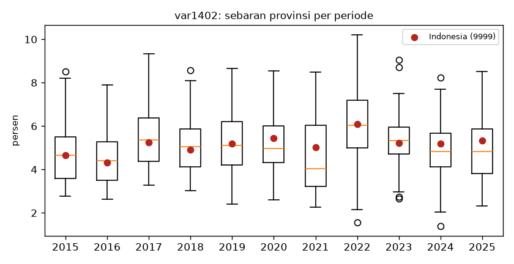
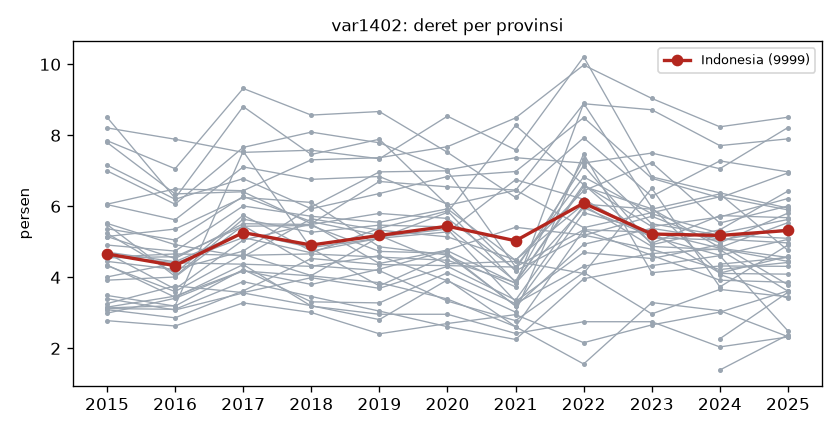
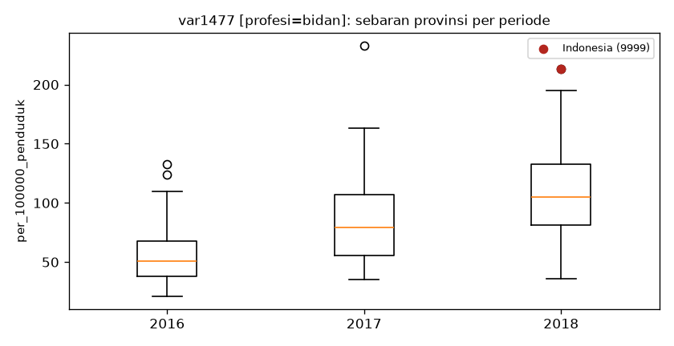
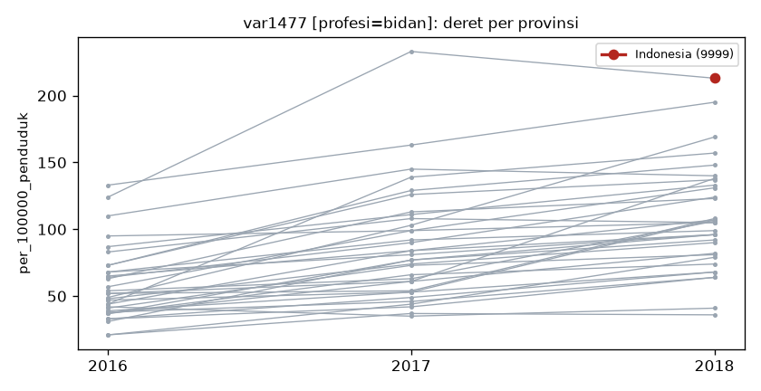
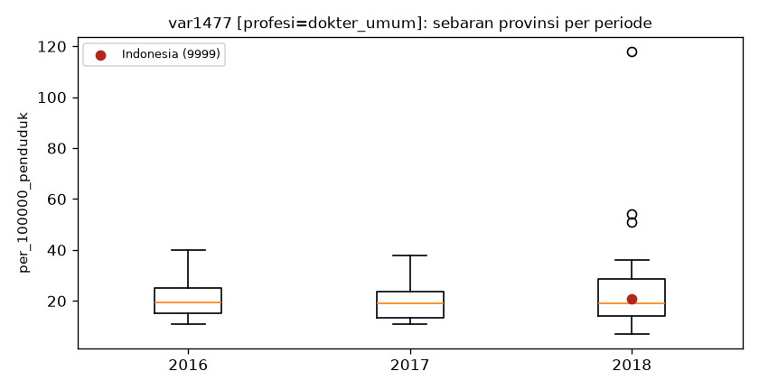
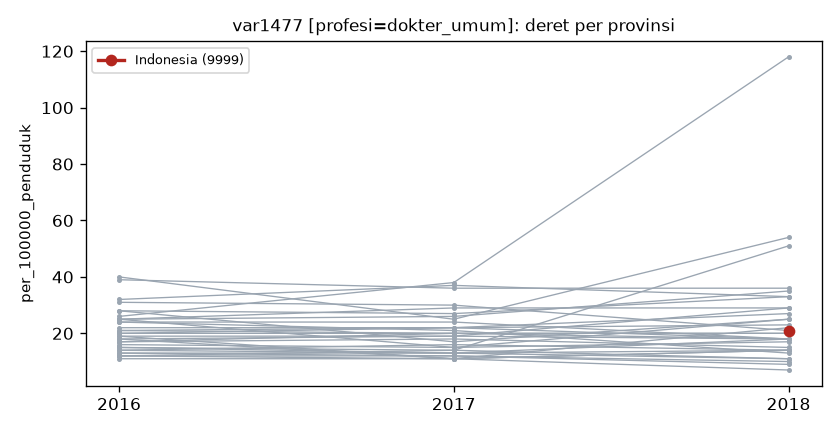
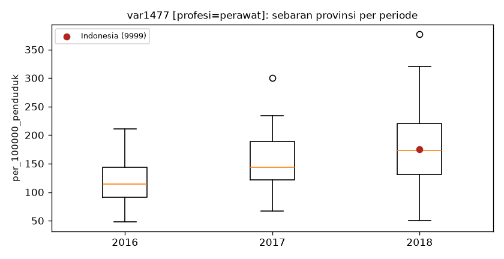
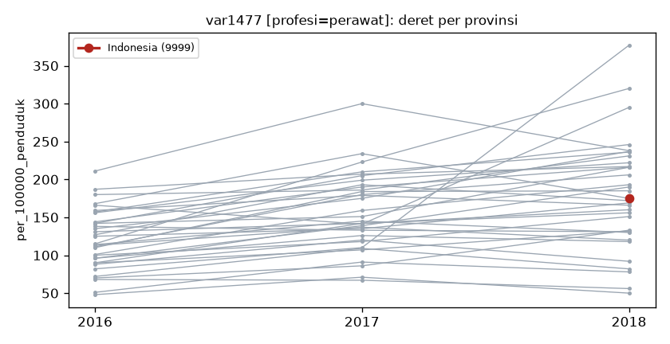
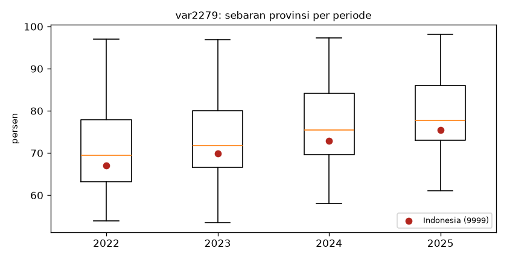
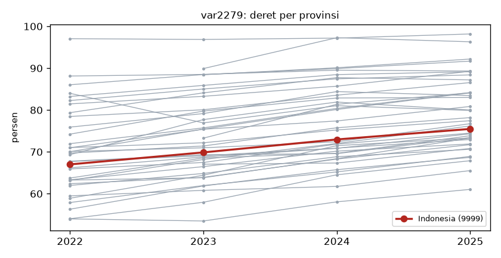

# Profil dan calon anomali seri utama

Dihasilkan `python pipeline.py` (`src/silver/profil.py`). Hanya baris provinsi deret utama (rincian `total`, atau rincian yang didaftar di `DERET` untuk seri yang terbit per rincian; label `kode [rincian]`); baris Indonesia ditampilkan terpisah dan tidak ikut statistik antarprovinsi.

## Banyak periode per provinsi (menentukan arah pembanding)

| seri_kode | min_periode_per_provinsi | maks_periode_per_provinsi |
|---|---|---|
| var1402 | 2 | 11 |
| var1477 [profesi=bidan] | 3 | 3 |
| var1477 [profesi=dokter_umum] | 3 | 3 |
| var1477 [profesi=perawat] | 3 | 3 |
| var2279 | 3 | 4 |

- var1402: tiga arah (periode per provinsi 2–11)
- var1477 [profesi=bidan]: hanya arah ke bawah dan perubahan (periode per provinsi 3–3)
- var1477 [profesi=dokter_umum]: hanya arah ke bawah dan perubahan (periode per provinsi 3–3)
- var1477 [profesi=perawat]: hanya arah ke bawah dan perubahan (periode per provinsi 3–3)
- var2279: hanya arah ke bawah dan perubahan (periode per provinsi 3–4)

Metode: IQR dengan pengali 1.5; arah ke samping hanya bila satu provinsi punya paling sedikit 6 periode. Sel yang ditandai lebih dari satu arah ditulis satu baris. Provinsi yang di luar batas ke bawah pada ≥ 50% periode diberi tanda `berulang`: itu perbedaan struktural antarprovinsi, bukan kejadian satu tahun. Lihat log untuk alasan memilih IQR.

## Statistik deskriptif per seri per periode (provinsi)

| seri_kode | periode | n | rerata | simpangan | minimum | q1 | median | q3 | maksimum |
|---|---|---|---|---|---|---|---|---|---|
| var1402 | 2015 | 34 | 4.94 | 1.61 | 2.78 | 3.60 | 4.64 | 5.51 | 8.51 |
| var1402 | 2016 | 34 | 4.55 | 1.30 | 2.63 | 3.50 | 4.41 | 5.28 | 7.89 |
| var1402 | 2017 | 34 | 5.51 | 1.51 | 3.28 | 4.36 | 5.35 | 6.38 | 9.32 |
| var1402 | 2018 | 34 | 5.20 | 1.44 | 3.01 | 4.12 | 5.05 | 5.88 | 8.57 |
| var1402 | 2019 | 34 | 5.17 | 1.58 | 2.41 | 4.20 | 5.10 | 6.22 | 8.67 |
| var1402 | 2020 | 34 | 5.17 | 1.46 | 2.61 | 4.31 | 4.96 | 6.00 | 8.54 |
| var1402 | 2021 | 34 | 4.55 | 1.78 | 2.25 | 3.21 | 4.04 | 6.04 | 8.49 |
| var1402 | 2022 | 34 | 6.05 | 2.01 | 1.56 | 4.99 | 6.04 | 7.20 | 10.21 |
| var1402 | 2023 | 34 | 5.43 | 1.46 | 2.66 | 4.70 | 5.33 | 5.96 | 9.04 |
| var1402 | 2024 | 38 | 4.87 | 1.48 | 1.39 | 4.11 | 4.83 | 5.66 | 8.24 |
| var1402 | 2025 | 38 | 4.94 | 1.56 | 2.32 | 3.81 | 4.83 | 5.88 | 8.51 |
| var1477 [profesi=bidan] | 2016 | 34 | 57.74 | 27.20 | 21.00 | 38.25 | 50.50 | 68.00 | 133.00 |
| var1477 [profesi=bidan] | 2017 | 34 | 87.18 | 41.67 | 35.00 | 55.75 | 79.00 | 106.75 | 233.00 |
| var1477 [profesi=bidan] | 2018 | 34 | 108.00 | 39.69 | 36.00 | 81.25 | 105.00 | 132.50 | 213.00 |
| var1477 [profesi=dokter_umum] | 2016 | 34 | 20.76 | 7.43 | 11.00 | 15.00 | 19.50 | 25.00 | 40.00 |
| var1477 [profesi=dokter_umum] | 2017 | 34 | 19.79 | 7.67 | 11.00 | 13.25 | 19.00 | 23.50 | 38.00 |
| var1477 [profesi=dokter_umum] | 2018 | 34 | 24.71 | 19.74 | 7.00 | 14.00 | 19.00 | 28.50 | 118.00 |
| var1477 [profesi=perawat] | 2016 | 34 | 120.09 | 39.38 | 48.00 | 91.50 | 114.50 | 143.50 | 211.00 |
| var1477 [profesi=perawat] | 2017 | 34 | 155.71 | 50.39 | 67.00 | 121.50 | 143.50 | 189.00 | 300.00 |
| var1477 [profesi=perawat] | 2018 | 34 | 179.29 | 72.64 | 50.00 | 131.25 | 173.50 | 220.75 | 377.00 |
| var2279 | 2022 | 34 | 70.28 | 10.45 | 53.99 | 63.20 | 69.53 | 77.83 | 97.05 |
| var2279 | 2023 | 38 | 73.60 | 10.14 | 53.49 | 66.62 | 71.80 | 79.99 | 96.87 |
| var2279 | 2024 | 38 | 76.96 | 9.89 | 58.06 | 69.60 | 75.50 | 84.19 | 97.28 |
| var2279 | 2025 | 38 | 79.19 | 8.92 | 61.04 | 73.04 | 77.82 | 85.97 | 98.18 |

## Baris Indonesia

| seri_kode | periode | nilai | rujukan_tahun |
|---|---|---|---|
| var1402 | 2015 | 4.66 | <NA> |
| var1402 | 2016 | 4.33 | <NA> |
| var1402 | 2017 | 5.26 | <NA> |
| var1402 | 2018 | 4.91 | <NA> |
| var1402 | 2019 | 5.18 | <NA> |
| var1402 | 2020 | 5.44 | <NA> |
| var1402 | 2021 | 5.03 | <NA> |
| var1402 | 2022 | 6.09 | <NA> |
| var1402 | 2023 | 5.22 | <NA> |
| var1402 | 2024 | 5.18 | <NA> |
| var1402 | 2025 | 5.32 | <NA> |
| var2279 | 2022 | 67.01 | <NA> |
| var2279 | 2023 | 69.88 | <NA> |
| var2279 | 2024 | 72.97 | <NA> |
| var2279 | 2025 | 75.49 | <NA> |
| var1477 [profesi=dokter_umum] | 2018 | 21.00 | <NA> |
| var1477 [profesi=perawat] | 2018 | 175.00 | <NA> |
| var1477 [profesi=bidan] | 2018 | 213.00 | <NA> |

## Calon anomali (62)

Daftar lengkap di `reports/calon-anomali.csv`; kategorinya di `reports/anomali.csv`.

| seri_kode | wilayah_kode | nama_wilayah | periode | nilai | arah | alasan | berulang |
|---|---|---|---|---|---|---|---|
| var1402 | 6300 | Kalimantan Selatan | 2015 | 7.80 | ke samping | di luar [4.89, 7.47] dibanding 11 tahun di provinsi ini | False |
| var1402 | 7500 | Gorontalo | 2015 | 8.51 | ke bawah | di luar [0.73, 8.38] (IQR x 1.5) dibanding 34 provinsi tahun itu | False |
| var1402 | 1800 | Lampung | 2016 | 4.03 | ke samping | di luar [4.61, 6.03] dibanding 11 tahun di provinsi ini | False |
| var1402 | 3500 | Jawa Timur | 2016 | 4.11 | ke samping | di luar [4.35, 6.29] dibanding 11 tahun di provinsi ini | False |
| var1402 | 7500 | Gorontalo | 2016 | 6.23 | perubahan | perubahan 2015→2016 sebesar -2.28 di luar [-2.02, 1.29] | False |
| var1402 | 6500 | Kalimantan Utara | 2017 | 7.55 | perubahan | perubahan 2016→2017 sebesar +4.35 di luar [-0.69, 2.58] | False |
| var1402 | 7500 | Gorontalo | 2017 | 8.81 | perubahan | perubahan 2016→2017 sebesar +2.58 di luar [-0.69, 2.58] | False |
| var1402 | 9100 | Papua Barat | 2017 | 5.46 | ke samping | di luar [2.23, 5.33] dibanding 11 tahun di provinsi ini | False |
| var1402 | 3600 | Banten | 2018 | 5.98 | perubahan | perubahan 2017→2018 sebesar +1.24 di luar [-1.90, 1.20] | False |
| var1402 | 6500 | Kalimantan Utara | 2018 | 4.81 | perubahan | perubahan 2017→2018 sebesar -2.74 di luar [-1.90, 1.20] | False |
| var1402 | 7200 | Sulawesi Tengah | 2018 | 8.57 | ke bawah | di luar [1.47, 8.52] (IQR x 1.5) dibanding 34 provinsi tahun itu | False |
| var1402 | 1400 | Riau | 2019 | 4.86 | perubahan | perubahan 2018→2019 sebesar -1.25 di luar [-1.25, 1.24] | False |
| var1402 | 7500 | Gorontalo | 2020 | 6.03 | perubahan | perubahan 2019→2020 sebesar -1.86 di luar [-1.65, 1.72] | False |
| var1402 | 1400 | Riau | 2021 | 3.20 | ke samping | di luar [3.43, 6.89] dibanding 11 tahun di provinsi ini | False |
| var1402 | 1800 | Lampung | 2021 | 3.89 | ke samping | di luar [4.61, 6.03] dibanding 11 tahun di provinsi ini | False |
| var1402 | 3300 | Jawa Tengah | 2021 | 8.28 | perubahan + ke samping | perubahan 2020→2021 sebesar +2.45 di luar [-3.57, 2.21]; di luar [3.39, 7.61] dibanding 11 tahun di provinsi ini | False |
| var1402 | 3400 | DI Yogyakarta | 2021 | 3.02 | ke samping | di luar [3.78, 4.95] dibanding 11 tahun di provinsi ini | False |
| var1402 | 3500 | Jawa Timur | 2021 | 6.75 | ke samping | di luar [4.35, 6.29] dibanding 11 tahun di provinsi ini | False |
| var1402 | 7100 | Sulawesi Utara | 2021 | 3.19 | ke samping | di luar [3.73, 6.13] dibanding 11 tahun di provinsi ini | False |
| var1402 | 1500 | Jambi | 2022 | 6.56 | ke samping | di luar [3.64, 6.12] dibanding 11 tahun di provinsi ini | False |
| var1402 | 1800 | Lampung | 2022 | 7.33 | ke samping | di luar [4.61, 6.03] dibanding 11 tahun di provinsi ini | False |
| var1402 | 1900 | Kepulauan Bangka Belitung | 2022 | 6.03 | ke samping | di luar [2.16, 5.98] dibanding 11 tahun di provinsi ini | False |
| var1402 | 3100 | DKI Jakarta | 2022 | 1.56 | ke bawah + ke samping | di luar [1.68, 10.52] (IQR x 1.5) dibanding 34 provinsi tahun itu; di luar [1.76, 4.30] dibanding 11 tahun di provinsi ini | False |
| var1402 | 3400 | DI Yogyakarta | 2022 | 7.48 | ke samping | di luar [3.78, 4.95] dibanding 11 tahun di provinsi ini | False |
| var1402 | 6400 | Kalimantan Timur | 2022 | 5.34 | ke samping | di luar [2.34, 5.17] dibanding 11 tahun di provinsi ini | False |
| var1402 | 6500 | Kalimantan Utara | 2022 | 8.90 | ke samping | di luar [1.28, 7.86] dibanding 11 tahun di provinsi ini | False |
| var1402 | 7300 | Sulawesi Selatan | 2022 | 7.15 | ke samping | di luar [3.99, 6.77] dibanding 11 tahun di provinsi ini | False |
| var1402 | 7400 | Sulawesi Tenggara | 2022 | 10.21 | ke samping | di luar [5.64, 9.50] dibanding 11 tahun di provinsi ini | False |
| var1402 | 7600 | Sulawesi Barat | 2022 | 8.50 | ke samping | di luar [5.31, 7.95] dibanding 11 tahun di provinsi ini | False |
| var1402 | 5100 | Bali | 2023 | 2.75 | ke bawah | di luar [2.81, 7.85] (IQR x 1.5) dibanding 34 provinsi tahun itu | False |
| var1402 | 5200 | Nusa Tenggara Barat | 2023 | 9.04 | ke bawah | di luar [2.81, 7.85] (IQR x 1.5) dibanding 34 provinsi tahun itu | False |
| var1402 | 6100 | Kalimantan Barat | 2023 | 7.23 | ke samping | di luar [4.04, 7.19] dibanding 11 tahun di provinsi ini | False |
| var1402 | 7500 | Gorontalo | 2023 | 8.72 | ke bawah | di luar [2.81, 7.85] (IQR x 1.5) dibanding 34 provinsi tahun itu | False |
| var1402 | 9400 | Papua | 2023 | 2.66 | ke bawah | di luar [2.81, 7.85] (IQR x 1.5) dibanding 34 provinsi tahun itu | False |
| var1402 | 5200 | Nusa Tenggara Barat | 2024 | 8.24 | ke bawah | di luar [1.80, 7.98] (IQR x 1.5) dibanding 38 provinsi tahun itu | False |
| var1402 | 8100 | Maluku | 2024 | 3.73 | perubahan | perubahan 2023→2024 sebesar -2.78 di luar [-2.19, 1.76] | False |
| var1402 | 9600 | Papua Tengah | 2024 | 1.39 | ke bawah | di luar [1.80, 7.98] (IQR x 1.5) dibanding 38 provinsi tahun itu | False |
| var1402 | 1700 | Bengkulu | 2025 | 4.76 | perubahan | perubahan 2024→2025 sebesar -1.59 di luar [-1.51, 1.72] | False |
| var1402 | 2100 | Kepulauan Riau | 2025 | 2.49 | perubahan | perubahan 2024→2025 sebesar -2.12 di luar [-1.51, 1.72] | False |
| var1402 | 9400 | Papua | 2025 | 3.62 | ke samping | di luar [2.09, 3.57] dibanding 11 tahun di provinsi ini | False |
| var1477 [profesi=bidan] | 1100 | Aceh | 2016 | 124.00 | ke bawah | di luar [-6.38, 112.62] (IQR x 1.5) dibanding 34 provinsi tahun itu | True |
| var1477 [profesi=bidan] | 1700 | Bengkulu | 2016 | 133.00 | ke bawah | di luar [-6.38, 112.62] (IQR x 1.5) dibanding 34 provinsi tahun itu | False |
| var1477 [profesi=bidan] | 1100 | Aceh | 2017 | 233.00 | ke bawah + perubahan | di luar [-20.75, 183.25] (IQR x 1.5) dibanding 34 provinsi tahun itu; perubahan 2016→2017 sebesar +109.00 di luar [-26.88, 80.12] | True |
| var1477 [profesi=bidan] | 7400 | Sulawesi Tenggara | 2017 | 139.00 | perubahan | perubahan 2016→2017 sebesar +95.00 di luar [-26.88, 80.12] | False |
| var1477 [profesi=bidan] | 1100 | Aceh | 2018 | 213.00 | ke bawah | di luar [4.38, 209.38] (IQR x 1.5) dibanding 34 provinsi tahun itu | True |
| var1477 [profesi=bidan] | 5200 | Nusa Tenggara Barat | 2018 | 138.00 | perubahan | perubahan 2017→2018 sebesar +77.00 di luar [-23.38, 61.62] | False |
| var1477 [profesi=bidan] | 7200 | Sulawesi Tengah | 2018 | 169.00 | perubahan | perubahan 2017→2018 sebesar +66.00 di luar [-23.38, 61.62] | False |
| var1477 [profesi=dokter_umum] | 2100 | Kepulauan Riau | 2017 | 17.00 | perubahan | perubahan 2016→2017 sebesar -11.00 di luar [-4.00, 4.00] | False |
| var1477 [profesi=dokter_umum] | 3100 | DKI Jakarta | 2017 | 38.00 | perubahan | perubahan 2016→2017 sebesar +12.00 di luar [-4.00, 4.00] | False |
| var1477 [profesi=dokter_umum] | 3400 | DI Yogyakarta | 2017 | 25.00 | perubahan | perubahan 2016→2017 sebesar -15.00 di luar [-4.00, 4.00] | False |
| var1477 [profesi=dokter_umum] | 6500 | Kalimantan Utara | 2017 | 37.00 | perubahan | perubahan 2016→2017 sebesar +5.00 di luar [-4.00, 4.00] | False |
| var1477 [profesi=dokter_umum] | 7200 | Sulawesi Tengah | 2017 | 11.00 | perubahan | perubahan 2016→2017 sebesar -7.00 di luar [-4.00, 4.00] | False |
| var1477 [profesi=dokter_umum] | 8100 | Maluku | 2017 | 11.00 | perubahan | perubahan 2016→2017 sebesar -8.00 di luar [-4.00, 4.00] | False |
| var1477 [profesi=dokter_umum] | 9100 | Papua Barat | 2017 | 15.00 | perubahan | perubahan 2016→2017 sebesar -10.00 di luar [-4.00, 4.00] | False |
| var1477 [profesi=dokter_umum] | 3100 | DKI Jakarta | 2018 | 118.00 | ke bawah + perubahan | di luar [-7.75, 50.25] (IQR x 1.5) dibanding 34 provinsi tahun itu; perubahan 2017→2018 sebesar +80.00 di luar [-15.50, 18.50] | False |
| var1477 [profesi=dokter_umum] | 3400 | DI Yogyakarta | 2018 | 54.00 | ke bawah + perubahan | di luar [-7.75, 50.25] (IQR x 1.5) dibanding 34 provinsi tahun itu; perubahan 2017→2018 sebesar +29.00 di luar [-15.50, 18.50] | False |
| var1477 [profesi=dokter_umum] | 5200 | Nusa Tenggara Barat | 2018 | 51.00 | ke bawah + perubahan | di luar [-7.75, 50.25] (IQR x 1.5) dibanding 34 provinsi tahun itu; perubahan 2017→2018 sebesar +37.00 di luar [-15.50, 18.50] | False |
| var1477 [profesi=perawat] | 3100 | DKI Jakarta | 2017 | 223.00 | perubahan | perubahan 2016→2017 sebesar +108.00 di luar [-36.00, 106.00] | False |
| var1477 [profesi=perawat] | 6500 | Kalimantan Utara | 2017 | 300.00 | ke bawah | di luar [20.25, 290.25] (IQR x 1.5) dibanding 34 provinsi tahun itu | False |
| var1477 [profesi=perawat] | 5200 | Nusa Tenggara Barat | 2018 | 377.00 | ke bawah + perubahan | di luar [-3.00, 355.00] (IQR x 1.5) dibanding 34 provinsi tahun itu; perubahan 2017→2018 sebesar +267.00 di luar [-91.38, 117.62] | False |
| var1477 [profesi=perawat] | 9100 | Papua Barat | 2018 | 295.00 | perubahan | perubahan 2017→2018 sebesar +154.00 di luar [-91.38, 117.62] | False |
| var2279 | 9400 | Papua | 2023 | 76.93 | perubahan | perubahan 2022→2023 sebesar -7.07 di luar [-2.95, 8.70] | False |

## Gambar

