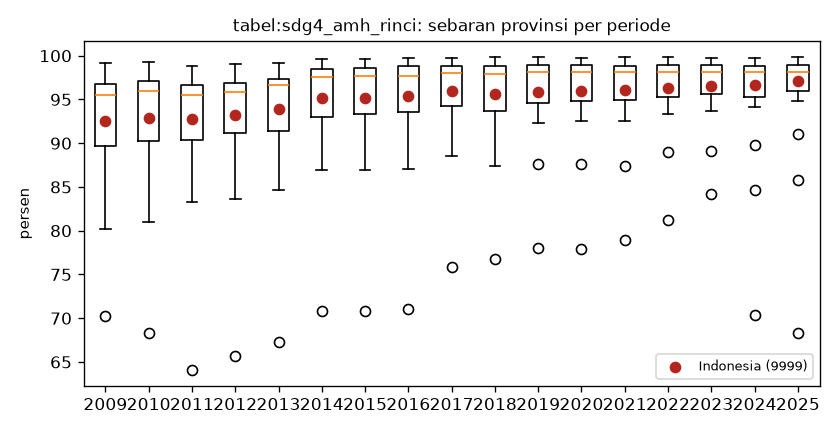
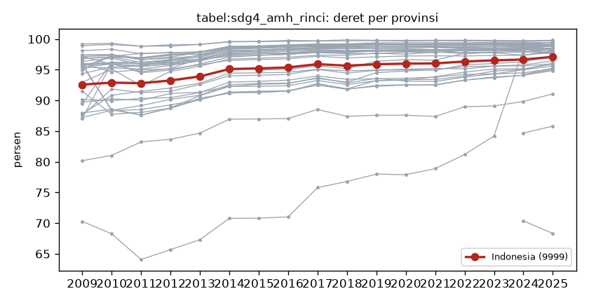
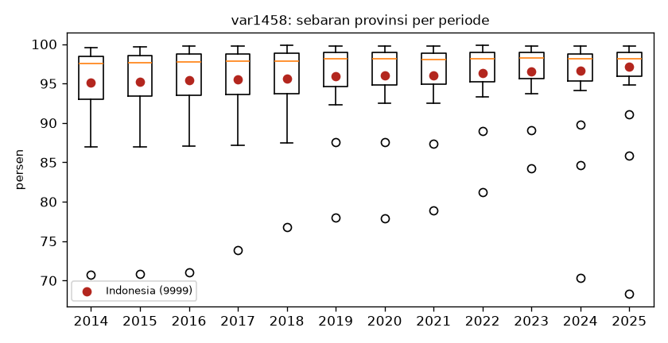
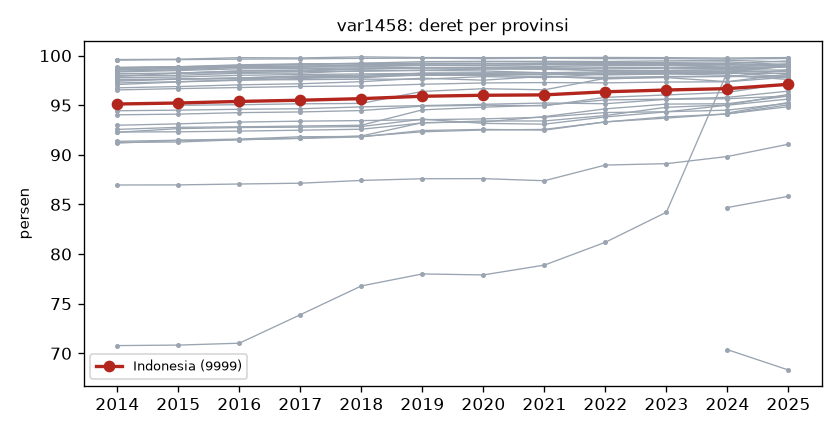

# Profil dan calon anomali seri utama

Dihasilkan `python pipeline.py` (`src/silver/profil.py`). Hanya baris provinsi deret utama (rincian `total`, atau rincian yang didaftar di `DERET` untuk seri yang terbit per rincian; label `kode [rincian]`); baris Indonesia ditampilkan terpisah dan tidak ikut statistik antarprovinsi.

## Banyak periode per provinsi (menentukan arah pembanding)

| seri_kode | min_periode_per_provinsi | maks_periode_per_provinsi |
|---|---|---|
| tabel:sdg4_amh_rinci | 2 | 17 |
| var1458 | 2 | 12 |

- tabel:sdg4_amh_rinci: tiga arah (periode per provinsi 2–17)
- var1458: tiga arah (periode per provinsi 2–12)

Metode: IQR dengan pengali 1.5; arah ke samping hanya bila satu provinsi punya paling sedikit 6 periode. Sel yang ditandai lebih dari satu arah ditulis satu baris. Provinsi yang di luar batas ke bawah pada ≥ 50% periode diberi tanda `berulang`: itu perbedaan struktural antarprovinsi, bukan kejadian satu tahun. Lihat log untuk alasan memilih IQR.

## Statistik deskriptif per seri per periode (provinsi)

| seri_kode | periode | n | rerata | simpangan | minimum | q1 | median | q3 | maksimum |
|---|---|---|---|---|---|---|---|---|---|
| tabel:sdg4_amh_rinci | 2009 | 33 | 92.98 | 6.00 | 70.29 | 89.70 | 95.51 | 96.81 | 99.22 |
| tabel:sdg4_amh_rinci | 2010 | 33 | 93.37 | 6.16 | 68.27 | 90.26 | 95.94 | 97.09 | 99.30 |
| tabel:sdg4_amh_rinci | 2011 | 33 | 92.95 | 6.46 | 64.08 | 90.34 | 95.52 | 96.63 | 98.85 |
| tabel:sdg4_amh_rinci | 2012 | 33 | 93.51 | 6.20 | 65.69 | 91.13 | 95.88 | 96.90 | 99.07 |
| tabel:sdg4_amh_rinci | 2013 | 33 | 94.25 | 5.91 | 67.31 | 91.34 | 96.64 | 97.38 | 99.13 |
| tabel:sdg4_amh_rinci | 2014 | 33 | 95.41 | 5.42 | 70.78 | 92.98 | 97.52 | 98.44 | 99.60 |
| tabel:sdg4_amh_rinci | 2015 | 34 | 95.50 | 5.34 | 70.83 | 93.37 | 97.63 | 98.54 | 99.63 |
| tabel:sdg4_amh_rinci | 2016 | 34 | 95.64 | 5.34 | 71.02 | 93.54 | 97.70 | 98.78 | 99.79 |
| tabel:sdg4_amh_rinci | 2017 | 34 | 96.19 | 4.52 | 75.80 | 94.25 | 98.00 | 98.85 | 99.73 |
| tabel:sdg4_amh_rinci | 2018 | 34 | 96.00 | 4.57 | 76.79 | 93.70 | 97.89 | 98.84 | 99.87 |
| tabel:sdg4_amh_rinci | 2019 | 34 | 96.32 | 4.31 | 78.00 | 94.62 | 98.15 | 98.95 | 99.80 |
| tabel:sdg4_amh_rinci | 2020 | 34 | 96.35 | 4.31 | 77.90 | 94.85 | 98.13 | 98.92 | 99.79 |
| tabel:sdg4_amh_rinci | 2021 | 34 | 96.40 | 4.18 | 78.89 | 94.95 | 98.09 | 98.87 | 99.80 |
| tabel:sdg4_amh_rinci | 2022 | 34 | 96.69 | 3.68 | 81.19 | 95.25 | 98.13 | 98.92 | 99.81 |
| tabel:sdg4_amh_rinci | 2023 | 34 | 96.92 | 3.23 | 84.22 | 95.59 | 98.19 | 98.96 | 99.79 |
| tabel:sdg4_amh_rinci | 2024 | 38 | 96.30 | 5.23 | 70.37 | 95.28 | 98.11 | 98.77 | 99.75 |
| tabel:sdg4_amh_rinci | 2025 | 38 | 96.58 | 5.40 | 68.32 | 95.97 | 98.17 | 98.95 | 99.80 |
| var1458 | 2014 | 33 | 95.41 | 5.42 | 70.78 | 92.98 | 97.52 | 98.44 | 99.60 |
| var1458 | 2015 | 34 | 95.50 | 5.34 | 70.83 | 93.37 | 97.63 | 98.54 | 99.63 |
| var1458 | 2016 | 34 | 95.64 | 5.34 | 71.02 | 93.54 | 97.70 | 98.78 | 99.79 |
| var1458 | 2017 | 34 | 95.81 | 4.95 | 73.89 | 93.62 | 97.84 | 98.79 | 99.76 |
| var1458 | 2018 | 34 | 96.00 | 4.57 | 76.79 | 93.70 | 97.89 | 98.84 | 99.87 |
| var1458 | 2019 | 34 | 96.32 | 4.31 | 78.00 | 94.62 | 98.15 | 98.95 | 99.80 |
| var1458 | 2020 | 34 | 96.35 | 4.31 | 77.90 | 94.85 | 98.13 | 98.92 | 99.79 |
| var1458 | 2021 | 34 | 96.40 | 4.18 | 78.89 | 94.95 | 98.09 | 98.87 | 99.80 |
| var1458 | 2022 | 34 | 96.69 | 3.68 | 81.19 | 95.25 | 98.13 | 98.92 | 99.81 |
| var1458 | 2023 | 34 | 96.92 | 3.23 | 84.22 | 95.59 | 98.19 | 98.96 | 99.79 |
| var1458 | 2024 | 38 | 96.30 | 5.23 | 70.37 | 95.28 | 98.11 | 98.77 | 99.75 |
| var1458 | 2025 | 38 | 96.58 | 5.40 | 68.32 | 95.97 | 98.17 | 98.95 | 99.80 |

## Baris Indonesia

| seri_kode | periode | nilai | rujukan_tahun |
|---|---|---|---|
| var1458 | 2014 | 95.12 | <NA> |
| var1458 | 2015 | 95.22 | <NA> |
| var1458 | 2016 | 95.38 | <NA> |
| var1458 | 2017 | 95.50 | <NA> |
| var1458 | 2018 | 95.66 | <NA> |
| var1458 | 2019 | 95.90 | <NA> |
| var1458 | 2020 | 96.00 | <NA> |
| var1458 | 2021 | 96.04 | <NA> |
| var1458 | 2022 | 96.35 | <NA> |
| var1458 | 2023 | 96.53 | <NA> |
| var1458 | 2024 | 96.67 | <NA> |
| var1458 | 2025 | 97.10 | <NA> |
| tabel:sdg4_amh_rinci | 2009 | 92.58 | <NA> |
| tabel:sdg4_amh_rinci | 2010 | 92.91 | <NA> |
| tabel:sdg4_amh_rinci | 2011 | 92.81 | <NA> |
| tabel:sdg4_amh_rinci | 2012 | 93.25 | <NA> |
| tabel:sdg4_amh_rinci | 2013 | 93.92 | <NA> |
| tabel:sdg4_amh_rinci | 2014 | 95.12 | <NA> |
| tabel:sdg4_amh_rinci | 2015 | 95.22 | <NA> |
| tabel:sdg4_amh_rinci | 2016 | 95.38 | <NA> |
| tabel:sdg4_amh_rinci | 2017 | 95.92 | <NA> |
| tabel:sdg4_amh_rinci | 2018 | 95.66 | <NA> |
| tabel:sdg4_amh_rinci | 2019 | 95.90 | <NA> |
| tabel:sdg4_amh_rinci | 2020 | 96.00 | <NA> |
| tabel:sdg4_amh_rinci | 2021 | 96.04 | <NA> |
| tabel:sdg4_amh_rinci | 2022 | 96.35 | <NA> |
| tabel:sdg4_amh_rinci | 2023 | 96.53 | <NA> |
| tabel:sdg4_amh_rinci | 2024 | 96.67 | <NA> |
| tabel:sdg4_amh_rinci | 2025 | 97.10 | <NA> |

## Calon anomali (133)

Daftar lengkap di `reports/calon-anomali.csv`; kategorinya di `reports/anomali.csv`.

| seri_kode | wilayah_kode | nama_wilayah | periode | nilai | arah | alasan | berulang |
|---|---|---|---|---|---|---|---|
| tabel:sdg4_amh_rinci | 1600 | Sumatera Selatan | 2009 | 94.90 | ke samping | di luar [95.30, 100.79] dibanding 17 tahun di provinsi ini | False |
| tabel:sdg4_amh_rinci | 2100 | Kepulauan Riau | 2009 | 95.51 | ke samping | di luar [96.25, 100.69] dibanding 17 tahun di provinsi ini | False |
| tabel:sdg4_amh_rinci | 3400 | DI Yogyakarta | 2009 | 87.80 | ke samping | di luar [89.32, 98.65] dibanding 17 tahun di provinsi ini | False |
| tabel:sdg4_amh_rinci | 3600 | Banten | 2009 | 89.46 | ke samping | di luar [94.78, 99.74] dibanding 17 tahun di provinsi ini | False |
| tabel:sdg4_amh_rinci | 7200 | Sulawesi Tengah | 2009 | 87.02 | ke samping | di luar [92.87, 101.43] dibanding 17 tahun di provinsi ini | False |
| tabel:sdg4_amh_rinci | 7400 | Sulawesi Tenggara | 2009 | 87.59 | ke samping | di luar [88.95, 98.71] dibanding 17 tahun di provinsi ini | False |
| tabel:sdg4_amh_rinci | 9400 | Papua | 2009 | 70.29 | ke bawah | di luar [79.03, 107.47] (IQR x 1.5) dibanding 33 provinsi tahun itu | True |
| tabel:sdg4_amh_rinci | 3400 | DI Yogyakarta | 2010 | 90.84 | perubahan | perubahan 2009→2010 sebesar +3.04 di luar [-1.54, 2.66] | False |
| tabel:sdg4_amh_rinci | 3500 | Jawa Timur | 2010 | 88.34 | perubahan + ke samping | perubahan 2009→2010 sebesar -7.61 di luar [-1.54, 2.66]; di luar [88.42, 96.26] dibanding 17 tahun di provinsi ini | False |
| tabel:sdg4_amh_rinci | 3600 | Banten | 2010 | 96.20 | perubahan | perubahan 2009→2010 sebesar +6.74 di luar [-1.54, 2.66] | False |
| tabel:sdg4_amh_rinci | 7200 | Sulawesi Tengah | 2010 | 96.08 | perubahan | perubahan 2009→2010 sebesar +9.06 di luar [-1.54, 2.66] | False |
| tabel:sdg4_amh_rinci | 7300 | Sulawesi Selatan | 2010 | 87.75 | perubahan + ke samping | perubahan 2009→2010 sebesar -3.76 di luar [-1.54, 2.66]; di luar [89.31, 94.51] dibanding 17 tahun di provinsi ini | False |
| tabel:sdg4_amh_rinci | 7400 | Sulawesi Tenggara | 2010 | 91.85 | perubahan | perubahan 2009→2010 sebesar +4.26 di luar [-1.54, 2.66] | False |
| tabel:sdg4_amh_rinci | 7600 | Sulawesi Barat | 2010 | 88.48 | perubahan + ke samping | perubahan 2009→2010 sebesar -7.23 di luar [-1.54, 2.66]; di luar [89.94, 96.14] dibanding 17 tahun di provinsi ini | False |
| tabel:sdg4_amh_rinci | 9400 | Papua | 2010 | 68.27 | ke bawah + perubahan | di luar [80.02, 107.34] (IQR x 1.5) dibanding 33 provinsi tahun itu; perubahan 2009→2010 sebesar -2.02 di luar [-1.54, 2.66] | True |
| tabel:sdg4_amh_rinci | 1500 | Jambi | 2011 | 95.52 | ke samping | di luar [95.80, 99.56] dibanding 17 tahun di provinsi ini | False |
| tabel:sdg4_amh_rinci | 5200 | Nusa Tenggara Barat | 2011 | 83.24 | perubahan | perubahan 2010→2011 sebesar +2.19 di luar [-2.28, 1.59] | False |
| tabel:sdg4_amh_rinci | 7300 | Sulawesi Selatan | 2011 | 88.07 | ke samping | di luar [89.31, 94.51] dibanding 17 tahun di provinsi ini | False |
| tabel:sdg4_amh_rinci | 7600 | Sulawesi Barat | 2011 | 87.61 | ke samping | di luar [89.94, 96.14] dibanding 17 tahun di provinsi ini | False |
| tabel:sdg4_amh_rinci | 9100 | Papua Barat | 2011 | 92.41 | perubahan | perubahan 2010→2011 sebesar -2.71 di luar [-2.28, 1.59] | False |
| tabel:sdg4_amh_rinci | 9400 | Papua | 2011 | 64.08 | ke bawah + perubahan | di luar [80.91, 106.06] (IQR x 1.5) dibanding 33 provinsi tahun itu; perubahan 2010→2011 sebesar -4.19 di luar [-2.28, 1.59] | True |
| tabel:sdg4_amh_rinci | 7300 | Sulawesi Selatan | 2012 | 88.73 | ke samping | di luar [89.31, 94.51] dibanding 17 tahun di provinsi ini | False |
| tabel:sdg4_amh_rinci | 7600 | Sulawesi Barat | 2012 | 88.79 | ke samping | di luar [89.94, 96.14] dibanding 17 tahun di provinsi ini | False |
| tabel:sdg4_amh_rinci | 9100 | Papua Barat | 2012 | 94.74 | perubahan | perubahan 2011→2012 sebesar +2.33 di luar [-0.37, 1.28] | False |
| tabel:sdg4_amh_rinci | 9400 | Papua | 2012 | 65.69 | ke bawah + perubahan | di luar [82.47, 105.56] (IQR x 1.5) dibanding 33 provinsi tahun itu; perubahan 2011→2012 sebesar +1.61 di luar [-0.37, 1.28] | True |
| tabel:sdg4_amh_rinci | 7600 | Sulawesi Barat | 2013 | 90.79 | perubahan | perubahan 2012→2013 sebesar +2.00 di luar [-0.28, 1.67] | False |
| tabel:sdg4_amh_rinci | 9400 | Papua | 2013 | 67.31 | ke bawah | di luar [82.28, 106.44] (IQR x 1.5) dibanding 33 provinsi tahun itu | True |
| tabel:sdg4_amh_rinci | 5200 | Nusa Tenggara Barat | 2014 | 86.96 | perubahan | perubahan 2013→2014 sebesar +2.29 di luar [0.35, 1.74] | False |
| tabel:sdg4_amh_rinci | 9400 | Papua | 2014 | 70.78 | ke bawah + perubahan | di luar [84.79, 106.63] (IQR x 1.5) dibanding 33 provinsi tahun itu; perubahan 2013→2014 sebesar +3.47 di luar [0.35, 1.74] | True |
| tabel:sdg4_amh_rinci | 5300 | Nusa Tenggara Timur | 2015 | 91.45 | perubahan | perubahan 2014→2015 sebesar +0.27 di luar [-0.07, 0.25] | False |
| tabel:sdg4_amh_rinci | 7200 | Sulawesi Tengah | 2015 | 97.34 | perubahan | perubahan 2014→2015 sebesar +0.26 di luar [-0.07, 0.25] | False |
| tabel:sdg4_amh_rinci | 7500 | Gorontalo | 2015 | 98.24 | perubahan | perubahan 2014→2015 sebesar +0.34 di luar [-0.07, 0.25] | False |
| tabel:sdg4_amh_rinci | 7600 | Sulawesi Barat | 2015 | 92.64 | perubahan | perubahan 2014→2015 sebesar +0.37 di luar [-0.07, 0.25] | False |
| tabel:sdg4_amh_rinci | 9400 | Papua | 2015 | 70.83 | ke bawah | di luar [85.60, 106.31] (IQR x 1.5) dibanding 34 provinsi tahun itu | True |
| tabel:sdg4_amh_rinci | 9400 | Papua | 2016 | 71.02 | ke bawah | di luar [85.68, 106.63] (IQR x 1.5) dibanding 34 provinsi tahun itu | True |
| tabel:sdg4_amh_rinci | 9400 | Papua | 2017 | 75.80 | ke bawah + perubahan | di luar [87.36, 105.75] (IQR x 1.5) dibanding 34 provinsi tahun itu; perubahan 2016→2017 sebesar +4.78 di luar [-0.76, 1.66] | True |
| tabel:sdg4_amh_rinci | 9400 | Papua | 2018 | 76.79 | ke bawah + perubahan | di luar [85.99, 106.55] (IQR x 1.5) dibanding 34 provinsi tahun itu; perubahan 2017→2018 sebesar +0.99 di luar [-1.35, 0.87] | True |
| tabel:sdg4_amh_rinci | 5100 | Bali | 2019 | 94.53 | perubahan | perubahan 2018→2019 sebesar +1.55 di luar [-0.46, 0.95] | False |
| tabel:sdg4_amh_rinci | 5200 | Nusa Tenggara Barat | 2019 | 87.59 | ke bawah | di luar [88.14, 105.43] (IQR x 1.5) dibanding 34 provinsi tahun itu | False |
| tabel:sdg4_amh_rinci | 5300 | Nusa Tenggara Timur | 2019 | 93.24 | perubahan | perubahan 2018→2019 sebesar +1.34 di luar [-0.46, 0.95] | False |
| tabel:sdg4_amh_rinci | 6500 | Kalimantan Utara | 2019 | 96.39 | perubahan | perubahan 2018→2019 sebesar +1.21 di luar [-0.46, 0.95] | False |
| tabel:sdg4_amh_rinci | 9400 | Papua | 2019 | 78.00 | ke bawah + perubahan | di luar [88.14, 105.43] (IQR x 1.5) dibanding 34 provinsi tahun itu; perubahan 2018→2019 sebesar +1.21 di luar [-0.46, 0.95] | True |
| tabel:sdg4_amh_rinci | 3600 | Banten | 2020 | 97.88 | perubahan | perubahan 2019→2020 sebesar +0.26 di luar [-0.17, 0.26] | False |
| tabel:sdg4_amh_rinci | 5100 | Bali | 2020 | 94.80 | perubahan | perubahan 2019→2020 sebesar +0.27 di luar [-0.17, 0.26] | False |
| tabel:sdg4_amh_rinci | 5200 | Nusa Tenggara Barat | 2020 | 87.60 | ke bawah | di luar [88.74, 105.03] (IQR x 1.5) dibanding 34 provinsi tahun itu | False |
| tabel:sdg4_amh_rinci | 6500 | Kalimantan Utara | 2020 | 96.66 | perubahan | perubahan 2019→2020 sebesar +0.27 di luar [-0.17, 0.26] | False |
| tabel:sdg4_amh_rinci | 7600 | Sulawesi Barat | 2020 | 93.17 | perubahan | perubahan 2019→2020 sebesar -0.42 di luar [-0.17, 0.26] | False |
| tabel:sdg4_amh_rinci | 9100 | Papua Barat | 2020 | 97.52 | perubahan | perubahan 2019→2020 sebesar -0.20 di luar [-0.17, 0.26] | False |
| tabel:sdg4_amh_rinci | 9400 | Papua | 2020 | 77.90 | ke bawah | di luar [88.74, 105.03] (IQR x 1.5) dibanding 34 provinsi tahun itu | True |
| tabel:sdg4_amh_rinci | 5200 | Nusa Tenggara Barat | 2021 | 87.39 | ke bawah | di luar [89.08, 104.74] (IQR x 1.5) dibanding 34 provinsi tahun itu | False |
| tabel:sdg4_amh_rinci | 5300 | Nusa Tenggara Timur | 2021 | 93.85 | perubahan | perubahan 2020→2021 sebesar +0.54 di luar [-0.26, 0.24] | False |
| tabel:sdg4_amh_rinci | 9100 | Papua Barat | 2021 | 97.91 | perubahan | perubahan 2020→2021 sebesar +0.39 di luar [-0.26, 0.24] | False |
| tabel:sdg4_amh_rinci | 9400 | Papua | 2021 | 78.89 | ke bawah + perubahan | di luar [89.08, 104.74] (IQR x 1.5) dibanding 34 provinsi tahun itu; perubahan 2020→2021 sebesar +0.99 di luar [-0.26, 0.24] | True |
| tabel:sdg4_amh_rinci | 5200 | Nusa Tenggara Barat | 2022 | 88.97 | ke bawah + perubahan | di luar [89.73, 104.44] (IQR x 1.5) dibanding 34 provinsi tahun itu; perubahan 2021→2022 sebesar +1.58 di luar [-0.97, 1.46] | False |
| tabel:sdg4_amh_rinci | 9400 | Papua | 2022 | 81.19 | ke bawah + perubahan | di luar [89.73, 104.44] (IQR x 1.5) dibanding 34 provinsi tahun itu; perubahan 2021→2022 sebesar +2.30 di luar [-0.97, 1.46] | True |
| tabel:sdg4_amh_rinci | 3400 | DI Yogyakarta | 2023 | 95.59 | perubahan | perubahan 2022→2023 sebesar +0.44 di luar [-0.20, 0.41] | False |
| tabel:sdg4_amh_rinci | 5200 | Nusa Tenggara Barat | 2023 | 89.11 | ke bawah | di luar [90.55, 104.01] (IQR x 1.5) dibanding 34 provinsi tahun itu | False |
| tabel:sdg4_amh_rinci | 5300 | Nusa Tenggara Timur | 2023 | 95.11 | perubahan | perubahan 2022→2023 sebesar +0.48 di luar [-0.20, 0.41] | False |
| tabel:sdg4_amh_rinci | 6100 | Kalimantan Barat | 2023 | 94.79 | perubahan | perubahan 2022→2023 sebesar +0.83 di luar [-0.20, 0.41] | False |
| tabel:sdg4_amh_rinci | 7300 | Sulawesi Selatan | 2023 | 93.83 | perubahan | perubahan 2022→2023 sebesar +0.52 di luar [-0.20, 0.41] | False |
| tabel:sdg4_amh_rinci | 7600 | Sulawesi Barat | 2023 | 94.33 | perubahan | perubahan 2022→2023 sebesar +0.51 di luar [-0.20, 0.41] | False |
| tabel:sdg4_amh_rinci | 9400 | Papua | 2023 | 84.22 | ke bawah + perubahan | di luar [90.55, 104.01] (IQR x 1.5) dibanding 34 provinsi tahun itu; perubahan 2022→2023 sebesar +3.03 di luar [-0.20, 0.41] | True |
| tabel:sdg4_amh_rinci | 5200 | Nusa Tenggara Barat | 2024 | 89.83 | ke bawah + perubahan | di luar [90.03, 104.01] (IQR x 1.5) dibanding 38 provinsi tahun itu; perubahan 2023→2024 sebesar +0.72 di luar [-0.36, 0.51] | False |
| tabel:sdg4_amh_rinci | 6500 | Kalimantan Utara | 2024 | 97.37 | perubahan | perubahan 2023→2024 sebesar -0.41 di luar [-0.36, 0.51] | False |
| tabel:sdg4_amh_rinci | 7600 | Sulawesi Barat | 2024 | 95.00 | perubahan | perubahan 2023→2024 sebesar +0.67 di luar [-0.36, 0.51] | False |
| tabel:sdg4_amh_rinci | 9400 | Papua | 2024 | 98.37 | perubahan + ke samping | perubahan 2023→2024 sebesar +14.15 di luar [-0.36, 0.51]; di luar [57.39, 91.79] dibanding 17 tahun di provinsi ini | True |
| tabel:sdg4_amh_rinci | 9600 | Papua Tengah | 2024 | 84.69 | ke bawah | di luar [90.03, 104.01] (IQR x 1.5) dibanding 38 provinsi tahun itu | True |
| tabel:sdg4_amh_rinci | 9700 | Papua Pegunungan | 2024 | 70.37 | ke bawah | di luar [90.03, 104.01] (IQR x 1.5) dibanding 38 provinsi tahun itu | True |
| tabel:sdg4_amh_rinci | 5200 | Nusa Tenggara Barat | 2025 | 91.07 | ke bawah | di luar [91.50, 103.42] (IQR x 1.5) dibanding 38 provinsi tahun itu | False |
| tabel:sdg4_amh_rinci | 7300 | Sulawesi Selatan | 2025 | 95.05 | ke samping | di luar [89.31, 94.51] dibanding 17 tahun di provinsi ini | False |
| tabel:sdg4_amh_rinci | 9400 | Papua | 2025 | 98.39 | ke samping | di luar [57.39, 91.79] dibanding 17 tahun di provinsi ini | True |
| tabel:sdg4_amh_rinci | 9600 | Papua Tengah | 2025 | 85.82 | ke bawah | di luar [91.50, 103.42] (IQR x 1.5) dibanding 38 provinsi tahun itu | True |
| tabel:sdg4_amh_rinci | 9700 | Papua Pegunungan | 2025 | 68.32 | ke bawah + perubahan | di luar [91.50, 103.42] (IQR x 1.5) dibanding 38 provinsi tahun itu; perubahan 2024→2025 sebesar -2.05 di luar [-1.07, 1.79] | True |
| var1458 | 1400 | Riau | 2014 | 98.75 | ke samping | di luar [98.83, 99.42] dibanding 12 tahun di provinsi ini | False |
| var1458 | 1600 | Sumatera Selatan | 2014 | 98.14 | ke samping | di luar [98.17, 99.10] dibanding 12 tahun di provinsi ini | False |
| var1458 | 1700 | Bengkulu | 2014 | 97.52 | ke samping | di luar [97.60, 98.09] dibanding 12 tahun di provinsi ini | False |
| var1458 | 3100 | DKI Jakarta | 2014 | 99.54 | ke samping | di luar [99.55, 99.81] dibanding 12 tahun di provinsi ini | False |
| var1458 | 6400 | Kalimantan Timur | 2014 | 98.59 | ke samping | di luar [98.74, 99.11] dibanding 12 tahun di provinsi ini | False |
| var1458 | 7100 | Sulawesi Utara | 2014 | 99.60 | ke samping | di luar [99.69, 99.86] dibanding 12 tahun di provinsi ini | False |
| var1458 | 7500 | Gorontalo | 2014 | 97.90 | ke samping | di luar [98.10, 99.00] dibanding 12 tahun di provinsi ini | False |
| var1458 | 8200 | Maluku Utara | 2014 | 98.36 | ke samping | di luar [98.51, 98.97] dibanding 12 tahun di provinsi ini | False |
| var1458 | 9400 | Papua | 2014 | 70.78 | ke bawah | di luar [84.79, 106.63] (IQR x 1.5) dibanding 33 provinsi tahun itu | True |
| var1458 | 5300 | Nusa Tenggara Timur | 2015 | 91.45 | perubahan | perubahan 2014→2015 sebesar +0.27 di luar [-0.07, 0.25] | False |
| var1458 | 6400 | Kalimantan Timur | 2015 | 98.69 | ke samping | di luar [98.74, 99.11] dibanding 12 tahun di provinsi ini | False |
| var1458 | 7100 | Sulawesi Utara | 2015 | 99.63 | ke samping | di luar [99.69, 99.86] dibanding 12 tahun di provinsi ini | False |
| var1458 | 7200 | Sulawesi Tengah | 2015 | 97.34 | perubahan | perubahan 2014→2015 sebesar +0.26 di luar [-0.07, 0.25] | False |
| var1458 | 7500 | Gorontalo | 2015 | 98.24 | perubahan | perubahan 2014→2015 sebesar +0.34 di luar [-0.07, 0.25] | False |
| var1458 | 7600 | Sulawesi Barat | 2015 | 92.64 | perubahan | perubahan 2014→2015 sebesar +0.37 di luar [-0.07, 0.25] | False |
| var1458 | 8200 | Maluku Utara | 2015 | 98.49 | ke samping | di luar [98.51, 98.97] dibanding 12 tahun di provinsi ini | False |
| var1458 | 9400 | Papua | 2015 | 70.83 | ke bawah | di luar [85.60, 106.31] (IQR x 1.5) dibanding 34 provinsi tahun itu | True |
| var1458 | 9400 | Papua | 2016 | 71.02 | ke bawah | di luar [85.68, 106.63] (IQR x 1.5) dibanding 34 provinsi tahun itu | True |
| var1458 | 9400 | Papua | 2017 | 73.89 | ke bawah + perubahan | di luar [85.87, 106.55] (IQR x 1.5) dibanding 34 provinsi tahun itu; perubahan 2016→2017 sebesar +2.87 di luar [-0.10, 0.27] | True |
| var1458 | 7100 | Sulawesi Utara | 2018 | 99.87 | ke samping | di luar [99.69, 99.86] dibanding 12 tahun di provinsi ini | False |
| var1458 | 9400 | Papua | 2018 | 76.79 | ke bawah + perubahan | di luar [85.99, 106.55] (IQR x 1.5) dibanding 34 provinsi tahun itu; perubahan 2017→2018 sebesar +2.90 di luar [-0.16, 0.39] | True |
| var1458 | 5100 | Bali | 2019 | 94.53 | perubahan | perubahan 2018→2019 sebesar +1.55 di luar [-0.46, 0.95] | False |
| var1458 | 5200 | Nusa Tenggara Barat | 2019 | 87.59 | ke bawah | di luar [88.14, 105.43] (IQR x 1.5) dibanding 34 provinsi tahun itu | True |
| var1458 | 5300 | Nusa Tenggara Timur | 2019 | 93.24 | perubahan | perubahan 2018→2019 sebesar +1.34 di luar [-0.46, 0.95] | False |
| var1458 | 6500 | Kalimantan Utara | 2019 | 96.39 | perubahan | perubahan 2018→2019 sebesar +1.21 di luar [-0.46, 0.95] | False |
| var1458 | 9400 | Papua | 2019 | 78.00 | ke bawah + perubahan | di luar [88.14, 105.43] (IQR x 1.5) dibanding 34 provinsi tahun itu; perubahan 2018→2019 sebesar +1.21 di luar [-0.46, 0.95] | True |
| var1458 | 3600 | Banten | 2020 | 97.88 | perubahan | perubahan 2019→2020 sebesar +0.26 di luar [-0.17, 0.26] | False |
| var1458 | 5100 | Bali | 2020 | 94.80 | perubahan | perubahan 2019→2020 sebesar +0.27 di luar [-0.17, 0.26] | False |
| var1458 | 5200 | Nusa Tenggara Barat | 2020 | 87.60 | ke bawah | di luar [88.74, 105.03] (IQR x 1.5) dibanding 34 provinsi tahun itu | True |
| var1458 | 6500 | Kalimantan Utara | 2020 | 96.66 | perubahan | perubahan 2019→2020 sebesar +0.27 di luar [-0.17, 0.26] | False |
| var1458 | 7600 | Sulawesi Barat | 2020 | 93.17 | perubahan | perubahan 2019→2020 sebesar -0.42 di luar [-0.17, 0.26] | False |
| var1458 | 9100 | Papua Barat | 2020 | 97.52 | perubahan | perubahan 2019→2020 sebesar -0.20 di luar [-0.17, 0.26] | False |
| var1458 | 9400 | Papua | 2020 | 77.90 | ke bawah | di luar [88.74, 105.03] (IQR x 1.5) dibanding 34 provinsi tahun itu | True |
| var1458 | 5200 | Nusa Tenggara Barat | 2021 | 87.39 | ke bawah | di luar [89.08, 104.74] (IQR x 1.5) dibanding 34 provinsi tahun itu | True |
| var1458 | 5300 | Nusa Tenggara Timur | 2021 | 93.85 | perubahan | perubahan 2020→2021 sebesar +0.54 di luar [-0.26, 0.24] | False |
| var1458 | 9100 | Papua Barat | 2021 | 97.91 | perubahan | perubahan 2020→2021 sebesar +0.39 di luar [-0.26, 0.24] | False |
| var1458 | 9400 | Papua | 2021 | 78.89 | ke bawah + perubahan | di luar [89.08, 104.74] (IQR x 1.5) dibanding 34 provinsi tahun itu; perubahan 2020→2021 sebesar +0.99 di luar [-0.26, 0.24] | True |
| var1458 | 5200 | Nusa Tenggara Barat | 2022 | 88.97 | ke bawah + perubahan | di luar [89.73, 104.44] (IQR x 1.5) dibanding 34 provinsi tahun itu; perubahan 2021→2022 sebesar +1.58 di luar [-0.97, 1.46] | True |
| var1458 | 9400 | Papua | 2022 | 81.19 | ke bawah + perubahan | di luar [89.73, 104.44] (IQR x 1.5) dibanding 34 provinsi tahun itu; perubahan 2021→2022 sebesar +2.30 di luar [-0.97, 1.46] | True |
| var1458 | 3400 | DI Yogyakarta | 2023 | 95.59 | perubahan | perubahan 2022→2023 sebesar +0.44 di luar [-0.20, 0.41] | False |
| var1458 | 5200 | Nusa Tenggara Barat | 2023 | 89.11 | ke bawah | di luar [90.55, 104.01] (IQR x 1.5) dibanding 34 provinsi tahun itu | True |
| var1458 | 5300 | Nusa Tenggara Timur | 2023 | 95.11 | perubahan | perubahan 2022→2023 sebesar +0.48 di luar [-0.20, 0.41] | False |
| var1458 | 6100 | Kalimantan Barat | 2023 | 94.79 | perubahan | perubahan 2022→2023 sebesar +0.83 di luar [-0.20, 0.41] | False |
| var1458 | 7300 | Sulawesi Selatan | 2023 | 93.83 | perubahan | perubahan 2022→2023 sebesar +0.52 di luar [-0.20, 0.41] | False |
| var1458 | 7600 | Sulawesi Barat | 2023 | 94.33 | perubahan | perubahan 2022→2023 sebesar +0.51 di luar [-0.20, 0.41] | False |
| var1458 | 9400 | Papua | 2023 | 84.22 | ke bawah + perubahan | di luar [90.55, 104.01] (IQR x 1.5) dibanding 34 provinsi tahun itu; perubahan 2022→2023 sebesar +3.03 di luar [-0.20, 0.41] | True |
| var1458 | 5200 | Nusa Tenggara Barat | 2024 | 89.83 | ke bawah + perubahan | di luar [90.03, 104.01] (IQR x 1.5) dibanding 38 provinsi tahun itu; perubahan 2023→2024 sebesar +0.72 di luar [-0.36, 0.51] | True |
| var1458 | 6500 | Kalimantan Utara | 2024 | 97.37 | perubahan | perubahan 2023→2024 sebesar -0.41 di luar [-0.36, 0.51] | False |
| var1458 | 7600 | Sulawesi Barat | 2024 | 95.00 | perubahan | perubahan 2023→2024 sebesar +0.67 di luar [-0.36, 0.51] | False |
| var1458 | 9400 | Papua | 2024 | 98.37 | perubahan + ke samping | perubahan 2023→2024 sebesar +14.15 di luar [-0.36, 0.51]; di luar [60.01, 95.11] dibanding 12 tahun di provinsi ini | True |
| var1458 | 9600 | Papua Tengah | 2024 | 84.69 | ke bawah | di luar [90.03, 104.01] (IQR x 1.5) dibanding 38 provinsi tahun itu | True |
| var1458 | 9700 | Papua Pegunungan | 2024 | 70.37 | ke bawah | di luar [90.03, 104.01] (IQR x 1.5) dibanding 38 provinsi tahun itu | True |
| var1458 | 1100 | Aceh | 2025 | 98.92 | ke samping | di luar [97.32, 98.85] dibanding 12 tahun di provinsi ini | False |
| var1458 | 1500 | Jambi | 2025 | 97.59 | ke samping | di luar [97.69, 98.43] dibanding 12 tahun di provinsi ini | False |
| var1458 | 2100 | Kepulauan Riau | 2025 | 99.46 | ke samping | di luar [98.50, 99.39] dibanding 12 tahun di provinsi ini | False |
| var1458 | 5200 | Nusa Tenggara Barat | 2025 | 91.07 | ke bawah | di luar [91.50, 103.42] (IQR x 1.5) dibanding 38 provinsi tahun itu | True |
| var1458 | 6300 | Kalimantan Selatan | 2025 | 97.82 | ke samping | di luar [98.03, 98.63] dibanding 12 tahun di provinsi ini | False |
| var1458 | 9400 | Papua | 2025 | 98.39 | ke samping | di luar [60.01, 95.11] dibanding 12 tahun di provinsi ini | True |
| var1458 | 9600 | Papua Tengah | 2025 | 85.82 | ke bawah | di luar [91.50, 103.42] (IQR x 1.5) dibanding 38 provinsi tahun itu | True |
| var1458 | 9700 | Papua Pegunungan | 2025 | 68.32 | ke bawah + perubahan | di luar [91.50, 103.42] (IQR x 1.5) dibanding 38 provinsi tahun itu; perubahan 2024→2025 sebesar -2.05 di luar [-1.07, 1.79] | True |

## Gambar

