# Profil dan calon anomali seri utama

Dihasilkan `python pipeline.py` (`src/silver/profil.py`). Hanya baris provinsi deret utama (rincian `total`, atau rincian yang didaftar di `DERET` untuk seri yang terbit per rincian; label `kode [rincian]`); baris Indonesia ditampilkan terpisah dan tidak ikut statistik antarprovinsi.

## Banyak periode per provinsi (menentukan arah pembanding)

| seri_kode | min_periode_per_provinsi | maks_periode_per_provinsi |
|---|---|---|
| var1980 [jenjang=sd] | 9 | 9 |
| var1980 [jenjang=sma] | 9 | 9 |
| var1980 [jenjang=smp] | 9 | 9 |
| var2211 [umur=13-15] | 2 | 11 |
| var2211 [umur=16-18] | 2 | 11 |
| var2211 [umur=19-23] | 2 | 11 |
| var2211 [umur=7-12] | 2 | 11 |
| var2595 | 2 | 6 |
| var2600 | 2 | 6 |
| var304 [jenjang=sd] | 2 | 23 |
| var304 [jenjang=sm] | 2 | 23 |
| var304 [jenjang=smp] | 2 | 23 |

- var1980 [jenjang=sd]: tiga arah (periode per provinsi 9–9)
- var1980 [jenjang=sma]: tiga arah (periode per provinsi 9–9)
- var1980 [jenjang=smp]: tiga arah (periode per provinsi 9–9)
- var2211 [umur=13-15]: tiga arah (periode per provinsi 2–11)
- var2211 [umur=16-18]: tiga arah (periode per provinsi 2–11)
- var2211 [umur=19-23]: tiga arah (periode per provinsi 2–11)
- var2211 [umur=7-12]: tiga arah (periode per provinsi 2–11)
- var2595: tiga arah (periode per provinsi 2–6)
- var2600: tiga arah (periode per provinsi 2–6)
- var304 [jenjang=sd]: tiga arah (periode per provinsi 2–23)
- var304 [jenjang=sm]: tiga arah (periode per provinsi 2–23)
- var304 [jenjang=smp]: tiga arah (periode per provinsi 2–23)

Metode: IQR dengan pengali 1.5; arah ke samping hanya bila satu provinsi punya paling sedikit 6 periode. Sel yang ditandai lebih dari satu arah ditulis satu baris. Provinsi yang di luar batas ke bawah pada ≥ 50% periode diberi tanda `berulang`: itu perbedaan struktural antarprovinsi, bukan kejadian satu tahun. Lihat log untuk alasan memilih IQR.

## Statistik deskriptif per seri per periode (provinsi)

| seri_kode | periode | n | rerata | simpangan | minimum | q1 | median | q3 | maksimum |
|---|---|---|---|---|---|---|---|---|---|
| var1980 [jenjang=sd] | 2015 | 34 | 90.48 | 6.47 | 62.34 | 90.10 | 92.13 | 93.35 | 97.85 |
| var1980 [jenjang=sd] | 2016 | 34 | 92.63 | 5.81 | 65.66 | 91.16 | 93.94 | 95.59 | 98.16 |
| var1980 [jenjang=sd] | 2017 | 34 | 93.48 | 4.90 | 74.18 | 92.53 | 95.06 | 96.61 | 97.85 |
| var1980 [jenjang=sd] | 2018 | 34 | 93.03 | 4.99 | 71.83 | 92.08 | 94.87 | 95.61 | 98.13 |
| var1980 [jenjang=sd] | 2019 | 34 | 93.78 | 4.66 | 73.07 | 92.91 | 95.03 | 96.22 | 98.60 |
| var1980 [jenjang=sd] | 2020 | 34 | 94.84 | 3.75 | 78.40 | 95.08 | 95.72 | 96.61 | 98.33 |
| var1980 [jenjang=sd] | 2021 | 34 | 96.37 | 3.70 | 78.43 | 95.81 | 97.16 | 98.42 | 99.44 |
| var1980 [jenjang=sd] | 2022 | 34 | 96.99 | 3.09 | 81.99 | 96.99 | 97.69 | 98.50 | 99.45 |
| var1980 [jenjang=sd] | 2023 | 34 | 96.75 | 3.38 | 80.09 | 96.05 | 97.80 | 98.43 | 99.09 |
| var1980 [jenjang=sma] | 2015 | 34 | 52.85 | 11.37 | 28.23 | 45.10 | 51.94 | 58.45 | 80.77 |
| var1980 [jenjang=sma] | 2016 | 34 | 59.93 | 10.91 | 35.69 | 53.55 | 60.03 | 67.03 | 79.95 |
| var1980 [jenjang=sma] | 2017 | 34 | 60.81 | 11.23 | 33.82 | 55.52 | 60.35 | 67.38 | 85.53 |
| var1980 [jenjang=sma] | 2018 | 34 | 61.19 | 11.82 | 29.56 | 54.92 | 61.06 | 67.64 | 83.48 |
| var1980 [jenjang=sma] | 2019 | 34 | 59.07 | 10.90 | 27.44 | 52.46 | 58.50 | 64.45 | 84.54 |
| var1980 [jenjang=sma] | 2020 | 34 | 64.58 | 10.16 | 30.92 | 58.45 | 64.45 | 69.62 | 87.99 |
| var1980 [jenjang=sma] | 2021 | 34 | 65.51 | 10.51 | 32.95 | 61.07 | 66.02 | 69.90 | 90.12 |
| var1980 [jenjang=sma] | 2022 | 34 | 64.68 | 10.86 | 38.47 | 59.31 | 66.34 | 68.19 | 87.92 |
| var1980 [jenjang=sma] | 2023 | 34 | 65.81 | 10.69 | 39.50 | 60.84 | 67.02 | 69.79 | 89.69 |
| var1980 [jenjang=smp] | 2015 | 34 | 78.11 | 7.80 | 50.57 | 76.34 | 78.56 | 82.95 | 89.01 |
| var1980 [jenjang=smp] | 2016 | 34 | 82.18 | 7.25 | 54.82 | 79.73 | 82.59 | 86.92 | 92.87 |
| var1980 [jenjang=smp] | 2017 | 34 | 82.77 | 7.10 | 57.86 | 79.12 | 84.50 | 87.06 | 92.13 |
| var1980 [jenjang=smp] | 2018 | 34 | 83.54 | 6.89 | 57.19 | 81.54 | 85.14 | 86.86 | 93.78 |
| var1980 [jenjang=smp] | 2019 | 34 | 84.00 | 6.43 | 59.31 | 82.37 | 85.02 | 87.30 | 93.33 |
| var1980 [jenjang=smp] | 2020 | 34 | 86.50 | 5.45 | 65.75 | 83.81 | 86.98 | 89.73 | 94.80 |
| var1980 [jenjang=smp] | 2021 | 34 | 88.32 | 5.85 | 66.06 | 86.34 | 89.62 | 91.98 | 95.34 |
| var1980 [jenjang=smp] | 2022 | 34 | 89.57 | 5.95 | 66.16 | 87.83 | 90.51 | 93.45 | 97.63 |
| var1980 [jenjang=smp] | 2023 | 34 | 89.55 | 5.45 | 67.12 | 88.11 | 90.28 | 93.01 | 97.02 |
| var2211 [umur=13-15] | 2015 | 34 | 94.43 | 3.74 | 78.14 | 93.14 | 94.83 | 96.66 | 99.68 |
| var2211 [umur=13-15] | 2016 | 34 | 94.64 | 3.65 | 78.86 | 93.29 | 95.12 | 96.89 | 99.62 |
| var2211 [umur=13-15] | 2017 | 34 | 94.91 | 3.65 | 79.09 | 93.47 | 95.58 | 97.13 | 99.63 |
| var2211 [umur=13-15] | 2018 | 34 | 95.14 | 3.55 | 80.00 | 93.94 | 95.79 | 97.29 | 99.72 |
| var2211 [umur=13-15] | 2019 | 34 | 95.22 | 3.48 | 80.13 | 94.11 | 95.95 | 97.26 | 99.56 |
| var2211 [umur=13-15] | 2020 | 34 | 95.42 | 3.46 | 80.48 | 94.49 | 96.07 | 97.47 | 99.45 |
| var2211 [umur=13-15] | 2021 | 34 | 95.55 | 3.50 | 80.02 | 94.90 | 96.45 | 97.61 | 99.43 |
| var2211 [umur=13-15] | 2022 | 34 | 95.46 | 3.31 | 81.66 | 94.66 | 96.30 | 97.68 | 99.01 |
| var2211 [umur=13-15] | 2023 | 34 | 95.56 | 3.40 | 80.91 | 94.92 | 96.33 | 97.70 | 99.07 |
| var2211 [umur=13-15] | 2024 | 38 | 94.51 | 6.25 | 68.42 | 94.28 | 96.16 | 97.60 | 98.91 |
| var2211 [umur=13-15] | 2025 | 38 | 94.66 | 6.36 | 67.86 | 94.80 | 96.30 | 97.14 | 99.60 |
| var2211 [umur=16-18] | 2015 | 34 | 73.08 | 6.08 | 61.96 | 67.84 | 72.32 | 77.46 | 86.78 |
| var2211 [umur=16-18] | 2016 | 34 | 73.33 | 6.10 | 62.07 | 68.13 | 72.62 | 77.75 | 87.20 |
| var2211 [umur=16-18] | 2017 | 34 | 73.88 | 6.01 | 63.35 | 68.62 | 72.99 | 78.49 | 87.61 |
| var2211 [umur=16-18] | 2018 | 34 | 74.34 | 6.01 | 63.48 | 69.18 | 73.57 | 78.69 | 88.39 |
| var2211 [umur=16-18] | 2019 | 34 | 74.71 | 6.05 | 63.50 | 69.81 | 74.03 | 78.96 | 88.97 |
| var2211 [umur=16-18] | 2020 | 34 | 74.97 | 5.95 | 64.83 | 70.33 | 74.31 | 79.34 | 88.95 |
| var2211 [umur=16-18] | 2021 | 34 | 75.22 | 6.00 | 63.98 | 71.21 | 74.58 | 79.43 | 89.63 |
| var2211 [umur=16-18] | 2022 | 34 | 75.14 | 5.85 | 65.93 | 70.83 | 74.43 | 78.94 | 89.95 |
| var2211 [umur=16-18] | 2023 | 34 | 75.50 | 6.08 | 64.15 | 71.14 | 74.57 | 79.49 | 91.17 |
| var2211 [umur=16-18] | 2024 | 38 | 75.07 | 7.53 | 47.65 | 72.00 | 75.53 | 79.02 | 90.36 |
| var2211 [umur=16-18] | 2025 | 38 | 76.75 | 8.95 | 44.61 | 73.98 | 77.35 | 80.95 | 93.03 |
| var2211 [umur=19-23] | 2015 | 34 | 28.25 | 7.37 | 14.95 | 23.67 | 26.68 | 31.62 | 54.45 |
| var2211 [umur=19-23] | 2016 | 34 | 28.76 | 7.61 | 14.62 | 24.72 | 27.84 | 31.86 | 56.48 |
| var2211 [umur=19-23] | 2017 | 34 | 29.87 | 7.11 | 17.21 | 26.12 | 28.51 | 33.02 | 56.94 |
| var2211 [umur=19-23] | 2018 | 34 | 30.25 | 7.35 | 18.66 | 25.66 | 29.21 | 34.48 | 56.81 |
| var2211 [umur=19-23] | 2019 | 34 | 29.09 | 7.22 | 18.45 | 24.54 | 26.62 | 33.13 | 56.74 |
| var2211 [umur=19-23] | 2020 | 34 | 29.49 | 7.12 | 18.92 | 24.96 | 27.02 | 33.16 | 56.75 |
| var2211 [umur=19-23] | 2021 | 34 | 29.74 | 7.02 | 19.10 | 25.29 | 27.57 | 33.56 | 56.41 |
| var2211 [umur=19-23] | 2022 | 34 | 29.74 | 7.26 | 18.88 | 25.02 | 28.33 | 33.31 | 56.69 |
| var2211 [umur=19-23] | 2023 | 34 | 30.72 | 6.94 | 19.38 | 25.92 | 29.70 | 34.25 | 55.80 |
| var2211 [umur=19-23] | 2024 | 38 | 30.39 | 7.10 | 17.84 | 25.90 | 30.30 | 34.18 | 54.17 |
| var2211 [umur=19-23] | 2025 | 38 | 29.48 | 7.21 | 12.48 | 25.43 | 29.07 | 34.09 | 54.72 |
| var2211 [umur=7-12] | 2015 | 34 | 98.61 | 3.18 | 81.04 | 98.85 | 99.39 | 99.55 | 99.90 |
| var2211 [umur=7-12] | 2016 | 34 | 98.63 | 3.16 | 81.11 | 98.93 | 99.41 | 99.54 | 99.84 |
| var2211 [umur=7-12] | 2017 | 34 | 98.72 | 3.05 | 81.80 | 99.03 | 99.47 | 99.63 | 99.87 |
| var2211 [umur=7-12] | 2018 | 34 | 98.80 | 2.96 | 82.43 | 99.07 | 99.52 | 99.71 | 99.90 |
| var2211 [umur=7-12] | 2019 | 34 | 98.84 | 2.90 | 82.67 | 99.01 | 99.50 | 99.70 | 99.90 |
| var2211 [umur=7-12] | 2020 | 34 | 98.87 | 2.85 | 82.99 | 99.06 | 99.53 | 99.69 | 99.89 |
| var2211 [umur=7-12] | 2021 | 34 | 98.83 | 2.76 | 83.43 | 99.05 | 99.48 | 99.62 | 99.76 |
| var2211 [umur=7-12] | 2022 | 34 | 98.79 | 2.58 | 84.35 | 99.07 | 99.36 | 99.50 | 99.61 |
| var2211 [umur=7-12] | 2023 | 34 | 98.82 | 2.72 | 83.61 | 99.15 | 99.41 | 99.51 | 99.76 |
| var2211 [umur=7-12] | 2024 | 38 | 97.83 | 5.17 | 74.63 | 98.98 | 99.38 | 99.51 | 99.71 |
| var2211 [umur=7-12] | 2025 | 38 | 98.06 | 4.25 | 80.13 | 98.91 | 99.31 | 99.53 | 99.74 |
| var2595 | 2020 | 34 | 80.36 | 12.00 | 61.42 | 73.88 | 80.45 | 83.76 | 114.78 |
| var2595 | 2021 | 34 | 77.99 | 11.38 | 53.59 | 68.90 | 77.59 | 83.17 | 112.73 |
| var2595 | 2022 | 34 | 82.77 | 10.04 | 64.89 | 75.33 | 82.60 | 88.45 | 103.91 |
| var2595 | 2023 | 34 | 82.08 | 8.95 | 65.74 | 76.25 | 81.15 | 86.80 | 103.66 |
| var2595 | 2024 | 38 | 77.87 | 12.37 | 44.00 | 69.59 | 80.38 | 87.49 | 98.50 |
| var2595 | 2025 | 38 | 83.93 | 18.17 | 31.98 | 76.94 | 85.70 | 93.06 | 124.16 |
| var2600 | 2020 | 34 | 111.08 | 12.58 | 88.36 | 101.38 | 109.60 | 118.25 | 135.09 |
| var2600 | 2021 | 34 | 115.54 | 15.74 | 87.06 | 106.35 | 112.79 | 123.35 | 175.50 |
| var2600 | 2022 | 34 | 119.16 | 11.63 | 92.18 | 113.92 | 119.12 | 124.69 | 147.29 |
| var2600 | 2023 | 34 | 121.12 | 18.25 | 80.66 | 113.52 | 121.56 | 131.50 | 165.96 |
| var2600 | 2024 | 38 | 121.61 | 20.86 | 77.69 | 111.48 | 119.69 | 128.42 | 183.03 |
| var2600 | 2025 | 38 | 124.39 | 31.30 | 62.00 | 109.07 | 121.89 | 128.89 | 260.23 |
| var304 [jenjang=sd] | 2003 | 30 | 91.73 | 2.46 | 83.86 | 91.07 | 92.03 | 93.65 | 95.36 |
| var304 [jenjang=sd] | 2004 | 30 | 92.37 | 2.25 | 85.21 | 91.05 | 93.12 | 93.63 | 95.88 |
| var304 [jenjang=sd] | 2005 | 30 | 92.59 | 2.66 | 81.05 | 92.01 | 92.81 | 93.90 | 95.46 |
| var304 [jenjang=sd] | 2006 | 33 | 92.63 | 3.09 | 78.11 | 91.67 | 93.33 | 94.20 | 95.97 |
| var304 [jenjang=sd] | 2007 | 33 | 92.94 | 2.55 | 80.94 | 92.17 | 93.50 | 94.20 | 95.75 |
| var304 [jenjang=sd] | 2008 | 33 | 93.27 | 2.47 | 81.76 | 92.75 | 93.96 | 94.32 | 96.05 |
| var304 [jenjang=sd] | 2009 | 33 | 93.49 | 3.42 | 76.09 | 92.98 | 94.38 | 94.79 | 96.95 |
| var304 [jenjang=sd] | 2010 | 33 | 94.04 | 3.47 | 76.22 | 93.94 | 94.76 | 95.51 | 97.32 |
| var304 [jenjang=sd] | 2011 | 33 | 90.30 | 4.09 | 69.60 | 89.83 | 91.63 | 92.26 | 93.44 |
| var304 [jenjang=sd] | 2012 | 33 | 92.07 | 4.27 | 70.78 | 91.29 | 92.93 | 94.06 | 96.11 |
| var304 [jenjang=sd] | 2013 | 33 | 94.71 | 4.48 | 72.57 | 94.39 | 95.72 | 96.74 | 98.75 |
| var304 [jenjang=sd] | 2014 | 33 | 95.82 | 3.54 | 78.36 | 95.75 | 96.49 | 97.60 | 98.98 |
| var304 [jenjang=sd] | 2015 | 34 | 95.99 | 3.55 | 78.56 | 95.75 | 96.75 | 97.73 | 99.23 |
| var304 [jenjang=sd] | 2016 | 34 | 96.13 | 3.54 | 78.66 | 95.87 | 96.87 | 97.88 | 99.21 |
| var304 [jenjang=sd] | 2017 | 34 | 96.51 | 3.57 | 78.83 | 96.22 | 97.43 | 98.34 | 99.29 |
| var304 [jenjang=sd] | 2018 | 34 | 96.88 | 3.59 | 79.14 | 96.41 | 97.86 | 98.65 | 99.50 |
| var304 [jenjang=sd] | 2019 | 34 | 96.97 | 3.56 | 79.19 | 96.88 | 97.94 | 98.67 | 99.53 |
| var304 [jenjang=sd] | 2020 | 34 | 97.04 | 3.52 | 79.34 | 96.94 | 97.93 | 98.73 | 99.59 |
| var304 [jenjang=sd] | 2021 | 34 | 97.15 | 3.37 | 80.38 | 97.20 | 98.15 | 98.77 | 99.44 |
| var304 [jenjang=sd] | 2022 | 34 | 97.26 | 3.18 | 81.66 | 97.32 | 98.18 | 98.78 | 99.43 |
| var304 [jenjang=sd] | 2023 | 34 | 97.33 | 3.29 | 80.67 | 97.44 | 98.16 | 98.74 | 99.36 |
| var304 [jenjang=sd] | 2024 | 38 | 95.94 | 6.19 | 69.03 | 96.51 | 98.13 | 98.51 | 99.43 |
| var304 [jenjang=sd] | 2025 | 38 | 95.09 | 5.49 | 72.55 | 95.68 | 96.39 | 97.55 | 98.77 |
| var304 [jenjang=sm] | 2003 | 30 | 40.63 | 10.29 | 23.57 | 34.01 | 37.76 | 46.54 | 63.26 |
| var304 [jenjang=sm] | 2004 | 30 | 43.71 | 9.92 | 28.12 | 37.42 | 40.92 | 51.99 | 62.04 |
| var304 [jenjang=sm] | 2005 | 30 | 44.38 | 8.38 | 27.77 | 39.55 | 43.67 | 50.92 | 62.45 |
| var304 [jenjang=sm] | 2006 | 33 | 44.11 | 7.67 | 30.97 | 37.84 | 43.15 | 50.41 | 57.07 |
| var304 [jenjang=sm] | 2007 | 33 | 45.70 | 7.99 | 33.28 | 38.97 | 44.41 | 51.54 | 61.95 |
| var304 [jenjang=sm] | 2008 | 33 | 46.00 | 7.98 | 34.21 | 38.83 | 44.81 | 51.84 | 62.19 |
| var304 [jenjang=sm] | 2009 | 33 | 46.02 | 8.06 | 33.41 | 38.77 | 44.71 | 51.78 | 62.12 |
| var304 [jenjang=sm] | 2010 | 33 | 46.61 | 8.05 | 34.03 | 39.61 | 45.31 | 52.68 | 62.42 |
| var304 [jenjang=sm] | 2011 | 33 | 49.13 | 6.61 | 30.82 | 45.79 | 49.29 | 53.31 | 61.37 |
| var304 [jenjang=sm] | 2012 | 33 | 50.94 | 7.84 | 29.16 | 46.09 | 51.15 | 54.25 | 63.55 |
| var304 [jenjang=sm] | 2013 | 33 | 55.15 | 6.69 | 36.73 | 51.81 | 54.26 | 59.54 | 67.62 |
| var304 [jenjang=sm] | 2014 | 33 | 60.31 | 6.14 | 43.11 | 56.87 | 60.00 | 64.11 | 70.83 |
| var304 [jenjang=sm] | 2015 | 34 | 60.73 | 6.14 | 43.22 | 57.03 | 61.27 | 64.56 | 71.53 |
| var304 [jenjang=sm] | 2016 | 34 | 60.98 | 6.17 | 43.27 | 57.21 | 61.63 | 64.80 | 71.71 |
| var304 [jenjang=sm] | 2017 | 34 | 61.39 | 6.09 | 43.48 | 57.74 | 62.10 | 64.95 | 72.40 |
| var304 [jenjang=sm] | 2018 | 34 | 61.74 | 6.09 | 44.31 | 58.08 | 62.17 | 65.15 | 73.00 |
| var304 [jenjang=sm] | 2019 | 34 | 61.92 | 6.14 | 44.32 | 58.51 | 62.34 | 65.30 | 73.01 |
| var304 [jenjang=sm] | 2020 | 34 | 62.32 | 6.16 | 44.73 | 58.88 | 62.83 | 65.62 | 73.45 |
| var304 [jenjang=sm] | 2021 | 34 | 62.60 | 6.23 | 44.41 | 59.71 | 62.98 | 65.92 | 74.82 |
| var304 [jenjang=sm] | 2022 | 34 | 63.11 | 5.96 | 47.63 | 59.80 | 62.70 | 66.39 | 74.73 |
| var304 [jenjang=sm] | 2023 | 34 | 63.89 | 5.92 | 48.32 | 60.58 | 63.35 | 66.99 | 76.37 |
| var304 [jenjang=sm] | 2024 | 38 | 64.08 | 8.21 | 36.84 | 61.25 | 64.66 | 68.98 | 77.86 |
| var304 [jenjang=sm] | 2025 | 38 | 64.42 | 9.01 | 35.59 | 61.52 | 65.61 | 70.25 | 78.42 |
| var304 [jenjang=smp] | 2003 | 30 | 61.68 | 9.28 | 39.10 | 56.55 | 62.22 | 67.05 | 79.06 |
| var304 [jenjang=smp] | 2004 | 30 | 64.13 | 8.39 | 43.26 | 60.01 | 64.98 | 69.04 | 79.98 |
| var304 [jenjang=smp] | 2005 | 30 | 64.11 | 8.86 | 43.00 | 60.92 | 65.40 | 69.94 | 83.27 |
| var304 [jenjang=smp] | 2006 | 33 | 65.18 | 7.75 | 47.23 | 62.12 | 66.65 | 70.28 | 78.39 |
| var304 [jenjang=smp] | 2007 | 33 | 64.09 | 7.90 | 48.69 | 59.36 | 66.25 | 70.00 | 76.44 |
| var304 [jenjang=smp] | 2008 | 33 | 64.52 | 7.98 | 48.95 | 59.73 | 66.58 | 70.58 | 76.58 |
| var304 [jenjang=smp] | 2009 | 33 | 64.71 | 8.04 | 49.03 | 60.22 | 66.69 | 70.57 | 77.40 |
| var304 [jenjang=smp] | 2010 | 33 | 65.25 | 7.94 | 49.62 | 60.83 | 67.14 | 71.36 | 78.58 |
| var304 [jenjang=smp] | 2011 | 33 | 65.96 | 6.26 | 44.44 | 62.99 | 66.62 | 69.66 | 76.56 |
| var304 [jenjang=smp] | 2012 | 33 | 67.91 | 7.33 | 43.61 | 63.28 | 69.68 | 72.52 | 78.67 |
| var304 [jenjang=smp] | 2013 | 33 | 70.72 | 7.95 | 45.76 | 64.55 | 72.56 | 75.64 | 83.31 |
| var304 [jenjang=smp] | 2014 | 33 | 75.18 | 6.54 | 53.68 | 72.32 | 75.87 | 79.30 | 85.20 |
| var304 [jenjang=smp] | 2015 | 34 | 75.61 | 6.42 | 54.21 | 72.64 | 76.53 | 79.43 | 85.55 |
| var304 [jenjang=smp] | 2016 | 34 | 75.81 | 6.44 | 54.26 | 72.85 | 76.72 | 79.62 | 85.73 |
| var304 [jenjang=smp] | 2017 | 34 | 76.32 | 6.27 | 56.13 | 73.50 | 77.28 | 80.11 | 86.31 |
| var304 [jenjang=smp] | 2018 | 34 | 76.75 | 6.17 | 57.09 | 73.99 | 77.56 | 80.67 | 86.38 |
| var304 [jenjang=smp] | 2019 | 34 | 77.32 | 6.19 | 57.19 | 74.39 | 78.26 | 81.05 | 86.75 |
| var304 [jenjang=smp] | 2020 | 34 | 77.93 | 6.20 | 57.95 | 74.90 | 78.77 | 81.87 | 87.26 |
| var304 [jenjang=smp] | 2021 | 34 | 78.24 | 6.23 | 57.93 | 75.12 | 79.00 | 82.67 | 87.11 |
| var304 [jenjang=smp] | 2022 | 34 | 78.74 | 6.18 | 59.14 | 76.15 | 79.12 | 82.76 | 88.21 |
| var304 [jenjang=smp] | 2023 | 34 | 79.33 | 5.31 | 60.23 | 76.85 | 80.22 | 83.55 | 86.78 |
| var304 [jenjang=smp] | 2024 | 38 | 78.14 | 8.06 | 52.03 | 75.77 | 79.69 | 83.40 | 90.14 |
| var304 [jenjang=smp] | 2025 | 38 | 77.34 | 7.46 | 54.33 | 75.07 | 78.47 | 81.47 | 88.67 |

## Baris Indonesia

| seri_kode | periode | nilai | rujukan_tahun |
|---|---|---|---|
| var304 [jenjang=sd] | 2003 | 92.55 | <NA> |
| var304 [jenjang=sd] | 2004 | 93.04 | <NA> |
| var304 [jenjang=sd] | 2005 | 93.25 | <NA> |
| var304 [jenjang=sd] | 2006 | 93.54 | <NA> |
| var304 [jenjang=sd] | 2007 | 93.78 | <NA> |
| var304 [jenjang=sd] | 2008 | 93.99 | <NA> |
| var304 [jenjang=sd] | 2009 | 94.37 | <NA> |
| var304 [jenjang=sd] | 2010 | 94.76 | <NA> |
| var304 [jenjang=sd] | 2011 | 91.07 | <NA> |
| var304 [jenjang=sd] | 2012 | 92.54 | <NA> |
| var304 [jenjang=sd] | 2013 | 95.59 | <NA> |
| var304 [jenjang=sd] | 2014 | 96.45 | <NA> |
| var304 [jenjang=sd] | 2015 | 96.70 | <NA> |
| var304 [jenjang=sd] | 2016 | 96.82 | <NA> |
| var304 [jenjang=sd] | 2017 | 97.19 | <NA> |
| var304 [jenjang=sd] | 2018 | 97.58 | <NA> |
| var304 [jenjang=sd] | 2019 | 97.64 | <NA> |
| var304 [jenjang=sd] | 2020 | 97.69 | <NA> |
| var304 [jenjang=sd] | 2021 | 97.80 | <NA> |
| var304 [jenjang=sd] | 2022 | 97.88 | <NA> |
| var304 [jenjang=sd] | 2023 | 97.89 | <NA> |
| var304 [jenjang=sd] | 2024 | 97.94 | <NA> |
| var304 [jenjang=sd] | 2025 | 97.00 | <NA> |
| var304 [jenjang=smp] | 2003 | 63.49 | <NA> |
| var304 [jenjang=smp] | 2004 | 65.24 | <NA> |
| var304 [jenjang=smp] | 2005 | 65.37 | <NA> |
| var304 [jenjang=smp] | 2006 | 66.52 | <NA> |
| var304 [jenjang=smp] | 2007 | 66.90 | <NA> |
| var304 [jenjang=smp] | 2008 | 67.39 | <NA> |
| var304 [jenjang=smp] | 2009 | 67.43 | <NA> |
| var304 [jenjang=smp] | 2010 | 67.73 | <NA> |
| var304 [jenjang=smp] | 2011 | 68.36 | <NA> |
| var304 [jenjang=smp] | 2012 | 70.93 | <NA> |
| var304 [jenjang=smp] | 2013 | 73.88 | <NA> |
| var304 [jenjang=smp] | 2014 | 77.53 | <NA> |
| var304 [jenjang=smp] | 2015 | 77.82 | <NA> |
| var304 [jenjang=smp] | 2016 | 77.95 | <NA> |
| var304 [jenjang=smp] | 2017 | 78.40 | <NA> |
| var304 [jenjang=smp] | 2018 | 78.84 | <NA> |
| var304 [jenjang=smp] | 2019 | 79.40 | <NA> |
| var304 [jenjang=smp] | 2020 | 80.12 | <NA> |
| var304 [jenjang=smp] | 2021 | 80.59 | <NA> |
| var304 [jenjang=smp] | 2022 | 80.89 | <NA> |
| var304 [jenjang=smp] | 2023 | 81.35 | <NA> |
| var304 [jenjang=smp] | 2024 | 81.73 | <NA> |
| var304 [jenjang=smp] | 2025 | 80.65 | <NA> |
| var304 [jenjang=sm] | 2003 | 40.56 | <NA> |
| var304 [jenjang=sm] | 2004 | 42.96 | <NA> |
| var304 [jenjang=sm] | 2005 | 43.50 | <NA> |
| var304 [jenjang=sm] | 2006 | 43.77 | <NA> |
| var304 [jenjang=sm] | 2007 | 44.84 | <NA> |
| var304 [jenjang=sm] | 2008 | 44.97 | <NA> |
| var304 [jenjang=sm] | 2009 | 45.11 | <NA> |
| var304 [jenjang=sm] | 2010 | 45.59 | <NA> |
| var304 [jenjang=sm] | 2011 | 48.07 | <NA> |
| var304 [jenjang=sm] | 2012 | 51.88 | <NA> |
| var304 [jenjang=sm] | 2013 | 54.25 | <NA> |
| var304 [jenjang=sm] | 2014 | 59.35 | <NA> |
| var304 [jenjang=sm] | 2015 | 59.71 | <NA> |
| var304 [jenjang=sm] | 2016 | 59.95 | <NA> |
| var304 [jenjang=sm] | 2017 | 60.37 | <NA> |
| var304 [jenjang=sm] | 2018 | 60.67 | <NA> |
| var304 [jenjang=sm] | 2019 | 60.84 | <NA> |
| var304 [jenjang=sm] | 2020 | 61.25 | <NA> |
| var304 [jenjang=sm] | 2021 | 61.65 | <NA> |
| var304 [jenjang=sm] | 2022 | 61.97 | <NA> |
| var304 [jenjang=sm] | 2023 | 62.53 | <NA> |
| var304 [jenjang=sm] | 2024 | 64.32 | <NA> |
| var304 [jenjang=sm] | 2025 | 67.44 | <NA> |
| var2595 | 2020 | 76.75 | <NA> |
| var2595 | 2021 | 75.67 | <NA> |
| var2595 | 2022 | 77.98 | <NA> |
| var2595 | 2023 | 78.01 | <NA> |
| var2595 | 2024 | 76.47 | <NA> |
| var2595 | 2025 | 89.31 | <NA> |
| var2600 | 2020 | 109.01 | <NA> |
| var2600 | 2021 | 115.26 | <NA> |
| var2600 | 2022 | 116.04 | <NA> |
| var2600 | 2023 | 116.31 | <NA> |
| var2600 | 2024 | 121.96 | <NA> |
| var2600 | 2025 | 120.39 | <NA> |
| var1980 [jenjang=sd] | 2015 | 91.44 | <NA> |
| var1980 [jenjang=sd] | 2016 | 93.88 | <NA> |
| var1980 [jenjang=sd] | 2017 | 95.25 | <NA> |
| var1980 [jenjang=sd] | 2018 | 94.68 | <NA> |
| var1980 [jenjang=sd] | 2019 | 95.48 | <NA> |
| var1980 [jenjang=sd] | 2020 | 96.00 | <NA> |
| var1980 [jenjang=sd] | 2021 | 97.37 | <NA> |
| var1980 [jenjang=sd] | 2022 | 97.82 | <NA> |
| var1980 [jenjang=sd] | 2023 | 97.83 | <NA> |
| var1980 [jenjang=smp] | 2015 | 79.05 | <NA> |
| var1980 [jenjang=smp] | 2016 | 83.76 | <NA> |
| var1980 [jenjang=smp] | 2017 | 84.74 | <NA> |
| var1980 [jenjang=smp] | 2018 | 84.96 | <NA> |
| var1980 [jenjang=smp] | 2019 | 85.23 | <NA> |
| var1980 [jenjang=smp] | 2020 | 87.89 | <NA> |
| var1980 [jenjang=smp] | 2021 | 88.88 | <NA> |
| var1980 [jenjang=smp] | 2022 | 90.13 | <NA> |
| var1980 [jenjang=smp] | 2023 | 90.44 | <NA> |
| var1980 [jenjang=sma] | 2015 | 52.04 | <NA> |
| var1980 [jenjang=sma] | 2016 | 57.47 | <NA> |
| var1980 [jenjang=sma] | 2017 | 57.71 | <NA> |
| var1980 [jenjang=sma] | 2018 | 61.84 | <NA> |
| var1980 [jenjang=sma] | 2019 | 58.33 | <NA> |
| var1980 [jenjang=sma] | 2020 | 63.95 | <NA> |
| var1980 [jenjang=sma] | 2021 | 65.94 | <NA> |
| var1980 [jenjang=sma] | 2022 | 66.13 | <NA> |
| var1980 [jenjang=sma] | 2023 | 66.79 | <NA> |
| var2211 [umur=7-12] | 2015 | 99.09 | <NA> |
| var2211 [umur=7-12] | 2016 | 99.09 | <NA> |
| var2211 [umur=7-12] | 2017 | 99.14 | <NA> |
| var2211 [umur=7-12] | 2018 | 99.22 | <NA> |
| var2211 [umur=7-12] | 2019 | 99.24 | <NA> |
| var2211 [umur=7-12] | 2020 | 99.26 | <NA> |
| var2211 [umur=7-12] | 2021 | 99.19 | <NA> |
| var2211 [umur=7-12] | 2022 | 99.10 | <NA> |
| var2211 [umur=7-12] | 2023 | 99.16 | <NA> |
| var2211 [umur=7-12] | 2024 | 99.19 | <NA> |
| var2211 [umur=7-12] | 2025 | 99.23 | <NA> |
| var2211 [umur=13-15] | 2015 | 94.72 | <NA> |
| var2211 [umur=13-15] | 2016 | 94.88 | <NA> |
| var2211 [umur=13-15] | 2017 | 95.08 | <NA> |
| var2211 [umur=13-15] | 2018 | 95.36 | <NA> |
| var2211 [umur=13-15] | 2019 | 95.51 | <NA> |
| var2211 [umur=13-15] | 2020 | 95.74 | <NA> |
| var2211 [umur=13-15] | 2021 | 95.99 | <NA> |
| var2211 [umur=13-15] | 2022 | 95.92 | <NA> |
| var2211 [umur=13-15] | 2023 | 96.10 | <NA> |
| var2211 [umur=13-15] | 2024 | 96.17 | <NA> |
| var2211 [umur=13-15] | 2025 | 96.30 | <NA> |
| var2211 [umur=16-18] | 2015 | 70.61 | <NA> |
| var2211 [umur=16-18] | 2016 | 70.83 | <NA> |
| var2211 [umur=16-18] | 2017 | 71.42 | <NA> |
| var2211 [umur=16-18] | 2018 | 71.99 | <NA> |
| var2211 [umur=16-18] | 2019 | 72.36 | <NA> |
| var2211 [umur=16-18] | 2020 | 72.72 | <NA> |
| var2211 [umur=16-18] | 2021 | 73.09 | <NA> |
| var2211 [umur=16-18] | 2022 | 73.15 | <NA> |
| var2211 [umur=16-18] | 2023 | 73.42 | <NA> |
| var2211 [umur=16-18] | 2024 | 74.64 | <NA> |
| var2211 [umur=16-18] | 2025 | 77.86 | <NA> |
| var2211 [umur=19-23] | 2015 | 25.92 | <NA> |
| var2211 [umur=19-23] | 2016 | 26.83 | <NA> |
| var2211 [umur=19-23] | 2017 | 27.86 | <NA> |
| var2211 [umur=19-23] | 2018 | 27.92 | <NA> |
| var2211 [umur=19-23] | 2019 | 26.87 | <NA> |
| var2211 [umur=19-23] | 2020 | 27.41 | <NA> |
| var2211 [umur=19-23] | 2021 | 27.72 | <NA> |
| var2211 [umur=19-23] | 2022 | 27.61 | <NA> |
| var2211 [umur=19-23] | 2023 | 28.96 | <NA> |
| var2211 [umur=19-23] | 2024 | 29.01 | <NA> |
| var2211 [umur=19-23] | 2025 | 29.13 | <NA> |

## Calon anomali (551)

Daftar lengkap di `reports/calon-anomali.csv`; kategorinya di `reports/anomali.csv`.

| seri_kode | wilayah_kode | nama_wilayah | periode | nilai | arah | alasan | berulang |
|---|---|---|---|---|---|---|---|
| var1980 [jenjang=sd] | 1200 | Sumatera Utara | 2015 | 92.76 | ke samping | di luar [93.35, 101.70] dibanding 9 tahun di provinsi ini | False |
| var1980 [jenjang=sd] | 1400 | Riau | 2015 | 90.44 | ke samping | di luar [91.54, 100.13] dibanding 9 tahun di provinsi ini | False |
| var1980 [jenjang=sd] | 1600 | Sumatera Selatan | 2015 | 90.27 | ke samping | di luar [90.85, 101.53] dibanding 9 tahun di provinsi ini | False |
| var1980 [jenjang=sd] | 3200 | Jawa Barat | 2015 | 92.42 | ke samping | di luar [94.75, 100.67] dibanding 9 tahun di provinsi ini | False |
| var1980 [jenjang=sd] | 3300 | Jawa Tengah | 2015 | 92.91 | ke samping | di luar [93.36, 100.80] dibanding 9 tahun di provinsi ini | False |
| var1980 [jenjang=sd] | 3500 | Jawa Timur | 2015 | 91.76 | ke samping | di luar [92.61, 100.85] dibanding 9 tahun di provinsi ini | False |
| var1980 [jenjang=sd] | 3600 | Banten | 2015 | 91.66 | ke samping | di luar [92.51, 100.07] dibanding 9 tahun di provinsi ini | False |
| var1980 [jenjang=sd] | 5300 | Nusa Tenggara Timur | 2015 | 78.94 | ke bawah | di luar [85.23, 98.22] (IQR x 1.5) dibanding 34 provinsi tahun itu | True |
| var1980 [jenjang=sd] | 6100 | Kalimantan Barat | 2015 | 83.99 | ke bawah | di luar [85.23, 98.22] (IQR x 1.5) dibanding 34 provinsi tahun itu | False |
| var1980 [jenjang=sd] | 6300 | Kalimantan Selatan | 2015 | 87.15 | ke samping | di luar [88.48, 98.40] dibanding 9 tahun di provinsi ini | False |
| var1980 [jenjang=sd] | 7100 | Sulawesi Utara | 2015 | 93.41 | ke samping | di luar [94.55, 97.03] dibanding 9 tahun di provinsi ini | False |
| var1980 [jenjang=sd] | 7400 | Sulawesi Tenggara | 2015 | 92.21 | ke samping | di luar [92.98, 97.14] dibanding 9 tahun di provinsi ini | False |
| var1980 [jenjang=sd] | 9100 | Papua Barat | 2015 | 82.45 | ke bawah | di luar [85.23, 98.22] (IQR x 1.5) dibanding 34 provinsi tahun itu | True |
| var1980 [jenjang=sd] | 9400 | Papua | 2015 | 62.34 | ke bawah | di luar [85.23, 98.22] (IQR x 1.5) dibanding 34 provinsi tahun itu | True |
| var1980 [jenjang=sd] | 2100 | Kepulauan Riau | 2016 | 94.90 | perubahan | perubahan 2015→2016 sebesar -2.95 di luar [-2.89, 7.02] | False |
| var1980 [jenjang=sd] | 3200 | Jawa Barat | 2016 | 93.75 | ke samping | di luar [94.75, 100.67] dibanding 9 tahun di provinsi ini | False |
| var1980 [jenjang=sd] | 9400 | Papua | 2016 | 65.66 | ke bawah | di luar [84.51, 102.24] (IQR x 1.5) dibanding 34 provinsi tahun itu | True |
| var1980 [jenjang=sd] | 5300 | Nusa Tenggara Timur | 2017 | 85.07 | ke bawah | di luar [86.43, 102.72] (IQR x 1.5) dibanding 34 provinsi tahun itu | True |
| var1980 [jenjang=sd] | 6100 | Kalimantan Barat | 2017 | 86.00 | ke bawah | di luar [86.43, 102.72] (IQR x 1.5) dibanding 34 provinsi tahun itu | False |
| var1980 [jenjang=sd] | 9100 | Papua Barat | 2017 | 85.96 | ke bawah | di luar [86.43, 102.72] (IQR x 1.5) dibanding 34 provinsi tahun itu | True |
| var1980 [jenjang=sd] | 9400 | Papua | 2017 | 74.18 | ke bawah + perubahan | di luar [86.43, 102.72] (IQR x 1.5) dibanding 34 provinsi tahun itu; perubahan 2016→2017 sebesar +8.52 di luar [-2.90, 4.13] | True |
| var1980 [jenjang=sd] | 5300 | Nusa Tenggara Timur | 2018 | 83.87 | ke bawah | di luar [86.79, 100.90] (IQR x 1.5) dibanding 34 provinsi tahun itu | True |
| var1980 [jenjang=sd] | 6100 | Kalimantan Barat | 2018 | 86.44 | ke bawah | di luar [86.79, 100.90] (IQR x 1.5) dibanding 34 provinsi tahun itu | False |
| var1980 [jenjang=sd] | 9100 | Papua Barat | 2018 | 86.46 | ke bawah | di luar [86.79, 100.90] (IQR x 1.5) dibanding 34 provinsi tahun itu | True |
| var1980 [jenjang=sd] | 9400 | Papua | 2018 | 71.83 | ke bawah | di luar [86.79, 100.90] (IQR x 1.5) dibanding 34 provinsi tahun itu | True |
| var1980 [jenjang=sd] | 2100 | Kepulauan Riau | 2019 | 95.69 | perubahan | perubahan 2018→2019 sebesar -2.44 di luar [-1.50, 3.06] | False |
| var1980 [jenjang=sd] | 5300 | Nusa Tenggara Timur | 2019 | 87.39 | ke bawah + perubahan | di luar [87.95, 101.18] (IQR x 1.5) dibanding 34 provinsi tahun itu; perubahan 2018→2019 sebesar +3.52 di luar [-1.50, 3.06] | True |
| var1980 [jenjang=sd] | 9400 | Papua | 2019 | 73.07 | ke bawah | di luar [87.95, 101.18] (IQR x 1.5) dibanding 34 provinsi tahun itu | True |
| var1980 [jenjang=sd] | 5300 | Nusa Tenggara Timur | 2020 | 86.92 | ke bawah | di luar [92.77, 98.92] (IQR x 1.5) dibanding 34 provinsi tahun itu | True |
| var1980 [jenjang=sd] | 6100 | Kalimantan Barat | 2020 | 91.79 | ke bawah | di luar [92.77, 98.92] (IQR x 1.5) dibanding 34 provinsi tahun itu | False |
| var1980 [jenjang=sd] | 7500 | Gorontalo | 2020 | 91.90 | ke bawah | di luar [92.77, 98.92] (IQR x 1.5) dibanding 34 provinsi tahun itu | False |
| var1980 [jenjang=sd] | 9100 | Papua Barat | 2020 | 89.25 | ke bawah | di luar [92.77, 98.92] (IQR x 1.5) dibanding 34 provinsi tahun itu | True |
| var1980 [jenjang=sd] | 9400 | Papua | 2020 | 78.40 | ke bawah + perubahan | di luar [92.77, 98.92] (IQR x 1.5) dibanding 34 provinsi tahun itu; perubahan 2019→2020 sebesar +5.33 di luar [-3.48, 5.23] | True |
| var1980 [jenjang=sd] | 5300 | Nusa Tenggara Timur | 2021 | 91.84 | ke bawah + perubahan | di luar [91.90, 102.34] (IQR x 1.5) dibanding 34 provinsi tahun itu; perubahan 2020→2021 sebesar +4.92 di luar [-0.86, 3.79] | True |
| var1980 [jenjang=sd] | 9100 | Papua Barat | 2021 | 91.81 | ke bawah | di luar [91.90, 102.34] (IQR x 1.5) dibanding 34 provinsi tahun itu | True |
| var1980 [jenjang=sd] | 9400 | Papua | 2021 | 78.43 | ke bawah | di luar [91.90, 102.34] (IQR x 1.5) dibanding 34 provinsi tahun itu | True |
| var1980 [jenjang=sd] | 5300 | Nusa Tenggara Timur | 2022 | 92.35 | ke bawah | di luar [94.73, 100.76] (IQR x 1.5) dibanding 34 provinsi tahun itu | True |
| var1980 [jenjang=sd] | 6300 | Kalimantan Selatan | 2022 | 94.68 | ke bawah | di luar [94.73, 100.76] (IQR x 1.5) dibanding 34 provinsi tahun itu | False |
| var1980 [jenjang=sd] | 7400 | Sulawesi Tenggara | 2022 | 97.24 | ke samping | di luar [92.98, 97.14] dibanding 9 tahun di provinsi ini | False |
| var1980 [jenjang=sd] | 9100 | Papua Barat | 2022 | 93.94 | ke bawah | di luar [94.73, 100.76] (IQR x 1.5) dibanding 34 provinsi tahun itu | True |
| var1980 [jenjang=sd] | 9400 | Papua | 2022 | 81.99 | ke bawah + perubahan | di luar [94.73, 100.76] (IQR x 1.5) dibanding 34 provinsi tahun itu; perubahan 2021→2022 sebesar +3.56 di luar [-1.80, 2.91] | True |
| var1980 [jenjang=sd] | 1300 | Sumatera Barat | 2023 | 95.81 | perubahan | perubahan 2022→2023 sebesar -2.06 di luar [-1.73, 1.43] | False |
| var1980 [jenjang=sd] | 7400 | Sulawesi Tenggara | 2023 | 97.83 | ke samping | di luar [92.98, 97.14] dibanding 9 tahun di provinsi ini | False |
| var1980 [jenjang=sd] | 7600 | Sulawesi Barat | 2023 | 95.13 | perubahan | perubahan 2022→2023 sebesar -2.02 di luar [-1.73, 1.43] | False |
| var1980 [jenjang=sd] | 9400 | Papua | 2023 | 80.09 | ke bawah + perubahan | di luar [92.49, 101.99] (IQR x 1.5) dibanding 34 provinsi tahun itu; perubahan 2022→2023 sebesar -1.90 di luar [-1.73, 1.43] | True |
| var1980 [jenjang=sma] | 1700 | Bengkulu | 2015 | 55.94 | ke samping | di luar [58.56, 66.32] dibanding 9 tahun di provinsi ini | False |
| var1980 [jenjang=sma] | 2100 | Kepulauan Riau | 2015 | 65.28 | ke samping | di luar [68.22, 88.78] dibanding 9 tahun di provinsi ini | False |
| var1980 [jenjang=sma] | 3400 | DI Yogyakarta | 2015 | 80.77 | ke bawah | di luar [25.07, 78.48] (IQR x 1.5) dibanding 34 provinsi tahun itu | True |
| var1980 [jenjang=sma] | 5100 | Bali | 2015 | 69.08 | ke samping | di luar [69.36, 80.80] dibanding 9 tahun di provinsi ini | False |
| var1980 [jenjang=sma] | 6300 | Kalimantan Selatan | 2015 | 44.85 | ke samping | di luar [46.49, 73.85] dibanding 9 tahun di provinsi ini | False |
| var1980 [jenjang=sma] | 6500 | Kalimantan Utara | 2015 | 47.64 | ke samping | di luar [51.92, 66.61] dibanding 9 tahun di provinsi ini | False |
| var1980 [jenjang=sma] | 7100 | Sulawesi Utara | 2015 | 55.50 | ke samping | di luar [63.62, 73.86] dibanding 9 tahun di provinsi ini | False |
| var1980 [jenjang=sma] | 7400 | Sulawesi Tenggara | 2015 | 61.52 | ke samping | di luar [62.50, 71.75] dibanding 9 tahun di provinsi ini | False |
| var1980 [jenjang=sma] | 8100 | Maluku | 2015 | 58.59 | ke samping | di luar [60.24, 80.45] dibanding 9 tahun di provinsi ini | False |
| var1980 [jenjang=sma] | 3400 | DI Yogyakarta | 2017 | 85.53 | ke bawah | di luar [37.72, 85.19] (IQR x 1.5) dibanding 34 provinsi tahun itu | True |
| var1980 [jenjang=sma] | 9400 | Papua | 2017 | 33.82 | ke bawah | di luar [37.72, 85.19] (IQR x 1.5) dibanding 34 provinsi tahun itu | True |
| var1980 [jenjang=sma] | 7600 | Sulawesi Barat | 2018 | 37.65 | perubahan | perubahan 2017→2018 sebesar -18.52 di luar [-15.00, 15.85] | False |
| var1980 [jenjang=sma] | 9400 | Papua | 2018 | 29.56 | ke bawah | di luar [35.84, 86.71] (IQR x 1.5) dibanding 34 provinsi tahun itu | True |
| var1980 [jenjang=sma] | 3100 | DKI Jakarta | 2019 | 84.35 | ke bawah | di luar [34.47, 82.45] (IQR x 1.5) dibanding 34 provinsi tahun itu | False |
| var1980 [jenjang=sma] | 3400 | DI Yogyakarta | 2019 | 84.54 | ke bawah | di luar [34.47, 82.45] (IQR x 1.5) dibanding 34 provinsi tahun itu | True |
| var1980 [jenjang=sma] | 5100 | Bali | 2019 | 64.52 | perubahan + ke samping | perubahan 2018→2019 sebesar -14.15 di luar [-12.98, 9.01]; di luar [69.36, 80.80] dibanding 9 tahun di provinsi ini | False |
| var1980 [jenjang=sma] | 7600 | Sulawesi Barat | 2019 | 48.20 | perubahan | perubahan 2018→2019 sebesar +10.55 di luar [-12.98, 9.01] | False |
| var1980 [jenjang=sma] | 9400 | Papua | 2019 | 27.44 | ke bawah | di luar [34.47, 82.45] (IQR x 1.5) dibanding 34 provinsi tahun itu | True |
| var1980 [jenjang=sma] | 3400 | DI Yogyakarta | 2020 | 87.99 | ke bawah | di luar [41.70, 86.38] (IQR x 1.5) dibanding 34 provinsi tahun itu | True |
| var1980 [jenjang=sma] | 5300 | Nusa Tenggara Timur | 2020 | 50.65 | ke samping | di luar [36.28, 50.04] dibanding 9 tahun di provinsi ini | False |
| var1980 [jenjang=sma] | 6500 | Kalimantan Utara | 2020 | 67.77 | ke samping | di luar [51.92, 66.61] dibanding 9 tahun di provinsi ini | False |
| var1980 [jenjang=sma] | 9400 | Papua | 2020 | 30.92 | ke bawah | di luar [41.70, 86.38] (IQR x 1.5) dibanding 34 provinsi tahun itu | True |
| var1980 [jenjang=sma] | 1900 | Kepulauan Bangka Belitung | 2021 | 63.98 | perubahan | perubahan 2020→2021 sebesar +7.24 di luar [-4.78, 7.02] | False |
| var1980 [jenjang=sma] | 3100 | DKI Jakarta | 2021 | 84.98 | ke bawah | di luar [47.82, 83.15] (IQR x 1.5) dibanding 34 provinsi tahun itu | False |
| var1980 [jenjang=sma] | 3400 | DI Yogyakarta | 2021 | 90.12 | ke bawah | di luar [47.82, 83.15] (IQR x 1.5) dibanding 34 provinsi tahun itu | True |
| var1980 [jenjang=sma] | 5300 | Nusa Tenggara Timur | 2021 | 44.88 | ke bawah + perubahan | di luar [47.82, 83.15] (IQR x 1.5) dibanding 34 provinsi tahun itu; perubahan 2020→2021 sebesar -5.77 di luar [-4.78, 7.02] | False |
| var1980 [jenjang=sma] | 6500 | Kalimantan Utara | 2021 | 62.30 | perubahan | perubahan 2020→2021 sebesar -5.47 di luar [-4.78, 7.02] | False |
| var1980 [jenjang=sma] | 7100 | Sulawesi Utara | 2021 | 68.56 | perubahan | perubahan 2020→2021 sebesar -5.23 di luar [-4.78, 7.02] | False |
| var1980 [jenjang=sma] | 9400 | Papua | 2021 | 32.95 | ke bawah | di luar [47.82, 83.15] (IQR x 1.5) dibanding 34 provinsi tahun itu | True |
| var1980 [jenjang=sma] | 3100 | DKI Jakarta | 2022 | 87.71 | ke bawah | di luar [45.99, 81.51] (IQR x 1.5) dibanding 34 provinsi tahun itu | False |
| var1980 [jenjang=sma] | 3400 | DI Yogyakarta | 2022 | 87.92 | ke bawah | di luar [45.99, 81.51] (IQR x 1.5) dibanding 34 provinsi tahun itu | True |
| var1980 [jenjang=sma] | 5300 | Nusa Tenggara Timur | 2022 | 38.47 | ke bawah | di luar [45.99, 81.51] (IQR x 1.5) dibanding 34 provinsi tahun itu | False |
| var1980 [jenjang=sma] | 7500 | Gorontalo | 2022 | 45.12 | ke bawah | di luar [45.99, 81.51] (IQR x 1.5) dibanding 34 provinsi tahun itu | False |
| var1980 [jenjang=sma] | 9400 | Papua | 2022 | 39.01 | ke bawah | di luar [45.99, 81.51] (IQR x 1.5) dibanding 34 provinsi tahun itu | True |
| var1980 [jenjang=sma] | 3100 | DKI Jakarta | 2023 | 88.10 | ke bawah | di luar [47.42, 83.21] (IQR x 1.5) dibanding 34 provinsi tahun itu | False |
| var1980 [jenjang=sma] | 3400 | DI Yogyakarta | 2023 | 89.69 | ke bawah | di luar [47.42, 83.21] (IQR x 1.5) dibanding 34 provinsi tahun itu | True |
| var1980 [jenjang=sma] | 5300 | Nusa Tenggara Timur | 2023 | 43.46 | ke bawah | di luar [47.42, 83.21] (IQR x 1.5) dibanding 34 provinsi tahun itu | False |
| var1980 [jenjang=sma] | 7500 | Gorontalo | 2023 | 46.19 | ke bawah | di luar [47.42, 83.21] (IQR x 1.5) dibanding 34 provinsi tahun itu | False |
| var1980 [jenjang=sma] | 9400 | Papua | 2023 | 39.50 | ke bawah | di luar [47.42, 83.21] (IQR x 1.5) dibanding 34 provinsi tahun itu | True |
| var1980 [jenjang=smp] | 1200 | Sumatera Utara | 2015 | 80.87 | ke samping | di luar [82.48, 97.12] dibanding 9 tahun di provinsi ini | False |
| var1980 [jenjang=smp] | 1400 | Riau | 2015 | 76.54 | ke samping | di luar [77.96, 92.60] dibanding 9 tahun di provinsi ini | False |
| var1980 [jenjang=smp] | 1500 | Jambi | 2015 | 78.04 | ke samping | di luar [78.37, 91.49] dibanding 9 tahun di provinsi ini | False |
| var1980 [jenjang=smp] | 1800 | Lampung | 2015 | 76.68 | ke samping | di luar [78.69, 93.06] dibanding 9 tahun di provinsi ini | False |
| var1980 [jenjang=smp] | 3200 | Jawa Barat | 2015 | 79.09 | ke samping | di luar [79.33, 93.49] dibanding 9 tahun di provinsi ini | False |
| var1980 [jenjang=smp] | 3300 | Jawa Tengah | 2015 | 78.96 | ke samping | di luar [81.33, 93.60] dibanding 9 tahun di provinsi ini | False |
| var1980 [jenjang=smp] | 3400 | DI Yogyakarta | 2015 | 87.41 | ke samping | di luar [88.44, 98.84] dibanding 9 tahun di provinsi ini | False |
| var1980 [jenjang=smp] | 5100 | Bali | 2015 | 85.95 | ke samping | di luar [89.30, 96.47] dibanding 9 tahun di provinsi ini | False |
| var1980 [jenjang=smp] | 6100 | Kalimantan Barat | 2015 | 63.41 | ke bawah | di luar [66.43, 92.86] (IQR x 1.5) dibanding 34 provinsi tahun itu | False |
| var1980 [jenjang=smp] | 9400 | Papua | 2015 | 50.57 | ke bawah | di luar [66.43, 92.86] (IQR x 1.5) dibanding 34 provinsi tahun itu | True |
| var1980 [jenjang=smp] | 2100 | Kepulauan Riau | 2016 | 86.92 | perubahan | perubahan 2015→2016 sebesar -1.33 di luar [-0.39, 8.96] | False |
| var1980 [jenjang=smp] | 6100 | Kalimantan Barat | 2016 | 72.66 | perubahan | perubahan 2015→2016 sebesar +9.25 di luar [-0.39, 8.96] | False |
| var1980 [jenjang=smp] | 6500 | Kalimantan Utara | 2016 | 81.96 | perubahan | perubahan 2015→2016 sebesar -1.06 di luar [-0.39, 8.96] | False |
| var1980 [jenjang=smp] | 9400 | Papua | 2016 | 54.82 | ke bawah | di luar [68.94, 97.71] (IQR x 1.5) dibanding 34 provinsi tahun itu | True |
| var1980 [jenjang=smp] | 1500 | Jambi | 2017 | 84.90 | perubahan | perubahan 2016→2017 sebesar +5.04 di luar [-3.52, 4.44] | False |
| var1980 [jenjang=smp] | 1800 | Lampung | 2017 | 85.02 | perubahan | perubahan 2016→2017 sebesar +5.34 di luar [-3.52, 4.44] | False |
| var1980 [jenjang=smp] | 2100 | Kepulauan Riau | 2017 | 92.11 | perubahan | perubahan 2016→2017 sebesar +5.19 di luar [-3.52, 4.44] | False |
| var1980 [jenjang=smp] | 6200 | Kalimantan Tengah | 2017 | 76.84 | perubahan | perubahan 2016→2017 sebesar -3.80 di luar [-3.52, 4.44] | False |
| var1980 [jenjang=smp] | 8100 | Maluku | 2017 | 84.35 | perubahan | perubahan 2016→2017 sebesar -4.08 di luar [-3.52, 4.44] | False |
| var1980 [jenjang=smp] | 9400 | Papua | 2017 | 57.86 | ke bawah | di luar [67.22, 98.97] (IQR x 1.5) dibanding 34 provinsi tahun itu | True |
| var1980 [jenjang=smp] | 5300 | Nusa Tenggara Timur | 2018 | 71.42 | ke bawah | di luar [73.57, 94.83] (IQR x 1.5) dibanding 34 provinsi tahun itu | False |
| var1980 [jenjang=smp] | 6100 | Kalimantan Barat | 2018 | 71.47 | ke bawah | di luar [73.57, 94.83] (IQR x 1.5) dibanding 34 provinsi tahun itu | False |
| var1980 [jenjang=smp] | 6300 | Kalimantan Selatan | 2018 | 84.05 | perubahan | perubahan 2017→2018 sebesar +6.94 di luar [-3.90, 4.94] | False |
| var1980 [jenjang=smp] | 9400 | Papua | 2018 | 57.19 | ke bawah | di luar [73.57, 94.83] (IQR x 1.5) dibanding 34 provinsi tahun itu | True |
| var1980 [jenjang=smp] | 5300 | Nusa Tenggara Timur | 2019 | 74.31 | ke bawah | di luar [74.97, 94.69] (IQR x 1.5) dibanding 34 provinsi tahun itu | False |
| var1980 [jenjang=smp] | 6100 | Kalimantan Barat | 2019 | 72.78 | ke bawah | di luar [74.97, 94.69] (IQR x 1.5) dibanding 34 provinsi tahun itu | False |
| var1980 [jenjang=smp] | 9400 | Papua | 2019 | 59.31 | ke bawah | di luar [74.97, 94.69] (IQR x 1.5) dibanding 34 provinsi tahun itu | True |
| var1980 [jenjang=smp] | 6100 | Kalimantan Barat | 2020 | 80.88 | perubahan | perubahan 2019→2020 sebesar +8.10 di luar [-2.29, 7.25] | False |
| var1980 [jenjang=smp] | 9400 | Papua | 2020 | 65.75 | ke bawah | di luar [74.93, 98.60] (IQR x 1.5) dibanding 34 provinsi tahun itu | True |
| var1980 [jenjang=smp] | 9400 | Papua | 2021 | 66.06 | ke bawah | di luar [77.89, 100.43] (IQR x 1.5) dibanding 34 provinsi tahun itu | True |
| var1980 [jenjang=smp] | 9400 | Papua | 2022 | 66.16 | ke bawah | di luar [79.40, 101.87] (IQR x 1.5) dibanding 34 provinsi tahun itu | True |
| var1980 [jenjang=smp] | 9400 | Papua | 2023 | 67.12 | ke bawah | di luar [80.75, 100.36] (IQR x 1.5) dibanding 34 provinsi tahun itu | True |
| var2211 [umur=13-15] | 6100 | Kalimantan Barat | 2015 | 91.91 | ke samping | di luar [91.96, 93.60] dibanding 11 tahun di provinsi ini | False |
| var2211 [umur=13-15] | 6500 | Kalimantan Utara | 2015 | 93.55 | ke samping | di luar [95.18, 97.36] dibanding 11 tahun di provinsi ini | False |
| var2211 [umur=13-15] | 7300 | Sulawesi Selatan | 2015 | 92.66 | ke samping | di luar [92.71, 93.77] dibanding 11 tahun di provinsi ini | False |
| var2211 [umur=13-15] | 9400 | Papua | 2015 | 78.14 | ke bawah | di luar [87.88, 101.92] (IQR x 1.5) dibanding 34 provinsi tahun itu | True |
| var2211 [umur=13-15] | 3400 | DI Yogyakarta | 2016 | 99.62 | perubahan | perubahan 2015→2016 sebesar -0.06 di luar [-0.05, 0.46] | False |
| var2211 [umur=13-15] | 6500 | Kalimantan Utara | 2016 | 93.79 | ke samping | di luar [95.18, 97.36] dibanding 11 tahun di provinsi ini | False |
| var2211 [umur=13-15] | 9400 | Papua | 2016 | 78.86 | ke bawah + perubahan | di luar [87.89, 102.29] (IQR x 1.5) dibanding 34 provinsi tahun itu; perubahan 2015→2016 sebesar +0.72 di luar [-0.05, 0.46] | True |
| var2211 [umur=13-15] | 6500 | Kalimantan Utara | 2017 | 96.04 | perubahan | perubahan 2016→2017 sebesar +2.25 di luar [-0.21, 0.66] | False |
| var2211 [umur=13-15] | 9400 | Papua | 2017 | 79.09 | ke bawah | di luar [87.98, 102.62] (IQR x 1.5) dibanding 34 provinsi tahun itu | True |
| var2211 [umur=13-15] | 9400 | Papua | 2018 | 80.00 | ke bawah + perubahan | di luar [88.92, 102.31] (IQR x 1.5) dibanding 34 provinsi tahun itu; perubahan 2017→2018 sebesar +0.91 di luar [-0.16, 0.58] | True |
| var2211 [umur=13-15] | 2100 | Kepulauan Riau | 2019 | 98.50 | perubahan | perubahan 2018→2019 sebesar -0.70 di luar [-0.51, 0.72] | False |
| var2211 [umur=13-15] | 9400 | Papua | 2019 | 80.13 | ke bawah | di luar [89.39, 101.99] (IQR x 1.5) dibanding 34 provinsi tahun itu | True |
| var2211 [umur=13-15] | 6200 | Kalimantan Tengah | 2020 | 94.86 | perubahan | perubahan 2019→2020 sebesar +0.77 di luar [-0.20, 0.60] | False |
| var2211 [umur=13-15] | 9400 | Papua | 2020 | 80.48 | ke bawah | di luar [90.01, 101.95] (IQR x 1.5) dibanding 34 provinsi tahun itu | True |
| var2211 [umur=13-15] | 3200 | Jawa Barat | 2021 | 95.09 | perubahan | perubahan 2020→2021 sebesar +0.64 di luar [-0.40, 0.63] | False |
| var2211 [umur=13-15] | 3600 | Banten | 2021 | 96.77 | perubahan | perubahan 2020→2021 sebesar +1.00 di luar [-0.40, 0.63] | False |
| var2211 [umur=13-15] | 7600 | Sulawesi Barat | 2021 | 90.12 | ke bawah | di luar [90.84, 101.67] (IQR x 1.5) dibanding 34 provinsi tahun itu | False |
| var2211 [umur=13-15] | 9400 | Papua | 2021 | 80.02 | ke bawah + perubahan | di luar [90.84, 101.67] (IQR x 1.5) dibanding 34 provinsi tahun itu; perubahan 2020→2021 sebesar -0.46 di luar [-0.40, 0.63] | True |
| var2211 [umur=13-15] | 7600 | Sulawesi Barat | 2022 | 89.39 | ke bawah + ke samping | di luar [90.13, 102.21] (IQR x 1.5) dibanding 34 provinsi tahun itu; di luar [89.51, 90.45] dibanding 11 tahun di provinsi ini | False |
| var2211 [umur=13-15] | 9400 | Papua | 2022 | 81.66 | ke bawah + perubahan | di luar [90.13, 102.21] (IQR x 1.5) dibanding 34 provinsi tahun itu; perubahan 2021→2022 sebesar +1.64 di luar [-1.23, 0.95] | True |
| var2211 [umur=13-15] | 6200 | Kalimantan Tengah | 2023 | 95.21 | perubahan | perubahan 2022→2023 sebesar +0.60 di luar [-0.31, 0.54] | False |
| var2211 [umur=13-15] | 7600 | Sulawesi Barat | 2023 | 89.47 | ke bawah + ke samping | di luar [90.74, 101.87] (IQR x 1.5) dibanding 34 provinsi tahun itu; di luar [89.51, 90.45] dibanding 11 tahun di provinsi ini | False |
| var2211 [umur=13-15] | 9400 | Papua | 2023 | 80.91 | ke bawah + perubahan | di luar [90.74, 101.87] (IQR x 1.5) dibanding 34 provinsi tahun itu; perubahan 2022→2023 sebesar -0.75 di luar [-0.31, 0.54] | True |
| var2211 [umur=13-15] | 5100 | Bali | 2024 | 98.79 | perubahan | perubahan 2023→2024 sebesar +0.84 di luar [-0.50, 0.67] | False |
| var2211 [umur=13-15] | 7100 | Sulawesi Utara | 2024 | 96.24 | perubahan + ke samping | perubahan 2023→2024 sebesar +1.24 di luar [-0.50, 0.67]; di luar [94.24, 96.00] dibanding 11 tahun di provinsi ini | False |
| var2211 [umur=13-15] | 7200 | Sulawesi Tengah | 2024 | 94.12 | perubahan | perubahan 2023→2024 sebesar +0.99 di luar [-0.50, 0.67] | False |
| var2211 [umur=13-15] | 7400 | Sulawesi Tenggara | 2024 | 95.76 | perubahan | perubahan 2023→2024 sebesar +0.76 di luar [-0.50, 0.67] | False |
| var2211 [umur=13-15] | 7600 | Sulawesi Barat | 2024 | 91.24 | perubahan + ke samping | perubahan 2023→2024 sebesar +1.77 di luar [-0.50, 0.67]; di luar [89.51, 90.45] dibanding 11 tahun di provinsi ini | False |
| var2211 [umur=13-15] | 8200 | Maluku Utara | 2024 | 96.68 | perubahan | perubahan 2023→2024 sebesar -0.83 di luar [-0.50, 0.67] | False |
| var2211 [umur=13-15] | 9100 | Papua Barat | 2024 | 95.61 | perubahan + ke samping | perubahan 2023→2024 sebesar -1.81 di luar [-0.50, 0.67]; di luar [95.95, 97.63] dibanding 11 tahun di provinsi ini | False |
| var2211 [umur=13-15] | 9400 | Papua | 2024 | 96.98 | perubahan + ke samping | perubahan 2023→2024 sebesar +16.07 di luar [-0.50, 0.67]; di luar [76.94, 83.89] dibanding 11 tahun di provinsi ini | True |
| var2211 [umur=13-15] | 9500 | Papua Selatan | 2024 | 85.51 | ke bawah | di luar [89.30, 102.57] (IQR x 1.5) dibanding 38 provinsi tahun itu | True |
| var2211 [umur=13-15] | 9600 | Papua Tengah | 2024 | 68.42 | ke bawah | di luar [89.30, 102.57] (IQR x 1.5) dibanding 38 provinsi tahun itu | True |
| var2211 [umur=13-15] | 9700 | Papua Pegunungan | 2024 | 73.12 | ke bawah | di luar [89.30, 102.57] (IQR x 1.5) dibanding 38 provinsi tahun itu | True |
| var2211 [umur=13-15] | 1200 | Sumatera Utara | 2025 | 97.67 | ke samping | di luar [96.16, 97.53] dibanding 11 tahun di provinsi ini | False |
| var2211 [umur=13-15] | 5200 | Nusa Tenggara Barat | 2025 | 96.92 | ke samping | di luar [97.21, 98.37] dibanding 11 tahun di provinsi ini | False |
| var2211 [umur=13-15] | 6100 | Kalimantan Barat | 2025 | 94.36 | ke samping | di luar [91.96, 93.60] dibanding 11 tahun di provinsi ini | False |
| var2211 [umur=13-15] | 6400 | Kalimantan Timur | 2025 | 97.34 | ke samping | di luar [97.82, 99.48] dibanding 11 tahun di provinsi ini | False |
| var2211 [umur=13-15] | 7100 | Sulawesi Utara | 2025 | 96.11 | ke samping | di luar [94.24, 96.00] dibanding 11 tahun di provinsi ini | False |
| var2211 [umur=13-15] | 7200 | Sulawesi Tengah | 2025 | 94.58 | ke samping | di luar [91.60, 94.20] dibanding 11 tahun di provinsi ini | False |
| var2211 [umur=13-15] | 7300 | Sulawesi Selatan | 2025 | 94.22 | ke samping | di luar [92.71, 93.77] dibanding 11 tahun di provinsi ini | False |
| var2211 [umur=13-15] | 7400 | Sulawesi Tenggara | 2025 | 96.53 | ke samping | di luar [92.92, 96.30] dibanding 11 tahun di provinsi ini | False |
| var2211 [umur=13-15] | 7600 | Sulawesi Barat | 2025 | 92.30 | ke samping | di luar [89.51, 90.45] dibanding 11 tahun di provinsi ini | False |
| var2211 [umur=13-15] | 9400 | Papua | 2025 | 97.32 | ke samping | di luar [76.94, 83.89] dibanding 11 tahun di provinsi ini | True |
| var2211 [umur=13-15] | 9500 | Papua Selatan | 2025 | 89.29 | ke bawah + perubahan | di luar [91.28, 100.66] (IQR x 1.5) dibanding 38 provinsi tahun itu; perubahan 2024→2025 sebesar +3.78 di luar [-2.00, 2.15] | True |
| var2211 [umur=13-15] | 9600 | Papua Tengah | 2025 | 67.86 | ke bawah | di luar [91.28, 100.66] (IQR x 1.5) dibanding 38 provinsi tahun itu | True |
| var2211 [umur=13-15] | 9700 | Papua Pegunungan | 2025 | 71.08 | ke bawah + perubahan | di luar [91.28, 100.66] (IQR x 1.5) dibanding 38 provinsi tahun itu; perubahan 2024→2025 sebesar -2.04 di luar [-2.00, 2.15] | True |
| var2211 [umur=16-18] | 1400 | Riau | 2015 | 75.57 | ke samping | di luar [75.81, 78.70] dibanding 11 tahun di provinsi ini | False |
| var2211 [umur=16-18] | 1700 | Bengkulu | 2015 | 78.16 | ke samping | di luar [78.21, 80.51] dibanding 11 tahun di provinsi ini | False |
| var2211 [umur=16-18] | 7300 | Sulawesi Selatan | 2015 | 69.66 | ke samping | di luar [70.11, 71.70] dibanding 11 tahun di provinsi ini | False |
| var2211 [umur=16-18] | 1400 | Riau | 2016 | 75.68 | ke samping | di luar [75.81, 78.70] dibanding 11 tahun di provinsi ini | False |
| var2211 [umur=16-18] | 7300 | Sulawesi Selatan | 2016 | 70.09 | ke samping | di luar [70.11, 71.70] dibanding 11 tahun di provinsi ini | False |
| var2211 [umur=16-18] | 9400 | Papua | 2020 | 64.83 | perubahan | perubahan 2019→2020 sebesar +1.33 di luar [-0.56, 1.04] | False |
| var2211 [umur=16-18] | 7600 | Sulawesi Barat | 2021 | 71.22 | perubahan | perubahan 2020→2021 sebesar +1.38 di luar [-0.77, 1.14] | False |
| var2211 [umur=16-18] | 9400 | Papua | 2021 | 63.98 | perubahan | perubahan 2020→2021 sebesar -0.85 di luar [-0.77, 1.14] | False |
| var2211 [umur=16-18] | 9400 | Papua | 2022 | 65.93 | perubahan | perubahan 2021→2022 sebesar +1.95 di luar [-1.57, 1.32] | False |
| var2211 [umur=16-18] | 9400 | Papua | 2023 | 64.15 | perubahan | perubahan 2022→2023 sebesar -1.78 di luar [-0.81, 1.54] | False |
| var2211 [umur=16-18] | 1900 | Kepulauan Bangka Belitung | 2024 | 72.69 | ke samping | di luar [64.16, 71.86] dibanding 11 tahun di provinsi ini | False |
| var2211 [umur=16-18] | 3100 | DKI Jakarta | 2024 | 79.95 | perubahan + ke samping | perubahan 2023→2024 sebesar +7.45 di luar [-4.51, 5.86]; di luar [70.52, 73.54] dibanding 11 tahun di provinsi ini | False |
| var2211 [umur=16-18] | 3400 | DI Yogyakarta | 2024 | 90.36 | ke bawah | di luar [61.46, 89.56] (IQR x 1.5) dibanding 38 provinsi tahun itu | False |
| var2211 [umur=16-18] | 3600 | Banten | 2024 | 71.91 | ke samping | di luar [66.00, 71.49] dibanding 11 tahun di provinsi ini | False |
| var2211 [umur=16-18] | 6200 | Kalimantan Tengah | 2024 | 68.33 | ke samping | di luar [65.37, 67.90] dibanding 11 tahun di provinsi ini | False |
| var2211 [umur=16-18] | 6300 | Kalimantan Selatan | 2024 | 72.31 | ke samping | di luar [66.33, 72.07] dibanding 11 tahun di provinsi ini | False |
| var2211 [umur=16-18] | 6500 | Kalimantan Utara | 2024 | 78.89 | ke samping | di luar [73.28, 78.86] dibanding 11 tahun di provinsi ini | False |
| var2211 [umur=16-18] | 7300 | Sulawesi Selatan | 2024 | 73.17 | ke samping | di luar [70.11, 71.70] dibanding 11 tahun di provinsi ini | False |
| var2211 [umur=16-18] | 9100 | Papua Barat | 2024 | 75.32 | perubahan + ke samping | perubahan 2023→2024 sebesar -5.26 di luar [-4.51, 5.86]; di luar [78.82, 82.32] dibanding 11 tahun di provinsi ini | False |
| var2211 [umur=16-18] | 9400 | Papua | 2024 | 80.38 | perubahan + ke samping | perubahan 2023→2024 sebesar +16.23 di luar [-4.51, 5.86]; di luar [60.47, 68.33] dibanding 11 tahun di provinsi ini | False |
| var2211 [umur=16-18] | 9600 | Papua Tengah | 2024 | 47.65 | ke bawah | di luar [61.46, 89.56] (IQR x 1.5) dibanding 38 provinsi tahun itu | True |
| var2211 [umur=16-18] | 9700 | Papua Pegunungan | 2024 | 56.09 | ke bawah | di luar [61.46, 89.56] (IQR x 1.5) dibanding 38 provinsi tahun itu | True |
| var2211 [umur=16-18] | 1500 | Jambi | 2025 | 74.39 | ke samping | di luar [70.63, 73.59] dibanding 11 tahun di provinsi ini | False |
| var2211 [umur=16-18] | 1800 | Lampung | 2025 | 75.35 | ke samping | di luar [68.48, 73.68] dibanding 11 tahun di provinsi ini | False |
| var2211 [umur=16-18] | 1900 | Kepulauan Bangka Belitung | 2025 | 76.03 | ke samping | di luar [64.16, 71.86] dibanding 11 tahun di provinsi ini | False |
| var2211 [umur=16-18] | 2100 | Kepulauan Riau | 2025 | 88.24 | ke samping | di luar [81.03, 87.05] dibanding 11 tahun di provinsi ini | False |
| var2211 [umur=16-18] | 3100 | DKI Jakarta | 2025 | 88.22 | perubahan + ke samping | perubahan 2024→2025 sebesar +8.27 di luar [-3.04, 6.62]; di luar [70.52, 73.54] dibanding 11 tahun di provinsi ini | False |
| var2211 [umur=16-18] | 3200 | Jawa Barat | 2025 | 75.80 | ke samping | di luar [64.31, 71.21] dibanding 11 tahun di provinsi ini | False |
| var2211 [umur=16-18] | 3300 | Jawa Tengah | 2025 | 77.97 | ke samping | di luar [65.61, 73.99] dibanding 11 tahun di provinsi ini | False |
| var2211 [umur=16-18] | 3400 | DI Yogyakarta | 2025 | 93.03 | ke bawah | di luar [63.51, 91.42] (IQR x 1.5) dibanding 38 provinsi tahun itu | False |
| var2211 [umur=16-18] | 3500 | Jawa Timur | 2025 | 80.96 | ke samping | di luar [68.46, 77.49] dibanding 11 tahun di provinsi ini | False |
| var2211 [umur=16-18] | 3600 | Banten | 2025 | 73.84 | ke samping | di luar [66.00, 71.49] dibanding 11 tahun di provinsi ini | False |
| var2211 [umur=16-18] | 5100 | Bali | 2025 | 90.68 | ke samping | di luar [79.12, 87.48] dibanding 11 tahun di provinsi ini | False |
| var2211 [umur=16-18] | 5200 | Nusa Tenggara Barat | 2025 | 79.21 | ke samping | di luar [75.51, 78.81] dibanding 11 tahun di provinsi ini | False |
| var2211 [umur=16-18] | 6200 | Kalimantan Tengah | 2025 | 70.76 | ke samping | di luar [65.37, 67.90] dibanding 11 tahun di provinsi ini | False |
| var2211 [umur=16-18] | 6300 | Kalimantan Selatan | 2025 | 75.16 | ke samping | di luar [66.33, 72.07] dibanding 11 tahun di provinsi ini | False |
| var2211 [umur=16-18] | 6400 | Kalimantan Timur | 2025 | 84.15 | ke samping | di luar [80.65, 82.59] dibanding 11 tahun di provinsi ini | False |
| var2211 [umur=16-18] | 6500 | Kalimantan Utara | 2025 | 81.93 | ke samping | di luar [73.28, 78.86] dibanding 11 tahun di provinsi ini | False |
| var2211 [umur=16-18] | 7300 | Sulawesi Selatan | 2025 | 75.94 | ke samping | di luar [70.11, 71.70] dibanding 11 tahun di provinsi ini | False |
| var2211 [umur=16-18] | 7400 | Sulawesi Tenggara | 2025 | 79.58 | ke samping | di luar [70.80, 77.22] dibanding 11 tahun di provinsi ini | False |
| var2211 [umur=16-18] | 8200 | Maluku Utara | 2025 | 79.62 | ke samping | di luar [74.07, 79.33] dibanding 11 tahun di provinsi ini | False |
| var2211 [umur=16-18] | 9100 | Papua Barat | 2025 | 77.53 | ke samping | di luar [78.82, 82.32] dibanding 11 tahun di provinsi ini | False |
| var2211 [umur=16-18] | 9400 | Papua | 2025 | 81.78 | ke samping | di luar [60.47, 68.33] dibanding 11 tahun di provinsi ini | False |
| var2211 [umur=16-18] | 9500 | Papua Selatan | 2025 | 66.97 | perubahan | perubahan 2024→2025 sebesar -4.71 di luar [-3.04, 6.62] | False |
| var2211 [umur=16-18] | 9600 | Papua Tengah | 2025 | 44.61 | ke bawah | di luar [63.51, 91.42] (IQR x 1.5) dibanding 38 provinsi tahun itu | True |
| var2211 [umur=16-18] | 9700 | Papua Pegunungan | 2025 | 50.79 | ke bawah + perubahan | di luar [63.51, 91.42] (IQR x 1.5) dibanding 38 provinsi tahun itu; perubahan 2024→2025 sebesar -5.30 di luar [-3.04, 6.62] | True |
| var2211 [umur=19-23] | 1200 | Sumatera Utara | 2015 | 27.08 | ke samping | di luar [27.52, 31.82] dibanding 11 tahun di provinsi ini | False |
| var2211 [umur=19-23] | 1400 | Riau | 2015 | 27.57 | ke samping | di luar [27.82, 33.72] dibanding 11 tahun di provinsi ini | False |
| var2211 [umur=19-23] | 1700 | Bengkulu | 2015 | 31.61 | ke samping | di luar [31.67, 35.23] dibanding 11 tahun di provinsi ini | False |
| var2211 [umur=19-23] | 1900 | Kepulauan Bangka Belitung | 2015 | 14.95 | ke samping | di luar [15.71, 21.36] dibanding 11 tahun di provinsi ini | False |
| var2211 [umur=19-23] | 3200 | Jawa Barat | 2015 | 21.37 | ke samping | di luar [21.61, 28.56] dibanding 11 tahun di provinsi ini | False |
| var2211 [umur=19-23] | 3400 | DI Yogyakarta | 2015 | 54.45 | ke bawah | di luar [11.74, 43.54] (IQR x 1.5) dibanding 34 provinsi tahun itu | True |
| var2211 [umur=19-23] | 3600 | Banten | 2015 | 20.83 | ke samping | di luar [21.91, 25.91] dibanding 11 tahun di provinsi ini | False |
| var2211 [umur=19-23] | 6300 | Kalimantan Selatan | 2015 | 23.31 | ke samping | di luar [25.14, 30.36] dibanding 11 tahun di provinsi ini | False |
| var2211 [umur=19-23] | 7300 | Sulawesi Selatan | 2015 | 32.88 | ke samping | di luar [33.60, 37.92] dibanding 11 tahun di provinsi ini | False |
| var2211 [umur=19-23] | 7400 | Sulawesi Tenggara | 2015 | 31.62 | ke samping | di luar [32.15, 34.83] dibanding 11 tahun di provinsi ini | False |
| var2211 [umur=19-23] | 1900 | Kepulauan Bangka Belitung | 2016 | 14.62 | ke samping | di luar [15.71, 21.36] dibanding 11 tahun di provinsi ini | False |
| var2211 [umur=19-23] | 3400 | DI Yogyakarta | 2016 | 56.48 | ke bawah | di luar [14.02, 42.56] (IQR x 1.5) dibanding 34 provinsi tahun itu | True |
| var2211 [umur=19-23] | 5300 | Nusa Tenggara Timur | 2016 | 28.56 | ke samping | di luar [28.78, 34.36] dibanding 11 tahun di provinsi ini | False |
| var2211 [umur=19-23] | 6300 | Kalimantan Selatan | 2016 | 24.69 | ke samping | di luar [25.14, 30.36] dibanding 11 tahun di provinsi ini | False |
| var2211 [umur=19-23] | 7400 | Sulawesi Tenggara | 2016 | 31.85 | ke samping | di luar [32.15, 34.83] dibanding 11 tahun di provinsi ini | False |
| var2211 [umur=19-23] | 9100 | Papua Barat | 2016 | 30.53 | perubahan + ke samping | perubahan 2015→2016 sebesar -3.59 di luar [-2.67, 3.84]; di luar [32.37, 36.76] dibanding 11 tahun di provinsi ini | False |
| var2211 [umur=19-23] | 1800 | Lampung | 2017 | 24.72 | ke samping | di luar [21.01, 24.65] dibanding 11 tahun di provinsi ini | False |
| var2211 [umur=19-23] | 3400 | DI Yogyakarta | 2017 | 56.94 | ke bawah | di luar [15.78, 43.37] (IQR x 1.5) dibanding 34 provinsi tahun itu | True |
| var2211 [umur=19-23] | 6200 | Kalimantan Tengah | 2017 | 27.55 | ke samping | di luar [24.23, 26.33] dibanding 11 tahun di provinsi ini | False |
| var2211 [umur=19-23] | 7600 | Sulawesi Barat | 2017 | 27.31 | ke samping | di luar [24.10, 26.16] dibanding 11 tahun di provinsi ini | False |
| var2211 [umur=19-23] | 3400 | DI Yogyakarta | 2018 | 56.81 | ke bawah | di luar [12.42, 47.73] (IQR x 1.5) dibanding 34 provinsi tahun itu | True |
| var2211 [umur=19-23] | 6200 | Kalimantan Tengah | 2018 | 28.97 | ke samping | di luar [24.23, 26.33] dibanding 11 tahun di provinsi ini | False |
| var2211 [umur=19-23] | 7100 | Sulawesi Utara | 2018 | 23.62 | perubahan | perubahan 2017→2018 sebesar -3.71 di luar [-3.39, 4.15] | False |
| var2211 [umur=19-23] | 7600 | Sulawesi Barat | 2018 | 27.96 | ke samping | di luar [24.10, 26.16] dibanding 11 tahun di provinsi ini | False |
| var2211 [umur=19-23] | 8200 | Maluku Utara | 2018 | 36.56 | ke samping | di luar [29.96, 34.68] dibanding 11 tahun di provinsi ini | False |
| var2211 [umur=19-23] | 3400 | DI Yogyakarta | 2019 | 56.74 | ke bawah | di luar [11.65, 46.01] (IQR x 1.5) dibanding 34 provinsi tahun itu | True |
| var2211 [umur=19-23] | 3400 | DI Yogyakarta | 2020 | 56.75 | ke bawah | di luar [12.65, 45.46] (IQR x 1.5) dibanding 34 provinsi tahun itu | True |
| var2211 [umur=19-23] | 3300 | Jawa Tengah | 2021 | 25.19 | perubahan | perubahan 2020→2021 sebesar +1.01 di luar [-0.35, 0.83] | False |
| var2211 [umur=19-23] | 3400 | DI Yogyakarta | 2021 | 56.41 | ke bawah | di luar [12.88, 45.96] (IQR x 1.5) dibanding 34 provinsi tahun itu | True |
| var2211 [umur=19-23] | 5300 | Nusa Tenggara Timur | 2021 | 32.41 | perubahan | perubahan 2020→2021 sebesar +0.94 di luar [-0.35, 0.83] | False |
| var2211 [umur=19-23] | 6500 | Kalimantan Utara | 2021 | 27.50 | perubahan | perubahan 2020→2021 sebesar +1.33 di luar [-0.35, 0.83] | False |
| var2211 [umur=19-23] | 7400 | Sulawesi Tenggara | 2021 | 33.64 | perubahan | perubahan 2020→2021 sebesar -0.38 di luar [-0.35, 0.83] | False |
| var2211 [umur=19-23] | 9100 | Papua Barat | 2021 | 34.77 | perubahan | perubahan 2020→2021 sebesar -0.41 di luar [-0.35, 0.83] | False |
| var2211 [umur=19-23] | 3400 | DI Yogyakarta | 2022 | 56.69 | ke bawah | di luar [12.59, 45.74] (IQR x 1.5) dibanding 34 provinsi tahun itu | True |
| var2211 [umur=19-23] | 5100 | Bali | 2022 | 32.90 | perubahan | perubahan 2021→2022 sebesar +1.42 di luar [-0.97, 0.74] | False |
| var2211 [umur=19-23] | 6500 | Kalimantan Utara | 2022 | 29.01 | perubahan | perubahan 2021→2022 sebesar +1.51 di luar [-0.97, 0.74] | False |
| var2211 [umur=19-23] | 8100 | Maluku | 2022 | 43.43 | perubahan | perubahan 2021→2022 sebesar +2.46 di luar [-0.97, 0.74] | False |
| var2211 [umur=19-23] | 1300 | Sumatera Barat | 2023 | 42.19 | ke samping | di luar [37.81, 40.35] dibanding 11 tahun di provinsi ini | False |
| var2211 [umur=19-23] | 3400 | DI Yogyakarta | 2023 | 55.80 | ke bawah + perubahan | di luar [13.44, 46.73] (IQR x 1.5) dibanding 34 provinsi tahun itu; perubahan 2022→2023 sebesar -0.89 di luar [-0.84, 2.96] | True |
| var2211 [umur=19-23] | 8100 | Maluku | 2023 | 40.27 | perubahan | perubahan 2022→2023 sebesar -3.16 di luar [-0.84, 2.96] | False |
| var2211 [umur=19-23] | 1300 | Sumatera Barat | 2024 | 42.75 | ke samping | di luar [37.81, 40.35] dibanding 11 tahun di provinsi ini | False |
| var2211 [umur=19-23] | 2100 | Kepulauan Riau | 2024 | 26.28 | perubahan + ke samping | perubahan 2023→2024 sebesar +3.85 di luar [-2.95, 2.34]; di luar [17.34, 25.88] dibanding 11 tahun di provinsi ini | False |
| var2211 [umur=19-23] | 3100 | DKI Jakarta | 2024 | 32.98 | perubahan + ke samping | perubahan 2023→2024 sebesar +4.55 di luar [-2.95, 2.34]; di luar [23.80, 30.90] dibanding 11 tahun di provinsi ini | False |
| var2211 [umur=19-23] | 3400 | DI Yogyakarta | 2024 | 54.17 | ke bawah | di luar [13.47, 46.60] (IQR x 1.5) dibanding 38 provinsi tahun itu | True |
| var2211 [umur=19-23] | 3600 | Banten | 2024 | 26.04 | ke samping | di luar [21.91, 25.91] dibanding 11 tahun di provinsi ini | False |
| var2211 [umur=19-23] | 6200 | Kalimantan Tengah | 2024 | 24.12 | ke samping | di luar [24.23, 26.33] dibanding 11 tahun di provinsi ini | False |
| var2211 [umur=19-23] | 8200 | Maluku Utara | 2024 | 29.50 | ke samping | di luar [29.96, 34.68] dibanding 11 tahun di provinsi ini | False |
| var2211 [umur=19-23] | 9100 | Papua Barat | 2024 | 31.18 | perubahan + ke samping | perubahan 2023→2024 sebesar -4.56 di luar [-2.95, 2.34]; di luar [32.37, 36.76] dibanding 11 tahun di provinsi ini | False |
| var2211 [umur=19-23] | 9400 | Papua | 2024 | 38.17 | perubahan + ke samping | perubahan 2023→2024 sebesar +12.11 di luar [-2.95, 2.34]; di luar [23.24, 28.90] dibanding 11 tahun di provinsi ini | False |
| var2211 [umur=19-23] | 1800 | Lampung | 2025 | 20.68 | ke samping | di luar [21.01, 24.65] dibanding 11 tahun di provinsi ini | False |
| var2211 [umur=19-23] | 2100 | Kepulauan Riau | 2025 | 26.61 | ke samping | di luar [17.34, 25.88] dibanding 11 tahun di provinsi ini | False |
| var2211 [umur=19-23] | 3100 | DKI Jakarta | 2025 | 34.21 | ke samping | di luar [23.80, 30.90] dibanding 11 tahun di provinsi ini | False |
| var2211 [umur=19-23] | 3300 | Jawa Tengah | 2025 | 27.44 | ke samping | di luar [23.00, 27.12] dibanding 11 tahun di provinsi ini | False |
| var2211 [umur=19-23] | 3400 | DI Yogyakarta | 2025 | 54.72 | ke bawah | di luar [12.44, 47.07] (IQR x 1.5) dibanding 38 provinsi tahun itu | True |
| var2211 [umur=19-23] | 6300 | Kalimantan Selatan | 2025 | 30.91 | ke samping | di luar [25.14, 30.36] dibanding 11 tahun di provinsi ini | False |
| var2211 [umur=19-23] | 7600 | Sulawesi Barat | 2025 | 23.55 | ke samping | di luar [24.10, 26.16] dibanding 11 tahun di provinsi ini | False |
| var2211 [umur=19-23] | 8100 | Maluku | 2025 | 29.66 | perubahan + ke samping | perubahan 2024→2025 sebesar -9.92 di luar [-5.48, 4.22]; di luar [36.88, 45.25] dibanding 11 tahun di provinsi ini | False |
| var2211 [umur=19-23] | 8200 | Maluku Utara | 2025 | 25.38 | ke samping | di luar [29.96, 34.68] dibanding 11 tahun di provinsi ini | False |
| var2211 [umur=19-23] | 9400 | Papua | 2025 | 38.16 | ke samping | di luar [23.24, 28.90] dibanding 11 tahun di provinsi ini | False |
| var2211 [umur=7-12] | 9100 | Papua Barat | 2015 | 96.74 | ke bawah | di luar [97.80, 100.59] (IQR x 1.5) dibanding 34 provinsi tahun itu | True |
| var2211 [umur=7-12] | 9400 | Papua | 2015 | 81.04 | ke bawah | di luar [97.80, 100.59] (IQR x 1.5) dibanding 34 provinsi tahun itu | True |
| var2211 [umur=7-12] | 7200 | Sulawesi Tengah | 2016 | 98.00 | ke bawah | di luar [98.02, 100.45] (IQR x 1.5) dibanding 34 provinsi tahun itu | False |
| var2211 [umur=7-12] | 9100 | Papua Barat | 2016 | 96.85 | ke bawah | di luar [98.02, 100.45] (IQR x 1.5) dibanding 34 provinsi tahun itu | True |
| var2211 [umur=7-12] | 9400 | Papua | 2016 | 81.11 | ke bawah | di luar [98.02, 100.45] (IQR x 1.5) dibanding 34 provinsi tahun itu | True |
| var2211 [umur=7-12] | 1900 | Kepulauan Bangka Belitung | 2017 | 99.64 | perubahan | perubahan 2016→2017 sebesar +0.39 di luar [-0.11, 0.24] | False |
| var2211 [umur=7-12] | 3600 | Banten | 2017 | 99.31 | perubahan + ke samping | perubahan 2016→2017 sebesar -0.12 di luar [-0.11, 0.24]; di luar [99.32, 99.52] dibanding 11 tahun di provinsi ini | False |
| var2211 [umur=7-12] | 7600 | Sulawesi Barat | 2017 | 98.10 | ke bawah | di luar [98.12, 100.53] (IQR x 1.5) dibanding 34 provinsi tahun itu | False |
| var2211 [umur=7-12] | 8100 | Maluku | 2017 | 99.72 | perubahan | perubahan 2016→2017 sebesar +0.33 di luar [-0.11, 0.24] | False |
| var2211 [umur=7-12] | 9100 | Papua Barat | 2017 | 97.27 | ke bawah + perubahan | di luar [98.12, 100.53] (IQR x 1.5) dibanding 34 provinsi tahun itu; perubahan 2016→2017 sebesar +0.42 di luar [-0.11, 0.24] | True |
| var2211 [umur=7-12] | 9400 | Papua | 2017 | 81.80 | ke bawah + perubahan | di luar [98.12, 100.53] (IQR x 1.5) dibanding 34 provinsi tahun itu; perubahan 2016→2017 sebesar +0.69 di luar [-0.11, 0.24] | True |
| var2211 [umur=7-12] | 9100 | Papua Barat | 2018 | 97.31 | ke bawah | di luar [98.12, 100.67] (IQR x 1.5) dibanding 34 provinsi tahun itu | True |
| var2211 [umur=7-12] | 9400 | Papua | 2018 | 82.43 | ke bawah + perubahan | di luar [98.12, 100.67] (IQR x 1.5) dibanding 34 provinsi tahun itu; perubahan 2017→2018 sebesar +0.63 di luar [-0.11, 0.21] | True |
| var2211 [umur=7-12] | 6500 | Kalimantan Utara | 2019 | 98.82 | perubahan | perubahan 2018→2019 sebesar +0.58 di luar [-0.35, 0.36] | False |
| var2211 [umur=7-12] | 9100 | Papua Barat | 2019 | 97.68 | ke bawah + perubahan | di luar [97.98, 100.72] (IQR x 1.5) dibanding 34 provinsi tahun itu; perubahan 2018→2019 sebesar +0.37 di luar [-0.35, 0.36] | True |
| var2211 [umur=7-12] | 9400 | Papua | 2019 | 82.67 | ke bawah | di luar [97.98, 100.72] (IQR x 1.5) dibanding 34 provinsi tahun itu | True |
| var2211 [umur=7-12] | 3200 | Jawa Barat | 2020 | 99.66 | ke samping | di luar [99.40, 99.62] dibanding 11 tahun di provinsi ini | False |
| var2211 [umur=7-12] | 7100 | Sulawesi Utara | 2020 | 99.59 | ke samping | di luar [99.30, 99.42] dibanding 11 tahun di provinsi ini | False |
| var2211 [umur=7-12] | 9100 | Papua Barat | 2020 | 97.89 | ke bawah | di luar [98.10, 100.64] (IQR x 1.5) dibanding 34 provinsi tahun itu | True |
| var2211 [umur=7-12] | 9400 | Papua | 2020 | 82.99 | ke bawah + perubahan | di luar [98.10, 100.64] (IQR x 1.5) dibanding 34 provinsi tahun itu; perubahan 2019→2020 sebesar +0.32 di luar [-0.23, 0.28] | True |
| var2211 [umur=7-12] | 7600 | Sulawesi Barat | 2021 | 98.19 | ke bawah | di luar [98.21, 100.46] (IQR x 1.5) dibanding 34 provinsi tahun itu | False |
| var2211 [umur=7-12] | 8200 | Maluku Utara | 2021 | 98.84 | ke samping | di luar [98.91, 99.25] dibanding 11 tahun di provinsi ini | False |
| var2211 [umur=7-12] | 9100 | Papua Barat | 2021 | 98.08 | ke bawah | di luar [98.21, 100.46] (IQR x 1.5) dibanding 34 provinsi tahun itu | True |
| var2211 [umur=7-12] | 9400 | Papua | 2021 | 83.43 | ke bawah + perubahan | di luar [98.21, 100.46] (IQR x 1.5) dibanding 34 provinsi tahun itu; perubahan 2020→2021 sebesar +0.44 di luar [-0.48, 0.38] | True |
| var2211 [umur=7-12] | 3200 | Jawa Barat | 2022 | 99.39 | ke samping | di luar [99.40, 99.62] dibanding 11 tahun di provinsi ini | False |
| var2211 [umur=7-12] | 5200 | Nusa Tenggara Barat | 2022 | 99.17 | ke samping | di luar [99.35, 99.55] dibanding 11 tahun di provinsi ini | False |
| var2211 [umur=7-12] | 7200 | Sulawesi Tengah | 2022 | 98.22 | ke bawah | di luar [98.43, 100.14] (IQR x 1.5) dibanding 34 provinsi tahun itu | False |
| var2211 [umur=7-12] | 7600 | Sulawesi Barat | 2022 | 98.40 | ke bawah | di luar [98.43, 100.14] (IQR x 1.5) dibanding 34 provinsi tahun itu | False |
| var2211 [umur=7-12] | 9100 | Papua Barat | 2022 | 98.27 | ke bawah | di luar [98.43, 100.14] (IQR x 1.5) dibanding 34 provinsi tahun itu | True |
| var2211 [umur=7-12] | 9400 | Papua | 2022 | 84.35 | ke bawah + perubahan | di luar [98.43, 100.14] (IQR x 1.5) dibanding 34 provinsi tahun itu; perubahan 2021→2022 sebesar +0.92 di luar [-0.65, 0.52] | True |
| var2211 [umur=7-12] | 5200 | Nusa Tenggara Barat | 2023 | 99.46 | perubahan | perubahan 2022→2023 sebesar +0.29 di luar [-0.17, 0.26] | False |
| var2211 [umur=7-12] | 6200 | Kalimantan Tengah | 2023 | 99.13 | ke samping | di luar [99.14, 99.79] dibanding 11 tahun di provinsi ini | False |
| var2211 [umur=7-12] | 7200 | Sulawesi Tengah | 2023 | 98.34 | ke bawah | di luar [98.60, 100.05] (IQR x 1.5) dibanding 34 provinsi tahun itu | False |
| var2211 [umur=7-12] | 7500 | Gorontalo | 2023 | 98.69 | perubahan | perubahan 2022→2023 sebesar -0.24 di luar [-0.17, 0.26] | False |
| var2211 [umur=7-12] | 7600 | Sulawesi Barat | 2023 | 98.31 | ke bawah | di luar [98.60, 100.05] (IQR x 1.5) dibanding 34 provinsi tahun itu | False |
| var2211 [umur=7-12] | 9100 | Papua Barat | 2023 | 98.41 | ke bawah | di luar [98.60, 100.05] (IQR x 1.5) dibanding 34 provinsi tahun itu | True |
| var2211 [umur=7-12] | 9400 | Papua | 2023 | 83.61 | ke bawah + perubahan | di luar [98.60, 100.05] (IQR x 1.5) dibanding 34 provinsi tahun itu; perubahan 2022→2023 sebesar -0.74 di luar [-0.17, 0.26] | True |
| var2211 [umur=7-12] | 3100 | DKI Jakarta | 2024 | 99.25 | perubahan | perubahan 2023→2024 sebesar -0.24 di luar [-0.20, 0.30] | False |
| var2211 [umur=7-12] | 3600 | Banten | 2024 | 99.52 | ke samping | di luar [99.32, 99.52] dibanding 11 tahun di provinsi ini | False |
| var2211 [umur=7-12] | 6500 | Kalimantan Utara | 2024 | 98.97 | perubahan | perubahan 2023→2024 sebesar -0.25 di luar [-0.20, 0.30] | False |
| var2211 [umur=7-12] | 9100 | Papua Barat | 2024 | 97.60 | ke bawah + perubahan | di luar [98.18, 100.30] (IQR x 1.5) dibanding 38 provinsi tahun itu; perubahan 2023→2024 sebesar -0.81 di luar [-0.20, 0.30] | True |
| var2211 [umur=7-12] | 9400 | Papua | 2024 | 97.09 | ke bawah + perubahan + ke samping | di luar [98.18, 100.30] (IQR x 1.5) dibanding 38 provinsi tahun itu; perubahan 2023→2024 sebesar +13.48 di luar [-0.20, 0.30]; di luar [79.32, 86.78] dibanding 11 tahun di provinsi ini | True |
| var2211 [umur=7-12] | 9500 | Papua Selatan | 2024 | 90.47 | ke bawah | di luar [98.18, 100.30] (IQR x 1.5) dibanding 38 provinsi tahun itu | True |
| var2211 [umur=7-12] | 9600 | Papua Tengah | 2024 | 74.63 | ke bawah | di luar [98.18, 100.30] (IQR x 1.5) dibanding 38 provinsi tahun itu | True |
| var2211 [umur=7-12] | 9700 | Papua Pegunungan | 2024 | 79.98 | ke bawah | di luar [98.18, 100.30] (IQR x 1.5) dibanding 38 provinsi tahun itu | True |
| var2211 [umur=7-12] | 3600 | Banten | 2025 | 99.52 | ke samping | di luar [99.32, 99.52] dibanding 11 tahun di provinsi ini | False |
| var2211 [umur=7-12] | 7100 | Sulawesi Utara | 2025 | 99.28 | ke samping | di luar [99.30, 99.42] dibanding 11 tahun di provinsi ini | False |
| var2211 [umur=7-12] | 9100 | Papua Barat | 2025 | 97.59 | ke bawah | di luar [97.96, 100.48] (IQR x 1.5) dibanding 38 provinsi tahun itu | True |
| var2211 [umur=7-12] | 9200 | Papua Barat Daya | 2025 | 98.67 | perubahan | perubahan 2024→2025 sebesar -0.50 di luar [-0.32, 0.34] | False |
| var2211 [umur=7-12] | 9400 | Papua | 2025 | 97.51 | ke bawah + perubahan + ke samping | di luar [97.96, 100.48] (IQR x 1.5) dibanding 38 provinsi tahun itu; perubahan 2024→2025 sebesar +0.42 di luar [-0.32, 0.34]; di luar [79.32, 86.78] dibanding 11 tahun di provinsi ini | True |
| var2211 [umur=7-12] | 9500 | Papua Selatan | 2025 | 91.65 | ke bawah + perubahan | di luar [97.96, 100.48] (IQR x 1.5) dibanding 38 provinsi tahun itu; perubahan 2024→2025 sebesar +1.18 di luar [-0.32, 0.34] | True |
| var2211 [umur=7-12] | 9600 | Papua Tengah | 2025 | 80.13 | ke bawah + perubahan | di luar [97.96, 100.48] (IQR x 1.5) dibanding 38 provinsi tahun itu; perubahan 2024→2025 sebesar +5.50 di luar [-0.32, 0.34] | True |
| var2211 [umur=7-12] | 9700 | Papua Pegunungan | 2025 | 82.24 | ke bawah + perubahan | di luar [97.96, 100.48] (IQR x 1.5) dibanding 38 provinsi tahun itu; perubahan 2024→2025 sebesar +2.26 di luar [-0.32, 0.34] | True |
| var2595 | 2100 | Kepulauan Riau | 2020 | 109.35 | ke bawah | di luar [59.07, 98.57] (IQR x 1.5) dibanding 34 provinsi tahun itu | False |
| var2595 | 3100 | DKI Jakarta | 2020 | 114.78 | ke bawah | di luar [59.07, 98.57] (IQR x 1.5) dibanding 34 provinsi tahun itu | False |
| var2595 | 5200 | Nusa Tenggara Barat | 2020 | 103.53 | ke bawah + ke samping | di luar [59.07, 98.57] (IQR x 1.5) dibanding 34 provinsi tahun itu; di luar [79.30, 102.97] dibanding 6 tahun di provinsi ini | False |
| var2595 | 3100 | DKI Jakarta | 2021 | 80.31 | perubahan | perubahan 2020→2021 sebesar -34.47 di luar [-31.04, 24.59] | False |
| var2595 | 6500 | Kalimantan Utara | 2021 | 53.59 | ke samping | di luar [63.07, 81.00] dibanding 6 tahun di provinsi ini | False |
| var2595 | 7600 | Sulawesi Barat | 2021 | 112.73 | ke bawah + perubahan | di luar [47.51, 104.56] (IQR x 1.5) dibanding 34 provinsi tahun itu; perubahan 2020→2021 sebesar +32.43 di luar [-31.04, 24.59] | False |
| var2595 | 8200 | Maluku Utara | 2021 | 100.04 | ke samping | di luar [65.65, 95.89] dibanding 6 tahun di provinsi ini | False |
| var2595 | 1800 | Lampung | 2022 | 88.71 | ke samping | di luar [65.47, 88.38] dibanding 6 tahun di provinsi ini | False |
| var2595 | 8200 | Maluku Utara | 2022 | 75.32 | perubahan | perubahan 2021→2022 sebesar -24.72 di luar [-23.46, 33.35] | False |
| var2595 | 6200 | Kalimantan Tengah | 2023 | 74.07 | ke samping | di luar [75.12, 90.17] dibanding 6 tahun di provinsi ini | False |
| var2595 | 9100 | Papua Barat | 2023 | 103.66 | ke bawah | di luar [60.43, 102.62] (IQR x 1.5) dibanding 34 provinsi tahun itu | False |
| var2595 | 2100 | Kepulauan Riau | 2024 | 68.85 | perubahan | perubahan 2023→2024 sebesar -31.54 di luar [-22.93, 23.71] | False |
| var2595 | 3200 | Jawa Barat | 2024 | 60.54 | ke samping | di luar [60.80, 71.51] dibanding 6 tahun di provinsi ini | False |
| var2595 | 6500 | Kalimantan Utara | 2024 | 93.91 | perubahan + ke samping | perubahan 2023→2024 sebesar +23.80 di luar [-22.93, 23.71]; di luar [63.07, 81.00] dibanding 6 tahun di provinsi ini | False |
| var2595 | 9100 | Papua Barat | 2024 | 63.44 | perubahan | perubahan 2023→2024 sebesar -40.22 di luar [-22.93, 23.71] | False |
| var2595 | 1600 | Sumatera Selatan | 2025 | 95.03 | ke samping | di luar [67.21, 91.75] dibanding 6 tahun di provinsi ini | False |
| var2595 | 3100 | DKI Jakarta | 2025 | 124.16 | ke bawah | di luar [52.74, 117.25] (IQR x 1.5) dibanding 38 provinsi tahun itu | False |
| var2595 | 3200 | Jawa Barat | 2025 | 88.40 | ke samping | di luar [60.80, 71.51] dibanding 6 tahun di provinsi ini | False |
| var2595 | 3300 | Jawa Tengah | 2025 | 90.70 | ke samping | di luar [64.01, 80.60] dibanding 6 tahun di provinsi ini | False |
| var2595 | 5300 | Nusa Tenggara Timur | 2025 | 85.99 | ke samping | di luar [63.82, 69.55] dibanding 6 tahun di provinsi ini | False |
| var2595 | 8100 | Maluku | 2025 | 101.51 | ke samping | di luar [72.71, 94.78] dibanding 6 tahun di provinsi ini | False |
| var2595 | 9100 | Papua Barat | 2025 | 46.80 | ke bawah | di luar [52.74, 117.25] (IQR x 1.5) dibanding 38 provinsi tahun itu | False |
| var2595 | 9200 | Papua Barat Daya | 2025 | 51.81 | ke bawah | di luar [52.74, 117.25] (IQR x 1.5) dibanding 38 provinsi tahun itu | False |
| var2595 | 9400 | Papua | 2025 | 105.40 | ke samping | di luar [48.45, 104.37] dibanding 6 tahun di provinsi ini | False |
| var2595 | 9600 | Papua Tengah | 2025 | 31.98 | ke bawah | di luar [52.74, 117.25] (IQR x 1.5) dibanding 38 provinsi tahun itu | False |
| var2595 | 9700 | Papua Pegunungan | 2025 | 44.51 | ke bawah | di luar [52.74, 117.25] (IQR x 1.5) dibanding 38 provinsi tahun itu | False |
| var2600 | 1400 | Riau | 2020 | 100.22 | ke samping | di luar [106.62, 131.97] dibanding 6 tahun di provinsi ini | False |
| var2600 | 7600 | Sulawesi Barat | 2020 | 110.47 | ke samping | di luar [120.02, 140.21] dibanding 6 tahun di provinsi ini | False |
| var2600 | 1800 | Lampung | 2021 | 105.55 | ke samping | di luar [122.17, 131.71] dibanding 6 tahun di provinsi ini | False |
| var2600 | 7500 | Gorontalo | 2021 | 175.50 | ke bawah + perubahan + ke samping | di luar [80.85, 148.86] (IQR x 1.5) dibanding 34 provinsi tahun itu; perubahan 2020→2021 sebesar +45.10 di luar [-29.98, 39.67]; di luar [114.45, 141.58] dibanding 6 tahun di provinsi ini | False |
| var2600 | 5200 | Nusa Tenggara Barat | 2022 | 92.18 | ke bawah | di luar [97.77, 140.85] (IQR x 1.5) dibanding 34 provinsi tahun itu | False |
| var2600 | 6100 | Kalimantan Barat | 2022 | 147.29 | ke bawah + perubahan | di luar [97.77, 140.85] (IQR x 1.5) dibanding 34 provinsi tahun itu; perubahan 2021→2022 sebesar +39.53 di luar [-31.89, 38.48] | False |
| var2600 | 7100 | Sulawesi Utara | 2022 | 145.76 | ke bawah | di luar [97.77, 140.85] (IQR x 1.5) dibanding 34 provinsi tahun itu | False |
| var2600 | 7500 | Gorontalo | 2022 | 122.75 | perubahan | perubahan 2021→2022 sebesar -52.75 di luar [-31.89, 38.48] | False |
| var2600 | 1300 | Sumatera Barat | 2023 | 124.74 | ke samping | di luar [125.86, 145.53] dibanding 6 tahun di provinsi ini | False |
| var2600 | 5200 | Nusa Tenggara Barat | 2023 | 80.74 | ke bawah | di luar [86.55, 158.47] (IQR x 1.5) dibanding 34 provinsi tahun itu | False |
| var2600 | 6500 | Kalimantan Utara | 2023 | 165.96 | ke bawah + perubahan | di luar [86.55, 158.47] (IQR x 1.5) dibanding 34 provinsi tahun itu; perubahan 2022→2023 sebesar +51.52 di luar [-24.33, 26.03] | True |
| var2600 | 9400 | Papua | 2023 | 80.66 | ke bawah + perubahan | di luar [86.55, 158.47] (IQR x 1.5) dibanding 34 provinsi tahun itu; perubahan 2022→2023 sebesar -34.88 di luar [-24.33, 26.03] | False |
| var2600 | 5100 | Bali | 2024 | 115.76 | ke samping | di luar [88.12, 115.25] dibanding 6 tahun di provinsi ini | False |
| var2600 | 6500 | Kalimantan Utara | 2024 | 161.15 | ke bawah | di luar [86.08, 153.82] (IQR x 1.5) dibanding 38 provinsi tahun itu | True |
| var2600 | 7100 | Sulawesi Utara | 2024 | 183.03 | ke bawah | di luar [86.08, 153.82] (IQR x 1.5) dibanding 38 provinsi tahun itu | False |
| var2600 | 7600 | Sulawesi Barat | 2024 | 170.21 | ke bawah + ke samping | di luar [86.08, 153.82] (IQR x 1.5) dibanding 38 provinsi tahun itu; di luar [120.02, 140.21] dibanding 6 tahun di provinsi ini | False |
| var2600 | 9100 | Papua Barat | 2024 | 147.16 | ke samping | di luar [82.91, 141.64] dibanding 6 tahun di provinsi ini | False |
| var2600 | 9500 | Papua Selatan | 2024 | 77.69 | ke bawah | di luar [86.08, 153.82] (IQR x 1.5) dibanding 38 provinsi tahun itu | True |
| var2600 | 9700 | Papua Pegunungan | 2024 | 83.91 | ke bawah | di luar [86.08, 153.82] (IQR x 1.5) dibanding 38 provinsi tahun itu | True |
| var2600 | 1700 | Bengkulu | 2025 | 155.76 | perubahan + ke samping | perubahan 2024→2025 sebesar +42.94 di luar [-38.05, 38.57]; di luar [97.17, 132.77] dibanding 6 tahun di provinsi ini | False |
| var2600 | 1800 | Lampung | 2025 | 165.50 | ke bawah + perubahan + ke samping | di luar [79.33, 158.63] (IQR x 1.5) dibanding 38 provinsi tahun itu; perubahan 2024→2025 sebesar +38.61 di luar [-38.05, 38.57]; di luar [122.17, 131.71] dibanding 6 tahun di provinsi ini | False |
| var2600 | 1900 | Kepulauan Bangka Belitung | 2025 | 151.71 | perubahan | perubahan 2024→2025 sebesar +56.33 di luar [-38.05, 38.57] | False |
| var2600 | 6500 | Kalimantan Utara | 2025 | 260.23 | ke bawah + perubahan + ke samping | di luar [79.33, 158.63] (IQR x 1.5) dibanding 38 provinsi tahun itu; perubahan 2024→2025 sebesar +99.08 di luar [-38.05, 38.57]; di luar [30.73, 245.17] dibanding 6 tahun di provinsi ini | True |
| var2600 | 7600 | Sulawesi Barat | 2025 | 128.78 | perubahan | perubahan 2024→2025 sebesar -41.43 di luar [-38.05, 38.57] | False |
| var2600 | 9500 | Papua Selatan | 2025 | 72.46 | ke bawah | di luar [79.33, 158.63] (IQR x 1.5) dibanding 38 provinsi tahun itu | True |
| var2600 | 9700 | Papua Pegunungan | 2025 | 62.00 | ke bawah | di luar [79.33, 158.63] (IQR x 1.5) dibanding 38 provinsi tahun itu | True |
| var304 [jenjang=sd] | 9400 | Papua | 2003 | 83.86 | ke bawah | di luar [87.21, 97.51] (IQR x 1.5) dibanding 30 provinsi tahun itu | True |
| var304 [jenjang=sd] | 6100 | Kalimantan Barat | 2004 | 93.11 | perubahan | perubahan 2003→2004 sebesar +4.22 di luar [-2.16, 3.33] | False |
| var304 [jenjang=sd] | 9400 | Papua | 2004 | 85.21 | ke bawah | di luar [87.18, 97.51] (IQR x 1.5) dibanding 30 provinsi tahun itu | True |
| var304 [jenjang=sd] | 7500 | Gorontalo | 2005 | 88.22 | ke bawah | di luar [89.18, 96.73] (IQR x 1.5) dibanding 30 provinsi tahun itu | False |
| var304 [jenjang=sd] | 9400 | Papua | 2005 | 81.05 | ke bawah + perubahan | di luar [89.18, 96.73] (IQR x 1.5) dibanding 30 provinsi tahun itu; perubahan 2004→2005 sebesar -4.16 di luar [-2.43, 3.38] | True |
| var304 [jenjang=sd] | 9400 | Papua | 2006 | 78.11 | ke bawah + perubahan | di luar [87.88, 98.00] (IQR x 1.5) dibanding 33 provinsi tahun itu; perubahan 2005→2006 sebesar -2.94 di luar [-2.44, 2.80] | True |
| var304 [jenjang=sd] | 3100 | DKI Jakarta | 2007 | 93.27 | perubahan | perubahan 2006→2007 sebesar +2.49 di luar [-1.83, 2.25] | False |
| var304 [jenjang=sd] | 9100 | Papua Barat | 2007 | 90.67 | perubahan | perubahan 2006→2007 sebesar +2.51 di luar [-1.83, 2.25] | False |
| var304 [jenjang=sd] | 9400 | Papua | 2007 | 80.94 | ke bawah + perubahan | di luar [89.12, 97.25] (IQR x 1.5) dibanding 33 provinsi tahun itu; perubahan 2006→2007 sebesar +2.83 di luar [-1.83, 2.25] | True |
| var304 [jenjang=sd] | 9400 | Papua | 2008 | 81.76 | ke bawah | di luar [90.40, 96.67] (IQR x 1.5) dibanding 33 provinsi tahun itu | True |
| var304 [jenjang=sd] | 9400 | Papua | 2009 | 76.09 | ke bawah + perubahan | di luar [90.27, 97.51] (IQR x 1.5) dibanding 33 provinsi tahun itu; perubahan 2008→2009 sebesar -5.67 di luar [-0.64, 1.41] | True |
| var304 [jenjang=sd] | 7500 | Gorontalo | 2010 | 90.81 | ke bawah | di luar [91.58, 97.87] (IQR x 1.5) dibanding 33 provinsi tahun itu | False |
| var304 [jenjang=sd] | 7600 | Sulawesi Barat | 2010 | 93.94 | perubahan | perubahan 2009→2010 sebesar +1.17 di luar [0.07, 0.95] | False |
| var304 [jenjang=sd] | 9100 | Papua Barat | 2010 | 92.29 | perubahan | perubahan 2009→2010 sebesar +1.04 di luar [0.07, 0.95] | False |
| var304 [jenjang=sd] | 9400 | Papua | 2010 | 76.22 | ke bawah | di luar [91.58, 97.87] (IQR x 1.5) dibanding 33 provinsi tahun itu | True |
| var304 [jenjang=sd] | 7100 | Sulawesi Utara | 2011 | 85.88 | ke bawah | di luar [86.18, 95.91] (IQR x 1.5) dibanding 33 provinsi tahun itu | False |
| var304 [jenjang=sd] | 9400 | Papua | 2011 | 69.60 | ke bawah + ke samping | di luar [86.18, 95.91] (IQR x 1.5) dibanding 33 provinsi tahun itu; di luar [73.56, 86.03] dibanding 23 tahun di provinsi ini | True |
| var304 [jenjang=sd] | 3400 | DI Yogyakarta | 2012 | 96.11 | perubahan | perubahan 2011→2012 sebesar +4.07 di luar [-0.65, 3.83] | False |
| var304 [jenjang=sd] | 6200 | Kalimantan Tengah | 2012 | 96.03 | perubahan | perubahan 2011→2012 sebesar +3.88 di luar [-0.65, 3.83] | False |
| var304 [jenjang=sd] | 7400 | Sulawesi Tenggara | 2012 | 92.54 | perubahan | perubahan 2011→2012 sebesar +3.99 di luar [-0.65, 3.83] | False |
| var304 [jenjang=sd] | 9400 | Papua | 2012 | 70.78 | ke bawah + ke samping | di luar [87.14, 98.22] (IQR x 1.5) dibanding 33 provinsi tahun itu; di luar [73.56, 86.03] dibanding 23 tahun di provinsi ini | True |
| var304 [jenjang=sd] | 3100 | DKI Jakarta | 2013 | 96.07 | perubahan | perubahan 2012→2013 sebesar +5.59 di luar [-0.43, 5.49] | False |
| var304 [jenjang=sd] | 7200 | Sulawesi Tengah | 2013 | 90.27 | ke bawah + perubahan | di luar [90.87, 100.26] (IQR x 1.5) dibanding 33 provinsi tahun itu; perubahan 2012→2013 sebesar -0.52 di luar [-0.43, 5.49] | False |
| var304 [jenjang=sd] | 9100 | Papua Barat | 2013 | 89.71 | ke bawah | di luar [90.87, 100.26] (IQR x 1.5) dibanding 33 provinsi tahun itu | False |
| var304 [jenjang=sd] | 9400 | Papua | 2013 | 72.57 | ke bawah + ke samping | di luar [90.87, 100.26] (IQR x 1.5) dibanding 33 provinsi tahun itu; di luar [73.56, 86.03] dibanding 23 tahun di provinsi ini | True |
| var304 [jenjang=sd] | 7100 | Sulawesi Utara | 2014 | 93.42 | perubahan | perubahan 2013→2014 sebesar +1.81 di luar [0.14, 1.66] | False |
| var304 [jenjang=sd] | 7200 | Sulawesi Tengah | 2014 | 91.77 | ke bawah | di luar [92.98, 100.37] (IQR x 1.5) dibanding 33 provinsi tahun itu | False |
| var304 [jenjang=sd] | 9100 | Papua Barat | 2014 | 92.76 | ke bawah + perubahan | di luar [92.98, 100.37] (IQR x 1.5) dibanding 33 provinsi tahun itu; perubahan 2013→2014 sebesar +3.05 di luar [0.14, 1.66] | False |
| var304 [jenjang=sd] | 9400 | Papua | 2014 | 78.36 | ke bawah + perubahan | di luar [92.98, 100.37] (IQR x 1.5) dibanding 33 provinsi tahun itu; perubahan 2013→2014 sebesar +5.79 di luar [0.14, 1.66] | True |
| var304 [jenjang=sd] | 6500 | Kalimantan Utara | 2015 | 91.83 | ke bawah | di luar [92.78, 100.70] (IQR x 1.5) dibanding 34 provinsi tahun itu | True |
| var304 [jenjang=sd] | 7200 | Sulawesi Tengah | 2015 | 92.35 | ke bawah | di luar [92.78, 100.70] (IQR x 1.5) dibanding 34 provinsi tahun itu | False |
| var304 [jenjang=sd] | 9400 | Papua | 2015 | 78.56 | ke bawah | di luar [92.78, 100.70] (IQR x 1.5) dibanding 34 provinsi tahun itu | True |
| var304 [jenjang=sd] | 3400 | DI Yogyakarta | 2016 | 99.21 | perubahan | perubahan 2015→2016 sebesar -0.02 di luar [0.05, 0.21] | False |
| var304 [jenjang=sd] | 3600 | Banten | 2016 | 97.22 | perubahan | perubahan 2015→2016 sebesar +0.24 di luar [0.05, 0.21] | False |
| var304 [jenjang=sd] | 5300 | Nusa Tenggara Timur | 2016 | 95.24 | perubahan | perubahan 2015→2016 sebesar +0.29 di luar [0.05, 0.21] | False |
| var304 [jenjang=sd] | 6300 | Kalimantan Selatan | 2016 | 98.05 | perubahan | perubahan 2015→2016 sebesar +0.30 di luar [0.05, 0.21] | False |
| var304 [jenjang=sd] | 6500 | Kalimantan Utara | 2016 | 92.18 | ke bawah + perubahan | di luar [92.85, 100.90] (IQR x 1.5) dibanding 34 provinsi tahun itu; perubahan 2015→2016 sebesar +0.35 di luar [0.05, 0.21] | True |
| var304 [jenjang=sd] | 7200 | Sulawesi Tengah | 2016 | 92.48 | ke bawah | di luar [92.85, 100.90] (IQR x 1.5) dibanding 34 provinsi tahun itu | False |
| var304 [jenjang=sd] | 9400 | Papua | 2016 | 78.66 | ke bawah | di luar [92.85, 100.90] (IQR x 1.5) dibanding 34 provinsi tahun itu | True |
| var304 [jenjang=sd] | 6500 | Kalimantan Utara | 2017 | 92.46 | ke bawah | di luar [93.03, 101.53] (IQR x 1.5) dibanding 34 provinsi tahun itu | True |
| var304 [jenjang=sd] | 7200 | Sulawesi Tengah | 2017 | 92.75 | ke bawah | di luar [93.03, 101.53] (IQR x 1.5) dibanding 34 provinsi tahun itu | False |
| var304 [jenjang=sd] | 8100 | Maluku | 2017 | 95.50 | perubahan | perubahan 2016→2017 sebesar +1.00 di luar [-0.07, 0.84] | False |
| var304 [jenjang=sd] | 9400 | Papua | 2017 | 78.83 | ke bawah | di luar [93.03, 101.53] (IQR x 1.5) dibanding 34 provinsi tahun itu | True |
| var304 [jenjang=sd] | 6500 | Kalimantan Utara | 2018 | 92.72 | ke bawah | di luar [93.06, 102.01] (IQR x 1.5) dibanding 34 provinsi tahun itu | True |
| var304 [jenjang=sd] | 7200 | Sulawesi Tengah | 2018 | 92.82 | ke bawah | di luar [93.06, 102.01] (IQR x 1.5) dibanding 34 provinsi tahun itu | False |
| var304 [jenjang=sd] | 9400 | Papua | 2018 | 79.14 | ke bawah | di luar [93.06, 102.01] (IQR x 1.5) dibanding 34 provinsi tahun itu | True |
| var304 [jenjang=sd] | 3500 | Jawa Timur | 2019 | 98.01 | perubahan | perubahan 2018→2019 sebesar +0.13 di luar [-0.04, 0.12] | False |
| var304 [jenjang=sd] | 5100 | Bali | 2019 | 96.81 | perubahan | perubahan 2018→2019 sebesar +0.62 di luar [-0.04, 0.12] | False |
| var304 [jenjang=sd] | 6500 | Kalimantan Utara | 2019 | 93.15 | ke bawah + perubahan | di luar [94.20, 101.35] (IQR x 1.5) dibanding 34 provinsi tahun itu; perubahan 2018→2019 sebesar +0.43 di luar [-0.04, 0.12] | True |
| var304 [jenjang=sd] | 7200 | Sulawesi Tengah | 2019 | 93.17 | ke bawah + perubahan | di luar [94.20, 101.35] (IQR x 1.5) dibanding 34 provinsi tahun itu; perubahan 2018→2019 sebesar +0.35 di luar [-0.04, 0.12] | False |
| var304 [jenjang=sd] | 8100 | Maluku | 2019 | 96.21 | perubahan | perubahan 2018→2019 sebesar +0.41 di luar [-0.04, 0.12] | False |
| var304 [jenjang=sd] | 9100 | Papua Barat | 2019 | 93.76 | ke bawah | di luar [94.20, 101.35] (IQR x 1.5) dibanding 34 provinsi tahun itu | False |
| var304 [jenjang=sd] | 9400 | Papua | 2019 | 79.19 | ke bawah | di luar [94.20, 101.35] (IQR x 1.5) dibanding 34 provinsi tahun itu | True |
| var304 [jenjang=sd] | 1400 | Riau | 2020 | 97.73 | perubahan | perubahan 2019→2020 sebesar +0.41 di luar [-0.27, 0.36] | False |
| var304 [jenjang=sd] | 6500 | Kalimantan Utara | 2020 | 93.46 | ke bawah | di luar [94.25, 101.42] (IQR x 1.5) dibanding 34 provinsi tahun itu | True |
| var304 [jenjang=sd] | 7200 | Sulawesi Tengah | 2020 | 93.24 | ke bawah | di luar [94.25, 101.42] (IQR x 1.5) dibanding 34 provinsi tahun itu | False |
| var304 [jenjang=sd] | 8100 | Maluku | 2020 | 96.85 | perubahan | perubahan 2019→2020 sebesar +0.64 di luar [-0.27, 0.36] | False |
| var304 [jenjang=sd] | 9100 | Papua Barat | 2020 | 93.88 | ke bawah | di luar [94.25, 101.42] (IQR x 1.5) dibanding 34 provinsi tahun itu | False |
| var304 [jenjang=sd] | 9400 | Papua | 2020 | 79.34 | ke bawah | di luar [94.25, 101.42] (IQR x 1.5) dibanding 34 provinsi tahun itu | True |
| var304 [jenjang=sd] | 6500 | Kalimantan Utara | 2021 | 93.38 | ke bawah | di luar [94.84, 101.13] (IQR x 1.5) dibanding 34 provinsi tahun itu | True |
| var304 [jenjang=sd] | 7200 | Sulawesi Tengah | 2021 | 93.33 | ke bawah | di luar [94.84, 101.13] (IQR x 1.5) dibanding 34 provinsi tahun itu | False |
| var304 [jenjang=sd] | 9100 | Papua Barat | 2021 | 94.09 | ke bawah | di luar [94.84, 101.13] (IQR x 1.5) dibanding 34 provinsi tahun itu | False |
| var304 [jenjang=sd] | 9400 | Papua | 2021 | 80.38 | ke bawah + perubahan | di luar [94.84, 101.13] (IQR x 1.5) dibanding 34 provinsi tahun itu; perubahan 2020→2021 sebesar +1.04 di luar [-0.41, 0.56] | True |
| var304 [jenjang=sd] | 6500 | Kalimantan Utara | 2022 | 93.69 | ke bawah | di luar [95.12, 100.99] (IQR x 1.5) dibanding 34 provinsi tahun itu | True |
| var304 [jenjang=sd] | 7200 | Sulawesi Tengah | 2022 | 93.25 | ke bawah | di luar [95.12, 100.99] (IQR x 1.5) dibanding 34 provinsi tahun itu | False |
| var304 [jenjang=sd] | 9100 | Papua Barat | 2022 | 94.31 | ke bawah | di luar [95.12, 100.99] (IQR x 1.5) dibanding 34 provinsi tahun itu | False |
| var304 [jenjang=sd] | 9400 | Papua | 2022 | 81.66 | ke bawah + perubahan | di luar [95.12, 100.99] (IQR x 1.5) dibanding 34 provinsi tahun itu; perubahan 2021→2022 sebesar +1.28 di luar [-0.27, 0.43] | True |
| var304 [jenjang=sd] | 6500 | Kalimantan Utara | 2023 | 94.73 | ke bawah + perubahan | di luar [95.50, 100.69] (IQR x 1.5) dibanding 34 provinsi tahun itu; perubahan 2022→2023 sebesar +1.04 di luar [-0.29, 0.34] | True |
| var304 [jenjang=sd] | 7200 | Sulawesi Tengah | 2023 | 93.31 | ke bawah | di luar [95.50, 100.69] (IQR x 1.5) dibanding 34 provinsi tahun itu | False |
| var304 [jenjang=sd] | 8100 | Maluku | 2023 | 97.27 | perubahan | perubahan 2022→2023 sebesar +0.37 di luar [-0.29, 0.34] | False |
| var304 [jenjang=sd] | 9100 | Papua Barat | 2023 | 94.52 | ke bawah | di luar [95.50, 100.69] (IQR x 1.5) dibanding 34 provinsi tahun itu | False |
| var304 [jenjang=sd] | 9400 | Papua | 2023 | 80.67 | ke bawah + perubahan | di luar [95.50, 100.69] (IQR x 1.5) dibanding 34 provinsi tahun itu; perubahan 2022→2023 sebesar -0.99 di luar [-0.29, 0.34] | True |
| var304 [jenjang=sd] | 9400 | Papua | 2024 | 92.52 | ke bawah + perubahan + ke samping | di luar [93.52, 101.51] (IQR x 1.5) dibanding 38 provinsi tahun itu; perubahan 2023→2024 sebesar +11.85 di luar [-2.02, 1.89]; di luar [73.56, 86.03] dibanding 23 tahun di provinsi ini | True |
| var304 [jenjang=sd] | 9500 | Papua Selatan | 2024 | 85.86 | ke bawah | di luar [93.52, 101.51] (IQR x 1.5) dibanding 38 provinsi tahun itu | True |
| var304 [jenjang=sd] | 9600 | Papua Tengah | 2024 | 69.03 | ke bawah | di luar [93.52, 101.51] (IQR x 1.5) dibanding 38 provinsi tahun itu | True |
| var304 [jenjang=sd] | 9700 | Papua Pegunungan | 2024 | 75.40 | ke bawah | di luar [93.52, 101.51] (IQR x 1.5) dibanding 38 provinsi tahun itu | True |
| var304 [jenjang=sd] | 6500 | Kalimantan Utara | 2025 | 97.05 | perubahan + ke samping | perubahan 2024→2025 sebesar +1.87 di luar [-2.97, 0.88]; di luar [90.16, 96.64] dibanding 11 tahun di provinsi ini | True |
| var304 [jenjang=sd] | 9400 | Papua | 2025 | 91.81 | ke bawah + ke samping | di luar [92.87, 100.36] (IQR x 1.5) dibanding 38 provinsi tahun itu; di luar [73.56, 86.03] dibanding 23 tahun di provinsi ini | True |
| var304 [jenjang=sd] | 9500 | Papua Selatan | 2025 | 87.64 | ke bawah + perubahan | di luar [92.87, 100.36] (IQR x 1.5) dibanding 38 provinsi tahun itu; perubahan 2024→2025 sebesar +1.78 di luar [-2.97, 0.88] | True |
| var304 [jenjang=sd] | 9600 | Papua Tengah | 2025 | 72.55 | ke bawah + perubahan | di luar [92.87, 100.36] (IQR x 1.5) dibanding 38 provinsi tahun itu; perubahan 2024→2025 sebesar +3.52 di luar [-2.97, 0.88] | True |
| var304 [jenjang=sd] | 9700 | Papua Pegunungan | 2025 | 74.85 | ke bawah | di luar [92.87, 100.36] (IQR x 1.5) dibanding 38 provinsi tahun itu | True |
| var304 [jenjang=sm] | 8100 | Maluku | 2004 | 56.39 | perubahan | perubahan 2003→2004 sebesar +12.86 di luar [-3.06, 8.55] | False |
| var304 [jenjang=sm] | 9400 | Papua | 2005 | 40.49 | perubahan | perubahan 2004→2005 sebesar +10.10 di luar [-7.06, 8.91] | True |
| var304 [jenjang=sm] | 3400 | DI Yogyakarta | 2006 | 55.85 | perubahan | perubahan 2005→2006 sebesar -6.60 di luar [-5.92, 6.66] | False |
| var304 [jenjang=sm] | 9400 | Papua | 2006 | 33.36 | perubahan | perubahan 2005→2006 sebesar -7.13 di luar [-5.92, 6.66] | True |
| var304 [jenjang=sm] | 3100 | DKI Jakarta | 2007 | 49.76 | perubahan | perubahan 2006→2007 sebesar -3.06 di luar [-2.85, 6.08] | False |
| var304 [jenjang=sm] | 6200 | Kalimantan Tengah | 2007 | 39.28 | perubahan | perubahan 2006→2007 sebesar -3.38 di luar [-2.85, 6.08] | False |
| var304 [jenjang=sm] | 9100 | Papua Barat | 2007 | 43.16 | perubahan | perubahan 2006→2007 sebesar +7.85 di luar [-2.85, 6.08] | False |
| var304 [jenjang=sm] | 5100 | Bali | 2009 | 56.48 | perubahan | perubahan 2008→2009 sebesar +0.83 di luar [-0.52, 0.63] | False |
| var304 [jenjang=sm] | 7600 | Sulawesi Barat | 2009 | 33.41 | perubahan | perubahan 2008→2009 sebesar -0.80 di luar [-0.52, 0.63] | False |
| var304 [jenjang=sm] | 2100 | Kepulauan Riau | 2010 | 54.74 | perubahan | perubahan 2009→2010 sebesar +1.32 di luar [-0.01, 1.14] | False |
| var304 [jenjang=sm] | 9100 | Papua Barat | 2010 | 44.75 | perubahan | perubahan 2009→2010 sebesar +1.20 di luar [-0.01, 1.14] | False |
| var304 [jenjang=sm] | 7600 | Sulawesi Barat | 2011 | 48.41 | perubahan | perubahan 2010→2011 sebesar +14.38 di luar [-6.15, 10.33] | False |
| var304 [jenjang=sm] | 8100 | Maluku | 2011 | 52.78 | perubahan | perubahan 2010→2011 sebesar -7.02 di luar [-6.15, 10.33] | False |
| var304 [jenjang=sm] | 9400 | Papua | 2011 | 30.82 | ke bawah | di luar [34.51, 64.59] (IQR x 1.5) dibanding 33 provinsi tahun itu | True |
| var304 [jenjang=sm] | 9400 | Papua | 2012 | 29.16 | ke bawah | di luar [33.85, 66.49] (IQR x 1.5) dibanding 33 provinsi tahun itu | True |
| var304 [jenjang=sm] | 9400 | Papua | 2013 | 36.73 | ke bawah | di luar [40.22, 71.13] (IQR x 1.5) dibanding 33 provinsi tahun itu | True |
| var304 [jenjang=sm] | 9400 | Papua | 2014 | 43.11 | ke bawah | di luar [46.01, 74.97] (IQR x 1.5) dibanding 33 provinsi tahun itu | True |
| var304 [jenjang=sm] | 9400 | Papua | 2015 | 43.22 | ke bawah | di luar [45.73, 75.86] (IQR x 1.5) dibanding 34 provinsi tahun itu | True |
| var304 [jenjang=sm] | 9400 | Papua | 2016 | 43.27 | ke bawah | di luar [45.84, 76.17] (IQR x 1.5) dibanding 34 provinsi tahun itu | True |
| var304 [jenjang=sm] | 6200 | Kalimantan Tengah | 2017 | 53.86 | perubahan | perubahan 2016→2017 sebesar +1.36 di luar [-0.24, 0.91] | False |
| var304 [jenjang=sm] | 6300 | Kalimantan Selatan | 2017 | 57.15 | perubahan | perubahan 2016→2017 sebesar +1.24 di luar [-0.24, 0.91] | False |
| var304 [jenjang=sm] | 9400 | Papua | 2017 | 43.48 | ke bawah | di luar [46.92, 75.76] (IQR x 1.5) dibanding 34 provinsi tahun itu | True |
| var304 [jenjang=sm] | 9400 | Papua | 2018 | 44.31 | ke bawah | di luar [47.46, 75.76] (IQR x 1.5) dibanding 34 provinsi tahun itu | True |
| var304 [jenjang=sm] | 1300 | Sumatera Barat | 2019 | 68.53 | perubahan | perubahan 2018→2019 sebesar +1.05 di luar [-0.25, 0.56] | False |
| var304 [jenjang=sm] | 9400 | Papua | 2019 | 44.32 | ke bawah | di luar [48.32, 75.48] (IQR x 1.5) dibanding 34 provinsi tahun itu | True |
| var304 [jenjang=sm] | 5200 | Nusa Tenggara Barat | 2020 | 66.81 | perubahan | perubahan 2019→2020 sebesar +0.77 di luar [0.15, 0.66] | False |
| var304 [jenjang=sm] | 9400 | Papua | 2020 | 44.73 | ke bawah | di luar [48.77, 75.73] (IQR x 1.5) dibanding 34 provinsi tahun itu | True |
| var304 [jenjang=sm] | 5100 | Bali | 2021 | 74.82 | perubahan | perubahan 2020→2021 sebesar +1.53 di luar [-0.62, 1.03] | False |
| var304 [jenjang=sm] | 7600 | Sulawesi Barat | 2021 | 59.77 | perubahan | perubahan 2020→2021 sebesar +1.72 di luar [-0.62, 1.03] | False |
| var304 [jenjang=sm] | 9400 | Papua | 2021 | 44.41 | ke bawah | di luar [50.39, 75.23] (IQR x 1.5) dibanding 34 provinsi tahun itu | True |
| var304 [jenjang=sm] | 3400 | DI Yogyakarta | 2022 | 74.50 | perubahan | perubahan 2021→2022 sebesar +3.08 di luar [-1.04, 1.69] | False |
| var304 [jenjang=sm] | 5300 | Nusa Tenggara Timur | 2022 | 56.00 | perubahan | perubahan 2021→2022 sebesar +1.71 di luar [-1.04, 1.69] | False |
| var304 [jenjang=sm] | 9400 | Papua | 2022 | 47.63 | ke bawah + perubahan | di luar [49.91, 76.27] (IQR x 1.5) dibanding 34 provinsi tahun itu; perubahan 2021→2022 sebesar +3.22 di luar [-1.04, 1.69] | True |
| var304 [jenjang=sm] | 3400 | DI Yogyakarta | 2023 | 76.37 | perubahan | perubahan 2022→2023 sebesar +1.87 di luar [-0.41, 1.74] | False |
| var304 [jenjang=sm] | 5300 | Nusa Tenggara Timur | 2023 | 58.15 | perubahan | perubahan 2022→2023 sebesar +2.15 di luar [-0.41, 1.74] | False |
| var304 [jenjang=sm] | 6100 | Kalimantan Barat | 2023 | 54.76 | perubahan | perubahan 2022→2023 sebesar +2.89 di luar [-0.41, 1.74] | False |
| var304 [jenjang=sm] | 9100 | Papua Barat | 2023 | 65.92 | perubahan | perubahan 2022→2023 sebesar +2.26 di luar [-0.41, 1.74] | False |
| var304 [jenjang=sm] | 9400 | Papua | 2023 | 48.32 | ke bawah | di luar [50.95, 76.62] (IQR x 1.5) dibanding 34 provinsi tahun itu | True |
| var304 [jenjang=sm] | 5100 | Bali | 2024 | 74.19 | perubahan | perubahan 2023→2024 sebesar -1.41 di luar [-1.30, 5.01] | False |
| var304 [jenjang=sm] | 9100 | Papua Barat | 2024 | 61.18 | perubahan | perubahan 2023→2024 sebesar -4.74 di luar [-1.30, 5.01] | False |
| var304 [jenjang=sm] | 9400 | Papua | 2024 | 61.33 | perubahan + ke samping | perubahan 2023→2024 sebesar +13.01 di luar [-1.30, 5.01]; di luar [22.89, 57.25] dibanding 23 tahun di provinsi ini | True |
| var304 [jenjang=sm] | 9500 | Papua Selatan | 2024 | 44.79 | ke bawah | di luar [49.66, 80.58] (IQR x 1.5) dibanding 38 provinsi tahun itu | True |
| var304 [jenjang=sm] | 9600 | Papua Tengah | 2024 | 36.84 | ke bawah | di luar [49.66, 80.58] (IQR x 1.5) dibanding 38 provinsi tahun itu | True |
| var304 [jenjang=sm] | 9700 | Papua Pegunungan | 2024 | 45.60 | ke bawah | di luar [49.66, 80.58] (IQR x 1.5) dibanding 38 provinsi tahun itu | True |
| var304 [jenjang=sm] | 6500 | Kalimantan Utara | 2025 | 73.13 | ke samping | di luar [59.74, 70.04] dibanding 11 tahun di provinsi ini | False |
| var304 [jenjang=sm] | 9200 | Papua Barat Daya | 2025 | 58.71 | perubahan | perubahan 2024→2025 sebesar -9.81 di luar [-7.55, 9.27] | False |
| var304 [jenjang=sm] | 9500 | Papua Selatan | 2025 | 45.48 | ke bawah | di luar [48.44, 83.33] (IQR x 1.5) dibanding 38 provinsi tahun itu | True |
| var304 [jenjang=sm] | 9600 | Papua Tengah | 2025 | 35.59 | ke bawah | di luar [48.44, 83.33] (IQR x 1.5) dibanding 38 provinsi tahun itu | True |
| var304 [jenjang=sm] | 9700 | Papua Pegunungan | 2025 | 39.87 | ke bawah | di luar [48.44, 83.33] (IQR x 1.5) dibanding 38 provinsi tahun itu | True |
| var304 [jenjang=smp] | 5300 | Nusa Tenggara Timur | 2003 | 39.10 | ke bawah | di luar [40.80, 82.80] (IQR x 1.5) dibanding 30 provinsi tahun itu | False |
| var304 [jenjang=smp] | 8100 | Maluku | 2003 | 62.59 | ke samping | di luar [62.63, 82.97] dibanding 23 tahun di provinsi ini | False |
| var304 [jenjang=smp] | 5300 | Nusa Tenggara Timur | 2004 | 43.26 | ke bawah | di luar [46.47, 82.59] (IQR x 1.5) dibanding 30 provinsi tahun itu | False |
| var304 [jenjang=smp] | 5300 | Nusa Tenggara Timur | 2005 | 43.00 | ke bawah | di luar [47.38, 83.48] (IQR x 1.5) dibanding 30 provinsi tahun itu | False |
| var304 [jenjang=smp] | 7500 | Gorontalo | 2005 | 46.30 | ke bawah | di luar [47.38, 83.48] (IQR x 1.5) dibanding 30 provinsi tahun itu | False |
| var304 [jenjang=smp] | 9400 | Papua | 2005 | 44.95 | ke bawah | di luar [47.38, 83.48] (IQR x 1.5) dibanding 30 provinsi tahun itu | True |
| var304 [jenjang=smp] | 3400 | DI Yogyakarta | 2006 | 72.30 | perubahan | perubahan 2005→2006 sebesar -10.97 di luar [-6.75, 11.61] | False |
| var304 [jenjang=smp] | 5300 | Nusa Tenggara Timur | 2006 | 47.23 | ke bawah | di luar [49.88, 82.52] (IQR x 1.5) dibanding 33 provinsi tahun itu | False |
| var304 [jenjang=smp] | 9400 | Papua | 2006 | 47.36 | ke bawah | di luar [49.88, 82.52] (IQR x 1.5) dibanding 33 provinsi tahun itu | True |
| var304 [jenjang=smp] | 7500 | Gorontalo | 2008 | 52.90 | perubahan | perubahan 2007→2008 sebesar -0.25 di luar [-0.19, 1.01] | False |
| var304 [jenjang=smp] | 8100 | Maluku | 2009 | 71.48 | perubahan | perubahan 2008→2009 sebesar +0.90 di luar [-0.52, 0.87] | False |
| var304 [jenjang=smp] | 1100 | Aceh | 2010 | 78.58 | perubahan | perubahan 2009→2010 sebesar +1.18 di luar [0.08, 0.96] | False |
| var304 [jenjang=smp] | 3100 | DKI Jakarta | 2010 | 71.96 | perubahan | perubahan 2009→2010 sebesar -0.06 di luar [0.08, 0.96] | False |
| var304 [jenjang=smp] | 9100 | Papua Barat | 2010 | 50.10 | perubahan | perubahan 2009→2010 sebesar +1.07 di luar [0.08, 0.96] | False |
| var304 [jenjang=smp] | 9400 | Papua | 2011 | 44.44 | ke bawah | di luar [52.99, 79.66] (IQR x 1.5) dibanding 33 provinsi tahun itu | True |
| var304 [jenjang=smp] | 9400 | Papua | 2012 | 43.61 | ke bawah | di luar [49.42, 86.38] (IQR x 1.5) dibanding 33 provinsi tahun itu | True |
| var304 [jenjang=smp] | 9400 | Papua | 2013 | 45.76 | ke bawah | di luar [47.91, 92.28] (IQR x 1.5) dibanding 33 provinsi tahun itu | True |
| var304 [jenjang=smp] | 9400 | Papua | 2014 | 53.68 | ke bawah | di luar [61.85, 89.77] (IQR x 1.5) dibanding 33 provinsi tahun itu | True |
| var304 [jenjang=smp] | 9400 | Papua | 2015 | 54.21 | ke bawah | di luar [62.45, 89.61] (IQR x 1.5) dibanding 34 provinsi tahun itu | True |
| var304 [jenjang=smp] | 9400 | Papua | 2016 | 54.26 | ke bawah | di luar [62.69, 89.78] (IQR x 1.5) dibanding 34 provinsi tahun itu | True |
| var304 [jenjang=smp] | 9400 | Papua | 2017 | 56.13 | ke bawah + perubahan | di luar [63.57, 90.04] (IQR x 1.5) dibanding 34 provinsi tahun itu; perubahan 2016→2017 sebesar +1.87 di luar [-0.21, 1.16] | True |
| var304 [jenjang=smp] | 9400 | Papua | 2018 | 57.09 | ke bawah | di luar [63.98, 90.68] (IQR x 1.5) dibanding 34 provinsi tahun itu | True |
| var304 [jenjang=smp] | 9400 | Papua | 2019 | 57.19 | ke bawah | di luar [64.41, 91.03] (IQR x 1.5) dibanding 34 provinsi tahun itu | True |
| var304 [jenjang=smp] | 3400 | DI Yogyakarta | 2020 | 83.98 | perubahan | perubahan 2019→2020 sebesar -0.06 di luar [0.02, 1.20] | False |
| var304 [jenjang=smp] | 9400 | Papua | 2020 | 57.95 | ke bawah | di luar [64.46, 92.31] (IQR x 1.5) dibanding 34 provinsi tahun itu | True |
| var304 [jenjang=smp] | 3600 | Banten | 2021 | 84.28 | perubahan | perubahan 2020→2021 sebesar +1.55 di luar [-0.57, 1.11] | False |
| var304 [jenjang=smp] | 9400 | Papua | 2021 | 57.93 | ke bawah | di luar [63.81, 93.98] (IQR x 1.5) dibanding 34 provinsi tahun itu | True |
| var304 [jenjang=smp] | 8100 | Maluku | 2022 | 78.37 | perubahan | perubahan 2021→2022 sebesar +2.84 di luar [-1.03, 1.82] | False |
| var304 [jenjang=smp] | 9400 | Papua | 2022 | 59.14 | ke bawah | di luar [66.24, 92.68] (IQR x 1.5) dibanding 34 provinsi tahun itu | True |
| var304 [jenjang=smp] | 1100 | Aceh | 2023 | 84.85 | perubahan | perubahan 2022→2023 sebesar -3.36 di luar [-1.08, 2.50] | False |
| var304 [jenjang=smp] | 1800 | Lampung | 2023 | 80.64 | perubahan | perubahan 2022→2023 sebesar -1.43 di luar [-1.08, 2.50] | False |
| var304 [jenjang=smp] | 5100 | Bali | 2023 | 84.78 | perubahan | perubahan 2022→2023 sebesar -2.10 di luar [-1.08, 2.50] | False |
| var304 [jenjang=smp] | 5200 | Nusa Tenggara Barat | 2023 | 84.03 | perubahan | perubahan 2022→2023 sebesar -2.02 di luar [-1.08, 2.50] | False |
| var304 [jenjang=smp] | 5300 | Nusa Tenggara Timur | 2023 | 73.47 | perubahan | perubahan 2022→2023 sebesar +3.42 di luar [-1.08, 2.50] | False |
| var304 [jenjang=smp] | 6100 | Kalimantan Barat | 2023 | 70.85 | perubahan | perubahan 2022→2023 sebesar +2.53 di luar [-1.08, 2.50] | False |
| var304 [jenjang=smp] | 7400 | Sulawesi Tenggara | 2023 | 76.54 | perubahan | perubahan 2022→2023 sebesar -1.23 di luar [-1.08, 2.50] | False |
| var304 [jenjang=smp] | 9100 | Papua Barat | 2023 | 74.70 | perubahan | perubahan 2022→2023 sebesar +3.32 di luar [-1.08, 2.50] | False |
| var304 [jenjang=smp] | 9400 | Papua | 2023 | 60.23 | ke bawah | di luar [66.80, 93.59] (IQR x 1.5) dibanding 34 provinsi tahun itu | True |
| var304 [jenjang=smp] | 3100 | DKI Jakarta | 2024 | 88.67 | perubahan | perubahan 2023→2024 sebesar +3.72 di luar [-2.98, 3.59] | False |
| var304 [jenjang=smp] | 3400 | DI Yogyakarta | 2024 | 90.14 | perubahan | perubahan 2023→2024 sebesar +4.52 di luar [-2.98, 3.59] | False |
| var304 [jenjang=smp] | 9400 | Papua | 2024 | 75.41 | perubahan + ke samping | perubahan 2023→2024 sebesar +15.18 di luar [-2.98, 3.59]; di luar [33.15, 72.21] dibanding 23 tahun di provinsi ini | True |
| var304 [jenjang=smp] | 9500 | Papua Selatan | 2024 | 52.03 | ke bawah | di luar [64.32, 94.84] (IQR x 1.5) dibanding 38 provinsi tahun itu | True |
| var304 [jenjang=smp] | 9600 | Papua Tengah | 2024 | 57.49 | ke bawah | di luar [64.32, 94.84] (IQR x 1.5) dibanding 38 provinsi tahun itu | True |
| var304 [jenjang=smp] | 9700 | Papua Pegunungan | 2024 | 58.83 | ke bawah | di luar [64.32, 94.84] (IQR x 1.5) dibanding 38 provinsi tahun itu | True |
| var304 [jenjang=smp] | 9400 | Papua | 2025 | 77.95 | ke samping | di luar [33.15, 72.21] dibanding 23 tahun di provinsi ini | True |
| var304 [jenjang=smp] | 9500 | Papua Selatan | 2025 | 57.72 | ke bawah + perubahan | di luar [65.47, 91.06] (IQR x 1.5) dibanding 38 provinsi tahun itu; perubahan 2024→2025 sebesar +5.69 di luar [-6.85, 4.48] | True |
| var304 [jenjang=smp] | 9600 | Papua Tengah | 2025 | 54.33 | ke bawah | di luar [65.47, 91.06] (IQR x 1.5) dibanding 38 provinsi tahun itu | True |
| var304 [jenjang=smp] | 9700 | Papua Pegunungan | 2025 | 56.16 | ke bawah | di luar [65.47, 91.06] (IQR x 1.5) dibanding 38 provinsi tahun itu | True |

## Gambar

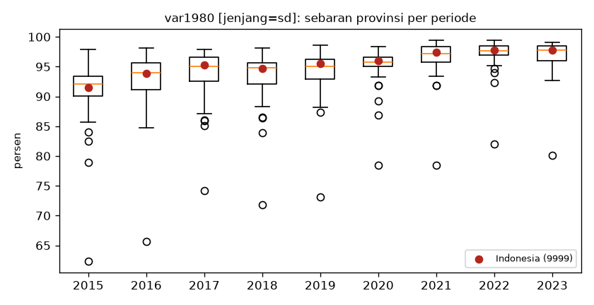
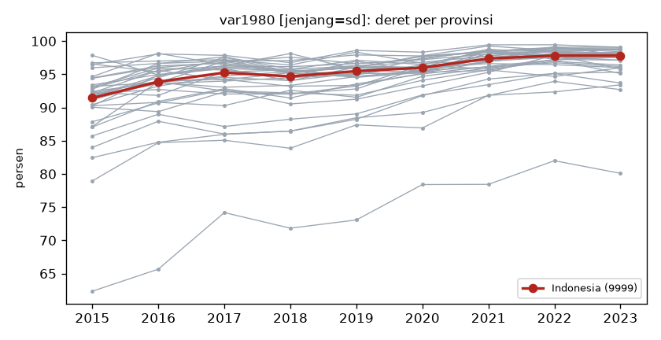
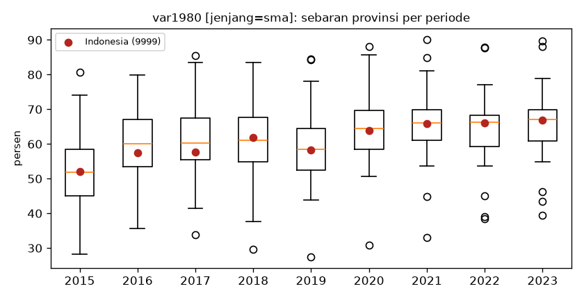
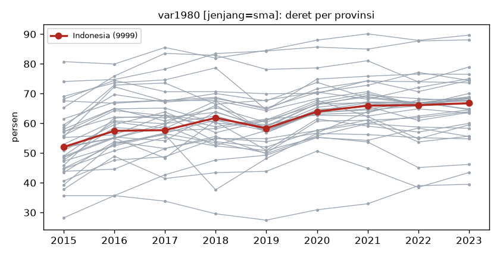
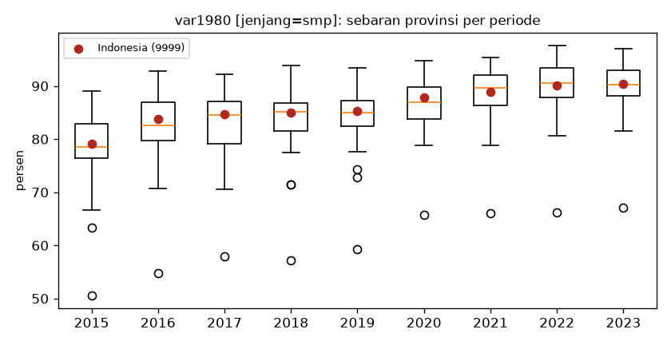
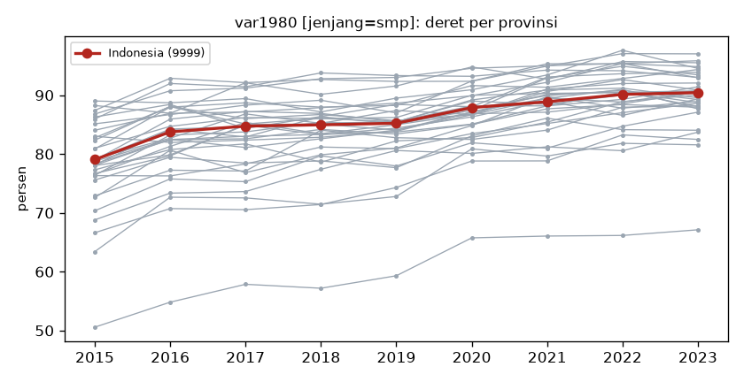
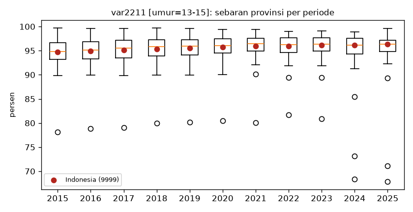
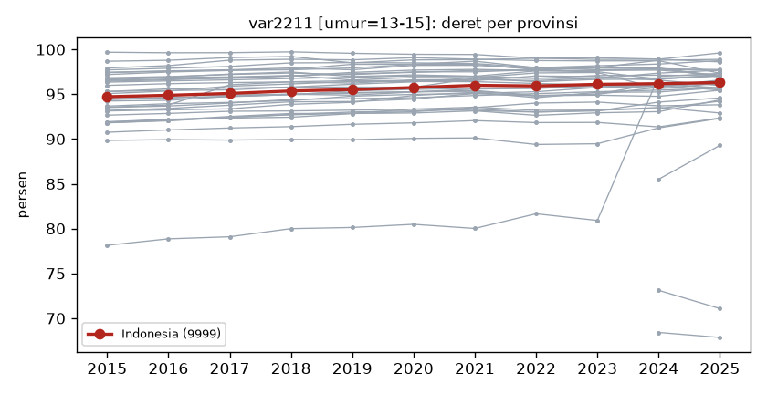
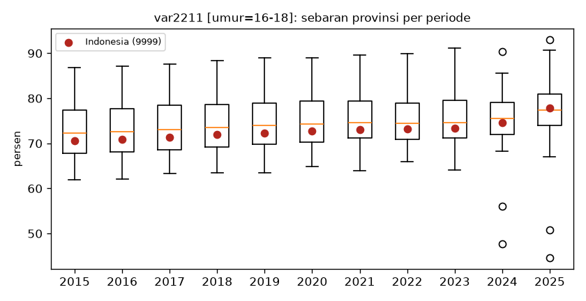
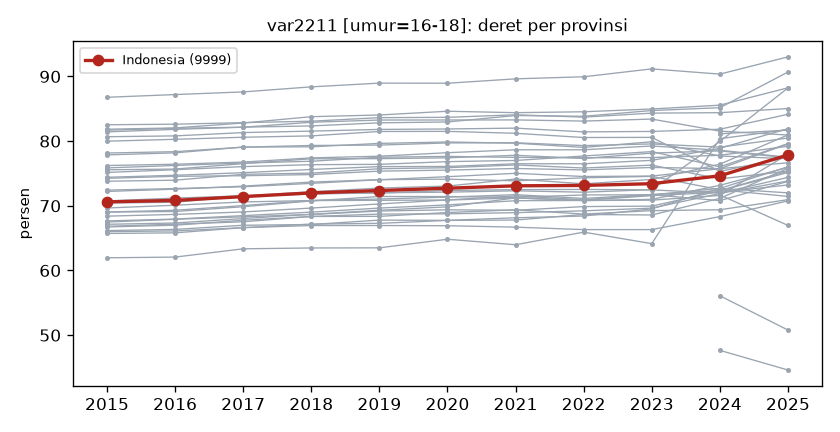
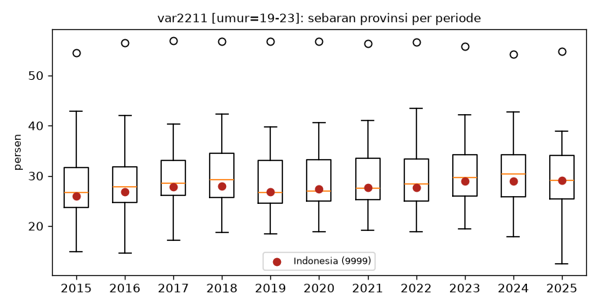
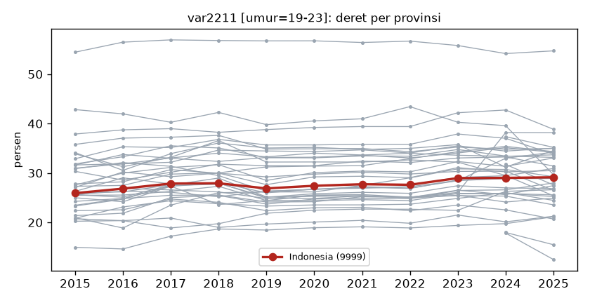
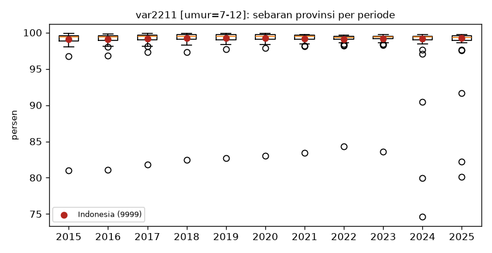
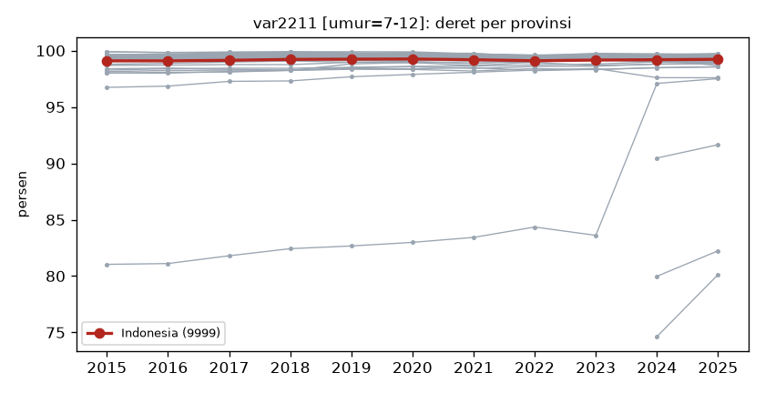
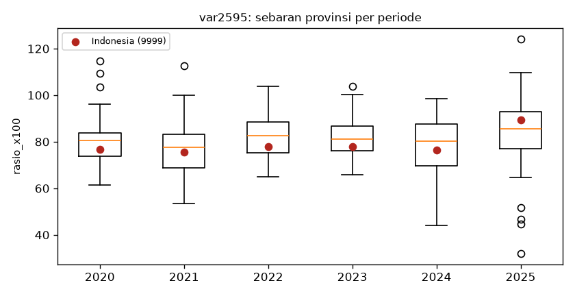
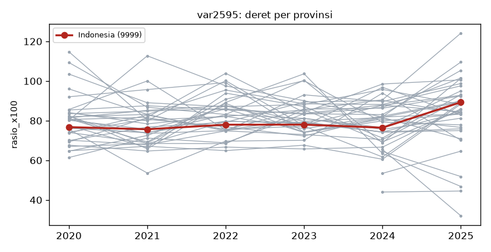
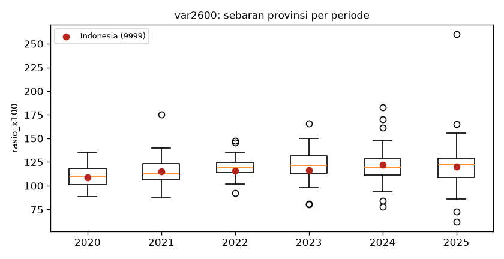
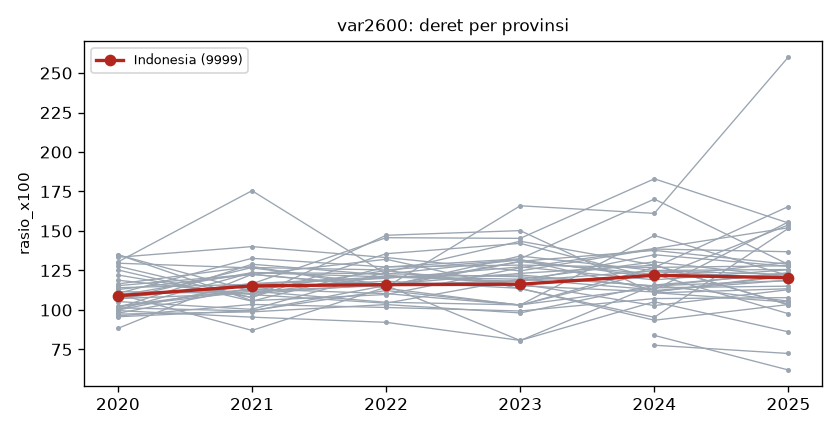
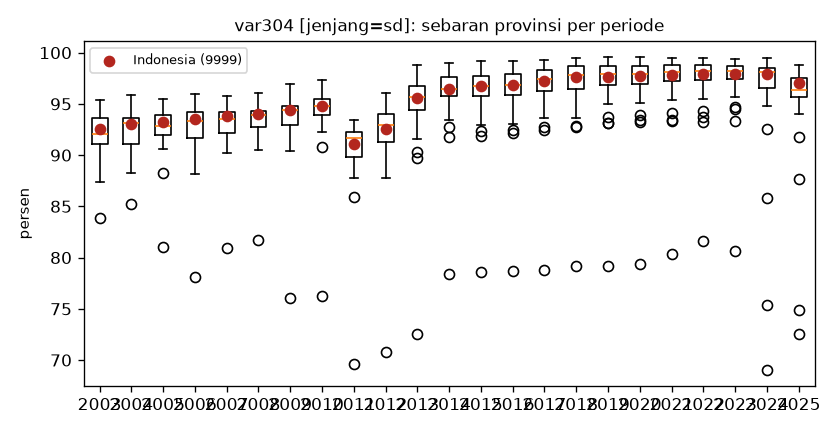
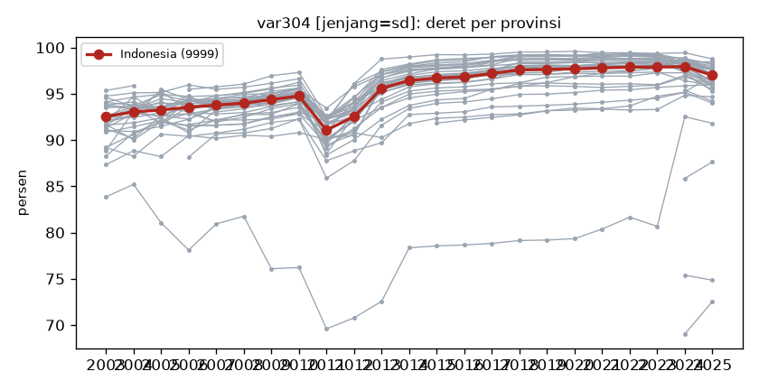
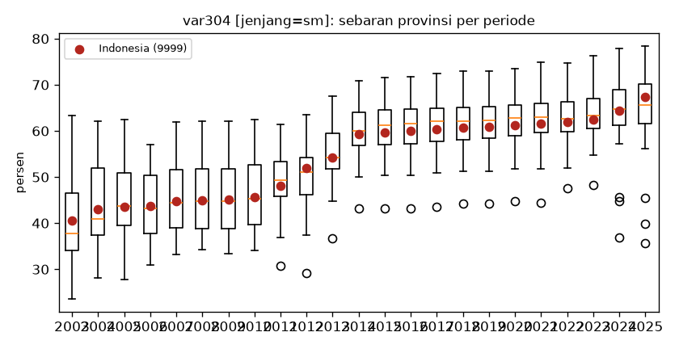
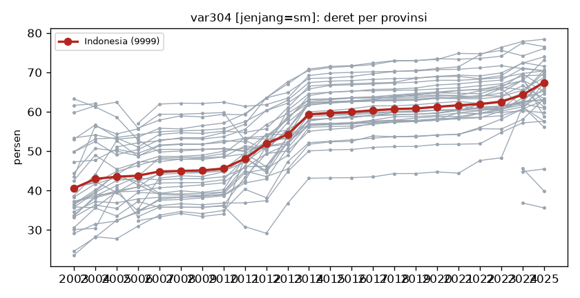
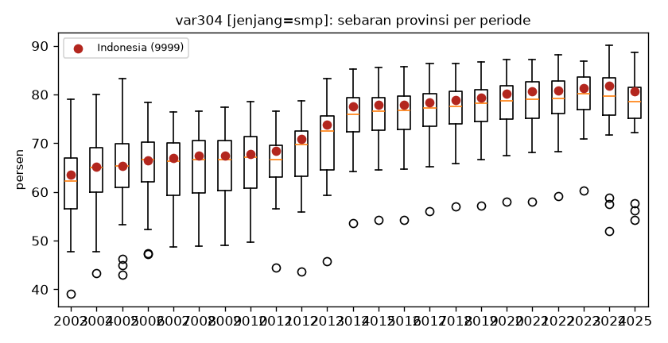
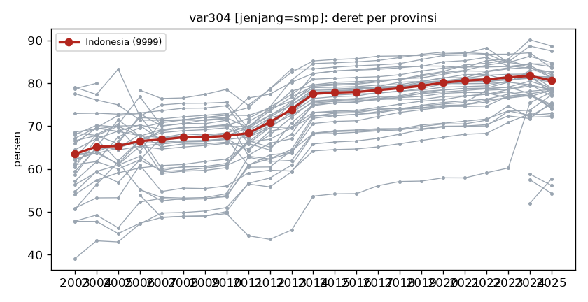
