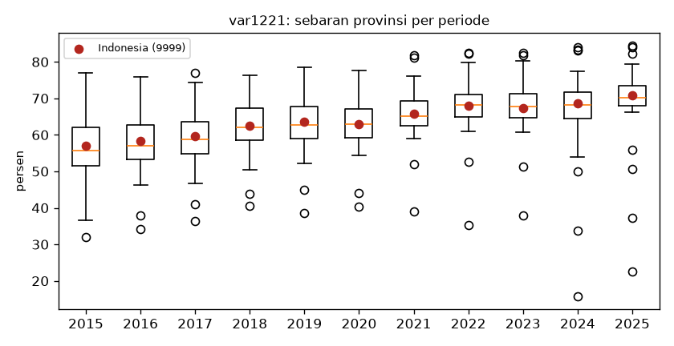
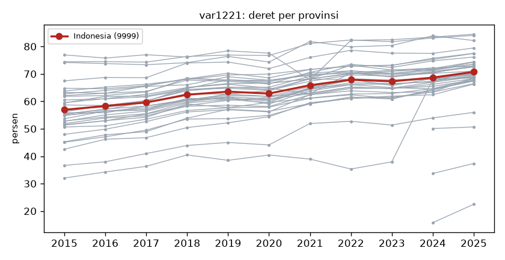
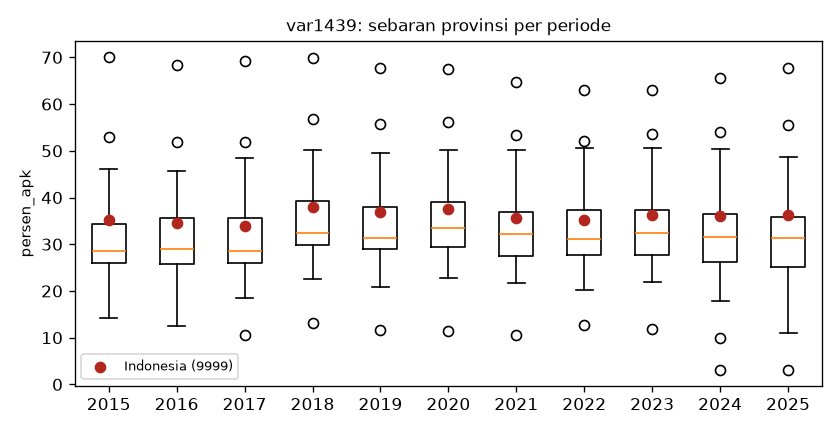
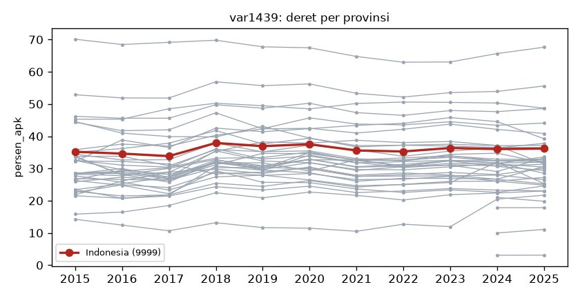
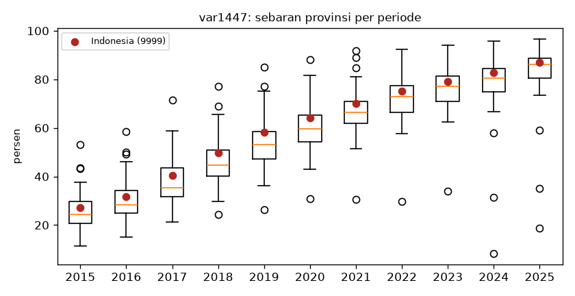
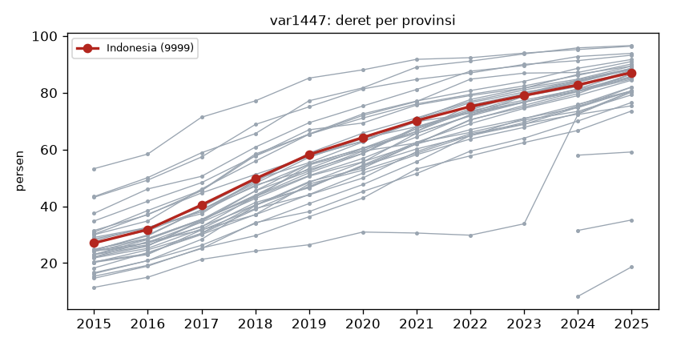
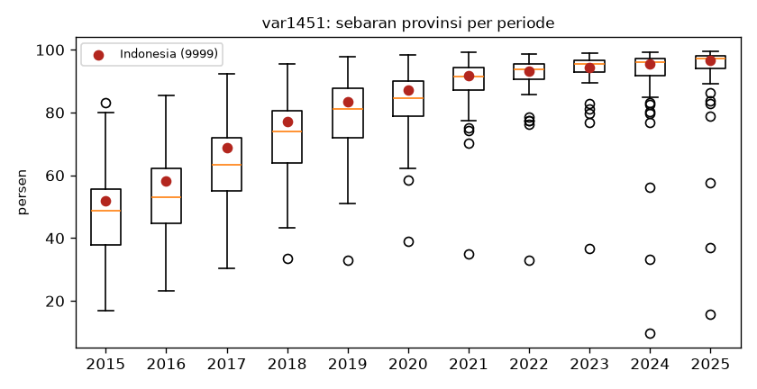
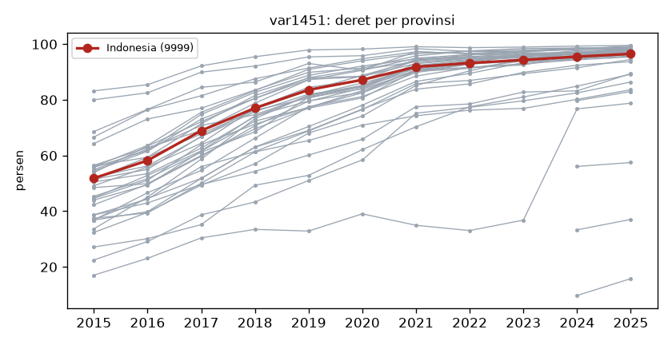

# Profil dan calon anomali seri utama

Dihasilkan `python pipeline.py` (`src/silver/profil.py`). Hanya baris provinsi deret utama (rincian `total`, atau rincian yang didaftar di `DERET` untuk seri yang terbit per rincian; label `kode [rincian]`); baris Indonesia ditampilkan terpisah dan tidak ikut statistik antarprovinsi.

## Banyak periode per provinsi (menentukan arah pembanding)

| seri_kode | min_periode_per_provinsi | maks_periode_per_provinsi |
|---|---|---|
| var1221 | 2 | 11 |
| var1439 | 2 | 11 |
| var1447 | 2 | 11 |
| var1451 | 2 | 11 |

- var1221: tiga arah (periode per provinsi 2–11)
- var1439: tiga arah (periode per provinsi 2–11)
- var1447: tiga arah (periode per provinsi 2–11)
- var1451: tiga arah (periode per provinsi 2–11)

Metode: IQR dengan pengali 1.5; arah ke samping hanya bila satu provinsi punya paling sedikit 6 periode. Sel yang ditandai lebih dari satu arah ditulis satu baris. Provinsi yang di luar batas ke bawah pada ≥ 50% periode diberi tanda `berulang`: itu perbedaan struktural antarprovinsi, bukan kejadian satu tahun. Lihat log untuk alasan memilih IQR.

## Statistik deskriptif per seri per periode (provinsi)

| seri_kode | periode | n | rerata | simpangan | minimum | q1 | median | q3 | maksimum |
|---|---|---|---|---|---|---|---|---|---|
| var1221 | 2015 | 34 | 56.28 | 9.76 | 32.04 | 51.60 | 55.65 | 62.03 | 76.93 |
| var1221 | 2016 | 34 | 57.52 | 9.08 | 34.24 | 53.21 | 57.07 | 62.70 | 75.78 |
| var1221 | 2017 | 34 | 58.89 | 8.61 | 36.31 | 54.89 | 58.87 | 63.59 | 76.99 |
| var1221 | 2018 | 34 | 62.07 | 8.02 | 40.46 | 58.64 | 61.97 | 67.31 | 76.36 |
| var1221 | 2019 | 34 | 63.07 | 8.33 | 38.50 | 59.02 | 62.65 | 67.74 | 78.42 |
| var1221 | 2020 | 34 | 62.67 | 7.79 | 40.44 | 59.16 | 62.84 | 67.00 | 77.57 |
| var1221 | 2021 | 34 | 65.63 | 7.63 | 38.94 | 62.50 | 65.19 | 69.40 | 81.83 |
| var1221 | 2022 | 34 | 67.81 | 8.46 | 35.33 | 64.81 | 68.12 | 71.12 | 82.37 |
| var1221 | 2023 | 34 | 67.43 | 8.19 | 37.95 | 64.63 | 67.66 | 71.26 | 82.47 |
| var1221 | 2024 | 38 | 66.75 | 12.26 | 15.76 | 64.55 | 68.18 | 71.62 | 83.90 |
| var1221 | 2025 | 38 | 68.99 | 11.40 | 22.49 | 67.90 | 70.18 | 73.57 | 84.47 |
| var1439 | 2015 | 34 | 31.79 | 10.91 | 14.24 | 25.98 | 28.55 | 34.30 | 70.11 |
| var1439 | 2016 | 34 | 31.42 | 10.60 | 12.44 | 25.82 | 28.98 | 35.59 | 68.47 |
| var1439 | 2017 | 34 | 31.11 | 10.88 | 10.68 | 25.92 | 28.47 | 35.56 | 69.14 |
| var1439 | 2018 | 34 | 35.25 | 10.46 | 13.17 | 29.88 | 32.39 | 39.32 | 69.80 |
| var1439 | 2019 | 34 | 34.18 | 10.42 | 11.66 | 29.04 | 31.32 | 38.08 | 67.75 |
| var1439 | 2020 | 34 | 35.03 | 10.26 | 11.47 | 29.38 | 33.38 | 39.02 | 67.46 |
| var1439 | 2021 | 34 | 33.37 | 10.26 | 10.51 | 27.54 | 32.17 | 36.99 | 64.76 |
| var1439 | 2022 | 34 | 33.29 | 9.90 | 12.71 | 27.77 | 31.03 | 37.24 | 62.98 |
| var1439 | 2023 | 34 | 34.07 | 10.01 | 11.94 | 27.78 | 32.43 | 37.38 | 63.06 |
| var1439 | 2024 | 38 | 31.86 | 11.49 | 3.08 | 26.22 | 31.63 | 36.48 | 65.67 |
| var1439 | 2025 | 38 | 31.63 | 11.52 | 3.10 | 25.22 | 31.35 | 35.76 | 67.63 |
| var1447 | 2015 | 34 | 25.97 | 8.78 | 11.43 | 20.82 | 24.38 | 29.74 | 53.25 |
| var1447 | 2016 | 34 | 30.65 | 9.65 | 15.00 | 24.80 | 28.39 | 34.28 | 58.40 |
| var1447 | 2017 | 34 | 37.89 | 10.53 | 21.29 | 31.59 | 35.23 | 43.47 | 71.39 |
| var1447 | 2018 | 34 | 46.71 | 11.16 | 24.23 | 40.28 | 44.67 | 50.78 | 77.14 |
| var1447 | 2019 | 34 | 54.35 | 12.04 | 26.45 | 47.24 | 53.11 | 58.52 | 85.17 |
| var1447 | 2020 | 34 | 60.38 | 11.62 | 30.93 | 54.14 | 59.55 | 65.31 | 88.08 |
| var1447 | 2021 | 34 | 66.83 | 11.40 | 30.58 | 61.96 | 66.38 | 71.03 | 91.79 |
| var1447 | 2022 | 34 | 72.36 | 11.24 | 29.82 | 66.29 | 72.94 | 77.46 | 92.36 |
| var1447 | 2023 | 34 | 76.44 | 10.74 | 33.84 | 70.92 | 77.09 | 81.46 | 93.98 |
| var1447 | 2024 | 38 | 77.37 | 15.96 | 8.27 | 74.81 | 80.64 | 84.50 | 95.83 |
| var1447 | 2025 | 38 | 82.12 | 15.00 | 18.67 | 80.63 | 86.13 | 88.64 | 96.64 |
| var1451 | 2015 | 34 | 48.04 | 14.53 | 17.03 | 37.76 | 48.81 | 55.51 | 83.22 |
| var1451 | 2016 | 34 | 54.07 | 14.53 | 23.09 | 44.72 | 53.16 | 62.16 | 85.43 |
| var1451 | 2017 | 34 | 63.37 | 14.19 | 30.42 | 55.01 | 63.28 | 71.96 | 92.19 |
| var1451 | 2018 | 34 | 71.74 | 13.44 | 33.48 | 63.84 | 74.11 | 80.51 | 95.48 |
| var1451 | 2019 | 34 | 78.24 | 13.74 | 32.88 | 72.06 | 81.09 | 87.72 | 97.91 |
| var1451 | 2020 | 34 | 82.26 | 11.95 | 39.06 | 78.72 | 84.67 | 90.14 | 98.22 |
| var1451 | 2021 | 34 | 88.48 | 11.72 | 34.95 | 87.11 | 91.36 | 94.40 | 99.07 |
| var1451 | 2022 | 34 | 90.13 | 11.77 | 33.06 | 90.64 | 93.81 | 95.54 | 98.74 |
| var1451 | 2023 | 34 | 91.91 | 11.17 | 36.81 | 93.03 | 95.53 | 96.70 | 98.95 |
| var1451 | 2024 | 38 | 89.00 | 18.42 | 9.74 | 91.75 | 96.03 | 97.15 | 99.31 |
| var1451 | 2025 | 38 | 90.68 | 17.42 | 15.79 | 93.91 | 97.22 | 97.99 | 99.54 |

## Baris Indonesia

| seri_kode | periode | nilai | rujukan_tahun |
|---|---|---|---|
| var1451 | 2015 | 51.83 | <NA> |
| var1451 | 2016 | 58.21 | <NA> |
| var1451 | 2017 | 68.93 | <NA> |
| var1451 | 2018 | 77.05 | <NA> |
| var1451 | 2019 | 83.58 | <NA> |
| var1451 | 2020 | 87.17 | <NA> |
| var1451 | 2021 | 91.83 | <NA> |
| var1451 | 2022 | 93.21 | <NA> |
| var1451 | 2023 | 94.31 | <NA> |
| var1451 | 2024 | 95.51 | <NA> |
| var1451 | 2025 | 96.50 | <NA> |
| var1447 | 2015 | 27.04 | <NA> |
| var1447 | 2016 | 31.83 | <NA> |
| var1447 | 2017 | 40.48 | <NA> |
| var1447 | 2018 | 49.73 | <NA> |
| var1447 | 2019 | 58.22 | <NA> |
| var1447 | 2020 | 64.26 | <NA> |
| var1447 | 2021 | 70.17 | <NA> |
| var1447 | 2022 | 75.16 | <NA> |
| var1447 | 2023 | 79.03 | <NA> |
| var1447 | 2024 | 82.75 | <NA> |
| var1447 | 2025 | 87.14 | <NA> |
| var1439 | 2015 | 35.18 | <NA> |
| var1439 | 2016 | 34.62 | <NA> |
| var1439 | 2017 | 33.84 | <NA> |
| var1439 | 2018 | 37.92 | <NA> |
| var1439 | 2019 | 36.93 | <NA> |
| var1439 | 2020 | 37.52 | <NA> |
| var1439 | 2021 | 35.59 | <NA> |
| var1439 | 2022 | 35.28 | <NA> |
| var1439 | 2023 | 36.36 | <NA> |
| var1439 | 2024 | 36.03 | <NA> |
| var1439 | 2025 | 36.19 | <NA> |
| var1221 | 2015 | 56.92 | <NA> |
| var1221 | 2016 | 58.30 | <NA> |
| var1221 | 2017 | 59.59 | <NA> |
| var1221 | 2018 | 62.41 | <NA> |
| var1221 | 2019 | 63.53 | <NA> |
| var1221 | 2020 | 62.84 | <NA> |
| var1221 | 2021 | 65.87 | <NA> |
| var1221 | 2022 | 67.88 | <NA> |
| var1221 | 2023 | 67.29 | <NA> |
| var1221 | 2024 | 68.65 | <NA> |
| var1221 | 2025 | 70.75 | <NA> |

## Calon anomali (186)

Daftar lengkap di `reports/calon-anomali.csv`; kategorinya di `reports/anomali.csv`.

| seri_kode | wilayah_kode | nama_wilayah | periode | nilai | arah | alasan | berulang |
|---|---|---|---|---|---|---|---|
| var1221 | 9400 | Papua | 2015 | 32.04 | ke bawah | di luar [35.95, 77.67] (IQR x 1.5) dibanding 34 provinsi tahun itu | True |
| var1221 | 5300 | Nusa Tenggara Timur | 2016 | 37.96 | ke bawah | di luar [38.98, 76.92] (IQR x 1.5) dibanding 34 provinsi tahun itu | True |
| var1221 | 9400 | Papua | 2016 | 34.24 | ke bawah | di luar [38.98, 76.92] (IQR x 1.5) dibanding 34 provinsi tahun itu | True |
| var1221 | 3100 | DKI Jakarta | 2017 | 76.99 | ke bawah | di luar [41.84, 76.64] (IQR x 1.5) dibanding 34 provinsi tahun itu | False |
| var1221 | 5300 | Nusa Tenggara Timur | 2017 | 40.97 | ke bawah | di luar [41.84, 76.64] (IQR x 1.5) dibanding 34 provinsi tahun itu | True |
| var1221 | 9400 | Papua | 2017 | 36.31 | ke bawah | di luar [41.84, 76.64] (IQR x 1.5) dibanding 34 provinsi tahun itu | True |
| var1221 | 3100 | DKI Jakarta | 2018 | 76.16 | perubahan | perubahan 2017→2018 sebesar -0.83 di luar [0.30, 6.35] | False |
| var1221 | 5300 | Nusa Tenggara Timur | 2018 | 43.91 | ke bawah | di luar [45.62, 80.33] (IQR x 1.5) dibanding 34 provinsi tahun itu | True |
| var1221 | 9400 | Papua | 2018 | 40.46 | ke bawah | di luar [45.62, 80.33] (IQR x 1.5) dibanding 34 provinsi tahun itu | True |
| var1221 | 5300 | Nusa Tenggara Timur | 2019 | 45.01 | ke bawah | di luar [45.93, 80.83] (IQR x 1.5) dibanding 34 provinsi tahun itu | True |
| var1221 | 9400 | Papua | 2019 | 38.50 | ke bawah + perubahan | di luar [45.93, 80.83] (IQR x 1.5) dibanding 34 provinsi tahun itu; perubahan 2018→2019 sebesar -1.96 di luar [-1.80, 3.86] | True |
| var1221 | 1100 | Aceh | 2020 | 59.60 | perubahan | perubahan 2019→2020 sebesar +1.85 di luar [-2.61, 1.74] | False |
| var1221 | 5300 | Nusa Tenggara Timur | 2020 | 44.12 | ke bawah | di luar [47.41, 78.76] (IQR x 1.5) dibanding 34 provinsi tahun itu | True |
| var1221 | 7600 | Sulawesi Barat | 2020 | 54.41 | perubahan | perubahan 2019→2020 sebesar +2.23 di luar [-2.61, 1.74] | False |
| var1221 | 9400 | Papua | 2020 | 40.44 | ke bawah + perubahan | di luar [47.41, 78.76] (IQR x 1.5) dibanding 34 provinsi tahun itu; perubahan 2019→2020 sebesar +1.94 di luar [-2.61, 1.74] | True |
| var1221 | 2100 | Kepulauan Riau | 2021 | 81.83 | ke bawah | di luar [52.14, 79.75] (IQR x 1.5) dibanding 34 provinsi tahun itu | False |
| var1221 | 3100 | DKI Jakarta | 2021 | 67.83 | perubahan | perubahan 2020→2021 sebesar -9.74 di luar [-1.84, 7.93] | False |
| var1221 | 3200 | Jawa Barat | 2021 | 62.76 | perubahan | perubahan 2020→2021 sebesar -2.07 di luar [-1.84, 7.93] | False |
| var1221 | 5300 | Nusa Tenggara Timur | 2021 | 51.92 | ke bawah | di luar [52.14, 79.75] (IQR x 1.5) dibanding 34 provinsi tahun itu | True |
| var1221 | 6400 | Kalimantan Timur | 2021 | 81.10 | ke bawah | di luar [52.14, 79.75] (IQR x 1.5) dibanding 34 provinsi tahun itu | False |
| var1221 | 9400 | Papua | 2021 | 38.94 | ke bawah | di luar [52.14, 79.75] (IQR x 1.5) dibanding 34 provinsi tahun itu | True |
| var1221 | 1900 | Kepulauan Bangka Belitung | 2022 | 73.16 | perubahan | perubahan 2021→2022 sebesar +4.94 di luar [-0.68, 4.39] | False |
| var1221 | 2100 | Kepulauan Riau | 2022 | 79.88 | perubahan | perubahan 2021→2022 sebesar -1.95 di luar [-0.68, 4.39] | False |
| var1221 | 3100 | DKI Jakarta | 2022 | 82.27 | ke bawah + perubahan | di luar [55.34, 80.58] (IQR x 1.5) dibanding 34 provinsi tahun itu; perubahan 2021→2022 sebesar +14.44 di luar [-0.68, 4.39] | False |
| var1221 | 3200 | Jawa Barat | 2022 | 70.37 | perubahan | perubahan 2021→2022 sebesar +7.61 di luar [-0.68, 4.39] | False |
| var1221 | 5300 | Nusa Tenggara Timur | 2022 | 52.73 | ke bawah | di luar [55.34, 80.58] (IQR x 1.5) dibanding 34 provinsi tahun itu | True |
| var1221 | 6400 | Kalimantan Timur | 2022 | 82.37 | ke bawah | di luar [55.34, 80.58] (IQR x 1.5) dibanding 34 provinsi tahun itu | False |
| var1221 | 9400 | Papua | 2022 | 35.33 | ke bawah + perubahan | di luar [55.34, 80.58] (IQR x 1.5) dibanding 34 provinsi tahun itu; perubahan 2021→2022 sebesar -3.61 di luar [-0.68, 4.39] | True |
| var1221 | 3100 | DKI Jakarta | 2023 | 82.47 | ke bawah | di luar [54.69, 81.20] (IQR x 1.5) dibanding 34 provinsi tahun itu | False |
| var1221 | 5300 | Nusa Tenggara Timur | 2023 | 51.36 | ke bawah | di luar [54.69, 81.20] (IQR x 1.5) dibanding 34 provinsi tahun itu | True |
| var1221 | 6400 | Kalimantan Timur | 2023 | 81.75 | ke bawah | di luar [54.69, 81.20] (IQR x 1.5) dibanding 34 provinsi tahun itu | False |
| var1221 | 9400 | Papua | 2023 | 37.95 | ke bawah + perubahan | di luar [54.69, 81.20] (IQR x 1.5) dibanding 34 provinsi tahun itu; perubahan 2022→2023 sebesar +2.62 di luar [-2.98, 2.13] | True |
| var1221 | 2100 | Kepulauan Riau | 2024 | 83.90 | ke bawah | di luar [53.94, 82.23] (IQR x 1.5) dibanding 38 provinsi tahun itu | False |
| var1221 | 3100 | DKI Jakarta | 2024 | 83.43 | ke bawah | di luar [53.94, 82.23] (IQR x 1.5) dibanding 38 provinsi tahun itu | False |
| var1221 | 6400 | Kalimantan Timur | 2024 | 83.10 | ke bawah | di luar [53.94, 82.23] (IQR x 1.5) dibanding 38 provinsi tahun itu | False |
| var1221 | 9400 | Papua | 2024 | 67.97 | perubahan + ke samping | perubahan 2023→2024 sebesar +30.02 di luar [-1.48, 4.30]; di luar [28.87, 47.40] dibanding 11 tahun di provinsi ini | True |
| var1221 | 9500 | Papua Selatan | 2024 | 50.08 | ke bawah | di luar [53.94, 82.23] (IQR x 1.5) dibanding 38 provinsi tahun itu | True |
| var1221 | 9600 | Papua Tengah | 2024 | 33.70 | ke bawah | di luar [53.94, 82.23] (IQR x 1.5) dibanding 38 provinsi tahun itu | True |
| var1221 | 9700 | Papua Pegunungan | 2024 | 15.76 | ke bawah | di luar [53.94, 82.23] (IQR x 1.5) dibanding 38 provinsi tahun itu | True |
| var1221 | 2100 | Kepulauan Riau | 2025 | 82.18 | ke bawah + perubahan | di luar [59.39, 82.08] (IQR x 1.5) dibanding 38 provinsi tahun itu; perubahan 2024→2025 sebesar -1.72 di luar [-0.12, 4.81] | False |
| var1221 | 3100 | DKI Jakarta | 2025 | 84.47 | ke bawah | di luar [59.39, 82.08] (IQR x 1.5) dibanding 38 provinsi tahun itu | False |
| var1221 | 5300 | Nusa Tenggara Timur | 2025 | 55.97 | ke bawah | di luar [59.39, 82.08] (IQR x 1.5) dibanding 38 provinsi tahun itu | True |
| var1221 | 6400 | Kalimantan Timur | 2025 | 84.04 | ke bawah | di luar [59.39, 82.08] (IQR x 1.5) dibanding 38 provinsi tahun itu | False |
| var1221 | 8100 | Maluku | 2025 | 68.64 | perubahan | perubahan 2024→2025 sebesar +5.20 di luar [-0.12, 4.81] | False |
| var1221 | 9400 | Papua | 2025 | 68.56 | ke samping | di luar [28.87, 47.40] dibanding 11 tahun di provinsi ini | True |
| var1221 | 9500 | Papua Selatan | 2025 | 50.67 | ke bawah | di luar [59.39, 82.08] (IQR x 1.5) dibanding 38 provinsi tahun itu | True |
| var1221 | 9600 | Papua Tengah | 2025 | 37.35 | ke bawah | di luar [59.39, 82.08] (IQR x 1.5) dibanding 38 provinsi tahun itu | True |
| var1221 | 9700 | Papua Pegunungan | 2025 | 22.49 | ke bawah + perubahan | di luar [59.39, 82.08] (IQR x 1.5) dibanding 38 provinsi tahun itu; perubahan 2024→2025 sebesar +6.73 di luar [-0.12, 4.81] | True |
| var1439 | 3400 | DI Yogyakarta | 2015 | 70.11 | ke bawah | di luar [13.50, 46.78] (IQR x 1.5) dibanding 34 provinsi tahun itu | True |
| var1439 | 3500 | Jawa Timur | 2015 | 52.89 | ke bawah | di luar [13.50, 46.78] (IQR x 1.5) dibanding 34 provinsi tahun itu | True |
| var1439 | 5300 | Nusa Tenggara Timur | 2015 | 23.42 | ke samping | di luar [23.91, 37.91] dibanding 11 tahun di provinsi ini | False |
| var1439 | 7500 | Gorontalo | 2015 | 45.29 | ke samping | di luar [45.86, 52.92] dibanding 11 tahun di provinsi ini | False |
| var1439 | 1600 | Sumatera Selatan | 2016 | 20.78 | ke samping | di luar [21.10, 28.48] dibanding 11 tahun di provinsi ini | False |
| var1439 | 3400 | DI Yogyakarta | 2016 | 68.47 | ke bawah | di luar [11.18, 50.23] (IQR x 1.5) dibanding 34 provinsi tahun itu | True |
| var1439 | 3500 | Jawa Timur | 2016 | 51.90 | ke bawah | di luar [11.18, 50.23] (IQR x 1.5) dibanding 34 provinsi tahun itu | True |
| var1439 | 6500 | Kalimantan Utara | 2016 | 28.02 | ke samping | di luar [28.27, 36.16] dibanding 11 tahun di provinsi ini | False |
| var1439 | 7500 | Gorontalo | 2016 | 45.29 | ke samping | di luar [45.86, 52.92] dibanding 11 tahun di provinsi ini | False |
| var1439 | 7600 | Sulawesi Barat | 2016 | 38.84 | perubahan | perubahan 2015→2016 sebesar +6.63 di luar [-5.91, 5.15] | False |
| var1439 | 3400 | DI Yogyakarta | 2017 | 69.14 | ke bawah | di luar [11.46, 50.02] (IQR x 1.5) dibanding 34 provinsi tahun itu | True |
| var1439 | 3500 | Jawa Timur | 2017 | 51.85 | ke bawah | di luar [11.46, 50.02] (IQR x 1.5) dibanding 34 provinsi tahun itu | True |
| var1439 | 9400 | Papua | 2017 | 10.68 | ke bawah | di luar [11.46, 50.02] (IQR x 1.5) dibanding 34 provinsi tahun itu | True |
| var1439 | 2100 | Kepulauan Riau | 2018 | 28.31 | perubahan | perubahan 2017→2018 sebesar -3.08 di luar [-0.42, 8.70] | False |
| var1439 | 3400 | DI Yogyakarta | 2018 | 69.80 | ke bawah | di luar [15.72, 53.49] (IQR x 1.5) dibanding 34 provinsi tahun itu | True |
| var1439 | 3500 | Jawa Timur | 2018 | 56.90 | ke bawah | di luar [15.72, 53.49] (IQR x 1.5) dibanding 34 provinsi tahun itu | True |
| var1439 | 6300 | Kalimantan Selatan | 2018 | 47.27 | ke samping | di luar [40.54, 46.76] dibanding 11 tahun di provinsi ini | False |
| var1439 | 7200 | Sulawesi Tengah | 2018 | 41.77 | ke samping | di luar [34.63, 39.59] dibanding 11 tahun di provinsi ini | False |
| var1439 | 8100 | Maluku | 2018 | 30.77 | perubahan | perubahan 2017→2018 sebesar +8.97 di luar [-0.42, 8.70] | False |
| var1439 | 9400 | Papua | 2018 | 13.17 | ke bawah | di luar [15.72, 53.49] (IQR x 1.5) dibanding 34 provinsi tahun itu | True |
| var1439 | 3100 | DKI Jakarta | 2019 | 43.08 | perubahan | perubahan 2018→2019 sebesar +3.28 di luar [-5.57, 3.08] | False |
| var1439 | 3400 | DI Yogyakarta | 2019 | 67.75 | ke bawah | di luar [15.48, 51.63] (IQR x 1.5) dibanding 34 provinsi tahun itu | True |
| var1439 | 3500 | Jawa Timur | 2019 | 55.70 | ke bawah | di luar [15.48, 51.63] (IQR x 1.5) dibanding 34 provinsi tahun itu | True |
| var1439 | 7400 | Sulawesi Tenggara | 2019 | 34.69 | perubahan | perubahan 2018→2019 sebesar +3.52 di luar [-5.57, 3.08] | False |
| var1439 | 9400 | Papua | 2019 | 11.66 | ke bawah | di luar [15.48, 51.63] (IQR x 1.5) dibanding 34 provinsi tahun itu | True |
| var1439 | 1800 | Lampung | 2020 | 35.13 | ke samping | di luar [29.98, 34.60] dibanding 11 tahun di provinsi ini | False |
| var1439 | 3100 | DKI Jakarta | 2020 | 39.44 | perubahan | perubahan 2019→2020 sebesar -3.64 di luar [-3.42, 4.99] | False |
| var1439 | 3400 | DI Yogyakarta | 2020 | 67.46 | ke bawah | di luar [14.91, 53.49] (IQR x 1.5) dibanding 34 provinsi tahun itu | True |
| var1439 | 3500 | Jawa Timur | 2020 | 56.24 | ke bawah | di luar [14.91, 53.49] (IQR x 1.5) dibanding 34 provinsi tahun itu | True |
| var1439 | 3600 | Banten | 2020 | 30.44 | ke samping | di luar [26.21, 30.15] dibanding 11 tahun di provinsi ini | False |
| var1439 | 9400 | Papua | 2020 | 11.47 | ke bawah | di luar [14.91, 53.49] (IQR x 1.5) dibanding 34 provinsi tahun itu | True |
| var1439 | 1100 | Aceh | 2021 | 32.70 | perubahan | perubahan 2020→2021 sebesar +3.49 di luar [-3.74, -0.22] | False |
| var1439 | 3400 | DI Yogyakarta | 2021 | 64.76 | ke bawah | di luar [13.37, 51.16] (IQR x 1.5) dibanding 34 provinsi tahun itu | True |
| var1439 | 3500 | Jawa Timur | 2021 | 53.33 | ke bawah | di luar [13.37, 51.16] (IQR x 1.5) dibanding 34 provinsi tahun itu | True |
| var1439 | 5300 | Nusa Tenggara Timur | 2021 | 32.59 | perubahan | perubahan 2020→2021 sebesar -0.13 di luar [-3.74, -0.22] | False |
| var1439 | 7500 | Gorontalo | 2021 | 50.18 | perubahan | perubahan 2020→2021 sebesar +1.71 di luar [-3.74, -0.22] | False |
| var1439 | 7600 | Sulawesi Barat | 2021 | 43.38 | perubahan | perubahan 2020→2021 sebesar +1.03 di luar [-3.74, -0.22] | False |
| var1439 | 8200 | Maluku Utara | 2021 | 38.76 | perubahan | perubahan 2020→2021 sebesar +0.88 di luar [-3.74, -0.22] | False |
| var1439 | 9400 | Papua | 2021 | 10.51 | ke bawah | di luar [13.37, 51.16] (IQR x 1.5) dibanding 34 provinsi tahun itu | True |
| var1439 | 3400 | DI Yogyakarta | 2022 | 62.98 | ke bawah | di luar [13.55, 51.46] (IQR x 1.5) dibanding 34 provinsi tahun itu | True |
| var1439 | 3500 | Jawa Timur | 2022 | 52.18 | ke bawah | di luar [13.55, 51.46] (IQR x 1.5) dibanding 34 provinsi tahun itu | True |
| var1439 | 9400 | Papua | 2022 | 12.71 | ke bawah | di luar [13.55, 51.46] (IQR x 1.5) dibanding 34 provinsi tahun itu | True |
| var1439 | 3400 | DI Yogyakarta | 2023 | 63.06 | ke bawah | di luar [13.38, 51.78] (IQR x 1.5) dibanding 34 provinsi tahun itu | True |
| var1439 | 3500 | Jawa Timur | 2023 | 53.54 | ke bawah | di luar [13.38, 51.78] (IQR x 1.5) dibanding 34 provinsi tahun itu | True |
| var1439 | 9400 | Papua | 2023 | 11.94 | ke bawah | di luar [13.38, 51.78] (IQR x 1.5) dibanding 34 provinsi tahun itu | True |
| var1439 | 3400 | DI Yogyakarta | 2024 | 65.67 | ke bawah + perubahan | di luar [10.82, 51.89] (IQR x 1.5) dibanding 38 provinsi tahun itu; perubahan 2023→2024 sebesar +2.61 di luar [-3.11, 2.16] | True |
| var1439 | 3500 | Jawa Timur | 2024 | 53.92 | ke bawah | di luar [10.82, 51.89] (IQR x 1.5) dibanding 38 provinsi tahun itu | True |
| var1439 | 9100 | Papua Barat | 2024 | 31.92 | perubahan + ke samping | perubahan 2023→2024 sebesar +6.26 di luar [-3.11, 2.16]; di luar [21.49, 31.21] dibanding 11 tahun di provinsi ini | False |
| var1439 | 9400 | Papua | 2024 | 20.50 | perubahan + ke samping | perubahan 2023→2024 sebesar +8.56 di luar [-3.11, 2.16]; di luar [8.36, 16.91] dibanding 11 tahun di provinsi ini | True |
| var1439 | 9600 | Papua Tengah | 2024 | 9.98 | ke bawah | di luar [10.82, 51.89] (IQR x 1.5) dibanding 38 provinsi tahun itu | False |
| var1439 | 9700 | Papua Pegunungan | 2024 | 3.08 | ke bawah | di luar [10.82, 51.89] (IQR x 1.5) dibanding 38 provinsi tahun itu | True |
| var1439 | 3400 | DI Yogyakarta | 2025 | 67.63 | ke bawah | di luar [9.40, 51.57] (IQR x 1.5) dibanding 38 provinsi tahun itu | True |
| var1439 | 3500 | Jawa Timur | 2025 | 55.60 | ke bawah | di luar [9.40, 51.57] (IQR x 1.5) dibanding 38 provinsi tahun itu | True |
| var1439 | 7600 | Sulawesi Barat | 2025 | 39.22 | perubahan | perubahan 2024→2025 sebesar -5.32 di luar [-4.83, 4.73] | False |
| var1439 | 8200 | Maluku Utara | 2025 | 31.40 | perubahan | perubahan 2024→2025 sebesar -5.74 di luar [-4.83, 4.73] | False |
| var1439 | 9100 | Papua Barat | 2025 | 25.27 | perubahan | perubahan 2024→2025 sebesar -6.65 di luar [-4.83, 4.73] | False |
| var1439 | 9400 | Papua | 2025 | 21.71 | ke samping | di luar [8.36, 16.91] dibanding 11 tahun di provinsi ini | True |
| var1439 | 9700 | Papua Pegunungan | 2025 | 3.10 | ke bawah | di luar [9.40, 51.57] (IQR x 1.5) dibanding 38 provinsi tahun itu | True |
| var1447 | 2100 | Kepulauan Riau | 2015 | 43.42 | ke bawah | di luar [7.45, 43.12] (IQR x 1.5) dibanding 34 provinsi tahun itu | False |
| var1447 | 3100 | DKI Jakarta | 2015 | 53.25 | ke bawah | di luar [7.45, 43.12] (IQR x 1.5) dibanding 34 provinsi tahun itu | True |
| var1447 | 3400 | DI Yogyakarta | 2015 | 43.16 | ke bawah | di luar [7.45, 43.12] (IQR x 1.5) dibanding 34 provinsi tahun itu | False |
| var1447 | 2100 | Kepulauan Riau | 2016 | 50.10 | ke bawah | di luar [10.56, 48.51] (IQR x 1.5) dibanding 34 provinsi tahun itu | False |
| var1447 | 3100 | DKI Jakarta | 2016 | 58.40 | ke bawah | di luar [10.56, 48.51] (IQR x 1.5) dibanding 34 provinsi tahun itu | True |
| var1447 | 3400 | DI Yogyakarta | 2016 | 49.23 | ke bawah | di luar [10.56, 48.51] (IQR x 1.5) dibanding 34 provinsi tahun itu | False |
| var1447 | 6400 | Kalimantan Timur | 2016 | 46.11 | perubahan | perubahan 2015→2016 sebesar +8.62 di luar [1.47, 7.78] | False |
| var1447 | 3100 | DKI Jakarta | 2017 | 71.39 | ke bawah + perubahan | di luar [13.76, 61.29] (IQR x 1.5) dibanding 34 provinsi tahun itu; perubahan 2016→2017 sebesar +12.99 di luar [3.16, 11.54] | True |
| var1447 | 3100 | DKI Jakarta | 2018 | 77.14 | ke bawah | di luar [24.53, 66.53] (IQR x 1.5) dibanding 34 provinsi tahun itu | True |
| var1447 | 3400 | DI Yogyakarta | 2018 | 68.82 | ke bawah | di luar [24.53, 66.53] (IQR x 1.5) dibanding 34 provinsi tahun itu | False |
| var1447 | 9400 | Papua | 2018 | 24.23 | ke bawah + perubahan | di luar [24.53, 66.53] (IQR x 1.5) dibanding 34 provinsi tahun itu; perubahan 2017→2018 sebesar +2.94 di luar [4.04, 13.71] | True |
| var1447 | 2100 | Kepulauan Riau | 2019 | 77.18 | ke bawah | di luar [30.33, 75.43] (IQR x 1.5) dibanding 34 provinsi tahun itu | False |
| var1447 | 3100 | DKI Jakarta | 2019 | 85.17 | ke bawah | di luar [30.33, 75.43] (IQR x 1.5) dibanding 34 provinsi tahun itu | True |
| var1447 | 9400 | Papua | 2019 | 26.45 | ke bawah + perubahan | di luar [30.33, 75.43] (IQR x 1.5) dibanding 34 provinsi tahun itu; perubahan 2018→2019 sebesar +2.22 di luar [2.53, 12.84] | True |
| var1447 | 3100 | DKI Jakarta | 2020 | 88.08 | ke bawah | di luar [37.38, 82.07] (IQR x 1.5) dibanding 34 provinsi tahun itu | True |
| var1447 | 3600 | Banten | 2020 | 69.35 | perubahan | perubahan 2019→2020 sebesar +2.39 di luar [2.42, 9.83] | False |
| var1447 | 9400 | Papua | 2020 | 30.93 | ke bawah | di luar [37.38, 82.07] (IQR x 1.5) dibanding 34 provinsi tahun itu | True |
| var1447 | 2100 | Kepulauan Riau | 2021 | 89.06 | ke bawah | di luar [48.36, 84.64] (IQR x 1.5) dibanding 34 provinsi tahun itu | False |
| var1447 | 3100 | DKI Jakarta | 2021 | 91.79 | ke bawah | di luar [48.36, 84.64] (IQR x 1.5) dibanding 34 provinsi tahun itu | True |
| var1447 | 3400 | DI Yogyakarta | 2021 | 84.72 | ke bawah | di luar [48.36, 84.64] (IQR x 1.5) dibanding 34 provinsi tahun itu | False |
| var1447 | 9400 | Papua | 2021 | 30.58 | ke bawah + perubahan | di luar [48.36, 84.64] (IQR x 1.5) dibanding 34 provinsi tahun itu; perubahan 2020→2021 sebesar -0.35 di luar [1.44, 11.93] | True |
| var1447 | 9400 | Papua | 2022 | 29.82 | ke bawah + perubahan | di luar [49.54, 94.21] (IQR x 1.5) dibanding 34 provinsi tahun itu; perubahan 2021→2022 sebesar -0.76 di luar [-0.61, 11.58] | True |
| var1447 | 1800 | Lampung | 2023 | 78.79 | perubahan | perubahan 2022→2023 sebesar +6.79 di luar [1.72, 6.41] | False |
| var1447 | 3100 | DKI Jakarta | 2023 | 93.98 | perubahan | perubahan 2022→2023 sebesar +1.62 di luar [1.72, 6.41] | True |
| var1447 | 9400 | Papua | 2023 | 33.84 | ke bawah | di luar [55.12, 97.26] (IQR x 1.5) dibanding 34 provinsi tahun itu | True |
| var1447 | 6500 | Kalimantan Utara | 2024 | 87.16 | perubahan | perubahan 2023→2024 sebesar +0.24 di luar [1.04, 7.09] | False |
| var1447 | 9400 | Papua | 2024 | 72.34 | perubahan + ke samping | perubahan 2023→2024 sebesar +38.50 di luar [1.04, 7.09]; di luar [8.32, 46.82] dibanding 11 tahun di provinsi ini | True |
| var1447 | 9500 | Papua Selatan | 2024 | 58.01 | ke bawah | di luar [60.28, 99.03] (IQR x 1.5) dibanding 38 provinsi tahun itu | True |
| var1447 | 9600 | Papua Tengah | 2024 | 31.50 | ke bawah | di luar [60.28, 99.03] (IQR x 1.5) dibanding 38 provinsi tahun itu | True |
| var1447 | 9700 | Papua Pegunungan | 2024 | 8.27 | ke bawah | di luar [60.28, 99.03] (IQR x 1.5) dibanding 38 provinsi tahun itu | True |
| var1447 | 2100 | Kepulauan Riau | 2025 | 96.64 | perubahan | perubahan 2024→2025 sebesar +0.81 di luar [0.84, 8.96] | False |
| var1447 | 9400 | Papua | 2025 | 75.43 | ke samping | di luar [8.32, 46.82] dibanding 11 tahun di provinsi ini | True |
| var1447 | 9500 | Papua Selatan | 2025 | 59.14 | ke bawah | di luar [68.63, 100.65] (IQR x 1.5) dibanding 38 provinsi tahun itu | True |
| var1447 | 9600 | Papua Tengah | 2025 | 35.18 | ke bawah | di luar [68.63, 100.65] (IQR x 1.5) dibanding 38 provinsi tahun itu | True |
| var1447 | 9700 | Papua Pegunungan | 2025 | 18.67 | ke bawah + perubahan | di luar [68.63, 100.65] (IQR x 1.5) dibanding 38 provinsi tahun itu; perubahan 2024→2025 sebesar +10.40 di luar [0.84, 8.96] | True |
| var1451 | 3100 | DKI Jakarta | 2015 | 80.01 | ke samping | di luar [81.07, 107.66] dibanding 11 tahun di provinsi ini | False |
| var1451 | 3400 | DI Yogyakarta | 2015 | 83.22 | ke bawah + ke samping | di luar [11.15, 82.12] (IQR x 1.5) dibanding 34 provinsi tahun itu; di luar [86.07, 106.77] dibanding 11 tahun di provinsi ini | False |
| var1451 | 9400 | Papua | 2015 | 17.03 | ke samping | di luar [22.22, 47.36] dibanding 11 tahun di provinsi ini | True |
| var1451 | 3400 | DI Yogyakarta | 2016 | 85.43 | ke samping | di luar [86.07, 106.77] dibanding 11 tahun di provinsi ini | False |
| var1451 | 9400 | Papua | 2018 | 33.48 | ke bawah | di luar [38.85, 105.51] (IQR x 1.5) dibanding 34 provinsi tahun itu | True |
| var1451 | 3400 | DI Yogyakarta | 2019 | 97.91 | perubahan | perubahan 2018→2019 sebesar +2.43 di luar [2.44, 10.62] | False |
| var1451 | 5200 | Nusa Tenggara Barat | 2019 | 77.54 | perubahan | perubahan 2018→2019 sebesar +11.31 di luar [2.44, 10.62] | False |
| var1451 | 6200 | Kalimantan Tengah | 2019 | 80.96 | perubahan | perubahan 2018→2019 sebesar +12.48 di luar [2.44, 10.62] | False |
| var1451 | 7600 | Sulawesi Barat | 2019 | 68.06 | perubahan | perubahan 2018→2019 sebesar +11.01 di luar [2.44, 10.62] | False |
| var1451 | 9400 | Papua | 2019 | 32.88 | ke bawah + perubahan | di luar [48.56, 111.21] (IQR x 1.5) dibanding 34 provinsi tahun itu; perubahan 2018→2019 sebesar -0.60 di luar [2.44, 10.62] | True |
| var1451 | 2100 | Kepulauan Riau | 2020 | 90.65 | perubahan | perubahan 2019→2020 sebesar -2.40 di luar [-1.03, 9.62] | False |
| var1451 | 5300 | Nusa Tenggara Timur | 2020 | 58.40 | ke bawah | di luar [61.61, 107.26] (IQR x 1.5) dibanding 34 provinsi tahun itu | True |
| var1451 | 9400 | Papua | 2020 | 39.06 | ke bawah | di luar [61.61, 107.26] (IQR x 1.5) dibanding 34 provinsi tahun itu | True |
| var1451 | 5300 | Nusa Tenggara Timur | 2021 | 75.20 | ke bawah + perubahan | di luar [76.18, 105.33] (IQR x 1.5) dibanding 34 provinsi tahun itu; perubahan 2020→2021 sebesar +16.80 di luar [-1.00, 13.31] | True |
| var1451 | 8200 | Maluku Utara | 2021 | 70.33 | ke bawah | di luar [76.18, 105.33] (IQR x 1.5) dibanding 34 provinsi tahun itu | False |
| var1451 | 9100 | Papua Barat | 2021 | 74.27 | ke bawah | di luar [76.18, 105.33] (IQR x 1.5) dibanding 34 provinsi tahun itu | False |
| var1451 | 9400 | Papua | 2021 | 34.95 | ke bawah + perubahan | di luar [76.18, 105.33] (IQR x 1.5) dibanding 34 provinsi tahun itu; perubahan 2020→2021 sebesar -4.11 di luar [-1.00, 13.31] | True |
| var1451 | 5300 | Nusa Tenggara Timur | 2022 | 77.30 | ke bawah | di luar [83.28, 102.90] (IQR x 1.5) dibanding 34 provinsi tahun itu | True |
| var1451 | 7600 | Sulawesi Barat | 2022 | 90.41 | perubahan | perubahan 2021→2022 sebesar +5.26 di luar [-1.03, 4.20] | False |
| var1451 | 8100 | Maluku | 2022 | 78.51 | ke bawah | di luar [83.28, 102.90] (IQR x 1.5) dibanding 34 provinsi tahun itu | False |
| var1451 | 8200 | Maluku Utara | 2022 | 77.48 | ke bawah + perubahan | di luar [83.28, 102.90] (IQR x 1.5) dibanding 34 provinsi tahun itu; perubahan 2021→2022 sebesar +7.15 di luar [-1.03, 4.20] | False |
| var1451 | 9100 | Papua Barat | 2022 | 76.29 | ke bawah | di luar [83.28, 102.90] (IQR x 1.5) dibanding 34 provinsi tahun itu | False |
| var1451 | 9400 | Papua | 2022 | 33.06 | ke bawah + perubahan | di luar [83.28, 102.90] (IQR x 1.5) dibanding 34 provinsi tahun itu; perubahan 2021→2022 sebesar -1.89 di luar [-1.03, 4.20] | True |
| var1451 | 5300 | Nusa Tenggara Timur | 2023 | 79.65 | ke bawah | di luar [87.52, 102.21] (IQR x 1.5) dibanding 34 provinsi tahun itu | True |
| var1451 | 8100 | Maluku | 2023 | 82.80 | ke bawah | di luar [87.52, 102.21] (IQR x 1.5) dibanding 34 provinsi tahun itu | False |
| var1451 | 8200 | Maluku Utara | 2023 | 81.01 | ke bawah | di luar [87.52, 102.21] (IQR x 1.5) dibanding 34 provinsi tahun itu | False |
| var1451 | 9100 | Papua Barat | 2023 | 76.93 | ke bawah | di luar [87.52, 102.21] (IQR x 1.5) dibanding 34 provinsi tahun itu | False |
| var1451 | 9400 | Papua | 2023 | 36.81 | ke bawah | di luar [87.52, 102.21] (IQR x 1.5) dibanding 34 provinsi tahun itu | True |
| var1451 | 5300 | Nusa Tenggara Timur | 2024 | 82.50 | ke bawah | di luar [83.64, 105.25] (IQR x 1.5) dibanding 38 provinsi tahun itu | True |
| var1451 | 6500 | Kalimantan Utara | 2024 | 94.81 | perubahan | perubahan 2023→2024 sebesar -2.25 di luar [-1.60, 3.95] | False |
| var1451 | 8100 | Maluku | 2024 | 83.22 | ke bawah | di luar [83.64, 105.25] (IQR x 1.5) dibanding 38 provinsi tahun itu | False |
| var1451 | 9100 | Papua Barat | 2024 | 80.17 | ke bawah | di luar [83.64, 105.25] (IQR x 1.5) dibanding 38 provinsi tahun itu | False |
| var1451 | 9200 | Papua Barat Daya | 2024 | 79.71 | ke bawah | di luar [83.64, 105.25] (IQR x 1.5) dibanding 38 provinsi tahun itu | True |
| var1451 | 9400 | Papua | 2024 | 76.75 | ke bawah + perubahan + ke samping | di luar [83.64, 105.25] (IQR x 1.5) dibanding 38 provinsi tahun itu; perubahan 2023→2024 sebesar +39.94 di luar [-1.60, 3.95]; di luar [22.22, 47.36] dibanding 11 tahun di provinsi ini | True |
| var1451 | 9500 | Papua Selatan | 2024 | 56.08 | ke bawah | di luar [83.64, 105.25] (IQR x 1.5) dibanding 38 provinsi tahun itu | True |
| var1451 | 9600 | Papua Tengah | 2024 | 33.31 | ke bawah | di luar [83.64, 105.25] (IQR x 1.5) dibanding 38 provinsi tahun itu | True |
| var1451 | 9700 | Papua Pegunungan | 2024 | 9.74 | ke bawah | di luar [83.64, 105.25] (IQR x 1.5) dibanding 38 provinsi tahun itu | True |
| var1451 | 5300 | Nusa Tenggara Timur | 2025 | 86.40 | ke bawah | di luar [87.80, 104.10] (IQR x 1.5) dibanding 38 provinsi tahun itu | True |
| var1451 | 8100 | Maluku | 2025 | 89.41 | perubahan | perubahan 2024→2025 sebesar +6.19 di luar [-1.85, 4.76] | False |
| var1451 | 9100 | Papua Barat | 2025 | 83.62 | ke bawah | di luar [87.80, 104.10] (IQR x 1.5) dibanding 38 provinsi tahun itu | False |
| var1451 | 9200 | Papua Barat Daya | 2025 | 82.98 | ke bawah | di luar [87.80, 104.10] (IQR x 1.5) dibanding 38 provinsi tahun itu | True |
| var1451 | 9400 | Papua | 2025 | 78.79 | ke bawah + ke samping | di luar [87.80, 104.10] (IQR x 1.5) dibanding 38 provinsi tahun itu; di luar [22.22, 47.36] dibanding 11 tahun di provinsi ini | True |
| var1451 | 9500 | Papua Selatan | 2025 | 57.49 | ke bawah | di luar [87.80, 104.10] (IQR x 1.5) dibanding 38 provinsi tahun itu | True |
| var1451 | 9600 | Papua Tengah | 2025 | 37.06 | ke bawah | di luar [87.80, 104.10] (IQR x 1.5) dibanding 38 provinsi tahun itu | True |
| var1451 | 9700 | Papua Pegunungan | 2025 | 15.79 | ke bawah + perubahan | di luar [87.80, 104.10] (IQR x 1.5) dibanding 38 provinsi tahun itu; perubahan 2024→2025 sebesar +6.05 di luar [-1.85, 4.76] | True |

## Gambar

