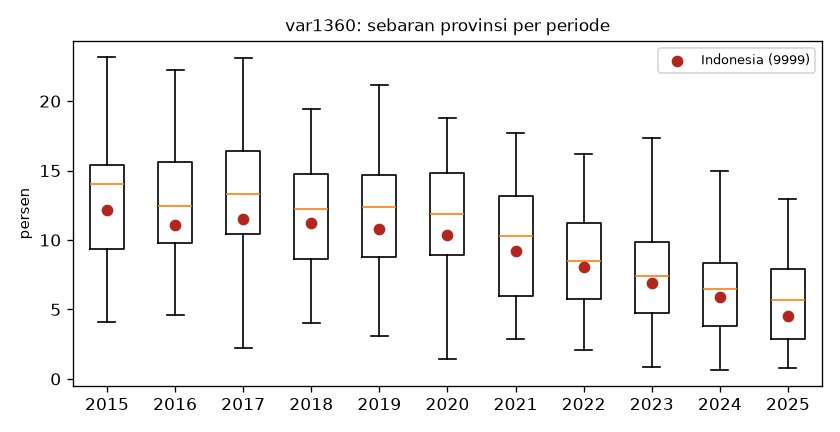
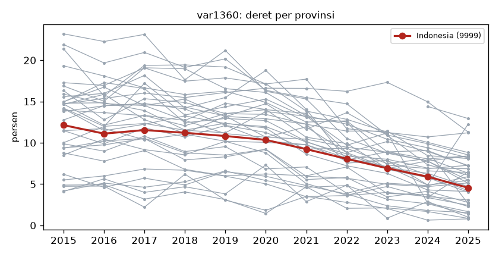
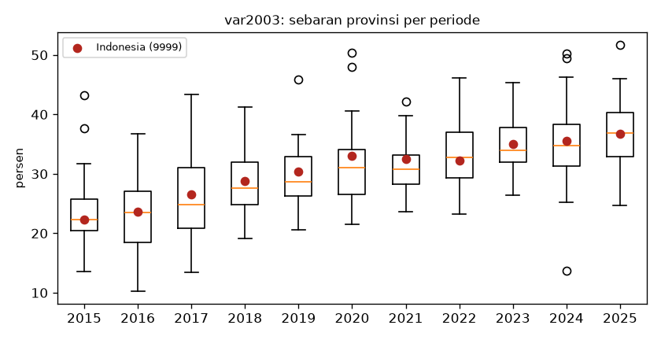
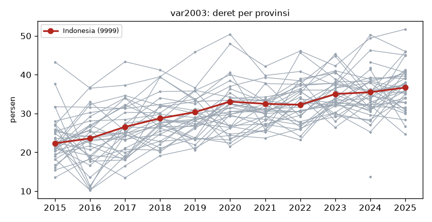

# Profil dan calon anomali seri utama

Dihasilkan `python pipeline.py` (`src/silver/profil.py`). Hanya baris provinsi deret utama (rincian `total`, atau rincian yang didaftar di `DERET` untuk seri yang terbit per rincian; label `kode [rincian]`); baris Indonesia ditampilkan terpisah dan tidak ikut statistik antarprovinsi.

## Banyak periode per provinsi (menentukan arah pembanding)

| seri_kode | min_periode_per_provinsi | maks_periode_per_provinsi |
|---|---|---|
| var1360 | 2 | 11 |
| var2003 | 1 | 11 |

- var1360: tiga arah (periode per provinsi 2–11)
- var2003: tiga arah (periode per provinsi 1–11)

Metode: IQR dengan pengali 1.5; arah ke samping hanya bila satu provinsi punya paling sedikit 6 periode. Sel yang ditandai lebih dari satu arah ditulis satu baris. Provinsi yang di luar batas ke bawah pada ≥ 50% periode diberi tanda `berulang`: itu perbedaan struktural antarprovinsi, bukan kejadian satu tahun. Lihat log untuk alasan memilih IQR.

## Statistik deskriptif per seri per periode (provinsi)

| seri_kode | periode | n | rerata | simpangan | minimum | q1 | median | q3 | maksimum |
|---|---|---|---|---|---|---|---|---|---|
| var1360 | 2015 | 34 | 12.76 | 5.09 | 4.11 | 9.36 | 14.04 | 15.43 | 23.19 |
| var1360 | 2016 | 34 | 12.39 | 4.57 | 4.61 | 9.78 | 12.46 | 15.60 | 22.26 |
| var1360 | 2017 | 34 | 12.84 | 5.18 | 2.21 | 10.41 | 13.30 | 16.43 | 23.12 |
| var1360 | 2018 | 34 | 11.82 | 4.38 | 4.06 | 8.61 | 12.25 | 14.74 | 19.43 |
| var1360 | 2019 | 34 | 11.90 | 4.69 | 3.06 | 8.77 | 12.34 | 14.67 | 21.18 |
| var1360 | 2020 | 34 | 11.41 | 4.49 | 1.45 | 8.89 | 11.88 | 14.85 | 18.76 |
| var1360 | 2021 | 34 | 9.97 | 4.14 | 2.89 | 5.96 | 10.30 | 13.18 | 17.71 |
| var1360 | 2022 | 34 | 8.48 | 3.62 | 2.07 | 5.73 | 8.51 | 11.20 | 16.23 |
| var1360 | 2023 | 34 | 7.34 | 3.53 | 0.88 | 4.78 | 7.39 | 9.85 | 17.32 |
| var1360 | 2024 | 38 | 6.43 | 3.28 | 0.64 | 3.83 | 6.45 | 8.36 | 14.96 |
| var1360 | 2025 | 38 | 5.70 | 3.24 | 0.79 | 2.85 | 5.70 | 7.88 | 12.94 |
| var2003 | 2015 | 34 | 23.47 | 6.05 | 13.51 | 20.46 | 22.30 | 25.81 | 43.28 |
| var2003 | 2016 | 34 | 23.00 | 7.15 | 10.25 | 18.44 | 23.49 | 27.03 | 36.76 |
| var2003 | 2017 | 34 | 25.85 | 6.61 | 13.45 | 20.86 | 24.82 | 31.04 | 43.35 |
| var2003 | 2018 | 34 | 28.56 | 5.78 | 19.16 | 24.87 | 27.66 | 31.97 | 41.22 |
| var2003 | 2019 | 34 | 29.18 | 5.38 | 20.62 | 26.24 | 28.60 | 32.95 | 45.82 |
| var2003 | 2020 | 34 | 31.57 | 6.68 | 21.54 | 26.51 | 30.98 | 34.11 | 50.43 |
| var2003 | 2021 | 34 | 31.17 | 4.42 | 23.68 | 28.29 | 30.76 | 33.20 | 42.14 |
| var2003 | 2022 | 34 | 33.12 | 5.65 | 23.20 | 29.27 | 32.72 | 37.00 | 46.09 |
| var2003 | 2023 | 34 | 35.05 | 4.70 | 26.40 | 32.02 | 33.99 | 37.80 | 45.39 |
| var2003 | 2024 | 38 | 34.90 | 6.66 | 13.74 | 31.36 | 34.80 | 38.28 | 50.26 |
| var2003 | 2025 | 36 | 36.80 | 5.83 | 24.64 | 32.84 | 36.84 | 40.32 | 51.72 |

## Baris Indonesia

| seri_kode | periode | nilai | rujukan_tahun |
|---|---|---|---|
| var1360 | 2015 | 12.14 | <NA> |
| var1360 | 2016 | 11.11 | <NA> |
| var1360 | 2017 | 11.54 | <NA> |
| var1360 | 2018 | 11.21 | <NA> |
| var1360 | 2019 | 10.82 | <NA> |
| var1360 | 2020 | 10.35 | <NA> |
| var1360 | 2021 | 9.23 | <NA> |
| var1360 | 2022 | 8.06 | <NA> |
| var1360 | 2023 | 6.92 | <NA> |
| var1360 | 2024 | 5.90 | <NA> |
| var1360 | 2025 | 4.56 | <NA> |
| var2003 | 2015 | 22.32 | <NA> |
| var2003 | 2016 | 23.60 | <NA> |
| var2003 | 2017 | 26.56 | <NA> |
| var2003 | 2018 | 28.75 | <NA> |
| var2003 | 2019 | 30.37 | <NA> |
| var2003 | 2020 | 33.08 | <NA> |
| var2003 | 2021 | 32.50 | <NA> |
| var2003 | 2022 | 32.26 | <NA> |
| var2003 | 2023 | 35.02 | <NA> |
| var2003 | 2024 | 35.49 | <NA> |
| var2003 | 2025 | 36.68 | <NA> |

## Calon anomali (49)

Daftar lengkap di `reports/calon-anomali.csv`; kategorinya di `reports/anomali.csv`.

| seri_kode | wilayah_kode | nama_wilayah | periode | nilai | arah | alasan | berulang |
|---|---|---|---|---|---|---|---|
| var1360 | 7600 | Sulawesi Barat | 2016 | 15.67 | perubahan | perubahan 2015→2016 sebesar -5.70 di luar [-5.00, 4.34] | False |
| var1360 | 8200 | Maluku Utara | 2017 | 17.21 | perubahan | perubahan 2016→2017 sebesar +5.24 di luar [-4.15, 4.53] | False |
| var1360 | 3400 | DI Yogyakarta | 2018 | 6.20 | perubahan | perubahan 2017→2018 sebesar +3.99 di luar [-4.33, 2.39] | False |
| var1360 | 6300 | Kalimantan Selatan | 2018 | 17.63 | perubahan | perubahan 2017→2018 sebesar -5.49 di luar [-4.33, 2.39] | False |
| var1360 | 1900 | Kepulauan Bangka Belitung | 2020 | 18.76 | perubahan | perubahan 2019→2020 sebesar +3.28 di luar [-3.93, 3.02] | False |
| var1360 | 2100 | Kepulauan Riau | 2020 | 7.31 | perubahan | perubahan 2019→2020 sebesar +3.49 di luar [-3.93, 3.02] | False |
| var1360 | 6300 | Kalimantan Selatan | 2020 | 16.24 | perubahan | perubahan 2019→2020 sebesar -4.94 di luar [-3.93, 3.02] | False |
| var1360 | 1900 | Kepulauan Bangka Belitung | 2022 | 7.91 | perubahan | perubahan 2021→2022 sebesar -6.14 di luar [-5.71, 2.99] | False |
| var1360 | 7600 | Sulawesi Barat | 2022 | 11.70 | perubahan | perubahan 2021→2022 sebesar -6.01 di luar [-5.71, 2.99] | False |
| var1360 | 8200 | Maluku Utara | 2023 | 7.30 | perubahan | perubahan 2022→2023 sebesar -5.22 di luar [-4.71, 2.89] | False |
| var1360 | 1600 | Sumatera Selatan | 2024 | 8.45 | perubahan | perubahan 2023→2024 sebesar -2.96 di luar [-2.84, 1.03] | False |
| var1360 | 2100 | Kepulauan Riau | 2024 | 2.89 | perubahan | perubahan 2023→2024 sebesar +2.01 di luar [-2.84, 1.03] | False |
| var1360 | 7500 | Gorontalo | 2024 | 7.34 | perubahan | perubahan 2023→2024 sebesar -3.57 di luar [-2.84, 1.03] | False |
| var1360 | 9100 | Papua Barat | 2024 | 4.90 | perubahan | perubahan 2023→2024 sebesar -2.96 di luar [-2.84, 1.03] | False |
| var1360 | 9400 | Papua | 2024 | 2.70 | perubahan + ke samping | perubahan 2023→2024 sebesar -8.49 di luar [-2.84, 1.03]; di luar [6.95, 16.27] dibanding 11 tahun di provinsi ini | False |
| var1360 | 1600 | Sumatera Selatan | 2025 | 8.09 | ke samping | di luar [8.31, 16.59] dibanding 11 tahun di provinsi ini | False |
| var1360 | 5200 | Nusa Tenggara Barat | 2025 | 11.31 | ke samping | di luar [13.31, 18.27] dibanding 11 tahun di provinsi ini | False |
| var1360 | 7500 | Gorontalo | 2025 | 6.08 | ke samping | di luar [6.09, 19.92] dibanding 11 tahun di provinsi ini | False |
| var1360 | 9100 | Papua Barat | 2025 | 12.25 | perubahan | perubahan 2024→2025 sebesar +7.35 di luar [-4.34, 2.75] | False |
| var1360 | 9200 | Papua Barat Daya | 2025 | 6.49 | perubahan | perubahan 2024→2025 sebesar +3.09 di luar [-4.34, 2.75] | False |
| var1360 | 9400 | Papua | 2025 | 1.67 | ke samping | di luar [6.95, 16.27] dibanding 11 tahun di provinsi ini | False |
| var1360 | 9600 | Papua Tengah | 2025 | 2.63 | perubahan | perubahan 2024→2025 sebesar -6.42 di luar [-4.34, 2.75] | False |
| var2003 | 7400 | Sulawesi Tenggara | 2015 | 37.60 | ke bawah | di luar [12.44, 33.83] (IQR x 1.5) dibanding 34 provinsi tahun itu | False |
| var2003 | 7500 | Gorontalo | 2015 | 43.28 | ke bawah | di luar [12.44, 33.83] (IQR x 1.5) dibanding 34 provinsi tahun itu | False |
| var2003 | 7600 | Sulawesi Barat | 2015 | 21.35 | ke samping | di luar [24.63, 38.78] dibanding 11 tahun di provinsi ini | False |
| var2003 | 7300 | Sulawesi Selatan | 2016 | 10.86 | ke samping | di luar [14.16, 48.86] dibanding 11 tahun di provinsi ini | False |
| var2003 | 6100 | Kalimantan Barat | 2017 | 18.65 | ke samping | di luar [18.70, 31.41] dibanding 11 tahun di provinsi ini | False |
| var2003 | 7500 | Gorontalo | 2019 | 45.82 | ke bawah | di luar [16.18, 43.01] (IQR x 1.5) dibanding 34 provinsi tahun itu | False |
| var2003 | 8200 | Maluku Utara | 2019 | 20.62 | ke samping | di luar [21.06, 37.75] dibanding 11 tahun di provinsi ini | False |
| var2003 | 7100 | Sulawesi Utara | 2020 | 47.93 | ke bawah | di luar [15.11, 45.52] (IQR x 1.5) dibanding 34 provinsi tahun itu | False |
| var2003 | 7500 | Gorontalo | 2020 | 50.43 | ke bawah | di luar [15.11, 45.52] (IQR x 1.5) dibanding 34 provinsi tahun itu | False |
| var2003 | 3400 | DI Yogyakarta | 2021 | 25.84 | perubahan | perubahan 2020→2021 sebesar -14.70 di luar [-9.28, 9.13] | False |
| var2003 | 7100 | Sulawesi Utara | 2021 | 42.14 | ke bawah | di luar [20.93, 40.57] (IQR x 1.5) dibanding 34 provinsi tahun itu | False |
| var2003 | 7500 | Gorontalo | 2021 | 39.80 | perubahan | perubahan 2020→2021 sebesar -10.63 di luar [-9.28, 9.13] | False |
| var2003 | 8100 | Maluku | 2021 | 37.72 | perubahan | perubahan 2020→2021 sebesar +11.25 di luar [-9.28, 9.13] | False |
| var2003 | 1500 | Jambi | 2022 | 45.68 | perubahan | perubahan 2021→2022 sebesar +16.02 di luar [-9.91, 13.28] | False |
| var2003 | 2100 | Kepulauan Riau | 2022 | 38.96 | perubahan | perubahan 2021→2022 sebesar +13.30 di luar [-9.91, 13.28] | False |
| var2003 | 1300 | Sumatera Barat | 2023 | 27.96 | perubahan | perubahan 2022→2023 sebesar -10.74 di luar [-9.05, 13.31] | False |
| var2003 | 1600 | Sumatera Selatan | 2024 | 37.94 | ke samping | di luar [21.38, 37.42] dibanding 11 tahun di provinsi ini | False |
| var2003 | 1900 | Kepulauan Bangka Belitung | 2024 | 41.35 | ke samping | di luar [15.44, 35.59] dibanding 11 tahun di provinsi ini | False |
| var2003 | 7100 | Sulawesi Utara | 2024 | 49.42 | ke bawah | di luar [20.98, 48.66] (IQR x 1.5) dibanding 38 provinsi tahun itu | False |
| var2003 | 8100 | Maluku | 2024 | 50.26 | ke bawah + ke samping | di luar [20.98, 48.66] (IQR x 1.5) dibanding 38 provinsi tahun itu; di luar [20.61, 48.03] dibanding 11 tahun di provinsi ini | False |
| var2003 | 9700 | Papua Pegunungan | 2024 | 13.74 | ke bawah | di luar [20.98, 48.66] (IQR x 1.5) dibanding 38 provinsi tahun itu | False |
| var2003 | 1300 | Sumatera Barat | 2025 | 45.89 | ke samping | di luar [23.72, 44.94] dibanding 11 tahun di provinsi ini | False |
| var2003 | 1900 | Kepulauan Bangka Belitung | 2025 | 26.68 | perubahan | perubahan 2024→2025 sebesar -14.67 di luar [-13.39, 16.50] | False |
| var2003 | 6100 | Kalimantan Barat | 2025 | 34.98 | ke samping | di luar [18.70, 31.41] dibanding 11 tahun di provinsi ini | False |
| var2003 | 7100 | Sulawesi Utara | 2025 | 51.72 | ke bawah | di luar [21.62, 51.54] (IQR x 1.5) dibanding 36 provinsi tahun itu | False |
| var2003 | 7600 | Sulawesi Barat | 2025 | 41.00 | ke samping | di luar [24.63, 38.78] dibanding 11 tahun di provinsi ini | False |
| var2003 | 8200 | Maluku Utara | 2025 | 45.01 | ke samping | di luar [21.06, 37.75] dibanding 11 tahun di provinsi ini | False |

## Gambar

