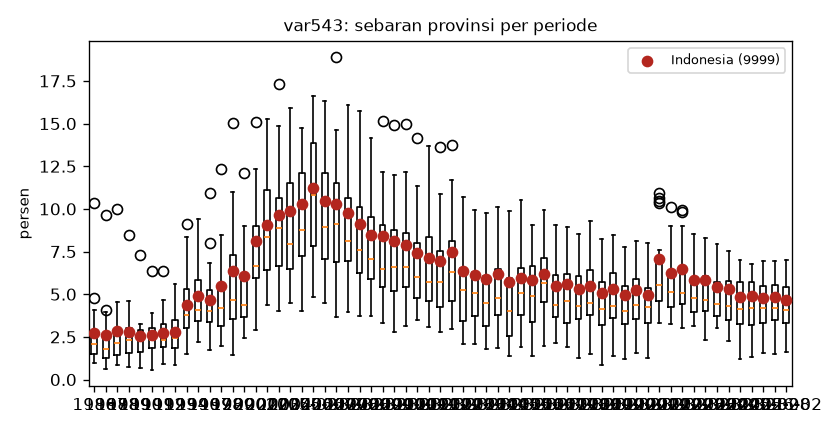
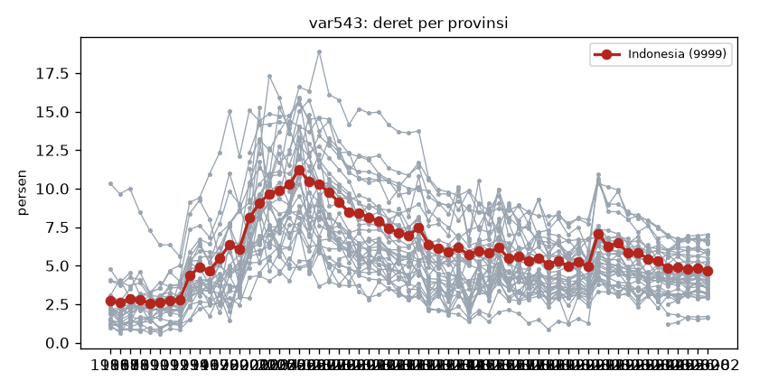

# Profil dan calon anomali seri utama

Dihasilkan `python pipeline.py` (`src/silver/profil.py`). Hanya baris provinsi deret utama (rincian `total`, atau rincian yang didaftar di `DERET` untuk seri yang terbit per rincian; label `kode [rincian]`); baris Indonesia ditampilkan terpisah dan tidak ikut statistik antarprovinsi.

## Banyak periode per provinsi (menentukan arah pembanding)

| seri_kode | min_periode_per_provinsi | maks_periode_per_provinsi |
|---|---|---|
| var543 | 5 | 61 |

- var543: tiga arah (periode per provinsi 5–61)

Metode: IQR dengan pengali 1.5; arah ke samping hanya bila satu provinsi punya paling sedikit 6 periode. Sel yang ditandai lebih dari satu arah ditulis satu baris. Provinsi yang di luar batas ke bawah pada ≥ 50% periode diberi tanda `berulang`: itu perbedaan struktural antarprovinsi, bukan kejadian satu tahun. Lihat log untuk alasan memilih IQR.

## Statistik deskriptif per seri per periode (provinsi)

| seri_kode | periode | n | rerata | simpangan | minimum | q1 | median | q3 | maksimum |
|---|---|---|---|---|---|---|---|---|---|
| var543 | 1986 | 26 | 2.53 | 1.86 | 0.99 | 1.50 | 2.10 | 2.76 | 10.35 |
| var543 | 1987 | 26 | 2.26 | 1.81 | 0.63 | 1.28 | 1.77 | 2.38 | 9.66 |
| var543 | 1988 | 26 | 2.50 | 1.81 | 0.85 | 1.42 | 2.17 | 2.68 | 10.01 |
| var543 | 1989 | 26 | 2.55 | 1.54 | 0.75 | 1.58 | 2.31 | 3.01 | 8.47 |
| var543 | 1990 | 26 | 2.35 | 1.26 | 0.65 | 1.61 | 2.29 | 2.92 | 7.30 |
| var543 | 1991 | 26 | 2.41 | 1.21 | 0.56 | 1.84 | 2.33 | 3.01 | 6.35 |
| var543 | 1992 | 26 | 2.60 | 1.27 | 0.92 | 1.89 | 2.31 | 3.25 | 6.35 |
| var543 | 1993 | 26 | 2.62 | 1.21 | 0.83 | 1.86 | 2.42 | 3.50 | 5.60 |
| var543 | 1994 | 26 | 4.27 | 1.91 | 1.50 | 2.99 | 3.81 | 5.29 | 9.10 |
| var543 | 1996 | 26 | 4.76 | 1.92 | 2.18 | 3.44 | 4.05 | 5.84 | 9.41 |
| var543 | 1997 | 26 | 4.47 | 1.97 | 1.71 | 3.37 | 4.01 | 5.23 | 10.94 |
| var543 | 1998 | 26 | 4.74 | 2.27 | 1.97 | 3.16 | 4.22 | 5.42 | 12.32 |
| var543 | 1999 | 26 | 5.50 | 3.06 | 1.44 | 3.52 | 4.64 | 7.29 | 15.01 |
| var543 | 2000 | 25 | 5.31 | 2.38 | 2.46 | 3.68 | 4.39 | 5.93 | 12.08 |
| var543 | 2001 | 30 | 7.59 | 2.65 | 2.89 | 5.94 | 6.66 | 9.00 | 15.07 |
| var543 | 2002 | 30 | 8.90 | 3.10 | 4.35 | 6.43 | 8.32 | 11.09 | 15.25 |
| var543 | 2003 | 30 | 9.01 | 3.12 | 4.02 | 6.65 | 8.88 | 10.65 | 17.32 |
| var543 | 2004 | 30 | 9.20 | 3.32 | 4.48 | 6.50 | 7.95 | 11.52 | 15.93 |
| var543 | 2005-02 | 30 | 9.42 | 3.18 | 4.03 | 7.25 | 8.75 | 12.10 | 14.73 |
| var543 | 2005-08 | 30 | 10.77 | 3.50 | 4.82 | 7.82 | 10.84 | 13.84 | 16.59 |
| var543 | 2006-02 | 33 | 9.72 | 3.46 | 4.50 | 7.06 | 8.96 | 12.11 | 16.34 |
| var543 | 2006-08 | 33 | 9.64 | 3.22 | 3.65 | 6.90 | 9.13 | 11.51 | 18.91 |
| var543 | 2007-02 | 33 | 8.85 | 3.21 | 3.98 | 6.93 | 8.10 | 10.63 | 16.11 |
| var543 | 2007-08 | 33 | 8.31 | 2.97 | 3.72 | 6.22 | 7.62 | 10.10 | 15.75 |
| var543 | 2008-02 | 33 | 7.81 | 2.68 | 3.70 | 5.91 | 7.04 | 9.55 | 14.15 |
| var543 | 2008-08 | 33 | 7.38 | 2.76 | 3.31 | 5.41 | 6.48 | 9.04 | 15.18 |
| var543 | 2009-02 | 33 | 7.23 | 2.78 | 2.78 | 5.20 | 6.61 | 8.74 | 14.90 |
| var543 | 2009-08 | 33 | 7.24 | 2.66 | 3.13 | 5.43 | 6.62 | 8.56 | 14.97 |
| var543 | 2010-02 | 33 | 6.68 | 2.58 | 3.49 | 4.77 | 6.02 | 7.99 | 14.13 |
| var543 | 2010-08 | 33 | 6.55 | 2.57 | 3.06 | 4.61 | 5.69 | 8.37 | 13.68 |
| var543 | 2011-02 | 33 | 6.24 | 2.64 | 2.76 | 4.24 | 5.74 | 7.51 | 13.62 |
| var543 | 2011-08 | 33 | 6.63 | 2.75 | 2.95 | 4.63 | 6.29 | 8.13 | 13.74 |
| var543 | 2012-02 | 33 | 5.40 | 2.48 | 2.10 | 3.42 | 5.23 | 6.56 | 10.68 |
| var543 | 2012-08 | 33 | 5.35 | 2.19 | 2.10 | 3.71 | 5.08 | 6.28 | 9.94 |
| var543 | 2013-02 | 33 | 4.97 | 2.34 | 1.81 | 3.13 | 4.51 | 6.09 | 9.77 |
| var543 | 2013-08 | 33 | 5.34 | 2.22 | 1.83 | 3.80 | 4.76 | 6.45 | 10.12 |
| var543 | 2014-02 | 33 | 4.65 | 2.43 | 1.37 | 2.53 | 4.03 | 5.95 | 9.87 |
| var543 | 2014-08 | 33 | 5.40 | 2.10 | 1.90 | 3.80 | 5.08 | 6.56 | 10.51 |
| var543 | 2015-02 | 34 | 5.13 | 2.09 | 1.37 | 3.37 | 4.91 | 6.64 | 9.05 |
| var543 | 2015-08 | 34 | 5.98 | 1.96 | 1.99 | 4.57 | 5.69 | 7.15 | 9.93 |
| var543 | 2016-02 | 34 | 5.06 | 1.93 | 2.12 | 3.66 | 4.37 | 6.11 | 9.03 |
| var543 | 2016-08 | 34 | 4.99 | 1.93 | 1.89 | 3.33 | 4.62 | 6.17 | 8.92 |
| var543 | 2017-02 | 34 | 4.83 | 1.84 | 1.28 | 3.56 | 4.32 | 6.04 | 8.55 |
| var543 | 2017-08 | 34 | 5.10 | 1.84 | 1.48 | 3.79 | 4.48 | 6.42 | 9.29 |
| var543 | 2018-02 | 34 | 4.53 | 1.75 | 0.88 | 3.17 | 4.14 | 5.72 | 8.22 |
| var543 | 2018-08 | 34 | 4.80 | 1.71 | 1.40 | 3.59 | 4.31 | 6.25 | 8.47 |
| var543 | 2019-02 | 34 | 4.41 | 1.65 | 1.22 | 3.23 | 4.04 | 5.50 | 7.78 |
| var543 | 2019-08 | 34 | 4.71 | 1.56 | 1.57 | 3.54 | 4.39 | 5.90 | 8.11 |
| var543 | 2020-02 | 34 | 4.46 | 1.57 | 1.25 | 3.33 | 4.23 | 5.38 | 7.99 |
| var543 | 2020-08 | 34 | 6.03 | 2.01 | 3.32 | 4.58 | 5.57 | 6.85 | 10.95 |
| var543 | 2021-02 | 34 | 5.50 | 1.73 | 3.28 | 4.26 | 5.12 | 6.27 | 10.12 |
| var543 | 2021-08 | 34 | 5.49 | 1.82 | 3.01 | 4.45 | 5.06 | 6.32 | 9.91 |
| var543 | 2022-02 | 34 | 5.12 | 1.52 | 3.11 | 3.98 | 4.78 | 5.92 | 8.53 |
| var543 | 2022-08 | 34 | 4.97 | 1.60 | 2.34 | 4.00 | 4.69 | 6.05 | 8.31 |
| var543 | 2023-02 | 34 | 4.81 | 1.44 | 3.04 | 3.73 | 4.42 | 5.70 | 7.97 |
| var543 | 2023-08 | 34 | 4.61 | 1.42 | 2.27 | 3.49 | 4.32 | 5.76 | 7.52 |
| var543 | 2024-02 | 38 | 4.37 | 1.40 | 1.18 | 3.25 | 4.14 | 5.70 | 7.02 |
| var543 | 2024-08 | 38 | 4.38 | 1.41 | 1.32 | 3.22 | 4.19 | 5.71 | 6.75 |
| var543 | 2025-02 | 38 | 4.43 | 1.39 | 1.58 | 3.32 | 4.19 | 5.46 | 6.92 |
| var543 | 2025-08 | 38 | 4.47 | 1.38 | 1.49 | 3.50 | 4.21 | 5.54 | 6.96 |
| var543 | 2026-02 | 38 | 4.39 | 1.39 | 1.59 | 3.30 | 4.09 | 5.45 | 7.02 |

## Baris Indonesia

| seri_kode | periode | nilai | rujukan_tahun |
|---|---|---|---|
| var543 | 1986 | 2.70 | <NA> |
| var543 | 1987 | 2.62 | <NA> |
| var543 | 1988 | 2.85 | <NA> |
| var543 | 1989 | 2.81 | <NA> |
| var543 | 1990 | 2.55 | <NA> |
| var543 | 1991 | 2.62 | <NA> |
| var543 | 1992 | 2.74 | <NA> |
| var543 | 1993 | 2.79 | <NA> |
| var543 | 1994 | 4.36 | <NA> |
| var543 | 1996 | 4.87 | <NA> |
| var543 | 1997 | 4.69 | <NA> |
| var543 | 1998 | 5.46 | <NA> |
| var543 | 1999 | 6.36 | <NA> |
| var543 | 2000 | 6.08 | <NA> |
| var543 | 2001 | 8.10 | <NA> |
| var543 | 2002 | 9.06 | <NA> |
| var543 | 2003 | 9.67 | <NA> |
| var543 | 2004 | 9.86 | <NA> |
| var543 | 2005-02 | 10.26 | <NA> |
| var543 | 2005-08 | 11.24 | <NA> |
| var543 | 2006-02 | 10.45 | <NA> |
| var543 | 2006-08 | 10.28 | <NA> |
| var543 | 2007-02 | 9.75 | <NA> |
| var543 | 2007-08 | 9.11 | <NA> |
| var543 | 2008-02 | 8.46 | <NA> |
| var543 | 2008-08 | 8.39 | <NA> |
| var543 | 2009-02 | 8.14 | <NA> |
| var543 | 2009-08 | 7.87 | <NA> |
| var543 | 2010-02 | 7.41 | <NA> |
| var543 | 2010-08 | 7.14 | <NA> |
| var543 | 2011-02 | 6.96 | <NA> |
| var543 | 2011-08 | 7.48 | <NA> |
| var543 | 2012-02 | 6.37 | <NA> |
| var543 | 2012-08 | 6.13 | <NA> |
| var543 | 2013-02 | 5.88 | <NA> |
| var543 | 2013-08 | 6.17 | <NA> |
| var543 | 2014-02 | 5.70 | <NA> |
| var543 | 2014-08 | 5.94 | <NA> |
| var543 | 2015-02 | 5.81 | <NA> |
| var543 | 2015-08 | 6.18 | <NA> |
| var543 | 2016-02 | 5.50 | <NA> |
| var543 | 2016-08 | 5.61 | <NA> |
| var543 | 2017-02 | 5.33 | <NA> |
| var543 | 2017-08 | 5.50 | <NA> |
| var543 | 2018-02 | 5.10 | <NA> |
| var543 | 2018-08 | 5.30 | <NA> |
| var543 | 2019-02 | 4.98 | <NA> |
| var543 | 2019-08 | 5.23 | <NA> |
| var543 | 2020-02 | 4.94 | <NA> |
| var543 | 2020-08 | 7.07 | <NA> |
| var543 | 2021-02 | 6.26 | <NA> |
| var543 | 2021-08 | 6.49 | <NA> |
| var543 | 2022-02 | 5.83 | <NA> |
| var543 | 2022-08 | 5.86 | <NA> |
| var543 | 2023-02 | 5.45 | <NA> |
| var543 | 2023-08 | 5.32 | <NA> |
| var543 | 2024-02 | 4.82 | <NA> |
| var543 | 2024-08 | 4.91 | <NA> |
| var543 | 2025-02 | 4.76 | <NA> |
| var543 | 2025-08 | 4.85 | <NA> |
| var543 | 2026-02 | 4.68 | <NA> |

## Calon anomali (179)

Daftar lengkap di `reports/calon-anomali.csv`; kategorinya di `reports/anomali.csv`.

| seri_kode | wilayah_kode | nama_wilayah | periode | nilai | arah | alasan | berulang |
|---|---|---|---|---|---|---|---|
| var543 | 3100 | DKI Jakarta | 1986 | 10.35 | ke bawah | di luar [-0.40, 4.65] (IQR x 1.5) dibanding 26 provinsi tahun itu | False |
| var543 | 5300 | Nusa Tenggara Timur | 1986 | 0.99 | ke samping | di luar [1.13, 5.16] dibanding 61 tahun di provinsi ini | False |
| var543 | 6400 | Kalimantan Timur | 1986 | 4.80 | ke bawah | di luar [-0.40, 4.65] (IQR x 1.5) dibanding 26 provinsi tahun itu | False |
| var543 | 1300 | Sumatera Barat | 1987 | 1.90 | ke samping | di luar [2.09, 10.86] dibanding 61 tahun di provinsi ini | False |
| var543 | 3100 | DKI Jakarta | 1987 | 9.66 | ke bawah | di luar [-0.37, 4.03] (IQR x 1.5) dibanding 26 provinsi tahun itu | False |
| var543 | 5300 | Nusa Tenggara Timur | 1987 | 0.80 | ke samping | di luar [1.13, 5.16] dibanding 61 tahun di provinsi ini | False |
| var543 | 6200 | Kalimantan Tengah | 1987 | 0.63 | ke samping | di luar [1.04, 6.64] dibanding 61 tahun di provinsi ini | False |
| var543 | 7200 | Sulawesi Tengah | 1987 | 2.32 | perubahan | perubahan 1986→1987 sebesar +0.83 di luar [-1.35, 0.68] | False |
| var543 | 8100 | Maluku | 1987 | 4.09 | ke bawah + perubahan | di luar [-0.37, 4.03] (IQR x 1.5) dibanding 26 provinsi tahun itu; perubahan 1986→1987 sebesar +1.08 di luar [-1.35, 0.68] | False |
| var543 | 1500 | Jambi | 1988 | 2.57 | perubahan | perubahan 1987→1988 sebesar +1.20 di luar [-0.57, 1.03] | False |
| var543 | 1800 | Lampung | 1988 | 1.03 | ke samping | di luar [1.25, 8.77] dibanding 61 tahun di provinsi ini | False |
| var543 | 3100 | DKI Jakarta | 1988 | 10.01 | ke bawah | di luar [-0.46, 4.57] (IQR x 1.5) dibanding 26 provinsi tahun itu | False |
| var543 | 5300 | Nusa Tenggara Timur | 1988 | 0.85 | ke samping | di luar [1.13, 5.16] dibanding 61 tahun di provinsi ini | False |
| var543 | 8100 | Maluku | 1988 | 2.94 | perubahan | perubahan 1987→1988 sebesar -1.15 di luar [-0.57, 1.03] | False |
| var543 | 1800 | Lampung | 1989 | 1.24 | ke samping | di luar [1.25, 8.77] dibanding 61 tahun di provinsi ini | False |
| var543 | 3100 | DKI Jakarta | 1989 | 8.47 | ke bawah + perubahan | di luar [-0.56, 5.16] (IQR x 1.5) dibanding 26 provinsi tahun itu; perubahan 1988→1989 sebesar -1.54 di luar [-0.97, 1.22] | False |
| var543 | 5300 | Nusa Tenggara Timur | 1989 | 0.88 | ke samping | di luar [1.13, 5.16] dibanding 61 tahun di provinsi ini | False |
| var543 | 6400 | Kalimantan Timur | 1989 | 3.11 | perubahan | perubahan 1988→1989 sebesar -1.42 di luar [-0.97, 1.22] | False |
| var543 | 1800 | Lampung | 1990 | 0.86 | ke samping | di luar [1.25, 8.77] dibanding 61 tahun di provinsi ini | False |
| var543 | 3100 | DKI Jakarta | 1990 | 7.30 | ke bawah + perubahan | di luar [-0.35, 4.88] (IQR x 1.5) dibanding 26 provinsi tahun itu; perubahan 1989→1990 sebesar -1.17 di luar [-1.05, 0.77] | False |
| var543 | 5300 | Nusa Tenggara Timur | 1990 | 0.65 | ke samping | di luar [1.13, 5.16] dibanding 61 tahun di provinsi ini | False |
| var543 | 7100 | Sulawesi Utara | 1990 | 3.27 | perubahan | perubahan 1989→1990 sebesar -1.33 di luar [-1.05, 0.77] | False |
| var543 | 1800 | Lampung | 1991 | 0.89 | ke samping | di luar [1.25, 8.77] dibanding 61 tahun di provinsi ini | False |
| var543 | 3100 | DKI Jakarta | 1991 | 6.35 | ke bawah | di luar [0.10, 4.75] (IQR x 1.5) dibanding 26 provinsi tahun itu | False |
| var543 | 5300 | Nusa Tenggara Timur | 1991 | 0.82 | ke samping | di luar [1.13, 5.16] dibanding 61 tahun di provinsi ini | False |
| var543 | 6200 | Kalimantan Tengah | 1991 | 0.88 | ke samping | di luar [1.04, 6.64] dibanding 61 tahun di provinsi ini | False |
| var543 | 1800 | Lampung | 1992 | 1.21 | ke samping | di luar [1.25, 8.77] dibanding 61 tahun di provinsi ini | False |
| var543 | 3100 | DKI Jakarta | 1992 | 6.35 | ke bawah | di luar [-0.14, 5.27] (IQR x 1.5) dibanding 26 provinsi tahun itu | False |
| var543 | 1100 | Aceh | 1993 | 4.01 | perubahan | perubahan 1992→1993 sebesar +2.05 di luar [-0.62, 0.64] | False |
| var543 | 3100 | DKI Jakarta | 1993 | 5.60 | perubahan | perubahan 1992→1993 sebesar -0.75 di luar [-0.62, 0.64] | False |
| var543 | 3100 | DKI Jakarta | 1994 | 9.10 | ke bawah + perubahan | di luar [-0.45, 8.72] (IQR x 1.5) dibanding 26 provinsi tahun itu; perubahan 1993→1994 sebesar +3.50 di luar [-0.40, 3.45] | False |
| var543 | 6200 | Kalimantan Tengah | 1996 | 3.00 | perubahan | perubahan 1994→1996 sebesar -1.40 di luar [-0.90, 2.04] | False |
| var543 | 3100 | DKI Jakarta | 1997 | 10.94 | ke bawah + perubahan | di luar [0.58, 8.02] (IQR x 1.5) dibanding 26 provinsi tahun itu; perubahan 1996→1997 sebesar +1.53 di luar [-2.22, 1.47] | False |
| var543 | 7100 | Sulawesi Utara | 1997 | 8.02 | ke bawah | di luar [0.58, 8.02] (IQR x 1.5) dibanding 26 provinsi tahun itu | False |
| var543 | 3100 | DKI Jakarta | 1998 | 12.32 | ke bawah | di luar [-0.23, 8.82] (IQR x 1.5) dibanding 26 provinsi tahun itu | False |
| var543 | 7100 | Sulawesi Utara | 1998 | 5.48 | perubahan | perubahan 1997→1998 sebesar -2.54 di luar [-2.20, 3.28] | False |
| var543 | 3100 | DKI Jakarta | 1999 | 15.01 | ke bawah | di luar [-2.14, 12.95] (IQR x 1.5) dibanding 26 provinsi tahun itu | False |
| var543 | 3100 | DKI Jakarta | 2000 | 12.08 | ke bawah | di luar [0.31, 9.30] (IQR x 1.5) dibanding 25 provinsi tahun itu | False |
| var543 | 3100 | DKI Jakarta | 2001 | 15.07 | ke bawah | di luar [1.33, 13.60] (IQR x 1.5) dibanding 30 provinsi tahun itu | False |
| var543 | 6400 | Kalimantan Timur | 2001 | 6.81 | perubahan | perubahan 2000→2001 sebesar -2.07 di luar [-1.30, 5.22] | False |
| var543 | 7200 | Sulawesi Tengah | 2001 | 8.25 | ke samping | di luar [-0.02, 8.02] dibanding 61 tahun di provinsi ini | False |
| var543 | 7400 | Sulawesi Tenggara | 2001 | 7.51 | ke samping | di luar [0.64, 7.20] dibanding 61 tahun di provinsi ini | False |
| var543 | 6100 | Kalimantan Barat | 2002 | 8.57 | ke samping | di luar [0.86, 8.19] dibanding 61 tahun di provinsi ini | False |
| var543 | 6400 | Kalimantan Timur | 2002 | 11.76 | perubahan | perubahan 2001→2002 sebesar +4.95 di luar [-2.39, 4.44] | False |
| var543 | 7200 | Sulawesi Tengah | 2002 | 8.06 | ke samping | di luar [-0.02, 8.02] dibanding 61 tahun di provinsi ini | False |
| var543 | 7400 | Sulawesi Tenggara | 2002 | 8.33 | ke samping | di luar [0.64, 7.20] dibanding 61 tahun di provinsi ini | False |
| var543 | 7500 | Gorontalo | 2002 | 13.17 | perubahan + ke samping | perubahan 2001→2002 sebesar +5.39 di luar [-2.39, 4.44]; di luar [-1.35, 10.91] dibanding 47 tahun di provinsi ini | False |
| var543 | 8100 | Maluku | 2002 | 8.08 | perubahan | perubahan 2001→2002 sebesar -3.20 di luar [-2.39, 4.44] | False |
| var543 | 8200 | Maluku Utara | 2002 | 15.25 | perubahan + ke samping | perubahan 2001→2002 sebesar +5.93 di luar [-2.39, 4.44]; di luar [1.63, 9.49] dibanding 47 tahun di provinsi ini | False |
| var543 | 1700 | Bengkulu | 2003 | 7.48 | ke samping | di luar [0.34, 7.14] dibanding 61 tahun di provinsi ini | False |
| var543 | 1800 | Lampung | 2003 | 9.14 | ke samping | di luar [1.25, 8.77] dibanding 61 tahun di provinsi ini | False |
| var543 | 3500 | Jawa Timur | 2003 | 8.79 | ke samping | di luar [1.19, 8.07] dibanding 61 tahun di provinsi ini | False |
| var543 | 6200 | Kalimantan Tengah | 2003 | 7.59 | ke samping | di luar [1.04, 6.64] dibanding 61 tahun di provinsi ini | False |
| var543 | 7200 | Sulawesi Tengah | 2003 | 4.64 | perubahan | perubahan 2002→2003 sebesar -3.42 di luar [-2.99, 3.40] | False |
| var543 | 7300 | Sulawesi Selatan | 2003 | 17.32 | ke bawah + perubahan + ke samping | di luar [0.66, 16.65] (IQR x 1.5) dibanding 30 provinsi tahun itu; perubahan 2002→2003 sebesar +5.03 di luar [-2.99, 3.40]; di luar [-0.20, 13.13] dibanding 61 tahun di provinsi ini | False |
| var543 | 7400 | Sulawesi Tenggara | 2003 | 10.30 | ke samping | di luar [0.64, 7.20] dibanding 61 tahun di provinsi ini | False |
| var543 | 7500 | Gorontalo | 2003 | 10.17 | perubahan | perubahan 2002→2003 sebesar -3.00 di luar [-2.99, 3.40] | False |
| var543 | 8100 | Maluku | 2003 | 12.63 | perubahan | perubahan 2002→2003 sebesar +4.55 di luar [-2.99, 3.40] | False |
| var543 | 8200 | Maluku Utara | 2003 | 7.50 | perubahan | perubahan 2002→2003 sebesar -7.75 di luar [-2.99, 3.40] | False |
| var543 | 1300 | Sumatera Barat | 2004 | 12.74 | ke samping | di luar [2.09, 10.86] dibanding 61 tahun di provinsi ini | False |
| var543 | 1400 | Riau | 2004 | 15.25 | perubahan + ke samping | perubahan 2003→2004 sebesar +4.51 di luar [-3.77, 3.91]; di luar [-0.80, 12.68] dibanding 61 tahun di provinsi ini | False |
| var543 | 7300 | Sulawesi Selatan | 2004 | 15.93 | ke samping | di luar [-0.20, 13.13] dibanding 61 tahun di provinsi ini | False |
| var543 | 7400 | Sulawesi Tenggara | 2004 | 9.35 | ke samping | di luar [0.64, 7.20] dibanding 61 tahun di provinsi ini | False |
| var543 | 7500 | Gorontalo | 2004 | 12.29 | ke samping | di luar [-1.35, 10.91] dibanding 47 tahun di provinsi ini | False |
| var543 | 9400 | Papua | 2004 | 8.00 | ke samping | di luar [0.26, 7.86] dibanding 61 tahun di provinsi ini | False |
| var543 | 1300 | Sumatera Barat | 2005-02 | 11.50 | ke samping | di luar [2.09, 10.86] dibanding 61 tahun di provinsi ini | False |
| var543 | 1400 | Riau | 2005-02 | 13.91 | ke samping | di luar [-0.80, 12.68] dibanding 61 tahun di provinsi ini | False |
| var543 | 1500 | Jambi | 2005-02 | 8.59 | ke samping | di luar [1.10, 7.54] dibanding 61 tahun di provinsi ini | False |
| var543 | 3500 | Jawa Timur | 2005-02 | 8.45 | ke samping | di luar [1.19, 8.07] dibanding 61 tahun di provinsi ini | False |
| var543 | 5300 | Nusa Tenggara Timur | 2005-02 | 5.46 | ke samping | di luar [1.13, 5.16] dibanding 61 tahun di provinsi ini | False |
| var543 | 6100 | Kalimantan Barat | 2005-02 | 8.61 | ke samping | di luar [0.86, 8.19] dibanding 61 tahun di provinsi ini | False |
| var543 | 7300 | Sulawesi Selatan | 2005-02 | 13.58 | ke samping | di luar [-0.20, 13.13] dibanding 61 tahun di provinsi ini | False |
| var543 | 7400 | Sulawesi Tenggara | 2005-02 | 8.92 | ke samping | di luar [0.64, 7.20] dibanding 61 tahun di provinsi ini | False |
| var543 | 1300 | Sumatera Barat | 2005-08 | 13.34 | ke samping | di luar [2.09, 10.86] dibanding 61 tahun di provinsi ini | False |
| var543 | 1500 | Jambi | 2005-08 | 10.74 | ke samping | di luar [1.10, 7.54] dibanding 61 tahun di provinsi ini | False |
| var543 | 1600 | Sumatera Selatan | 2005-08 | 12.82 | ke samping | di luar [-0.10, 10.54] dibanding 61 tahun di provinsi ini | False |
| var543 | 1700 | Bengkulu | 2005-08 | 8.91 | ke samping | di luar [0.34, 7.14] dibanding 61 tahun di provinsi ini | False |
| var543 | 3500 | Jawa Timur | 2005-08 | 8.51 | ke samping | di luar [1.19, 8.07] dibanding 61 tahun di provinsi ini | False |
| var543 | 5200 | Nusa Tenggara Barat | 2005-08 | 10.29 | ke samping | di luar [-1.06, 9.74] dibanding 61 tahun di provinsi ini | False |
| var543 | 7300 | Sulawesi Selatan | 2005-08 | 15.93 | ke samping | di luar [-0.20, 13.13] dibanding 61 tahun di provinsi ini | False |
| var543 | 7400 | Sulawesi Tenggara | 2005-08 | 10.93 | ke samping | di luar [0.64, 7.20] dibanding 61 tahun di provinsi ini | False |
| var543 | 7500 | Gorontalo | 2005-08 | 14.04 | ke samping | di luar [-1.35, 10.91] dibanding 47 tahun di provinsi ini | False |
| var543 | 8200 | Maluku Utara | 2005-08 | 13.09 | ke samping | di luar [1.63, 9.49] dibanding 47 tahun di provinsi ini | False |
| var543 | 1200 | Sumatera Utara | 2006-02 | 14.82 | ke samping | di luar [1.03, 12.47] dibanding 61 tahun di provinsi ini | False |
| var543 | 1300 | Sumatera Barat | 2006-02 | 12.93 | ke samping | di luar [2.09, 10.86] dibanding 61 tahun di provinsi ini | False |
| var543 | 1500 | Jambi | 2006-02 | 7.77 | ke samping | di luar [1.10, 7.54] dibanding 61 tahun di provinsi ini | False |
| var543 | 1600 | Sumatera Selatan | 2006-02 | 12.10 | ke samping | di luar [-0.10, 10.54] dibanding 61 tahun di provinsi ini | False |
| var543 | 1800 | Lampung | 2006-02 | 9.76 | ke samping | di luar [1.25, 8.77] dibanding 61 tahun di provinsi ini | False |
| var543 | 7200 | Sulawesi Tengah | 2006-02 | 8.90 | ke samping | di luar [-0.02, 8.02] dibanding 61 tahun di provinsi ini | False |
| var543 | 7400 | Sulawesi Tenggara | 2006-02 | 7.42 | ke samping | di luar [0.64, 7.20] dibanding 61 tahun di provinsi ini | False |
| var543 | 9100 | Papua Barat | 2006-02 | 11.17 | ke samping | di luar [2.09, 10.84] dibanding 41 tahun di provinsi ini | False |
| var543 | 1300 | Sumatera Barat | 2006-08 | 11.87 | ke samping | di luar [2.09, 10.86] dibanding 61 tahun di provinsi ini | False |
| var543 | 1800 | Lampung | 2006-08 | 9.13 | ke samping | di luar [1.25, 8.77] dibanding 61 tahun di provinsi ini | False |
| var543 | 2100 | Kepulauan Riau | 2006-08 | 12.24 | ke samping | di luar [3.78, 10.90] dibanding 41 tahun di provinsi ini | False |
| var543 | 3500 | Jawa Timur | 2006-08 | 8.19 | ke samping | di luar [1.19, 8.07] dibanding 61 tahun di provinsi ini | False |
| var543 | 3600 | Banten | 2006-08 | 18.91 | ke bawah | di luar [-0.01, 18.42] (IQR x 1.5) dibanding 33 provinsi tahun itu | False |
| var543 | 6100 | Kalimantan Barat | 2006-08 | 8.53 | ke samping | di luar [0.86, 8.19] dibanding 61 tahun di provinsi ini | False |
| var543 | 6200 | Kalimantan Tengah | 2006-08 | 6.68 | ke samping | di luar [1.04, 6.64] dibanding 61 tahun di provinsi ini | False |
| var543 | 7200 | Sulawesi Tengah | 2006-08 | 10.31 | ke samping | di luar [-0.02, 8.02] dibanding 61 tahun di provinsi ini | False |
| var543 | 7400 | Sulawesi Tenggara | 2006-08 | 9.67 | ke samping | di luar [0.64, 7.20] dibanding 61 tahun di provinsi ini | False |
| var543 | 7600 | Sulawesi Barat | 2006-08 | 6.45 | ke samping | di luar [0.85, 4.85] dibanding 41 tahun di provinsi ini | False |
| var543 | 1300 | Sumatera Barat | 2007-02 | 11.02 | ke samping | di luar [2.09, 10.86] dibanding 61 tahun di provinsi ini | False |
| var543 | 3200 | Jawa Barat | 2007-08 | 13.08 | perubahan | perubahan 2007-02→2007-08 sebesar -1.43 di luar [-1.36, 0.24] | False |
| var543 | 6300 | Kalimantan Selatan | 2007-08 | 7.62 | perubahan | perubahan 2007-02→2007-08 sebesar +0.31 di luar [-1.36, 0.24] | False |
| var543 | 7200 | Sulawesi Tengah | 2007-08 | 8.39 | perubahan + ke samping | perubahan 2007-02→2007-08 sebesar +1.38 di luar [-1.36, 0.24]; di luar [-0.02, 8.02] dibanding 61 tahun di provinsi ini | False |
| var543 | 7600 | Sulawesi Barat | 2007-08 | 5.45 | perubahan + ke samping | perubahan 2007-02→2007-08 sebesar +1.36 di luar [-1.36, 0.24]; di luar [0.85, 4.85] dibanding 41 tahun di provinsi ini | False |
| var543 | 8100 | Maluku | 2007-08 | 12.20 | perubahan | perubahan 2007-02→2007-08 sebesar -2.17 di luar [-1.36, 0.24] | False |
| var543 | 8200 | Maluku Utara | 2007-08 | 6.05 | perubahan | perubahan 2007-02→2007-08 sebesar -2.29 di luar [-1.36, 0.24] | False |
| var543 | 5100 | Bali | 2008-02 | 4.56 | perubahan | perubahan 2007-08→2008-02 sebesar +0.79 di luar [-1.66, 0.74] | False |
| var543 | 7600 | Sulawesi Barat | 2008-02 | 5.68 | ke samping | di luar [0.85, 4.85] dibanding 41 tahun di provinsi ini | False |
| var543 | 8200 | Maluku Utara | 2008-02 | 7.03 | perubahan | perubahan 2007-08→2008-02 sebesar +0.98 di luar [-1.66, 0.74] | False |
| var543 | 3600 | Banten | 2008-08 | 15.18 | ke bawah | di luar [-0.03, 14.48] (IQR x 1.5) dibanding 33 provinsi tahun itu | False |
| var543 | 1400 | Riau | 2009-02 | 8.96 | perubahan | perubahan 2008-08→2009-02 sebesar +0.76 di luar [-0.97, 0.71] | False |
| var543 | 1800 | Lampung | 2009-02 | 6.18 | perubahan | perubahan 2008-08→2009-02 sebesar -0.97 di luar [-0.97, 0.71] | False |
| var543 | 1900 | Kepulauan Bangka Belitung | 2009-02 | 4.82 | perubahan | perubahan 2008-08→2009-02 sebesar -1.17 di luar [-0.97, 0.71] | False |
| var543 | 3600 | Banten | 2009-02 | 14.90 | ke bawah | di luar [-0.11, 14.05] (IQR x 1.5) dibanding 33 provinsi tahun itu | False |
| var543 | 7600 | Sulawesi Barat | 2009-02 | 4.92 | ke samping | di luar [0.85, 4.85] dibanding 41 tahun di provinsi ini | False |
| var543 | 1900 | Kepulauan Bangka Belitung | 2009-08 | 6.14 | perubahan | perubahan 2009-02→2009-08 sebesar +1.32 di luar [-0.95, 0.89] | False |
| var543 | 3600 | Banten | 2009-08 | 14.97 | ke bawah | di luar [0.73, 13.26] (IQR x 1.5) dibanding 33 provinsi tahun itu | False |
| var543 | 5300 | Nusa Tenggara Timur | 2009-08 | 3.97 | perubahan | perubahan 2009-02→2009-08 sebesar +1.19 di luar [-0.95, 0.89] | False |
| var543 | 1900 | Kepulauan Bangka Belitung | 2010-02 | 4.24 | perubahan | perubahan 2009-08→2010-02 sebesar -1.90 di luar [-1.84, 0.83] | False |
| var543 | 3600 | Banten | 2010-02 | 14.13 | ke bawah | di luar [-0.06, 12.82] (IQR x 1.5) dibanding 33 provinsi tahun itu | False |
| var543 | 1400 | Riau | 2010-08 | 8.72 | perubahan | perubahan 2010-02→2010-08 sebesar +1.51 di luar [-1.48, 1.05] | False |
| var543 | 1900 | Kepulauan Bangka Belitung | 2010-08 | 5.63 | perubahan | perubahan 2010-02→2010-08 sebesar +1.39 di luar [-1.48, 1.05] | False |
| var543 | 1500 | Jambi | 2011-02 | 3.98 | perubahan | perubahan 2010-08→2011-02 sebesar -1.41 di luar [-1.40, 1.05] | False |
| var543 | 1900 | Kepulauan Bangka Belitung | 2011-02 | 3.31 | perubahan | perubahan 2010-08→2011-02 sebesar -2.32 di luar [-1.40, 1.05] | False |
| var543 | 3600 | Banten | 2011-02 | 13.62 | ke bawah | di luar [-0.66, 12.41] (IQR x 1.5) dibanding 33 provinsi tahun itu | False |
| var543 | 7300 | Sulawesi Selatan | 2011-02 | 6.89 | perubahan | perubahan 2010-08→2011-02 sebesar -1.48 di luar [-1.40, 1.05] | False |
| var543 | 8100 | Maluku | 2011-02 | 8.18 | perubahan | perubahan 2010-08→2011-02 sebesar -1.79 di luar [-1.40, 1.05] | False |
| var543 | 1400 | Riau | 2011-08 | 6.09 | perubahan | perubahan 2011-02→2011-08 sebesar -1.42 di luar [-1.37, 2.15] | False |
| var543 | 2100 | Kepulauan Riau | 2011-08 | 5.38 | perubahan | perubahan 2011-02→2011-08 sebesar -1.82 di luar [-1.37, 2.15] | False |
| var543 | 3600 | Banten | 2011-08 | 13.74 | ke bawah | di luar [-0.62, 13.38] (IQR x 1.5) dibanding 33 provinsi tahun itu | False |
| var543 | 7200 | Sulawesi Tengah | 2011-08 | 6.78 | perubahan | perubahan 2011-02→2011-08 sebesar +2.47 di luar [-1.37, 2.15] | False |
| var543 | 8100 | Maluku | 2011-08 | 10.81 | perubahan | perubahan 2011-02→2011-08 sebesar +2.63 di luar [-1.37, 2.15] | False |
| var543 | 3600 | Banten | 2012-02 | 10.68 | perubahan | perubahan 2011-08→2012-02 sebesar -3.06 di luar [-2.73, 0.36] | False |
| var543 | 7200 | Sulawesi Tengah | 2012-02 | 3.75 | perubahan | perubahan 2011-08→2012-02 sebesar -3.03 di luar [-2.73, 0.36] | False |
| var543 | 8100 | Maluku | 2012-02 | 7.59 | perubahan | perubahan 2011-08→2012-02 sebesar -3.22 di luar [-2.73, 0.36] | False |
| var543 | 1700 | Bengkulu | 2012-08 | 3.62 | perubahan | perubahan 2012-02→2012-08 sebesar +1.44 di luar [-1.67, 1.33] | False |
| var543 | 2100 | Kepulauan Riau | 2013-02 | 6.05 | perubahan | perubahan 2012-08→2013-02 sebesar +0.97 di luar [-1.61, 0.76] | False |
| var543 | 8100 | Maluku | 2013-08 | 9.91 | perubahan | perubahan 2013-02→2013-08 sebesar +2.94 di luar [-2.32, 2.91] | False |
| var543 | 1100 | Aceh | 2014-02 | 6.75 | perubahan | perubahan 2013-08→2014-02 sebesar -3.37 di luar [-3.18, 1.91] | False |
| var543 | 8100 | Maluku | 2014-02 | 6.59 | perubahan | perubahan 2013-08→2014-02 sebesar -3.32 di luar [-3.18, 1.91] | False |
| var543 | 8100 | Maluku | 2014-08 | 10.51 | perubahan | perubahan 2014-02→2014-08 sebesar +3.92 di luar [-2.37, 3.84] | False |
| var543 | 1500 | Jambi | 2015-02 | 2.73 | perubahan | perubahan 2014-08→2015-02 sebesar -2.35 di luar [-1.97, 1.44] | False |
| var543 | 2100 | Kepulauan Riau | 2015-02 | 9.05 | perubahan | perubahan 2014-08→2015-02 sebesar +2.36 di luar [-1.97, 1.44] | False |
| var543 | 8100 | Maluku | 2015-02 | 6.72 | perubahan | perubahan 2014-08→2015-02 sebesar -3.79 di luar [-1.97, 1.44] | False |
| var543 | 2100 | Kepulauan Riau | 2015-08 | 6.20 | perubahan | perubahan 2015-02→2015-08 sebesar -2.85 di luar [-1.66, 3.52] | False |
| var543 | 2100 | Kepulauan Riau | 2016-02 | 9.03 | perubahan | perubahan 2015-08→2016-02 sebesar +2.83 di luar [-3.71, 1.60] | False |
| var543 | 1900 | Kepulauan Bangka Belitung | 2016-08 | 2.60 | perubahan | perubahan 2016-02→2016-08 sebesar -3.57 di luar [-2.20, 1.99] | False |
| var543 | 1900 | Kepulauan Bangka Belitung | 2017-02 | 4.46 | perubahan | perubahan 2016-08→2017-02 sebesar +1.86 di luar [-1.74, 1.59] | False |
| var543 | 6300 | Kalimantan Selatan | 2017-02 | 3.53 | perubahan | perubahan 2016-08→2017-02 sebesar -1.92 di luar [-1.74, 1.59] | False |
| var543 | 8100 | Maluku | 2018-02 | 7.07 | perubahan | perubahan 2017-08→2018-02 sebesar -2.22 di luar [-1.99, 0.97] | False |
| var543 | 7600 | Sulawesi Barat | 2019-02 | 1.29 | perubahan | perubahan 2018-08→2019-02 sebesar -1.72 di luar [-1.57, 0.78] | False |
| var543 | 6400 | Kalimantan Timur | 2019-08 | 5.94 | perubahan | perubahan 2019-02→2019-08 sebesar -0.71 di luar [-0.71, 1.39] | False |
| var543 | 6500 | Kalimantan Utara | 2019-08 | 4.49 | perubahan | perubahan 2019-02→2019-08 sebesar -1.35 di luar [-0.71, 1.39] | False |
| var543 | 7600 | Sulawesi Barat | 2019-08 | 2.98 | perubahan | perubahan 2019-02→2019-08 sebesar +1.69 di luar [-0.71, 1.39] | False |
| var543 | 6500 | Kalimantan Utara | 2020-02 | 5.71 | perubahan | perubahan 2019-08→2020-02 sebesar +1.22 di luar [-1.54, 0.91] | False |
| var543 | 7300 | Sulawesi Selatan | 2020-02 | 5.70 | perubahan | perubahan 2019-08→2020-02 sebesar +1.08 di luar [-1.54, 0.91] | False |
| var543 | 2100 | Kepulauan Riau | 2020-08 | 10.34 | ke bawah + perubahan | di luar [1.17, 10.26] (IQR x 1.5) dibanding 34 provinsi tahun itu; perubahan 2020-02→2020-08 sebesar +4.36 di luar [-0.78, 3.67] | False |
| var543 | 3100 | DKI Jakarta | 2020-08 | 10.95 | ke bawah + perubahan | di luar [1.17, 10.26] (IQR x 1.5) dibanding 34 provinsi tahun itu; perubahan 2020-02→2020-08 sebesar +5.80 di luar [-0.78, 3.67] | False |
| var543 | 3200 | Jawa Barat | 2020-08 | 10.46 | ke bawah | di luar [1.17, 10.26] (IQR x 1.5) dibanding 34 provinsi tahun itu | False |
| var543 | 3600 | Banten | 2020-08 | 10.64 | ke bawah | di luar [1.17, 10.26] (IQR x 1.5) dibanding 34 provinsi tahun itu | False |
| var543 | 5100 | Bali | 2020-08 | 5.63 | perubahan | perubahan 2020-02→2020-08 sebesar +4.38 di luar [-0.78, 3.67] | False |
| var543 | 1400 | Riau | 2021-02 | 4.96 | perubahan | perubahan 2020-08→2021-02 sebesar -1.36 di luar [-1.33, 0.46] | False |
| var543 | 2100 | Kepulauan Riau | 2021-02 | 10.12 | ke bawah | di luar [1.24, 9.29] (IQR x 1.5) dibanding 34 provinsi tahun itu | False |
| var543 | 3100 | DKI Jakarta | 2021-02 | 8.51 | perubahan | perubahan 2020-08→2021-02 sebesar -2.44 di luar [-1.33, 0.46] | False |
| var543 | 3200 | Jawa Barat | 2021-02 | 8.92 | perubahan | perubahan 2020-08→2021-02 sebesar -1.54 di luar [-1.33, 0.46] | False |
| var543 | 3600 | Banten | 2021-02 | 9.01 | perubahan | perubahan 2020-08→2021-02 sebesar -1.63 di luar [-1.33, 0.46] | False |
| var543 | 2100 | Kepulauan Riau | 2021-08 | 9.91 | ke bawah | di luar [1.63, 9.13] (IQR x 1.5) dibanding 34 provinsi tahun itu | False |
| var543 | 3200 | Jawa Barat | 2021-08 | 9.82 | ke bawah + perubahan | di luar [1.63, 9.13] (IQR x 1.5) dibanding 34 provinsi tahun itu; perubahan 2021-02→2021-08 sebesar +0.90 di luar [-0.79, 0.78] | False |
| var543 | 5200 | Nusa Tenggara Barat | 2021-08 | 3.01 | perubahan | perubahan 2021-02→2021-08 sebesar -0.96 di luar [-0.79, 0.78] | False |
| var543 | 2100 | Kepulauan Riau | 2022-02 | 8.02 | perubahan | perubahan 2021-08→2022-02 sebesar -1.89 di luar [-1.27, 0.67] | False |
| var543 | 3200 | Jawa Barat | 2022-02 | 8.35 | perubahan | perubahan 2021-08→2022-02 sebesar -1.47 di luar [-1.27, 0.67] | False |
| var543 | 5200 | Nusa Tenggara Barat | 2022-02 | 3.92 | perubahan | perubahan 2021-08→2022-02 sebesar +0.91 di luar [-1.27, 0.67] | False |
| var543 | 9400 | Papua | 2024-02 | 5.81 | perubahan | perubahan 2023-08→2024-02 sebesar +3.14 di luar [-1.28, 0.81] | False |
| var543 | 7300 | Sulawesi Selatan | 2025-08 | 4.21 | perubahan | perubahan 2025-02→2025-08 sebesar -0.75 di luar [-0.65, 0.82] | False |
| var543 | 9500 | Papua Selatan | 2025-08 | 4.04 | perubahan | perubahan 2025-02→2025-08 sebesar -0.86 di luar [-0.65, 0.82] | False |
| var543 | 7300 | Sulawesi Selatan | 2026-02 | 4.95 | perubahan | perubahan 2025-08→2026-02 sebesar +0.74 di luar [-0.80, 0.55] | False |
| var543 | 9500 | Papua Selatan | 2026-02 | 5.25 | perubahan | perubahan 2025-08→2026-02 sebesar +1.21 di luar [-0.80, 0.55] | False |

## Gambar

