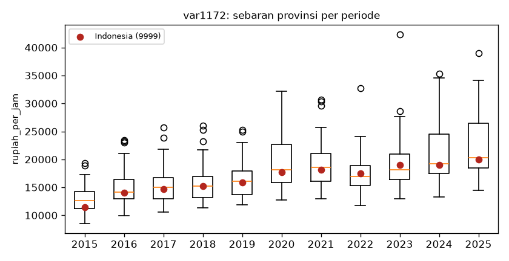
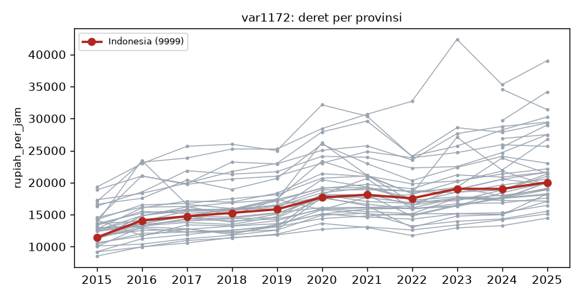
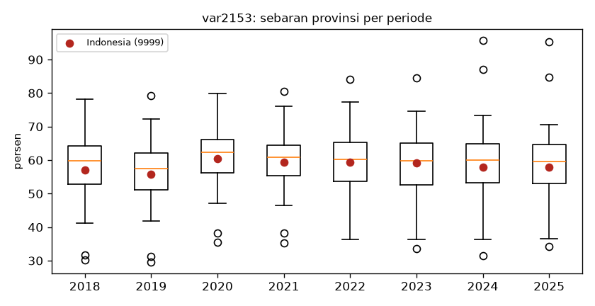
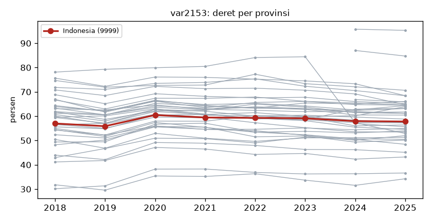

# Profil dan calon anomali seri utama

Dihasilkan `python pipeline.py` (`src/silver/profil.py`). Hanya baris provinsi deret utama (rincian `total`, atau rincian yang didaftar di `DERET` untuk seri yang terbit per rincian; label `kode [rincian]`); baris Indonesia ditampilkan terpisah dan tidak ikut statistik antarprovinsi.

## Banyak periode per provinsi (menentukan arah pembanding)

| seri_kode | min_periode_per_provinsi | maks_periode_per_provinsi |
|---|---|---|
| var1172 | 2 | 11 |
| var2153 | 2 | 8 |

- var1172: tiga arah (periode per provinsi 2–11)
- var2153: tiga arah (periode per provinsi 2–8)

Metode: IQR dengan pengali 1.5; arah ke samping hanya bila satu provinsi punya paling sedikit 6 periode. Sel yang ditandai lebih dari satu arah ditulis satu baris. Provinsi yang di luar batas ke bawah pada ≥ 50% periode diberi tanda `berulang`: itu perbedaan struktural antarprovinsi, bukan kejadian satu tahun. Lihat log untuk alasan memilih IQR.

## Statistik deskriptif per seri per periode (provinsi)

| seri_kode | periode | n | rerata | simpangan | minimum | q1 | median | q3 | maksimum |
|---|---|---|---|---|---|---|---|---|---|
| var1172 | 2015 | 34 | 12,972.68 | 2,683.00 | 8,525.00 | 11,229.75 | 12,665.50 | 14,206.25 | 19,290.00 |
| var1172 | 2016 | 34 | 15,115.44 | 3,723.52 | 9,940.00 | 12,923.00 | 14,132.00 | 16,424.50 | 23,444.00 |
| var1172 | 2017 | 34 | 15,697.53 | 3,617.94 | 10,569.00 | 12,937.00 | 15,002.00 | 16,703.75 | 25,657.00 |
| var1172 | 2018 | 34 | 15,911.38 | 3,890.38 | 11,359.00 | 13,224.75 | 15,268.00 | 16,926.25 | 25,987.00 |
| var1172 | 2019 | 34 | 16,653.26 | 3,700.37 | 11,828.00 | 13,700.25 | 16,059.50 | 17,923.75 | 25,236.00 |
| var1172 | 2020 | 34 | 19,537.76 | 4,721.60 | 12,707.00 | 15,867.25 | 18,138.00 | 22,623.75 | 32,138.00 |
| var1172 | 2021 | 34 | 19,422.97 | 4,638.77 | 12,992.00 | 16,064.00 | 18,572.50 | 21,108.25 | 30,662.00 |
| var1172 | 2022 | 34 | 17,901.47 | 4,181.44 | 11,734.00 | 15,320.00 | 16,931.50 | 18,943.75 | 32,685.00 |
| var1172 | 2023 | 34 | 19,662.03 | 5,664.10 | 12,933.00 | 16,413.50 | 18,094.50 | 20,959.75 | 42,354.00 |
| var1172 | 2024 | 38 | 21,058.18 | 5,527.99 | 13,267.00 | 17,507.75 | 19,225.00 | 24,530.00 | 35,281.00 |
| var1172 | 2025 | 38 | 22,253.37 | 5,689.15 | 14,449.96 | 18,412.22 | 20,275.46 | 26,461.40 | 39,018.92 |
| var2153 | 2018 | 34 | 58.10 | 11.39 | 30.15 | 52.85 | 59.81 | 64.26 | 78.11 |
| var2153 | 2019 | 34 | 56.58 | 10.77 | 29.57 | 51.18 | 57.55 | 62.09 | 79.29 |
| var2153 | 2020 | 34 | 61.01 | 9.62 | 35.41 | 56.15 | 62.43 | 66.24 | 79.92 |
| var2153 | 2021 | 34 | 60.21 | 9.63 | 35.20 | 55.39 | 60.78 | 64.35 | 80.47 |
| var2153 | 2022 | 34 | 59.95 | 10.57 | 36.32 | 53.58 | 60.22 | 65.19 | 84.11 |
| var2153 | 2023 | 34 | 59.35 | 10.41 | 33.67 | 52.71 | 59.80 | 65.11 | 84.43 |
| var2153 | 2024 | 38 | 59.46 | 11.89 | 31.55 | 53.23 | 59.91 | 64.97 | 95.76 |
| var2153 | 2025 | 38 | 59.06 | 11.28 | 34.25 | 53.03 | 59.62 | 64.55 | 95.30 |

## Baris Indonesia

| seri_kode | periode | nilai | rujukan_tahun |
|---|---|---|---|
| var1172 | 2015 | 11,434.00 | <NA> |
| var1172 | 2016 | 14,068.00 | <NA> |
| var1172 | 2017 | 14,731.00 | <NA> |
| var1172 | 2018 | 15,275.00 | <NA> |
| var1172 | 2019 | 15,823.00 | <NA> |
| var1172 | 2020 | 17,696.00 | <NA> |
| var1172 | 2021 | 18,089.00 | <NA> |
| var1172 | 2022 | 17,542.00 | <NA> |
| var1172 | 2023 | 19,027.00 | <NA> |
| var1172 | 2024 | 19,009.00 | <NA> |
| var1172 | 2025 | 20,030.36 | <NA> |
| var2153 | 2018 | 56.98 | <NA> |
| var2153 | 2019 | 55.88 | <NA> |
| var2153 | 2020 | 60.47 | <NA> |
| var2153 | 2021 | 59.45 | <NA> |
| var2153 | 2022 | 59.31 | <NA> |
| var2153 | 2023 | 59.11 | <NA> |
| var2153 | 2024 | 57.95 | <NA> |
| var2153 | 2025 | 57.80 | <NA> |

## Calon anomali (83)

Daftar lengkap di `reports/calon-anomali.csv`; kategorinya di `reports/anomali.csv`.

| seri_kode | wilayah_kode | nama_wilayah | periode | nilai | arah | alasan | berulang |
|---|---|---|---|---|---|---|---|
| var1172 | 2100 | Kepulauan Riau | 2015 | 18,863.00 | ke bawah | di luar [6765.00, 18671.00] (IQR x 1.5) dibanding 34 provinsi tahun itu | False |
| var1172 | 3600 | Banten | 2015 | 14,228.00 | ke samping | di luar [14817.00, 30729.00] dibanding 11 tahun di provinsi ini | False |
| var1172 | 5100 | Bali | 2015 | 11,038.00 | ke samping | di luar [12169.25, 21735.25] dibanding 11 tahun di provinsi ini | False |
| var1172 | 6400 | Kalimantan Timur | 2015 | 16,323.00 | ke samping | di luar [17712.50, 27804.50] dibanding 11 tahun di provinsi ini | False |
| var1172 | 9400 | Papua | 2015 | 19,290.00 | ke bawah | di luar [6765.00, 18671.00] (IQR x 1.5) dibanding 34 provinsi tahun itu | True |
| var1172 | 3100 | DKI Jakarta | 2016 | 23,181.00 | ke bawah + perubahan | di luar [7670.75, 21676.75] (IQR x 1.5) dibanding 34 provinsi tahun itu; perubahan 2015→2016 sebesar +6169.00 di luar [-1189.38, 4513.62] | True |
| var1172 | 3600 | Banten | 2016 | 21,033.00 | perubahan | perubahan 2015→2016 sebesar +6805.00 di luar [-1189.38, 4513.62] | False |
| var1172 | 7400 | Sulawesi Tenggara | 2016 | 23,444.00 | ke bawah + perubahan | di luar [7670.75, 21676.75] (IQR x 1.5) dibanding 34 provinsi tahun itu; perubahan 2015→2016 sebesar +9783.00 di luar [-1189.38, 4513.62] | False |
| var1172 | 7600 | Sulawesi Barat | 2016 | 11,730.00 | perubahan | perubahan 2015→2016 sebesar -2441.00 di luar [-1189.38, 4513.62] | False |
| var1172 | 9400 | Papua | 2016 | 22,961.00 | ke bawah | di luar [7670.75, 21676.75] (IQR x 1.5) dibanding 34 provinsi tahun itu | True |
| var1172 | 3100 | DKI Jakarta | 2017 | 23,826.00 | ke bawah | di luar [7286.88, 22353.88] (IQR x 1.5) dibanding 34 provinsi tahun itu | True |
| var1172 | 3600 | Banten | 2017 | 19,719.00 | perubahan | perubahan 2016→2017 sebesar -1314.00 di luar [-1218.00, 2600.00] | False |
| var1172 | 6400 | Kalimantan Timur | 2017 | 21,864.00 | perubahan | perubahan 2016→2017 sebesar +3350.00 di luar [-1218.00, 2600.00] | False |
| var1172 | 6500 | Kalimantan Utara | 2017 | 20,392.00 | perubahan | perubahan 2016→2017 sebesar +2845.00 di luar [-1218.00, 2600.00] | False |
| var1172 | 7400 | Sulawesi Tenggara | 2017 | 16,604.00 | perubahan | perubahan 2016→2017 sebesar -6840.00 di luar [-1218.00, 2600.00] | False |
| var1172 | 9400 | Papua | 2017 | 25,657.00 | ke bawah + perubahan | di luar [7286.88, 22353.88] (IQR x 1.5) dibanding 34 provinsi tahun itu; perubahan 2016→2017 sebesar +2696.00 di luar [-1218.00, 2600.00] | True |
| var1172 | 2100 | Kepulauan Riau | 2018 | 23,212.00 | ke bawah + perubahan | di luar [7672.50, 22478.50] (IQR x 1.5) dibanding 34 provinsi tahun itu; perubahan 2017→2018 sebesar +3380.00 di luar [-1601.75, 1948.25] | False |
| var1172 | 3100 | DKI Jakarta | 2018 | 25,238.00 | ke bawah | di luar [7672.50, 22478.50] (IQR x 1.5) dibanding 34 provinsi tahun itu | True |
| var1172 | 9400 | Papua | 2018 | 25,987.00 | ke bawah | di luar [7672.50, 22478.50] (IQR x 1.5) dibanding 34 provinsi tahun itu | True |
| var1172 | 3100 | DKI Jakarta | 2019 | 25,236.00 | ke bawah | di luar [7365.00, 24259.00] (IQR x 1.5) dibanding 34 provinsi tahun itu | True |
| var1172 | 9400 | Papua | 2019 | 24,984.00 | ke bawah + perubahan | di luar [7365.00, 24259.00] (IQR x 1.5) dibanding 34 provinsi tahun itu; perubahan 2018→2019 sebesar -1003.00 di luar [-880.50, 2517.50] | True |
| var1172 | 1900 | Kepulauan Bangka Belitung | 2020 | 15,763.00 | perubahan | perubahan 2019→2020 sebesar -1610.00 di luar [-876.75, 5949.25] | False |
| var1172 | 8100 | Maluku | 2020 | 26,198.00 | perubahan + ke samping | perubahan 2019→2020 sebesar +8892.00 di luar [-876.75, 5949.25]; di luar [10544.75, 25662.75] dibanding 11 tahun di provinsi ini | False |
| var1172 | 9400 | Papua | 2020 | 32,138.00 | perubahan | perubahan 2019→2020 sebesar +7154.00 di luar [-876.75, 5949.25] | True |
| var1172 | 3100 | DKI Jakarta | 2021 | 30,662.00 | ke bawah | di luar [8497.62, 28674.62] (IQR x 1.5) dibanding 34 provinsi tahun itu | True |
| var1172 | 6500 | Kalimantan Utara | 2021 | 22,972.00 | perubahan | perubahan 2020→2021 sebesar -3030.00 di luar [-2690.00, 2714.00] | False |
| var1172 | 8100 | Maluku | 2021 | 21,156.00 | perubahan | perubahan 2020→2021 sebesar -5042.00 di luar [-2690.00, 2714.00] | False |
| var1172 | 9100 | Papua Barat | 2021 | 29,600.00 | ke bawah | di luar [8497.62, 28674.62] (IQR x 1.5) dibanding 34 provinsi tahun itu | False |
| var1172 | 9400 | Papua | 2021 | 30,382.00 | ke bawah | di luar [8497.62, 28674.62] (IQR x 1.5) dibanding 34 provinsi tahun itu | True |
| var1172 | 3100 | DKI Jakarta | 2022 | 32,685.00 | ke bawah | di luar [9884.38, 24379.38] (IQR x 1.5) dibanding 34 provinsi tahun itu | True |
| var1172 | 9400 | Papua | 2022 | 24,097.00 | perubahan | perubahan 2021→2022 sebesar -6285.00 di luar [-5887.88, 3085.12] | True |
| var1172 | 2100 | Kepulauan Riau | 2023 | 27,640.00 | perubahan | perubahan 2022→2023 sebesar +4112.00 di luar [-1483.75, 4004.25] | False |
| var1172 | 3100 | DKI Jakarta | 2023 | 42,354.00 | ke bawah + perubahan | di luar [9594.12, 27779.12] (IQR x 1.5) dibanding 34 provinsi tahun itu; perubahan 2022→2023 sebesar +9669.00 di luar [-1483.75, 4004.25] | True |
| var1172 | 8200 | Maluku Utara | 2023 | 27,078.00 | perubahan | perubahan 2022→2023 sebesar +8800.00 di luar [-1483.75, 4004.25] | False |
| var1172 | 9400 | Papua | 2023 | 28,570.00 | ke bawah + perubahan | di luar [9594.12, 27779.12] (IQR x 1.5) dibanding 34 provinsi tahun itu; perubahan 2022→2023 sebesar +4473.00 di luar [-1483.75, 4004.25] | True |
| var1172 | 3100 | DKI Jakarta | 2024 | 35,281.00 | ke bawah + perubahan | di luar [6974.38, 35063.38] (IQR x 1.5) dibanding 38 provinsi tahun itu; perubahan 2023→2024 sebesar -7073.00 di luar [-2362.62, 3900.38] | True |
| var1172 | 7100 | Sulawesi Utara | 2024 | 23,831.00 | perubahan | perubahan 2023→2024 sebesar +4561.00 di luar [-2362.62, 3900.38] | False |
| var1172 | 8200 | Maluku Utara | 2024 | 21,965.00 | perubahan | perubahan 2023→2024 sebesar -5113.00 di luar [-2362.62, 3900.38] | False |
| var1172 | 1900 | Kepulauan Bangka Belitung | 2025 | 19,614.14 | perubahan | perubahan 2024→2025 sebesar -2191.86 di luar [-1517.11, 4323.34] | False |
| var1172 | 3100 | DKI Jakarta | 2025 | 39,018.92 | ke bawah | di luar [6338.45, 38535.16] (IQR x 1.5) dibanding 38 provinsi tahun itu | True |
| var1172 | 7100 | Sulawesi Utara | 2025 | 21,434.42 | perubahan | perubahan 2024→2025 sebesar -2396.58 di luar [-1517.11, 4323.34] | False |
| var1172 | 8200 | Maluku Utara | 2025 | 26,731.96 | perubahan | perubahan 2024→2025 sebesar +4766.96 di luar [-1517.11, 4323.34] | False |
| var1172 | 9600 | Papua Tengah | 2025 | 34,165.28 | perubahan | perubahan 2024→2025 sebesar +4507.28 di luar [-1517.11, 4323.34] | False |
| var1172 | 9700 | Papua Pegunungan | 2025 | 31,388.46 | perubahan | perubahan 2024→2025 sebesar -3199.54 di luar [-1517.11, 4323.34] | False |
| var2153 | 2100 | Kepulauan Riau | 2018 | 31.78 | ke bawah | di luar [35.74, 81.38] (IQR x 1.5) dibanding 34 provinsi tahun itu | True |
| var2153 | 3100 | DKI Jakarta | 2018 | 30.15 | ke bawah + ke samping | di luar [35.74, 81.38] (IQR x 1.5) dibanding 34 provinsi tahun itu; di luar [31.70, 40.52] dibanding 8 tahun di provinsi ini | True |
| var2153 | 3200 | Jawa Barat | 2018 | 48.21 | ke samping | di luar [50.86, 57.49] dibanding 8 tahun di provinsi ini | False |
| var2153 | 6500 | Kalimantan Utara | 2018 | 42.95 | ke samping | di luar [43.82, 54.97] dibanding 8 tahun di provinsi ini | False |
| var2153 | 1900 | Kepulauan Bangka Belitung | 2019 | 46.82 | ke samping | di luar [48.81, 52.60] dibanding 8 tahun di provinsi ini | False |
| var2153 | 2100 | Kepulauan Riau | 2019 | 29.57 | ke bawah | di luar [34.80, 78.47] (IQR x 1.5) dibanding 34 provinsi tahun itu | True |
| var2153 | 3100 | DKI Jakarta | 2019 | 31.35 | ke bawah + ke samping | di luar [34.80, 78.47] (IQR x 1.5) dibanding 34 provinsi tahun itu; di luar [31.70, 40.52] dibanding 8 tahun di provinsi ini | True |
| var2153 | 3200 | Jawa Barat | 2019 | 50.20 | ke samping | di luar [50.86, 57.49] dibanding 8 tahun di provinsi ini | False |
| var2153 | 6500 | Kalimantan Utara | 2019 | 46.69 | perubahan | perubahan 2018→2019 sebesar +3.74 di luar [-6.07, 2.72] | False |
| var2153 | 7500 | Gorontalo | 2019 | 58.66 | ke samping | di luar [59.34, 64.75] dibanding 8 tahun di provinsi ini | False |
| var2153 | 9400 | Papua | 2019 | 79.29 | ke bawah | di luar [34.80, 78.47] (IQR x 1.5) dibanding 34 provinsi tahun itu | True |
| var2153 | 1900 | Kepulauan Bangka Belitung | 2020 | 52.93 | ke samping | di luar [48.81, 52.60] dibanding 8 tahun di provinsi ini | False |
| var2153 | 2100 | Kepulauan Riau | 2020 | 35.41 | ke bawah | di luar [41.01, 81.38] (IQR x 1.5) dibanding 34 provinsi tahun itu | True |
| var2153 | 3100 | DKI Jakarta | 2020 | 38.22 | ke bawah | di luar [41.01, 81.38] (IQR x 1.5) dibanding 34 provinsi tahun itu | True |
| var2153 | 3300 | Jawa Tengah | 2020 | 62.75 | ke samping | di luar [57.88, 62.01] dibanding 8 tahun di provinsi ini | False |
| var2153 | 3400 | DI Yogyakarta | 2020 | 57.41 | ke samping | di luar [51.27, 56.72] dibanding 8 tahun di provinsi ini | False |
| var2153 | 7400 | Sulawesi Tenggara | 2020 | 64.59 | ke samping | di luar [60.43, 64.35] dibanding 8 tahun di provinsi ini | False |
| var2153 | 7600 | Sulawesi Barat | 2020 | 72.63 | perubahan | perubahan 2019→2020 sebesar +0.72 di luar [1.01, 8.33] | False |
| var2153 | 9400 | Papua | 2020 | 79.92 | perubahan | perubahan 2019→2020 sebesar +0.63 di luar [1.01, 8.33] | True |
| var2153 | 2100 | Kepulauan Riau | 2021 | 35.20 | ke bawah | di luar [41.97, 77.78] (IQR x 1.5) dibanding 34 provinsi tahun itu | True |
| var2153 | 3100 | DKI Jakarta | 2021 | 38.26 | ke bawah | di luar [41.97, 77.78] (IQR x 1.5) dibanding 34 provinsi tahun itu | True |
| var2153 | 9400 | Papua | 2021 | 80.47 | ke bawah | di luar [41.97, 77.78] (IQR x 1.5) dibanding 34 provinsi tahun itu | True |
| var2153 | 7500 | Gorontalo | 2022 | 64.97 | ke samping | di luar [59.34, 64.75] dibanding 8 tahun di provinsi ini | False |
| var2153 | 7600 | Sulawesi Barat | 2022 | 77.25 | perubahan + ke samping | perubahan 2021→2022 sebesar +4.45 di luar [-4.83, 4.03]; di luar [69.57, 76.16] dibanding 8 tahun di provinsi ini | False |
| var2153 | 9400 | Papua | 2022 | 84.11 | ke bawah | di luar [36.16, 82.60] (IQR x 1.5) dibanding 34 provinsi tahun itu | True |
| var2153 | 2100 | Kepulauan Riau | 2023 | 33.67 | ke bawah | di luar [34.10, 83.72] (IQR x 1.5) dibanding 34 provinsi tahun itu | True |
| var2153 | 9400 | Papua | 2023 | 84.43 | ke bawah | di luar [34.10, 83.72] (IQR x 1.5) dibanding 34 provinsi tahun itu | True |
| var2153 | 2100 | Kepulauan Riau | 2024 | 31.55 | ke bawah | di luar [35.62, 82.58] (IQR x 1.5) dibanding 38 provinsi tahun itu | True |
| var2153 | 9100 | Papua Barat | 2024 | 62.87 | perubahan | perubahan 2023→2024 sebesar +4.32 di luar [-3.99, 1.33] | False |
| var2153 | 9400 | Papua | 2024 | 57.28 | perubahan + ke samping | perubahan 2023→2024 sebesar -27.15 di luar [-3.99, 1.33]; di luar [60.19, 94.10] dibanding 8 tahun di provinsi ini | True |
| var2153 | 9600 | Papua Tengah | 2024 | 87.02 | ke bawah | di luar [35.62, 82.58] (IQR x 1.5) dibanding 38 provinsi tahun itu | True |
| var2153 | 9700 | Papua Pegunungan | 2024 | 95.76 | ke bawah | di luar [35.62, 82.58] (IQR x 1.5) dibanding 38 provinsi tahun itu | True |
| var2153 | 1100 | Aceh | 2025 | 63.91 | perubahan | perubahan 2024→2025 sebesar +3.74 di luar [-3.39, 2.86] | False |
| var2153 | 1800 | Lampung | 2025 | 64.72 | perubahan + ke samping | perubahan 2024→2025 sebesar -4.42 di luar [-3.39, 2.86]; di luar [65.40, 74.93] dibanding 8 tahun di provinsi ini | False |
| var2153 | 2100 | Kepulauan Riau | 2025 | 34.25 | ke bawah | di luar [35.74, 81.84] (IQR x 1.5) dibanding 38 provinsi tahun itu | True |
| var2153 | 5300 | Nusa Tenggara Timur | 2025 | 68.44 | perubahan + ke samping | perubahan 2024→2025 sebesar -4.88 di luar [-3.39, 2.86]; di luar [69.04, 79.74] dibanding 8 tahun di provinsi ini | False |
| var2153 | 9400 | Papua | 2025 | 52.88 | perubahan + ke samping | perubahan 2024→2025 sebesar -4.40 di luar [-3.39, 2.86]; di luar [60.19, 94.10] dibanding 8 tahun di provinsi ini | True |
| var2153 | 9600 | Papua Tengah | 2025 | 84.72 | ke bawah | di luar [35.74, 81.84] (IQR x 1.5) dibanding 38 provinsi tahun itu | True |
| var2153 | 9700 | Papua Pegunungan | 2025 | 95.30 | ke bawah | di luar [35.74, 81.84] (IQR x 1.5) dibanding 38 provinsi tahun itu | True |

## Gambar

