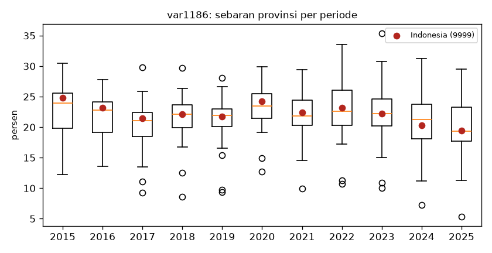
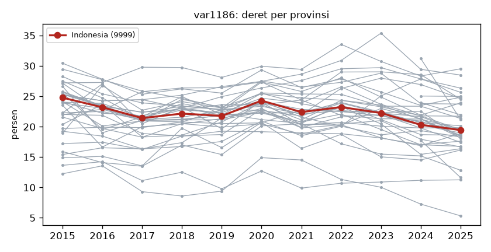
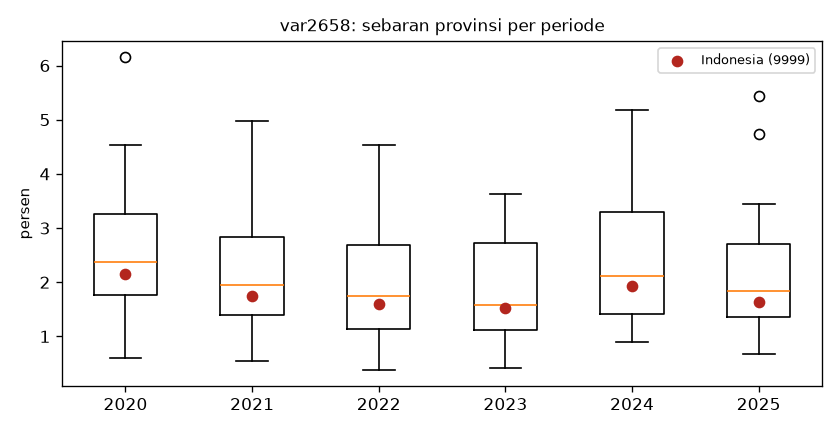
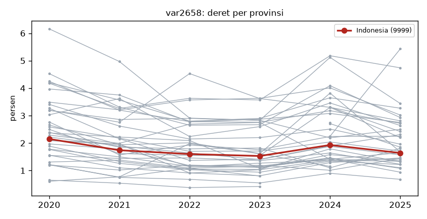

# Profil dan calon anomali seri utama

Dihasilkan `python pipeline.py` (`src/silver/profil.py`). Hanya baris provinsi deret utama (rincian `total`, atau rincian yang didaftar di `DERET` untuk seri yang terbit per rincian; label `kode [rincian]`); baris Indonesia ditampilkan terpisah dan tidak ikut statistik antarprovinsi.

## Banyak periode per provinsi (menentukan arah pembanding)

| seri_kode | min_periode_per_provinsi | maks_periode_per_provinsi |
|---|---|---|
| var1186 | 2 | 11 |
| var2658 | 1 | 6 |

- var1186: tiga arah (periode per provinsi 2–11)
- var2658: tiga arah (periode per provinsi 1–6)

Metode: IQR dengan pengali 1.5; arah ke samping hanya bila satu provinsi punya paling sedikit 6 periode. Sel yang ditandai lebih dari satu arah ditulis satu baris. Provinsi yang di luar batas ke bawah pada ≥ 50% periode diberi tanda `berulang`: itu perbedaan struktural antarprovinsi, bukan kejadian satu tahun. Lihat log untuk alasan memilih IQR.

## Statistik deskriptif per seri per periode (provinsi)

| seri_kode | periode | n | rerata | simpangan | minimum | q1 | median | q3 | maksimum |
|---|---|---|---|---|---|---|---|---|---|
| var1186 | 2015 | 34 | 22.71 | 4.61 | 12.25 | 19.87 | 23.96 | 25.62 | 30.44 |
| var1186 | 2016 | 34 | 21.64 | 4.07 | 13.56 | 19.12 | 22.78 | 24.15 | 27.80 |
| var1186 | 2017 | 34 | 20.38 | 4.27 | 9.31 | 18.45 | 21.06 | 22.39 | 29.78 |
| var1186 | 2018 | 34 | 21.45 | 4.01 | 8.59 | 19.92 | 22.16 | 23.70 | 29.73 |
| var1186 | 2019 | 34 | 21.23 | 3.98 | 9.40 | 20.07 | 21.95 | 23.01 | 28.10 |
| var1186 | 2020 | 34 | 23.30 | 3.58 | 12.71 | 21.43 | 23.48 | 25.47 | 29.94 |
| var1186 | 2021 | 34 | 21.98 | 3.94 | 9.89 | 20.30 | 21.87 | 24.38 | 29.43 |
| var1186 | 2022 | 34 | 23.00 | 4.80 | 10.70 | 20.34 | 22.62 | 26.05 | 33.54 |
| var1186 | 2023 | 34 | 22.32 | 5.21 | 10.03 | 20.17 | 22.25 | 24.57 | 35.38 |
| var1186 | 2024 | 38 | 21.15 | 5.03 | 7.26 | 18.12 | 21.24 | 23.71 | 31.20 |
| var1186 | 2025 | 38 | 19.75 | 4.81 | 5.33 | 17.73 | 19.33 | 23.28 | 29.52 |
| var2658 | 2020 | 34 | 2.58 | 1.22 | 0.61 | 1.77 | 2.38 | 3.25 | 6.16 |
| var2658 | 2021 | 34 | 2.12 | 1.04 | 0.54 | 1.40 | 1.94 | 2.83 | 4.97 |
| var2658 | 2022 | 34 | 1.91 | 0.95 | 0.38 | 1.14 | 1.75 | 2.68 | 4.53 |
| var2658 | 2023 | 34 | 1.82 | 0.92 | 0.42 | 1.12 | 1.58 | 2.73 | 3.63 |
| var2658 | 2024 | 36 | 2.40 | 1.16 | 0.90 | 1.42 | 2.12 | 3.30 | 5.18 |
| var2658 | 2025 | 34 | 2.12 | 1.04 | 0.68 | 1.37 | 1.83 | 2.70 | 5.43 |

## Baris Indonesia

| seri_kode | periode | nilai | rujukan_tahun |
|---|---|---|---|
| var1186 | 2015 | 24.77 | <NA> |
| var1186 | 2016 | 23.19 | <NA> |
| var1186 | 2017 | 21.41 | <NA> |
| var1186 | 2018 | 22.15 | <NA> |
| var1186 | 2019 | 21.77 | <NA> |
| var1186 | 2020 | 24.28 | <NA> |
| var1186 | 2021 | 22.40 | <NA> |
| var1186 | 2022 | 23.22 | <NA> |
| var1186 | 2023 | 22.25 | <NA> |
| var1186 | 2024 | 20.31 | <NA> |
| var1186 | 2025 | 19.44 | <NA> |
| var2658 | 2020 | 2.15 | <NA> |
| var2658 | 2021 | 1.74 | <NA> |
| var2658 | 2022 | 1.60 | <NA> |
| var2658 | 2023 | 1.53 | <NA> |
| var2658 | 2024 | 1.93 | <NA> |
| var2658 | 2025 | 1.64 | <NA> |

## Calon anomali (72)

Daftar lengkap di `reports/calon-anomali.csv`; kategorinya di `reports/anomali.csv`.

| seri_kode | wilayah_kode | nama_wilayah | periode | nilai | arah | alasan | berulang |
|---|---|---|---|---|---|---|---|
| var1186 | 1800 | Lampung | 2015 | 28.26 | ke samping | di luar [20.57, 25.52] dibanding 11 tahun di provinsi ini | False |
| var1186 | 7200 | Sulawesi Tengah | 2015 | 26.64 | ke samping | di luar [18.61, 24.59] dibanding 11 tahun di provinsi ini | False |
| var1186 | 6400 | Kalimantan Timur | 2016 | 27.04 | perubahan | perubahan 2015→2016 sebesar +4.79 di luar [-6.17, 4.06] | False |
| var1186 | 7200 | Sulawesi Tengah | 2016 | 18.99 | perubahan | perubahan 2015→2016 sebesar -7.65 di luar [-6.17, 4.06] | False |
| var1186 | 7400 | Sulawesi Tenggara | 2016 | 16.64 | perubahan + ke samping | perubahan 2015→2016 sebesar -6.88 di luar [-6.17, 4.06]; di luar [16.95, 24.69] dibanding 11 tahun di provinsi ini | False |
| var1186 | 7600 | Sulawesi Barat | 2016 | 26.76 | perubahan | perubahan 2015→2016 sebesar +7.84 di luar [-6.17, 4.06] | False |
| var1186 | 3400 | DI Yogyakarta | 2017 | 11.13 | ke bawah | di luar [12.52, 28.32] (IQR x 1.5) dibanding 34 provinsi tahun itu | True |
| var1186 | 5100 | Bali | 2017 | 9.31 | ke bawah | di luar [12.52, 28.32] (IQR x 1.5) dibanding 34 provinsi tahun itu | True |
| var1186 | 6400 | Kalimantan Timur | 2017 | 20.47 | perubahan | perubahan 2016→2017 sebesar -6.57 di luar [-5.94, 3.42] | False |
| var1186 | 7100 | Sulawesi Utara | 2017 | 29.78 | ke bawah | di luar [12.52, 28.32] (IQR x 1.5) dibanding 34 provinsi tahun itu | False |
| var1186 | 2100 | Kepulauan Riau | 2018 | 19.74 | perubahan | perubahan 2017→2018 sebesar +6.19 di luar [-2.12, 3.88] | False |
| var1186 | 3400 | DI Yogyakarta | 2018 | 12.52 | ke bawah | di luar [14.25, 29.37] (IQR x 1.5) dibanding 34 provinsi tahun itu | True |
| var1186 | 5100 | Bali | 2018 | 8.59 | ke bawah | di luar [14.25, 29.37] (IQR x 1.5) dibanding 34 provinsi tahun itu | True |
| var1186 | 7100 | Sulawesi Utara | 2018 | 29.73 | ke bawah | di luar [14.25, 29.37] (IQR x 1.5) dibanding 34 provinsi tahun itu | False |
| var1186 | 3100 | DKI Jakarta | 2019 | 15.41 | ke bawah | di luar [15.67, 27.42] (IQR x 1.5) dibanding 34 provinsi tahun itu | False |
| var1186 | 3400 | DI Yogyakarta | 2019 | 9.78 | ke bawah | di luar [15.67, 27.42] (IQR x 1.5) dibanding 34 provinsi tahun itu | True |
| var1186 | 5100 | Bali | 2019 | 9.40 | ke bawah | di luar [15.67, 27.42] (IQR x 1.5) dibanding 34 provinsi tahun itu | True |
| var1186 | 6500 | Kalimantan Utara | 2019 | 21.42 | perubahan | perubahan 2018→2019 sebesar +4.05 di luar [-4.12, 3.79] | False |
| var1186 | 7100 | Sulawesi Utara | 2019 | 28.10 | ke bawah | di luar [15.67, 27.42] (IQR x 1.5) dibanding 34 provinsi tahun itu | False |
| var1186 | 3400 | DI Yogyakarta | 2020 | 12.71 | ke bawah | di luar [15.37, 31.53] (IQR x 1.5) dibanding 34 provinsi tahun itu | True |
| var1186 | 5100 | Bali | 2020 | 14.90 | ke bawah | di luar [15.37, 31.53] (IQR x 1.5) dibanding 34 provinsi tahun itu | True |
| var1186 | 3400 | DI Yogyakarta | 2021 | 9.89 | ke bawah | di luar [14.17, 30.50] (IQR x 1.5) dibanding 34 provinsi tahun itu | True |
| var1186 | 3400 | DI Yogyakarta | 2022 | 10.70 | ke bawah | di luar [11.77, 34.62] (IQR x 1.5) dibanding 34 provinsi tahun itu | True |
| var1186 | 5100 | Bali | 2022 | 11.32 | ke bawah | di luar [11.77, 34.62] (IQR x 1.5) dibanding 34 provinsi tahun itu | True |
| var1186 | 6200 | Kalimantan Tengah | 2022 | 26.54 | ke samping | di luar [19.38, 26.45] dibanding 11 tahun di provinsi ini | False |
| var1186 | 7100 | Sulawesi Utara | 2022 | 33.54 | ke samping | di luar [25.75, 32.33] dibanding 11 tahun di provinsi ini | False |
| var1186 | 3400 | DI Yogyakarta | 2023 | 10.89 | ke bawah | di luar [13.57, 31.17] (IQR x 1.5) dibanding 34 provinsi tahun itu | True |
| var1186 | 5100 | Bali | 2023 | 10.03 | ke bawah | di luar [13.57, 31.17] (IQR x 1.5) dibanding 34 provinsi tahun itu | True |
| var1186 | 8100 | Maluku | 2023 | 35.38 | ke bawah + perubahan + ke samping | di luar [13.57, 31.17] (IQR x 1.5) dibanding 34 provinsi tahun itu; perubahan 2022→2023 sebesar +4.49 di luar [-5.46, 3.51]; di luar [19.46, 34.78] dibanding 11 tahun di provinsi ini | False |
| var1186 | 9400 | Papua | 2023 | 25.06 | perubahan | perubahan 2022→2023 sebesar +4.99 di luar [-5.46, 3.51] | False |
| var1186 | 5100 | Bali | 2024 | 7.26 | ke bawah | di luar [9.73, 32.11] (IQR x 1.5) dibanding 38 provinsi tahun itu | True |
| var1186 | 5200 | Nusa Tenggara Barat | 2024 | 15.44 | ke samping | di luar [15.82, 26.94] dibanding 11 tahun di provinsi ini | False |
| var1186 | 8100 | Maluku | 2024 | 29.43 | perubahan | perubahan 2023→2024 sebesar -5.95 di luar [-5.24, 2.39] | False |
| var1186 | 9400 | Papua | 2024 | 27.85 | perubahan | perubahan 2023→2024 sebesar +2.79 di luar [-5.24, 2.39] | False |
| var1186 | 1800 | Lampung | 2025 | 18.07 | ke samping | di luar [20.57, 25.52] dibanding 11 tahun di provinsi ini | False |
| var1186 | 3300 | Jawa Tengah | 2025 | 16.67 | ke samping | di luar [16.96, 26.08] dibanding 11 tahun di provinsi ini | False |
| var1186 | 3500 | Jawa Timur | 2025 | 16.76 | ke samping | di luar [17.01, 25.38] dibanding 11 tahun di provinsi ini | False |
| var1186 | 5100 | Bali | 2025 | 5.33 | ke bawah | di luar [9.42, 31.59] (IQR x 1.5) dibanding 38 provinsi tahun itu | True |
| var1186 | 7300 | Sulawesi Selatan | 2025 | 19.20 | ke samping | di luar [19.54, 25.76] dibanding 11 tahun di provinsi ini | False |
| var1186 | 9600 | Papua Tengah | 2025 | 21.18 | perubahan | perubahan 2024→2025 sebesar -10.02 di luar [-5.68, 3.30] | False |
| var1186 | 9700 | Papua Pegunungan | 2025 | 11.62 | perubahan | perubahan 2024→2025 sebesar -6.12 di luar [-5.68, 3.30] | False |
| var2658 | 1100 | Aceh | 2020 | 1.22 | ke samping | di luar [0.41, 1.14] dibanding 6 tahun di provinsi ini | False |
| var2658 | 1200 | Sumatera Utara | 2020 | 4.25 | ke samping | di luar [2.12, 3.84] dibanding 6 tahun di provinsi ini | False |
| var2658 | 1900 | Kepulauan Bangka Belitung | 2020 | 2.39 | ke samping | di luar [1.72, 1.91] dibanding 6 tahun di provinsi ini | False |
| var2658 | 3500 | Jawa Timur | 2020 | 1.77 | ke samping | di luar [0.71, 1.68] dibanding 6 tahun di provinsi ini | False |
| var2658 | 7400 | Sulawesi Tenggara | 2020 | 6.16 | ke bawah | di luar [-0.45, 5.47] (IQR x 1.5) dibanding 34 provinsi tahun itu | False |
| var2658 | 9100 | Papua Barat | 2020 | 3.41 | ke samping | di luar [1.52, 3.24] dibanding 6 tahun di provinsi ini | False |
| var2658 | 3600 | Banten | 2021 | 0.76 | ke samping | di luar [0.91, 1.37] dibanding 6 tahun di provinsi ini | False |
| var2658 | 2100 | Kepulauan Riau | 2022 | 1.98 | perubahan | perubahan 2021→2022 sebesar +1.21 di luar [-1.52, 1.01] | False |
| var2658 | 7400 | Sulawesi Tenggara | 2022 | 2.91 | perubahan | perubahan 2021→2022 sebesar -2.06 di luar [-1.52, 1.01] | False |
| var2658 | 7500 | Gorontalo | 2022 | 4.53 | perubahan + ke samping | perubahan 2021→2022 sebesar +1.77 di luar [-1.52, 1.01]; di luar [1.96, 4.49] dibanding 6 tahun di provinsi ini | False |
| var2658 | 2100 | Kepulauan Riau | 2023 | 1.61 | perubahan | perubahan 2022→2023 sebesar -0.37 di luar [-0.32, 0.27] | False |
| var2658 | 6100 | Kalimantan Barat | 2023 | 1.08 | perubahan | perubahan 2022→2023 sebesar -1.01 di luar [-0.32, 0.27] | False |
| var2658 | 6500 | Kalimantan Utara | 2023 | 2.60 | perubahan | perubahan 2022→2023 sebesar +0.36 di luar [-0.32, 0.27] | False |
| var2658 | 7500 | Gorontalo | 2023 | 3.62 | perubahan | perubahan 2022→2023 sebesar -0.91 di luar [-0.32, 0.27] | False |
| var2658 | 8100 | Maluku | 2023 | 1.62 | perubahan | perubahan 2022→2023 sebesar -0.39 di luar [-0.32, 0.27] | False |
| var2658 | 1900 | Kepulauan Bangka Belitung | 2024 | 1.10 | perubahan + ke samping | perubahan 2023→2024 sebesar -0.72 di luar [-0.19, 1.01]; di luar [1.72, 1.91] dibanding 6 tahun di provinsi ini | False |
| var2658 | 2100 | Kepulauan Riau | 2024 | 1.15 | perubahan | perubahan 2023→2024 sebesar -0.46 di luar [-0.19, 1.01] | False |
| var2658 | 3200 | Jawa Barat | 2024 | 1.45 | ke samping | di luar [0.96, 1.35] dibanding 6 tahun di provinsi ini | False |
| var2658 | 3600 | Banten | 2024 | 1.46 | ke samping | di luar [0.91, 1.37] dibanding 6 tahun di provinsi ini | False |
| var2658 | 5100 | Bali | 2024 | 2.19 | perubahan | perubahan 2023→2024 sebesar -0.64 di luar [-0.19, 1.01] | False |
| var2658 | 5200 | Nusa Tenggara Barat | 2024 | 4.09 | perubahan | perubahan 2023→2024 sebesar +1.42 di luar [-0.19, 1.01] | False |
| var2658 | 5300 | Nusa Tenggara Timur | 2024 | 5.18 | perubahan | perubahan 2023→2024 sebesar +1.61 di luar [-0.19, 1.01] | False |
| var2658 | 7400 | Sulawesi Tenggara | 2024 | 5.12 | perubahan | perubahan 2023→2024 sebesar +2.29 di luar [-0.19, 1.01] | False |
| var2658 | 7500 | Gorontalo | 2024 | 3.30 | perubahan | perubahan 2023→2024 sebesar -0.32 di luar [-0.19, 1.01] | False |
| var2658 | 8100 | Maluku | 2024 | 3.82 | perubahan + ke samping | perubahan 2023→2024 sebesar +2.20 di luar [-0.19, 1.01]; di luar [0.62, 3.63] dibanding 6 tahun di provinsi ini | False |
| var2658 | 8200 | Maluku Utara | 2024 | 3.30 | perubahan | perubahan 2023→2024 sebesar +1.75 di luar [-0.19, 1.01] | False |
| var2658 | 9400 | Papua | 2024 | 1.41 | perubahan | perubahan 2023→2024 sebesar -1.34 di luar [-0.19, 1.01] | False |
| var2658 | 5300 | Nusa Tenggara Timur | 2025 | 4.74 | ke bawah | di luar [-0.63, 4.70] (IQR x 1.5) dibanding 34 provinsi tahun itu | False |
| var2658 | 7400 | Sulawesi Tenggara | 2025 | 3.44 | perubahan | perubahan 2024→2025 sebesar -1.68 di luar [-1.34, 0.80] | False |
| var2658 | 8100 | Maluku | 2025 | 1.68 | perubahan | perubahan 2024→2025 sebesar -2.14 di luar [-1.34, 0.80] | False |
| var2658 | 9600 | Papua Tengah | 2025 | 5.43 | ke bawah + perubahan | di luar [-0.63, 4.70] (IQR x 1.5) dibanding 34 provinsi tahun itu; perubahan 2024→2025 sebesar +3.18 di luar [-1.34, 0.80] | False |

## Gambar

