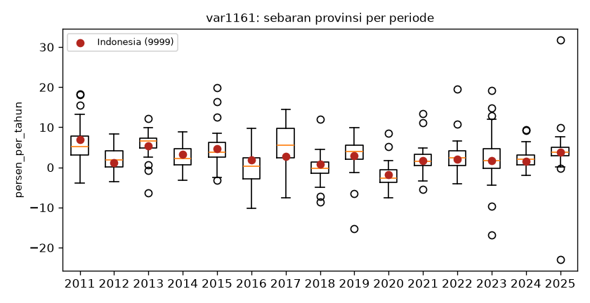
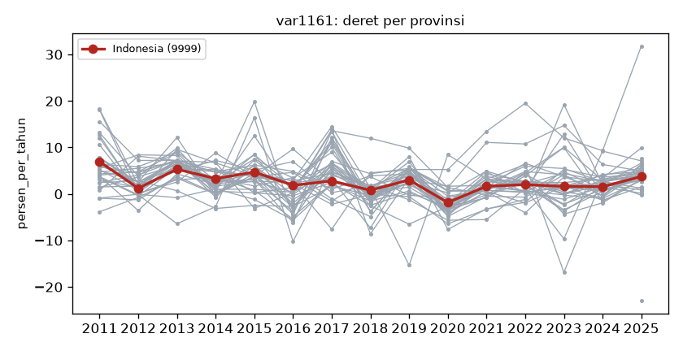
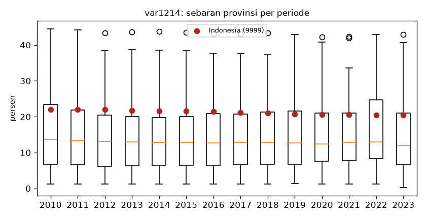
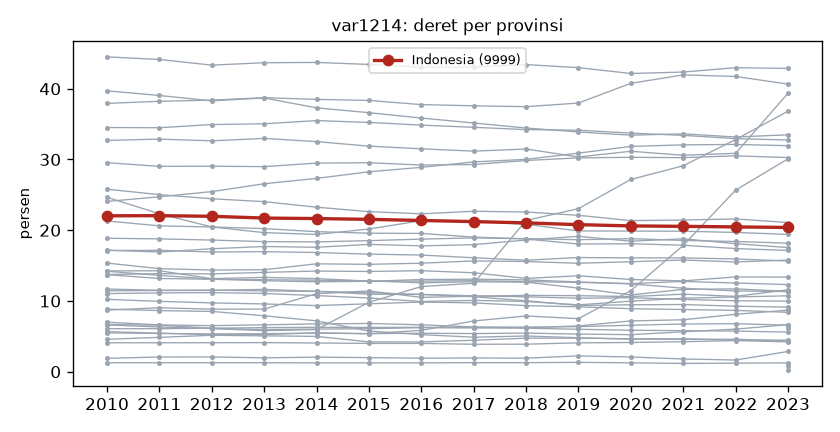
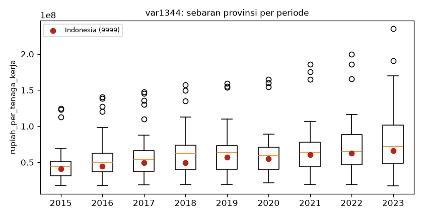
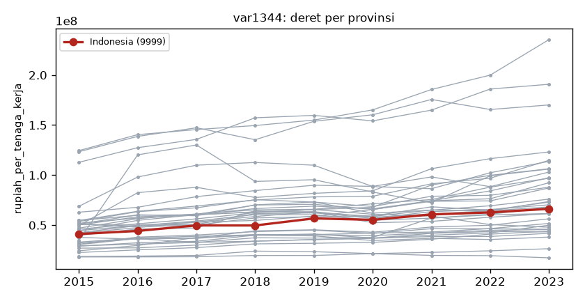
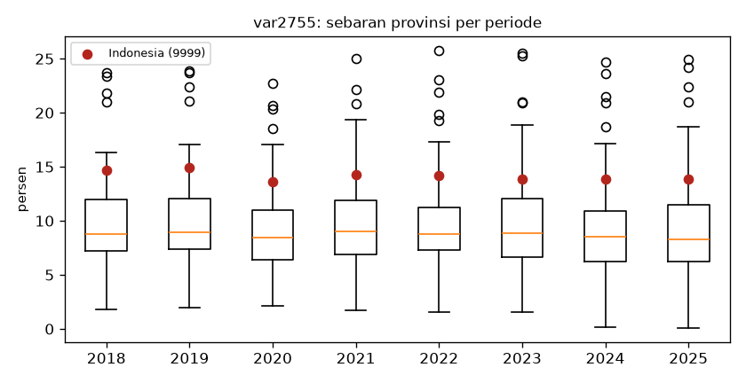
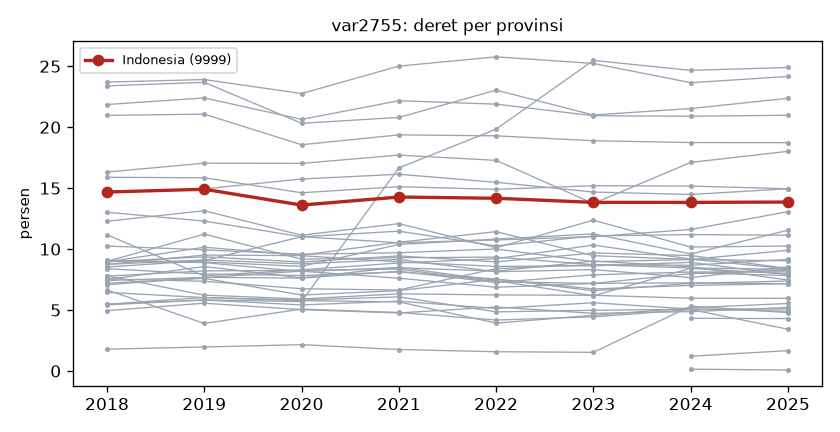

# Profil dan calon anomali seri utama

Dihasilkan `python pipeline.py` (`src/silver/profil.py`). Hanya baris provinsi deret utama (rincian `total`, atau rincian yang didaftar di `DERET` untuk seri yang terbit per rincian; label `kode [rincian]`); baris Indonesia ditampilkan terpisah dan tidak ikut statistik antarprovinsi.

## Banyak periode per provinsi (menentukan arah pembanding)

| seri_kode | min_periode_per_provinsi | maks_periode_per_provinsi |
|---|---|---|
| var1161 | 1 | 15 |
| var1214 | 1 | 14 |
| var1344 | 9 | 9 |
| var2755 | 2 | 8 |

- var1161: tiga arah (periode per provinsi 1–15)
- var1214: tiga arah (periode per provinsi 1–14)
- var1344: tiga arah (periode per provinsi 9–9)
- var2755: tiga arah (periode per provinsi 2–8)

Metode: IQR dengan pengali 1.5; arah ke samping hanya bila satu provinsi punya paling sedikit 6 periode. Sel yang ditandai lebih dari satu arah ditulis satu baris. Provinsi yang di luar batas ke bawah pada ≥ 50% periode diberi tanda `berulang`: itu perbedaan struktural antarprovinsi, bukan kejadian satu tahun. Lihat log untuk alasan memilih IQR.

## Statistik deskriptif per seri per periode (provinsi)

| seri_kode | periode | n | rerata | simpangan | minimum | q1 | median | q3 | maksimum |
|---|---|---|---|---|---|---|---|---|---|
| var1161 | 2011 | 33 | 6.11 | 5.22 | -3.83 | 3.01 | 5.21 | 7.79 | 18.22 |
| var1161 | 2012 | 33 | 2.39 | 2.76 | -3.57 | 0.15 | 1.95 | 4.07 | 8.42 |
| var1161 | 2013 | 33 | 5.80 | 3.38 | -6.41 | 4.91 | 6.60 | 7.22 | 12.15 |
| var1161 | 2014 | 33 | 2.44 | 2.77 | -3.13 | 0.61 | 2.14 | 4.65 | 8.81 |
| var1161 | 2015 | 33 | 4.66 | 4.75 | -3.12 | 2.61 | 3.86 | 6.21 | 19.85 |
| var1161 | 2016 | 34 | -0.07 | 4.09 | -10.21 | -2.77 | 0.32 | 2.41 | 9.67 |
| var1161 | 2017 | 34 | 5.63 | 5.22 | -7.59 | 2.33 | 5.59 | 9.79 | 14.50 |
| var1161 | 2018 | 34 | -0.12 | 3.64 | -8.59 | -1.53 | -0.22 | 1.41 | 11.98 |
| var1161 | 2019 | 34 | 3.01 | 4.42 | -15.34 | 2.08 | 3.95 | 5.49 | 9.86 |
| var1161 | 2020 | 34 | -1.96 | 3.16 | -7.63 | -3.66 | -2.70 | -0.53 | 8.47 |
| var1161 | 2021 | 34 | 1.87 | 3.48 | -5.52 | 0.55 | 1.50 | 3.20 | 13.47 |
| var1161 | 2022 | 34 | 2.76 | 4.09 | -4.07 | 0.48 | 2.33 | 4.17 | 19.52 |
| var1161 | 2023 | 34 | 2.41 | 6.78 | -16.88 | -0.25 | 1.70 | 4.68 | 19.25 |
| var1161 | 2024 | 34 | 2.04 | 2.61 | -1.91 | 0.56 | 2.01 | 3.02 | 9.31 |
| var1161 | 2025 | 38 | 4.01 | 6.70 | -22.96 | 2.99 | 3.86 | 5.02 | 31.79 |
| var1214 | 2010 | 34 | 16.19 | 11.57 | 1.27 | 6.75 | 13.73 | 23.38 | 44.51 |
| var1214 | 2011 | 34 | 15.98 | 11.47 | 1.27 | 6.59 | 13.40 | 21.90 | 44.14 |
| var1214 | 2012 | 34 | 15.80 | 11.39 | 1.27 | 6.24 | 13.08 | 20.47 | 43.34 |
| var1214 | 2013 | 34 | 15.81 | 11.52 | 1.27 | 6.33 | 12.93 | 20.09 | 43.68 |
| var1214 | 2014 | 34 | 15.80 | 11.42 | 1.25 | 6.40 | 12.82 | 19.70 | 43.72 |
| var1214 | 2015 | 34 | 15.80 | 11.33 | 1.25 | 6.40 | 12.79 | 20.02 | 43.44 |
| var1214 | 2016 | 34 | 15.78 | 11.20 | 1.25 | 6.37 | 12.69 | 20.90 | 43.07 |
| var1214 | 2017 | 34 | 15.79 | 11.14 | 1.28 | 6.54 | 12.79 | 20.72 | 43.07 |
| var1214 | 2018 | 34 | 16.01 | 11.17 | 1.28 | 6.70 | 12.86 | 21.24 | 43.42 |
| var1214 | 2019 | 34 | 15.93 | 11.18 | 1.32 | 6.73 | 12.66 | 21.56 | 42.98 |
| var1214 | 2020 | 34 | 16.18 | 11.35 | 1.26 | 7.61 | 12.43 | 20.99 | 42.16 |
| var1214 | 2021 | 34 | 16.49 | 11.44 | 1.17 | 7.70 | 12.80 | 21.05 | 42.36 |
| var1214 | 2022 | 34 | 16.79 | 11.68 | 1.21 | 8.26 | 12.97 | 24.64 | 42.98 |
| var1214 | 2023 | 38 | 16.15 | 12.28 | 0.24 | 6.59 | 11.95 | 20.97 | 42.88 |
| var1344 | 2015 | 34 | 48,110,361.69 | 25,905,666.46 | 18,257,338.67 | 31,304,894.75 | 44,499,880.20 | 51,717,267.96 | 124,492,105.50 |
| var1344 | 2016 | 34 | 57,658,452.41 | 32,321,494.54 | 18,316,416.35 | 36,600,216.58 | 49,846,967.91 | 62,700,796.38 | 140,456,266.70 |
| var1344 | 2017 | 34 | 61,333,460.23 | 34,634,944.34 | 18,499,048.26 | 37,433,886.48 | 53,717,925.80 | 65,836,445.45 | 147,289,096.52 |
| var1344 | 2018 | 34 | 64,984,156.14 | 32,859,580.89 | 19,730,773.10 | 40,489,729.34 | 62,060,476.47 | 73,959,645.22 | 157,265,983.66 |
| var1344 | 2019 | 34 | 66,834,780.48 | 34,693,641.81 | 19,752,009.77 | 40,717,448.58 | 63,062,786.24 | 73,172,222.88 | 159,684,833.29 |
| var1344 | 2020 | 34 | 64,632,868.71 | 35,085,849.76 | 21,606,160.00 | 40,098,444.50 | 58,879,791.00 | 70,718,899.50 | 165,160,425.00 |
| var1344 | 2021 | 34 | 71,026,983.20 | 38,914,809.06 | 19,837,606.53 | 43,991,935.82 | 64,297,559.79 | 78,066,801.05 | 185,539,364.69 |
| var1344 | 2022 | 34 | 74,978,996.42 | 41,681,413.36 | 19,554,486.71 | 46,464,128.14 | 64,688,008.00 | 88,351,276.37 | 199,870,060.50 |
| var1344 | 2023 | 34 | 81,945,212.20 | 46,315,547.16 | 17,412,788.26 | 48,465,147.60 | 71,693,818.19 | 101,653,992.73 | 235,350,879.04 |
| var2755 | 2018 | 34 | 10.34 | 5.43 | 1.79 | 7.25 | 8.75 | 12.00 | 23.70 |
| var2755 | 2019 | 34 | 10.43 | 5.56 | 1.97 | 7.42 | 8.92 | 12.03 | 23.91 |
| var2755 | 2020 | 34 | 9.90 | 5.00 | 2.16 | 6.36 | 8.44 | 11.02 | 22.76 |
| var2755 | 2021 | 34 | 10.62 | 5.44 | 1.76 | 6.88 | 9.05 | 11.94 | 25.01 |
| var2755 | 2022 | 34 | 10.49 | 5.85 | 1.58 | 7.28 | 8.77 | 11.28 | 25.77 |
| var2755 | 2023 | 34 | 10.49 | 5.88 | 1.53 | 6.62 | 8.85 | 12.09 | 25.48 |
| var2755 | 2024 | 38 | 9.85 | 5.82 | 0.15 | 6.23 | 8.49 | 10.93 | 24.66 |
| var2755 | 2025 | 38 | 9.92 | 6.02 | 0.08 | 6.26 | 8.30 | 11.45 | 24.90 |

## Baris Indonesia

| seri_kode | periode | nilai | rujukan_tahun |
|---|---|---|---|
| var1161 | 2011 | 6.95 | <NA> |
| var1161 | 2012 | 1.23 | <NA> |
| var1161 | 2013 | 5.32 | <NA> |
| var1161 | 2014 | 3.30 | <NA> |
| var1161 | 2015 | 4.70 | <NA> |
| var1161 | 2016 | 1.85 | <NA> |
| var1161 | 2017 | 2.80 | <NA> |
| var1161 | 2018 | 0.79 | <NA> |
| var1161 | 2019 | 3.00 | <NA> |
| var1161 | 2020 | -1.84 | <NA> |
| var1161 | 2021 | 1.65 | <NA> |
| var1161 | 2022 | 2.00 | <NA> |
| var1161 | 2023 | 1.63 | <NA> |
| var1161 | 2024 | 1.55 | <NA> |
| var1161 | 2025 | 3.75 | <NA> |
| var1344 | 2015 | 41,197,190.48 | <NA> |
| var1344 | 2016 | 44,253,158.79 | <NA> |
| var1344 | 2017 | 49,769,966.44 | <NA> |
| var1344 | 2018 | 49,722,772.42 | <NA> |
| var1344 | 2019 | 56,776,481.75 | <NA> |
| var1344 | 2020 | 55,341,371.00 | <NA> |
| var1344 | 2021 | 60,719,101.91 | <NA> |
| var1344 | 2022 | 62,755,806.92 | <NA> |
| var1344 | 2023 | 66,352,036.91 | <NA> |
| var1214 | 2010 | 22.04 | <NA> |
| var1214 | 2011 | 22.06 | <NA> |
| var1214 | 2012 | 21.97 | <NA> |
| var1214 | 2013 | 21.72 | <NA> |
| var1214 | 2014 | 21.65 | <NA> |
| var1214 | 2015 | 21.54 | <NA> |
| var1214 | 2016 | 21.38 | <NA> |
| var1214 | 2017 | 21.22 | <NA> |
| var1214 | 2018 | 21.04 | <NA> |
| var1214 | 2019 | 20.79 | <NA> |
| var1214 | 2020 | 20.61 | <NA> |
| var1214 | 2021 | 20.55 | <NA> |
| var1214 | 2022 | 20.47 | <NA> |
| var1214 | 2023 | 20.39 | <NA> |
| var2755 | 2018 | 14.68 | <NA> |
| var2755 | 2019 | 14.91 | <NA> |
| var2755 | 2020 | 13.61 | <NA> |
| var2755 | 2021 | 14.27 | <NA> |
| var2755 | 2022 | 14.17 | <NA> |
| var2755 | 2023 | 13.83 | <NA> |
| var2755 | 2024 | 13.83 | <NA> |
| var2755 | 2025 | 13.86 | <NA> |

## Calon anomali (240)

Daftar lengkap di `reports/calon-anomali.csv`; kategorinya di `reports/anomali.csv`.

| seri_kode | wilayah_kode | nama_wilayah | periode | nilai | arah | alasan | berulang |
|---|---|---|---|---|---|---|---|
| var1161 | 1200 | Sumatera Utara | 2011 | 18.09 | ke bawah + ke samping | di luar [-4.16, 14.96] (IQR x 1.5) dibanding 33 provinsi tahun itu; di luar [-5.93, 10.23] dibanding 15 tahun di provinsi ini | False |
| var1161 | 1500 | Jambi | 2011 | 13.19 | ke samping | di luar [-4.66, 9.41] dibanding 15 tahun di provinsi ini | False |
| var1161 | 1800 | Lampung | 2011 | 18.22 | ke bawah + ke samping | di luar [-4.16, 14.96] (IQR x 1.5) dibanding 33 provinsi tahun itu; di luar [-10.87, 15.17] dibanding 15 tahun di provinsi ini | False |
| var1161 | 1900 | Kepulauan Bangka Belitung | 2011 | 12.65 | ke samping | di luar [-4.65, 8.06] dibanding 15 tahun di provinsi ini | False |
| var1161 | 7400 | Sulawesi Tenggara | 2011 | 15.58 | ke bawah | di luar [-4.16, 14.96] (IQR x 1.5) dibanding 33 provinsi tahun itu | False |
| var1161 | 1200 | Sumatera Utara | 2012 | 0.15 | perubahan | perubahan 2011→2012 sebesar -17.94 di luar [-15.85, 10.15] | False |
| var1161 | 1800 | Lampung | 2012 | 1.95 | perubahan | perubahan 2011→2012 sebesar -16.27 di luar [-15.85, 10.15] | False |
| var1161 | 1100 | Aceh | 2013 | 0.70 | ke bawah + perubahan | di luar [1.45, 10.68] (IQR x 1.5) dibanding 33 provinsi tahun itu; perubahan 2012→2013 sebesar -2.12 di luar [-1.40, 9.00] | False |
| var1161 | 1400 | Riau | 2013 | -0.81 | ke bawah | di luar [1.45, 10.68] (IQR x 1.5) dibanding 33 provinsi tahun itu | False |
| var1161 | 1500 | Jambi | 2013 | 9.84 | ke samping | di luar [-4.66, 9.41] dibanding 15 tahun di provinsi ini | False |
| var1161 | 3100 | DKI Jakarta | 2013 | 9.60 | perubahan | perubahan 2012→2013 sebesar +9.59 di luar [-1.40, 9.00] | False |
| var1161 | 6400 | Kalimantan Timur | 2013 | -6.41 | ke bawah + perubahan | di luar [1.45, 10.68] (IQR x 1.5) dibanding 33 provinsi tahun itu; perubahan 2012→2013 sebesar -6.23 di luar [-1.40, 9.00] | False |
| var1161 | 7600 | Sulawesi Barat | 2013 | 12.15 | ke bawah + perubahan | di luar [1.45, 10.68] (IQR x 1.5) dibanding 33 provinsi tahun itu; perubahan 2012→2013 sebesar +9.57 di luar [-1.40, 9.00] | False |
| var1161 | 1200 | Sumatera Utara | 2014 | 8.81 | perubahan | perubahan 2013→2014 sebesar +6.24 di luar [-10.32, 3.36] | False |
| var1161 | 6400 | Kalimantan Timur | 2014 | -2.75 | perubahan | perubahan 2013→2014 sebesar +3.66 di luar [-10.32, 3.36] | False |
| var1161 | 7600 | Sulawesi Barat | 2014 | -0.35 | perubahan | perubahan 2013→2014 sebesar -12.50 di luar [-10.32, 3.36] | False |
| var1161 | 5200 | Nusa Tenggara Barat | 2015 | 19.85 | ke bawah + perubahan + ke samping | di luar [-2.79, 11.61] (IQR x 1.5) dibanding 33 provinsi tahun itu; perubahan 2014→2015 sebesar +17.79 di luar [-11.85, 15.35]; di luar [-13.09, 13.45] dibanding 15 tahun di provinsi ini | False |
| var1161 | 6400 | Kalimantan Timur | 2015 | 16.39 | ke bawah + perubahan + ke samping | di luar [-2.79, 11.61] (IQR x 1.5) dibanding 33 provinsi tahun itu; perubahan 2014→2015 sebesar +19.14 di luar [-11.85, 15.35]; di luar [-11.44, 12.14] dibanding 15 tahun di provinsi ini | False |
| var1161 | 7200 | Sulawesi Tengah | 2015 | 12.52 | ke bawah | di luar [-2.79, 11.61] (IQR x 1.5) dibanding 33 provinsi tahun itu | False |
| var1161 | 8100 | Maluku | 2015 | -3.12 | ke bawah | di luar [-2.79, 11.61] (IQR x 1.5) dibanding 33 provinsi tahun itu | False |
| var1161 | 1900 | Kepulauan Bangka Belitung | 2016 | -5.43 | ke samping | di luar [-4.65, 8.06] dibanding 15 tahun di provinsi ini | False |
| var1161 | 5200 | Nusa Tenggara Barat | 2016 | -4.91 | perubahan | perubahan 2015→2016 sebesar -24.76 di luar [-17.19, 9.34] | False |
| var1161 | 6400 | Kalimantan Timur | 2016 | -10.21 | perubahan | perubahan 2015→2016 sebesar -26.60 di luar [-17.19, 9.34] | False |
| var1161 | 3100 | DKI Jakarta | 2017 | 14.50 | ke samping | di luar [-4.22, 11.71] dibanding 15 tahun di provinsi ini | False |
| var1161 | 6200 | Kalimantan Tengah | 2017 | 8.95 | ke samping | di luar [-2.86, 8.52] dibanding 15 tahun di provinsi ini | False |
| var1161 | 6500 | Kalimantan Utara | 2017 | -7.59 | ke samping | di luar [-5.56, 9.29] dibanding 10 tahun di provinsi ini | False |
| var1161 | 7100 | Sulawesi Utara | 2017 | 13.43 | ke samping | di luar [-5.52, 10.80] dibanding 15 tahun di provinsi ini | False |
| var1161 | 5300 | Nusa Tenggara Timur | 2018 | -7.31 | ke bawah | di luar [-5.94, 5.82] (IQR x 1.5) dibanding 34 provinsi tahun itu | False |
| var1161 | 6500 | Kalimantan Utara | 2018 | 4.57 | perubahan | perubahan 2017→2018 sebesar +12.16 di luar [-22.74, 10.43] | False |
| var1161 | 7200 | Sulawesi Tengah | 2018 | 11.98 | ke bawah | di luar [-5.94, 5.82] (IQR x 1.5) dibanding 34 provinsi tahun itu | False |
| var1161 | 8100 | Maluku | 2018 | -8.59 | ke bawah | di luar [-5.94, 5.82] (IQR x 1.5) dibanding 34 provinsi tahun itu | False |
| var1161 | 5200 | Nusa Tenggara Barat | 2019 | -6.51 | ke bawah | di luar [-3.03, 10.61] (IQR x 1.5) dibanding 34 provinsi tahun itu | False |
| var1161 | 9400 | Papua | 2019 | -15.34 | ke bawah + perubahan + ke samping | di luar [-3.03, 10.61] (IQR x 1.5) dibanding 34 provinsi tahun itu; perubahan 2018→2019 sebesar -16.60 di luar [-7.67, 14.67]; di luar [-8.61, 13.28] dibanding 15 tahun di provinsi ini | False |
| var1161 | 5100 | Bali | 2020 | -7.63 | perubahan + ke samping | perubahan 2019→2020 sebesar -15.65 di luar [-12.57, 1.00]; di luar [-4.71, 12.16] dibanding 15 tahun di provinsi ini | False |
| var1161 | 5200 | Nusa Tenggara Barat | 2020 | -2.70 | perubahan | perubahan 2019→2020 sebesar +3.81 di luar [-12.57, 1.00] | False |
| var1161 | 6100 | Kalimantan Barat | 2020 | -2.35 | ke samping | di luar [-1.62, 7.56] dibanding 15 tahun di provinsi ini | False |
| var1161 | 6300 | Kalimantan Selatan | 2020 | -3.58 | ke samping | di luar [-1.31, 8.60] dibanding 15 tahun di provinsi ini | False |
| var1161 | 8200 | Maluku Utara | 2020 | 5.25 | ke bawah | di luar [-8.34, 4.16] (IQR x 1.5) dibanding 34 provinsi tahun itu | False |
| var1161 | 9400 | Papua | 2020 | 8.47 | ke bawah + perubahan | di luar [-8.34, 4.16] (IQR x 1.5) dibanding 34 provinsi tahun itu; perubahan 2019→2020 sebesar +23.81 di luar [-12.57, 1.00] | False |
| var1161 | 7200 | Sulawesi Tengah | 2021 | 11.09 | ke bawah | di luar [-3.43, 7.18] (IQR x 1.5) dibanding 34 provinsi tahun itu | False |
| var1161 | 8200 | Maluku Utara | 2021 | 13.47 | ke bawah | di luar [-3.43, 7.18] (IQR x 1.5) dibanding 34 provinsi tahun itu | False |
| var1161 | 9100 | Papua Barat | 2021 | -5.52 | ke bawah | di luar [-3.43, 7.18] (IQR x 1.5) dibanding 34 provinsi tahun itu | False |
| var1161 | 9400 | Papua | 2021 | 3.20 | perubahan | perubahan 2020→2021 sebesar -5.27 di luar [-3.91, 12.03] | False |
| var1161 | 7200 | Sulawesi Tengah | 2022 | 10.75 | ke bawah | di luar [-5.04, 9.70] (IQR x 1.5) dibanding 34 provinsi tahun itu | False |
| var1161 | 8200 | Maluku Utara | 2022 | 19.52 | ke bawah | di luar [-5.04, 9.70] (IQR x 1.5) dibanding 34 provinsi tahun itu | False |
| var1161 | 1400 | Riau | 2023 | 9.99 | ke samping | di luar [-5.79, 6.05] dibanding 15 tahun di provinsi ini | False |
| var1161 | 2100 | Kepulauan Riau | 2023 | 19.25 | ke bawah + perubahan + ke samping | di luar [-7.64, 12.07] (IQR x 1.5) dibanding 34 provinsi tahun itu; perubahan 2022→2023 sebesar +20.42 di luar [-15.45, 15.49]; di luar [-10.72, 15.58] dibanding 15 tahun di provinsi ini | False |
| var1161 | 3600 | Banten | 2023 | 12.87 | ke bawah | di luar [-7.64, 12.07] (IQR x 1.5) dibanding 34 provinsi tahun itu | False |
| var1161 | 6100 | Kalimantan Barat | 2023 | -3.74 | ke samping | di luar [-1.62, 7.56] dibanding 15 tahun di provinsi ini | False |
| var1161 | 7200 | Sulawesi Tengah | 2023 | 14.74 | ke bawah | di luar [-7.64, 12.07] (IQR x 1.5) dibanding 34 provinsi tahun itu | False |
| var1161 | 9100 | Papua Barat | 2023 | -9.66 | ke bawah + ke samping | di luar [-7.64, 12.07] (IQR x 1.5) dibanding 34 provinsi tahun itu; di luar [-8.78, 11.22] dibanding 15 tahun di provinsi ini | False |
| var1161 | 9400 | Papua | 2023 | -16.88 | ke bawah + perubahan + ke samping | di luar [-7.64, 12.07] (IQR x 1.5) dibanding 34 provinsi tahun itu; perubahan 2022→2023 sebesar -23.20 di luar [-15.45, 15.49]; di luar [-8.61, 13.28] dibanding 15 tahun di provinsi ini | False |
| var1161 | 2100 | Kepulauan Riau | 2024 | 2.04 | perubahan | perubahan 2023→2024 sebesar -17.21 di luar [-11.83, 11.32] | False |
| var1161 | 3600 | Banten | 2024 | -0.29 | perubahan | perubahan 2023→2024 sebesar -13.16 di luar [-11.83, 11.32] | False |
| var1161 | 8200 | Maluku Utara | 2024 | 9.31 | ke bawah | di luar [-3.13, 6.71] (IQR x 1.5) dibanding 34 provinsi tahun itu | False |
| var1161 | 9100 | Papua Barat | 2024 | 9.22 | ke bawah + perubahan | di luar [-3.13, 6.71] (IQR x 1.5) dibanding 34 provinsi tahun itu; perubahan 2023→2024 sebesar +18.88 di luar [-11.83, 11.32] | False |
| var1161 | 9400 | Papua | 2024 | 3.40 | perubahan | perubahan 2023→2024 sebesar +20.28 di luar [-11.83, 11.32] | False |
| var1161 | 7600 | Sulawesi Barat | 2025 | -0.29 | ke bawah | di luar [-0.06, 8.07] (IQR x 1.5) dibanding 38 provinsi tahun itu | False |
| var1161 | 8200 | Maluku Utara | 2025 | 31.79 | ke bawah + perubahan + ke samping | di luar [-0.06, 8.07] (IQR x 1.5) dibanding 38 provinsi tahun itu; perubahan 2024→2025 sebesar +22.48 di luar [-4.22, 9.61]; di luar [-11.73, 25.41] dibanding 15 tahun di provinsi ini | False |
| var1161 | 9400 | Papua | 2025 | 9.90 | ke bawah | di luar [-0.06, 8.07] (IQR x 1.5) dibanding 38 provinsi tahun itu | False |
| var1161 | 9600 | Papua Tengah | 2025 | -22.96 | ke bawah | di luar [-0.06, 8.07] (IQR x 1.5) dibanding 38 provinsi tahun itu | False |
| var1214 | 3400 | DI Yogyakarta | 2010 | 14.25 | ke samping | di luar [11.44, 14.19] dibanding 14 tahun di provinsi ini | False |
| var1214 | 6300 | Kalimantan Selatan | 2010 | 13.72 | ke samping | di luar [12.15, 13.61] dibanding 14 tahun di provinsi ini | False |
| var1214 | 6400 | Kalimantan Timur | 2010 | 24.66 | ke samping | di luar [17.58, 23.32] dibanding 14 tahun di provinsi ini | False |
| var1214 | 3400 | DI Yogyakarta | 2011 | 14.27 | ke samping | di luar [11.44, 14.19] dibanding 14 tahun di provinsi ini | False |
| var1214 | 6200 | Kalimantan Tengah | 2011 | 14.57 | ke samping | di luar [14.63, 16.13] dibanding 14 tahun di provinsi ini | False |
| var1214 | 6400 | Kalimantan Timur | 2011 | 22.33 | perubahan | perubahan 2010→2011 sebesar -2.33 di luar [-1.01, 0.68] | False |
| var1214 | 1400 | Riau | 2012 | 25.46 | perubahan | perubahan 2011→2012 sebesar +0.73 di luar [-0.62, 0.40] | False |
| var1214 | 1800 | Lampung | 2012 | 17.38 | perubahan | perubahan 2011→2012 sebesar +0.46 di luar [-0.62, 0.40] | False |
| var1214 | 3200 | Jawa Barat | 2012 | 43.34 | ke bawah + perubahan | di luar [-15.10, 41.81] (IQR x 1.5) dibanding 34 provinsi tahun itu; perubahan 2011→2012 sebesar -0.80 di luar [-0.62, 0.40] | True |
| var1214 | 3300 | Jawa Tengah | 2012 | 34.94 | perubahan | perubahan 2011→2012 sebesar +0.45 di luar [-0.62, 0.40] | False |
| var1214 | 3400 | DI Yogyakarta | 2012 | 13.16 | perubahan | perubahan 2011→2012 sebesar -1.11 di luar [-0.62, 0.40] | False |
| var1214 | 3600 | Banten | 2012 | 38.29 | perubahan | perubahan 2011→2012 sebesar -0.76 di luar [-0.62, 0.40] | False |
| var1214 | 6200 | Kalimantan Tengah | 2012 | 14.37 | ke samping | di luar [14.63, 16.13] dibanding 14 tahun di provinsi ini | False |
| var1214 | 6400 | Kalimantan Timur | 2012 | 20.47 | perubahan | perubahan 2011→2012 sebesar -1.86 di luar [-0.62, 0.40] | False |
| var1214 | 1100 | Aceh | 2013 | 7.91 | perubahan | perubahan 2012→2013 sebesar -0.61 di luar [-0.58, 0.57] | False |
| var1214 | 1400 | Riau | 2013 | 26.57 | perubahan | perubahan 2012→2013 sebesar +1.11 di luar [-0.58, 0.57] | False |
| var1214 | 3200 | Jawa Barat | 2013 | 43.68 | ke bawah | di luar [-14.31, 40.72] (IQR x 1.5) dibanding 34 provinsi tahun itu | True |
| var1214 | 6200 | Kalimantan Tengah | 2013 | 14.42 | ke samping | di luar [14.63, 16.13] dibanding 14 tahun di provinsi ini | False |
| var1214 | 6400 | Kalimantan Timur | 2013 | 19.66 | perubahan | perubahan 2012→2013 sebesar -0.81 di luar [-0.58, 0.57] | False |
| var1214 | 1400 | Riau | 2014 | 27.33 | perubahan | perubahan 2013→2014 sebesar +0.76 di luar [-0.78, 0.66] | False |
| var1214 | 1900 | Kepulauan Bangka Belitung | 2014 | 23.26 | perubahan | perubahan 2013→2014 sebesar -0.78 di luar [-0.78, 0.66] | False |
| var1214 | 3200 | Jawa Barat | 2014 | 43.72 | ke bawah | di luar [-13.55, 39.66] (IQR x 1.5) dibanding 34 provinsi tahun itu | True |
| var1214 | 3600 | Banten | 2014 | 37.30 | perubahan | perubahan 2013→2014 sebesar -1.40 di luar [-0.78, 0.66] | False |
| var1214 | 6200 | Kalimantan Tengah | 2014 | 15.25 | perubahan | perubahan 2013→2014 sebesar +0.83 di luar [-0.78, 0.66] | False |
| var1214 | 7600 | Sulawesi Barat | 2014 | 11.03 | perubahan | perubahan 2013→2014 sebesar +2.18 di luar [-0.78, 0.66] | False |
| var1214 | 1100 | Aceh | 2015 | 5.75 | perubahan | perubahan 2014→2015 sebesar -1.44 di luar [-0.77, 0.56] | False |
| var1214 | 1400 | Riau | 2015 | 28.26 | perubahan | perubahan 2014→2015 sebesar +0.93 di luar [-0.77, 0.56] | False |
| var1214 | 3200 | Jawa Barat | 2015 | 43.44 | ke bawah | di luar [-14.03, 40.46] (IQR x 1.5) dibanding 34 provinsi tahun itu | True |
| var1214 | 6400 | Kalimantan Timur | 2015 | 20.17 | perubahan | perubahan 2014→2015 sebesar +0.76 di luar [-0.77, 0.56] | False |
| var1214 | 7200 | Sulawesi Tengah | 2015 | 9.81 | perubahan | perubahan 2014→2015 sebesar +3.85 di luar [-0.77, 0.56] | False |
| var1214 | 3200 | Jawa Barat | 2016 | 43.07 | ke bawah | di luar [-15.43, 42.70] (IQR x 1.5) dibanding 34 provinsi tahun itu | True |
| var1214 | 6400 | Kalimantan Timur | 2016 | 21.35 | perubahan | perubahan 2015→2016 sebesar +1.18 di luar [-0.99, 0.81] | False |
| var1214 | 7200 | Sulawesi Tengah | 2016 | 12.04 | perubahan | perubahan 2015→2016 sebesar +2.23 di luar [-0.99, 0.81] | False |
| var1214 | 3200 | Jawa Barat | 2017 | 43.07 | ke bawah | di luar [-14.73, 41.98] (IQR x 1.5) dibanding 34 provinsi tahun itu | True |
| var1214 | 8200 | Maluku Utara | 2017 | 7.17 | perubahan | perubahan 2016→2017 sebesar +1.32 di luar [-0.91, 0.80] | False |
| var1214 | 1800 | Lampung | 2018 | 18.62 | perubahan | perubahan 2017→2018 sebesar +0.66 di luar [-0.61, 0.61] | False |
| var1214 | 3200 | Jawa Barat | 2018 | 43.42 | ke bawah | di luar [-15.13, 43.06] (IQR x 1.5) dibanding 34 provinsi tahun itu | True |
| var1214 | 3600 | Banten | 2018 | 34.45 | perubahan | perubahan 2017→2018 sebesar -0.71 di luar [-0.61, 0.61] | False |
| var1214 | 7200 | Sulawesi Tengah | 2018 | 21.38 | perubahan | perubahan 2017→2018 sebesar +8.88 di luar [-0.61, 0.61] | False |
| var1214 | 7300 | Sulawesi Selatan | 2018 | 13.19 | perubahan | perubahan 2017→2018 sebesar -0.80 di luar [-0.61, 0.61] | False |
| var1214 | 8200 | Maluku Utara | 2018 | 7.88 | perubahan | perubahan 2017→2018 sebesar +0.71 di luar [-0.61, 0.61] | False |
| var1214 | 5300 | Nusa Tenggara Timur | 2019 | 1.32 | ke samping | di luar [1.22, 1.30] dibanding 14 tahun di provinsi ini | False |
| var1214 | 7200 | Sulawesi Tengah | 2019 | 23.05 | perubahan | perubahan 2018→2019 sebesar +1.67 di luar [-1.42, 1.23] | False |
| var1214 | 1400 | Riau | 2020 | 31.85 | perubahan | perubahan 2019→2020 sebesar +0.95 di luar [-0.86, 0.82] | False |
| var1214 | 2100 | Kepulauan Riau | 2020 | 40.77 | perubahan | perubahan 2019→2020 sebesar +2.79 di luar [-0.86, 0.82] | False |
| var1214 | 3100 | DKI Jakarta | 2020 | 10.85 | perubahan | perubahan 2019→2020 sebesar -0.97 di luar [-0.86, 0.82] | False |
| var1214 | 3200 | Jawa Barat | 2020 | 42.16 | ke bawah | di luar [-12.45, 41.06] (IQR x 1.5) dibanding 34 provinsi tahun itu | True |
| var1214 | 7200 | Sulawesi Tengah | 2020 | 27.18 | perubahan | perubahan 2019→2020 sebesar +4.13 di luar [-0.86, 0.82] | False |
| var1214 | 8200 | Maluku Utara | 2020 | 11.46 | perubahan | perubahan 2019→2020 sebesar +3.96 di luar [-0.86, 0.82] | False |
| var1214 | 2100 | Kepulauan Riau | 2021 | 41.96 | ke bawah + perubahan | di luar [-12.31, 41.06] (IQR x 1.5) dibanding 34 provinsi tahun itu; perubahan 2020→2021 sebesar +1.19 di luar [-0.72, 0.90] | False |
| var1214 | 3200 | Jawa Barat | 2021 | 42.36 | ke bawah | di luar [-12.31, 41.06] (IQR x 1.5) dibanding 34 provinsi tahun itu | True |
| var1214 | 5300 | Nusa Tenggara Timur | 2021 | 1.17 | ke samping | di luar [1.22, 1.30] dibanding 14 tahun di provinsi ini | False |
| var1214 | 7200 | Sulawesi Tengah | 2021 | 29.11 | perubahan | perubahan 2020→2021 sebesar +1.93 di luar [-0.72, 0.90] | False |
| var1214 | 8200 | Maluku Utara | 2021 | 17.85 | perubahan | perubahan 2020→2021 sebesar +6.39 di luar [-0.72, 0.90] | False |
| var1214 | 3400 | DI Yogyakarta | 2022 | 11.42 | ke samping | di luar [11.44, 14.19] dibanding 14 tahun di provinsi ini | False |
| var1214 | 5300 | Nusa Tenggara Timur | 2022 | 1.21 | ke samping | di luar [1.22, 1.30] dibanding 14 tahun di provinsi ini | False |
| var1214 | 7200 | Sulawesi Tengah | 2022 | 32.82 | perubahan | perubahan 2021→2022 sebesar +3.71 di luar [-0.81, 0.77] | False |
| var1214 | 7400 | Sulawesi Tenggara | 2022 | 8.12 | perubahan | perubahan 2021→2022 sebesar +0.78 di luar [-0.81, 0.77] | False |
| var1214 | 7500 | Gorontalo | 2022 | 4.40 | ke samping | di luar [3.85, 4.29] dibanding 14 tahun di provinsi ini | False |
| var1214 | 8100 | Maluku | 2022 | 6.02 | ke samping | di luar [5.21, 5.65] dibanding 14 tahun di provinsi ini | False |
| var1214 | 8200 | Maluku Utara | 2022 | 25.66 | perubahan + ke samping | perubahan 2021→2022 sebesar +7.81 di luar [-0.81, 0.77]; di luar [-2.22, 18.23] dibanding 14 tahun di provinsi ini | False |
| var1214 | 9400 | Papua | 2022 | 1.65 | ke samping | di luar [1.65, 2.34] dibanding 14 tahun di provinsi ini | False |
| var1214 | 2100 | Kepulauan Riau | 2023 | 40.66 | perubahan | perubahan 2022→2023 sebesar -1.08 di luar [-0.98, 0.96] | False |
| var1214 | 3200 | Jawa Barat | 2023 | 42.88 | ke bawah | di luar [-14.98, 42.53] (IQR x 1.5) dibanding 38 provinsi tahun itu | True |
| var1214 | 3400 | DI Yogyakarta | 2023 | 11.33 | ke samping | di luar [11.44, 14.19] dibanding 14 tahun di provinsi ini | False |
| var1214 | 7200 | Sulawesi Tengah | 2023 | 36.82 | perubahan | perubahan 2022→2023 sebesar +4.00 di luar [-0.98, 0.96] | False |
| var1214 | 7400 | Sulawesi Tenggara | 2023 | 8.70 | ke samping | di luar [4.81, 8.40] dibanding 14 tahun di provinsi ini | False |
| var1214 | 8100 | Maluku | 2023 | 6.65 | ke samping | di luar [5.21, 5.65] dibanding 14 tahun di provinsi ini | False |
| var1214 | 8200 | Maluku Utara | 2023 | 30.09 | perubahan + ke samping | perubahan 2022→2023 sebesar +4.43 di luar [-0.98, 0.96]; di luar [-2.22, 18.23] dibanding 14 tahun di provinsi ini | False |
| var1214 | 9100 | Papua Barat | 2023 | 39.36 | perubahan + ke samping | perubahan 2022→2023 sebesar +8.49 di luar [-0.98, 0.96]; di luar [28.88, 34.97] dibanding 14 tahun di provinsi ini | False |
| var1214 | 9400 | Papua | 2023 | 2.86 | perubahan + ke samping | perubahan 2022→2023 sebesar +1.21 di luar [-0.98, 0.96]; di luar [1.65, 2.34] dibanding 14 tahun di provinsi ini | False |
| var1344 | 1400 | Riau | 2015 | 124,492,105.50 | ke bawah | di luar [686334.93, 82335827.78] (IQR x 1.5) dibanding 34 provinsi tahun itu | True |
| var1344 | 1800 | Lampung | 2015 | 42,534,940.39 | ke samping | di luar [44698172.52, 69869892.28] dibanding 9 tahun di provinsi ini | False |
| var1344 | 3100 | DKI Jakarta | 2015 | 34,746,299.82 | ke samping | di luar [48555132.78, 140607416.03] dibanding 9 tahun di provinsi ini | False |
| var1344 | 3200 | Jawa Barat | 2015 | 42,002,733.23 | ke samping | di luar [43095093.68, 67974019.88] dibanding 9 tahun di provinsi ini | False |
| var1344 | 3300 | Jawa Tengah | 2015 | 31,008,568.47 | ke samping | di luar [31444983.11, 54662422.55] dibanding 9 tahun di provinsi ini | False |
| var1344 | 3500 | Jawa Timur | 2015 | 33,107,268.11 | ke samping | di luar [33830927.88, 47356552.55] dibanding 9 tahun di provinsi ini | False |
| var1344 | 5200 | Nusa Tenggara Barat | 2015 | 24,410,637.30 | ke samping | di luar [29500286.35, 43295898.75] dibanding 9 tahun di provinsi ini | False |
| var1344 | 6400 | Kalimantan Timur | 2015 | 112,811,919.40 | ke bawah | di luar [686334.93, 82335827.78] (IQR x 1.5) dibanding 34 provinsi tahun itu | True |
| var1344 | 6500 | Kalimantan Utara | 2015 | 123,346,018.20 | ke bawah | di luar [686334.93, 82335827.78] (IQR x 1.5) dibanding 34 provinsi tahun itu | True |
| var1344 | 1400 | Riau | 2016 | 140,456,266.70 | ke bawah | di luar [-2550653.11, 101851666.07] (IQR x 1.5) dibanding 34 provinsi tahun itu | True |
| var1344 | 2100 | Kepulauan Riau | 2016 | 98,106,166.38 | perubahan | perubahan 2015→2016 sebesar +29252528.93 di luar [-5194165.51, 18124228.66] | False |
| var1344 | 3100 | DKI Jakarta | 2016 | 120,232,473.70 | ke bawah + perubahan | di luar [-2550653.11, 101851666.07] (IQR x 1.5) dibanding 34 provinsi tahun itu; perubahan 2015→2016 sebesar +85486173.88 di luar [-5194165.51, 18124228.66] | False |
| var1344 | 6400 | Kalimantan Timur | 2016 | 127,408,296.00 | ke bawah | di luar [-2550653.11, 101851666.07] (IQR x 1.5) dibanding 34 provinsi tahun itu | True |
| var1344 | 6500 | Kalimantan Utara | 2016 | 138,693,395.00 | ke bawah | di luar [-2550653.11, 101851666.07] (IQR x 1.5) dibanding 34 provinsi tahun itu | True |
| var1344 | 7100 | Sulawesi Utara | 2016 | 82,469,708.59 | perubahan | perubahan 2015→2016 sebesar +32787994.25 di luar [-5194165.51, 18124228.66] | False |
| var1344 | 1400 | Riau | 2017 | 145,498,341.55 | ke bawah | di luar [-5169951.98, 108440283.91] (IQR x 1.5) dibanding 34 provinsi tahun itu | True |
| var1344 | 2100 | Kepulauan Riau | 2017 | 109,922,192.38 | ke bawah + perubahan | di luar [-5169951.98, 108440283.91] (IQR x 1.5) dibanding 34 provinsi tahun itu; perubahan 2016→2017 sebesar +11816026.00 di luar [-4646650.46, 11344747.76] | False |
| var1344 | 3100 | DKI Jakarta | 2017 | 130,123,080.83 | ke bawah | di luar [-5169951.98, 108440283.91] (IQR x 1.5) dibanding 34 provinsi tahun itu | False |
| var1344 | 6400 | Kalimantan Timur | 2017 | 135,705,272.48 | ke bawah | di luar [-5169951.98, 108440283.91] (IQR x 1.5) dibanding 34 provinsi tahun itu | True |
| var1344 | 6500 | Kalimantan Utara | 2017 | 147,289,096.52 | ke bawah | di luar [-5169951.98, 108440283.91] (IQR x 1.5) dibanding 34 provinsi tahun itu | True |
| var1344 | 1400 | Riau | 2018 | 149,541,382.22 | ke bawah | di luar [-9715144.48, 124164519.04] (IQR x 1.5) dibanding 34 provinsi tahun itu | True |
| var1344 | 3100 | DKI Jakarta | 2018 | 93,703,148.43 | perubahan | perubahan 2017→2018 sebesar -36419932.40 di luar [-2846318.43, 11950468.69] | False |
| var1344 | 3600 | Banten | 2018 | 64,305,740.59 | perubahan | perubahan 2017→2018 sebesar +17056725.24 di luar [-2846318.43, 11950468.69] | False |
| var1344 | 6400 | Kalimantan Timur | 2018 | 157,265,983.66 | ke bawah + perubahan | di luar [-9715144.48, 124164519.04] (IQR x 1.5) dibanding 34 provinsi tahun itu; perubahan 2017→2018 sebesar +21560711.18 di luar [-2846318.43, 11950468.69] | True |
| var1344 | 6500 | Kalimantan Utara | 2018 | 135,364,238.41 | ke bawah + perubahan | di luar [-9715144.48, 124164519.04] (IQR x 1.5) dibanding 34 provinsi tahun itu; perubahan 2017→2018 sebesar -11924858.11 di luar [-2846318.43, 11950468.69] | True |
| var1344 | 7100 | Sulawesi Utara | 2018 | 77,633,466.90 | perubahan | perubahan 2017→2018 sebesar -10230207.86 di luar [-2846318.43, 11950468.69] | False |
| var1344 | 1400 | Riau | 2019 | 154,991,100.84 | ke bawah | di luar [-7964712.87, 121854384.34] (IQR x 1.5) dibanding 34 provinsi tahun itu | True |
| var1344 | 6400 | Kalimantan Timur | 2019 | 159,684,833.29 | ke bawah | di luar [-7964712.87, 121854384.34] (IQR x 1.5) dibanding 34 provinsi tahun itu | True |
| var1344 | 6500 | Kalimantan Utara | 2019 | 153,748,725.48 | ke bawah + perubahan | di luar [-7964712.87, 121854384.34] (IQR x 1.5) dibanding 34 provinsi tahun itu; perubahan 2018→2019 sebesar +18384487.07 di luar [-4128541.39, 6974529.36] | True |
| var1344 | 1400 | Riau | 2020 | 165,160,425.00 | ke bawah | di luar [-5832238.00, 116649582.00] (IQR x 1.5) dibanding 34 provinsi tahun itu | True |
| var1344 | 2100 | Kepulauan Riau | 2020 | 88,571,947.00 | perubahan | perubahan 2019→2020 sebesar -21349460.37 di luar [-14577968.82, 10858460.44] | False |
| var1344 | 6400 | Kalimantan Timur | 2020 | 154,191,705.00 | ke bawah | di luar [-5832238.00, 116649582.00] (IQR x 1.5) dibanding 34 provinsi tahun itu | True |
| var1344 | 6500 | Kalimantan Utara | 2020 | 160,272,315.00 | ke bawah | di luar [-5832238.00, 116649582.00] (IQR x 1.5) dibanding 34 provinsi tahun itu | True |
| var1344 | 1400 | Riau | 2021 | 185,539,364.69 | ke bawah + perubahan | di luar [-7120362.03, 129179098.90] (IQR x 1.5) dibanding 34 provinsi tahun itu; perubahan 2020→2021 sebesar +20378939.69 di luar [-8807342.92, 20351591.19] | True |
| var1344 | 1900 | Kepulauan Bangka Belitung | 2021 | 90,148,456.06 | perubahan | perubahan 2020→2021 sebesar +22245378.06 di luar [-8807342.92, 20351591.19] | False |
| var1344 | 3100 | DKI Jakarta | 2021 | 72,446,101.52 | perubahan | perubahan 2020→2021 sebesar -10628637.48 di luar [-8807342.92, 20351591.19] | False |
| var1344 | 6400 | Kalimantan Timur | 2021 | 164,941,698.81 | ke bawah | di luar [-7120362.03, 129179098.90] (IQR x 1.5) dibanding 34 provinsi tahun itu | True |
| var1344 | 6500 | Kalimantan Utara | 2021 | 175,583,697.20 | ke bawah | di luar [-7120362.03, 129179098.90] (IQR x 1.5) dibanding 34 provinsi tahun itu | True |
| var1344 | 7100 | Sulawesi Utara | 2021 | 106,417,957.89 | perubahan | perubahan 2020→2021 sebesar +22087955.89 di luar [-8807342.92, 20351591.19] | False |
| var1344 | 1400 | Riau | 2022 | 199,870,060.50 | ke bawah + perubahan | di luar [-16366594.21, 151181998.72] (IQR x 1.5) dibanding 34 provinsi tahun itu; perubahan 2021→2022 sebesar +14330695.81 di luar [-7746608.57, 13381527.72] | True |
| var1344 | 2100 | Kepulauan Riau | 2022 | 102,373,400.79 | perubahan | perubahan 2021→2022 sebesar +15911759.45 di luar [-7746608.57, 13381527.72] | False |
| var1344 | 3100 | DKI Jakarta | 2022 | 99,345,461.15 | perubahan | perubahan 2021→2022 sebesar +26899359.63 di luar [-7746608.57, 13381527.72] | False |
| var1344 | 6400 | Kalimantan Timur | 2022 | 185,990,703.48 | ke bawah + perubahan | di luar [-16366594.21, 151181998.72] (IQR x 1.5) dibanding 34 provinsi tahun itu; perubahan 2021→2022 sebesar +21049004.67 di luar [-7746608.57, 13381527.72] | True |
| var1344 | 6500 | Kalimantan Utara | 2022 | 165,546,300.84 | ke bawah + perubahan | di luar [-16366594.21, 151181998.72] (IQR x 1.5) dibanding 34 provinsi tahun itu; perubahan 2021→2022 sebesar -10037396.36 di luar [-7746608.57, 13381527.72] | True |
| var1344 | 7500 | Gorontalo | 2022 | 88,461,848.78 | perubahan | perubahan 2021→2022 sebesar -9761055.00 di luar [-7746608.57, 13381527.72] | False |
| var1344 | 9100 | Papua Barat | 2022 | 50,608,064.46 | perubahan | perubahan 2021→2022 sebesar -8473716.01 di luar [-7746608.57, 13381527.72] | False |
| var1344 | 1400 | Riau | 2023 | 235,350,879.04 | ke bawah + perubahan | di luar [-31318120.09, 181437260.42] (IQR x 1.5) dibanding 34 provinsi tahun itu; perubahan 2022→2023 sebesar +35480818.54 di luar [-5579502.94, 17235255.76] | True |
| var1344 | 1500 | Jambi | 2023 | 114,799,868.80 | perubahan | perubahan 2022→2023 sebesar +17876199.87 di luar [-5579502.94, 17235255.76] | False |
| var1344 | 6400 | Kalimantan Timur | 2023 | 190,742,066.74 | ke bawah | di luar [-31318120.09, 181437260.42] (IQR x 1.5) dibanding 34 provinsi tahun itu | True |
| var1344 | 7400 | Sulawesi Tenggara | 2023 | 97,368,042.32 | ke samping | di luar [39588616.70, 95325059.50] dibanding 9 tahun di provinsi ini | False |
| var2755 | 1600 | Sumatera Selatan | 2018 | 7.80 | ke samping | di luar [5.52, 6.71] dibanding 8 tahun di provinsi ini | False |
| var2755 | 2100 | Kepulauan Riau | 2018 | 23.70 | ke bawah | di luar [0.13, 19.12] (IQR x 1.5) dibanding 34 provinsi tahun itu | True |
| var2755 | 3100 | DKI Jakarta | 2018 | 13.02 | ke samping | di luar [10.14, 12.60] dibanding 8 tahun di provinsi ini | False |
| var2755 | 3200 | Jawa Barat | 2018 | 20.97 | ke bawah | di luar [0.13, 19.12] (IQR x 1.5) dibanding 34 provinsi tahun itu | True |
| var2755 | 3300 | Jawa Tengah | 2018 | 21.86 | ke bawah | di luar [0.13, 19.12] (IQR x 1.5) dibanding 34 provinsi tahun itu | True |
| var2755 | 3600 | Banten | 2018 | 23.39 | ke bawah | di luar [0.13, 19.12] (IQR x 1.5) dibanding 34 provinsi tahun itu | True |
| var2755 | 8100 | Maluku | 2018 | 8.53 | ke samping | di luar [8.64, 12.69] dibanding 8 tahun di provinsi ini | False |
| var2755 | 9100 | Papua Barat | 2018 | 6.65 | ke samping | di luar [2.70, 6.46] dibanding 8 tahun di provinsi ini | False |
| var2755 | 1600 | Sumatera Selatan | 2019 | 6.22 | perubahan | perubahan 2018→2019 sebesar -1.58 di luar [-1.17, 1.59] | False |
| var2755 | 1800 | Lampung | 2019 | 11.23 | perubahan + ke samping | perubahan 2018→2019 sebesar +2.24 di luar [-1.17, 1.59]; di luar [8.35, 9.87] dibanding 8 tahun di provinsi ini | False |
| var2755 | 2100 | Kepulauan Riau | 2019 | 23.91 | ke bawah | di luar [0.50, 18.95] (IQR x 1.5) dibanding 34 provinsi tahun itu | True |
| var2755 | 3200 | Jawa Barat | 2019 | 21.07 | ke bawah | di luar [0.50, 18.95] (IQR x 1.5) dibanding 34 provinsi tahun itu | True |
| var2755 | 3300 | Jawa Tengah | 2019 | 22.40 | ke bawah | di luar [0.50, 18.95] (IQR x 1.5) dibanding 34 provinsi tahun itu | True |
| var2755 | 3600 | Banten | 2019 | 23.68 | ke bawah | di luar [0.50, 18.95] (IQR x 1.5) dibanding 34 provinsi tahun itu | True |
| var2755 | 7500 | Gorontalo | 2019 | 7.81 | perubahan | perubahan 2018→2019 sebesar -3.36 di luar [-1.17, 1.59] | False |
| var2755 | 9100 | Papua Barat | 2019 | 3.90 | perubahan | perubahan 2018→2019 sebesar -2.75 di luar [-1.17, 1.59] | False |
| var2755 | 2100 | Kepulauan Riau | 2020 | 22.76 | ke bawah | di luar [-0.63, 18.00] (IQR x 1.5) dibanding 34 provinsi tahun itu | True |
| var2755 | 3200 | Jawa Barat | 2020 | 18.56 | ke bawah | di luar [-0.63, 18.00] (IQR x 1.5) dibanding 34 provinsi tahun itu | True |
| var2755 | 3300 | Jawa Tengah | 2020 | 20.64 | ke bawah | di luar [-0.63, 18.00] (IQR x 1.5) dibanding 34 provinsi tahun itu | True |
| var2755 | 3600 | Banten | 2020 | 20.32 | ke bawah + perubahan | di luar [-0.63, 18.00] (IQR x 1.5) dibanding 34 provinsi tahun itu; perubahan 2019→2020 sebesar -3.36 di luar [-2.66, 1.51] | True |
| var2755 | 8100 | Maluku | 2020 | 11.02 | perubahan | perubahan 2019→2020 sebesar +1.96 di luar [-2.66, 1.51] | False |
| var2755 | 2100 | Kepulauan Riau | 2021 | 25.01 | ke bawah + perubahan | di luar [-0.70, 19.51] (IQR x 1.5) dibanding 34 provinsi tahun itu; perubahan 2020→2021 sebesar +2.25 di luar [-0.71, 1.47] | True |
| var2755 | 3300 | Jawa Tengah | 2021 | 22.17 | ke bawah + perubahan | di luar [-0.70, 19.51] (IQR x 1.5) dibanding 34 provinsi tahun itu; perubahan 2020→2021 sebesar +1.53 di luar [-0.71, 1.47] | True |
| var2755 | 3600 | Banten | 2021 | 20.80 | ke bawah | di luar [-0.70, 19.51] (IQR x 1.5) dibanding 34 provinsi tahun itu | True |
| var2755 | 7100 | Sulawesi Utara | 2021 | 10.38 | perubahan | perubahan 2020→2021 sebesar +1.80 di luar [-0.71, 1.47] | False |
| var2755 | 8200 | Maluku Utara | 2021 | 16.66 | perubahan | perubahan 2020→2021 sebesar +10.96 di luar [-0.71, 1.47] | True |
| var2755 | 2100 | Kepulauan Riau | 2022 | 25.77 | ke bawah | di luar [1.27, 17.28] (IQR x 1.5) dibanding 34 provinsi tahun itu | True |
| var2755 | 3200 | Jawa Barat | 2022 | 19.29 | ke bawah | di luar [1.27, 17.28] (IQR x 1.5) dibanding 34 provinsi tahun itu | True |
| var2755 | 3300 | Jawa Tengah | 2022 | 21.89 | ke bawah | di luar [1.27, 17.28] (IQR x 1.5) dibanding 34 provinsi tahun itu | True |
| var2755 | 3600 | Banten | 2022 | 23.04 | ke bawah + perubahan | di luar [1.27, 17.28] (IQR x 1.5) dibanding 34 provinsi tahun itu; perubahan 2021→2022 sebesar +2.24 di luar [-2.31, 1.93] | True |
| var2755 | 6200 | Kalimantan Tengah | 2022 | 3.93 | ke samping | di luar [4.03, 6.70] dibanding 8 tahun di provinsi ini | False |
| var2755 | 8200 | Maluku Utara | 2022 | 19.84 | ke bawah + perubahan | di luar [1.27, 17.28] (IQR x 1.5) dibanding 34 provinsi tahun itu; perubahan 2021→2022 sebesar +3.18 di luar [-2.31, 1.93] | True |
| var2755 | 2100 | Kepulauan Riau | 2023 | 25.23 | ke bawah | di luar [-1.59, 20.30] (IQR x 1.5) dibanding 34 provinsi tahun itu | True |
| var2755 | 3300 | Jawa Tengah | 2023 | 20.94 | ke bawah | di luar [-1.59, 20.30] (IQR x 1.5) dibanding 34 provinsi tahun itu | True |
| var2755 | 3400 | DI Yogyakarta | 2023 | 13.74 | perubahan + ke samping | perubahan 2022→2023 sebesar -3.54 di luar [-2.56, 2.27]; di luar [16.05, 18.19] dibanding 8 tahun di provinsi ini | False |
| var2755 | 3600 | Banten | 2023 | 21.00 | ke bawah | di luar [-1.59, 20.30] (IQR x 1.5) dibanding 34 provinsi tahun itu | True |
| var2755 | 8200 | Maluku Utara | 2023 | 25.48 | ke bawah + perubahan | di luar [-1.59, 20.30] (IQR x 1.5) dibanding 34 provinsi tahun itu; perubahan 2022→2023 sebesar +5.64 di luar [-2.56, 2.27] | True |
| var2755 | 2100 | Kepulauan Riau | 2024 | 23.65 | ke bawah + perubahan | di luar [-0.82, 17.99] (IQR x 1.5) dibanding 38 provinsi tahun itu; perubahan 2023→2024 sebesar -1.58 di luar [-1.46, 1.63] | True |
| var2755 | 3200 | Jawa Barat | 2024 | 18.74 | ke bawah | di luar [-0.82, 17.99] (IQR x 1.5) dibanding 38 provinsi tahun itu | True |
| var2755 | 3300 | Jawa Tengah | 2024 | 20.90 | ke bawah | di luar [-0.82, 17.99] (IQR x 1.5) dibanding 38 provinsi tahun itu | True |
| var2755 | 3400 | DI Yogyakarta | 2024 | 17.11 | perubahan | perubahan 2023→2024 sebesar +3.37 di luar [-1.46, 1.63] | False |
| var2755 | 3600 | Banten | 2024 | 21.53 | ke bawah | di luar [-0.82, 17.99] (IQR x 1.5) dibanding 38 provinsi tahun itu | True |
| var2755 | 5200 | Nusa Tenggara Barat | 2024 | 10.17 | perubahan | perubahan 2023→2024 sebesar -2.20 di luar [-1.46, 1.63] | False |
| var2755 | 7100 | Sulawesi Utara | 2024 | 9.60 | perubahan | perubahan 2023→2024 sebesar -1.65 di luar [-1.46, 1.63] | False |
| var2755 | 7600 | Sulawesi Barat | 2024 | 8.42 | perubahan | perubahan 2023→2024 sebesar +2.25 di luar [-1.46, 1.63] | False |
| var2755 | 8200 | Maluku Utara | 2024 | 24.66 | ke bawah | di luar [-0.82, 17.99] (IQR x 1.5) dibanding 38 provinsi tahun itu | True |
| var2755 | 9400 | Papua | 2024 | 5.32 | perubahan + ke samping | perubahan 2023→2024 sebesar +3.79 di luar [-1.46, 1.63]; di luar [0.06, 4.47] dibanding 8 tahun di provinsi ini | False |
| var2755 | 1300 | Sumatera Barat | 2025 | 7.90 | ke samping | di luar [7.93, 9.77] dibanding 8 tahun di provinsi ini | False |
| var2755 | 2100 | Kepulauan Riau | 2025 | 24.16 | ke bawah | di luar [-1.52, 19.23] (IQR x 1.5) dibanding 38 provinsi tahun itu | True |
| var2755 | 3300 | Jawa Tengah | 2025 | 20.98 | ke bawah | di luar [-1.52, 19.23] (IQR x 1.5) dibanding 38 provinsi tahun itu | True |
| var2755 | 3600 | Banten | 2025 | 22.37 | ke bawah | di luar [-1.52, 19.23] (IQR x 1.5) dibanding 38 provinsi tahun itu | True |
| var2755 | 7100 | Sulawesi Utara | 2025 | 11.55 | perubahan | perubahan 2024→2025 sebesar +1.95 di luar [-1.06, 1.33] | False |
| var2755 | 7300 | Sulawesi Selatan | 2025 | 7.47 | perubahan | perubahan 2024→2025 sebesar -1.07 di luar [-1.06, 1.33] | False |
| var2755 | 7400 | Sulawesi Tenggara | 2025 | 8.41 | perubahan | perubahan 2024→2025 sebesar -1.06 di luar [-1.06, 1.33] | False |
| var2755 | 8100 | Maluku | 2025 | 13.07 | perubahan + ke samping | perubahan 2024→2025 sebesar +1.46 di luar [-1.06, 1.33]; di luar [8.64, 12.69] dibanding 8 tahun di provinsi ini | False |
| var2755 | 8200 | Maluku Utara | 2025 | 24.90 | ke bawah | di luar [-1.52, 19.23] (IQR x 1.5) dibanding 38 provinsi tahun itu | True |
| var2755 | 9100 | Papua Barat | 2025 | 3.43 | perubahan | perubahan 2024→2025 sebesar -1.61 di luar [-1.06, 1.33] | False |
| var2755 | 9400 | Papua | 2025 | 4.79 | ke samping | di luar [0.06, 4.47] dibanding 8 tahun di provinsi ini | False |

## Gambar

