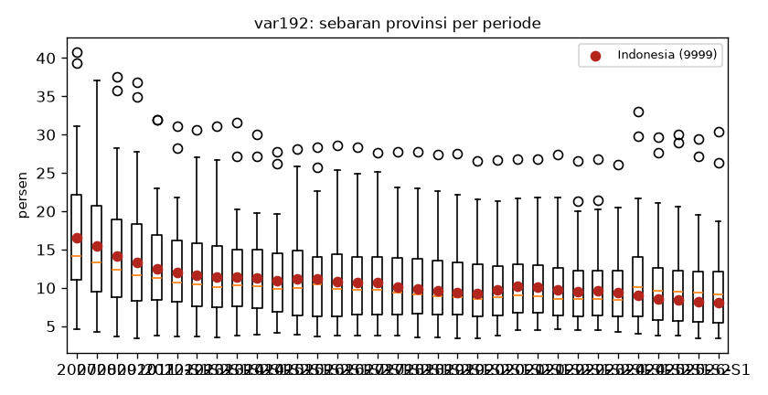
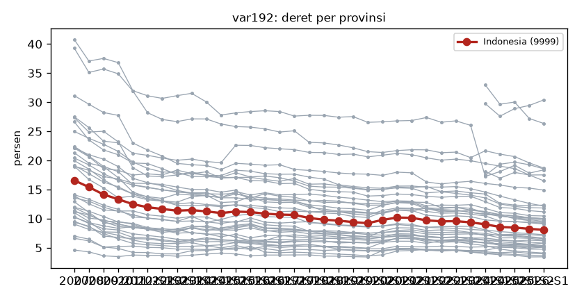
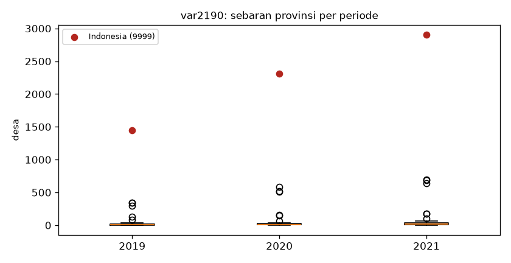
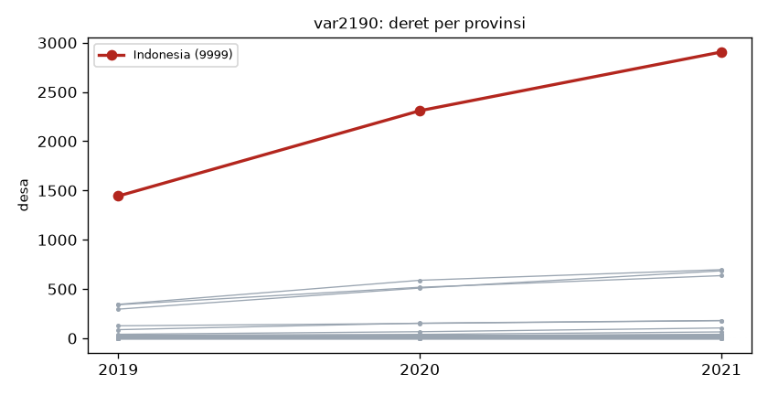
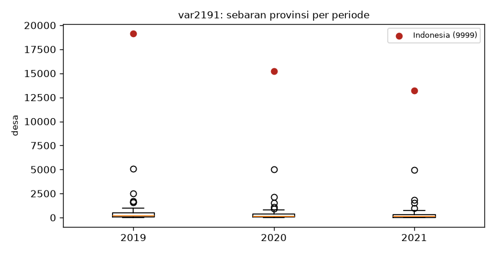
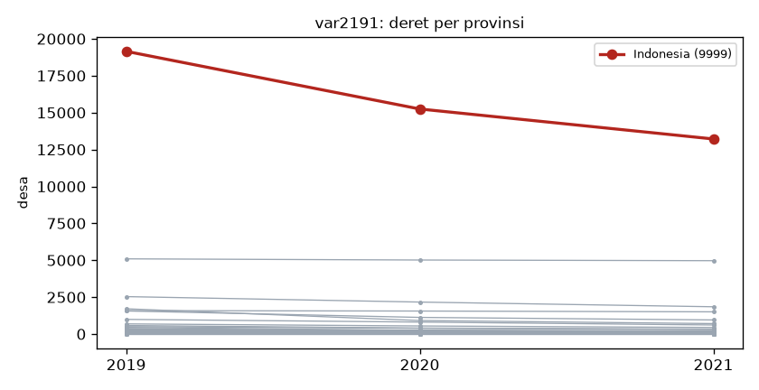

# Profil dan calon anomali seri utama

Dihasilkan `python pipeline.py` (`src/silver/profil.py`). Hanya baris provinsi deret utama (rincian `total`, atau rincian yang didaftar di `DERET` untuk seri yang terbit per rincian; label `kode [rincian]`); baris Indonesia ditampilkan terpisah dan tidak ikut statistik antarprovinsi.

## Banyak periode per provinsi (menentukan arah pembanding)

| seri_kode | min_periode_per_provinsi | maks_periode_per_provinsi |
|---|---|---|
| var192 | 5 | 33 |
| var2190 | 3 | 3 |
| var2191 | 3 | 3 |

- var192: tiga arah (periode per provinsi 5–33)
- var2190: hanya arah ke bawah dan perubahan (periode per provinsi 3–3)
- var2191: hanya arah ke bawah dan perubahan (periode per provinsi 3–3)

Metode: IQR dengan pengali 1.5; arah ke samping hanya bila satu provinsi punya paling sedikit 6 periode. Sel yang ditandai lebih dari satu arah ditulis satu baris. Provinsi yang di luar batas ke bawah pada ≥ 50% periode diberi tanda `berulang`: itu perbedaan struktural antarprovinsi, bukan kejadian satu tahun. Lihat log untuk alasan memilih IQR.

## Statistik deskriptif per seri per periode (provinsi)

| seri_kode | periode | n | rerata | simpangan | minimum | q1 | median | q3 | maksimum |
|---|---|---|---|---|---|---|---|---|---|
| var192 | 2007 | 33 | 17.64 | 8.99 | 4.61 | 11.04 | 14.11 | 22.19 | 40.78 |
| var192 | 2008 | 33 | 16.22 | 8.26 | 4.29 | 9.51 | 13.34 | 20.75 | 37.08 |
| var192 | 2009 | 33 | 15.13 | 8.44 | 3.62 | 8.77 | 12.31 | 18.98 | 37.53 |
| var192 | 2010 | 33 | 14.43 | 8.24 | 3.48 | 8.34 | 11.60 | 18.30 | 36.80 |
| var192 | 2011 | 33 | 13.21 | 7.14 | 3.75 | 8.47 | 11.33 | 16.93 | 31.98 |
| var192 | 2012-S1 | 33 | 12.65 | 6.73 | 3.69 | 8.17 | 10.67 | 16.18 | 31.11 |
| var192 | 2012-S2 | 33 | 12.29 | 6.55 | 3.70 | 7.64 | 10.41 | 15.88 | 30.66 |
| var192 | 2013-S1 | 33 | 12.08 | 6.55 | 3.55 | 7.50 | 10.06 | 15.43 | 31.13 |
| var192 | 2013-S2 | 33 | 12.20 | 6.49 | 3.72 | 7.56 | 10.39 | 15.03 | 31.53 |
| var192 | 2014-S1 | 33 | 12.02 | 6.36 | 3.92 | 7.30 | 10.28 | 15.00 | 30.05 |
| var192 | 2014-S2 | 33 | 11.69 | 6.01 | 4.09 | 6.89 | 9.85 | 14.55 | 27.80 |
| var192 | 2015-S1 | 34 | 11.85 | 6.21 | 3.93 | 6.39 | 10.03 | 14.85 | 28.17 |
| var192 | 2015-S2 | 34 | 11.70 | 6.19 | 3.61 | 6.25 | 10.45 | 14.00 | 28.40 |
| var192 | 2016-S1 | 34 | 11.51 | 6.20 | 3.75 | 6.26 | 9.88 | 14.41 | 28.54 |
| var192 | 2016-S2 | 34 | 11.36 | 6.13 | 3.75 | 6.55 | 9.75 | 14.03 | 28.40 |
| var192 | 2017-S1 | 34 | 11.32 | 6.01 | 3.77 | 6.48 | 9.80 | 14.03 | 27.62 |
| var192 | 2017-S2 | 34 | 10.95 | 5.79 | 3.78 | 6.52 | 9.38 | 13.94 | 27.76 |
| var192 | 2018-S1 | 34 | 10.81 | 5.78 | 3.57 | 6.64 | 9.14 | 13.79 | 27.74 |
| var192 | 2018-S2 | 34 | 10.61 | 5.70 | 3.55 | 6.57 | 8.90 | 13.52 | 27.43 |
| var192 | 2019-S1 | 34 | 10.46 | 5.68 | 3.47 | 6.47 | 8.76 | 13.29 | 27.53 |
| var192 | 2019-S2 | 34 | 10.24 | 5.52 | 3.42 | 6.34 | 8.60 | 13.03 | 26.55 |
| var192 | 2020-S1 | 34 | 10.43 | 5.44 | 3.78 | 6.41 | 8.73 | 12.86 | 26.64 |
| var192 | 2020-S2 | 34 | 10.81 | 5.41 | 4.45 | 6.72 | 9.07 | 13.04 | 26.80 |
| var192 | 2021-S1 | 34 | 10.76 | 5.40 | 4.53 | 6.72 | 8.89 | 12.96 | 26.86 |
| var192 | 2021-S2 | 34 | 10.43 | 5.41 | 4.56 | 6.41 | 8.51 | 12.64 | 27.38 |
| var192 | 2022-S1 | 34 | 10.24 | 5.25 | 4.45 | 6.26 | 8.53 | 12.22 | 26.56 |
| var192 | 2022-S2 | 34 | 10.30 | 5.29 | 4.53 | 6.39 | 8.50 | 12.21 | 26.80 |
| var192 | 2023-S1 | 34 | 10.09 | 5.18 | 4.25 | 6.24 | 8.43 | 12.25 | 26.03 |
| var192 | 2024-S1 | 38 | 11.15 | 6.75 | 4.00 | 6.32 | 10.13 | 14.06 | 32.97 |
| var192 | 2024-S2 | 38 | 10.66 | 6.37 | 3.80 | 5.78 | 9.57 | 12.61 | 29.66 |
| var192 | 2025-S1 | 38 | 10.61 | 6.55 | 3.72 | 5.67 | 9.49 | 12.27 | 30.03 |
| var192 | 2025-S2 | 38 | 10.27 | 6.27 | 3.42 | 5.53 | 9.35 | 12.14 | 29.45 |
| var192 | 2026-S1 | 38 | 10.09 | 6.24 | 3.44 | 5.48 | 9.14 | 12.08 | 30.41 |
| var2190 | 2019 | 33 | 43.76 | 94.97 | 0.00 | 2.00 | 6.00 | 18.00 | 345.00 |
| var2190 | 2020 | 33 | 70.00 | 155.28 | 0.00 | 6.00 | 11.00 | 29.00 | 589.00 |
| var2190 | 2021 | 33 | 88.06 | 193.08 | 0.00 | 5.00 | 18.00 | 36.00 | 697.00 |
| var2191 | 2019 | 33 | 580.36 | 1,003.65 | 0.00 | 74.00 | 214.00 | 502.00 | 5,094.00 |
| var2191 | 2020 | 33 | 462.00 | 951.92 | 0.00 | 39.00 | 138.00 | 386.00 | 5,015.00 |
| var2191 | 2021 | 33 | 400.45 | 926.41 | 0.00 | 25.00 | 102.00 | 306.00 | 4,970.00 |

## Baris Indonesia

| seri_kode | periode | nilai | rujukan_tahun |
|---|---|---|---|
| var192 | 2007 | 16.58 | <NA> |
| var192 | 2008 | 15.42 | <NA> |
| var192 | 2009 | 14.15 | <NA> |
| var192 | 2010 | 13.33 | <NA> |
| var192 | 2011 | 12.49 | <NA> |
| var192 | 2012-S1 | 11.96 | <NA> |
| var192 | 2012-S2 | 11.66 | <NA> |
| var192 | 2013-S1 | 11.37 | <NA> |
| var192 | 2013-S2 | 11.47 | <NA> |
| var192 | 2014-S1 | 11.25 | <NA> |
| var192 | 2014-S2 | 10.96 | <NA> |
| var192 | 2015-S1 | 11.22 | <NA> |
| var192 | 2015-S2 | 11.13 | <NA> |
| var192 | 2016-S1 | 10.86 | <NA> |
| var192 | 2016-S2 | 10.70 | <NA> |
| var192 | 2017-S1 | 10.64 | <NA> |
| var192 | 2017-S2 | 10.12 | <NA> |
| var192 | 2018-S1 | 9.82 | <NA> |
| var192 | 2018-S2 | 9.66 | <NA> |
| var192 | 2019-S1 | 9.41 | <NA> |
| var192 | 2019-S2 | 9.22 | <NA> |
| var192 | 2020-S1 | 9.78 | <NA> |
| var192 | 2020-S2 | 10.19 | <NA> |
| var192 | 2021-S1 | 10.14 | <NA> |
| var192 | 2021-S2 | 9.71 | <NA> |
| var192 | 2022-S1 | 9.54 | <NA> |
| var192 | 2022-S2 | 9.57 | <NA> |
| var192 | 2023-S1 | 9.36 | <NA> |
| var192 | 2024-S1 | 9.03 | <NA> |
| var192 | 2024-S2 | 8.57 | <NA> |
| var192 | 2025-S1 | 8.47 | <NA> |
| var192 | 2025-S2 | 8.25 | <NA> |
| var192 | 2026-S1 | 8.07 | <NA> |
| var2190 | 2019 | 1,444.00 | <NA> |
| var2190 | 2020 | 2,310.00 | <NA> |
| var2190 | 2021 | 2,906.00 | <NA> |
| var2191 | 2019 | 19,152.00 | <NA> |
| var2191 | 2020 | 15,246.00 | <NA> |
| var2191 | 2021 | 13,215.00 | <NA> |

## Calon anomali (227)

Daftar lengkap di `reports/calon-anomali.csv`; kategorinya di `reports/anomali.csv`.

| seri_kode | wilayah_kode | nama_wilayah | periode | nilai | arah | alasan | berulang |
|---|---|---|---|---|---|---|---|
| var192 | 1100 | Aceh | 2007 | 26.65 | ke samping | di luar [10.90, 21.81] dibanding 33 tahun di provinsi ini | False |
| var192 | 1200 | Sumatera Utara | 2007 | 13.90 | ke samping | di luar [5.61, 13.29] dibanding 33 tahun di provinsi ini | False |
| var192 | 1300 | Sumatera Barat | 2007 | 11.90 | ke samping | di luar [3.76, 9.84] dibanding 33 tahun di provinsi ini | False |
| var192 | 1400 | Riau | 2007 | 11.20 | ke samping | di luar [4.77, 10.29] dibanding 33 tahun di provinsi ini | False |
| var192 | 1500 | Jambi | 2007 | 10.27 | ke samping | di luar [6.38, 9.62] dibanding 33 tahun di provinsi ini | False |
| var192 | 1600 | Sumatera Selatan | 2007 | 19.15 | ke samping | di luar [10.54, 15.93] dibanding 33 tahun di provinsi ini | False |
| var192 | 1700 | Bengkulu | 2007 | 22.13 | ke samping | di luar [10.28, 21.85] dibanding 33 tahun di provinsi ini | False |
| var192 | 1800 | Lampung | 2007 | 22.19 | ke samping | di luar [7.59, 18.47] dibanding 33 tahun di provinsi ini | False |
| var192 | 1900 | Kepulauan Bangka Belitung | 2007 | 9.54 | ke samping | di luar [3.83, 6.28] dibanding 33 tahun di provinsi ini | False |
| var192 | 2100 | Kepulauan Riau | 2007 | 10.30 | ke samping | di luar [4.81, 7.45] dibanding 33 tahun di provinsi ini | False |
| var192 | 3200 | Jawa Barat | 2007 | 13.55 | ke samping | di luar [4.29, 12.74] dibanding 33 tahun di provinsi ini | False |
| var192 | 3300 | Jawa Tengah | 2007 | 20.43 | ke samping | di luar [5.63, 19.76] dibanding 33 tahun di provinsi ini | False |
| var192 | 3500 | Jawa Timur | 2007 | 19.98 | ke samping | di luar [7.13, 15.80] dibanding 33 tahun di provinsi ini | False |
| var192 | 3600 | Banten | 2007 | 9.07 | ke samping | di luar [4.27, 7.43] dibanding 33 tahun di provinsi ini | False |
| var192 | 5100 | Bali | 2007 | 6.63 | ke samping | di luar [3.02, 5.50] dibanding 33 tahun di provinsi ini | False |
| var192 | 5200 | Nusa Tenggara Barat | 2007 | 24.99 | ke samping | di luar [8.75, 22.35] dibanding 33 tahun di provinsi ini | False |
| var192 | 5300 | Nusa Tenggara Timur | 2007 | 27.51 | ke samping | di luar [17.30, 24.58] dibanding 33 tahun di provinsi ini | False |
| var192 | 6100 | Kalimantan Barat | 2007 | 12.91 | ke samping | di luar [4.74, 10.34] dibanding 33 tahun di provinsi ini | False |
| var192 | 6200 | Kalimantan Tengah | 2007 | 9.38 | ke samping | di luar [3.79, 7.44] dibanding 33 tahun di provinsi ini | False |
| var192 | 6300 | Kalimantan Selatan | 2007 | 7.01 | ke samping | di luar [3.95, 5.39] dibanding 33 tahun di provinsi ini | False |
| var192 | 6400 | Kalimantan Timur | 2007 | 11.04 | ke samping | di luar [5.42, 7.06] dibanding 33 tahun di provinsi ini | False |
| var192 | 7100 | Sulawesi Utara | 2007 | 11.42 | ke samping | di luar [5.70, 10.18] dibanding 33 tahun di provinsi ini | False |
| var192 | 7200 | Sulawesi Tengah | 2007 | 22.42 | ke samping | di luar [9.04, 18.04] dibanding 33 tahun di provinsi ini | False |
| var192 | 7300 | Sulawesi Selatan | 2007 | 14.11 | ke samping | di luar [6.49, 12.28] dibanding 33 tahun di provinsi ini | False |
| var192 | 7400 | Sulawesi Tenggara | 2007 | 21.33 | ke samping | di luar [7.53, 17.42] dibanding 33 tahun di provinsi ini | False |
| var192 | 7500 | Gorontalo | 2007 | 27.35 | ke samping | di luar [11.95, 21.18] dibanding 33 tahun di provinsi ini | False |
| var192 | 7600 | Sulawesi Barat | 2007 | 19.03 | ke samping | di luar [9.52, 13.97] dibanding 33 tahun di provinsi ini | False |
| var192 | 8100 | Maluku | 2007 | 31.14 | ke samping | di luar [11.82, 24.09] dibanding 33 tahun di provinsi ini | False |
| var192 | 8200 | Maluku Utara | 2007 | 11.97 | ke samping | di luar [4.62, 9.23] dibanding 33 tahun di provinsi ini | False |
| var192 | 9100 | Papua Barat | 2007 | 39.31 | ke bawah + ke samping | di luar [-5.69, 38.92] (IQR x 1.5) dibanding 33 provinsi tahun itu; di luar [13.22, 35.33] dibanding 33 tahun di provinsi ini | False |
| var192 | 9400 | Papua | 2007 | 40.78 | ke bawah + ke samping | di luar [-5.69, 38.92] (IQR x 1.5) dibanding 33 provinsi tahun itu; di luar [20.61, 36.69] dibanding 33 tahun di provinsi ini | True |
| var192 | 1100 | Aceh | 2008 | 23.53 | perubahan + ke samping | perubahan 2007→2008 sebesar -3.12 di luar [-3.02, 0.58]; di luar [10.90, 21.81] dibanding 33 tahun di provinsi ini | False |
| var192 | 1300 | Sumatera Barat | 2008 | 10.67 | ke samping | di luar [3.76, 9.84] dibanding 33 tahun di provinsi ini | False |
| var192 | 1400 | Riau | 2008 | 10.63 | ke samping | di luar [4.77, 10.29] dibanding 33 tahun di provinsi ini | False |
| var192 | 1600 | Sumatera Selatan | 2008 | 17.73 | ke samping | di luar [10.54, 15.93] dibanding 33 tahun di provinsi ini | False |
| var192 | 1800 | Lampung | 2008 | 20.98 | ke samping | di luar [7.59, 18.47] dibanding 33 tahun di provinsi ini | False |
| var192 | 1900 | Kepulauan Bangka Belitung | 2008 | 8.58 | ke samping | di luar [3.83, 6.28] dibanding 33 tahun di provinsi ini | False |
| var192 | 2100 | Kepulauan Riau | 2008 | 9.18 | ke samping | di luar [4.81, 7.45] dibanding 33 tahun di provinsi ini | False |
| var192 | 3200 | Jawa Barat | 2008 | 13.01 | ke samping | di luar [4.29, 12.74] dibanding 33 tahun di provinsi ini | False |
| var192 | 3500 | Jawa Timur | 2008 | 18.51 | ke samping | di luar [7.13, 15.80] dibanding 33 tahun di provinsi ini | False |
| var192 | 3600 | Banten | 2008 | 8.15 | ke samping | di luar [4.27, 7.43] dibanding 33 tahun di provinsi ini | False |
| var192 | 5100 | Bali | 2008 | 6.17 | ke samping | di luar [3.02, 5.50] dibanding 33 tahun di provinsi ini | False |
| var192 | 5200 | Nusa Tenggara Barat | 2008 | 23.81 | ke samping | di luar [8.75, 22.35] dibanding 33 tahun di provinsi ini | False |
| var192 | 5300 | Nusa Tenggara Timur | 2008 | 25.65 | ke samping | di luar [17.30, 24.58] dibanding 33 tahun di provinsi ini | False |
| var192 | 6100 | Kalimantan Barat | 2008 | 11.07 | ke samping | di luar [4.74, 10.34] dibanding 33 tahun di provinsi ini | False |
| var192 | 6200 | Kalimantan Tengah | 2008 | 8.71 | ke samping | di luar [3.79, 7.44] dibanding 33 tahun di provinsi ini | False |
| var192 | 6300 | Kalimantan Selatan | 2008 | 6.48 | ke samping | di luar [3.95, 5.39] dibanding 33 tahun di provinsi ini | False |
| var192 | 6400 | Kalimantan Timur | 2008 | 9.51 | ke samping | di luar [5.42, 7.06] dibanding 33 tahun di provinsi ini | False |
| var192 | 7200 | Sulawesi Tengah | 2008 | 20.75 | ke samping | di luar [9.04, 18.04] dibanding 33 tahun di provinsi ini | False |
| var192 | 7300 | Sulawesi Selatan | 2008 | 13.34 | ke samping | di luar [6.49, 12.28] dibanding 33 tahun di provinsi ini | False |
| var192 | 7400 | Sulawesi Tenggara | 2008 | 19.53 | ke samping | di luar [7.53, 17.42] dibanding 33 tahun di provinsi ini | False |
| var192 | 7500 | Gorontalo | 2008 | 24.88 | ke samping | di luar [11.95, 21.18] dibanding 33 tahun di provinsi ini | False |
| var192 | 7600 | Sulawesi Barat | 2008 | 16.73 | ke samping | di luar [9.52, 13.97] dibanding 33 tahun di provinsi ini | False |
| var192 | 8100 | Maluku | 2008 | 29.66 | ke samping | di luar [11.82, 24.09] dibanding 33 tahun di provinsi ini | False |
| var192 | 8200 | Maluku Utara | 2008 | 11.28 | ke samping | di luar [4.62, 9.23] dibanding 33 tahun di provinsi ini | False |
| var192 | 9100 | Papua Barat | 2008 | 35.12 | perubahan | perubahan 2007→2008 sebesar -4.19 di luar [-3.02, 0.58] | False |
| var192 | 9400 | Papua | 2008 | 37.08 | perubahan + ke samping | perubahan 2007→2008 sebesar -3.70 di luar [-3.02, 0.58]; di luar [20.61, 36.69] dibanding 33 tahun di provinsi ini | True |
| var192 | 1600 | Sumatera Selatan | 2009 | 16.28 | ke samping | di luar [10.54, 15.93] dibanding 33 tahun di provinsi ini | False |
| var192 | 1800 | Lampung | 2009 | 20.22 | ke samping | di luar [7.59, 18.47] dibanding 33 tahun di provinsi ini | False |
| var192 | 1900 | Kepulauan Bangka Belitung | 2009 | 7.46 | ke samping | di luar [3.83, 6.28] dibanding 33 tahun di provinsi ini | False |
| var192 | 2100 | Kepulauan Riau | 2009 | 8.27 | ke samping | di luar [4.81, 7.45] dibanding 33 tahun di provinsi ini | False |
| var192 | 3500 | Jawa Timur | 2009 | 16.68 | ke samping | di luar [7.13, 15.80] dibanding 33 tahun di provinsi ini | False |
| var192 | 3600 | Banten | 2009 | 7.64 | ke samping | di luar [4.27, 7.43] dibanding 33 tahun di provinsi ini | False |
| var192 | 5200 | Nusa Tenggara Barat | 2009 | 22.78 | ke samping | di luar [8.75, 22.35] dibanding 33 tahun di provinsi ini | False |
| var192 | 6400 | Kalimantan Timur | 2009 | 7.73 | ke samping | di luar [5.42, 7.06] dibanding 33 tahun di provinsi ini | False |
| var192 | 7200 | Sulawesi Tengah | 2009 | 18.98 | ke samping | di luar [9.04, 18.04] dibanding 33 tahun di provinsi ini | False |
| var192 | 7300 | Sulawesi Selatan | 2009 | 12.31 | ke samping | di luar [6.49, 12.28] dibanding 33 tahun di provinsi ini | False |
| var192 | 7400 | Sulawesi Tenggara | 2009 | 18.93 | ke samping | di luar [7.53, 17.42] dibanding 33 tahun di provinsi ini | False |
| var192 | 7500 | Gorontalo | 2009 | 25.01 | ke samping | di luar [11.95, 21.18] dibanding 33 tahun di provinsi ini | False |
| var192 | 7600 | Sulawesi Barat | 2009 | 15.29 | ke samping | di luar [9.52, 13.97] dibanding 33 tahun di provinsi ini | False |
| var192 | 8100 | Maluku | 2009 | 28.23 | ke samping | di luar [11.82, 24.09] dibanding 33 tahun di provinsi ini | False |
| var192 | 8200 | Maluku Utara | 2009 | 10.36 | ke samping | di luar [4.62, 9.23] dibanding 33 tahun di provinsi ini | False |
| var192 | 9100 | Papua Barat | 2009 | 35.71 | ke bawah + perubahan + ke samping | di luar [-6.55, 34.30] (IQR x 1.5) dibanding 33 provinsi tahun itu; perubahan 2008→2009 sebesar +0.59 di luar [-2.64, 0.36]; di luar [13.22, 35.33] dibanding 33 tahun di provinsi ini | False |
| var192 | 9400 | Papua | 2009 | 37.53 | ke bawah + perubahan + ke samping | di luar [-6.55, 34.30] (IQR x 1.5) dibanding 33 provinsi tahun itu; perubahan 2008→2009 sebesar +0.45 di luar [-2.64, 0.36]; di luar [20.61, 36.69] dibanding 33 tahun di provinsi ini | True |
| var192 | 1800 | Lampung | 2010 | 18.94 | ke samping | di luar [7.59, 18.47] dibanding 33 tahun di provinsi ini | False |
| var192 | 1900 | Kepulauan Bangka Belitung | 2010 | 6.51 | ke samping | di luar [3.83, 6.28] dibanding 33 tahun di provinsi ini | False |
| var192 | 2100 | Kepulauan Riau | 2010 | 8.05 | ke samping | di luar [4.81, 7.45] dibanding 33 tahun di provinsi ini | False |
| var192 | 6400 | Kalimantan Timur | 2010 | 7.66 | ke samping | di luar [5.42, 7.06] dibanding 33 tahun di provinsi ini | False |
| var192 | 7200 | Sulawesi Tengah | 2010 | 18.07 | ke samping | di luar [9.04, 18.04] dibanding 33 tahun di provinsi ini | False |
| var192 | 7500 | Gorontalo | 2010 | 23.19 | ke samping | di luar [11.95, 21.18] dibanding 33 tahun di provinsi ini | False |
| var192 | 8100 | Maluku | 2010 | 27.74 | ke samping | di luar [11.82, 24.09] dibanding 33 tahun di provinsi ini | False |
| var192 | 8200 | Maluku Utara | 2010 | 9.42 | ke samping | di luar [4.62, 9.23] dibanding 33 tahun di provinsi ini | False |
| var192 | 9100 | Papua Barat | 2010 | 34.88 | ke bawah | di luar [-6.60, 33.24] (IQR x 1.5) dibanding 33 provinsi tahun itu | False |
| var192 | 9400 | Papua | 2010 | 36.80 | ke bawah + ke samping | di luar [-6.60, 33.24] (IQR x 1.5) dibanding 33 provinsi tahun itu; di luar [20.61, 36.69] dibanding 33 tahun di provinsi ini | True |
| var192 | 7500 | Gorontalo | 2011 | 18.75 | perubahan | perubahan 2010→2011 sebesar -4.44 di luar [-3.87, 1.65] | False |
| var192 | 8100 | Maluku | 2011 | 23.00 | perubahan | perubahan 2010→2011 sebesar -4.74 di luar [-3.87, 1.65] | False |
| var192 | 9100 | Papua Barat | 2011 | 31.92 | ke bawah | di luar [-4.22, 29.62] (IQR x 1.5) dibanding 33 provinsi tahun itu | False |
| var192 | 9400 | Papua | 2011 | 31.98 | ke bawah + perubahan | di luar [-4.22, 29.62] (IQR x 1.5) dibanding 33 provinsi tahun itu; perubahan 2010→2011 sebesar -4.82 di luar [-3.87, 1.65] | True |
| var192 | 9100 | Papua Barat | 2012-S1 | 28.20 | ke bawah + perubahan | di luar [-3.85, 28.20] (IQR x 1.5) dibanding 33 provinsi tahun itu; perubahan 2011→2012-S1 sebesar -3.72 di luar [-1.55, 0.58] | False |
| var192 | 9400 | Papua | 2012-S1 | 31.11 | ke bawah | di luar [-3.85, 28.20] (IQR x 1.5) dibanding 33 provinsi tahun itu | True |
| var192 | 1100 | Aceh | 2012-S2 | 18.58 | perubahan | perubahan 2012-S1→2012-S2 sebesar -0.88 di luar [-0.87, 0.22] | False |
| var192 | 8100 | Maluku | 2012-S2 | 20.76 | perubahan | perubahan 2012-S1→2012-S2 sebesar -1.02 di luar [-0.87, 0.22] | False |
| var192 | 9100 | Papua Barat | 2012-S2 | 27.04 | perubahan | perubahan 2012-S1→2012-S2 sebesar -1.16 di luar [-0.87, 0.22] | False |
| var192 | 9400 | Papua | 2012-S2 | 30.66 | ke bawah | di luar [-4.72, 28.24] (IQR x 1.5) dibanding 33 provinsi tahun itu | True |
| var192 | 1100 | Aceh | 2013-S1 | 17.60 | perubahan | perubahan 2012-S2→2013-S1 sebesar -0.98 di luar [-0.95, 0.57] | False |
| var192 | 1600 | Sumatera Selatan | 2013-S1 | 14.24 | perubahan | perubahan 2012-S2→2013-S1 sebesar +0.76 di luar [-0.95, 0.57] | False |
| var192 | 1700 | Bengkulu | 2013-S1 | 18.34 | perubahan | perubahan 2012-S2→2013-S1 sebesar +0.83 di luar [-0.95, 0.57] | False |
| var192 | 8100 | Maluku | 2013-S1 | 19.49 | perubahan | perubahan 2012-S2→2013-S1 sebesar -1.27 di luar [-0.95, 0.57] | False |
| var192 | 9400 | Papua | 2013-S1 | 31.13 | ke bawah | di luar [-4.39, 27.32] (IQR x 1.5) dibanding 33 provinsi tahun itu | True |
| var192 | 9100 | Papua Barat | 2013-S2 | 27.14 | ke bawah | di luar [-3.65, 26.23] (IQR x 1.5) dibanding 33 provinsi tahun itu | False |
| var192 | 9400 | Papua | 2013-S2 | 31.53 | ke bawah | di luar [-3.65, 26.23] (IQR x 1.5) dibanding 33 provinsi tahun itu | True |
| var192 | 1200 | Sumatera Utara | 2014-S1 | 9.38 | perubahan | perubahan 2013-S2→2014-S1 sebesar -1.01 di luar [-0.83, 0.56] | False |
| var192 | 9100 | Papua Barat | 2014-S1 | 27.13 | ke bawah | di luar [-4.25, 26.55] (IQR x 1.5) dibanding 33 provinsi tahun itu | False |
| var192 | 9400 | Papua | 2014-S1 | 30.05 | ke bawah + perubahan | di luar [-4.25, 26.55] (IQR x 1.5) dibanding 33 provinsi tahun itu; perubahan 2013-S2→2014-S1 sebesar -1.48 di luar [-0.83, 0.56] | True |
| var192 | 7400 | Sulawesi Tenggara | 2014-S2 | 12.77 | perubahan | perubahan 2014-S1→2014-S2 sebesar -1.28 di luar [-1.18, 0.66] | False |
| var192 | 9100 | Papua Barat | 2014-S2 | 26.26 | ke bawah | di luar [-4.60, 26.04] (IQR x 1.5) dibanding 33 provinsi tahun itu | False |
| var192 | 9400 | Papua | 2014-S2 | 27.80 | ke bawah + perubahan | di luar [-4.60, 26.04] (IQR x 1.5) dibanding 33 provinsi tahun itu; perubahan 2014-S1→2014-S2 sebesar -2.25 di luar [-1.18, 0.66] | True |
| var192 | 5300 | Nusa Tenggara Timur | 2015-S1 | 22.61 | perubahan | perubahan 2014-S2→2015-S1 sebesar +3.01 di luar [-0.69, 1.11] | False |
| var192 | 9400 | Papua | 2015-S1 | 28.17 | ke bawah | di luar [-6.30, 27.53] (IQR x 1.5) dibanding 34 provinsi tahun itu | True |
| var192 | 3400 | DI Yogyakarta | 2015-S2 | 13.16 | perubahan | perubahan 2015-S1→2015-S2 sebesar -1.75 di luar [-1.53, 1.22] | False |
| var192 | 9100 | Papua Barat | 2015-S2 | 25.73 | ke bawah | di luar [-5.38, 25.62] (IQR x 1.5) dibanding 34 provinsi tahun itu | False |
| var192 | 9400 | Papua | 2015-S2 | 28.40 | ke bawah | di luar [-5.38, 25.62] (IQR x 1.5) dibanding 34 provinsi tahun itu | True |
| var192 | 9400 | Papua | 2016-S1 | 28.54 | ke bawah | di luar [-5.98, 26.64] (IQR x 1.5) dibanding 34 provinsi tahun itu | True |
| var192 | 6500 | Kalimantan Utara | 2016-S2 | 6.99 | perubahan | perubahan 2016-S1→2016-S2 sebesar +0.76 di luar [-0.62, 0.25] | False |
| var192 | 9400 | Papua | 2016-S2 | 28.40 | ke bawah | di luar [-4.66, 25.25] (IQR x 1.5) dibanding 34 provinsi tahun itu | True |
| var192 | 1700 | Bengkulu | 2017-S1 | 16.45 | perubahan | perubahan 2016-S2→2017-S1 sebesar -0.58 di luar [-0.54, 0.50] | False |
| var192 | 8100 | Maluku | 2017-S1 | 18.45 | perubahan | perubahan 2016-S2→2017-S1 sebesar -0.81 di luar [-0.54, 0.50] | False |
| var192 | 9400 | Papua | 2017-S1 | 27.62 | ke bawah + perubahan | di luar [-4.84, 25.35] (IQR x 1.5) dibanding 34 provinsi tahun itu; perubahan 2016-S2→2017-S1 sebesar -0.78 di luar [-0.54, 0.50] | True |
| var192 | 9100 | Papua Barat | 2017-S2 | 23.12 | perubahan | perubahan 2017-S1→2017-S2 sebesar -1.98 di luar [-1.61, 0.93] | False |
| var192 | 9400 | Papua | 2017-S2 | 27.76 | ke bawah | di luar [-4.62, 25.07] (IQR x 1.5) dibanding 34 provinsi tahun itu | True |
| var192 | 3300 | Jawa Tengah | 2018-S1 | 11.32 | perubahan | perubahan 2017-S2→2018-S1 sebesar -0.91 di luar [-0.53, 0.28] | False |
| var192 | 9400 | Papua | 2018-S1 | 27.74 | ke bawah | di luar [-4.08, 24.52] (IQR x 1.5) dibanding 34 provinsi tahun itu | True |
| var192 | 7500 | Gorontalo | 2018-S2 | 15.83 | perubahan | perubahan 2018-S1→2018-S2 sebesar -0.98 di luar [-0.67, 0.29] | False |
| var192 | 9400 | Papua | 2018-S2 | 27.43 | ke bawah | di luar [-3.86, 23.95] (IQR x 1.5) dibanding 34 provinsi tahun itu | True |
| var192 | 3500 | Jawa Timur | 2019-S1 | 10.37 | perubahan | perubahan 2018-S2→2019-S1 sebesar -0.48 di luar [-0.43, 0.12] | False |
| var192 | 8200 | Maluku Utara | 2019-S1 | 6.77 | perubahan | perubahan 2018-S2→2019-S1 sebesar +0.15 di luar [-0.43, 0.12] | False |
| var192 | 9100 | Papua Barat | 2019-S1 | 22.17 | perubahan | perubahan 2018-S2→2019-S1 sebesar -0.49 di luar [-0.43, 0.12] | False |
| var192 | 9400 | Papua | 2019-S1 | 27.53 | ke bawah | di luar [-3.75, 23.51] (IQR x 1.5) dibanding 34 provinsi tahun itu | True |
| var192 | 5200 | Nusa Tenggara Barat | 2019-S2 | 13.88 | perubahan | perubahan 2019-S1→2019-S2 sebesar -0.68 di luar [-0.47, 0.11] | False |
| var192 | 5300 | Nusa Tenggara Timur | 2019-S2 | 20.62 | perubahan | perubahan 2019-S1→2019-S2 sebesar -0.47 di luar [-0.47, 0.11] | False |
| var192 | 8200 | Maluku Utara | 2019-S2 | 6.91 | perubahan | perubahan 2019-S1→2019-S2 sebesar +0.14 di luar [-0.47, 0.11] | False |
| var192 | 9100 | Papua Barat | 2019-S2 | 21.51 | perubahan | perubahan 2019-S1→2019-S2 sebesar -0.66 di luar [-0.47, 0.11] | False |
| var192 | 9400 | Papua | 2019-S2 | 26.55 | ke bawah + perubahan | di luar [-3.69, 23.05] (IQR x 1.5) dibanding 34 provinsi tahun itu; perubahan 2019-S1→2019-S2 sebesar -0.98 di luar [-0.47, 0.11] | True |
| var192 | 3100 | DKI Jakarta | 2020-S1 | 4.53 | perubahan | perubahan 2019-S2→2020-S1 sebesar +1.11 di luar [-0.45, 0.57] | False |
| var192 | 3200 | Jawa Barat | 2020-S1 | 7.88 | perubahan | perubahan 2019-S2→2020-S1 sebesar +1.06 di luar [-0.45, 0.57] | False |
| var192 | 3300 | Jawa Tengah | 2020-S1 | 11.41 | perubahan | perubahan 2019-S2→2020-S1 sebesar +0.83 di luar [-0.45, 0.57] | False |
| var192 | 3400 | DI Yogyakarta | 2020-S1 | 12.28 | perubahan | perubahan 2019-S2→2020-S1 sebesar +0.84 di luar [-0.45, 0.57] | False |
| var192 | 3500 | Jawa Timur | 2020-S1 | 11.09 | perubahan | perubahan 2019-S2→2020-S1 sebesar +0.89 di luar [-0.45, 0.57] | False |
| var192 | 3600 | Banten | 2020-S1 | 5.92 | perubahan | perubahan 2019-S2→2020-S1 sebesar +0.98 di luar [-0.45, 0.57] | False |
| var192 | 9400 | Papua | 2020-S1 | 26.64 | ke bawah | di luar [-3.27, 22.53] (IQR x 1.5) dibanding 34 provinsi tahun itu | True |
| var192 | 9400 | Papua | 2020-S2 | 26.80 | ke bawah | di luar [-2.75, 22.52] (IQR x 1.5) dibanding 34 provinsi tahun itu | True |
| var192 | 9400 | Papua | 2021-S1 | 26.86 | ke bawah | di luar [-2.65, 22.32] (IQR x 1.5) dibanding 34 provinsi tahun itu | True |
| var192 | 8100 | Maluku | 2021-S2 | 16.30 | perubahan | perubahan 2021-S1→2021-S2 sebesar -1.57 di luar [-1.24, 0.64] | False |
| var192 | 9400 | Papua | 2021-S2 | 27.38 | ke bawah | di luar [-2.93, 21.98] (IQR x 1.5) dibanding 34 provinsi tahun itu | True |
| var192 | 1100 | Aceh | 2022-S1 | 14.64 | perubahan | perubahan 2021-S2→2022-S1 sebesar -0.89 di luar [-0.81, 0.48] | False |
| var192 | 1600 | Sumatera Selatan | 2022-S1 | 11.90 | perubahan | perubahan 2021-S2→2022-S1 sebesar -0.89 di luar [-0.81, 0.48] | False |
| var192 | 2100 | Kepulauan Riau | 2022-S1 | 6.24 | perubahan | perubahan 2021-S2→2022-S1 sebesar +0.49 di luar [-0.81, 0.48] | False |
| var192 | 9100 | Papua Barat | 2022-S1 | 21.33 | ke bawah | di luar [-2.69, 21.17] (IQR x 1.5) dibanding 34 provinsi tahun itu | False |
| var192 | 9400 | Papua | 2022-S1 | 26.56 | ke bawah + perubahan | di luar [-2.69, 21.17] (IQR x 1.5) dibanding 34 provinsi tahun itu; perubahan 2021-S2→2022-S1 sebesar -0.82 di luar [-0.81, 0.48] | True |
| var192 | 1700 | Bengkulu | 2022-S2 | 14.34 | perubahan | perubahan 2022-S1→2022-S2 sebesar -0.28 di luar [-0.23, 0.34] | False |
| var192 | 9100 | Papua Barat | 2022-S2 | 21.43 | ke bawah | di luar [-2.35, 20.95] (IQR x 1.5) dibanding 34 provinsi tahun itu | False |
| var192 | 9400 | Papua | 2022-S2 | 26.80 | ke bawah | di luar [-2.35, 20.95] (IQR x 1.5) dibanding 34 provinsi tahun itu | True |
| var192 | 9100 | Papua Barat | 2023-S1 | 20.49 | perubahan | perubahan 2022-S2→2023-S1 sebesar -0.94 di luar [-0.69, 0.27] | False |
| var192 | 9400 | Papua | 2023-S1 | 26.03 | ke bawah + perubahan | di luar [-2.78, 21.27] (IQR x 1.5) dibanding 34 provinsi tahun itu; perubahan 2022-S2→2023-S1 sebesar -0.77 di luar [-0.69, 0.27] | True |
| var192 | 9100 | Papua Barat | 2024-S1 | 21.66 | perubahan | perubahan 2023-S1→2024-S1 sebesar +1.17 di luar [-0.98, 0.36] | False |
| var192 | 9400 | Papua | 2024-S1 | 17.26 | perubahan + ke samping | perubahan 2023-S1→2024-S1 sebesar -8.77 di luar [-0.98, 0.36]; di luar [20.61, 36.69] dibanding 33 tahun di provinsi ini | True |
| var192 | 9600 | Papua Tengah | 2024-S1 | 29.76 | ke bawah | di luar [-5.29, 25.68] (IQR x 1.5) dibanding 38 provinsi tahun itu | True |
| var192 | 9700 | Papua Pegunungan | 2024-S1 | 32.97 | ke bawah | di luar [-5.29, 25.68] (IQR x 1.5) dibanding 38 provinsi tahun itu | True |
| var192 | 1100 | Aceh | 2024-S2 | 12.64 | perubahan | perubahan 2024-S1→2024-S2 sebesar -1.59 di luar [-1.55, 0.66] | False |
| var192 | 1600 | Sumatera Selatan | 2024-S2 | 10.51 | ke samping | di luar [10.54, 15.93] dibanding 33 tahun di provinsi ini | False |
| var192 | 2100 | Kepulauan Riau | 2024-S2 | 4.78 | ke samping | di luar [4.81, 7.45] dibanding 33 tahun di provinsi ini | False |
| var192 | 9400 | Papua | 2024-S2 | 18.09 | perubahan + ke samping | perubahan 2024-S1→2024-S2 sebesar +0.83 di luar [-1.55, 0.66]; di luar [20.61, 36.69] dibanding 33 tahun di provinsi ini | True |
| var192 | 9500 | Papua Selatan | 2024-S2 | 19.35 | perubahan | perubahan 2024-S1→2024-S2 sebesar +1.91 di luar [-1.55, 0.66] | False |
| var192 | 9600 | Papua Tengah | 2024-S2 | 27.60 | ke bawah + perubahan | di luar [-4.46, 22.85] (IQR x 1.5) dibanding 38 provinsi tahun itu; perubahan 2024-S1→2024-S2 sebesar -2.16 di luar [-1.55, 0.66] | True |
| var192 | 9700 | Papua Pegunungan | 2024-S2 | 29.66 | ke bawah + perubahan | di luar [-4.46, 22.85] (IQR x 1.5) dibanding 38 provinsi tahun itu; perubahan 2024-S1→2024-S2 sebesar -3.31 di luar [-1.55, 0.66] | True |
| var192 | 1600 | Sumatera Selatan | 2025-S1 | 10.15 | ke samping | di luar [10.54, 15.93] dibanding 33 tahun di provinsi ini | False |
| var192 | 2100 | Kepulauan Riau | 2025-S1 | 4.44 | ke samping | di luar [4.81, 7.45] dibanding 33 tahun di provinsi ini | False |
| var192 | 6300 | Kalimantan Selatan | 2025-S1 | 3.84 | ke samping | di luar [3.95, 5.39] dibanding 33 tahun di provinsi ini | False |
| var192 | 6400 | Kalimantan Timur | 2025-S1 | 5.17 | ke samping | di luar [5.42, 7.06] dibanding 33 tahun di provinsi ini | False |
| var192 | 9200 | Papua Barat Daya | 2025-S1 | 17.95 | perubahan | perubahan 2024-S2→2025-S1 sebesar +1.00 di luar [-0.68, 0.31] | False |
| var192 | 9400 | Papua | 2025-S1 | 19.16 | perubahan + ke samping | perubahan 2024-S2→2025-S1 sebesar +1.07 di luar [-0.68, 0.31]; di luar [20.61, 36.69] dibanding 33 tahun di provinsi ini | True |
| var192 | 9500 | Papua Selatan | 2025-S1 | 19.71 | perubahan | perubahan 2024-S2→2025-S1 sebesar +0.36 di luar [-0.68, 0.31] | False |
| var192 | 9600 | Papua Tengah | 2025-S1 | 28.90 | ke bawah + perubahan | di luar [-4.21, 22.16] (IQR x 1.5) dibanding 38 provinsi tahun itu; perubahan 2024-S2→2025-S1 sebesar +1.30 di luar [-0.68, 0.31] | True |
| var192 | 9700 | Papua Pegunungan | 2025-S1 | 30.03 | ke bawah + perubahan | di luar [-4.21, 22.16] (IQR x 1.5) dibanding 38 provinsi tahun itu; perubahan 2024-S2→2025-S1 sebesar +0.37 di luar [-0.68, 0.31] | True |
| var192 | 1600 | Sumatera Selatan | 2025-S2 | 9.85 | ke samping | di luar [10.54, 15.93] dibanding 33 tahun di provinsi ini | False |
| var192 | 2100 | Kepulauan Riau | 2025-S2 | 4.26 | ke samping | di luar [4.81, 7.45] dibanding 33 tahun di provinsi ini | False |
| var192 | 5300 | Nusa Tenggara Timur | 2025-S2 | 17.50 | perubahan | perubahan 2025-S1→2025-S2 sebesar -1.10 di luar [-0.78, 0.28] | False |
| var192 | 6300 | Kalimantan Selatan | 2025-S2 | 3.73 | ke samping | di luar [3.95, 5.39] dibanding 33 tahun di provinsi ini | False |
| var192 | 6400 | Kalimantan Timur | 2025-S2 | 5.19 | ke samping | di luar [5.42, 7.06] dibanding 33 tahun di provinsi ini | False |
| var192 | 9100 | Papua Barat | 2025-S2 | 19.58 | perubahan | perubahan 2025-S1→2025-S2 sebesar -1.08 di luar [-0.78, 0.28] | False |
| var192 | 9400 | Papua | 2025-S2 | 17.82 | perubahan + ke samping | perubahan 2025-S1→2025-S2 sebesar -1.34 di luar [-0.78, 0.28]; di luar [20.61, 36.69] dibanding 33 tahun di provinsi ini | True |
| var192 | 9600 | Papua Tengah | 2025-S2 | 29.45 | ke bawah + perubahan | di luar [-4.38, 22.04] (IQR x 1.5) dibanding 38 provinsi tahun itu; perubahan 2025-S1→2025-S2 sebesar +0.55 di luar [-0.78, 0.28] | True |
| var192 | 9700 | Papua Pegunungan | 2025-S2 | 27.21 | ke bawah + perubahan | di luar [-4.38, 22.04] (IQR x 1.5) dibanding 38 provinsi tahun itu; perubahan 2025-S1→2025-S2 sebesar -2.82 di luar [-0.78, 0.28] | True |
| var192 | 1600 | Sumatera Selatan | 2026-S1 | 9.50 | ke samping | di luar [10.54, 15.93] dibanding 33 tahun di provinsi ini | False |
| var192 | 2100 | Kepulauan Riau | 2026-S1 | 4.09 | ke samping | di luar [4.81, 7.45] dibanding 33 tahun di provinsi ini | False |
| var192 | 6300 | Kalimantan Selatan | 2026-S1 | 3.63 | ke samping | di luar [3.95, 5.39] dibanding 33 tahun di provinsi ini | False |
| var192 | 6400 | Kalimantan Timur | 2026-S1 | 5.14 | ke samping | di luar [5.42, 7.06] dibanding 33 tahun di provinsi ini | False |
| var192 | 6500 | Kalimantan Utara | 2026-S1 | 5.18 | ke samping | di luar [5.25, 7.95] dibanding 22 tahun di provinsi ini | False |
| var192 | 9100 | Papua Barat | 2026-S1 | 18.68 | perubahan | perubahan 2025-S2→2026-S1 sebesar -0.90 di luar [-0.67, 0.32] | False |
| var192 | 9200 | Papua Barat Daya | 2026-S1 | 16.49 | perubahan | perubahan 2025-S2→2026-S1 sebesar -1.01 di luar [-0.67, 0.32] | False |
| var192 | 9400 | Papua | 2026-S1 | 18.39 | perubahan + ke samping | perubahan 2025-S2→2026-S1 sebesar +0.57 di luar [-0.67, 0.32]; di luar [20.61, 36.69] dibanding 33 tahun di provinsi ini | True |
| var192 | 9500 | Papua Selatan | 2026-S1 | 18.54 | perubahan | perubahan 2025-S2→2026-S1 sebesar -0.72 di luar [-0.67, 0.32] | False |
| var192 | 9600 | Papua Tengah | 2026-S1 | 30.41 | ke bawah + perubahan | di luar [-4.42, 21.97] (IQR x 1.5) dibanding 38 provinsi tahun itu; perubahan 2025-S2→2026-S1 sebesar +0.96 di luar [-0.67, 0.32] | True |
| var192 | 9700 | Papua Pegunungan | 2026-S1 | 26.34 | ke bawah + perubahan | di luar [-4.42, 21.97] (IQR x 1.5) dibanding 38 provinsi tahun itu; perubahan 2025-S2→2026-S1 sebesar -0.87 di luar [-0.67, 0.32] | True |
| var2190 | 3200 | Jawa Barat | 2019 | 341.00 | ke bawah | di luar [-22.00, 42.00] (IQR x 1.5) dibanding 33 provinsi tahun itu | True |
| var2190 | 3300 | Jawa Tengah | 2019 | 296.00 | ke bawah | di luar [-22.00, 42.00] (IQR x 1.5) dibanding 33 provinsi tahun itu | True |
| var2190 | 3400 | DI Yogyakarta | 2019 | 127.00 | ke bawah | di luar [-22.00, 42.00] (IQR x 1.5) dibanding 33 provinsi tahun itu | True |
| var2190 | 3500 | Jawa Timur | 2019 | 345.00 | ke bawah | di luar [-22.00, 42.00] (IQR x 1.5) dibanding 33 provinsi tahun itu | True |
| var2190 | 5100 | Bali | 2019 | 88.00 | ke bawah | di luar [-22.00, 42.00] (IQR x 1.5) dibanding 33 provinsi tahun itu | True |
| var2190 | 3200 | Jawa Barat | 2020 | 518.00 | ke bawah + perubahan | di luar [-28.50, 63.50] (IQR x 1.5) dibanding 33 provinsi tahun itu; perubahan 2019→2020 sebesar +177.00 di luar [-15.50, 28.50] | True |
| var2190 | 3300 | Jawa Tengah | 2020 | 510.00 | ke bawah + perubahan | di luar [-28.50, 63.50] (IQR x 1.5) dibanding 33 provinsi tahun itu; perubahan 2019→2020 sebesar +214.00 di luar [-15.50, 28.50] | True |
| var2190 | 3400 | DI Yogyakarta | 2020 | 151.00 | ke bawah | di luar [-28.50, 63.50] (IQR x 1.5) dibanding 33 provinsi tahun itu | True |
| var2190 | 3500 | Jawa Timur | 2020 | 589.00 | ke bawah + perubahan | di luar [-28.50, 63.50] (IQR x 1.5) dibanding 33 provinsi tahun itu; perubahan 2019→2020 sebesar +244.00 di luar [-15.50, 28.50] | True |
| var2190 | 5100 | Bali | 2020 | 154.00 | ke bawah + perubahan | di luar [-28.50, 63.50] (IQR x 1.5) dibanding 33 provinsi tahun itu; perubahan 2019→2020 sebesar +66.00 di luar [-15.50, 28.50] | True |
| var2190 | 5200 | Nusa Tenggara Barat | 2020 | 67.00 | ke bawah | di luar [-28.50, 63.50] (IQR x 1.5) dibanding 33 provinsi tahun itu | True |
| var2190 | 3200 | Jawa Barat | 2021 | 636.00 | ke bawah + perubahan | di luar [-41.50, 82.50] (IQR x 1.5) dibanding 33 provinsi tahun itu; perubahan 2020→2021 sebesar +118.00 di luar [-27.00, 45.00] | True |
| var2190 | 3300 | Jawa Tengah | 2021 | 685.00 | ke bawah + perubahan | di luar [-41.50, 82.50] (IQR x 1.5) dibanding 33 provinsi tahun itu; perubahan 2020→2021 sebesar +175.00 di luar [-27.00, 45.00] | True |
| var2190 | 3400 | DI Yogyakarta | 2021 | 179.00 | ke bawah | di luar [-41.50, 82.50] (IQR x 1.5) dibanding 33 provinsi tahun itu | True |
| var2190 | 3500 | Jawa Timur | 2021 | 697.00 | ke bawah + perubahan | di luar [-41.50, 82.50] (IQR x 1.5) dibanding 33 provinsi tahun itu; perubahan 2020→2021 sebesar +108.00 di luar [-27.00, 45.00] | True |
| var2190 | 5100 | Bali | 2021 | 181.00 | ke bawah | di luar [-41.50, 82.50] (IQR x 1.5) dibanding 33 provinsi tahun itu | True |
| var2190 | 5200 | Nusa Tenggara Barat | 2021 | 105.00 | ke bawah | di luar [-41.50, 82.50] (IQR x 1.5) dibanding 33 provinsi tahun itu | True |
| var2191 | 1100 | Aceh | 2019 | 1,710.00 | ke bawah | di luar [-568.00, 1144.00] (IQR x 1.5) dibanding 33 provinsi tahun itu | True |
| var2191 | 1200 | Sumatera Utara | 2019 | 2,535.00 | ke bawah | di luar [-568.00, 1144.00] (IQR x 1.5) dibanding 33 provinsi tahun itu | True |
| var2191 | 5300 | Nusa Tenggara Timur | 2019 | 1,563.00 | ke bawah | di luar [-568.00, 1144.00] (IQR x 1.5) dibanding 33 provinsi tahun itu | True |
| var2191 | 9100 | Papua Barat | 2019 | 1,587.00 | ke bawah | di luar [-568.00, 1144.00] (IQR x 1.5) dibanding 33 provinsi tahun itu | True |
| var2191 | 9400 | Papua | 2019 | 5,094.00 | ke bawah | di luar [-568.00, 1144.00] (IQR x 1.5) dibanding 33 provinsi tahun itu | True |
| var2191 | 1100 | Aceh | 2020 | 915.00 | ke bawah + perubahan | di luar [-481.50, 906.50] (IQR x 1.5) dibanding 33 provinsi tahun itu; perubahan 2019→2020 sebesar -795.00 di luar [-333.50, 158.50] | True |
| var2191 | 1200 | Sumatera Utara | 2020 | 2,166.00 | ke bawah + perubahan | di luar [-481.50, 906.50] (IQR x 1.5) dibanding 33 provinsi tahun itu; perubahan 2019→2020 sebesar -369.00 di luar [-333.50, 158.50] | True |
| var2191 | 5300 | Nusa Tenggara Timur | 2020 | 1,127.00 | ke bawah + perubahan | di luar [-481.50, 906.50] (IQR x 1.5) dibanding 33 provinsi tahun itu; perubahan 2019→2020 sebesar -436.00 di luar [-333.50, 158.50] | True |
| var2191 | 9100 | Papua Barat | 2020 | 1,558.00 | ke bawah | di luar [-481.50, 906.50] (IQR x 1.5) dibanding 33 provinsi tahun itu | True |
| var2191 | 9400 | Papua | 2020 | 5,015.00 | ke bawah | di luar [-481.50, 906.50] (IQR x 1.5) dibanding 33 provinsi tahun itu | True |
| var2191 | 1100 | Aceh | 2021 | 708.00 | perubahan | perubahan 2020→2021 sebesar -207.00 di luar [-162.00, 78.00] | True |
| var2191 | 1200 | Sumatera Utara | 2021 | 1,848.00 | ke bawah + perubahan | di luar [-396.50, 727.50] (IQR x 1.5) dibanding 33 provinsi tahun itu; perubahan 2020→2021 sebesar -318.00 di luar [-162.00, 78.00] | True |
| var2191 | 5300 | Nusa Tenggara Timur | 2021 | 955.00 | ke bawah + perubahan | di luar [-396.50, 727.50] (IQR x 1.5) dibanding 33 provinsi tahun itu; perubahan 2020→2021 sebesar -172.00 di luar [-162.00, 78.00] | True |
| var2191 | 6100 | Kalimantan Barat | 2021 | 613.00 | perubahan | perubahan 2020→2021 sebesar -198.00 di luar [-162.00, 78.00] | False |
| var2191 | 9100 | Papua Barat | 2021 | 1,505.00 | ke bawah | di luar [-396.50, 727.50] (IQR x 1.5) dibanding 33 provinsi tahun itu | True |
| var2191 | 9400 | Papua | 2021 | 4,970.00 | ke bawah | di luar [-396.50, 727.50] (IQR x 1.5) dibanding 33 provinsi tahun itu | True |

## Gambar

