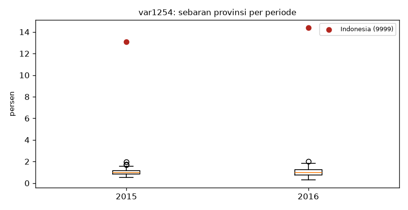
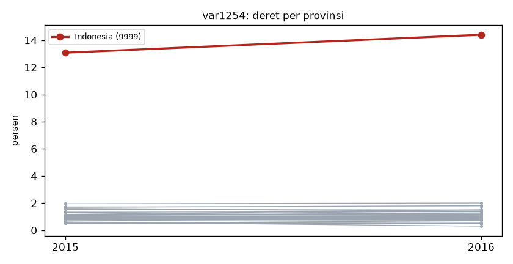
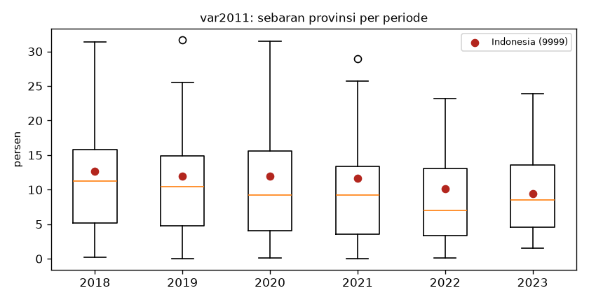
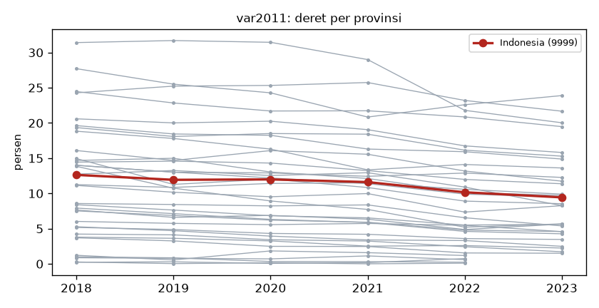
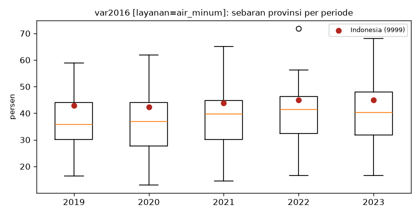
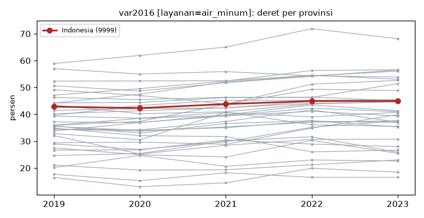
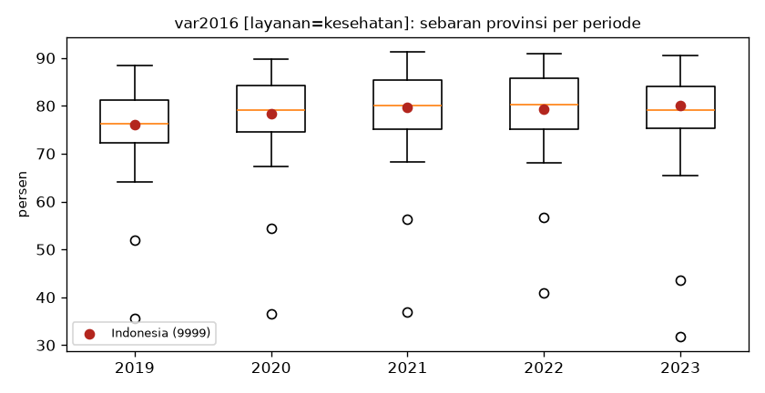
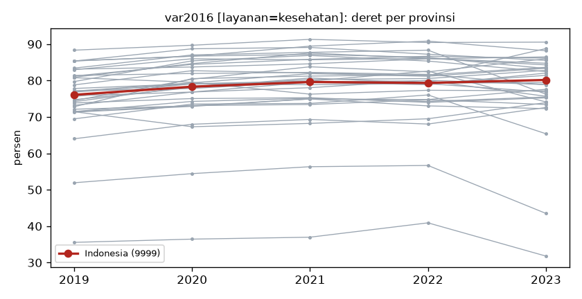
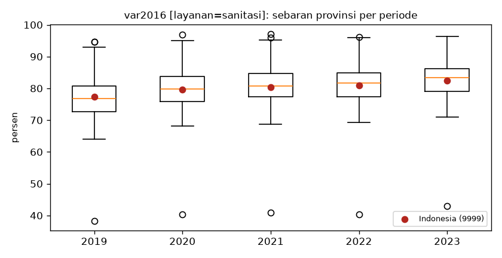
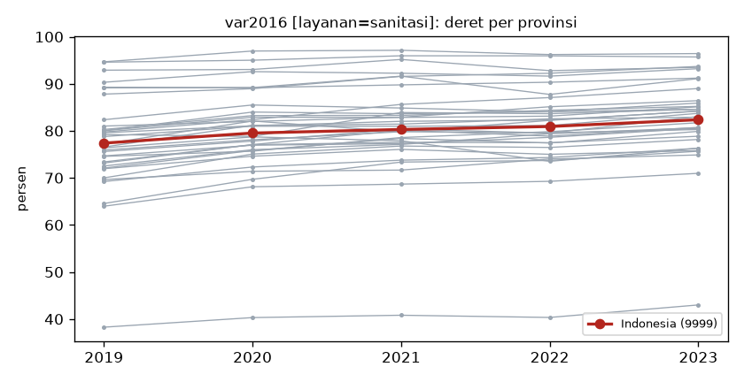

# Profil dan calon anomali seri utama

Dihasilkan `python pipeline.py` (`src/silver/profil.py`). Hanya baris provinsi deret utama (rincian `total`, atau rincian yang didaftar di `DERET` untuk seri yang terbit per rincian; label `kode [rincian]`); baris Indonesia ditampilkan terpisah dan tidak ikut statistik antarprovinsi.

## Banyak periode per provinsi (menentukan arah pembanding)

| seri_kode | min_periode_per_provinsi | maks_periode_per_provinsi |
|---|---|---|
| var1254 | 2 | 2 |
| var2011 | 5 | 6 |
| var2016 [layanan=air_minum] | 5 | 5 |
| var2016 [layanan=kesehatan] | 5 | 5 |
| var2016 [layanan=sanitasi] | 5 | 5 |

- var1254: hanya arah ke bawah dan perubahan (periode per provinsi 2–2)
- var2011: tiga arah (periode per provinsi 5–6)
- var2016 [layanan=air_minum]: hanya arah ke bawah dan perubahan (periode per provinsi 5–5)
- var2016 [layanan=kesehatan]: hanya arah ke bawah dan perubahan (periode per provinsi 5–5)
- var2016 [layanan=sanitasi]: hanya arah ke bawah dan perubahan (periode per provinsi 5–5)

Metode: IQR dengan pengali 1.5; arah ke samping hanya bila satu provinsi punya paling sedikit 6 periode. Sel yang ditandai lebih dari satu arah ditulis satu baris. Provinsi yang di luar batas ke bawah pada ≥ 50% periode diberi tanda `berulang`: itu perbedaan struktural antarprovinsi, bukan kejadian satu tahun. Lihat log untuk alasan memilih IQR.

## Statistik deskriptif per seri per periode (provinsi)

| seri_kode | periode | n | rerata | simpangan | minimum | q1 | median | q3 | maksimum |
|---|---|---|---|---|---|---|---|---|---|
| var1254 | 2015 | 34 | 1.04 | 0.35 | 0.51 | 0.83 | 0.99 | 1.16 | 1.95 |
| var1254 | 2016 | 34 | 1.03 | 0.40 | 0.30 | 0.77 | 0.97 | 1.24 | 2.01 |
| var2011 | 2018 | 34 | 11.62 | 8.26 | 0.23 | 5.20 | 11.20 | 15.80 | 31.41 |
| var2011 | 2019 | 34 | 10.93 | 8.08 | 0.04 | 4.75 | 10.46 | 14.91 | 31.70 |
| var2011 | 2020 | 34 | 10.58 | 8.03 | 0.07 | 4.04 | 9.23 | 15.64 | 31.45 |
| var2011 | 2021 | 34 | 10.00 | 7.57 | 0.01 | 3.60 | 9.18 | 13.32 | 29.00 |
| var2011 | 2022 | 34 | 8.84 | 6.93 | 0.10 | 3.38 | 6.95 | 13.11 | 23.20 |
| var2011 | 2023 | 29 | 9.71 | 6.28 | 1.51 | 4.59 | 8.54 | 13.61 | 23.89 |
| var2016 [layanan=air_minum] | 2019 | 34 | 36.73 | 10.60 | 16.46 | 30.05 | 35.77 | 44.01 | 58.91 |
| var2016 [layanan=air_minum] | 2020 | 34 | 36.34 | 11.29 | 13.02 | 27.59 | 36.93 | 44.12 | 61.92 |
| var2016 [layanan=air_minum] | 2021 | 34 | 38.27 | 11.53 | 14.47 | 30.16 | 39.68 | 44.88 | 65.03 |
| var2016 [layanan=air_minum] | 2022 | 34 | 40.31 | 12.00 | 16.52 | 32.42 | 41.38 | 46.36 | 71.88 |
| var2016 [layanan=air_minum] | 2023 | 34 | 40.05 | 12.26 | 16.51 | 31.86 | 40.30 | 47.99 | 68.16 |
| var2016 [layanan=kesehatan] | 2019 | 34 | 75.26 | 9.87 | 35.55 | 72.28 | 76.33 | 81.14 | 88.33 |
| var2016 [layanan=kesehatan] | 2020 | 34 | 77.66 | 10.14 | 36.44 | 74.46 | 79.12 | 84.24 | 89.68 |
| var2016 [layanan=kesehatan] | 2021 | 34 | 78.74 | 10.21 | 36.97 | 75.14 | 80.06 | 85.41 | 91.30 |
| var2016 [layanan=kesehatan] | 2022 | 34 | 78.83 | 9.64 | 40.91 | 75.08 | 80.31 | 85.80 | 90.82 |
| var2016 [layanan=kesehatan] | 2023 | 34 | 77.58 | 11.68 | 31.78 | 75.30 | 79.13 | 84.12 | 90.54 |
| var2016 [layanan=sanitasi] | 2019 | 34 | 77.34 | 10.53 | 38.27 | 72.68 | 76.88 | 80.83 | 94.67 |
| var2016 [layanan=sanitasi] | 2020 | 34 | 79.81 | 9.96 | 40.31 | 75.86 | 79.90 | 83.80 | 96.96 |
| var2016 [layanan=sanitasi] | 2021 | 34 | 80.97 | 9.93 | 40.81 | 77.36 | 80.66 | 84.61 | 97.12 |
| var2016 [layanan=sanitasi] | 2022 | 34 | 81.00 | 9.78 | 40.34 | 77.43 | 81.67 | 84.93 | 96.21 |
| var2016 [layanan=sanitasi] | 2023 | 34 | 82.57 | 9.46 | 43.00 | 79.11 | 83.38 | 86.28 | 96.42 |

## Baris Indonesia

| seri_kode | periode | nilai | rujukan_tahun |
|---|---|---|---|
| var2011 | 2018 | 12.63 | <NA> |
| var2011 | 2019 | 11.93 | <NA> |
| var2011 | 2020 | 11.99 | <NA> |
| var2011 | 2021 | 11.61 | <NA> |
| var2011 | 2022 | 10.16 | <NA> |
| var2011 | 2023 | 9.44 | <NA> |
| var2016 [layanan=air_minum] | 2019 | 42.84 | <NA> |
| var2016 [layanan=air_minum] | 2020 | 42.31 | <NA> |
| var2016 [layanan=air_minum] | 2021 | 43.81 | <NA> |
| var2016 [layanan=air_minum] | 2022 | 44.94 | <NA> |
| var2016 [layanan=air_minum] | 2023 | 44.95 | <NA> |
| var2016 [layanan=sanitasi] | 2019 | 77.39 | <NA> |
| var2016 [layanan=sanitasi] | 2020 | 79.53 | <NA> |
| var2016 [layanan=sanitasi] | 2021 | 80.29 | <NA> |
| var2016 [layanan=sanitasi] | 2022 | 80.92 | <NA> |
| var2016 [layanan=sanitasi] | 2023 | 82.36 | <NA> |
| var2016 [layanan=kesehatan] | 2019 | 76.07 | <NA> |
| var2016 [layanan=kesehatan] | 2020 | 78.30 | <NA> |
| var2016 [layanan=kesehatan] | 2021 | 79.59 | <NA> |
| var2016 [layanan=kesehatan] | 2022 | 79.33 | <NA> |
| var2016 [layanan=kesehatan] | 2023 | 80.15 | <NA> |
| var1254 | 2015 | 13.08 | <NA> |
| var1254 | 2016 | 14.40 | <NA> |

## Calon anomali (58)

Daftar lengkap di `reports/calon-anomali.csv`; kategorinya di `reports/anomali.csv`.

| seri_kode | wilayah_kode | nama_wilayah | periode | nilai | arah | alasan | berulang |
|---|---|---|---|---|---|---|---|
| var1254 | 3100 | DKI Jakarta | 2015 | 1.69 | ke bawah | di luar [0.34, 1.65] (IQR x 1.5) dibanding 34 provinsi tahun itu | False |
| var1254 | 5100 | Bali | 2015 | 1.72 | ke bawah | di luar [0.34, 1.65] (IQR x 1.5) dibanding 34 provinsi tahun itu | False |
| var1254 | 6300 | Kalimantan Selatan | 2015 | 1.95 | ke bawah | di luar [0.34, 1.65] (IQR x 1.5) dibanding 34 provinsi tahun itu | True |
| var1254 | 6200 | Kalimantan Tengah | 2016 | 1.51 | perubahan | perubahan 2015→2016 sebesar +0.34 di luar [-0.22, 0.18] | False |
| var1254 | 6300 | Kalimantan Selatan | 2016 | 2.01 | ke bawah | di luar [0.06, 1.95] (IQR x 1.5) dibanding 34 provinsi tahun itu | True |
| var1254 | 8100 | Maluku | 2016 | 1.42 | perubahan | perubahan 2015→2016 sebesar +0.28 di luar [-0.22, 0.18] | False |
| var1254 | 9400 | Papua | 2016 | 0.30 | perubahan | perubahan 2015→2016 sebesar -0.30 di luar [-0.22, 0.18] | False |
| var2011 | 7100 | Sulawesi Utara | 2018 | 14.00 | ke samping | di luar [11.89, 13.64] dibanding 6 tahun di provinsi ini | False |
| var2011 | 5300 | Nusa Tenggara Timur | 2019 | 31.70 | ke bawah | di luar [-10.49, 30.15] (IQR x 1.5) dibanding 34 provinsi tahun itu | False |
| var2011 | 8100 | Maluku | 2019 | 10.75 | perubahan | perubahan 2018→2019 sebesar -3.10 di luar [-2.34, 1.18] | False |
| var2011 | 9100 | Papua Barat | 2019 | 11.28 | perubahan | perubahan 2018→2019 sebesar -3.67 di luar [-2.34, 1.18] | False |
| var2011 | 3500 | Jawa Timur | 2020 | 16.08 | perubahan | perubahan 2019→2020 sebesar +1.40 di luar [-2.01, 1.29] | False |
| var2011 | 5300 | Nusa Tenggara Timur | 2021 | 29.00 | ke bawah + perubahan | di luar [-10.98, 27.91] (IQR x 1.5) dibanding 34 provinsi tahun itu; perubahan 2020→2021 sebesar -2.45 di luar [-2.26, 1.38] | False |
| var2011 | 7500 | Gorontalo | 2021 | 20.84 | perubahan | perubahan 2020→2021 sebesar -3.44 di luar [-2.26, 1.38] | False |
| var2011 | 9400 | Papua | 2021 | 13.35 | perubahan | perubahan 2020→2021 sebesar -2.94 di luar [-2.26, 1.38] | False |
| var2011 | 5300 | Nusa Tenggara Timur | 2022 | 21.79 | perubahan | perubahan 2021→2022 sebesar -7.21 di luar [-4.45, 2.20] | False |
| var2011 | 1100 | Aceh | 2023 | 8.26 | perubahan | perubahan 2022→2023 sebesar +0.91 di luar [-2.03, 0.88] | False |
| var2011 | 3400 | DI Yogyakarta | 2023 | 8.27 | perubahan + ke samping | perubahan 2022→2023 sebesar -2.63 di luar [-2.03, 0.88]; di luar [8.94, 15.26] dibanding 6 tahun di provinsi ini | False |
| var2011 | 5100 | Bali | 2023 | 4.58 | ke samping | di luar [5.12, 6.13] dibanding 6 tahun di provinsi ini | False |
| var2011 | 7500 | Gorontalo | 2023 | 23.89 | perubahan | perubahan 2022→2023 sebesar +1.30 di luar [-2.03, 0.88] | False |
| var2016 [layanan=air_minum] | 9100 | Papua Barat | 2020 | 25.21 | perubahan | perubahan 2019→2020 sebesar -6.85 di luar [-6.83, 5.73] | False |
| var2016 [layanan=air_minum] | 5200 | Nusa Tenggara Barat | 2021 | 43.82 | perubahan | perubahan 2020→2021 sebesar -3.16 di luar [-2.80, 6.65] | False |
| var2016 [layanan=air_minum] | 6500 | Kalimantan Utara | 2021 | 20.62 | perubahan | perubahan 2020→2021 sebesar -4.06 di luar [-2.80, 6.65] | False |
| var2016 [layanan=air_minum] | 7600 | Sulawesi Barat | 2021 | 40.80 | perubahan | perubahan 2020→2021 sebesar +10.31 di luar [-2.80, 6.65] | False |
| var2016 [layanan=air_minum] | 3400 | DI Yogyakarta | 2022 | 71.88 | ke bawah | di luar [11.52, 67.27] (IQR x 1.5) dibanding 34 provinsi tahun itu | False |
| var2016 [layanan=air_minum] | 7500 | Gorontalo | 2022 | 26.00 | perubahan | perubahan 2021→2022 sebesar -5.69 di luar [-4.83, 9.08] | False |
| var2016 [layanan=air_minum] | 1500 | Jambi | 2023 | 51.42 | perubahan | perubahan 2022→2023 sebesar +5.14 di luar [-4.60, 3.92] | False |
| var2016 [layanan=air_minum] | 3100 | DKI Jakarta | 2023 | 25.45 | perubahan | perubahan 2022→2023 sebesar -4.83 di luar [-4.60, 3.92] | False |
| var2016 [layanan=air_minum] | 8100 | Maluku | 2023 | 39.85 | perubahan | perubahan 2022→2023 sebesar +4.98 di luar [-4.60, 3.92] | False |
| var2016 [layanan=air_minum] | 9400 | Papua | 2023 | 25.86 | perubahan | perubahan 2022→2023 sebesar -5.75 di luar [-4.60, 3.92] | False |
| var2016 [layanan=kesehatan] | 5300 | Nusa Tenggara Timur | 2019 | 51.92 | ke bawah | di luar [59.01, 94.42] (IQR x 1.5) dibanding 34 provinsi tahun itu | True |
| var2016 [layanan=kesehatan] | 9400 | Papua | 2019 | 35.55 | ke bawah | di luar [59.01, 94.42] (IQR x 1.5) dibanding 34 provinsi tahun itu | True |
| var2016 [layanan=kesehatan] | 1200 | Sumatera Utara | 2020 | 67.30 | perubahan | perubahan 2019→2020 sebesar -4.13 di luar [-2.39, 7.26] | False |
| var2016 [layanan=kesehatan] | 5300 | Nusa Tenggara Timur | 2020 | 54.43 | ke bawah | di luar [59.77, 98.92] (IQR x 1.5) dibanding 34 provinsi tahun itu | True |
| var2016 [layanan=kesehatan] | 8200 | Maluku Utara | 2020 | 80.52 | perubahan | perubahan 2019→2020 sebesar +7.71 di luar [-2.39, 7.26] | False |
| var2016 [layanan=kesehatan] | 9400 | Papua | 2020 | 36.44 | ke bawah | di luar [59.77, 98.92] (IQR x 1.5) dibanding 34 provinsi tahun itu | True |
| var2016 [layanan=kesehatan] | 5300 | Nusa Tenggara Timur | 2021 | 56.33 | ke bawah | di luar [59.74, 100.81] (IQR x 1.5) dibanding 34 provinsi tahun itu | True |
| var2016 [layanan=kesehatan] | 7600 | Sulawesi Barat | 2021 | 76.25 | perubahan | perubahan 2020→2021 sebesar -3.27 di luar [-1.90, 4.17] | False |
| var2016 [layanan=kesehatan] | 9400 | Papua | 2021 | 36.97 | ke bawah | di luar [59.74, 100.81] (IQR x 1.5) dibanding 34 provinsi tahun itu | True |
| var2016 [layanan=kesehatan] | 5300 | Nusa Tenggara Timur | 2022 | 56.67 | ke bawah | di luar [59.02, 101.87] (IQR x 1.5) dibanding 34 provinsi tahun itu | True |
| var2016 [layanan=kesehatan] | 9400 | Papua | 2022 | 40.91 | ke bawah + perubahan | di luar [59.02, 101.87] (IQR x 1.5) dibanding 34 provinsi tahun itu; perubahan 2021→2022 sebesar +3.94 di luar [-3.68, 3.83] | True |
| var2016 [layanan=kesehatan] | 5300 | Nusa Tenggara Timur | 2023 | 43.50 | ke bawah + perubahan | di luar [62.07, 97.36] (IQR x 1.5) dibanding 34 provinsi tahun itu; perubahan 2022→2023 sebesar -13.17 di luar [-10.27, 9.63] | True |
| var2016 [layanan=kesehatan] | 6500 | Kalimantan Utara | 2023 | 76.24 | perubahan | perubahan 2022→2023 sebesar -12.09 di luar [-10.27, 9.63] | False |
| var2016 [layanan=kesehatan] | 9100 | Papua Barat | 2023 | 65.38 | perubahan | perubahan 2022→2023 sebesar -10.65 di luar [-10.27, 9.63] | False |
| var2016 [layanan=kesehatan] | 9400 | Papua | 2023 | 31.78 | ke bawah | di luar [62.07, 97.36] (IQR x 1.5) dibanding 34 provinsi tahun itu | True |
| var2016 [layanan=sanitasi] | 3400 | DI Yogyakarta | 2019 | 94.67 | ke bawah | di luar [60.45, 93.06] (IQR x 1.5) dibanding 34 provinsi tahun itu | True |
| var2016 [layanan=sanitasi] | 5100 | Bali | 2019 | 94.59 | ke bawah | di luar [60.45, 93.06] (IQR x 1.5) dibanding 34 provinsi tahun itu | False |
| var2016 [layanan=sanitasi] | 9400 | Papua | 2019 | 38.27 | ke bawah | di luar [60.45, 93.06] (IQR x 1.5) dibanding 34 provinsi tahun itu | True |
| var2016 [layanan=sanitasi] | 3400 | DI Yogyakarta | 2020 | 96.96 | ke bawah | di luar [63.93, 95.72] (IQR x 1.5) dibanding 34 provinsi tahun itu | True |
| var2016 [layanan=sanitasi] | 9400 | Papua | 2020 | 40.31 | ke bawah | di luar [63.93, 95.72] (IQR x 1.5) dibanding 34 provinsi tahun itu | True |
| var2016 [layanan=sanitasi] | 3400 | DI Yogyakarta | 2021 | 97.12 | ke bawah | di luar [66.47, 95.49] (IQR x 1.5) dibanding 34 provinsi tahun itu | True |
| var2016 [layanan=sanitasi] | 5100 | Bali | 2021 | 95.95 | ke bawah | di luar [66.47, 95.49] (IQR x 1.5) dibanding 34 provinsi tahun itu | False |
| var2016 [layanan=sanitasi] | 9400 | Papua | 2021 | 40.81 | ke bawah | di luar [66.47, 95.49] (IQR x 1.5) dibanding 34 provinsi tahun itu | True |
| var2016 [layanan=sanitasi] | 2100 | Kepulauan Riau | 2022 | 87.74 | perubahan | perubahan 2021→2022 sebesar -3.88 di luar [-3.36, 3.59] | False |
| var2016 [layanan=sanitasi] | 3400 | DI Yogyakarta | 2022 | 96.21 | ke bawah | di luar [66.17, 96.19] (IQR x 1.5) dibanding 34 provinsi tahun itu | True |
| var2016 [layanan=sanitasi] | 9100 | Papua Barat | 2022 | 73.52 | perubahan | perubahan 2021→2022 sebesar -4.37 di luar [-3.36, 3.59] | False |
| var2016 [layanan=sanitasi] | 9400 | Papua | 2022 | 40.34 | ke bawah | di luar [66.17, 96.19] (IQR x 1.5) dibanding 34 provinsi tahun itu | True |
| var2016 [layanan=sanitasi] | 9400 | Papua | 2023 | 43.00 | ke bawah | di luar [68.35, 97.05] (IQR x 1.5) dibanding 34 provinsi tahun itu | True |

## Gambar

