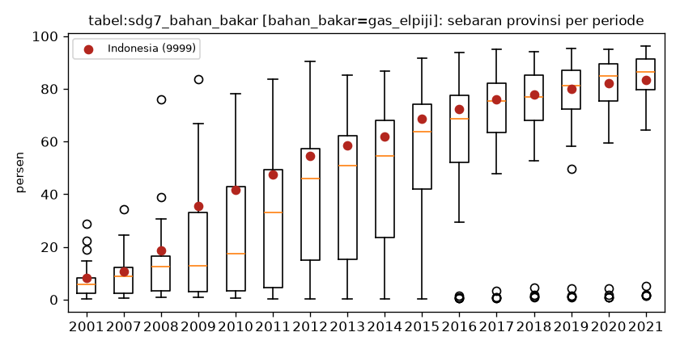
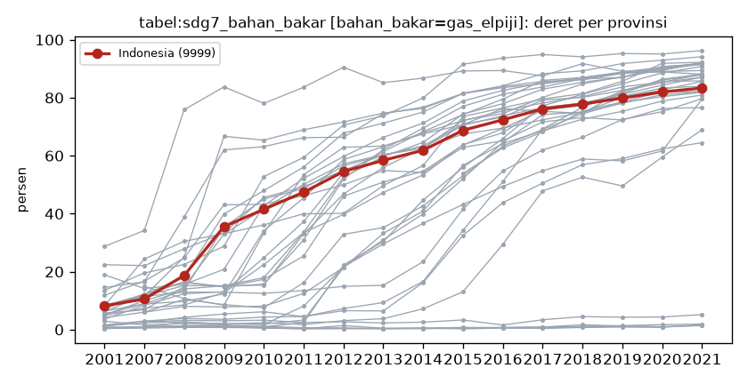
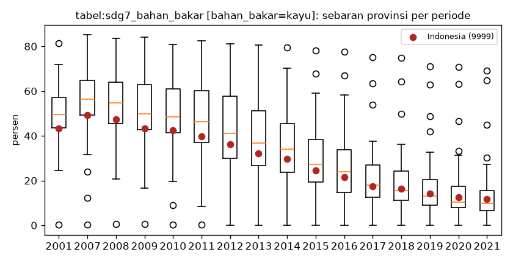
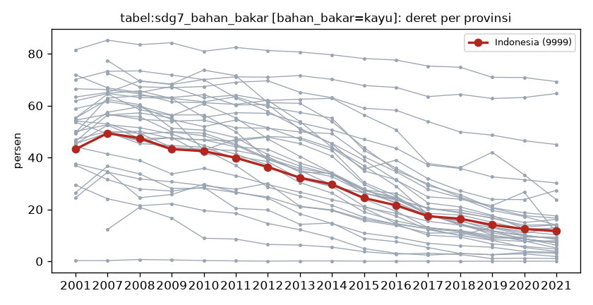
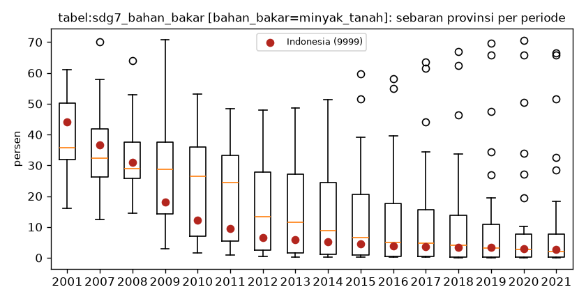
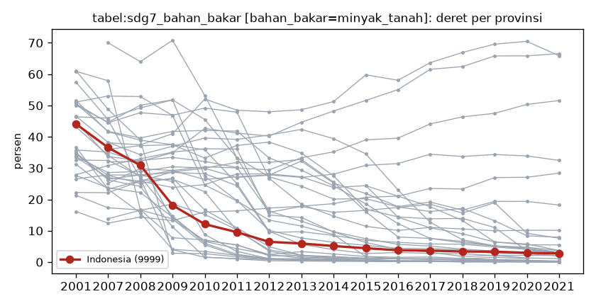
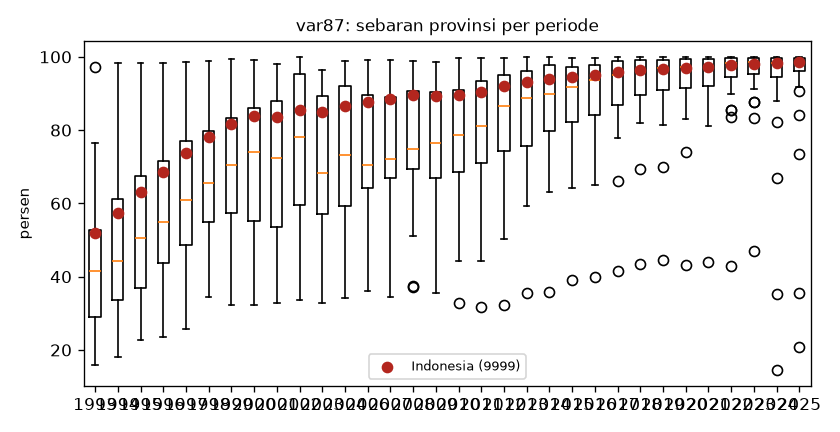
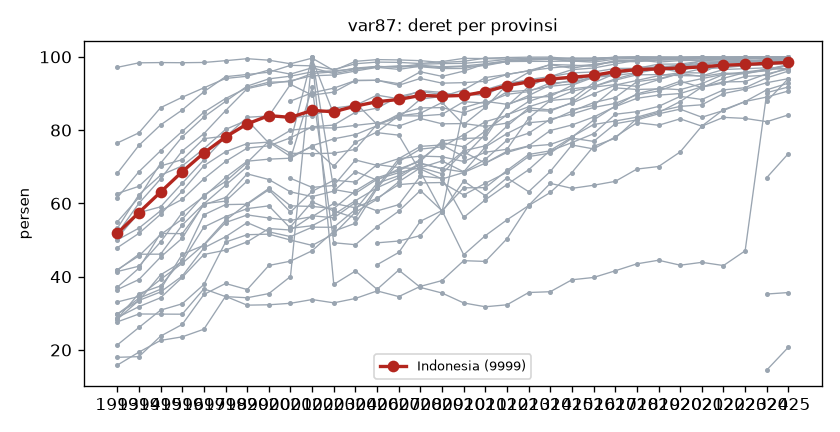

# Profil dan calon anomali seri utama

Dihasilkan `python pipeline.py` (`src/silver/profil.py`). Hanya baris provinsi deret utama (rincian `total`, atau rincian yang didaftar di `DERET` untuk seri yang terbit per rincian; label `kode [rincian]`); baris Indonesia ditampilkan terpisah dan tidak ikut statistik antarprovinsi.

## Banyak periode per provinsi (menentukan arah pembanding)

| seri_kode | min_periode_per_provinsi | maks_periode_per_provinsi |
|---|---|---|
| tabel:sdg7_bahan_bakar [bahan_bakar=gas_elpiji] | 7 | 16 |
| tabel:sdg7_bahan_bakar [bahan_bakar=kayu] | 7 | 16 |
| tabel:sdg7_bahan_bakar [bahan_bakar=minyak_tanah] | 7 | 16 |
| var87 | 2 | 32 |

- tabel:sdg7_bahan_bakar [bahan_bakar=gas_elpiji]: tiga arah (periode per provinsi 7–16)
- tabel:sdg7_bahan_bakar [bahan_bakar=kayu]: tiga arah (periode per provinsi 7–16)
- tabel:sdg7_bahan_bakar [bahan_bakar=minyak_tanah]: tiga arah (periode per provinsi 7–16)
- var87: tiga arah (periode per provinsi 2–32)

Metode: IQR dengan pengali 1.5; arah ke samping hanya bila satu provinsi punya paling sedikit 6 periode. Sel yang ditandai lebih dari satu arah ditulis satu baris. Provinsi yang di luar batas ke bawah pada ≥ 50% periode diberi tanda `berulang`: itu perbedaan struktural antarprovinsi, bukan kejadian satu tahun. Lihat log untuk alasan memilih IQR.

## Statistik deskriptif per seri per periode (provinsi)

| seri_kode | periode | n | rerata | simpangan | minimum | q1 | median | q3 | maksimum |
|---|---|---|---|---|---|---|---|---|---|
| tabel:sdg7_bahan_bakar [bahan_bakar=gas_elpiji] | 2001 | 27 | 7.42 | 7.03 | 0.34 | 2.27 | 5.72 | 8.35 | 28.71 |
| tabel:sdg7_bahan_bakar [bahan_bakar=gas_elpiji] | 2007 | 33 | 9.50 | 7.93 | 0.53 | 2.46 | 8.89 | 12.35 | 34.20 |
| tabel:sdg7_bahan_bakar [bahan_bakar=gas_elpiji] | 2008 | 33 | 14.15 | 14.69 | 0.78 | 3.22 | 12.38 | 16.48 | 75.86 |
| tabel:sdg7_bahan_bakar [bahan_bakar=gas_elpiji] | 2009 | 33 | 19.38 | 20.91 | 0.74 | 3.04 | 12.93 | 32.94 | 83.75 |
| tabel:sdg7_bahan_bakar [bahan_bakar=gas_elpiji] | 2010 | 33 | 24.09 | 22.37 | 0.51 | 3.27 | 17.35 | 42.78 | 78.06 |
| tabel:sdg7_bahan_bakar [bahan_bakar=gas_elpiji] | 2011 | 33 | 29.83 | 24.50 | 0.26 | 4.49 | 33.05 | 49.31 | 83.63 |
| tabel:sdg7_bahan_bakar [bahan_bakar=gas_elpiji] | 2012 | 33 | 38.04 | 26.04 | 0.37 | 14.94 | 46.03 | 57.20 | 90.52 |
| tabel:sdg7_bahan_bakar [bahan_bakar=gas_elpiji] | 2013 | 33 | 42.22 | 27.11 | 0.33 | 15.28 | 50.90 | 62.14 | 85.20 |
| tabel:sdg7_bahan_bakar [bahan_bakar=gas_elpiji] | 2014 | 33 | 46.89 | 27.40 | 0.33 | 23.47 | 54.67 | 67.92 | 86.76 |
| tabel:sdg7_bahan_bakar [bahan_bakar=gas_elpiji] | 2015 | 34 | 54.69 | 28.08 | 0.27 | 41.98 | 63.76 | 74.05 | 91.55 |
| tabel:sdg7_bahan_bakar [bahan_bakar=gas_elpiji] | 2016 | 34 | 59.74 | 28.06 | 0.57 | 51.98 | 68.66 | 77.58 | 93.71 |
| tabel:sdg7_bahan_bakar [bahan_bakar=gas_elpiji] | 2017 | 34 | 64.48 | 28.56 | 0.44 | 63.54 | 75.48 | 82.24 | 94.90 |
| tabel:sdg7_bahan_bakar [bahan_bakar=gas_elpiji] | 2018 | 34 | 66.94 | 28.94 | 0.75 | 67.92 | 77.00 | 85.21 | 94.11 |
| tabel:sdg7_bahan_bakar [bahan_bakar=gas_elpiji] | 2019 | 34 | 69.04 | 29.89 | 0.89 | 72.37 | 81.34 | 87.05 | 95.26 |
| tabel:sdg7_bahan_bakar [bahan_bakar=gas_elpiji] | 2020 | 34 | 71.54 | 30.59 | 0.80 | 75.47 | 84.80 | 89.40 | 95.07 |
| tabel:sdg7_bahan_bakar [bahan_bakar=gas_elpiji] | 2021 | 34 | 73.65 | 30.78 | 1.41 | 79.58 | 86.47 | 91.31 | 96.28 |
| tabel:sdg7_bahan_bakar [bahan_bakar=kayu] | 2001 | 27 | 48.95 | 16.63 | 0.28 | 43.58 | 49.55 | 57.07 | 81.51 |
| tabel:sdg7_bahan_bakar [bahan_bakar=kayu] | 2007 | 33 | 52.60 | 18.14 | 0.27 | 49.19 | 56.39 | 64.67 | 85.25 |
| tabel:sdg7_bahan_bakar [bahan_bakar=kayu] | 2008 | 33 | 50.82 | 17.90 | 0.68 | 45.37 | 54.75 | 63.91 | 83.51 |
| tabel:sdg7_bahan_bakar [bahan_bakar=kayu] | 2009 | 33 | 48.86 | 17.98 | 0.52 | 42.88 | 49.95 | 62.77 | 84.25 |
| tabel:sdg7_bahan_bakar [bahan_bakar=kayu] | 2010 | 33 | 47.65 | 18.25 | 0.30 | 41.32 | 48.40 | 61.12 | 80.96 |
| tabel:sdg7_bahan_bakar [bahan_bakar=kayu] | 2011 | 33 | 45.81 | 18.68 | 0.16 | 36.97 | 46.38 | 60.26 | 82.45 |
| tabel:sdg7_bahan_bakar [bahan_bakar=kayu] | 2012 | 33 | 43.04 | 18.64 | 0.04 | 30.08 | 41.10 | 57.78 | 81.26 |
| tabel:sdg7_bahan_bakar [bahan_bakar=kayu] | 2013 | 33 | 39.16 | 18.91 | 0.14 | 26.62 | 36.72 | 51.32 | 80.69 |
| tabel:sdg7_bahan_bakar [bahan_bakar=kayu] | 2014 | 33 | 36.06 | 18.52 | 0.15 | 23.80 | 33.93 | 45.43 | 79.60 |
| tabel:sdg7_bahan_bakar [bahan_bakar=kayu] | 2015 | 34 | 29.81 | 17.65 | 0.05 | 19.38 | 27.31 | 38.42 | 78.17 |
| tabel:sdg7_bahan_bakar [bahan_bakar=kayu] | 2016 | 34 | 26.48 | 17.43 | 0.05 | 14.81 | 23.96 | 33.76 | 77.58 |
| tabel:sdg7_bahan_bakar [bahan_bakar=kayu] | 2017 | 34 | 21.67 | 16.42 | 0.06 | 12.54 | 17.96 | 27.04 | 75.25 |
| tabel:sdg7_bahan_bakar [bahan_bakar=kayu] | 2018 | 34 | 19.93 | 16.32 | 0.02 | 11.08 | 15.54 | 24.35 | 74.81 |
| tabel:sdg7_bahan_bakar [bahan_bakar=kayu] | 2019 | 34 | 17.79 | 16.24 | 0.02 | 8.99 | 13.06 | 20.31 | 70.94 |
| tabel:sdg7_bahan_bakar [bahan_bakar=kayu] | 2020 | 34 | 16.18 | 16.19 | 0.03 | 8.00 | 10.46 | 17.50 | 70.83 |
| tabel:sdg7_bahan_bakar [bahan_bakar=kayu] | 2021 | 34 | 14.86 | 16.06 | 0.03 | 6.46 | 9.77 | 15.66 | 69.28 |
| tabel:sdg7_bahan_bakar [bahan_bakar=minyak_tanah] | 2001 | 27 | 39.41 | 12.28 | 16.17 | 31.94 | 35.79 | 50.32 | 61.12 |
| tabel:sdg7_bahan_bakar [bahan_bakar=minyak_tanah] | 2007 | 33 | 34.21 | 12.62 | 12.44 | 26.25 | 32.44 | 41.74 | 70.02 |
| tabel:sdg7_bahan_bakar [bahan_bakar=minyak_tanah] | 2008 | 33 | 31.66 | 11.54 | 14.37 | 25.84 | 28.95 | 37.44 | 63.98 |
| tabel:sdg7_bahan_bakar [bahan_bakar=minyak_tanah] | 2009 | 33 | 28.29 | 15.82 | 2.83 | 14.33 | 28.81 | 37.47 | 70.82 |
| tabel:sdg7_bahan_bakar [bahan_bakar=minyak_tanah] | 2010 | 33 | 24.36 | 15.91 | 1.53 | 7.07 | 26.37 | 35.86 | 53.22 |
| tabel:sdg7_bahan_bakar [bahan_bakar=minyak_tanah] | 2011 | 33 | 21.16 | 15.35 | 1.00 | 5.40 | 24.39 | 33.29 | 48.50 |
| tabel:sdg7_bahan_bakar [bahan_bakar=minyak_tanah] | 2012 | 33 | 16.13 | 14.59 | 0.42 | 2.41 | 13.41 | 27.85 | 47.99 |
| tabel:sdg7_bahan_bakar [bahan_bakar=minyak_tanah] | 2013 | 33 | 15.46 | 15.13 | 0.33 | 1.60 | 11.48 | 27.23 | 48.64 |
| tabel:sdg7_bahan_bakar [bahan_bakar=minyak_tanah] | 2014 | 33 | 13.87 | 14.81 | 0.25 | 1.19 | 8.80 | 24.34 | 51.24 |
| tabel:sdg7_bahan_bakar [bahan_bakar=minyak_tanah] | 2015 | 34 | 13.14 | 15.61 | 0.22 | 0.91 | 6.62 | 20.57 | 59.80 |
| tabel:sdg7_bahan_bakar [bahan_bakar=minyak_tanah] | 2016 | 34 | 11.54 | 15.20 | 0.17 | 0.41 | 5.02 | 17.58 | 58.05 |
| tabel:sdg7_bahan_bakar [bahan_bakar=minyak_tanah] | 2017 | 34 | 11.50 | 16.62 | 0.17 | 0.39 | 4.73 | 15.57 | 63.66 |
| tabel:sdg7_bahan_bakar [bahan_bakar=minyak_tanah] | 2018 | 34 | 10.96 | 17.16 | 0.00 | 0.31 | 4.03 | 13.80 | 66.94 |
| tabel:sdg7_bahan_bakar [bahan_bakar=minyak_tanah] | 2019 | 34 | 10.76 | 18.05 | 0.05 | 0.32 | 3.11 | 10.78 | 69.59 |
| tabel:sdg7_bahan_bakar [bahan_bakar=minyak_tanah] | 2020 | 34 | 10.00 | 18.36 | 0.02 | 0.20 | 2.68 | 7.76 | 70.47 |
| tabel:sdg7_bahan_bakar [bahan_bakar=minyak_tanah] | 2021 | 33 | 9.78 | 18.37 | 0.00 | 0.15 | 2.09 | 7.62 | 66.56 |
| var87 | 1993 | 26 | 43.63 | 19.06 | 15.86 | 29.07 | 41.57 | 52.83 | 97.14 |
| var87 | 1994 | 26 | 47.93 | 19.53 | 18.18 | 33.67 | 44.27 | 61.24 | 98.37 |
| var87 | 1995 | 26 | 52.51 | 19.95 | 22.61 | 36.81 | 50.47 | 67.45 | 98.44 |
| var87 | 1996 | 26 | 56.85 | 19.97 | 23.58 | 43.76 | 54.91 | 71.51 | 98.40 |
| var87 | 1997 | 26 | 62.70 | 19.05 | 25.67 | 48.62 | 60.91 | 76.99 | 98.47 |
| var87 | 1998 | 26 | 66.66 | 18.62 | 34.56 | 54.91 | 65.47 | 79.73 | 98.96 |
| var87 | 1999 | 26 | 69.40 | 19.40 | 32.23 | 57.29 | 70.59 | 83.32 | 99.50 |
| var87 | 2000 | 24 | 70.59 | 19.84 | 32.33 | 55.30 | 73.90 | 86.05 | 99.09 |
| var87 | 2001 | 29 | 70.41 | 19.12 | 32.74 | 53.63 | 72.34 | 87.93 | 98.11 |
| var87 | 2002 | 30 | 76.02 | 19.64 | 33.76 | 59.48 | 78.20 | 95.30 | 100.00 |
| var87 | 2003 | 30 | 71.22 | 18.80 | 32.86 | 57.21 | 68.25 | 89.29 | 96.54 |
| var87 | 2004 | 30 | 73.48 | 18.54 | 34.06 | 59.16 | 73.30 | 92.02 | 98.78 |
| var87 | 2006 | 33 | 73.74 | 18.35 | 36.12 | 64.10 | 70.60 | 89.54 | 99.25 |
| var87 | 2007 | 33 | 75.53 | 17.34 | 34.57 | 66.95 | 72.21 | 89.16 | 99.16 |
| var87 | 2008 | 33 | 77.23 | 16.87 | 37.07 | 69.41 | 74.82 | 90.77 | 98.96 |
| var87 | 2009 | 33 | 77.11 | 16.89 | 35.54 | 66.86 | 76.60 | 90.30 | 98.72 |
| var87 | 2010 | 33 | 77.92 | 17.01 | 32.83 | 68.56 | 78.75 | 90.98 | 99.59 |
| var87 | 2011 | 33 | 79.55 | 16.85 | 31.79 | 71.00 | 81.02 | 93.33 | 99.65 |
| var87 | 2012 | 33 | 82.45 | 15.98 | 32.33 | 74.25 | 86.55 | 95.18 | 99.82 |
| var87 | 2013 | 33 | 84.76 | 14.89 | 35.68 | 75.70 | 88.89 | 96.19 | 99.92 |
| var87 | 2014 | 33 | 86.43 | 14.10 | 35.90 | 79.90 | 89.85 | 97.88 | 99.94 |
| var87 | 2015 | 34 | 87.80 | 12.81 | 39.16 | 82.16 | 91.77 | 97.33 | 99.70 |
| var87 | 2016 | 34 | 89.18 | 12.36 | 39.79 | 84.23 | 93.58 | 97.77 | 99.64 |
| var87 | 2017 | 34 | 90.81 | 11.82 | 41.61 | 86.77 | 94.97 | 98.75 | 99.90 |
| var87 | 2018 | 34 | 92.01 | 11.09 | 43.51 | 89.72 | 95.99 | 99.12 | 100.00 |
| var87 | 2019 | 34 | 92.63 | 10.86 | 44.49 | 90.83 | 96.86 | 99.13 | 99.99 |
| var87 | 2020 | 34 | 93.28 | 10.64 | 43.14 | 91.48 | 97.22 | 99.36 | 99.99 |
| var87 | 2021 | 34 | 93.80 | 10.37 | 43.92 | 92.05 | 97.39 | 99.51 | 100.00 |
| var87 | 2022 | 34 | 94.74 | 10.18 | 43.04 | 94.42 | 98.41 | 99.55 | 99.96 |
| var87 | 2023 | 34 | 95.25 | 9.45 | 47.07 | 95.41 | 98.56 | 99.62 | 100.00 |
| var87 | 2024 | 38 | 92.22 | 17.43 | 14.53 | 94.45 | 98.31 | 99.70 | 100.00 |
| var87 | 2025 | 38 | 93.23 | 16.42 | 20.78 | 96.25 | 98.47 | 99.65 | 100.00 |

## Baris Indonesia

| seri_kode | periode | nilai | rujukan_tahun |
|---|---|---|---|
| var87 | 1993 | 51.83 | <NA> |
| var87 | 1994 | 57.51 | <NA> |
| var87 | 1995 | 63.10 | <NA> |
| var87 | 1996 | 68.66 | <NA> |
| var87 | 1997 | 73.77 | <NA> |
| var87 | 1998 | 78.13 | <NA> |
| var87 | 1999 | 81.70 | <NA> |
| var87 | 2000 | 83.97 | <NA> |
| var87 | 2001 | 83.48 | <NA> |
| var87 | 2002 | 85.38 | <NA> |
| var87 | 2003 | 85.02 | <NA> |
| var87 | 2004 | 86.56 | <NA> |
| var87 | 2006 | 87.76 | <NA> |
| var87 | 2007 | 88.37 | <NA> |
| var87 | 2008 | 89.46 | <NA> |
| var87 | 2009 | 89.29 | <NA> |
| var87 | 2010 | 89.47 | <NA> |
| var87 | 2011 | 90.51 | <NA> |
| var87 | 2012 | 92.13 | <NA> |
| var87 | 2013 | 93.17 | <NA> |
| var87 | 2014 | 93.97 | <NA> |
| var87 | 2015 | 94.44 | <NA> |
| var87 | 2016 | 94.93 | <NA> |
| var87 | 2017 | 95.99 | <NA> |
| var87 | 2018 | 96.52 | <NA> |
| var87 | 2019 | 96.73 | <NA> |
| var87 | 2020 | 96.95 | <NA> |
| var87 | 2021 | 97.26 | <NA> |
| var87 | 2022 | 97.73 | <NA> |
| var87 | 2023 | 97.93 | <NA> |
| var87 | 2024 | 98.24 | <NA> |
| var87 | 2025 | 98.46 | <NA> |
| tabel:sdg7_bahan_bakar [bahan_bakar=gas_elpiji] | 2001 | 8.22 | <NA> |
| tabel:sdg7_bahan_bakar [bahan_bakar=gas_elpiji] | 2007 | 10.57 | <NA> |
| tabel:sdg7_bahan_bakar [bahan_bakar=gas_elpiji] | 2008 | 18.68 | <NA> |
| tabel:sdg7_bahan_bakar [bahan_bakar=gas_elpiji] | 2009 | 35.54 | <NA> |
| tabel:sdg7_bahan_bakar [bahan_bakar=gas_elpiji] | 2010 | 41.51 | <NA> |
| tabel:sdg7_bahan_bakar [bahan_bakar=gas_elpiji] | 2011 | 47.40 | <NA> |
| tabel:sdg7_bahan_bakar [bahan_bakar=gas_elpiji] | 2012 | 54.54 | <NA> |
| tabel:sdg7_bahan_bakar [bahan_bakar=gas_elpiji] | 2013 | 58.42 | <NA> |
| tabel:sdg7_bahan_bakar [bahan_bakar=gas_elpiji] | 2014 | 61.88 | <NA> |
| tabel:sdg7_bahan_bakar [bahan_bakar=gas_elpiji] | 2015 | 68.78 | <NA> |
| tabel:sdg7_bahan_bakar [bahan_bakar=gas_elpiji] | 2016 | 72.38 | <NA> |
| tabel:sdg7_bahan_bakar [bahan_bakar=gas_elpiji] | 2017 | 76.14 | <NA> |
| tabel:sdg7_bahan_bakar [bahan_bakar=gas_elpiji] | 2018 | 77.83 | <NA> |
| tabel:sdg7_bahan_bakar [bahan_bakar=gas_elpiji] | 2019 | 79.90 | <NA> |
| tabel:sdg7_bahan_bakar [bahan_bakar=gas_elpiji] | 2020 | 81.98 | <NA> |
| tabel:sdg7_bahan_bakar [bahan_bakar=gas_elpiji] | 2021 | 83.36 | <NA> |
| tabel:sdg7_bahan_bakar [bahan_bakar=minyak_tanah] | 2001 | 44.10 | <NA> |
| tabel:sdg7_bahan_bakar [bahan_bakar=minyak_tanah] | 2007 | 36.57 | <NA> |
| tabel:sdg7_bahan_bakar [bahan_bakar=minyak_tanah] | 2008 | 30.89 | <NA> |
| tabel:sdg7_bahan_bakar [bahan_bakar=minyak_tanah] | 2009 | 18.14 | <NA> |
| tabel:sdg7_bahan_bakar [bahan_bakar=minyak_tanah] | 2010 | 12.11 | <NA> |
| tabel:sdg7_bahan_bakar [bahan_bakar=minyak_tanah] | 2011 | 9.55 | <NA> |
| tabel:sdg7_bahan_bakar [bahan_bakar=minyak_tanah] | 2012 | 6.46 | <NA> |
| tabel:sdg7_bahan_bakar [bahan_bakar=minyak_tanah] | 2013 | 5.95 | <NA> |
| tabel:sdg7_bahan_bakar [bahan_bakar=minyak_tanah] | 2014 | 5.12 | <NA> |
| tabel:sdg7_bahan_bakar [bahan_bakar=minyak_tanah] | 2015 | 4.44 | <NA> |
| tabel:sdg7_bahan_bakar [bahan_bakar=minyak_tanah] | 2016 | 3.78 | <NA> |
| tabel:sdg7_bahan_bakar [bahan_bakar=minyak_tanah] | 2017 | 3.67 | <NA> |
| tabel:sdg7_bahan_bakar [bahan_bakar=minyak_tanah] | 2018 | 3.37 | <NA> |
| tabel:sdg7_bahan_bakar [bahan_bakar=minyak_tanah] | 2019 | 3.33 | <NA> |
| tabel:sdg7_bahan_bakar [bahan_bakar=minyak_tanah] | 2020 | 2.97 | <NA> |
| tabel:sdg7_bahan_bakar [bahan_bakar=minyak_tanah] | 2021 | 2.78 | <NA> |
| tabel:sdg7_bahan_bakar [bahan_bakar=kayu] | 2001 | 43.23 | <NA> |
| tabel:sdg7_bahan_bakar [bahan_bakar=kayu] | 2007 | 49.38 | <NA> |
| tabel:sdg7_bahan_bakar [bahan_bakar=kayu] | 2008 | 47.49 | <NA> |
| tabel:sdg7_bahan_bakar [bahan_bakar=kayu] | 2009 | 43.24 | <NA> |
| tabel:sdg7_bahan_bakar [bahan_bakar=kayu] | 2010 | 42.46 | <NA> |
| tabel:sdg7_bahan_bakar [bahan_bakar=kayu] | 2011 | 39.89 | <NA> |
| tabel:sdg7_bahan_bakar [bahan_bakar=kayu] | 2012 | 36.35 | <NA> |
| tabel:sdg7_bahan_bakar [bahan_bakar=kayu] | 2013 | 32.23 | <NA> |
| tabel:sdg7_bahan_bakar [bahan_bakar=kayu] | 2014 | 29.68 | <NA> |
| tabel:sdg7_bahan_bakar [bahan_bakar=kayu] | 2015 | 24.40 | <NA> |
| tabel:sdg7_bahan_bakar [bahan_bakar=kayu] | 2016 | 21.57 | <NA> |
| tabel:sdg7_bahan_bakar [bahan_bakar=kayu] | 2017 | 17.38 | <NA> |
| tabel:sdg7_bahan_bakar [bahan_bakar=kayu] | 2018 | 16.40 | <NA> |
| tabel:sdg7_bahan_bakar [bahan_bakar=kayu] | 2019 | 14.04 | <NA> |
| tabel:sdg7_bahan_bakar [bahan_bakar=kayu] | 2020 | 12.43 | <NA> |
| tabel:sdg7_bahan_bakar [bahan_bakar=kayu] | 2021 | 11.76 | <NA> |

## Calon anomali (337)

Daftar lengkap di `reports/calon-anomali.csv`; kategorinya di `reports/anomali.csv`.

| seri_kode | wilayah_kode | nama_wilayah | periode | nilai | arah | alasan | berulang |
|---|---|---|---|---|---|---|---|
| tabel:sdg7_bahan_bakar [bahan_bakar=gas_elpiji] | 3100 | DKI Jakarta | 2001 | 28.71 | ke bawah + ke samping | di luar [-6.86, 17.47] (IQR x 1.5) dibanding 27 provinsi tahun itu; di luar [71.47, 100.18] dibanding 16 tahun di provinsi ini | False |
| tabel:sdg7_bahan_bakar [bahan_bakar=gas_elpiji] | 3200 | Jawa Barat | 2001 | 7.83 | ke samping | di luar [37.25, 114.88] dibanding 16 tahun di provinsi ini | False |
| tabel:sdg7_bahan_bakar [bahan_bakar=gas_elpiji] | 3600 | Banten | 2001 | 14.53 | ke samping | di luar [29.29, 118.81] dibanding 16 tahun di provinsi ini | False |
| tabel:sdg7_bahan_bakar [bahan_bakar=gas_elpiji] | 5100 | Bali | 2001 | 22.43 | ke bawah | di luar [-6.86, 17.47] (IQR x 1.5) dibanding 27 provinsi tahun itu | False |
| tabel:sdg7_bahan_bakar [bahan_bakar=gas_elpiji] | 7300 | Sulawesi Selatan | 2001 | 18.92 | ke bawah | di luar [-6.86, 17.47] (IQR x 1.5) dibanding 27 provinsi tahun itu | False |
| tabel:sdg7_bahan_bakar [bahan_bakar=gas_elpiji] | 1900 | Kepulauan Bangka Belitung | 2007 | 24.36 | perubahan | perubahan 2001→2007 sebesar +16.09 di luar [-5.17, 10.82] | False |
| tabel:sdg7_bahan_bakar [bahan_bakar=gas_elpiji] | 3100 | DKI Jakarta | 2007 | 34.20 | ke bawah + ke samping | di luar [-12.38, 27.19] (IQR x 1.5) dibanding 33 provinsi tahun itu; di luar [71.47, 100.18] dibanding 16 tahun di provinsi ini | False |
| tabel:sdg7_bahan_bakar [bahan_bakar=gas_elpiji] | 3200 | Jawa Barat | 2007 | 11.56 | ke samping | di luar [37.25, 114.88] dibanding 16 tahun di provinsi ini | False |
| tabel:sdg7_bahan_bakar [bahan_bakar=gas_elpiji] | 3600 | Banten | 2007 | 16.52 | ke samping | di luar [29.29, 118.81] dibanding 16 tahun di provinsi ini | False |
| tabel:sdg7_bahan_bakar [bahan_bakar=gas_elpiji] | 3100 | DKI Jakarta | 2008 | 75.86 | ke bawah + perubahan | di luar [-16.67, 36.37] (IQR x 1.5) dibanding 33 provinsi tahun itu; perubahan 2007→2008 sebesar +41.66 di luar [-5.59, 10.89] | False |
| tabel:sdg7_bahan_bakar [bahan_bakar=gas_elpiji] | 3200 | Jawa Barat | 2008 | 25.04 | perubahan + ke samping | perubahan 2007→2008 sebesar +13.48 di luar [-5.59, 10.89]; di luar [37.25, 114.88] dibanding 16 tahun di provinsi ini | False |
| tabel:sdg7_bahan_bakar [bahan_bakar=gas_elpiji] | 3600 | Banten | 2008 | 38.88 | ke bawah + perubahan | di luar [-16.67, 36.37] (IQR x 1.5) dibanding 33 provinsi tahun itu; perubahan 2007→2008 sebesar +22.36 di luar [-5.59, 10.89] | False |
| tabel:sdg7_bahan_bakar [bahan_bakar=gas_elpiji] | 1600 | Sumatera Selatan | 2009 | 39.90 | perubahan | perubahan 2008→2009 sebesar +21.78 di luar [-8.66, 13.95] | False |
| tabel:sdg7_bahan_bakar [bahan_bakar=gas_elpiji] | 3100 | DKI Jakarta | 2009 | 83.75 | ke bawah | di luar [-41.81, 77.79] (IQR x 1.5) dibanding 33 provinsi tahun itu | False |
| tabel:sdg7_bahan_bakar [bahan_bakar=gas_elpiji] | 3200 | Jawa Barat | 2009 | 66.69 | perubahan | perubahan 2008→2009 sebesar +41.65 di luar [-8.66, 13.95] | False |
| tabel:sdg7_bahan_bakar [bahan_bakar=gas_elpiji] | 3300 | Jawa Tengah | 2009 | 35.39 | perubahan | perubahan 2008→2009 sebesar +21.78 di luar [-8.66, 13.95] | False |
| tabel:sdg7_bahan_bakar [bahan_bakar=gas_elpiji] | 3400 | DI Yogyakarta | 2009 | 43.06 | perubahan | perubahan 2008→2009 sebesar +18.30 di luar [-8.66, 13.95] | False |
| tabel:sdg7_bahan_bakar [bahan_bakar=gas_elpiji] | 3500 | Jawa Timur | 2009 | 32.94 | perubahan | perubahan 2008→2009 sebesar +18.14 di luar [-8.66, 13.95] | False |
| tabel:sdg7_bahan_bakar [bahan_bakar=gas_elpiji] | 3600 | Banten | 2009 | 62.00 | perubahan | perubahan 2008→2009 sebesar +23.12 di luar [-8.66, 13.95] | False |
| tabel:sdg7_bahan_bakar [bahan_bakar=gas_elpiji] | 2100 | Kepulauan Riau | 2010 | 33.32 | perubahan | perubahan 2009→2010 sebesar +24.87 di luar [-13.42, 22.07] | False |
| tabel:sdg7_bahan_bakar [bahan_bakar=gas_elpiji] | 6400 | Kalimantan Timur | 2010 | 52.81 | perubahan | perubahan 2009→2010 sebesar +24.05 di luar [-13.42, 22.07] | False |
| tabel:sdg7_bahan_bakar [bahan_bakar=gas_elpiji] | 2100 | Kepulauan Riau | 2011 | 53.44 | perubahan | perubahan 2010→2011 sebesar +20.12 di luar [-10.41, 20.07] | False |
| tabel:sdg7_bahan_bakar [bahan_bakar=gas_elpiji] | 5300 | Nusa Tenggara Timur | 2016 | 0.57 | ke bawah | di luar [13.60, 115.96] (IQR x 1.5) dibanding 34 provinsi tahun itu | False |
| tabel:sdg7_bahan_bakar [bahan_bakar=gas_elpiji] | 6200 | Kalimantan Tengah | 2016 | 51.07 | perubahan | perubahan 2015→2016 sebesar +16.84 di luar [-5.38, 14.75] | False |
| tabel:sdg7_bahan_bakar [bahan_bakar=gas_elpiji] | 7200 | Sulawesi Tengah | 2016 | 29.45 | perubahan | perubahan 2015→2016 sebesar +16.36 di luar [-5.38, 14.75] | False |
| tabel:sdg7_bahan_bakar [bahan_bakar=gas_elpiji] | 8100 | Maluku | 2016 | 0.65 | ke bawah | di luar [13.60, 115.96] (IQR x 1.5) dibanding 34 provinsi tahun itu | False |
| tabel:sdg7_bahan_bakar [bahan_bakar=gas_elpiji] | 8200 | Maluku Utara | 2016 | 0.65 | ke bawah | di luar [13.60, 115.96] (IQR x 1.5) dibanding 34 provinsi tahun itu | False |
| tabel:sdg7_bahan_bakar [bahan_bakar=gas_elpiji] | 9100 | Papua Barat | 2016 | 1.59 | ke bawah | di luar [13.60, 115.96] (IQR x 1.5) dibanding 34 provinsi tahun itu | False |
| tabel:sdg7_bahan_bakar [bahan_bakar=gas_elpiji] | 9400 | Papua | 2016 | 0.80 | ke bawah | di luar [13.60, 115.96] (IQR x 1.5) dibanding 34 provinsi tahun itu | False |
| tabel:sdg7_bahan_bakar [bahan_bakar=gas_elpiji] | 5300 | Nusa Tenggara Timur | 2017 | 0.52 | ke bawah | di luar [35.49, 110.30] (IQR x 1.5) dibanding 34 provinsi tahun itu | False |
| tabel:sdg7_bahan_bakar [bahan_bakar=gas_elpiji] | 6200 | Kalimantan Tengah | 2017 | 69.27 | perubahan | perubahan 2016→2017 sebesar +18.20 di luar [-5.18, 13.36] | False |
| tabel:sdg7_bahan_bakar [bahan_bakar=gas_elpiji] | 7200 | Sulawesi Tengah | 2017 | 47.88 | perubahan | perubahan 2016→2017 sebesar +18.43 di luar [-5.18, 13.36] | False |
| tabel:sdg7_bahan_bakar [bahan_bakar=gas_elpiji] | 8100 | Maluku | 2017 | 0.44 | ke bawah | di luar [35.49, 110.30] (IQR x 1.5) dibanding 34 provinsi tahun itu | False |
| tabel:sdg7_bahan_bakar [bahan_bakar=gas_elpiji] | 8200 | Maluku Utara | 2017 | 0.89 | ke bawah | di luar [35.49, 110.30] (IQR x 1.5) dibanding 34 provinsi tahun itu | False |
| tabel:sdg7_bahan_bakar [bahan_bakar=gas_elpiji] | 9100 | Papua Barat | 2017 | 3.42 | ke bawah | di luar [35.49, 110.30] (IQR x 1.5) dibanding 34 provinsi tahun itu | False |
| tabel:sdg7_bahan_bakar [bahan_bakar=gas_elpiji] | 9400 | Papua | 2017 | 0.88 | ke bawah | di luar [35.49, 110.30] (IQR x 1.5) dibanding 34 provinsi tahun itu | False |
| tabel:sdg7_bahan_bakar [bahan_bakar=gas_elpiji] | 5300 | Nusa Tenggara Timur | 2018 | 1.04 | ke bawah | di luar [41.99, 111.15] (IQR x 1.5) dibanding 34 provinsi tahun itu | False |
| tabel:sdg7_bahan_bakar [bahan_bakar=gas_elpiji] | 8100 | Maluku | 2018 | 0.75 | ke bawah | di luar [41.99, 111.15] (IQR x 1.5) dibanding 34 provinsi tahun itu | False |
| tabel:sdg7_bahan_bakar [bahan_bakar=gas_elpiji] | 8200 | Maluku Utara | 2018 | 1.70 | ke bawah | di luar [41.99, 111.15] (IQR x 1.5) dibanding 34 provinsi tahun itu | False |
| tabel:sdg7_bahan_bakar [bahan_bakar=gas_elpiji] | 9100 | Papua Barat | 2018 | 4.50 | ke bawah | di luar [41.99, 111.15] (IQR x 1.5) dibanding 34 provinsi tahun itu | False |
| tabel:sdg7_bahan_bakar [bahan_bakar=gas_elpiji] | 9400 | Papua | 2018 | 1.13 | ke bawah | di luar [41.99, 111.15] (IQR x 1.5) dibanding 34 provinsi tahun itu | False |
| tabel:sdg7_bahan_bakar [bahan_bakar=gas_elpiji] | 5300 | Nusa Tenggara Timur | 2019 | 1.20 | ke bawah | di luar [50.35, 109.06] (IQR x 1.5) dibanding 34 provinsi tahun itu | False |
| tabel:sdg7_bahan_bakar [bahan_bakar=gas_elpiji] | 7200 | Sulawesi Tengah | 2019 | 49.57 | ke bawah | di luar [50.35, 109.06] (IQR x 1.5) dibanding 34 provinsi tahun itu | False |
| tabel:sdg7_bahan_bakar [bahan_bakar=gas_elpiji] | 8100 | Maluku | 2019 | 0.89 | ke bawah | di luar [50.35, 109.06] (IQR x 1.5) dibanding 34 provinsi tahun itu | False |
| tabel:sdg7_bahan_bakar [bahan_bakar=gas_elpiji] | 8200 | Maluku Utara | 2019 | 1.23 | ke bawah | di luar [50.35, 109.06] (IQR x 1.5) dibanding 34 provinsi tahun itu | False |
| tabel:sdg7_bahan_bakar [bahan_bakar=gas_elpiji] | 9100 | Papua Barat | 2019 | 4.31 | ke bawah | di luar [50.35, 109.06] (IQR x 1.5) dibanding 34 provinsi tahun itu | False |
| tabel:sdg7_bahan_bakar [bahan_bakar=gas_elpiji] | 9400 | Papua | 2019 | 1.39 | ke bawah | di luar [50.35, 109.06] (IQR x 1.5) dibanding 34 provinsi tahun itu | False |
| tabel:sdg7_bahan_bakar [bahan_bakar=gas_elpiji] | 5300 | Nusa Tenggara Timur | 2020 | 1.01 | ke bawah | di luar [54.58, 110.28] (IQR x 1.5) dibanding 34 provinsi tahun itu | False |
| tabel:sdg7_bahan_bakar [bahan_bakar=gas_elpiji] | 7200 | Sulawesi Tengah | 2020 | 59.55 | perubahan | perubahan 2019→2020 sebesar +9.98 di luar [-3.31, 7.58] | False |
| tabel:sdg7_bahan_bakar [bahan_bakar=gas_elpiji] | 8100 | Maluku | 2020 | 0.80 | ke bawah | di luar [54.58, 110.28] (IQR x 1.5) dibanding 34 provinsi tahun itu | False |
| tabel:sdg7_bahan_bakar [bahan_bakar=gas_elpiji] | 8200 | Maluku Utara | 2020 | 0.97 | ke bawah | di luar [54.58, 110.28] (IQR x 1.5) dibanding 34 provinsi tahun itu | False |
| tabel:sdg7_bahan_bakar [bahan_bakar=gas_elpiji] | 9100 | Papua Barat | 2020 | 4.35 | ke bawah | di luar [54.58, 110.28] (IQR x 1.5) dibanding 34 provinsi tahun itu | False |
| tabel:sdg7_bahan_bakar [bahan_bakar=gas_elpiji] | 9400 | Papua | 2020 | 1.73 | ke bawah | di luar [54.58, 110.28] (IQR x 1.5) dibanding 34 provinsi tahun itu | False |
| tabel:sdg7_bahan_bakar [bahan_bakar=gas_elpiji] | 5200 | Nusa Tenggara Barat | 2021 | 79.53 | perubahan | perubahan 2020→2021 sebesar +17.88 di luar [-1.95, 4.69] | False |
| tabel:sdg7_bahan_bakar [bahan_bakar=gas_elpiji] | 5300 | Nusa Tenggara Timur | 2021 | 1.41 | ke bawah | di luar [61.97, 108.91] (IQR x 1.5) dibanding 34 provinsi tahun itu | False |
| tabel:sdg7_bahan_bakar [bahan_bakar=gas_elpiji] | 7200 | Sulawesi Tengah | 2021 | 68.97 | perubahan | perubahan 2020→2021 sebesar +9.42 di luar [-1.95, 4.69] | False |
| tabel:sdg7_bahan_bakar [bahan_bakar=gas_elpiji] | 8100 | Maluku | 2021 | 1.76 | ke bawah | di luar [61.97, 108.91] (IQR x 1.5) dibanding 34 provinsi tahun itu | False |
| tabel:sdg7_bahan_bakar [bahan_bakar=gas_elpiji] | 8200 | Maluku Utara | 2021 | 1.48 | ke bawah | di luar [61.97, 108.91] (IQR x 1.5) dibanding 34 provinsi tahun itu | False |
| tabel:sdg7_bahan_bakar [bahan_bakar=gas_elpiji] | 9100 | Papua Barat | 2021 | 5.21 | ke bawah | di luar [61.97, 108.91] (IQR x 1.5) dibanding 34 provinsi tahun itu | False |
| tabel:sdg7_bahan_bakar [bahan_bakar=gas_elpiji] | 9400 | Papua | 2021 | 1.92 | ke bawah | di luar [61.97, 108.91] (IQR x 1.5) dibanding 34 provinsi tahun itu | False |
| tabel:sdg7_bahan_bakar [bahan_bakar=kayu] | 3100 | DKI Jakarta | 2001 | 0.28 | ke bawah | di luar [23.33, 77.31] (IQR x 1.5) dibanding 27 provinsi tahun itu | False |
| tabel:sdg7_bahan_bakar [bahan_bakar=kayu] | 5300 | Nusa Tenggara Timur | 2001 | 81.51 | ke bawah | di luar [23.33, 77.31] (IQR x 1.5) dibanding 27 provinsi tahun itu | True |
| tabel:sdg7_bahan_bakar [bahan_bakar=kayu] | 2100 | Kepulauan Riau | 2007 | 12.29 | ke bawah | di luar [25.97, 87.89] (IQR x 1.5) dibanding 33 provinsi tahun itu | False |
| tabel:sdg7_bahan_bakar [bahan_bakar=kayu] | 3100 | DKI Jakarta | 2007 | 0.27 | ke bawah | di luar [25.97, 87.89] (IQR x 1.5) dibanding 33 provinsi tahun itu | False |
| tabel:sdg7_bahan_bakar [bahan_bakar=kayu] | 6400 | Kalimantan Timur | 2007 | 24.10 | ke bawah | di luar [25.97, 87.89] (IQR x 1.5) dibanding 33 provinsi tahun itu | False |
| tabel:sdg7_bahan_bakar [bahan_bakar=kayu] | 1400 | Riau | 2008 | 24.53 | perubahan | perubahan 2007→2008 sebesar -10.15 di luar [-8.01, 5.08] | False |
| tabel:sdg7_bahan_bakar [bahan_bakar=kayu] | 2100 | Kepulauan Riau | 2008 | 20.83 | perubahan + ke samping | perubahan 2007→2008 sebesar +8.54 di luar [-8.01, 5.08]; di luar [-6.35, 17.79] dibanding 15 tahun di provinsi ini | False |
| tabel:sdg7_bahan_bakar [bahan_bakar=kayu] | 3100 | DKI Jakarta | 2008 | 0.68 | ke bawah + ke samping | di luar [17.56, 91.72] (IQR x 1.5) dibanding 33 provinsi tahun itu; di luar [-0.32, 0.62] dibanding 16 tahun di provinsi ini | False |
| tabel:sdg7_bahan_bakar [bahan_bakar=kayu] | 3100 | DKI Jakarta | 2009 | 0.52 | ke bawah | di luar [13.05, 92.61] (IQR x 1.5) dibanding 33 provinsi tahun itu | False |
| tabel:sdg7_bahan_bakar [bahan_bakar=kayu] | 3300 | Jawa Tengah | 2009 | 51.31 | perubahan | perubahan 2008→2009 sebesar -9.10 di luar [-8.04, 4.41] | False |
| tabel:sdg7_bahan_bakar [bahan_bakar=kayu] | 2100 | Kepulauan Riau | 2010 | 8.91 | ke bawah + perubahan | di luar [11.62, 90.82] (IQR x 1.5) dibanding 33 provinsi tahun itu; perubahan 2009→2010 sebesar -7.74 di luar [-7.20, 4.96] | False |
| tabel:sdg7_bahan_bakar [bahan_bakar=kayu] | 3100 | DKI Jakarta | 2010 | 0.30 | ke bawah | di luar [11.62, 90.82] (IQR x 1.5) dibanding 33 provinsi tahun itu | False |
| tabel:sdg7_bahan_bakar [bahan_bakar=kayu] | 7600 | Sulawesi Barat | 2010 | 73.71 | perubahan | perubahan 2009→2010 sebesar +5.39 di luar [-7.20, 4.96] | False |
| tabel:sdg7_bahan_bakar [bahan_bakar=kayu] | 8100 | Maluku | 2010 | 55.51 | perubahan | perubahan 2009→2010 sebesar -7.26 di luar [-7.20, 4.96] | False |
| tabel:sdg7_bahan_bakar [bahan_bakar=kayu] | 9100 | Papua Barat | 2010 | 42.85 | perubahan | perubahan 2009→2010 sebesar -12.40 di luar [-7.20, 4.96] | False |
| tabel:sdg7_bahan_bakar [bahan_bakar=kayu] | 3100 | DKI Jakarta | 2011 | 0.16 | ke bawah | di luar [2.03, 95.19] (IQR x 1.5) dibanding 33 provinsi tahun itu | False |
| tabel:sdg7_bahan_bakar [bahan_bakar=kayu] | 6100 | Kalimantan Barat | 2012 | 39.30 | perubahan | perubahan 2011→2012 sebesar -10.66 di luar [-10.22, 5.83] | False |
| tabel:sdg7_bahan_bakar [bahan_bakar=kayu] | 7600 | Sulawesi Barat | 2012 | 61.15 | perubahan | perubahan 2011→2012 sebesar -10.40 di luar [-10.22, 5.83] | False |
| tabel:sdg7_bahan_bakar [bahan_bakar=kayu] | 5300 | Nusa Tenggara Timur | 2014 | 79.60 | ke bawah | di luar [-8.64, 77.88] (IQR x 1.5) dibanding 33 provinsi tahun itu | True |
| tabel:sdg7_bahan_bakar [bahan_bakar=kayu] | 7500 | Gorontalo | 2014 | 43.96 | perubahan | perubahan 2013→2014 sebesar -9.94 di luar [-7.98, 2.46] | False |
| tabel:sdg7_bahan_bakar [bahan_bakar=kayu] | 5300 | Nusa Tenggara Timur | 2015 | 78.17 | ke bawah | di luar [-9.18, 66.98] (IQR x 1.5) dibanding 34 provinsi tahun itu | True |
| tabel:sdg7_bahan_bakar [bahan_bakar=kayu] | 6500 | Kalimantan Utara | 2015 | 20.57 | ke samping | di luar [8.32, 17.22] dibanding 7 tahun di provinsi ini | False |
| tabel:sdg7_bahan_bakar [bahan_bakar=kayu] | 9400 | Papua | 2015 | 67.74 | ke bawah | di luar [-9.18, 66.98] (IQR x 1.5) dibanding 34 provinsi tahun itu | False |
| tabel:sdg7_bahan_bakar [bahan_bakar=kayu] | 5300 | Nusa Tenggara Timur | 2016 | 77.58 | ke bawah | di luar [-13.62, 62.19] (IQR x 1.5) dibanding 34 provinsi tahun itu | True |
| tabel:sdg7_bahan_bakar [bahan_bakar=kayu] | 9400 | Papua | 2016 | 67.04 | ke bawah | di luar [-13.62, 62.19] (IQR x 1.5) dibanding 34 provinsi tahun itu | False |
| tabel:sdg7_bahan_bakar [bahan_bakar=kayu] | 5300 | Nusa Tenggara Timur | 2017 | 75.25 | ke bawah | di luar [-9.20, 48.77] (IQR x 1.5) dibanding 34 provinsi tahun itu | True |
| tabel:sdg7_bahan_bakar [bahan_bakar=kayu] | 7200 | Sulawesi Tengah | 2017 | 37.68 | perubahan | perubahan 2016→2017 sebesar -13.05 di luar [-12.10, 3.09] | False |
| tabel:sdg7_bahan_bakar [bahan_bakar=kayu] | 8200 | Maluku Utara | 2017 | 53.85 | ke bawah | di luar [-9.20, 48.77] (IQR x 1.5) dibanding 34 provinsi tahun itu | False |
| tabel:sdg7_bahan_bakar [bahan_bakar=kayu] | 9400 | Papua | 2017 | 63.49 | ke bawah | di luar [-9.20, 48.77] (IQR x 1.5) dibanding 34 provinsi tahun itu | False |
| tabel:sdg7_bahan_bakar [bahan_bakar=kayu] | 5300 | Nusa Tenggara Timur | 2018 | 74.81 | ke bawah | di luar [-8.82, 44.25] (IQR x 1.5) dibanding 34 provinsi tahun itu | True |
| tabel:sdg7_bahan_bakar [bahan_bakar=kayu] | 8200 | Maluku Utara | 2018 | 49.87 | ke bawah | di luar [-8.82, 44.25] (IQR x 1.5) dibanding 34 provinsi tahun itu | False |
| tabel:sdg7_bahan_bakar [bahan_bakar=kayu] | 9400 | Papua | 2018 | 64.37 | ke bawah | di luar [-8.82, 44.25] (IQR x 1.5) dibanding 34 provinsi tahun itu | False |
| tabel:sdg7_bahan_bakar [bahan_bakar=kayu] | 5300 | Nusa Tenggara Timur | 2019 | 70.94 | ke bawah | di luar [-8.00, 37.30] (IQR x 1.5) dibanding 34 provinsi tahun itu | True |
| tabel:sdg7_bahan_bakar [bahan_bakar=kayu] | 6500 | Kalimantan Utara | 2019 | 13.21 | perubahan | perubahan 2018→2019 sebesar +3.28 di luar [-5.56, 0.67] | False |
| tabel:sdg7_bahan_bakar [bahan_bakar=kayu] | 7200 | Sulawesi Tengah | 2019 | 42.04 | ke bawah + perubahan | di luar [-8.00, 37.30] (IQR x 1.5) dibanding 34 provinsi tahun itu; perubahan 2018→2019 sebesar +5.95 di luar [-5.56, 0.67] | False |
| tabel:sdg7_bahan_bakar [bahan_bakar=kayu] | 8200 | Maluku Utara | 2019 | 48.63 | ke bawah | di luar [-8.00, 37.30] (IQR x 1.5) dibanding 34 provinsi tahun itu | False |
| tabel:sdg7_bahan_bakar [bahan_bakar=kayu] | 9400 | Papua | 2019 | 62.76 | ke bawah | di luar [-8.00, 37.30] (IQR x 1.5) dibanding 34 provinsi tahun itu | False |
| tabel:sdg7_bahan_bakar [bahan_bakar=kayu] | 5200 | Nusa Tenggara Barat | 2020 | 26.65 | perubahan | perubahan 2019→2020 sebesar +5.21 di luar [-6.05, 3.20] | False |
| tabel:sdg7_bahan_bakar [bahan_bakar=kayu] | 5300 | Nusa Tenggara Timur | 2020 | 70.83 | ke bawah | di luar [-6.25, 31.75] (IQR x 1.5) dibanding 34 provinsi tahun itu | True |
| tabel:sdg7_bahan_bakar [bahan_bakar=kayu] | 7200 | Sulawesi Tengah | 2020 | 33.36 | ke bawah + perubahan | di luar [-6.25, 31.75] (IQR x 1.5) dibanding 34 provinsi tahun itu; perubahan 2019→2020 sebesar -8.68 di luar [-6.05, 3.20] | False |
| tabel:sdg7_bahan_bakar [bahan_bakar=kayu] | 8200 | Maluku Utara | 2020 | 46.47 | ke bawah | di luar [-6.25, 31.75] (IQR x 1.5) dibanding 34 provinsi tahun itu | False |
| tabel:sdg7_bahan_bakar [bahan_bakar=kayu] | 9400 | Papua | 2020 | 63.15 | ke bawah | di luar [-6.25, 31.75] (IQR x 1.5) dibanding 34 provinsi tahun itu | False |
| tabel:sdg7_bahan_bakar [bahan_bakar=kayu] | 5200 | Nusa Tenggara Barat | 2021 | 11.02 | perubahan | perubahan 2020→2021 sebesar -15.63 di luar [-3.63, 2.16] | False |
| tabel:sdg7_bahan_bakar [bahan_bakar=kayu] | 5300 | Nusa Tenggara Timur | 2021 | 69.28 | ke bawah | di luar [-7.34, 29.45] (IQR x 1.5) dibanding 34 provinsi tahun itu | True |
| tabel:sdg7_bahan_bakar [bahan_bakar=kayu] | 6500 | Kalimantan Utara | 2021 | 13.14 | perubahan | perubahan 2020→2021 sebesar +2.35 di luar [-3.63, 2.16] | False |
| tabel:sdg7_bahan_bakar [bahan_bakar=kayu] | 7200 | Sulawesi Tengah | 2021 | 23.79 | perubahan | perubahan 2020→2021 sebesar -9.57 di luar [-3.63, 2.16] | False |
| tabel:sdg7_bahan_bakar [bahan_bakar=kayu] | 8100 | Maluku | 2021 | 30.20 | ke bawah | di luar [-7.34, 29.45] (IQR x 1.5) dibanding 34 provinsi tahun itu | False |
| tabel:sdg7_bahan_bakar [bahan_bakar=kayu] | 8200 | Maluku Utara | 2021 | 45.03 | ke bawah | di luar [-7.34, 29.45] (IQR x 1.5) dibanding 34 provinsi tahun itu | False |
| tabel:sdg7_bahan_bakar [bahan_bakar=kayu] | 9100 | Papua Barat | 2021 | 27.34 | perubahan | perubahan 2020→2021 sebesar +3.56 di luar [-3.63, 2.16] | False |
| tabel:sdg7_bahan_bakar [bahan_bakar=kayu] | 9400 | Papua | 2021 | 64.67 | ke bawah | di luar [-7.34, 29.45] (IQR x 1.5) dibanding 34 provinsi tahun itu | False |
| tabel:sdg7_bahan_bakar [bahan_bakar=minyak_tanah] | 1600 | Sumatera Selatan | 2001 | 35.79 | ke samping | di luar [-10.69, 20.12] dibanding 16 tahun di provinsi ini | False |
| tabel:sdg7_bahan_bakar [bahan_bakar=minyak_tanah] | 1800 | Lampung | 2001 | 21.34 | ke samping | di luar [-10.88, 18.67] dibanding 16 tahun di provinsi ini | False |
| tabel:sdg7_bahan_bakar [bahan_bakar=minyak_tanah] | 3100 | DKI Jakarta | 2001 | 60.92 | ke samping | di luar [-7.19, 16.19] dibanding 15 tahun di provinsi ini | False |
| tabel:sdg7_bahan_bakar [bahan_bakar=minyak_tanah] | 3200 | Jawa Barat | 2001 | 61.12 | ke samping | di luar [-3.54, 6.49] dibanding 16 tahun di provinsi ini | False |
| tabel:sdg7_bahan_bakar [bahan_bakar=minyak_tanah] | 3300 | Jawa Tengah | 2001 | 35.04 | ke samping | di luar [-5.62, 9.79] dibanding 16 tahun di provinsi ini | False |
| tabel:sdg7_bahan_bakar [bahan_bakar=minyak_tanah] | 3400 | DI Yogyakarta | 2001 | 31.27 | ke samping | di luar [-2.62, 5.00] dibanding 16 tahun di provinsi ini | False |
| tabel:sdg7_bahan_bakar [bahan_bakar=minyak_tanah] | 3500 | Jawa Timur | 2001 | 43.18 | ke samping | di luar [-11.49, 19.98] dibanding 16 tahun di provinsi ini | False |
| tabel:sdg7_bahan_bakar [bahan_bakar=minyak_tanah] | 3600 | Banten | 2001 | 57.49 | ke samping | di luar [-4.57, 8.44] dibanding 16 tahun di provinsi ini | False |
| tabel:sdg7_bahan_bakar [bahan_bakar=minyak_tanah] | 5100 | Bali | 2001 | 27.67 | ke samping | di luar [-12.05, 20.90] dibanding 16 tahun di provinsi ini | False |
| tabel:sdg7_bahan_bakar [bahan_bakar=minyak_tanah] | 1600 | Sumatera Selatan | 2007 | 35.14 | ke samping | di luar [-10.69, 20.12] dibanding 16 tahun di provinsi ini | False |
| tabel:sdg7_bahan_bakar [bahan_bakar=minyak_tanah] | 2100 | Kepulauan Riau | 2007 | 70.02 | ke bawah | di luar [3.01, 64.98] (IQR x 1.5) dibanding 33 provinsi tahun itu | False |
| tabel:sdg7_bahan_bakar [bahan_bakar=minyak_tanah] | 3100 | DKI Jakarta | 2007 | 57.90 | ke samping | di luar [-7.19, 16.19] dibanding 15 tahun di provinsi ini | False |
| tabel:sdg7_bahan_bakar [bahan_bakar=minyak_tanah] | 3200 | Jawa Barat | 2007 | 48.74 | ke samping | di luar [-3.54, 6.49] dibanding 16 tahun di provinsi ini | False |
| tabel:sdg7_bahan_bakar [bahan_bakar=minyak_tanah] | 3300 | Jawa Tengah | 2007 | 26.25 | ke samping | di luar [-5.62, 9.79] dibanding 16 tahun di provinsi ini | False |
| tabel:sdg7_bahan_bakar [bahan_bakar=minyak_tanah] | 3400 | DI Yogyakarta | 2007 | 23.25 | ke samping | di luar [-2.62, 5.00] dibanding 16 tahun di provinsi ini | False |
| tabel:sdg7_bahan_bakar [bahan_bakar=minyak_tanah] | 3500 | Jawa Timur | 2007 | 34.08 | ke samping | di luar [-11.49, 19.98] dibanding 16 tahun di provinsi ini | False |
| tabel:sdg7_bahan_bakar [bahan_bakar=minyak_tanah] | 3600 | Banten | 2007 | 45.46 | ke samping | di luar [-4.57, 8.44] dibanding 16 tahun di provinsi ini | False |
| tabel:sdg7_bahan_bakar [bahan_bakar=minyak_tanah] | 5100 | Bali | 2007 | 23.68 | ke samping | di luar [-12.05, 20.90] dibanding 16 tahun di provinsi ini | False |
| tabel:sdg7_bahan_bakar [bahan_bakar=minyak_tanah] | 1600 | Sumatera Selatan | 2008 | 31.87 | ke samping | di luar [-10.69, 20.12] dibanding 16 tahun di provinsi ini | False |
| tabel:sdg7_bahan_bakar [bahan_bakar=minyak_tanah] | 2100 | Kepulauan Riau | 2008 | 63.98 | ke bawah | di luar [8.44, 54.84] (IQR x 1.5) dibanding 33 provinsi tahun itu | False |
| tabel:sdg7_bahan_bakar [bahan_bakar=minyak_tanah] | 3100 | DKI Jakarta | 2008 | 16.70 | perubahan + ke samping | perubahan 2007→2008 sebesar -41.20 di luar [-11.07, 9.73]; di luar [-7.19, 16.19] dibanding 15 tahun di provinsi ini | False |
| tabel:sdg7_bahan_bakar [bahan_bakar=minyak_tanah] | 3200 | Jawa Barat | 2008 | 38.99 | ke samping | di luar [-3.54, 6.49] dibanding 16 tahun di provinsi ini | False |
| tabel:sdg7_bahan_bakar [bahan_bakar=minyak_tanah] | 3300 | Jawa Tengah | 2008 | 24.14 | ke samping | di luar [-5.62, 9.79] dibanding 16 tahun di provinsi ini | False |
| tabel:sdg7_bahan_bakar [bahan_bakar=minyak_tanah] | 3400 | DI Yogyakarta | 2008 | 15.70 | ke samping | di luar [-2.62, 5.00] dibanding 16 tahun di provinsi ini | False |
| tabel:sdg7_bahan_bakar [bahan_bakar=minyak_tanah] | 3500 | Jawa Timur | 2008 | 27.23 | ke samping | di luar [-11.49, 19.98] dibanding 16 tahun di provinsi ini | False |
| tabel:sdg7_bahan_bakar [bahan_bakar=minyak_tanah] | 3600 | Banten | 2008 | 26.67 | perubahan + ke samping | perubahan 2007→2008 sebesar -18.79 di luar [-11.07, 9.73]; di luar [-4.57, 8.44] dibanding 16 tahun di provinsi ini | False |
| tabel:sdg7_bahan_bakar [bahan_bakar=minyak_tanah] | 5100 | Bali | 2008 | 22.23 | ke samping | di luar [-12.05, 20.90] dibanding 16 tahun di provinsi ini | False |
| tabel:sdg7_bahan_bakar [bahan_bakar=minyak_tanah] | 1600 | Sumatera Selatan | 2009 | 13.64 | perubahan | perubahan 2008→2009 sebesar -18.23 di luar [-18.02, 14.01] | False |
| tabel:sdg7_bahan_bakar [bahan_bakar=minyak_tanah] | 3200 | Jawa Barat | 2009 | 2.83 | perubahan | perubahan 2008→2009 sebesar -36.16 di luar [-18.02, 14.01] | False |
| tabel:sdg7_bahan_bakar [bahan_bakar=minyak_tanah] | 3300 | Jawa Tengah | 2009 | 11.25 | ke samping | di luar [-5.62, 9.79] dibanding 16 tahun di provinsi ini | False |
| tabel:sdg7_bahan_bakar [bahan_bakar=minyak_tanah] | 3600 | Banten | 2009 | 4.05 | perubahan | perubahan 2008→2009 sebesar -22.62 di luar [-18.02, 14.01] | False |
| tabel:sdg7_bahan_bakar [bahan_bakar=minyak_tanah] | 1200 | Sumatera Utara | 2010 | 27.42 | perubahan | perubahan 2009→2010 sebesar -24.34 di luar [-20.66, 13.85] | False |
| tabel:sdg7_bahan_bakar [bahan_bakar=minyak_tanah] | 6400 | Kalimantan Timur | 2010 | 24.62 | perubahan | perubahan 2009→2010 sebesar -22.20 di luar [-20.66, 13.85] | False |
| tabel:sdg7_bahan_bakar [bahan_bakar=minyak_tanah] | 1400 | Riau | 2011 | 33.29 | perubahan | perubahan 2010→2011 sebesar -12.23 di luar [-11.62, 6.33] | False |
| tabel:sdg7_bahan_bakar [bahan_bakar=minyak_tanah] | 1700 | Bengkulu | 2011 | 10.05 | perubahan | perubahan 2010→2011 sebesar -12.41 di luar [-11.62, 6.33] | False |
| tabel:sdg7_bahan_bakar [bahan_bakar=minyak_tanah] | 2100 | Kepulauan Riau | 2011 | 33.29 | perubahan | perubahan 2010→2011 sebesar -19.93 di luar [-11.62, 6.33] | False |
| tabel:sdg7_bahan_bakar [bahan_bakar=minyak_tanah] | 1400 | Riau | 2012 | 16.27 | perubahan | perubahan 2011→2012 sebesar -17.02 di luar [-16.29, 8.96] | False |
| tabel:sdg7_bahan_bakar [bahan_bakar=minyak_tanah] | 7100 | Sulawesi Utara | 2012 | 26.73 | perubahan | perubahan 2011→2012 sebesar -21.13 di luar [-16.29, 8.96] | False |
| tabel:sdg7_bahan_bakar [bahan_bakar=minyak_tanah] | 7500 | Gorontalo | 2012 | 15.00 | perubahan | perubahan 2011→2012 sebesar -21.08 di luar [-16.29, 8.96] | False |
| tabel:sdg7_bahan_bakar [bahan_bakar=minyak_tanah] | 7100 | Sulawesi Utara | 2013 | 18.47 | perubahan | perubahan 2012→2013 sebesar -8.26 di luar [-5.71, 4.37] | False |
| tabel:sdg7_bahan_bakar [bahan_bakar=minyak_tanah] | 7400 | Sulawesi Tenggara | 2013 | 32.27 | perubahan | perubahan 2012→2013 sebesar +4.51 di luar [-5.71, 4.37] | False |
| tabel:sdg7_bahan_bakar [bahan_bakar=minyak_tanah] | 8100 | Maluku | 2013 | 44.65 | perubahan | perubahan 2012→2013 sebesar +4.43 di luar [-5.71, 4.37] | False |
| tabel:sdg7_bahan_bakar [bahan_bakar=minyak_tanah] | 1300 | Sumatera Barat | 2015 | 16.08 | perubahan | perubahan 2014→2015 sebesar -9.46 di luar [-5.52, 3.28] | False |
| tabel:sdg7_bahan_bakar [bahan_bakar=minyak_tanah] | 1900 | Kepulauan Bangka Belitung | 2015 | 16.89 | perubahan | perubahan 2014→2015 sebesar -10.64 di luar [-5.52, 3.28] | False |
| tabel:sdg7_bahan_bakar [bahan_bakar=minyak_tanah] | 6300 | Kalimantan Selatan | 2015 | 18.58 | perubahan | perubahan 2014→2015 sebesar -5.76 di luar [-5.52, 3.28] | False |
| tabel:sdg7_bahan_bakar [bahan_bakar=minyak_tanah] | 6400 | Kalimantan Timur | 2015 | 1.73 | perubahan | perubahan 2014→2015 sebesar -7.07 di luar [-5.52, 3.28] | False |
| tabel:sdg7_bahan_bakar [bahan_bakar=minyak_tanah] | 8100 | Maluku | 2015 | 51.62 | ke bawah + perubahan | di luar [-28.58, 50.06] (IQR x 1.5) dibanding 34 provinsi tahun itu; perubahan 2014→2015 sebesar +3.39 di luar [-5.52, 3.28] | False |
| tabel:sdg7_bahan_bakar [bahan_bakar=minyak_tanah] | 8200 | Maluku Utara | 2015 | 39.02 | perubahan | perubahan 2014→2015 sebesar +3.83 di luar [-5.52, 3.28] | False |
| tabel:sdg7_bahan_bakar [bahan_bakar=minyak_tanah] | 9100 | Papua Barat | 2015 | 59.80 | ke bawah + perubahan | di luar [-28.58, 50.06] (IQR x 1.5) dibanding 34 provinsi tahun itu; perubahan 2014→2015 sebesar +8.56 di luar [-5.52, 3.28] | False |
| tabel:sdg7_bahan_bakar [bahan_bakar=minyak_tanah] | 1300 | Sumatera Barat | 2016 | 8.01 | perubahan | perubahan 2015→2016 sebesar -8.07 di luar [-5.17, 3.02] | False |
| tabel:sdg7_bahan_bakar [bahan_bakar=minyak_tanah] | 6200 | Kalimantan Tengah | 2016 | 23.02 | perubahan | perubahan 2015→2016 sebesar -11.53 di luar [-5.17, 3.02] | False |
| tabel:sdg7_bahan_bakar [bahan_bakar=minyak_tanah] | 6300 | Kalimantan Selatan | 2016 | 12.31 | perubahan | perubahan 2015→2016 sebesar -6.27 di luar [-5.17, 3.02] | False |
| tabel:sdg7_bahan_bakar [bahan_bakar=minyak_tanah] | 7200 | Sulawesi Tengah | 2016 | 14.33 | perubahan | perubahan 2015→2016 sebesar -10.08 di luar [-5.17, 3.02] | False |
| tabel:sdg7_bahan_bakar [bahan_bakar=minyak_tanah] | 8100 | Maluku | 2016 | 55.07 | ke bawah + perubahan | di luar [-25.35, 43.33] (IQR x 1.5) dibanding 34 provinsi tahun itu; perubahan 2015→2016 sebesar +3.45 di luar [-5.17, 3.02] | False |
| tabel:sdg7_bahan_bakar [bahan_bakar=minyak_tanah] | 9100 | Papua Barat | 2016 | 58.05 | ke bawah | di luar [-25.35, 43.33] (IQR x 1.5) dibanding 34 provinsi tahun itu | False |
| tabel:sdg7_bahan_bakar [bahan_bakar=minyak_tanah] | 2100 | Kepulauan Riau | 2017 | 16.15 | perubahan | perubahan 2016→2017 sebesar -1.47 di luar [-1.38, 1.00] | False |
| tabel:sdg7_bahan_bakar [bahan_bakar=minyak_tanah] | 5200 | Nusa Tenggara Barat | 2017 | 18.45 | perubahan | perubahan 2016→2017 sebesar +1.01 di luar [-1.38, 1.00] | False |
| tabel:sdg7_bahan_bakar [bahan_bakar=minyak_tanah] | 5300 | Nusa Tenggara Timur | 2017 | 23.51 | perubahan | perubahan 2016→2017 sebesar +2.46 di luar [-1.38, 1.00] | False |
| tabel:sdg7_bahan_bakar [bahan_bakar=minyak_tanah] | 6200 | Kalimantan Tengah | 2017 | 12.68 | perubahan | perubahan 2016→2017 sebesar -10.34 di luar [-1.38, 1.00] | False |
| tabel:sdg7_bahan_bakar [bahan_bakar=minyak_tanah] | 6300 | Kalimantan Selatan | 2017 | 7.55 | perubahan | perubahan 2016→2017 sebesar -4.76 di luar [-1.38, 1.00] | False |
| tabel:sdg7_bahan_bakar [bahan_bakar=minyak_tanah] | 6500 | Kalimantan Utara | 2017 | 17.69 | perubahan | perubahan 2016→2017 sebesar -3.36 di luar [-1.38, 1.00] | False |
| tabel:sdg7_bahan_bakar [bahan_bakar=minyak_tanah] | 7200 | Sulawesi Tengah | 2017 | 10.92 | perubahan | perubahan 2016→2017 sebesar -3.41 di luar [-1.38, 1.00] | False |
| tabel:sdg7_bahan_bakar [bahan_bakar=minyak_tanah] | 7400 | Sulawesi Tenggara | 2017 | 19.17 | perubahan | perubahan 2016→2017 sebesar +1.45 di luar [-1.38, 1.00] | False |
| tabel:sdg7_bahan_bakar [bahan_bakar=minyak_tanah] | 8100 | Maluku | 2017 | 61.55 | ke bawah + perubahan | di luar [-22.38, 38.34] (IQR x 1.5) dibanding 34 provinsi tahun itu; perubahan 2016→2017 sebesar +6.48 di luar [-1.38, 1.00] | False |
| tabel:sdg7_bahan_bakar [bahan_bakar=minyak_tanah] | 8200 | Maluku Utara | 2017 | 44.12 | ke bawah + perubahan | di luar [-22.38, 38.34] (IQR x 1.5) dibanding 34 provinsi tahun itu; perubahan 2016→2017 sebesar +4.55 di luar [-1.38, 1.00] | False |
| tabel:sdg7_bahan_bakar [bahan_bakar=minyak_tanah] | 9100 | Papua Barat | 2017 | 63.66 | ke bawah + perubahan | di luar [-22.38, 38.34] (IQR x 1.5) dibanding 34 provinsi tahun itu; perubahan 2016→2017 sebesar +5.61 di luar [-1.38, 1.00] | False |
| tabel:sdg7_bahan_bakar [bahan_bakar=minyak_tanah] | 9400 | Papua | 2017 | 34.44 | perubahan | perubahan 2016→2017 sebesar +2.98 di luar [-1.38, 1.00] | False |
| tabel:sdg7_bahan_bakar [bahan_bakar=minyak_tanah] | 5200 | Nusa Tenggara Barat | 2018 | 15.68 | perubahan | perubahan 2017→2018 sebesar -2.77 di luar [-2.11, 1.18] | False |
| tabel:sdg7_bahan_bakar [bahan_bakar=minyak_tanah] | 6200 | Kalimantan Tengah | 2018 | 7.13 | perubahan | perubahan 2017→2018 sebesar -5.55 di luar [-2.11, 1.18] | False |
| tabel:sdg7_bahan_bakar [bahan_bakar=minyak_tanah] | 6500 | Kalimantan Utara | 2018 | 13.30 | perubahan | perubahan 2017→2018 sebesar -4.39 di luar [-2.11, 1.18] | False |
| tabel:sdg7_bahan_bakar [bahan_bakar=minyak_tanah] | 7400 | Sulawesi Tenggara | 2018 | 16.59 | perubahan | perubahan 2017→2018 sebesar -2.58 di luar [-2.11, 1.18] | False |
| tabel:sdg7_bahan_bakar [bahan_bakar=minyak_tanah] | 8100 | Maluku | 2018 | 62.41 | ke bawah | di luar [-19.91, 34.02] (IQR x 1.5) dibanding 34 provinsi tahun itu | False |
| tabel:sdg7_bahan_bakar [bahan_bakar=minyak_tanah] | 8200 | Maluku Utara | 2018 | 46.36 | ke bawah + perubahan | di luar [-19.91, 34.02] (IQR x 1.5) dibanding 34 provinsi tahun itu; perubahan 2017→2018 sebesar +2.24 di luar [-2.11, 1.18] | False |
| tabel:sdg7_bahan_bakar [bahan_bakar=minyak_tanah] | 9100 | Papua Barat | 2018 | 66.94 | ke bawah + perubahan | di luar [-19.91, 34.02] (IQR x 1.5) dibanding 34 provinsi tahun itu; perubahan 2017→2018 sebesar +3.28 di luar [-2.11, 1.18] | False |
| tabel:sdg7_bahan_bakar [bahan_bakar=minyak_tanah] | 1900 | Kepulauan Bangka Belitung | 2019 | 11.04 | perubahan | perubahan 2018→2019 sebesar -2.92 di luar [-2.45, 1.88] | False |
| tabel:sdg7_bahan_bakar [bahan_bakar=minyak_tanah] | 2100 | Kepulauan Riau | 2019 | 13.17 | perubahan | perubahan 2018→2019 sebesar -3.98 di luar [-2.45, 1.88] | False |
| tabel:sdg7_bahan_bakar [bahan_bakar=minyak_tanah] | 5200 | Nusa Tenggara Barat | 2019 | 18.97 | perubahan | perubahan 2018→2019 sebesar +3.29 di luar [-2.45, 1.88] | False |
| tabel:sdg7_bahan_bakar [bahan_bakar=minyak_tanah] | 5300 | Nusa Tenggara Timur | 2019 | 26.98 | ke bawah + perubahan | di luar [-15.38, 26.48] (IQR x 1.5) dibanding 34 provinsi tahun itu; perubahan 2018→2019 sebesar +3.64 di luar [-2.45, 1.88] | False |
| tabel:sdg7_bahan_bakar [bahan_bakar=minyak_tanah] | 6500 | Kalimantan Utara | 2019 | 6.41 | perubahan | perubahan 2018→2019 sebesar -6.89 di luar [-2.45, 1.88] | False |
| tabel:sdg7_bahan_bakar [bahan_bakar=minyak_tanah] | 7200 | Sulawesi Tengah | 2019 | 6.42 | perubahan | perubahan 2018→2019 sebesar -2.63 di luar [-2.45, 1.88] | False |
| tabel:sdg7_bahan_bakar [bahan_bakar=minyak_tanah] | 7400 | Sulawesi Tenggara | 2019 | 19.38 | perubahan | perubahan 2018→2019 sebesar +2.79 di luar [-2.45, 1.88] | False |
| tabel:sdg7_bahan_bakar [bahan_bakar=minyak_tanah] | 8100 | Maluku | 2019 | 65.82 | ke bawah + perubahan | di luar [-15.38, 26.48] (IQR x 1.5) dibanding 34 provinsi tahun itu; perubahan 2018→2019 sebesar +3.41 di luar [-2.45, 1.88] | False |
| tabel:sdg7_bahan_bakar [bahan_bakar=minyak_tanah] | 8200 | Maluku Utara | 2019 | 47.50 | ke bawah | di luar [-15.38, 26.48] (IQR x 1.5) dibanding 34 provinsi tahun itu | False |
| tabel:sdg7_bahan_bakar [bahan_bakar=minyak_tanah] | 9100 | Papua Barat | 2019 | 69.59 | ke bawah + perubahan | di luar [-15.38, 26.48] (IQR x 1.5) dibanding 34 provinsi tahun itu; perubahan 2018→2019 sebesar +2.65 di luar [-2.45, 1.88] | False |
| tabel:sdg7_bahan_bakar [bahan_bakar=minyak_tanah] | 9400 | Papua | 2019 | 34.35 | ke bawah | di luar [-15.38, 26.48] (IQR x 1.5) dibanding 34 provinsi tahun itu | False |
| tabel:sdg7_bahan_bakar [bahan_bakar=minyak_tanah] | 1900 | Kepulauan Bangka Belitung | 2020 | 3.59 | perubahan | perubahan 2019→2020 sebesar -7.45 di luar [-1.54, 0.94] | False |
| tabel:sdg7_bahan_bakar [bahan_bakar=minyak_tanah] | 2100 | Kepulauan Riau | 2020 | 8.42 | perubahan | perubahan 2019→2020 sebesar -4.75 di luar [-1.54, 0.94] | False |
| tabel:sdg7_bahan_bakar [bahan_bakar=minyak_tanah] | 5200 | Nusa Tenggara Barat | 2020 | 9.20 | perubahan | perubahan 2019→2020 sebesar -9.77 di luar [-1.54, 0.94] | False |
| tabel:sdg7_bahan_bakar [bahan_bakar=minyak_tanah] | 5300 | Nusa Tenggara Timur | 2020 | 27.08 | ke bawah | di luar [-11.15, 19.11] (IQR x 1.5) dibanding 34 provinsi tahun itu | False |
| tabel:sdg7_bahan_bakar [bahan_bakar=minyak_tanah] | 7400 | Sulawesi Tenggara | 2020 | 19.37 | ke bawah | di luar [-11.15, 19.11] (IQR x 1.5) dibanding 34 provinsi tahun itu | False |
| tabel:sdg7_bahan_bakar [bahan_bakar=minyak_tanah] | 8100 | Maluku | 2020 | 65.84 | ke bawah | di luar [-11.15, 19.11] (IQR x 1.5) dibanding 34 provinsi tahun itu | False |
| tabel:sdg7_bahan_bakar [bahan_bakar=minyak_tanah] | 8200 | Maluku Utara | 2020 | 50.34 | ke bawah + perubahan | di luar [-11.15, 19.11] (IQR x 1.5) dibanding 34 provinsi tahun itu; perubahan 2019→2020 sebesar +2.84 di luar [-1.54, 0.94] | False |
| tabel:sdg7_bahan_bakar [bahan_bakar=minyak_tanah] | 9100 | Papua Barat | 2020 | 70.47 | ke bawah | di luar [-11.15, 19.11] (IQR x 1.5) dibanding 34 provinsi tahun itu | False |
| tabel:sdg7_bahan_bakar [bahan_bakar=minyak_tanah] | 9400 | Papua | 2020 | 33.90 | ke bawah | di luar [-11.15, 19.11] (IQR x 1.5) dibanding 34 provinsi tahun itu | False |
| tabel:sdg7_bahan_bakar [bahan_bakar=minyak_tanah] | 5300 | Nusa Tenggara Timur | 2021 | 28.40 | ke bawah | di luar [-11.05, 18.82] (IQR x 1.5) dibanding 33 provinsi tahun itu | False |
| tabel:sdg7_bahan_bakar [bahan_bakar=minyak_tanah] | 8100 | Maluku | 2021 | 66.56 | ke bawah | di luar [-11.05, 18.82] (IQR x 1.5) dibanding 33 provinsi tahun itu | False |
| tabel:sdg7_bahan_bakar [bahan_bakar=minyak_tanah] | 8200 | Maluku Utara | 2021 | 51.58 | ke bawah | di luar [-11.05, 18.82] (IQR x 1.5) dibanding 33 provinsi tahun itu | False |
| tabel:sdg7_bahan_bakar [bahan_bakar=minyak_tanah] | 9100 | Papua Barat | 2021 | 65.88 | ke bawah + perubahan | di luar [-11.05, 18.82] (IQR x 1.5) dibanding 33 provinsi tahun itu; perubahan 2020→2021 sebesar -4.59 di luar [-2.67, 1.57] | False |
| tabel:sdg7_bahan_bakar [bahan_bakar=minyak_tanah] | 9400 | Papua | 2021 | 32.47 | ke bawah | di luar [-11.05, 18.82] (IQR x 1.5) dibanding 33 provinsi tahun itu | False |
| var87 | 1100 | Aceh | 1993 | 36.48 | ke samping | di luar [56.41, 124.75] dibanding 30 tahun di provinsi ini | False |
| var87 | 1200 | Sumatera Utara | 1993 | 50.55 | ke samping | di luar [65.37, 114.45] dibanding 32 tahun di provinsi ini | False |
| var87 | 3100 | DKI Jakarta | 1993 | 97.14 | ke bawah | di luar [-6.56, 88.46] (IQR x 1.5) dibanding 26 provinsi tahun itu | False |
| var87 | 3200 | Jawa Barat | 1993 | 61.56 | ke samping | di luar [83.53, 109.28] dibanding 32 tahun di provinsi ini | False |
| var87 | 3300 | Jawa Tengah | 1993 | 54.96 | ke samping | di luar [86.69, 107.64] dibanding 32 tahun di provinsi ini | False |
| var87 | 3400 | DI Yogyakarta | 1993 | 68.21 | ke samping | di luar [91.25, 104.86] dibanding 32 tahun di provinsi ini | False |
| var87 | 3500 | Jawa Timur | 1993 | 51.75 | ke samping | di luar [84.09, 108.58] dibanding 32 tahun di provinsi ini | False |
| var87 | 5100 | Bali | 1993 | 76.49 | ke samping | di luar [88.82, 106.33] dibanding 32 tahun di provinsi ini | False |
| var87 | 6100 | Kalimantan Barat | 1993 | 28.54 | ke samping | di luar [31.91, 113.27] dibanding 32 tahun di provinsi ini | False |
| var87 | 6400 | Kalimantan Timur | 1993 | 53.19 | ke samping | di luar [63.11, 109.46] dibanding 32 tahun di provinsi ini | False |
| var87 | 7100 | Sulawesi Utara | 1993 | 62.70 | ke samping | di luar [72.26, 114.57] dibanding 32 tahun di provinsi ini | False |
| var87 | 1100 | Aceh | 1994 | 39.23 | ke samping | di luar [56.41, 124.75] dibanding 30 tahun di provinsi ini | False |
| var87 | 1200 | Sumatera Utara | 1994 | 57.47 | ke samping | di luar [65.37, 114.45] dibanding 32 tahun di provinsi ini | False |
| var87 | 3200 | Jawa Barat | 1994 | 68.67 | ke samping | di luar [83.53, 109.28] dibanding 32 tahun di provinsi ini | False |
| var87 | 3300 | Jawa Tengah | 1994 | 61.64 | ke samping | di luar [86.69, 107.64] dibanding 32 tahun di provinsi ini | False |
| var87 | 3400 | DI Yogyakarta | 1994 | 75.86 | ke samping | di luar [91.25, 104.86] dibanding 32 tahun di provinsi ini | False |
| var87 | 3500 | Jawa Timur | 1994 | 60.04 | ke samping | di luar [84.09, 108.58] dibanding 32 tahun di provinsi ini | False |
| var87 | 5100 | Bali | 1994 | 79.27 | ke samping | di luar [88.82, 106.33] dibanding 32 tahun di provinsi ini | False |
| var87 | 6400 | Kalimantan Timur | 1994 | 62.39 | ke samping | di luar [63.11, 109.46] dibanding 32 tahun di provinsi ini | False |
| var87 | 7100 | Sulawesi Utara | 1994 | 64.67 | ke samping | di luar [72.26, 114.57] dibanding 32 tahun di provinsi ini | False |
| var87 | 1100 | Aceh | 1995 | 45.35 | ke samping | di luar [56.41, 124.75] dibanding 30 tahun di provinsi ini | False |
| var87 | 1200 | Sumatera Utara | 1995 | 59.08 | ke samping | di luar [65.37, 114.45] dibanding 32 tahun di provinsi ini | False |
| var87 | 3200 | Jawa Barat | 1995 | 74.37 | ke samping | di luar [83.53, 109.28] dibanding 32 tahun di provinsi ini | False |
| var87 | 3300 | Jawa Tengah | 1995 | 70.97 | ke samping | di luar [86.69, 107.64] dibanding 32 tahun di provinsi ini | False |
| var87 | 3400 | DI Yogyakarta | 1995 | 81.42 | ke samping | di luar [91.25, 104.86] dibanding 32 tahun di provinsi ini | False |
| var87 | 3500 | Jawa Timur | 1995 | 66.69 | ke samping | di luar [84.09, 108.58] dibanding 32 tahun di provinsi ini | False |
| var87 | 5100 | Bali | 1995 | 86.13 | ke samping | di luar [88.82, 106.33] dibanding 32 tahun di provinsi ini | False |
| var87 | 7100 | Sulawesi Utara | 1995 | 70.23 | ke samping | di luar [72.26, 114.57] dibanding 32 tahun di provinsi ini | False |
| var87 | 1100 | Aceh | 1996 | 50.52 | ke samping | di luar [56.41, 124.75] dibanding 30 tahun di provinsi ini | False |
| var87 | 3200 | Jawa Barat | 1996 | 79.68 | ke samping | di luar [83.53, 109.28] dibanding 32 tahun di provinsi ini | False |
| var87 | 3300 | Jawa Tengah | 1996 | 78.17 | ke samping | di luar [86.69, 107.64] dibanding 32 tahun di provinsi ini | False |
| var87 | 3400 | DI Yogyakarta | 1996 | 85.51 | ke samping | di luar [91.25, 104.86] dibanding 32 tahun di provinsi ini | False |
| var87 | 3500 | Jawa Timur | 1996 | 74.32 | ke samping | di luar [84.09, 108.58] dibanding 32 tahun di provinsi ini | False |
| var87 | 7100 | Sulawesi Utara | 1996 | 71.94 | ke samping | di luar [72.26, 114.57] dibanding 32 tahun di provinsi ini | False |
| var87 | 3100 | DKI Jakarta | 1997 | 98.47 | perubahan | perubahan 1996→1997 sebesar +0.07 di luar [1.58, 10.13] | False |
| var87 | 3300 | Jawa Tengah | 1997 | 83.59 | ke samping | di luar [86.69, 107.64] dibanding 32 tahun di provinsi ini | False |
| var87 | 3400 | DI Yogyakarta | 1997 | 90.48 | ke samping | di luar [91.25, 104.86] dibanding 32 tahun di provinsi ini | False |
| var87 | 3500 | Jawa Timur | 1997 | 79.04 | ke samping | di luar [84.09, 108.58] dibanding 32 tahun di provinsi ini | False |
| var87 | 6100 | Kalimantan Barat | 1997 | 56.89 | perubahan | perubahan 1996→1997 sebesar +12.30 di luar [1.58, 10.13] | False |
| var87 | 7400 | Sulawesi Tenggara | 1998 | 49.45 | perubahan | perubahan 1997→1998 sebesar +11.57 di luar [-1.35, 9.22] | False |
| var87 | 9400 | Papua | 1998 | 34.56 | perubahan | perubahan 1997→1998 sebesar -2.13 di luar [-1.35, 9.22] | False |
| var87 | 1800 | Lampung | 2000 | 43.06 | perubahan | perubahan 1999→2000 sebesar +6.57 di luar [-2.74, 4.93] | False |
| var87 | 6400 | Kalimantan Timur | 2000 | 76.47 | perubahan | perubahan 1999→2000 sebesar -6.27 di luar [-2.74, 4.93] | False |
| var87 | 7300 | Sulawesi Selatan | 2000 | 77.02 | perubahan | perubahan 1999→2000 sebesar +5.86 di luar [-2.74, 4.93] | False |
| var87 | 7100 | Sulawesi Utara | 2001 | 92.50 | perubahan | perubahan 2000→2001 sebesar +8.64 di luar [-6.50, 5.41] | False |
| var87 | 7500 | Gorontalo | 2002 | 60.42 | perubahan | perubahan 2001→2002 sebesar +6.79 di luar [-3.10, 6.66] | False |
| var87 | 8100 | Maluku | 2002 | 100.00 | perubahan | perubahan 2001→2002 sebesar +23.19 di luar [-3.10, 6.66] | False |
| var87 | 8200 | Maluku Utara | 2002 | 91.65 | perubahan | perubahan 2001→2002 sebesar +19.47 di luar [-3.10, 6.66] | False |
| var87 | 9400 | Papua | 2002 | 100.00 | perubahan + ke samping | perubahan 2001→2002 sebesar +59.95 di luar [-3.10, 6.66]; di luar [21.61, 55.94] dibanding 32 tahun di provinsi ini | False |
| var87 | 1100 | Aceh | 2003 | 84.31 | perubahan | perubahan 2002→2003 sebesar -15.07 di luar [-5.81, 5.80] | False |
| var87 | 3100 | DKI Jakarta | 2003 | 96.27 | ke samping | di luar [96.97, 101.59] dibanding 32 tahun di provinsi ini | False |
| var87 | 8100 | Maluku | 2003 | 63.79 | perubahan | perubahan 2002→2003 sebesar -36.21 di luar [-5.81, 5.80] | False |
| var87 | 8200 | Maluku Utara | 2003 | 49.26 | perubahan | perubahan 2002→2003 sebesar -42.39 di luar [-5.81, 5.80] | False |
| var87 | 9400 | Papua | 2003 | 37.89 | perubahan | perubahan 2002→2003 sebesar -62.11 di luar [-5.81, 5.80] | False |
| var87 | 1100 | Aceh | 2006 | 81.57 | perubahan | perubahan 2004→2006 sebesar -5.88 di luar [-4.21, 8.22] | False |
| var87 | 1800 | Lampung | 2006 | 64.10 | perubahan | perubahan 2004→2006 sebesar +9.51 di luar [-4.21, 8.22] | False |
| var87 | 7500 | Gorontalo | 2006 | 64.54 | perubahan | perubahan 2004→2006 sebesar +8.49 di luar [-4.21, 8.22] | False |
| var87 | 9400 | Papua | 2006 | 36.55 | perubahan | perubahan 2004→2006 sebesar -5.00 di luar [-4.21, 8.22] | False |
| var87 | 1400 | Riau | 2008 | 67.44 | perubahan | perubahan 2007→2008 sebesar +7.78 di luar [-3.69, 7.59] | False |
| var87 | 2100 | Kepulauan Riau | 2008 | 68.65 | perubahan + ke samping | perubahan 2007→2008 sebesar -9.98 di luar [-3.69, 7.59]; di luar [71.35, 112.61] dibanding 20 tahun di provinsi ini | False |
| var87 | 5300 | Nusa Tenggara Timur | 2008 | 37.36 | ke bawah | di luar [37.37, 122.81] (IQR x 1.5) dibanding 33 provinsi tahun itu | False |
| var87 | 7600 | Sulawesi Barat | 2008 | 55.14 | perubahan | perubahan 2007→2008 sebesar +8.52 di luar [-3.69, 7.59] | False |
| var87 | 9400 | Papua | 2008 | 37.07 | ke bawah + perubahan | di luar [37.37, 122.81] (IQR x 1.5) dibanding 33 provinsi tahun itu; perubahan 2007→2008 sebesar -4.74 di luar [-3.69, 7.59] | False |
| var87 | 1600 | Sumatera Selatan | 2009 | 76.60 | perubahan | perubahan 2008→2009 sebesar +4.65 di luar [-4.17, 3.51] | False |
| var87 | 1700 | Bengkulu | 2009 | 77.07 | perubahan | perubahan 2008→2009 sebesar +5.58 di luar [-4.17, 3.51] | False |
| var87 | 2100 | Kepulauan Riau | 2009 | 57.69 | perubahan + ke samping | perubahan 2008→2009 sebesar -10.96 di luar [-4.17, 3.51]; di luar [71.35, 112.61] dibanding 20 tahun di provinsi ini | False |
| var87 | 8200 | Maluku Utara | 2009 | 57.99 | perubahan | perubahan 2008→2009 sebesar -5.53 di luar [-4.17, 3.51] | False |
| var87 | 9100 | Papua Barat | 2009 | 57.67 | perubahan | perubahan 2008→2009 sebesar +6.46 di luar [-4.17, 3.51] | False |
| var87 | 1400 | Riau | 2010 | 56.18 | perubahan | perubahan 2009→2010 sebesar -10.68 di luar [-5.94, 6.43] | False |
| var87 | 2100 | Kepulauan Riau | 2010 | 86.14 | perubahan | perubahan 2009→2010 sebesar +28.45 di luar [-5.94, 6.43] | False |
| var87 | 5200 | Nusa Tenggara Barat | 2010 | 81.52 | perubahan | perubahan 2009→2010 sebesar -6.03 di luar [-5.94, 6.43] | False |
| var87 | 7600 | Sulawesi Barat | 2010 | 45.97 | perubahan | perubahan 2009→2010 sebesar -12.07 di luar [-5.94, 6.43] | False |
| var87 | 9100 | Papua Barat | 2010 | 66.11 | perubahan | perubahan 2009→2010 sebesar +8.44 di luar [-5.94, 6.43] | False |
| var87 | 9400 | Papua | 2010 | 32.83 | ke bawah | di luar [34.93, 124.61] (IQR x 1.5) dibanding 33 provinsi tahun itu | False |
| var87 | 9400 | Papua | 2011 | 31.79 | ke bawah | di luar [37.51, 126.82] (IQR x 1.5) dibanding 33 provinsi tahun itu | False |
| var87 | 9400 | Papua | 2012 | 32.33 | ke bawah | di luar [42.85, 126.58] (IQR x 1.5) dibanding 33 provinsi tahun itu | False |
| var87 | 5300 | Nusa Tenggara Timur | 2013 | 59.45 | perubahan | perubahan 2012→2013 sebesar +9.09 di luar [-4.35, 8.72] | False |
| var87 | 9400 | Papua | 2013 | 35.68 | ke bawah | di luar [44.97, 126.92] (IQR x 1.5) dibanding 33 provinsi tahun itu | False |
| var87 | 9400 | Papua | 2014 | 35.90 | ke bawah | di luar [52.93, 124.85] (IQR x 1.5) dibanding 33 provinsi tahun itu | False |
| var87 | 9100 | Papua Barat | 2015 | 75.95 | perubahan | perubahan 2014→2015 sebesar +7.23 di luar [-3.30, 5.74] | False |
| var87 | 9400 | Papua | 2015 | 39.16 | ke bawah | di luar [59.39, 120.10] (IQR x 1.5) dibanding 34 provinsi tahun itu | False |
| var87 | 7600 | Sulawesi Barat | 2016 | 75.58 | perubahan | perubahan 2015→2016 sebesar +7.15 di luar [-2.82, 5.18] | False |
| var87 | 9400 | Papua | 2016 | 39.79 | ke bawah | di luar [63.93, 118.07] (IQR x 1.5) dibanding 34 provinsi tahun itu | False |
| var87 | 5300 | Nusa Tenggara Timur | 2017 | 66.02 | ke bawah | di luar [68.79, 116.73] (IQR x 1.5) dibanding 34 provinsi tahun itu | False |
| var87 | 6200 | Kalimantan Tengah | 2017 | 81.75 | perubahan | perubahan 2016→2017 sebesar +4.82 di luar [-1.42, 4.35] | False |
| var87 | 6500 | Kalimantan Utara | 2017 | 91.54 | perubahan | perubahan 2016→2017 sebesar +4.79 di luar [-1.42, 4.35] | False |
| var87 | 8200 | Maluku Utara | 2017 | 84.33 | perubahan | perubahan 2016→2017 sebesar +5.31 di luar [-1.42, 4.35] | False |
| var87 | 9400 | Papua | 2017 | 41.61 | ke bawah | di luar [68.79, 116.73] (IQR x 1.5) dibanding 34 provinsi tahun itu | False |
| var87 | 5300 | Nusa Tenggara Timur | 2018 | 69.37 | ke bawah | di luar [75.60, 113.24] (IQR x 1.5) dibanding 34 provinsi tahun itu | False |
| var87 | 7600 | Sulawesi Barat | 2018 | 83.18 | perubahan | perubahan 2017→2018 sebesar +5.38 di luar [-2.59, 4.46] | False |
| var87 | 9400 | Papua | 2018 | 43.51 | ke bawah | di luar [75.60, 113.24] (IQR x 1.5) dibanding 34 provinsi tahun itu | False |
| var87 | 5300 | Nusa Tenggara Timur | 2019 | 70.07 | ke bawah | di luar [78.36, 111.60] (IQR x 1.5) dibanding 34 provinsi tahun itu | False |
| var87 | 9400 | Papua | 2019 | 44.49 | ke bawah | di luar [78.36, 111.60] (IQR x 1.5) dibanding 34 provinsi tahun itu | False |
| var87 | 5300 | Nusa Tenggara Timur | 2020 | 74.05 | ke bawah + perubahan | di luar [79.65, 111.18] (IQR x 1.5) dibanding 34 provinsi tahun itu; perubahan 2019→2020 sebesar +3.98 di luar [-1.94, 3.23] | False |
| var87 | 9400 | Papua | 2020 | 43.14 | ke bawah | di luar [79.65, 111.18] (IQR x 1.5) dibanding 34 provinsi tahun itu | False |
| var87 | 2100 | Kepulauan Riau | 2021 | 98.46 | perubahan | perubahan 2020→2021 sebesar +2.61 di luar [-1.15, 1.96] | False |
| var87 | 5300 | Nusa Tenggara Timur | 2021 | 81.12 | perubahan | perubahan 2020→2021 sebesar +7.07 di luar [-1.15, 1.96] | False |
| var87 | 6200 | Kalimantan Tengah | 2021 | 83.52 | perubahan | perubahan 2020→2021 sebesar -2.21 di luar [-1.15, 1.96] | False |
| var87 | 6500 | Kalimantan Utara | 2021 | 91.63 | perubahan | perubahan 2020→2021 sebesar -1.73 di luar [-1.15, 1.96] | False |
| var87 | 7600 | Sulawesi Barat | 2021 | 91.75 | perubahan | perubahan 2020→2021 sebesar +3.95 di luar [-1.15, 1.96] | False |
| var87 | 9100 | Papua Barat | 2021 | 81.08 | perubahan | perubahan 2020→2021 sebesar -2.01 di luar [-1.15, 1.96] | False |
| var87 | 9400 | Papua | 2021 | 43.92 | ke bawah | di luar [80.86, 110.70] (IQR x 1.5) dibanding 34 provinsi tahun itu | False |
| var87 | 5300 | Nusa Tenggara Timur | 2022 | 85.58 | ke bawah + perubahan | di luar [86.72, 107.25] (IQR x 1.5) dibanding 34 provinsi tahun itu; perubahan 2021→2022 sebesar +4.46 di luar [-2.33, 4.06] | False |
| var87 | 6200 | Kalimantan Tengah | 2022 | 85.36 | ke bawah | di luar [86.72, 107.25] (IQR x 1.5) dibanding 34 provinsi tahun itu | False |
| var87 | 9100 | Papua Barat | 2022 | 83.49 | ke bawah | di luar [86.72, 107.25] (IQR x 1.5) dibanding 34 provinsi tahun itu | False |
| var87 | 9400 | Papua | 2022 | 43.04 | ke bawah | di luar [86.72, 107.25] (IQR x 1.5) dibanding 34 provinsi tahun itu | False |
| var87 | 5300 | Nusa Tenggara Timur | 2023 | 87.81 | ke bawah + perubahan | di luar [89.09, 105.94] (IQR x 1.5) dibanding 34 provinsi tahun itu; perubahan 2022→2023 sebesar +2.23 di luar [-0.70, 1.27] | False |
| var87 | 6200 | Kalimantan Tengah | 2023 | 87.81 | ke bawah + perubahan | di luar [89.09, 105.94] (IQR x 1.5) dibanding 34 provinsi tahun itu; perubahan 2022→2023 sebesar +2.45 di luar [-0.70, 1.27] | False |
| var87 | 6500 | Kalimantan Utara | 2023 | 95.72 | perubahan | perubahan 2022→2023 sebesar +1.56 di luar [-0.70, 1.27] | False |
| var87 | 7600 | Sulawesi Barat | 2023 | 94.67 | perubahan | perubahan 2022→2023 sebesar +1.82 di luar [-0.70, 1.27] | False |
| var87 | 9100 | Papua Barat | 2023 | 83.20 | ke bawah | di luar [89.09, 105.94] (IQR x 1.5) dibanding 34 provinsi tahun itu | False |
| var87 | 9400 | Papua | 2023 | 47.07 | ke bawah + perubahan | di luar [89.09, 105.94] (IQR x 1.5) dibanding 34 provinsi tahun itu; perubahan 2022→2023 sebesar +4.03 di luar [-0.70, 1.27] | False |
| var87 | 5300 | Nusa Tenggara Timur | 2024 | 91.01 | perubahan | perubahan 2023→2024 sebesar +3.20 di luar [-0.90, 1.67] | False |
| var87 | 6100 | Kalimantan Barat | 2024 | 92.95 | perubahan | perubahan 2023→2024 sebesar +1.76 di luar [-0.90, 1.67] | False |
| var87 | 8100 | Maluku | 2024 | 95.37 | perubahan | perubahan 2023→2024 sebesar +2.11 di luar [-0.90, 1.67] | False |
| var87 | 8200 | Maluku Utara | 2024 | 94.27 | perubahan | perubahan 2023→2024 sebesar +2.69 di luar [-0.90, 1.67] | False |
| var87 | 9100 | Papua Barat | 2024 | 82.31 | ke bawah | di luar [86.57, 107.57] (IQR x 1.5) dibanding 38 provinsi tahun itu | False |
| var87 | 9400 | Papua | 2024 | 90.24 | perubahan + ke samping | perubahan 2023→2024 sebesar +43.17 di luar [-0.90, 1.67]; di luar [21.61, 55.94] dibanding 32 tahun di provinsi ini | False |
| var87 | 9500 | Papua Selatan | 2024 | 67.05 | ke bawah | di luar [86.57, 107.57] (IQR x 1.5) dibanding 38 provinsi tahun itu | True |
| var87 | 9600 | Papua Tengah | 2024 | 35.27 | ke bawah | di luar [86.57, 107.57] (IQR x 1.5) dibanding 38 provinsi tahun itu | True |
| var87 | 9700 | Papua Pegunungan | 2024 | 14.53 | ke bawah | di luar [86.57, 107.57] (IQR x 1.5) dibanding 38 provinsi tahun itu | True |
| var87 | 6200 | Kalimantan Tengah | 2025 | 90.69 | ke bawah | di luar [91.16, 104.75] (IQR x 1.5) dibanding 38 provinsi tahun itu | False |
| var87 | 9100 | Papua Barat | 2025 | 84.16 | ke bawah | di luar [91.16, 104.75] (IQR x 1.5) dibanding 38 provinsi tahun itu | False |
| var87 | 9200 | Papua Barat Daya | 2025 | 94.09 | perubahan | perubahan 2024→2025 sebesar +6.23 di luar [-2.09, 3.62] | False |
| var87 | 9400 | Papua | 2025 | 91.78 | ke samping | di luar [21.61, 55.94] dibanding 32 tahun di provinsi ini | False |
| var87 | 9500 | Papua Selatan | 2025 | 73.62 | ke bawah + perubahan | di luar [91.16, 104.75] (IQR x 1.5) dibanding 38 provinsi tahun itu; perubahan 2024→2025 sebesar +6.57 di luar [-2.09, 3.62] | True |
| var87 | 9600 | Papua Tengah | 2025 | 35.67 | ke bawah | di luar [91.16, 104.75] (IQR x 1.5) dibanding 38 provinsi tahun itu | True |
| var87 | 9700 | Papua Pegunungan | 2025 | 20.78 | ke bawah + perubahan | di luar [91.16, 104.75] (IQR x 1.5) dibanding 38 provinsi tahun itu; perubahan 2024→2025 sebesar +6.25 di luar [-2.09, 3.62] | True |

## Gambar

