# Profil dan calon anomali seri utama

Dihasilkan `python pipeline.py` (`src/silver/profil.py`). Hanya baris provinsi deret utama (rincian `total`, atau rincian yang didaftar di `DERET` untuk seri yang terbit per rincian; label `kode [rincian]`); baris Indonesia ditampilkan terpisah dan tidak ikut statistik antarprovinsi.

## Banyak periode per provinsi (menentukan arah pembanding)

| seri_kode | min_periode_per_provinsi | maks_periode_per_provinsi |
|---|---|---|
| var1241 | 2 | 11 |
| var2012 | 2 | 2 |
| var2013 | 2 | 2 |
| var2753 [arus=bongkar] | 5 | 5 |
| var2753 [arus=muat] | 5 | 5 |
| var2754 [arus=bongkar] | 5 | 5 |
| var2754 [arus=muat] | 5 | 5 |

- var1241: tiga arah (periode per provinsi 2–11)
- var2012: hanya arah ke bawah dan perubahan (periode per provinsi 2–2)
- var2013: hanya arah ke bawah dan perubahan (periode per provinsi 2–2)
- var2753 [arus=bongkar]: hanya arah ke bawah dan perubahan (periode per provinsi 5–5)
- var2753 [arus=muat]: hanya arah ke bawah dan perubahan (periode per provinsi 5–5)
- var2754 [arus=bongkar]: hanya arah ke bawah dan perubahan (periode per provinsi 5–5)
- var2754 [arus=muat]: hanya arah ke bawah dan perubahan (periode per provinsi 5–5)

Metode: IQR dengan pengali 1.5; arah ke samping hanya bila satu provinsi punya paling sedikit 6 periode. Sel yang ditandai lebih dari satu arah ditulis satu baris. Provinsi yang di luar batas ke bawah pada ≥ 50% periode diberi tanda `berulang`: itu perbedaan struktural antarprovinsi, bukan kejadian satu tahun. Lihat log untuk alasan memilih IQR.

## Statistik deskriptif per seri per periode (provinsi)

| seri_kode | periode | n | rerata | simpangan | minimum | q1 | median | q3 | maksimum |
|---|---|---|---|---|---|---|---|---|---|
| var1241 | 2015 | 34 | 89.91 | 10.38 | 49.53 | 88.66 | 92.42 | 94.92 | 99.25 |
| var1241 | 2016 | 34 | 91.18 | 10.18 | 49.33 | 90.89 | 93.66 | 96.36 | 99.49 |
| var1241 | 2017 | 34 | 92.86 | 8.77 | 55.21 | 92.20 | 95.02 | 96.74 | 99.49 |
| var1241 | 2018 | 34 | 93.90 | 7.92 | 58.23 | 93.71 | 96.01 | 97.32 | 99.46 |
| var1241 | 2019 | 34 | 54.14 | 12.42 | 26.16 | 48.25 | 55.56 | 61.93 | 81.61 |
| var1241 | 2020 | 34 | 58.02 | 12.63 | 28.56 | 52.46 | 58.83 | 66.76 | 86.19 |
| var1241 | 2021 | 34 | 60.14 | 12.16 | 27.60 | 56.82 | 62.05 | 67.19 | 85.15 |
| var1241 | 2022 | 34 | 60.06 | 12.59 | 27.28 | 55.08 | 60.91 | 67.25 | 84.94 |
| var1241 | 2023 | 34 | 62.49 | 12.64 | 29.01 | 57.06 | 63.87 | 70.90 | 85.79 |
| var1241 | 2024 | 38 | 61.66 | 16.18 | 4.44 | 58.23 | 65.32 | 71.84 | 86.68 |
| var1241 | 2025 | 38 | 65.04 | 16.04 | 9.53 | 59.05 | 68.60 | 75.53 | 88.31 |
| var2012 | 2017 | 34 | 57.98 | 12.23 | 33.58 | 51.25 | 57.03 | 66.91 | 82.87 |
| var2012 | 2020 | 34 | 59.24 | 12.20 | 34.33 | 51.67 | 59.08 | 67.58 | 84.87 |
| var2013 | 2017 | 34 | 4.00 | 3.44 | 0.52 | 1.54 | 2.46 | 5.08 | 13.11 |
| var2013 | 2020 | 34 | 5.05 | 4.18 | 0.61 | 1.86 | 3.71 | 7.36 | 15.83 |
| var2753 [arus=bongkar] | 2021 | 36 | 11,092,373.83 | 16,653,063.99 | 630,459.00 | 2,603,849.50 | 4,949,973.50 | 12,407,043.25 | 76,360,233.00 |
| var2753 [arus=bongkar] | 2022 | 36 | 10,914,656.86 | 15,876,615.63 | 562,706.00 | 2,236,632.75 | 5,260,166.00 | 11,634,217.50 | 67,835,734.00 |
| var2753 [arus=bongkar] | 2023 | 36 | 9,947,232.53 | 11,983,980.44 | 579,479.00 | 2,238,164.75 | 6,208,615.50 | 13,032,280.25 | 50,868,767.00 |
| var2753 [arus=bongkar] | 2024 | 36 | 11,010,832.36 | 14,136,451.57 | 351,014.00 | 1,382,779.25 | 3,666,602.00 | 13,269,892.50 | 64,474,307.00 |
| var2753 [arus=bongkar] | 2025 | 36 | 12,546,225.69 | 15,431,203.46 | 173,347.00 | 1,554,513.00 | 4,010,563.00 | 16,555,767.25 | 64,726,193.00 |
| var2753 [arus=muat] | 2021 | 36 | 10,688,451.61 | 20,702,564.49 | 447,925.00 | 1,330,526.25 | 2,995,554.50 | 10,523,166.75 | 111,000,000.00 |
| var2753 [arus=muat] | 2022 | 36 | 11,058,200.08 | 21,517,720.02 | 264,370.00 | 1,260,947.75 | 3,334,498.50 | 11,535,501.25 | 117,000,000.00 |
| var2753 [arus=muat] | 2023 | 36 | 10,711,455.75 | 19,229,197.37 | 208,332.00 | 1,175,337.25 | 3,961,532.50 | 11,431,761.00 | 84,681,909.00 |
| var2753 [arus=muat] | 2024 | 36 | 12,048,165.78 | 22,691,206.09 | 440,035.00 | 1,383,160.50 | 3,461,651.00 | 13,061,962.25 | 105,000,000.00 |
| var2753 [arus=muat] | 2025 | 36 | 14,126,398.33 | 26,406,201.23 | 465,572.00 | 1,609,974.25 | 3,740,476.00 | 13,316,284.75 | 116,000,000.00 |
| var2754 [arus=bongkar] | 2021 | 38 | 16,382,810.92 | 27,593,003.83 | 165,347.00 | 2,763,294.75 | 8,771,566.50 | 12,494,967.50 | 124,000,000.00 |
| var2754 [arus=bongkar] | 2022 | 38 | 15,204,357.29 | 23,264,564.29 | 47,184.00 | 2,453,958.50 | 8,609,112.50 | 14,848,500.50 | 114,000,000.00 |
| var2754 [arus=bongkar] | 2023 | 38 | 15,287,893.71 | 25,477,666.11 | 32,975.00 | 2,842,106.00 | 7,053,255.00 | 13,527,877.25 | 123,130,032.00 |
| var2754 [arus=bongkar] | 2024 | 38 | 18,139,030.95 | 28,283,547.72 | 56,453.00 | 3,151,064.50 | 7,971,806.50 | 17,573,103.75 | 129,000,000.00 |
| var2754 [arus=bongkar] | 2025 | 38 | 17,751,245.58 | 24,531,841.51 | 5,709.00 | 3,444,809.25 | 9,629,282.00 | 16,959,980.25 | 114,000,000.00 |
| var2754 [arus=muat] | 2021 | 38 | 15,843,900.34 | 34,121,834.20 | 5,187.00 | 2,070,218.50 | 4,145,377.50 | 13,195,901.00 | 181,000,000.00 |
| var2754 [arus=muat] | 2022 | 38 | 16,906,295.95 | 45,519,317.57 | 4,644.00 | 2,121,873.00 | 4,421,059.50 | 10,193,957.00 | 259,000,000.00 |
| var2754 [arus=muat] | 2023 | 38 | 15,835,857.58 | 37,228,375.90 | 4,470.00 | 2,220,498.00 | 4,371,562.00 | 10,901,934.00 | 200,936,111.00 |
| var2754 [arus=muat] | 2024 | 38 | 17,756,184.29 | 41,869,633.27 | 80,993.00 | 2,435,062.25 | 3,983,256.00 | 13,194,469.25 | 236,000,000.00 |
| var2754 [arus=muat] | 2025 | 38 | 17,650,271.79 | 40,601,864.61 | 107,585.00 | 2,827,286.50 | 4,325,044.50 | 14,076,226.75 | 236,000,000.00 |

## Baris Indonesia

| seri_kode | periode | nilai | rujukan_tahun |
|---|---|---|---|
| var1241 | 2015 | 92.85 | <NA> |
| var1241 | 2016 | 94.00 | <NA> |
| var1241 | 2017 | 95.05 | <NA> |
| var1241 | 2018 | 95.70 | <NA> |
| var1241 | 2019 | 56.51 | <NA> |
| var1241 | 2020 | 59.54 | <NA> |
| var1241 | 2021 | 60.90 | <NA> |
| var1241 | 2022 | 60.66 | <NA> |
| var1241 | 2023 | 63.15 | <NA> |
| var1241 | 2024 | 65.25 | <NA> |
| var1241 | 2025 | 68.40 | <NA> |
| var2012 | 2017 | 54.67 | <NA> |
| var2012 | 2020 | 56.01 | <NA> |
| var2013 | 2017 | 4.85 | <NA> |
| var2013 | 2020 | 5.74 | <NA> |
| var2753 [arus=bongkar] | 2021 | 399,000,000.00 | <NA> |
| var2753 [arus=bongkar] | 2022 | 393,000,000.00 | <NA> |
| var2753 [arus=bongkar] | 2023 | 358,000,000.00 | <NA> |
| var2753 [arus=bongkar] | 2024 | 396,000,000.00 | <NA> |
| var2753 [arus=bongkar] | 2025 | 452,000,000.00 | <NA> |
| var2753 [arus=muat] | 2021 | 384,000,000.00 | <NA> |
| var2753 [arus=muat] | 2022 | 399,000,000.00 | <NA> |
| var2753 [arus=muat] | 2023 | 386,000,000.00 | <NA> |
| var2753 [arus=muat] | 2024 | 434,000,000.00 | <NA> |
| var2753 [arus=muat] | 2025 | 508,000,000.00 | <NA> |
| var2754 [arus=bongkar] | 2021 | 622,000,000.00 | <NA> |
| var2754 [arus=bongkar] | 2022 | 577,000,000.00 | <NA> |
| var2754 [arus=bongkar] | 2023 | 580,939,961.00 | <NA> |
| var2754 [arus=bongkar] | 2024 | 689,000,000.00 | <NA> |
| var2754 [arus=bongkar] | 2025 | 675,000,000.00 | <NA> |
| var2754 [arus=muat] | 2021 | 602,000,000.00 | <NA> |
| var2754 [arus=muat] | 2022 | 643,000,000.00 | <NA> |
| var2754 [arus=muat] | 2023 | 601,762,588.00 | <NA> |
| var2754 [arus=muat] | 2024 | 675,000,000.00 | <NA> |
| var2754 [arus=muat] | 2025 | 671,000,000.00 | <NA> |

## Calon anomali (202)

Daftar lengkap di `reports/calon-anomali.csv`; kategorinya di `reports/anomali.csv`.

| seri_kode | wilayah_kode | nama_wilayah | periode | nilai | arah | alasan | berulang |
|---|---|---|---|---|---|---|---|
| var1241 | 5300 | Nusa Tenggara Timur | 2015 | 56.40 | ke bawah | di luar [79.27, 104.31] (IQR x 1.5) dibanding 34 provinsi tahun itu | False |
| var1241 | 9400 | Papua | 2015 | 49.53 | ke bawah | di luar [79.27, 104.31] (IQR x 1.5) dibanding 34 provinsi tahun itu | True |
| var1241 | 5300 | Nusa Tenggara Timur | 2016 | 59.67 | ke bawah | di luar [82.68, 104.56] (IQR x 1.5) dibanding 34 provinsi tahun itu | False |
| var1241 | 9100 | Papua Barat | 2016 | 88.58 | perubahan | perubahan 2015→2016 sebesar -2.15 di luar [-2.00, 4.54] | False |
| var1241 | 9400 | Papua | 2016 | 49.33 | ke bawah | di luar [82.68, 104.56] (IQR x 1.5) dibanding 34 provinsi tahun itu | True |
| var1241 | 5300 | Nusa Tenggara Timur | 2017 | 66.25 | ke bawah + perubahan | di luar [85.38, 103.55] (IQR x 1.5) dibanding 34 provinsi tahun itu; perubahan 2016→2017 sebesar +6.58 di luar [-1.31, 4.06] | False |
| var1241 | 7600 | Sulawesi Barat | 2017 | 88.77 | perubahan | perubahan 2016→2017 sebesar +4.41 di luar [-1.31, 4.06] | False |
| var1241 | 8200 | Maluku Utara | 2017 | 91.36 | perubahan | perubahan 2016→2017 sebesar +4.10 di luar [-1.31, 4.06] | False |
| var1241 | 9400 | Papua | 2017 | 55.21 | ke bawah + perubahan | di luar [85.38, 103.55] (IQR x 1.5) dibanding 34 provinsi tahun itu; perubahan 2016→2017 sebesar +5.88 di luar [-1.31, 4.06] | True |
| var1241 | 5300 | Nusa Tenggara Timur | 2018 | 72.06 | ke bawah + perubahan | di luar [88.29, 102.75] (IQR x 1.5) dibanding 34 provinsi tahun itu; perubahan 2017→2018 sebesar +5.81 di luar [-1.34, 2.98] | False |
| var1241 | 9400 | Papua | 2018 | 58.23 | ke bawah + perubahan | di luar [88.29, 102.75] (IQR x 1.5) dibanding 34 provinsi tahun itu; perubahan 2017→2018 sebesar +3.02 di luar [-1.34, 2.98] | True |
| var1241 | 1900 | Kepulauan Bangka Belitung | 2019 | 26.16 | ke bawah + perubahan | di luar [27.73, 82.45] (IQR x 1.5) dibanding 34 provinsi tahun itu; perubahan 2018→2019 sebesar -72.94 di luar [-59.85, -16.60] | True |
| var1241 | 3100 | DKI Jakarta | 2019 | 34.25 | perubahan | perubahan 2018→2019 sebesar -65.11 di luar [-59.85, -16.60] | False |
| var1241 | 9400 | Papua | 2019 | 26.19 | ke bawah | di luar [27.73, 82.45] (IQR x 1.5) dibanding 34 provinsi tahun itu | True |
| var1241 | 1900 | Kepulauan Bangka Belitung | 2020 | 30.64 | ke bawah | di luar [31.00, 88.21] (IQR x 1.5) dibanding 34 provinsi tahun itu | True |
| var1241 | 3100 | DKI Jakarta | 2020 | 33.18 | perubahan | perubahan 2019→2020 sebesar -1.07 di luar [-0.74, 9.23] | False |
| var1241 | 9400 | Papua | 2020 | 28.56 | ke bawah | di luar [31.00, 88.21] (IQR x 1.5) dibanding 34 provinsi tahun itu | True |
| var1241 | 1900 | Kepulauan Bangka Belitung | 2021 | 27.60 | ke bawah | di luar [41.26, 82.75] (IQR x 1.5) dibanding 34 provinsi tahun itu | True |
| var1241 | 3100 | DKI Jakarta | 2021 | 40.00 | ke bawah | di luar [41.26, 82.75] (IQR x 1.5) dibanding 34 provinsi tahun itu | False |
| var1241 | 3400 | DI Yogyakarta | 2021 | 85.15 | ke bawah | di luar [41.26, 82.75] (IQR x 1.5) dibanding 34 provinsi tahun itu | False |
| var1241 | 5300 | Nusa Tenggara Timur | 2021 | 40.41 | ke bawah | di luar [41.26, 82.75] (IQR x 1.5) dibanding 34 provinsi tahun itu | False |
| var1241 | 9400 | Papua | 2021 | 28.92 | ke bawah | di luar [41.26, 82.75] (IQR x 1.5) dibanding 34 provinsi tahun itu | True |
| var1241 | 1900 | Kepulauan Bangka Belitung | 2022 | 30.79 | ke bawah | di luar [36.82, 85.50] (IQR x 1.5) dibanding 34 provinsi tahun itu | True |
| var1241 | 3100 | DKI Jakarta | 2022 | 36.23 | ke bawah | di luar [36.82, 85.50] (IQR x 1.5) dibanding 34 provinsi tahun itu | False |
| var1241 | 9400 | Papua | 2022 | 27.28 | ke bawah | di luar [36.82, 85.50] (IQR x 1.5) dibanding 34 provinsi tahun itu | True |
| var1241 | 1900 | Kepulauan Bangka Belitung | 2023 | 32.57 | ke bawah | di luar [36.31, 91.65] (IQR x 1.5) dibanding 34 provinsi tahun itu | True |
| var1241 | 2100 | Kepulauan Riau | 2023 | 54.21 | perubahan | perubahan 2022→2023 sebesar +7.52 di luar [-0.39, 5.15] | False |
| var1241 | 9400 | Papua | 2023 | 29.01 | ke bawah | di luar [36.31, 91.65] (IQR x 1.5) dibanding 34 provinsi tahun itu | True |
| var1241 | 1900 | Kepulauan Bangka Belitung | 2024 | 30.72 | ke bawah + perubahan | di luar [37.82, 92.25] (IQR x 1.5) dibanding 38 provinsi tahun itu; perubahan 2023→2024 sebesar -1.85 di luar [-0.93, 4.99] | True |
| var1241 | 6500 | Kalimantan Utara | 2024 | 69.65 | perubahan | perubahan 2023→2024 sebesar -1.78 di luar [-0.93, 4.99] | False |
| var1241 | 9400 | Papua | 2024 | 62.15 | perubahan | perubahan 2023→2024 sebesar +33.14 di luar [-0.93, 4.99] | True |
| var1241 | 9600 | Papua Tengah | 2024 | 26.79 | ke bawah | di luar [37.82, 92.25] (IQR x 1.5) dibanding 38 provinsi tahun itu | True |
| var1241 | 9700 | Papua Pegunungan | 2024 | 4.44 | ke bawah | di luar [37.82, 92.25] (IQR x 1.5) dibanding 38 provinsi tahun itu | True |
| var1241 | 1900 | Kepulauan Bangka Belitung | 2025 | 33.13 | ke bawah | di luar [34.33, 100.24] (IQR x 1.5) dibanding 38 provinsi tahun itu | True |
| var1241 | 5300 | Nusa Tenggara Timur | 2025 | 62.27 | perubahan | perubahan 2024→2025 sebesar +15.39 di luar [-2.47, 9.27] | False |
| var1241 | 9400 | Papua | 2025 | 58.41 | perubahan | perubahan 2024→2025 sebesar -3.74 di luar [-2.47, 9.27] | True |
| var1241 | 9600 | Papua Tengah | 2025 | 30.95 | ke bawah | di luar [34.33, 100.24] (IQR x 1.5) dibanding 38 provinsi tahun itu | True |
| var1241 | 9700 | Papua Pegunungan | 2025 | 9.53 | ke bawah | di luar [34.33, 100.24] (IQR x 1.5) dibanding 38 provinsi tahun itu | True |
| var2012 | 3100 | DKI Jakarta | 2020 | 74.02 | perubahan | perubahan 2017→2020 sebesar +3.37 di luar [-1.44, 3.06] | False |
| var2012 | 3200 | Jawa Barat | 2020 | 63.81 | perubahan | perubahan 2017→2020 sebesar +3.74 di luar [-1.44, 3.06] | False |
| var2012 | 5300 | Nusa Tenggara Timur | 2020 | 65.75 | perubahan | perubahan 2017→2020 sebesar +3.79 di luar [-1.44, 3.06] | False |
| var2012 | 6200 | Kalimantan Tengah | 2020 | 48.24 | perubahan | perubahan 2017→2020 sebesar +7.95 di luar [-1.44, 3.06] | False |
| var2012 | 7600 | Sulawesi Barat | 2020 | 61.53 | perubahan | perubahan 2017→2020 sebesar +7.57 di luar [-1.44, 3.06] | False |
| var2013 | 3100 | DKI Jakarta | 2017 | 11.67 | ke bawah | di luar [-3.75, 10.38] (IQR x 1.5) dibanding 34 provinsi tahun itu | False |
| var2013 | 8100 | Maluku | 2017 | 13.11 | ke bawah | di luar [-3.75, 10.38] (IQR x 1.5) dibanding 34 provinsi tahun itu | True |
| var2013 | 9100 | Papua Barat | 2017 | 10.59 | ke bawah | di luar [-3.75, 10.38] (IQR x 1.5) dibanding 34 provinsi tahun itu | False |
| var2013 | 7100 | Sulawesi Utara | 2020 | 13.60 | perubahan | perubahan 2017→2020 sebesar +4.53 di luar [-2.13, 3.78] | False |
| var2013 | 7500 | Gorontalo | 2020 | 5.96 | perubahan | perubahan 2017→2020 sebesar +4.62 di luar [-2.13, 3.78] | False |
| var2013 | 8100 | Maluku | 2020 | 15.83 | ke bawah | di luar [-6.39, 15.61] (IQR x 1.5) dibanding 34 provinsi tahun itu | True |
| var2013 | 9400 | Papua | 2020 | 8.91 | perubahan | perubahan 2017→2020 sebesar +4.34 di luar [-2.13, 3.78] | False |
| var2753 [arus=bongkar] | 3300 | Jawa Tengah | 2021 | 33,675,509.00 | ke bawah | di luar [-12100941.12, 27111833.88] (IQR x 1.5) dibanding 36 provinsi tahun itu | False |
| var2753 [arus=bongkar] | 3500 | Jawa Timur | 2021 | 34,487,630.00 | ke bawah | di luar [-12100941.12, 27111833.88] (IQR x 1.5) dibanding 36 provinsi tahun itu | True |
| var2753 [arus=bongkar] | 3600 | Banten | 2021 | 76,360,233.00 | ke bawah | di luar [-12100941.12, 27111833.88] (IQR x 1.5) dibanding 36 provinsi tahun itu | True |
| var2753 [arus=bongkar] | 6300 | Kalimantan Selatan | 2021 | 61,289,467.00 | ke bawah | di luar [-12100941.12, 27111833.88] (IQR x 1.5) dibanding 36 provinsi tahun itu | False |
| var2753 [arus=bongkar] | 1500 | Jambi | 2022 | 7,181,376.00 | perubahan | perubahan 2021→2022 sebesar +4104496.00 di luar [-2354151.25, 2638984.75] | False |
| var2753 [arus=bongkar] | 1800 | Lampung | 2022 | 11,002,519.00 | perubahan | perubahan 2021→2022 sebesar -2672933.00 di luar [-2354151.25, 2638984.75] | False |
| var2753 [arus=bongkar] | 2100 | Kepulauan Riau | 2022 | 10,066,895.00 | perubahan | perubahan 2021→2022 sebesar +4571172.00 di luar [-2354151.25, 2638984.75] | False |
| var2753 [arus=bongkar] | 3100 | DKI Jakarta | 2022 | 14,859,079.00 | perubahan | perubahan 2021→2022 sebesar +2711730.00 di luar [-2354151.25, 2638984.75] | False |
| var2753 [arus=bongkar] | 3300 | Jawa Tengah | 2022 | 20,710,203.00 | perubahan | perubahan 2021→2022 sebesar -12965306.00 di luar [-2354151.25, 2638984.75] | False |
| var2753 [arus=bongkar] | 3500 | Jawa Timur | 2022 | 36,404,570.00 | ke bawah | di luar [-11859744.38, 25730594.62] (IQR x 1.5) dibanding 36 provinsi tahun itu | True |
| var2753 [arus=bongkar] | 3600 | Banten | 2022 | 66,775,592.00 | ke bawah + perubahan | di luar [-11859744.38, 25730594.62] (IQR x 1.5) dibanding 36 provinsi tahun itu; perubahan 2021→2022 sebesar -9584641.00 di luar [-2354151.25, 2638984.75] | True |
| var2753 [arus=bongkar] | 5300 | Nusa Tenggara Timur | 2022 | 2,649,232.00 | perubahan | perubahan 2021→2022 sebesar -2666639.00 di luar [-2354151.25, 2638984.75] | False |
| var2753 [arus=bongkar] | 6300 | Kalimantan Selatan | 2022 | 67,835,734.00 | ke bawah + perubahan | di luar [-11859744.38, 25730594.62] (IQR x 1.5) dibanding 36 provinsi tahun itu; perubahan 2021→2022 sebesar +6546267.00 di luar [-2354151.25, 2638984.75] | False |
| var2753 [arus=bongkar] | 3100 | DKI Jakarta | 2023 | 35,956,909.00 | ke bawah + perubahan | di luar [-13953008.50, 29223453.50] (IQR x 1.5) dibanding 36 provinsi tahun itu; perubahan 2022→2023 sebesar +21097830.00 di luar [-4997670.38, 4533894.62] | False |
| var2753 [arus=bongkar] | 3500 | Jawa Timur | 2023 | 44,458,445.00 | ke bawah + perubahan | di luar [-13953008.50, 29223453.50] (IQR x 1.5) dibanding 36 provinsi tahun itu; perubahan 2022→2023 sebesar +8053875.00 di luar [-4997670.38, 4533894.62] | True |
| var2753 [arus=bongkar] | 3600 | Banten | 2023 | 50,868,767.00 | ke bawah + perubahan | di luar [-13953008.50, 29223453.50] (IQR x 1.5) dibanding 36 provinsi tahun itu; perubahan 2022→2023 sebesar -15906825.00 di luar [-4997670.38, 4533894.62] | True |
| var2753 [arus=bongkar] | 5100 | Bali | 2023 | 14,560,403.00 | perubahan | perubahan 2022→2023 sebesar +12680860.00 di luar [-4997670.38, 4533894.62] | False |
| var2753 [arus=bongkar] | 6300 | Kalimantan Selatan | 2023 | 11,878,759.00 | perubahan | perubahan 2022→2023 sebesar -55956975.00 di luar [-4997670.38, 4533894.62] | False |
| var2753 [arus=bongkar] | 1400 | Riau | 2024 | 24,606,522.00 | perubahan | perubahan 2023→2024 sebesar +10762077.00 di luar [-2399510.75, 2161035.25] | False |
| var2753 [arus=bongkar] | 1500 | Jambi | 2024 | 3,525,914.00 | perubahan | perubahan 2023→2024 sebesar -4710494.00 di luar [-2399510.75, 2161035.25] | False |
| var2753 [arus=bongkar] | 3100 | DKI Jakarta | 2024 | 33,472,879.00 | ke bawah + perubahan | di luar [-16447890.62, 31100562.38] (IQR x 1.5) dibanding 36 provinsi tahun itu; perubahan 2023→2024 sebesar -2484030.00 di luar [-2399510.75, 2161035.25] | False |
| var2753 [arus=bongkar] | 3300 | Jawa Tengah | 2024 | 29,931,389.00 | perubahan | perubahan 2023→2024 sebesar +8358593.00 di luar [-2399510.75, 2161035.25] | False |
| var2753 [arus=bongkar] | 3500 | Jawa Timur | 2024 | 33,849,628.00 | ke bawah + perubahan | di luar [-16447890.62, 31100562.38] (IQR x 1.5) dibanding 36 provinsi tahun itu; perubahan 2023→2024 sebesar -10608817.00 di luar [-2399510.75, 2161035.25] | True |
| var2753 [arus=bongkar] | 3600 | Banten | 2024 | 64,474,307.00 | ke bawah + perubahan | di luar [-16447890.62, 31100562.38] (IQR x 1.5) dibanding 36 provinsi tahun itu; perubahan 2023→2024 sebesar +13605540.00 di luar [-2399510.75, 2161035.25] | True |
| var2753 [arus=bongkar] | 6200 | Kalimantan Tengah | 2024 | 931,782.00 | perubahan | perubahan 2023→2024 sebesar -2472564.00 di luar [-2399510.75, 2161035.25] | False |
| var2753 [arus=bongkar] | 6400 | Kalimantan Timur | 2024 | 31,965,124.00 | ke bawah + perubahan | di luar [-16447890.62, 31100562.38] (IQR x 1.5) dibanding 36 provinsi tahun itu; perubahan 2023→2024 sebesar +11033082.00 di luar [-2399510.75, 2161035.25] | False |
| var2753 [arus=bongkar] | 7100 | Sulawesi Utara | 2024 | 3,390,366.00 | perubahan | perubahan 2023→2024 sebesar -2621161.00 di luar [-2399510.75, 2161035.25] | False |
| var2753 [arus=bongkar] | 7200 | Sulawesi Tengah | 2024 | 31,395,451.00 | ke bawah + perubahan | di luar [-16447890.62, 31100562.38] (IQR x 1.5) dibanding 36 provinsi tahun itu; perubahan 2023→2024 sebesar +18013883.00 di luar [-2399510.75, 2161035.25] | False |
| var2753 [arus=bongkar] | 8200 | Maluku Utara | 2024 | 9,024,289.00 | perubahan | perubahan 2023→2024 sebesar +2618585.00 di luar [-2399510.75, 2161035.25] | False |
| var2753 [arus=bongkar] | 1800 | Lampung | 2025 | 14,476,599.00 | perubahan | perubahan 2024→2025 sebesar +4391904.00 di luar [-2077624.50, 3780705.50] | False |
| var2753 [arus=bongkar] | 3500 | Jawa Timur | 2025 | 40,069,895.00 | ke bawah + perubahan | di luar [-20947368.38, 39057648.62] (IQR x 1.5) dibanding 36 provinsi tahun itu; perubahan 2024→2025 sebesar +6220267.00 di luar [-2077624.50, 3780705.50] | True |
| var2753 [arus=bongkar] | 3600 | Banten | 2025 | 64,726,193.00 | ke bawah | di luar [-20947368.38, 39057648.62] (IQR x 1.5) dibanding 36 provinsi tahun itu | True |
| var2753 [arus=bongkar] | 6100 | Kalimantan Barat | 2025 | 17,696,542.00 | perubahan | perubahan 2024→2025 sebesar +7774790.00 di luar [-2077624.50, 3780705.50] | False |
| var2753 [arus=bongkar] | 6400 | Kalimantan Timur | 2025 | 48,400,770.00 | ke bawah + perubahan | di luar [-20947368.38, 39057648.62] (IQR x 1.5) dibanding 36 provinsi tahun itu; perubahan 2024→2025 sebesar +16435646.00 di luar [-2077624.50, 3780705.50] | False |
| var2753 [arus=muat] | 3500 | Jawa Timur | 2021 | 24,447,572.00 | ke bawah | di luar [-12458434.50, 24312127.50] (IQR x 1.5) dibanding 36 provinsi tahun itu | True |
| var2753 [arus=muat] | 6300 | Kalimantan Selatan | 2021 | 111,000,000.00 | ke bawah | di luar [-12458434.50, 24312127.50] (IQR x 1.5) dibanding 36 provinsi tahun itu | True |
| var2753 [arus=muat] | 6400 | Kalimantan Timur | 2021 | 63,246,049.00 | ke bawah | di luar [-12458434.50, 24312127.50] (IQR x 1.5) dibanding 36 provinsi tahun itu | True |
| var2753 [arus=muat] | 1400 | Riau | 2022 | 12,763,338.00 | perubahan | perubahan 2021→2022 sebesar +2475989.00 di luar [-1481831.12, 1968525.88] | False |
| var2753 [arus=muat] | 1800 | Lampung | 2022 | 21,511,579.00 | perubahan | perubahan 2021→2022 sebesar +2500935.00 di luar [-1481831.12, 1968525.88] | False |
| var2753 [arus=muat] | 1900 | Kepulauan Bangka Belitung | 2022 | 5,535,011.00 | perubahan | perubahan 2021→2022 sebesar -3060894.00 di luar [-1481831.12, 1968525.88] | False |
| var2753 [arus=muat] | 3500 | Jawa Timur | 2022 | 21,798,505.00 | perubahan | perubahan 2021→2022 sebesar -2649067.00 di luar [-1481831.12, 1968525.88] | True |
| var2753 [arus=muat] | 3600 | Banten | 2022 | 11,103,514.00 | perubahan | perubahan 2021→2022 sebesar -6659307.00 di luar [-1481831.12, 1968525.88] | False |
| var2753 [arus=muat] | 6300 | Kalimantan Selatan | 2022 | 117,000,000.00 | ke bawah + perubahan | di luar [-14150882.50, 26947331.50] (IQR x 1.5) dibanding 36 provinsi tahun itu; perubahan 2021→2022 sebesar +6000000.00 di luar [-1481831.12, 1968525.88] | True |
| var2753 [arus=muat] | 6400 | Kalimantan Timur | 2022 | 63,289,363.00 | ke bawah | di luar [-14150882.50, 26947331.50] (IQR x 1.5) dibanding 36 provinsi tahun itu | True |
| var2753 [arus=muat] | 7200 | Sulawesi Tengah | 2022 | 13,259,869.00 | perubahan | perubahan 2021→2022 sebesar +3746417.00 di luar [-1481831.12, 1968525.88] | False |
| var2753 [arus=muat] | 8100 | Maluku | 2022 | 1,303,260.00 | perubahan | perubahan 2021→2022 sebesar -1587957.00 di luar [-1481831.12, 1968525.88] | False |
| var2753 [arus=muat] | 9100 | Papua Barat | 2022 | 8,920,653.00 | perubahan | perubahan 2021→2022 sebesar +7482817.00 di luar [-1481831.12, 1968525.88] | False |
| var2753 [arus=muat] | 1800 | Lampung | 2023 | 12,794,521.00 | perubahan | perubahan 2022→2023 sebesar -8717058.00 di luar [-2351192.38, 2555918.62] | False |
| var2753 [arus=muat] | 2100 | Kepulauan Riau | 2023 | 5,604,099.00 | perubahan | perubahan 2022→2023 sebesar +2659758.00 di luar [-2351192.38, 2555918.62] | False |
| var2753 [arus=muat] | 3500 | Jawa Timur | 2023 | 33,413,566.00 | ke bawah + perubahan | di luar [-14209298.38, 26816396.62] (IQR x 1.5) dibanding 36 provinsi tahun itu; perubahan 2022→2023 sebesar +11615061.00 di luar [-2351192.38, 2555918.62] | True |
| var2753 [arus=muat] | 6100 | Kalimantan Barat | 2023 | 8,410,202.00 | perubahan | perubahan 2022→2023 sebesar +4062130.00 di luar [-2351192.38, 2555918.62] | False |
| var2753 [arus=muat] | 6200 | Kalimantan Tengah | 2023 | 4,272,910.00 | perubahan | perubahan 2022→2023 sebesar -6215886.00 di luar [-2351192.38, 2555918.62] | False |
| var2753 [arus=muat] | 6300 | Kalimantan Selatan | 2023 | 84,681,909.00 | ke bawah + perubahan | di luar [-14209298.38, 26816396.62] (IQR x 1.5) dibanding 36 provinsi tahun itu; perubahan 2022→2023 sebesar -32318091.00 di luar [-2351192.38, 2555918.62] | True |
| var2753 [arus=muat] | 6400 | Kalimantan Timur | 2023 | 81,116,607.00 | ke bawah + perubahan | di luar [-14209298.38, 26816396.62] (IQR x 1.5) dibanding 36 provinsi tahun itu; perubahan 2022→2023 sebesar +17827244.00 di luar [-2351192.38, 2555918.62] | True |
| var2753 [arus=muat] | 6500 | Kalimantan Utara | 2023 | 15,518,137.00 | perubahan | perubahan 2022→2023 sebesar +2965113.00 di luar [-2351192.38, 2555918.62] | False |
| var2753 [arus=muat] | 8200 | Maluku Utara | 2023 | 14,040,627.00 | perubahan | perubahan 2022→2023 sebesar +2844300.00 di luar [-2351192.38, 2555918.62] | False |
| var2753 [arus=muat] | 9100 | Papua Barat | 2023 | 393,560.00 | perubahan | perubahan 2022→2023 sebesar -8527093.00 di luar [-2351192.38, 2555918.62] | False |
| var2753 [arus=muat] | 1800 | Lampung | 2024 | 9,413,173.00 | perubahan | perubahan 2023→2024 sebesar -3381348.00 di luar [-3113126.38, 4803886.62] | False |
| var2753 [arus=muat] | 3500 | Jawa Timur | 2024 | 36,456,303.00 | ke bawah | di luar [-16135042.12, 30580164.88] (IQR x 1.5) dibanding 36 provinsi tahun itu | True |
| var2753 [arus=muat] | 6300 | Kalimantan Selatan | 2024 | 91,390,301.00 | ke bawah + perubahan | di luar [-16135042.12, 30580164.88] (IQR x 1.5) dibanding 36 provinsi tahun itu; perubahan 2023→2024 sebesar +6708392.00 di luar [-3113126.38, 4803886.62] | True |
| var2753 [arus=muat] | 6400 | Kalimantan Timur | 2024 | 105,000,000.00 | ke bawah + perubahan | di luar [-16135042.12, 30580164.88] (IQR x 1.5) dibanding 36 provinsi tahun itu; perubahan 2023→2024 sebesar +23883393.00 di luar [-3113126.38, 4803886.62] | True |
| var2753 [arus=muat] | 7200 | Sulawesi Tengah | 2024 | 18,945,166.00 | perubahan | perubahan 2023→2024 sebesar +6489031.00 di luar [-3113126.38, 4803886.62] | False |
| var2753 [arus=muat] | 1800 | Lampung | 2025 | 13,321,003.00 | perubahan | perubahan 2024→2025 sebesar +3907830.00 di luar [-2240666.88, 3561388.12] | False |
| var2753 [arus=muat] | 3500 | Jawa Timur | 2025 | 36,746,907.00 | ke bawah | di luar [-15949491.50, 30875750.50] (IQR x 1.5) dibanding 36 provinsi tahun itu | True |
| var2753 [arus=muat] | 6300 | Kalimantan Selatan | 2025 | 116,000,000.00 | ke bawah + perubahan | di luar [-15949491.50, 30875750.50] (IQR x 1.5) dibanding 36 provinsi tahun itu; perubahan 2024→2025 sebesar +24609699.00 di luar [-2240666.88, 3561388.12] | True |
| var2753 [arus=muat] | 6400 | Kalimantan Timur | 2025 | 111,000,000.00 | ke bawah + perubahan | di luar [-15949491.50, 30875750.50] (IQR x 1.5) dibanding 36 provinsi tahun itu; perubahan 2024→2025 sebesar +6000000.00 di luar [-2240666.88, 3561388.12] | True |
| var2753 [arus=muat] | 7200 | Sulawesi Tengah | 2025 | 30,618,464.00 | perubahan | perubahan 2024→2025 sebesar +11673298.00 di luar [-2240666.88, 3561388.12] | False |
| var2753 [arus=muat] | 7300 | Sulawesi Selatan | 2025 | 10,082,137.00 | perubahan | perubahan 2024→2025 sebesar -2765360.00 di luar [-2240666.88, 3561388.12] | False |
| var2753 [arus=muat] | 7400 | Sulawesi Tenggara | 2025 | 25,997,481.00 | perubahan | perubahan 2024→2025 sebesar +5859467.00 di luar [-2240666.88, 3561388.12] | False |
| var2753 [arus=muat] | 8200 | Maluku Utara | 2025 | 34,809,308.00 | ke bawah + perubahan | di luar [-15949491.50, 30875750.50] (IQR x 1.5) dibanding 36 provinsi tahun itu; perubahan 2024→2025 sebesar +18624692.00 di luar [-2240666.88, 3561388.12] | False |
| var2754 [arus=bongkar] | 1200 | Sumatera Utara | 2021 | 42,234,410.00 | ke bawah | di luar [-11834214.38, 27092476.62] (IQR x 1.5) dibanding 38 provinsi tahun itu | True |
| var2754 [arus=bongkar] | 3600 | Banten | 2021 | 119,000,000.00 | ke bawah | di luar [-11834214.38, 27092476.62] (IQR x 1.5) dibanding 38 provinsi tahun itu | True |
| var2754 [arus=bongkar] | 6400 | Kalimantan Timur | 2021 | 36,240,286.00 | ke bawah | di luar [-11834214.38, 27092476.62] (IQR x 1.5) dibanding 38 provinsi tahun itu | True |
| var2754 [arus=bongkar] | 7300 | Sulawesi Selatan | 2021 | 50,803,801.00 | ke bawah | di luar [-11834214.38, 27092476.62] (IQR x 1.5) dibanding 38 provinsi tahun itu | True |
| var2754 [arus=bongkar] | 9700 | Papua Pegunungan | 2021 | 124,000,000.00 | ke bawah | di luar [-11834214.38, 27092476.62] (IQR x 1.5) dibanding 38 provinsi tahun itu | True |
| var2754 [arus=bongkar] | 1200 | Sumatera Utara | 2022 | 35,923,629.00 | ke bawah + perubahan | di luar [-16137854.50, 33440313.50] (IQR x 1.5) dibanding 38 provinsi tahun itu; perubahan 2021→2022 sebesar -6310781.00 di luar [-2276432.88, 2636628.12] | True |
| var2754 [arus=bongkar] | 3100 | DKI Jakarta | 2022 | 2,311,572.00 | perubahan | perubahan 2021→2022 sebesar -6489774.00 di luar [-2276432.88, 2636628.12] | False |
| var2754 [arus=bongkar] | 3600 | Banten | 2022 | 114,000,000.00 | ke bawah + perubahan | di luar [-16137854.50, 33440313.50] (IQR x 1.5) dibanding 38 provinsi tahun itu; perubahan 2021→2022 sebesar -5000000.00 di luar [-2276432.88, 2636628.12] | True |
| var2754 [arus=bongkar] | 6400 | Kalimantan Timur | 2022 | 35,005,771.00 | ke bawah | di luar [-16137854.50, 33440313.50] (IQR x 1.5) dibanding 38 provinsi tahun itu | True |
| var2754 [arus=bongkar] | 7300 | Sulawesi Selatan | 2022 | 52,742,332.00 | ke bawah | di luar [-16137854.50, 33440313.50] (IQR x 1.5) dibanding 38 provinsi tahun itu | True |
| var2754 [arus=bongkar] | 9400 | Papua | 2022 | 16,747,053.00 | perubahan | perubahan 2021→2022 sebesar +6373281.00 di luar [-2276432.88, 2636628.12] | False |
| var2754 [arus=bongkar] | 9600 | Papua Tengah | 2022 | 6,268,029.00 | perubahan | perubahan 2021→2022 sebesar -5471612.00 di luar [-2276432.88, 2636628.12] | False |
| var2754 [arus=bongkar] | 9700 | Papua Pegunungan | 2022 | 84,213,686.00 | ke bawah + perubahan | di luar [-16137854.50, 33440313.50] (IQR x 1.5) dibanding 38 provinsi tahun itu; perubahan 2021→2022 sebesar -39786314.00 di luar [-2276432.88, 2636628.12] | True |
| var2754 [arus=bongkar] | 1200 | Sumatera Utara | 2023 | 32,497,265.00 | ke bawah | di luar [-13186550.88, 29556534.12] (IQR x 1.5) dibanding 38 provinsi tahun itu | True |
| var2754 [arus=bongkar] | 2100 | Kepulauan Riau | 2023 | 25,460,342.00 | perubahan | perubahan 2022→2023 sebesar +3635360.00 di luar [-4042461.50, 2686904.50] | False |
| var2754 [arus=bongkar] | 3100 | DKI Jakarta | 2023 | 5,603,127.00 | perubahan | perubahan 2022→2023 sebesar +3291555.00 di luar [-4042461.50, 2686904.50] | False |
| var2754 [arus=bongkar] | 3600 | Banten | 2023 | 100,199,541.00 | ke bawah + perubahan | di luar [-13186550.88, 29556534.12] (IQR x 1.5) dibanding 38 provinsi tahun itu; perubahan 2022→2023 sebesar -13800459.00 di luar [-4042461.50, 2686904.50] | True |
| var2754 [arus=bongkar] | 5100 | Bali | 2023 | 14,111,061.00 | perubahan | perubahan 2022→2023 sebesar +3501792.00 di luar [-4042461.50, 2686904.50] | False |
| var2754 [arus=bongkar] | 6100 | Kalimantan Barat | 2023 | 19,108,362.00 | perubahan | perubahan 2022→2023 sebesar -5462051.00 di luar [-4042461.50, 2686904.50] | False |
| var2754 [arus=bongkar] | 6400 | Kalimantan Timur | 2023 | 35,164,727.00 | ke bawah | di luar [-13186550.88, 29556534.12] (IQR x 1.5) dibanding 38 provinsi tahun itu | True |
| var2754 [arus=bongkar] | 7300 | Sulawesi Selatan | 2023 | 48,571,017.00 | ke bawah + perubahan | di luar [-13186550.88, 29556534.12] (IQR x 1.5) dibanding 38 provinsi tahun itu; perubahan 2022→2023 sebesar -4171315.00 di luar [-4042461.50, 2686904.50] | True |
| var2754 [arus=bongkar] | 7400 | Sulawesi Tenggara | 2023 | 3,311,696.00 | perubahan | perubahan 2022→2023 sebesar -6812197.00 di luar [-4042461.50, 2686904.50] | False |
| var2754 [arus=bongkar] | 9400 | Papua | 2023 | 9,920,100.00 | perubahan | perubahan 2022→2023 sebesar -6826953.00 di luar [-4042461.50, 2686904.50] | False |
| var2754 [arus=bongkar] | 9600 | Papua Tengah | 2023 | 11,358,194.00 | perubahan | perubahan 2022→2023 sebesar +5090165.00 di luar [-4042461.50, 2686904.50] | False |
| var2754 [arus=bongkar] | 9700 | Papua Pegunungan | 2023 | 123,130,032.00 | ke bawah + perubahan | di luar [-13186550.88, 29556534.12] (IQR x 1.5) dibanding 38 provinsi tahun itu; perubahan 2022→2023 sebesar +38916346.00 di luar [-4042461.50, 2686904.50] | True |
| var2754 [arus=bongkar] | 1200 | Sumatera Utara | 2024 | 40,514,777.00 | ke bawah | di luar [-18481994.38, 39206162.62] (IQR x 1.5) dibanding 38 provinsi tahun itu | True |
| var2754 [arus=bongkar] | 3600 | Banten | 2024 | 117,000,000.00 | ke bawah + perubahan | di luar [-18481994.38, 39206162.62] (IQR x 1.5) dibanding 38 provinsi tahun itu; perubahan 2023→2024 sebesar +16800459.00 di luar [-5708522.50, 10138453.50] | True |
| var2754 [arus=bongkar] | 6400 | Kalimantan Timur | 2024 | 42,773,503.00 | ke bawah | di luar [-18481994.38, 39206162.62] (IQR x 1.5) dibanding 38 provinsi tahun itu | True |
| var2754 [arus=bongkar] | 7300 | Sulawesi Selatan | 2024 | 58,902,442.00 | ke bawah + perubahan | di luar [-18481994.38, 39206162.62] (IQR x 1.5) dibanding 38 provinsi tahun itu; perubahan 2023→2024 sebesar +10331425.00 di luar [-5708522.50, 10138453.50] | True |
| var2754 [arus=bongkar] | 9700 | Papua Pegunungan | 2024 | 129,000,000.00 | ke bawah | di luar [-18481994.38, 39206162.62] (IQR x 1.5) dibanding 38 provinsi tahun itu | True |
| var2754 [arus=bongkar] | 1200 | Sumatera Utara | 2025 | 40,489,641.00 | ke bawah | di luar [-16827947.25, 37232736.75] (IQR x 1.5) dibanding 38 provinsi tahun itu | True |
| var2754 [arus=bongkar] | 3600 | Banten | 2025 | 114,000,000.00 | ke bawah | di luar [-16827947.25, 37232736.75] (IQR x 1.5) dibanding 38 provinsi tahun itu | True |
| var2754 [arus=bongkar] | 6400 | Kalimantan Timur | 2025 | 42,770,003.00 | ke bawah | di luar [-16827947.25, 37232736.75] (IQR x 1.5) dibanding 38 provinsi tahun itu | True |
| var2754 [arus=bongkar] | 7300 | Sulawesi Selatan | 2025 | 63,474,391.00 | ke bawah | di luar [-16827947.25, 37232736.75] (IQR x 1.5) dibanding 38 provinsi tahun itu | True |
| var2754 [arus=bongkar] | 9700 | Papua Pegunungan | 2025 | 89,783,504.00 | ke bawah + perubahan | di luar [-16827947.25, 37232736.75] (IQR x 1.5) dibanding 38 provinsi tahun itu; perubahan 2024→2025 sebesar -39216496.00 di luar [-3581031.12, 4919333.88] | True |
| var2754 [arus=muat] | 3100 | DKI Jakarta | 2021 | 67,980,973.00 | ke bawah | di luar [-14618305.25, 29884424.75] (IQR x 1.5) dibanding 38 provinsi tahun itu | True |
| var2754 [arus=muat] | 3500 | Jawa Timur | 2021 | 41,408,580.00 | ke bawah | di luar [-14618305.25, 29884424.75] (IQR x 1.5) dibanding 38 provinsi tahun itu | True |
| var2754 [arus=muat] | 3600 | Banten | 2021 | 181,000,000.00 | ke bawah | di luar [-14618305.25, 29884424.75] (IQR x 1.5) dibanding 38 provinsi tahun itu | True |
| var2754 [arus=muat] | 9400 | Papua | 2021 | 103,000,000.00 | ke bawah | di luar [-14618305.25, 29884424.75] (IQR x 1.5) dibanding 38 provinsi tahun itu | True |
| var2754 [arus=muat] | 2100 | Kepulauan Riau | 2022 | 13,220,162.00 | perubahan | perubahan 2021→2022 sebesar -1934633.00 di luar [-1496289.50, 1641576.50] | False |
| var2754 [arus=muat] | 3100 | DKI Jakarta | 2022 | 19,509,830.00 | perubahan | perubahan 2021→2022 sebesar -48471143.00 di luar [-1496289.50, 1641576.50] | True |
| var2754 [arus=muat] | 3200 | Jawa Barat | 2022 | 8,682,563.00 | perubahan | perubahan 2021→2022 sebesar +5116802.00 di luar [-1496289.50, 1641576.50] | False |
| var2754 [arus=muat] | 3500 | Jawa Timur | 2022 | 42,565,385.00 | ke bawah | di luar [-9986253.00, 22302083.00] (IQR x 1.5) dibanding 38 provinsi tahun itu | True |
| var2754 [arus=muat] | 3600 | Banten | 2022 | 259,000,000.00 | ke bawah + perubahan | di luar [-9986253.00, 22302083.00] (IQR x 1.5) dibanding 38 provinsi tahun itu; perubahan 2021→2022 sebesar +78000000.00 di luar [-1496289.50, 1641576.50] | True |
| var2754 [arus=muat] | 5100 | Bali | 2022 | 12,388,676.00 | perubahan | perubahan 2021→2022 sebesar -4873789.00 di luar [-1496289.50, 1641576.50] | False |
| var2754 [arus=muat] | 6400 | Kalimantan Timur | 2022 | 11,337,301.00 | perubahan | perubahan 2021→2022 sebesar -4613522.00 di luar [-1496289.50, 1641576.50] | False |
| var2754 [arus=muat] | 7200 | Sulawesi Tengah | 2022 | 4,205,977.00 | perubahan | perubahan 2021→2022 sebesar +1767858.00 di luar [-1496289.50, 1641576.50] | False |
| var2754 [arus=muat] | 7300 | Sulawesi Selatan | 2022 | 31,328,206.00 | ke bawah + perubahan | di luar [-9986253.00, 22302083.00] (IQR x 1.5) dibanding 38 provinsi tahun itu; perubahan 2021→2022 sebesar +3002700.00 di luar [-1496289.50, 1641576.50] | True |
| var2754 [arus=muat] | 9400 | Papua | 2022 | 126,000,000.00 | ke bawah + perubahan | di luar [-9986253.00, 22302083.00] (IQR x 1.5) dibanding 38 provinsi tahun itu; perubahan 2021→2022 sebesar +23000000.00 di luar [-1496289.50, 1641576.50] | True |
| var2754 [arus=muat] | 9600 | Papua Tengah | 2022 | 8,088,651.00 | perubahan | perubahan 2021→2022 sebesar -15693286.00 di luar [-1496289.50, 1641576.50] | False |
| var2754 [arus=muat] | 9700 | Papua Pegunungan | 2022 | 10,697,755.00 | perubahan | perubahan 2021→2022 sebesar +4006291.00 di luar [-1496289.50, 1641576.50] | False |
| var2754 [arus=muat] | 2100 | Kepulauan Riau | 2023 | 11,003,058.00 | perubahan | perubahan 2022→2023 sebesar -2217104.00 di luar [-1890994.00, 1511448.00] | False |
| var2754 [arus=muat] | 3100 | DKI Jakarta | 2023 | 39,627,175.00 | ke bawah + perubahan | di luar [-10801656.00, 23924088.00] (IQR x 1.5) dibanding 38 provinsi tahun itu; perubahan 2022→2023 sebesar +20117345.00 di luar [-1890994.00, 1511448.00] | True |
| var2754 [arus=muat] | 3200 | Jawa Barat | 2023 | 4,403,760.00 | perubahan | perubahan 2022→2023 sebesar -4278803.00 di luar [-1890994.00, 1511448.00] | False |
| var2754 [arus=muat] | 3300 | Jawa Tengah | 2023 | 11,234,132.00 | perubahan | perubahan 2022→2023 sebesar +4930899.00 di luar [-1890994.00, 1511448.00] | False |
| var2754 [arus=muat] | 3400 | DI Yogyakarta | 2023 | 9,390,606.00 | perubahan | perubahan 2022→2023 sebesar +2943702.00 di luar [-1890994.00, 1511448.00] | False |
| var2754 [arus=muat] | 3500 | Jawa Timur | 2023 | 40,921,248.00 | ke bawah | di luar [-10801656.00, 23924088.00] (IQR x 1.5) dibanding 38 provinsi tahun itu | True |
| var2754 [arus=muat] | 3600 | Banten | 2023 | 200,936,111.00 | ke bawah + perubahan | di luar [-10801656.00, 23924088.00] (IQR x 1.5) dibanding 38 provinsi tahun itu; perubahan 2022→2023 sebesar -58063889.00 di luar [-1890994.00, 1511448.00] | True |
| var2754 [arus=muat] | 5100 | Bali | 2023 | 9,647,668.00 | perubahan | perubahan 2022→2023 sebesar -2741008.00 di luar [-1890994.00, 1511448.00] | False |
| var2754 [arus=muat] | 5200 | Nusa Tenggara Barat | 2023 | 3,570,293.00 | perubahan | perubahan 2022→2023 sebesar +2331537.00 di luar [-1890994.00, 1511448.00] | False |
| var2754 [arus=muat] | 6400 | Kalimantan Timur | 2023 | 14,467,789.00 | perubahan | perubahan 2022→2023 sebesar +3130488.00 di luar [-1890994.00, 1511448.00] | False |
| var2754 [arus=muat] | 7300 | Sulawesi Selatan | 2023 | 30,877,260.00 | ke bawah | di luar [-10801656.00, 23924088.00] (IQR x 1.5) dibanding 38 provinsi tahun itu | True |
| var2754 [arus=muat] | 9400 | Papua | 2023 | 121,462,646.00 | ke bawah + perubahan | di luar [-10801656.00, 23924088.00] (IQR x 1.5) dibanding 38 provinsi tahun itu; perubahan 2022→2023 sebesar -4537354.00 di luar [-1890994.00, 1511448.00] | True |
| var2754 [arus=muat] | 9600 | Papua Tengah | 2023 | 11,655,915.00 | perubahan | perubahan 2022→2023 sebesar +3567264.00 di luar [-1890994.00, 1511448.00] | False |
| var2754 [arus=muat] | 3100 | DKI Jakarta | 2024 | 45,701,903.00 | ke bawah + perubahan | di luar [-13704048.25, 29333579.75] (IQR x 1.5) dibanding 38 provinsi tahun itu; perubahan 2023→2024 sebesar +6074728.00 di luar [-2424036.75, 3929893.25] | True |
| var2754 [arus=muat] | 3300 | Jawa Tengah | 2024 | 17,517,659.00 | perubahan | perubahan 2023→2024 sebesar +6283527.00 di luar [-2424036.75, 3929893.25] | False |
| var2754 [arus=muat] | 3400 | DI Yogyakarta | 2024 | 13,688,249.00 | perubahan | perubahan 2023→2024 sebesar +4297643.00 di luar [-2424036.75, 3929893.25] | False |
| var2754 [arus=muat] | 3500 | Jawa Timur | 2024 | 47,540,633.00 | ke bawah + perubahan | di luar [-13704048.25, 29333579.75] (IQR x 1.5) dibanding 38 provinsi tahun itu; perubahan 2023→2024 sebesar +6619385.00 di luar [-2424036.75, 3929893.25] | True |
| var2754 [arus=muat] | 3600 | Banten | 2024 | 236,000,000.00 | ke bawah + perubahan | di luar [-13704048.25, 29333579.75] (IQR x 1.5) dibanding 38 provinsi tahun itu; perubahan 2023→2024 sebesar +35063889.00 di luar [-2424036.75, 3929893.25] | True |
| var2754 [arus=muat] | 7300 | Sulawesi Selatan | 2024 | 37,950,976.00 | ke bawah + perubahan | di luar [-13704048.25, 29333579.75] (IQR x 1.5) dibanding 38 provinsi tahun itu; perubahan 2023→2024 sebesar +7073716.00 di luar [-2424036.75, 3929893.25] | True |
| var2754 [arus=muat] | 9400 | Papua | 2024 | 115,000,000.00 | ke bawah + perubahan | di luar [-13704048.25, 29333579.75] (IQR x 1.5) dibanding 38 provinsi tahun itu; perubahan 2023→2024 sebesar -6462646.00 di luar [-2424036.75, 3929893.25] | True |
| var2754 [arus=muat] | 9600 | Papua Tengah | 2024 | 19,680,538.00 | perubahan | perubahan 2023→2024 sebesar +8024623.00 di luar [-2424036.75, 3929893.25] | False |
| var2754 [arus=muat] | 2100 | Kepulauan Riau | 2025 | 14,311,489.00 | perubahan | perubahan 2024→2025 sebesar +2598359.00 di luar [-1640773.12, 2581717.88] | False |
| var2754 [arus=muat] | 3100 | DKI Jakarta | 2025 | 50,015,794.00 | ke bawah + perubahan | di luar [-14046123.88, 30949637.12] (IQR x 1.5) dibanding 38 provinsi tahun itu; perubahan 2024→2025 sebesar +4313891.00 di luar [-1640773.12, 2581717.88] | True |
| var2754 [arus=muat] | 3200 | Jawa Barat | 2025 | 135,732.00 | perubahan | perubahan 2024→2025 sebesar -2248384.00 di luar [-1640773.12, 2581717.88] | False |
| var2754 [arus=muat] | 3300 | Jawa Tengah | 2025 | 21,033,224.00 | perubahan | perubahan 2024→2025 sebesar +3515565.00 di luar [-1640773.12, 2581717.88] | False |
| var2754 [arus=muat] | 3500 | Jawa Timur | 2025 | 50,493,528.00 | ke bawah + perubahan | di luar [-14046123.88, 30949637.12] (IQR x 1.5) dibanding 38 provinsi tahun itu; perubahan 2024→2025 sebesar +2952895.00 di luar [-1640773.12, 2581717.88] | True |
| var2754 [arus=muat] | 3600 | Banten | 2025 | 236,000,000.00 | ke bawah | di luar [-14046123.88, 30949637.12] (IQR x 1.5) dibanding 38 provinsi tahun itu | True |
| var2754 [arus=muat] | 7300 | Sulawesi Selatan | 2025 | 40,552,229.00 | ke bawah + perubahan | di luar [-14046123.88, 30949637.12] (IQR x 1.5) dibanding 38 provinsi tahun itu; perubahan 2024→2025 sebesar +2601253.00 di luar [-1640773.12, 2581717.88] | True |
| var2754 [arus=muat] | 9400 | Papua | 2025 | 88,960,996.00 | ke bawah + perubahan | di luar [-14046123.88, 30949637.12] (IQR x 1.5) dibanding 38 provinsi tahun itu; perubahan 2024→2025 sebesar -26039004.00 di luar [-1640773.12, 2581717.88] | True |
| var2754 [arus=muat] | 9500 | Papua Selatan | 2025 | 2,789,626.00 | perubahan | perubahan 2024→2025 sebesar -3895390.00 di luar [-1640773.12, 2581717.88] | False |
| var2754 [arus=muat] | 9600 | Papua Tengah | 2025 | 24,497,976.00 | perubahan | perubahan 2024→2025 sebesar +4817438.00 di luar [-1640773.12, 2581717.88] | False |

## Gambar

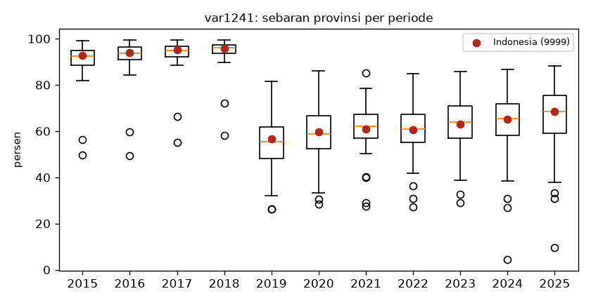
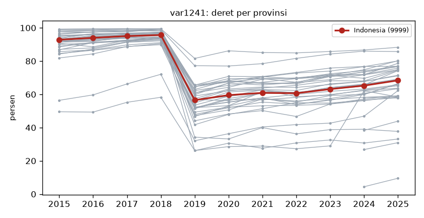
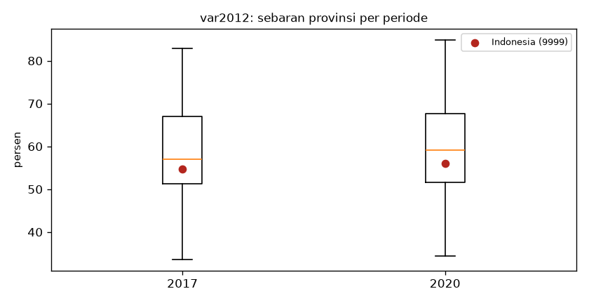
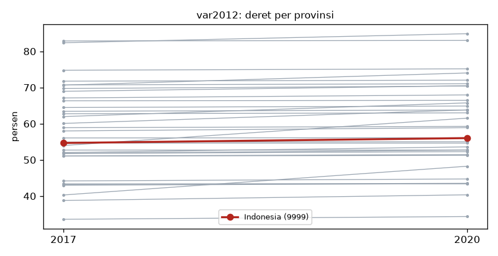
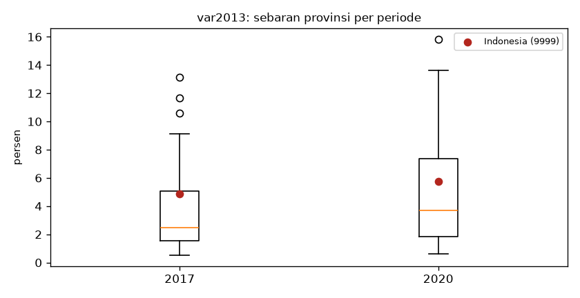
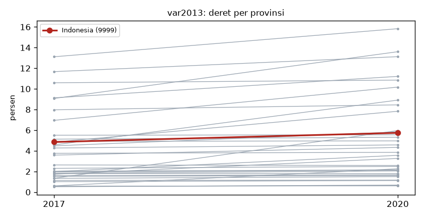
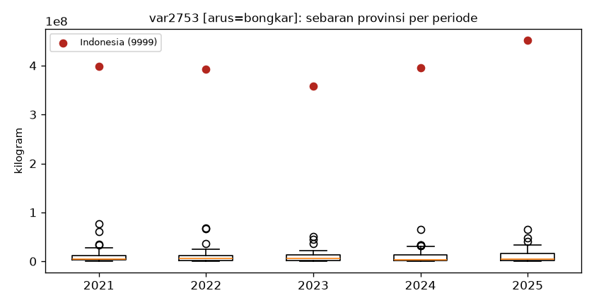
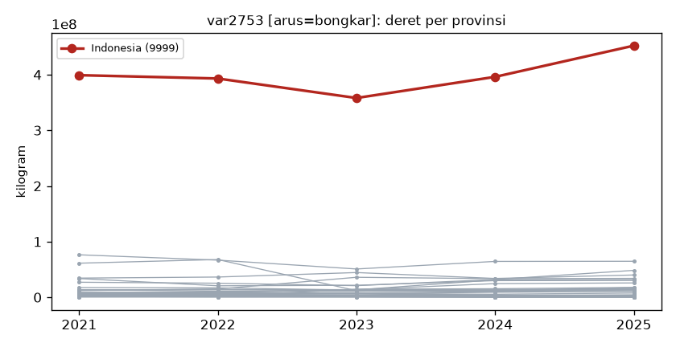
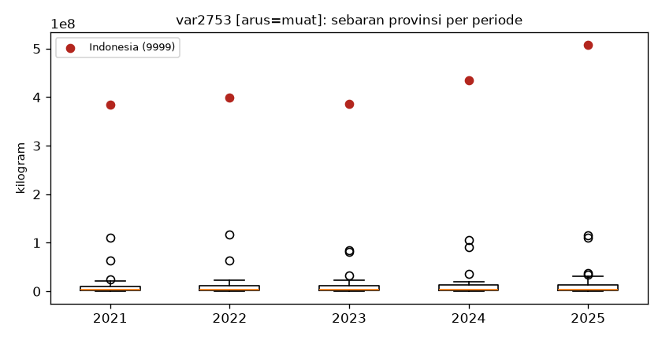
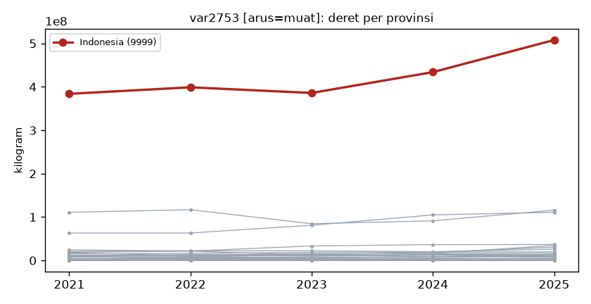
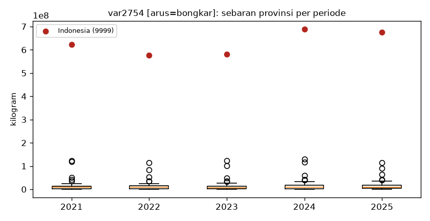
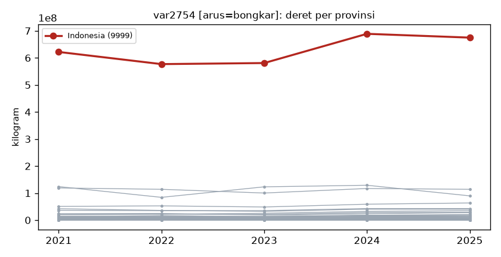
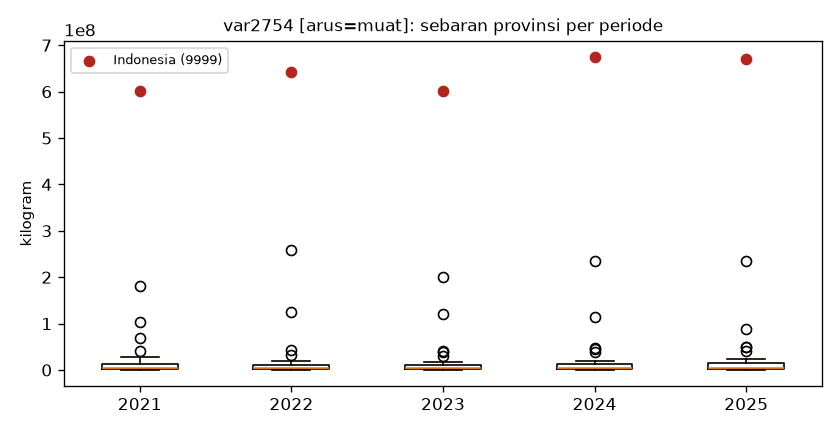
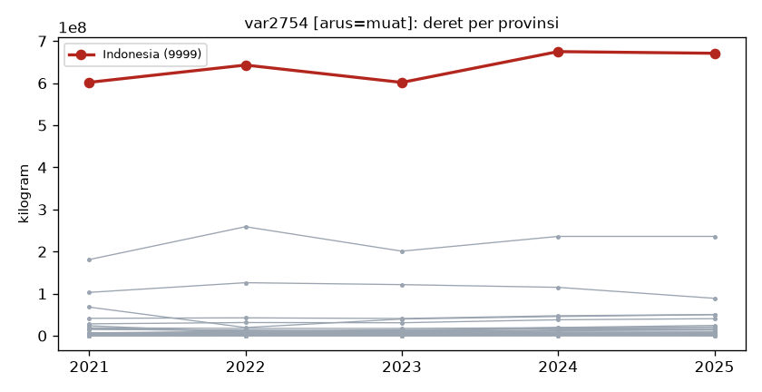
