# Profil dan calon anomali seri utama

Dihasilkan `python pipeline.py` (`src/silver/profil.py`). Hanya baris provinsi deret utama (rincian `total`, atau rincian yang didaftar di `DERET` untuk seri yang terbit per rincian; label `kode [rincian]`); baris Indonesia ditampilkan terpisah dan tidak ikut statistik antarprovinsi.

## Banyak periode per provinsi (menentukan arah pembanding)

| seri_kode | min_periode_per_provinsi | maks_periode_per_provinsi |
|---|---|---|
| tabel:sdg15_tutupan_hutan:luas_ribu_ha | 1 | 10 |
| tabel:sdg15_tutupan_hutan:persen [tutupan=hutan] | 1 | 10 |
| var1304 | 1 | 6 |
| var2532 [komponen=ika] | 2 | 6 |
| var2532 [komponen=iktl] | 2 | 6 |
| var2532 [komponen=iku] | 2 | 6 |
| var588 | 2 | 4 |

- tabel:sdg15_tutupan_hutan:luas_ribu_ha: tiga arah (periode per provinsi 1–10)
- tabel:sdg15_tutupan_hutan:persen [tutupan=hutan]: tiga arah (periode per provinsi 1–10)
- var1304: tiga arah (periode per provinsi 1–6)
- var2532 [komponen=ika]: tiga arah (periode per provinsi 2–6)
- var2532 [komponen=iktl]: tiga arah (periode per provinsi 2–6)
- var2532 [komponen=iku]: tiga arah (periode per provinsi 2–6)
- var588: hanya arah ke bawah dan perubahan (periode per provinsi 2–4)

Metode: IQR dengan pengali 1.5; arah ke samping hanya bila satu provinsi punya paling sedikit 6 periode. Sel yang ditandai lebih dari satu arah ditulis satu baris. Provinsi yang di luar batas ke bawah pada ≥ 50% periode diberi tanda `berulang`: itu perbedaan struktural antarprovinsi, bukan kejadian satu tahun. Lihat log untuk alasan memilih IQR.

## Statistik deskriptif per seri per periode (provinsi)

| seri_kode | periode | n | rerata | simpangan | minimum | q1 | median | q3 | maksimum |
|---|---|---|---|---|---|---|---|---|---|
| tabel:sdg15_tutupan_hutan:luas_ribu_ha | 2014 | 33 | 5,689.45 | 6,396.70 | 65.30 | 1,680.20 | 3,713.90 | 6,034.70 | 31,076.90 |
| tabel:sdg15_tutupan_hutan:luas_ribu_ha | 2015 | 33 | 5,689.45 | 6,396.70 | 65.30 | 1,680.20 | 3,713.90 | 6,034.70 | 31,076.90 |
| tabel:sdg15_tutupan_hutan:luas_ribu_ha | 2016 | 33 | 5,776.55 | 6,340.62 | 65.30 | 1,980.20 | 3,713.90 | 6,034.70 | 31,076.90 |
| tabel:sdg15_tutupan_hutan:luas_ribu_ha | 2017 | 33 | 5,689.45 | 6,396.70 | 65.30 | 1,680.20 | 3,713.90 | 6,034.70 | 31,076.90 |
| tabel:sdg15_tutupan_hutan:luas_ribu_ha | 2018 | 33 | 5,689.45 | 6,396.70 | 65.30 | 1,680.20 | 3,713.90 | 6,034.70 | 31,076.90 |
| tabel:sdg15_tutupan_hutan:luas_ribu_ha | 2019 | 33 | 5,689.45 | 6,396.70 | 65.30 | 1,680.20 | 3,713.90 | 6,034.70 | 31,076.90 |
| tabel:sdg15_tutupan_hutan:luas_ribu_ha | 2020 | 33 | 5,689.45 | 6,396.70 | 65.30 | 1,680.20 | 3,713.90 | 6,034.70 | 31,076.90 |
| tabel:sdg15_tutupan_hutan:luas_ribu_ha | 2021 | 34 | 5,519.97 | 5,932.89 | 66.50 | 1,749.60 | 3,938.45 | 6,657.60 | 30,958.30 |
| tabel:sdg15_tutupan_hutan:luas_ribu_ha | 2022 | 34 | 5,517.29 | 5,929.99 | 66.20 | 1,750.12 | 3,937.75 | 6,657.12 | 30,956.60 |
| tabel:sdg15_tutupan_hutan:luas_ribu_ha | 2023 | 38 | 4,945.76 | 3,793.05 | 66.30 | 2,005.88 | 4,296.75 | 6,080.30 | 15,192.90 |
| tabel:sdg15_tutupan_hutan:persen [tutupan=hutan] | 2014 | 33 | 38.48 | 22.05 | 0.50 | 22.50 | 34.60 | 53.40 | 92.10 |
| tabel:sdg15_tutupan_hutan:persen [tutupan=hutan] | 2015 | 33 | 38.38 | 21.91 | 0.50 | 24.20 | 34.40 | 53.00 | 91.30 |
| tabel:sdg15_tutupan_hutan:persen [tutupan=hutan] | 2016 | 33 | 38.55 | 21.57 | 0.50 | 22.80 | 34.00 | 52.50 | 91.70 |
| tabel:sdg15_tutupan_hutan:persen [tutupan=hutan] | 2017 | 33 | 38.06 | 21.73 | 0.50 | 23.00 | 34.20 | 52.00 | 90.90 |
| tabel:sdg15_tutupan_hutan:persen [tutupan=hutan] | 2018 | 33 | 37.86 | 21.70 | 0.50 | 22.60 | 33.80 | 51.10 | 90.90 |
| tabel:sdg15_tutupan_hutan:persen [tutupan=hutan] | 2019 | 33 | 37.93 | 21.94 | 0.50 | 21.60 | 33.70 | 51.50 | 92.20 |
| tabel:sdg15_tutupan_hutan:persen [tutupan=hutan] | 2020 | 33 | 38.30 | 22.32 | 1.40 | 19.20 | 34.80 | 52.40 | 93.20 |
| tabel:sdg15_tutupan_hutan:persen [tutupan=hutan] | 2021 | 34 | 39.20 | 23.00 | 1.70 | 20.60 | 35.75 | 54.62 | 92.70 |
| tabel:sdg15_tutupan_hutan:persen [tutupan=hutan] | 2022 | 34 | 39.61 | 23.00 | 1.70 | 20.65 | 37.20 | 54.70 | 93.10 |
| tabel:sdg15_tutupan_hutan:persen [tutupan=hutan] | 2023 | 38 | 44.67 | 26.16 | 1.70 | 25.57 | 39.80 | 62.80 | 94.30 |
| var1304 | 2014 | 33 | 5,689.45 | 6,396.70 | 65.30 | 1,680.20 | 3,713.90 | 6,034.70 | 31,076.90 |
| var1304 | 2015 | 33 | 5,689.45 | 6,396.70 | 65.30 | 1,680.20 | 3,713.90 | 6,034.70 | 31,076.90 |
| var1304 | 2016 | 33 | 5,776.55 | 6,340.62 | 65.30 | 1,980.20 | 3,713.90 | 6,034.70 | 31,076.90 |
| var1304 | 2017 | 33 | 5,689.45 | 6,396.70 | 65.30 | 1,680.20 | 3,713.90 | 6,034.70 | 31,076.90 |
| var1304 | 2018 | 33 | 5,689.45 | 6,396.70 | 65.30 | 1,680.20 | 3,713.90 | 6,034.70 | 31,076.90 |
| var1304 | 2023 | 38 | 4,945.76 | 3,793.05 | 66.30 | 2,005.88 | 4,296.75 | 6,080.30 | 15,192.90 |
| var2532 [komponen=ika] | 2019 | 34 | 53.55 | 7.47 | 35.37 | 50.14 | 53.75 | 58.19 | 69.29 |
| var2532 [komponen=ika] | 2020 | 34 | 54.00 | 5.31 | 41.50 | 51.13 | 53.12 | 56.08 | 65.63 |
| var2532 [komponen=ika] | 2021 | 34 | 53.26 | 4.20 | 43.09 | 52.00 | 54.32 | 55.99 | 58.37 |
| var2532 [komponen=ika] | 2022 | 34 | 53.72 | 5.46 | 39.31 | 52.21 | 55.28 | 56.77 | 62.00 |
| var2532 [komponen=ika] | 2023 | 38 | 55.29 | 5.72 | 40.28 | 52.72 | 55.75 | 58.90 | 64.67 |
| var2532 [komponen=ika] | 2024 | 38 | 55.75 | 5.32 | 41.22 | 52.81 | 56.00 | 58.79 | 65.32 |
| var2532 [komponen=iktl] | 2019 | 33 | 61.10 | 19.76 | 24.66 | 46.78 | 59.45 | 76.27 | 100.00 |
| var2532 [komponen=iktl] | 2020 | 34 | 61.28 | 20.50 | 24.86 | 43.93 | 58.36 | 76.35 | 100.00 |
| var2532 [komponen=iktl] | 2021 | 34 | 61.51 | 20.71 | 26.25 | 44.34 | 59.23 | 76.37 | 100.00 |
| var2532 [komponen=iktl] | 2022 | 34 | 62.31 | 20.09 | 27.07 | 46.55 | 58.95 | 76.14 | 100.00 |
| var2532 [komponen=iktl] | 2023 | 38 | 66.76 | 21.41 | 27.17 | 49.72 | 64.17 | 83.32 | 100.00 |
| var2532 [komponen=iktl] | 2024 | 38 | 67.09 | 21.11 | 27.49 | 50.48 | 63.97 | 83.83 | 100.00 |
| var2532 [komponen=iku] | 2019 | 34 | 87.92 | 5.53 | 67.97 | 86.94 | 89.53 | 90.69 | 93.79 |
| var2532 [komponen=iku] | 2020 | 34 | 88.27 | 5.73 | 66.69 | 88.41 | 89.63 | 90.73 | 94.83 |
| var2532 [komponen=iku] | 2021 | 34 | 88.45 | 5.63 | 66.52 | 88.54 | 90.17 | 90.91 | 95.60 |
| var2532 [komponen=iku] | 2022 | 34 | 89.18 | 5.56 | 68.06 | 89.17 | 90.48 | 91.78 | 95.79 |
| var2532 [komponen=iku] | 2023 | 38 | 90.24 | 6.32 | 66.67 | 89.76 | 91.20 | 93.30 | 97.68 |
| var2532 [komponen=iku] | 2024 | 38 | 91.33 | 5.37 | 69.84 | 91.44 | 92.72 | 93.72 | 96.41 |
| var588 | 2006 | 31 | 974,090.35 | 996,880.41 | 27,138.00 | 263,652.00 | 566,592.00 | 1,294,685.50 | 3,219,811.00 |
| var588 | 2011 | 32 | 852,963.81 | 1,073,513.18 | 33,559.00 | 256,569.25 | 599,071.00 | 894,210.25 | 4,636,890.00 |
| var588 | 2013 | 33 | 736,463.42 | 932,262.65 | 26,117.00 | 274,340.00 | 532,661.00 | 859,575.00 | 5,144,704.00 |
| var588 | 2018 | 33 | 424,437.79 | 314,369.44 | 8,230.00 | 213,985.00 | 375,733.00 | 538,523.00 | 1,338,810.00 |

## Baris Indonesia

| seri_kode | periode | nilai | rujukan_tahun |
|---|---|---|---|
| tabel:sdg15_tutupan_hutan:luas_ribu_ha | 2014 | 187,751.90 | <NA> |
| tabel:sdg15_tutupan_hutan:luas_ribu_ha | 2015 | 187,751.90 | <NA> |
| tabel:sdg15_tutupan_hutan:luas_ribu_ha | 2016 | 187,751.90 | <NA> |
| tabel:sdg15_tutupan_hutan:luas_ribu_ha | 2017 | 187,751.90 | <NA> |
| tabel:sdg15_tutupan_hutan:luas_ribu_ha | 2018 | 187,751.90 | <NA> |
| tabel:sdg15_tutupan_hutan:luas_ribu_ha | 2019 | 187,751.90 | <NA> |
| tabel:sdg15_tutupan_hutan:luas_ribu_ha | 2020 | 187,751.90 | <NA> |
| tabel:sdg15_tutupan_hutan:luas_ribu_ha | 2021 | 187,679.10 | <NA> |
| tabel:sdg15_tutupan_hutan:luas_ribu_ha | 2022 | 187,587.90 | <NA> |
| tabel:sdg15_tutupan_hutan:luas_ribu_ha | 2023 | 187,938.70 | <NA> |
| tabel:sdg15_tutupan_hutan:persen [tutupan=hutan] | 2014 | 51.00 | <NA> |
| tabel:sdg15_tutupan_hutan:persen [tutupan=hutan] | 2015 | 50.60 | <NA> |
| tabel:sdg15_tutupan_hutan:persen [tutupan=hutan] | 2016 | 50.70 | <NA> |
| tabel:sdg15_tutupan_hutan:persen [tutupan=hutan] | 2017 | 50.00 | <NA> |
| tabel:sdg15_tutupan_hutan:persen [tutupan=hutan] | 2018 | 49.80 | <NA> |
| tabel:sdg15_tutupan_hutan:persen [tutupan=hutan] | 2019 | 50.10 | <NA> |
| tabel:sdg15_tutupan_hutan:persen [tutupan=hutan] | 2020 | 50.90 | <NA> |
| tabel:sdg15_tutupan_hutan:persen [tutupan=hutan] | 2021 | 50.80 | <NA> |
| tabel:sdg15_tutupan_hutan:persen [tutupan=hutan] | 2022 | 51.20 | <NA> |
| tabel:sdg15_tutupan_hutan:persen [tutupan=hutan] | 2023 | 51.20 | <NA> |
| var1304 | 2014 | 187,751.90 | <NA> |
| var1304 | 2015 | 187,751.90 | <NA> |
| var1304 | 2016 | 187,751.90 | <NA> |
| var1304 | 2017 | 187,751.90 | <NA> |
| var1304 | 2018 | 187,751.90 | <NA> |
| var1304 | 2023 | 187,938.70 | <NA> |
| var588 | 2006 | 30,196,802.00 | <NA> |
| var588 | 2011 | 27,294,842.00 | <NA> |
| var588 | 2013 | 24,303,294.00 | <NA> |
| var588 | 2018 | 14,006,450.00 | <NA> |
| var2532 [komponen=iku] | 2019 | 86.56 | <NA> |
| var2532 [komponen=iku] | 2020 | 87.21 | <NA> |
| var2532 [komponen=iku] | 2021 | 87.36 | <NA> |
| var2532 [komponen=iku] | 2022 | 88.06 | <NA> |
| var2532 [komponen=iku] | 2023 | 88.67 | <NA> |
| var2532 [komponen=iku] | 2024 | 90.13 | <NA> |
| var2532 [komponen=ika] | 2019 | 52.62 | <NA> |
| var2532 [komponen=ika] | 2020 | 53.53 | <NA> |
| var2532 [komponen=ika] | 2021 | 52.82 | <NA> |
| var2532 [komponen=ika] | 2022 | 53.88 | <NA> |
| var2532 [komponen=ika] | 2023 | 54.59 | <NA> |
| var2532 [komponen=ika] | 2024 | 54.78 | <NA> |
| var2532 [komponen=iktl] | 2019 | 62.00 | <NA> |
| var2532 [komponen=iktl] | 2020 | 60.74 | <NA> |
| var2532 [komponen=iktl] | 2021 | 60.81 | <NA> |
| var2532 [komponen=iktl] | 2022 | 61.22 | <NA> |
| var2532 [komponen=iktl] | 2023 | 61.65 | <NA> |
| var2532 [komponen=iktl] | 2024 | 61.96 | <NA> |

## Calon anomali (313)

Daftar lengkap di `reports/calon-anomali.csv`; kategorinya di `reports/anomali.csv`.

| seri_kode | wilayah_kode | nama_wilayah | periode | nilai | arah | alasan | berulang |
|---|---|---|---|---|---|---|---|
| tabel:sdg15_tutupan_hutan:luas_ribu_ha | 6100 | Kalimantan Barat | 2014 | 14,572.80 | ke bawah | di luar [-4851.55, 12566.45] (IQR x 1.5) dibanding 33 provinsi tahun itu | True |
| tabel:sdg15_tutupan_hutan:luas_ribu_ha | 6200 | Kalimantan Tengah | 2014 | 15,266.20 | ke bawah | di luar [-4851.55, 12566.45] (IQR x 1.5) dibanding 33 provinsi tahun itu | True |
| tabel:sdg15_tutupan_hutan:luas_ribu_ha | 6400 | Kalimantan Timur | 2014 | 19,504.80 | ke bawah | di luar [-4851.55, 12566.45] (IQR x 1.5) dibanding 33 provinsi tahun itu | True |
| tabel:sdg15_tutupan_hutan:luas_ribu_ha | 9400 | Papua | 2014 | 31,076.90 | ke bawah | di luar [-4851.55, 12566.45] (IQR x 1.5) dibanding 33 provinsi tahun itu | True |
| tabel:sdg15_tutupan_hutan:luas_ribu_ha | 6100 | Kalimantan Barat | 2015 | 14,572.80 | ke bawah | di luar [-4851.55, 12566.45] (IQR x 1.5) dibanding 33 provinsi tahun itu | True |
| tabel:sdg15_tutupan_hutan:luas_ribu_ha | 6200 | Kalimantan Tengah | 2015 | 15,266.20 | ke bawah | di luar [-4851.55, 12566.45] (IQR x 1.5) dibanding 33 provinsi tahun itu | True |
| tabel:sdg15_tutupan_hutan:luas_ribu_ha | 6400 | Kalimantan Timur | 2015 | 19,504.80 | ke bawah | di luar [-4851.55, 12566.45] (IQR x 1.5) dibanding 33 provinsi tahun itu | True |
| tabel:sdg15_tutupan_hutan:luas_ribu_ha | 9400 | Papua | 2015 | 31,076.90 | ke bawah | di luar [-4851.55, 12566.45] (IQR x 1.5) dibanding 33 provinsi tahun itu | True |
| tabel:sdg15_tutupan_hutan:luas_ribu_ha | 3400 | DI Yogyakarta | 2016 | 3,194.00 | perubahan + ke samping | perubahan 2015→2016 sebesar +2874.60 di luar [0.00, 0.00]; di luar [315.69, 325.59] dibanding 10 tahun di provinsi ini | False |
| tabel:sdg15_tutupan_hutan:luas_ribu_ha | 6100 | Kalimantan Barat | 2016 | 14,572.80 | ke bawah | di luar [-4101.55, 12116.45] (IQR x 1.5) dibanding 33 provinsi tahun itu | True |
| tabel:sdg15_tutupan_hutan:luas_ribu_ha | 6200 | Kalimantan Tengah | 2016 | 15,266.20 | ke bawah | di luar [-4101.55, 12116.45] (IQR x 1.5) dibanding 33 provinsi tahun itu | True |
| tabel:sdg15_tutupan_hutan:luas_ribu_ha | 6400 | Kalimantan Timur | 2016 | 19,504.80 | ke bawah | di luar [-4101.55, 12116.45] (IQR x 1.5) dibanding 33 provinsi tahun itu | True |
| tabel:sdg15_tutupan_hutan:luas_ribu_ha | 9400 | Papua | 2016 | 31,076.90 | ke bawah | di luar [-4101.55, 12116.45] (IQR x 1.5) dibanding 33 provinsi tahun itu | True |
| tabel:sdg15_tutupan_hutan:luas_ribu_ha | 3400 | DI Yogyakarta | 2017 | 319.40 | perubahan | perubahan 2016→2017 sebesar -2874.60 di luar [0.00, 0.00] | False |
| tabel:sdg15_tutupan_hutan:luas_ribu_ha | 6100 | Kalimantan Barat | 2017 | 14,572.80 | ke bawah | di luar [-4851.55, 12566.45] (IQR x 1.5) dibanding 33 provinsi tahun itu | True |
| tabel:sdg15_tutupan_hutan:luas_ribu_ha | 6200 | Kalimantan Tengah | 2017 | 15,266.20 | ke bawah | di luar [-4851.55, 12566.45] (IQR x 1.5) dibanding 33 provinsi tahun itu | True |
| tabel:sdg15_tutupan_hutan:luas_ribu_ha | 6400 | Kalimantan Timur | 2017 | 19,504.80 | ke bawah | di luar [-4851.55, 12566.45] (IQR x 1.5) dibanding 33 provinsi tahun itu | True |
| tabel:sdg15_tutupan_hutan:luas_ribu_ha | 9400 | Papua | 2017 | 31,076.90 | ke bawah | di luar [-4851.55, 12566.45] (IQR x 1.5) dibanding 33 provinsi tahun itu | True |
| tabel:sdg15_tutupan_hutan:luas_ribu_ha | 6100 | Kalimantan Barat | 2018 | 14,572.80 | ke bawah | di luar [-4851.55, 12566.45] (IQR x 1.5) dibanding 33 provinsi tahun itu | True |
| tabel:sdg15_tutupan_hutan:luas_ribu_ha | 6200 | Kalimantan Tengah | 2018 | 15,266.20 | ke bawah | di luar [-4851.55, 12566.45] (IQR x 1.5) dibanding 33 provinsi tahun itu | True |
| tabel:sdg15_tutupan_hutan:luas_ribu_ha | 6400 | Kalimantan Timur | 2018 | 19,504.80 | ke bawah | di luar [-4851.55, 12566.45] (IQR x 1.5) dibanding 33 provinsi tahun itu | True |
| tabel:sdg15_tutupan_hutan:luas_ribu_ha | 9400 | Papua | 2018 | 31,076.90 | ke bawah | di luar [-4851.55, 12566.45] (IQR x 1.5) dibanding 33 provinsi tahun itu | True |
| tabel:sdg15_tutupan_hutan:luas_ribu_ha | 6100 | Kalimantan Barat | 2019 | 14,572.80 | ke bawah | di luar [-4851.55, 12566.45] (IQR x 1.5) dibanding 33 provinsi tahun itu | True |
| tabel:sdg15_tutupan_hutan:luas_ribu_ha | 6200 | Kalimantan Tengah | 2019 | 15,266.20 | ke bawah | di luar [-4851.55, 12566.45] (IQR x 1.5) dibanding 33 provinsi tahun itu | True |
| tabel:sdg15_tutupan_hutan:luas_ribu_ha | 6400 | Kalimantan Timur | 2019 | 19,504.80 | ke bawah | di luar [-4851.55, 12566.45] (IQR x 1.5) dibanding 33 provinsi tahun itu | True |
| tabel:sdg15_tutupan_hutan:luas_ribu_ha | 9400 | Papua | 2019 | 31,076.90 | ke bawah | di luar [-4851.55, 12566.45] (IQR x 1.5) dibanding 33 provinsi tahun itu | True |
| tabel:sdg15_tutupan_hutan:luas_ribu_ha | 6100 | Kalimantan Barat | 2020 | 14,572.80 | ke bawah | di luar [-4851.55, 12566.45] (IQR x 1.5) dibanding 33 provinsi tahun itu | True |
| tabel:sdg15_tutupan_hutan:luas_ribu_ha | 6200 | Kalimantan Tengah | 2020 | 15,266.20 | ke bawah | di luar [-4851.55, 12566.45] (IQR x 1.5) dibanding 33 provinsi tahun itu | True |
| tabel:sdg15_tutupan_hutan:luas_ribu_ha | 6400 | Kalimantan Timur | 2020 | 19,504.80 | ke bawah | di luar [-4851.55, 12566.45] (IQR x 1.5) dibanding 33 provinsi tahun itu | True |
| tabel:sdg15_tutupan_hutan:luas_ribu_ha | 9400 | Papua | 2020 | 31,076.90 | ke bawah | di luar [-4851.55, 12566.45] (IQR x 1.5) dibanding 33 provinsi tahun itu | True |
| tabel:sdg15_tutupan_hutan:luas_ribu_ha | 1600 | Sumatera Selatan | 2021 | 8,606.70 | ke samping | di luar [8607.40, 8638.60] dibanding 10 tahun di provinsi ini | False |
| tabel:sdg15_tutupan_hutan:luas_ribu_ha | 6100 | Kalimantan Barat | 2021 | 14,556.40 | ke bawah + ke samping | di luar [-5612.40, 14019.60] (IQR x 1.5) dibanding 34 provinsi tahun itu; di luar [14571.49, 14573.59] dibanding 10 tahun di provinsi ini | True |
| tabel:sdg15_tutupan_hutan:luas_ribu_ha | 6200 | Kalimantan Tengah | 2021 | 15,170.20 | ke bawah + perubahan | di luar [-5612.40, 14019.60] (IQR x 1.5) dibanding 34 provinsi tahun itu; perubahan 2020→2021 sebesar -96.00 di luar [-79.90, 63.30] | True |
| tabel:sdg15_tutupan_hutan:luas_ribu_ha | 6400 | Kalimantan Timur | 2021 | 12,734.90 | perubahan | perubahan 2020→2021 sebesar -6769.90 di luar [-79.90, 63.30] | True |
| tabel:sdg15_tutupan_hutan:luas_ribu_ha | 9100 | Papua Barat | 2021 | 9,801.40 | perubahan + ke samping | perubahan 2020→2021 sebesar +176.50 di luar [-79.90, 63.30]; di luar [9624.90, 9624.90] dibanding 10 tahun di provinsi ini | False |
| tabel:sdg15_tutupan_hutan:luas_ribu_ha | 9400 | Papua | 2021 | 30,958.30 | ke bawah + perubahan | di luar [-5612.40, 14019.60] (IQR x 1.5) dibanding 34 provinsi tahun itu; perubahan 2020→2021 sebesar -118.60 di luar [-79.90, 63.30] | True |
| tabel:sdg15_tutupan_hutan:luas_ribu_ha | 1500 | Jambi | 2022 | 4,847.10 | perubahan | perubahan 2021→2022 sebesar -8.20 di luar [-2.59, 1.71] | False |
| tabel:sdg15_tutupan_hutan:luas_ribu_ha | 1600 | Sumatera Selatan | 2022 | 8,606.90 | ke samping | di luar [8607.40, 8638.60] dibanding 10 tahun di provinsi ini | False |
| tabel:sdg15_tutupan_hutan:luas_ribu_ha | 6100 | Kalimantan Barat | 2022 | 14,555.30 | ke bawah + ke samping | di luar [-5610.38, 14017.62] (IQR x 1.5) dibanding 34 provinsi tahun itu; di luar [14571.49, 14573.59] dibanding 10 tahun di provinsi ini | True |
| tabel:sdg15_tutupan_hutan:luas_ribu_ha | 6200 | Kalimantan Tengah | 2022 | 15,169.70 | ke bawah | di luar [-5610.38, 14017.62] (IQR x 1.5) dibanding 34 provinsi tahun itu | True |
| tabel:sdg15_tutupan_hutan:luas_ribu_ha | 6400 | Kalimantan Timur | 2022 | 12,660.70 | perubahan | perubahan 2021→2022 sebesar -74.20 di luar [-2.59, 1.71] | True |
| tabel:sdg15_tutupan_hutan:luas_ribu_ha | 7300 | Sulawesi Selatan | 2022 | 4,457.50 | perubahan | perubahan 2021→2022 sebesar -3.00 di luar [-2.59, 1.71] | False |
| tabel:sdg15_tutupan_hutan:luas_ribu_ha | 8100 | Maluku | 2022 | 4,629.00 | perubahan | perubahan 2021→2022 sebesar -2.90 di luar [-2.59, 1.71] | False |
| tabel:sdg15_tutupan_hutan:luas_ribu_ha | 9100 | Papua Barat | 2022 | 9,803.80 | perubahan + ke samping | perubahan 2021→2022 sebesar +2.40 di luar [-2.59, 1.71]; di luar [9624.90, 9624.90] dibanding 10 tahun di provinsi ini | False |
| tabel:sdg15_tutupan_hutan:luas_ribu_ha | 9400 | Papua | 2022 | 30,956.60 | ke bawah | di luar [-5610.38, 14017.62] (IQR x 1.5) dibanding 34 provinsi tahun itu | True |
| tabel:sdg15_tutupan_hutan:luas_ribu_ha | 1100 | Aceh | 2023 | 5,659.30 | ke samping | di luar [5641.23, 5657.43] dibanding 10 tahun di provinsi ini | False |
| tabel:sdg15_tutupan_hutan:luas_ribu_ha | 3300 | Jawa Tengah | 2023 | 3,463.70 | ke samping | di luar [3454.91, 3459.41] dibanding 10 tahun di provinsi ini | False |
| tabel:sdg15_tutupan_hutan:luas_ribu_ha | 5100 | Bali | 2023 | 567.50 | ke samping | di luar [566.90, 566.90] dibanding 10 tahun di provinsi ini | False |
| tabel:sdg15_tutupan_hutan:luas_ribu_ha | 6100 | Kalimantan Barat | 2023 | 14,572.10 | ke bawah + perubahan | di luar [-4105.76, 12191.94] (IQR x 1.5) dibanding 38 provinsi tahun itu; perubahan 2022→2023 sebesar +16.80 di luar [-8.36, 14.54] | True |
| tabel:sdg15_tutupan_hutan:luas_ribu_ha | 6200 | Kalimantan Tengah | 2023 | 15,192.90 | ke bawah + perubahan | di luar [-4105.76, 12191.94] (IQR x 1.5) dibanding 38 provinsi tahun itu; perubahan 2022→2023 sebesar +23.20 di luar [-8.36, 14.54] | True |
| tabel:sdg15_tutupan_hutan:luas_ribu_ha | 6400 | Kalimantan Timur | 2023 | 12,576.50 | ke bawah + perubahan | di luar [-4105.76, 12191.94] (IQR x 1.5) dibanding 38 provinsi tahun itu; perubahan 2022→2023 sebesar -84.20 di luar [-8.36, 14.54] | True |
| tabel:sdg15_tutupan_hutan:luas_ribu_ha | 6500 | Kalimantan Utara | 2023 | 6,959.20 | perubahan | perubahan 2022→2023 sebesar +98.20 di luar [-8.36, 14.54] | False |
| tabel:sdg15_tutupan_hutan:luas_ribu_ha | 7200 | Sulawesi Tengah | 2023 | 6,089.30 | perubahan + ke samping | perubahan 2022→2023 sebesar +43.80 di luar [-8.36, 14.54]; di luar [6022.55, 6054.95] dibanding 10 tahun di provinsi ini | False |
| tabel:sdg15_tutupan_hutan:luas_ribu_ha | 7300 | Sulawesi Selatan | 2023 | 4,433.70 | perubahan | perubahan 2022→2023 sebesar -23.80 di luar [-8.36, 14.54] | False |
| tabel:sdg15_tutupan_hutan:luas_ribu_ha | 9100 | Papua Barat | 2023 | 5,942.00 | perubahan + ke samping | perubahan 2022→2023 sebesar -3861.80 di luar [-8.36, 14.54]; di luar [9624.90, 9624.90] dibanding 10 tahun di provinsi ini | False |
| tabel:sdg15_tutupan_hutan:luas_ribu_ha | 9400 | Papua | 2023 | 8,155.50 | perubahan + ke samping | perubahan 2022→2023 sebesar -22801.10 di luar [-8.36, 14.54]; di luar [30854.53, 31210.33] dibanding 10 tahun di provinsi ini | True |
| tabel:sdg15_tutupan_hutan:persen [tutupan=hutan] | 5300 | Nusa Tenggara Timur | 2014 | 26.40 | ke samping | di luar [27.94, 49.84] dibanding 10 tahun di provinsi ini | False |
| tabel:sdg15_tutupan_hutan:persen [tutupan=hutan] | 6200 | Kalimantan Tengah | 2014 | 51.50 | ke samping | di luar [46.89, 51.39] dibanding 10 tahun di provinsi ini | False |
| tabel:sdg15_tutupan_hutan:persen [tutupan=hutan] | 1600 | Sumatera Selatan | 2015 | 13.90 | perubahan | perubahan 2014→2015 sebesar -3.80 di luar [-2.35, 1.25] | False |
| tabel:sdg15_tutupan_hutan:persen [tutupan=hutan] | 2100 | Kepulauan Riau | 2015 | 30.00 | perubahan | perubahan 2014→2015 sebesar -4.60 di luar [-2.35, 1.25] | False |
| tabel:sdg15_tutupan_hutan:persen [tutupan=hutan] | 3300 | Jawa Tengah | 2015 | 29.50 | perubahan | perubahan 2014→2015 sebesar +7.00 di luar [-2.35, 1.25] | False |
| tabel:sdg15_tutupan_hutan:persen [tutupan=hutan] | 5200 | Nusa Tenggara Barat | 2015 | 40.00 | perubahan | perubahan 2014→2015 sebesar -2.50 di luar [-2.35, 1.25] | False |
| tabel:sdg15_tutupan_hutan:persen [tutupan=hutan] | 5300 | Nusa Tenggara Timur | 2015 | 41.70 | perubahan | perubahan 2014→2015 sebesar +15.30 di luar [-2.35, 1.25] | False |
| tabel:sdg15_tutupan_hutan:persen [tutupan=hutan] | 6200 | Kalimantan Tengah | 2015 | 51.50 | ke samping | di luar [46.89, 51.39] dibanding 10 tahun di provinsi ini | False |
| tabel:sdg15_tutupan_hutan:persen [tutupan=hutan] | 6400 | Kalimantan Timur | 2015 | 66.00 | perubahan | perubahan 2014→2015 sebesar -3.50 di luar [-2.35, 1.25] | False |
| tabel:sdg15_tutupan_hutan:persen [tutupan=hutan] | 7200 | Sulawesi Tengah | 2015 | 64.80 | perubahan | perubahan 2014→2015 sebesar +1.70 di luar [-2.35, 1.25] | False |
| tabel:sdg15_tutupan_hutan:persen [tutupan=hutan] | 1100 | Aceh | 2016 | 57.90 | ke samping | di luar [54.71, 56.61] dibanding 10 tahun di provinsi ini | False |
| tabel:sdg15_tutupan_hutan:persen [tutupan=hutan] | 3300 | Jawa Tengah | 2016 | 22.80 | perubahan | perubahan 2015→2016 sebesar -6.70 di luar [-3.20, 4.00] | False |
| tabel:sdg15_tutupan_hutan:persen [tutupan=hutan] | 5200 | Nusa Tenggara Barat | 2016 | 46.50 | perubahan | perubahan 2015→2016 sebesar +6.50 di luar [-3.20, 4.00] | False |
| tabel:sdg15_tutupan_hutan:persen [tutupan=hutan] | 5300 | Nusa Tenggara Timur | 2016 | 37.30 | perubahan | perubahan 2015→2016 sebesar -4.40 di luar [-3.20, 4.00] | False |
| tabel:sdg15_tutupan_hutan:persen [tutupan=hutan] | 7500 | Gorontalo | 2016 | 57.80 | ke samping | di luar [58.55, 59.75] dibanding 10 tahun di provinsi ini | False |
| tabel:sdg15_tutupan_hutan:persen [tutupan=hutan] | 8200 | Maluku Utara | 2016 | 62.20 | perubahan | perubahan 2015→2016 sebesar -3.90 di luar [-3.20, 4.00] | False |
| tabel:sdg15_tutupan_hutan:persen [tutupan=hutan] | 1400 | Riau | 2017 | 25.90 | perubahan | perubahan 2016→2017 sebesar -3.60 di luar [-3.15, 2.05] | False |
| tabel:sdg15_tutupan_hutan:persen [tutupan=hutan] | 1600 | Sumatera Selatan | 2017 | 13.30 | perubahan | perubahan 2016→2017 sebesar -4.50 di luar [-3.15, 2.05] | False |
| tabel:sdg15_tutupan_hutan:persen [tutupan=hutan] | 3300 | Jawa Tengah | 2017 | 29.50 | perubahan | perubahan 2016→2017 sebesar +6.70 di luar [-3.15, 2.05] | False |
| tabel:sdg15_tutupan_hutan:persen [tutupan=hutan] | 3400 | DI Yogyakarta | 2017 | 10.80 | perubahan | perubahan 2016→2017 sebesar -3.60 di luar [-3.15, 2.05] | False |
| tabel:sdg15_tutupan_hutan:persen [tutupan=hutan] | 5200 | Nusa Tenggara Barat | 2017 | 40.10 | perubahan | perubahan 2016→2017 sebesar -6.40 di luar [-3.15, 2.05] | False |
| tabel:sdg15_tutupan_hutan:persen [tutupan=hutan] | 5300 | Nusa Tenggara Timur | 2017 | 41.90 | perubahan | perubahan 2016→2017 sebesar +4.60 di luar [-3.15, 2.05] | False |
| tabel:sdg15_tutupan_hutan:persen [tutupan=hutan] | 8200 | Maluku Utara | 2017 | 64.50 | perubahan | perubahan 2016→2017 sebesar +2.30 di luar [-3.15, 2.05] | False |
| tabel:sdg15_tutupan_hutan:persen [tutupan=hutan] | 7400 | Sulawesi Tenggara | 2018 | 51.10 | perubahan | perubahan 2017→2018 sebesar -0.90 di luar [-0.75, 0.45] | False |
| tabel:sdg15_tutupan_hutan:persen [tutupan=hutan] | 1600 | Sumatera Selatan | 2019 | 16.80 | perubahan | perubahan 2018→2019 sebesar +3.60 di luar [-2.75, 3.25] | False |
| tabel:sdg15_tutupan_hutan:persen [tutupan=hutan] | 3200 | Jawa Barat | 2019 | 21.60 | perubahan + ke samping | perubahan 2018→2019 sebesar +4.30 di luar [-2.75, 3.25]; di luar [15.86, 19.76] dibanding 10 tahun di provinsi ini | False |
| tabel:sdg15_tutupan_hutan:persen [tutupan=hutan] | 3300 | Jawa Tengah | 2019 | 19.20 | perubahan | perubahan 2018→2019 sebesar -10.30 di luar [-2.75, 3.25] | False |
| tabel:sdg15_tutupan_hutan:persen [tutupan=hutan] | 3500 | Jawa Timur | 2019 | 25.00 | perubahan | perubahan 2018→2019 sebesar -3.00 di luar [-2.75, 3.25] | False |
| tabel:sdg15_tutupan_hutan:persen [tutupan=hutan] | 5200 | Nusa Tenggara Barat | 2019 | 44.40 | perubahan | perubahan 2018→2019 sebesar +4.80 di luar [-2.75, 3.25] | False |
| tabel:sdg15_tutupan_hutan:persen [tutupan=hutan] | 5300 | Nusa Tenggara Timur | 2019 | 36.40 | perubahan | perubahan 2018→2019 sebesar -5.00 di luar [-2.75, 3.25] | False |
| tabel:sdg15_tutupan_hutan:persen [tutupan=hutan] | 7500 | Gorontalo | 2019 | 59.90 | ke samping | di luar [58.55, 59.75] dibanding 10 tahun di provinsi ini | False |
| tabel:sdg15_tutupan_hutan:persen [tutupan=hutan] | 1700 | Bengkulu | 2020 | 11.60 | ke samping | di luar [29.84, 36.74] dibanding 10 tahun di provinsi ini | False |
| tabel:sdg15_tutupan_hutan:persen [tutupan=hutan] | 1800 | Lampung | 2020 | 33.20 | ke samping | di luar [9.01, 10.91] dibanding 10 tahun di provinsi ini | False |
| tabel:sdg15_tutupan_hutan:persen [tutupan=hutan] | 3100 | DKI Jakarta | 2020 | 16.30 | ke samping | di luar [-1.30, 3.50] dibanding 10 tahun di provinsi ini | False |
| tabel:sdg15_tutupan_hutan:persen [tutupan=hutan] | 3200 | Jawa Barat | 2020 | 1.40 | ke samping | di luar [15.86, 19.76] dibanding 10 tahun di provinsi ini | False |
| tabel:sdg15_tutupan_hutan:persen [tutupan=hutan] | 3400 | DI Yogyakarta | 2020 | 18.40 | ke samping | di luar [3.30, 15.30] dibanding 10 tahun di provinsi ini | False |
| tabel:sdg15_tutupan_hutan:persen [tutupan=hutan] | 3500 | Jawa Timur | 2020 | 6.40 | ke samping | di luar [21.40, 32.40] dibanding 10 tahun di provinsi ini | False |
| tabel:sdg15_tutupan_hutan:persen [tutupan=hutan] | 3600 | Banten | 2020 | 24.70 | ke samping | di luar [14.75, 19.55] dibanding 10 tahun di provinsi ini | False |
| tabel:sdg15_tutupan_hutan:persen [tutupan=hutan] | 5100 | Bali | 2020 | 38.80 | ke samping | di luar [15.03, 19.62] dibanding 10 tahun di provinsi ini | False |
| tabel:sdg15_tutupan_hutan:persen [tutupan=hutan] | 5200 | Nusa Tenggara Barat | 2020 | 25.50 | ke samping | di luar [33.65, 50.65] dibanding 10 tahun di provinsi ini | False |
| tabel:sdg15_tutupan_hutan:persen [tutupan=hutan] | 6100 | Kalimantan Barat | 2020 | 68.10 | ke samping | di luar [37.06, 40.76] dibanding 10 tahun di provinsi ini | False |
| tabel:sdg15_tutupan_hutan:persen [tutupan=hutan] | 6200 | Kalimantan Tengah | 2020 | 38.90 | ke samping | di luar [46.89, 51.39] dibanding 10 tahun di provinsi ini | False |
| tabel:sdg15_tutupan_hutan:persen [tutupan=hutan] | 6300 | Kalimantan Selatan | 2020 | 61.00 | ke samping | di luar [22.21, 27.51] dibanding 10 tahun di provinsi ini | False |
| tabel:sdg15_tutupan_hutan:persen [tutupan=hutan] | 7100 | Sulawesi Utara | 2020 | 52.40 | ke samping | di luar [37.85, 39.45] dibanding 10 tahun di provinsi ini | False |
| tabel:sdg15_tutupan_hutan:persen [tutupan=hutan] | 7200 | Sulawesi Tengah | 2020 | 49.90 | ke samping | di luar [60.06, 65.76] dibanding 10 tahun di provinsi ini | False |
| tabel:sdg15_tutupan_hutan:persen [tutupan=hutan] | 7400 | Sulawesi Tenggara | 2020 | 17.20 | ke samping | di luar [50.38, 53.57] dibanding 10 tahun di provinsi ini | False |
| tabel:sdg15_tutupan_hutan:persen [tutupan=hutan] | 7500 | Gorontalo | 2020 | 43.90 | ke samping | di luar [58.55, 59.75] dibanding 10 tahun di provinsi ini | False |
| tabel:sdg15_tutupan_hutan:persen [tutupan=hutan] | 7600 | Sulawesi Barat | 2020 | 36.50 | ke samping | di luar [47.92, 49.93] dibanding 10 tahun di provinsi ini | False |
| tabel:sdg15_tutupan_hutan:persen [tutupan=hutan] | 9100 | Papua Barat | 2020 | 81.70 | ke samping | di luar [88.64, 94.94] dibanding 10 tahun di provinsi ini | False |
| tabel:sdg15_tutupan_hutan:persen [tutupan=hutan] | 9400 | Papua | 2020 | 93.20 | ke samping | di luar [79.16, 83.26] dibanding 10 tahun di provinsi ini | False |
| tabel:sdg15_tutupan_hutan:persen [tutupan=hutan] | 2100 | Kepulauan Riau | 2022 | 39.70 | perubahan + ke samping | perubahan 2021→2022 sebesar +4.50 di luar [-0.60, 1.00]; di luar [29.60, 38.40] dibanding 10 tahun di provinsi ini | False |
| tabel:sdg15_tutupan_hutan:persen [tutupan=hutan] | 3400 | DI Yogyakarta | 2022 | 7.00 | perubahan | perubahan 2021→2022 sebesar +1.10 di luar [-0.60, 1.00] | False |
| tabel:sdg15_tutupan_hutan:persen [tutupan=hutan] | 6400 | Kalimantan Timur | 2022 | 62.40 | perubahan | perubahan 2021→2022 sebesar +1.50 di luar [-0.60, 1.00] | False |
| tabel:sdg15_tutupan_hutan:persen [tutupan=hutan] | 1500 | Jambi | 2023 | 30.60 | perubahan + ke samping | perubahan 2022→2023 sebesar +2.50 di luar [-0.86, 1.44]; di luar [24.85, 30.05] dibanding 10 tahun di provinsi ini | False |
| tabel:sdg15_tutupan_hutan:persen [tutupan=hutan] | 1900 | Kepulauan Bangka Belitung | 2023 | 14.30 | perubahan | perubahan 2022→2023 sebesar +1.70 di luar [-0.86, 1.44] | False |
| tabel:sdg15_tutupan_hutan:persen [tutupan=hutan] | 2100 | Kepulauan Riau | 2023 | 40.60 | ke samping | di luar [29.60, 38.40] dibanding 10 tahun di provinsi ini | False |
| tabel:sdg15_tutupan_hutan:persen [tutupan=hutan] | 9400 | Papua | 2023 | 94.30 | perubahan + ke samping | perubahan 2022→2023 sebesar +12.50 di luar [-0.86, 1.44]; di luar [79.16, 83.26] dibanding 10 tahun di provinsi ini | False |
| var1304 | 6100 | Kalimantan Barat | 2014 | 14,572.80 | ke bawah | di luar [-4851.55, 12566.45] (IQR x 1.5) dibanding 33 provinsi tahun itu | True |
| var1304 | 6200 | Kalimantan Tengah | 2014 | 15,266.20 | ke bawah | di luar [-4851.55, 12566.45] (IQR x 1.5) dibanding 33 provinsi tahun itu | True |
| var1304 | 6400 | Kalimantan Timur | 2014 | 19,504.80 | ke bawah | di luar [-4851.55, 12566.45] (IQR x 1.5) dibanding 33 provinsi tahun itu | True |
| var1304 | 9400 | Papua | 2014 | 31,076.90 | ke bawah | di luar [-4851.55, 12566.45] (IQR x 1.5) dibanding 33 provinsi tahun itu | True |
| var1304 | 6100 | Kalimantan Barat | 2015 | 14,572.80 | ke bawah | di luar [-4851.55, 12566.45] (IQR x 1.5) dibanding 33 provinsi tahun itu | True |
| var1304 | 6200 | Kalimantan Tengah | 2015 | 15,266.20 | ke bawah | di luar [-4851.55, 12566.45] (IQR x 1.5) dibanding 33 provinsi tahun itu | True |
| var1304 | 6400 | Kalimantan Timur | 2015 | 19,504.80 | ke bawah | di luar [-4851.55, 12566.45] (IQR x 1.5) dibanding 33 provinsi tahun itu | True |
| var1304 | 9400 | Papua | 2015 | 31,076.90 | ke bawah | di luar [-4851.55, 12566.45] (IQR x 1.5) dibanding 33 provinsi tahun itu | True |
| var1304 | 3400 | DI Yogyakarta | 2016 | 3,194.00 | perubahan + ke samping | perubahan 2015→2016 sebesar +2874.60 di luar [0.00, 0.00]; di luar [316.59, 324.09] dibanding 6 tahun di provinsi ini | False |
| var1304 | 6100 | Kalimantan Barat | 2016 | 14,572.80 | ke bawah | di luar [-4101.55, 12116.45] (IQR x 1.5) dibanding 33 provinsi tahun itu | True |
| var1304 | 6200 | Kalimantan Tengah | 2016 | 15,266.20 | ke bawah | di luar [-4101.55, 12116.45] (IQR x 1.5) dibanding 33 provinsi tahun itu | True |
| var1304 | 6400 | Kalimantan Timur | 2016 | 19,504.80 | ke bawah | di luar [-4101.55, 12116.45] (IQR x 1.5) dibanding 33 provinsi tahun itu | True |
| var1304 | 9400 | Papua | 2016 | 31,076.90 | ke bawah | di luar [-4101.55, 12116.45] (IQR x 1.5) dibanding 33 provinsi tahun itu | True |
| var1304 | 3400 | DI Yogyakarta | 2017 | 319.40 | perubahan | perubahan 2016→2017 sebesar -2874.60 di luar [0.00, 0.00] | False |
| var1304 | 6100 | Kalimantan Barat | 2017 | 14,572.80 | ke bawah | di luar [-4851.55, 12566.45] (IQR x 1.5) dibanding 33 provinsi tahun itu | True |
| var1304 | 6200 | Kalimantan Tengah | 2017 | 15,266.20 | ke bawah | di luar [-4851.55, 12566.45] (IQR x 1.5) dibanding 33 provinsi tahun itu | True |
| var1304 | 6400 | Kalimantan Timur | 2017 | 19,504.80 | ke bawah | di luar [-4851.55, 12566.45] (IQR x 1.5) dibanding 33 provinsi tahun itu | True |
| var1304 | 9400 | Papua | 2017 | 31,076.90 | ke bawah | di luar [-4851.55, 12566.45] (IQR x 1.5) dibanding 33 provinsi tahun itu | True |
| var1304 | 6100 | Kalimantan Barat | 2018 | 14,572.80 | ke bawah | di luar [-4851.55, 12566.45] (IQR x 1.5) dibanding 33 provinsi tahun itu | True |
| var1304 | 6200 | Kalimantan Tengah | 2018 | 15,266.20 | ke bawah | di luar [-4851.55, 12566.45] (IQR x 1.5) dibanding 33 provinsi tahun itu | True |
| var1304 | 6400 | Kalimantan Timur | 2018 | 19,504.80 | ke bawah | di luar [-4851.55, 12566.45] (IQR x 1.5) dibanding 33 provinsi tahun itu | True |
| var1304 | 9400 | Papua | 2018 | 31,076.90 | ke bawah | di luar [-4851.55, 12566.45] (IQR x 1.5) dibanding 33 provinsi tahun itu | True |
| var1304 | 1100 | Aceh | 2023 | 5,659.30 | ke samping | di luar [5647.30, 5647.30] dibanding 6 tahun di provinsi ini | False |
| var1304 | 1200 | Sumatera Utara | 2023 | 7,076.90 | ke samping | di luar [7102.00, 7102.00] dibanding 6 tahun di provinsi ini | False |
| var1304 | 1300 | Sumatera Barat | 2023 | 4,159.80 | ke samping | di luar [4183.90, 4183.90] dibanding 6 tahun di provinsi ini | False |
| var1304 | 1400 | Riau | 2023 | 8,851.80 | ke samping | di luar [8882.80, 8882.80] dibanding 6 tahun di provinsi ini | False |
| var1304 | 1500 | Jambi | 2023 | 4,855.10 | ke samping | di luar [4832.30, 4832.30] dibanding 6 tahun di provinsi ini | False |
| var1304 | 1600 | Sumatera Selatan | 2023 | 8,616.50 | ke samping | di luar [8626.90, 8626.90] dibanding 6 tahun di provinsi ini | False |
| var1304 | 1700 | Bengkulu | 2023 | 2,012.40 | ke samping | di luar [2002.90, 2002.90] dibanding 6 tahun di provinsi ini | False |
| var1304 | 1800 | Lampung | 2023 | 3,364.10 | ke samping | di luar [3435.40, 3435.40] dibanding 6 tahun di provinsi ini | False |
| var1304 | 1900 | Kepulauan Bangka Belitung | 2023 | 1,668.30 | ke samping | di luar [1659.70, 1659.70] dibanding 6 tahun di provinsi ini | False |
| var1304 | 2100 | Kepulauan Riau | 2023 | 812.80 | ke samping | di luar [817.00, 817.00] dibanding 6 tahun di provinsi ini | False |
| var1304 | 3100 | DKI Jakarta | 2023 | 66.30 | ke samping | di luar [65.30, 65.30] dibanding 6 tahun di provinsi ini | False |
| var1304 | 3200 | Jawa Barat | 2023 | 3,723.40 | ke samping | di luar [3698.60, 3698.60] dibanding 6 tahun di provinsi ini | False |
| var1304 | 3300 | Jawa Tengah | 2023 | 3,463.70 | ke samping | di luar [3456.60, 3456.60] dibanding 6 tahun di provinsi ini | False |
| var1304 | 3500 | Jawa Timur | 2023 | 4,873.90 | ke samping | di luar [4837.70, 4837.70] dibanding 6 tahun di provinsi ini | False |
| var1304 | 3600 | Banten | 2023 | 945.20 | ke samping | di luar [939.20, 939.20] dibanding 6 tahun di provinsi ini | False |
| var1304 | 5100 | Bali | 2023 | 567.50 | ke samping | di luar [566.90, 566.90] dibanding 6 tahun di provinsi ini | False |
| var1304 | 5200 | Nusa Tenggara Barat | 2023 | 2,003.70 | ke samping | di luar [1980.20, 1980.20] dibanding 6 tahun di provinsi ini | False |
| var1304 | 5300 | Nusa Tenggara Timur | 2023 | 4,735.70 | ke samping | di luar [4722.50, 4722.50] dibanding 6 tahun di provinsi ini | False |
| var1304 | 6100 | Kalimantan Barat | 2023 | 14,572.10 | ke bawah + ke samping | di luar [-4105.76, 12191.94] (IQR x 1.5) dibanding 38 provinsi tahun itu; di luar [14572.80, 14572.80] dibanding 6 tahun di provinsi ini | True |
| var1304 | 6200 | Kalimantan Tengah | 2023 | 15,192.90 | ke bawah + ke samping | di luar [-4105.76, 12191.94] (IQR x 1.5) dibanding 38 provinsi tahun itu; di luar [15266.20, 15266.20] dibanding 6 tahun di provinsi ini | True |
| var1304 | 6300 | Kalimantan Selatan | 2023 | 3,689.70 | ke samping | di luar [3713.90, 3713.90] dibanding 6 tahun di provinsi ini | False |
| var1304 | 6400 | Kalimantan Timur | 2023 | 12,576.50 | ke bawah + perubahan + ke samping | di luar [-4105.76, 12191.94] (IQR x 1.5) dibanding 38 provinsi tahun itu; perubahan 2018→2023 sebesar -6928.30 di luar [-77.60, 64.80]; di luar [19504.80, 19504.80] dibanding 6 tahun di provinsi ini | True |
| var1304 | 7100 | Sulawesi Utara | 2023 | 1,443.80 | ke samping | di luar [1439.50, 1439.50] dibanding 6 tahun di provinsi ini | False |
| var1304 | 7200 | Sulawesi Tengah | 2023 | 6,089.30 | ke samping | di luar [6034.70, 6034.70] dibanding 6 tahun di provinsi ini | False |
| var1304 | 7300 | Sulawesi Selatan | 2023 | 4,433.70 | ke samping | di luar [4498.40, 4498.40] dibanding 6 tahun di provinsi ini | False |
| var1304 | 7400 | Sulawesi Tenggara | 2023 | 3,627.00 | ke samping | di luar [3611.60, 3611.60] dibanding 6 tahun di provinsi ini | False |
| var1304 | 7500 | Gorontalo | 2023 | 1,196.40 | ke samping | di luar [1198.50, 1198.50] dibanding 6 tahun di provinsi ini | False |
| var1304 | 7600 | Sulawesi Barat | 2023 | 1,656.30 | ke samping | di luar [1680.20, 1680.20] dibanding 6 tahun di provinsi ini | False |
| var1304 | 8100 | Maluku | 2023 | 4,633.10 | ke samping | di luar [4622.10, 4622.10] dibanding 6 tahun di provinsi ini | False |
| var1304 | 8200 | Maluku Utara | 2023 | 3,142.00 | ke samping | di luar [3130.60, 3130.60] dibanding 6 tahun di provinsi ini | False |
| var1304 | 9100 | Papua Barat | 2023 | 5,942.00 | perubahan + ke samping | perubahan 2018→2023 sebesar -3682.90 di luar [-77.60, 64.80]; di luar [9624.90, 9624.90] dibanding 6 tahun di provinsi ini | False |
| var1304 | 9400 | Papua | 2023 | 8,155.50 | perubahan + ke samping | perubahan 2018→2023 sebesar -22921.40 di luar [-77.60, 64.80]; di luar [31076.90, 31076.90] dibanding 6 tahun di provinsi ini | True |
| var2532 [komponen=ika] | 3400 | DI Yogyakarta | 2019 | 35.37 | ke bawah | di luar [38.06, 70.27] (IQR x 1.5) dibanding 34 provinsi tahun itu | True |
| var2532 [komponen=ika] | 3600 | Banten | 2019 | 43.11 | ke samping | di luar [45.72, 61.14] dibanding 6 tahun di provinsi ini | False |
| var2532 [komponen=ika] | 9400 | Papua | 2019 | 47.29 | ke samping | di luar [50.06, 58.05] dibanding 6 tahun di provinsi ini | False |
| var2532 [komponen=ika] | 1900 | Kepulauan Bangka Belitung | 2020 | 65.63 | ke bawah | di luar [43.72, 63.49] (IQR x 1.5) dibanding 34 provinsi tahun itu | False |
| var2532 [komponen=ika] | 2100 | Kepulauan Riau | 2020 | 50.00 | ke samping | di luar [52.32, 56.76] dibanding 6 tahun di provinsi ini | False |
| var2532 [komponen=ika] | 3100 | DKI Jakarta | 2020 | 42.73 | ke bawah | di luar [43.72, 63.49] (IQR x 1.5) dibanding 34 provinsi tahun itu | True |
| var2532 [komponen=ika] | 3200 | Jawa Barat | 2020 | 41.50 | ke bawah | di luar [43.72, 63.49] (IQR x 1.5) dibanding 34 provinsi tahun itu | False |
| var2532 [komponen=ika] | 3400 | DI Yogyakarta | 2020 | 50.00 | perubahan | perubahan 2019→2020 sebesar +14.63 di luar [-10.36, 9.55] | True |
| var2532 [komponen=ika] | 5100 | Bali | 2020 | 64.33 | ke bawah | di luar [43.72, 63.49] (IQR x 1.5) dibanding 34 provinsi tahun itu | False |
| var2532 [komponen=ika] | 5200 | Nusa Tenggara Barat | 2020 | 50.98 | perubahan | perubahan 2019→2020 sebesar +10.75 di luar [-10.36, 9.55] | False |
| var2532 [komponen=ika] | 6300 | Kalimantan Selatan | 2020 | 51.67 | ke samping | di luar [53.31, 56.90] dibanding 6 tahun di provinsi ini | False |
| var2532 [komponen=ika] | 7300 | Sulawesi Selatan | 2020 | 52.38 | ke samping | di luar [55.22, 60.12] dibanding 6 tahun di provinsi ini | False |
| var2532 [komponen=ika] | 7600 | Sulawesi Barat | 2020 | 52.44 | ke samping | di luar [55.38, 56.93] dibanding 6 tahun di provinsi ini | False |
| var2532 [komponen=ika] | 1100 | Aceh | 2021 | 57.14 | ke samping | di luar [59.02, 62.82] dibanding 6 tahun di provinsi ini | False |
| var2532 [komponen=ika] | 3100 | DKI Jakarta | 2021 | 44.19 | ke bawah | di luar [46.02, 61.97] (IQR x 1.5) dibanding 34 provinsi tahun itu | True |
| var2532 [komponen=ika] | 3200 | Jawa Barat | 2021 | 43.09 | ke bawah | di luar [46.02, 61.97] (IQR x 1.5) dibanding 34 provinsi tahun itu | False |
| var2532 [komponen=ika] | 3400 | DI Yogyakarta | 2021 | 45.73 | ke bawah | di luar [46.02, 61.97] (IQR x 1.5) dibanding 34 provinsi tahun itu | True |
| var2532 [komponen=ika] | 5200 | Nusa Tenggara Barat | 2021 | 45.10 | ke bawah | di luar [46.02, 61.97] (IQR x 1.5) dibanding 34 provinsi tahun itu | False |
| var2532 [komponen=ika] | 2100 | Kepulauan Riau | 2022 | 56.79 | ke samping | di luar [52.32, 56.76] dibanding 6 tahun di provinsi ini | False |
| var2532 [komponen=ika] | 3100 | DKI Jakarta | 2022 | 41.17 | ke bawah | di luar [45.39, 63.59] (IQR x 1.5) dibanding 34 provinsi tahun itu | True |
| var2532 [komponen=ika] | 3400 | DI Yogyakarta | 2022 | 39.31 | ke bawah | di luar [45.39, 63.59] (IQR x 1.5) dibanding 34 provinsi tahun itu | True |
| var2532 [komponen=ika] | 5200 | Nusa Tenggara Barat | 2022 | 43.39 | ke bawah | di luar [45.39, 63.59] (IQR x 1.5) dibanding 34 provinsi tahun itu | False |
| var2532 [komponen=ika] | 8100 | Maluku | 2022 | 52.08 | ke samping | di luar [54.40, 57.57] dibanding 6 tahun di provinsi ini | False |
| var2532 [komponen=ika] | 3100 | DKI Jakarta | 2023 | 40.76 | ke bawah | di luar [43.45, 68.17] (IQR x 1.5) dibanding 38 provinsi tahun itu | True |
| var2532 [komponen=ika] | 3400 | DI Yogyakarta | 2023 | 40.28 | ke bawah | di luar [43.45, 68.17] (IQR x 1.5) dibanding 38 provinsi tahun itu | True |
| var2532 [komponen=ika] | 7600 | Sulawesi Barat | 2023 | 58.82 | ke samping | di luar [55.38, 56.93] dibanding 6 tahun di provinsi ini | False |
| var2532 [komponen=ika] | 1100 | Aceh | 2024 | 63.25 | ke samping | di luar [59.02, 62.82] dibanding 6 tahun di provinsi ini | False |
| var2532 [komponen=ika] | 1500 | Jambi | 2024 | 55.58 | perubahan | perubahan 2023→2024 sebesar +9.52 di luar [-6.93, 7.28] | False |
| var2532 [komponen=ika] | 1800 | Lampung | 2024 | 62.97 | perubahan + ke samping | perubahan 2023→2024 sebesar +7.61 di luar [-6.93, 7.28]; di luar [52.57, 60.27] dibanding 6 tahun di provinsi ini | False |
| var2532 [komponen=ika] | 3100 | DKI Jakarta | 2024 | 41.22 | ke bawah | di luar [43.83, 67.77] (IQR x 1.5) dibanding 38 provinsi tahun itu | True |
| var2532 [komponen=ika] | 3400 | DI Yogyakarta | 2024 | 42.94 | ke bawah | di luar [43.83, 67.77] (IQR x 1.5) dibanding 38 provinsi tahun itu | True |
| var2532 [komponen=ika] | 7100 | Sulawesi Utara | 2024 | 58.17 | ke samping | di luar [43.92, 56.40] dibanding 6 tahun di provinsi ini | False |
| var2532 [komponen=iktl] | 1200 | Sumatera Utara | 2019 | 52.95 | ke samping | di luar [47.02, 52.01] dibanding 6 tahun di provinsi ini | False |
| var2532 [komponen=iktl] | 1400 | Riau | 2019 | 48.15 | ke samping | di luar [48.19, 53.28] dibanding 6 tahun di provinsi ini | False |
| var2532 [komponen=iktl] | 1500 | Jambi | 2019 | 60.90 | ke samping | di luar [48.09, 59.52] dibanding 6 tahun di provinsi ini | False |
| var2532 [komponen=iktl] | 1600 | Sumatera Selatan | 2019 | 39.84 | ke samping | di luar [40.64, 45.89] dibanding 6 tahun di provinsi ini | False |
| var2532 [komponen=iktl] | 3200 | Jawa Barat | 2019 | 38.70 | ke samping | di luar [39.56, 43.54] dibanding 6 tahun di provinsi ini | False |
| var2532 [komponen=iktl] | 5300 | Nusa Tenggara Timur | 2019 | 63.42 | ke samping | di luar [57.35, 60.87] dibanding 6 tahun di provinsi ini | False |
| var2532 [komponen=iktl] | 6200 | Kalimantan Tengah | 2019 | 76.27 | ke samping | di luar [75.36, 75.70] dibanding 6 tahun di provinsi ini | False |
| var2532 [komponen=iktl] | 6300 | Kalimantan Selatan | 2019 | 46.78 | ke samping | di luar [47.93, 54.03] dibanding 6 tahun di provinsi ini | False |
| var2532 [komponen=iktl] | 6400 | Kalimantan Timur | 2019 | 87.94 | ke samping | di luar [79.87, 86.45] dibanding 6 tahun di provinsi ini | False |
| var2532 [komponen=iktl] | 7300 | Sulawesi Selatan | 2019 | 58.06 | ke samping | di luar [53.96, 57.84] dibanding 6 tahun di provinsi ini | False |
| var2532 [komponen=iktl] | 9400 | Papua | 2019 | 99.58 | ke samping | di luar [99.74, 100.16] dibanding 6 tahun di provinsi ini | False |
| var2532 [komponen=iktl] | 1200 | Sumatera Utara | 2020 | 47.69 | perubahan | perubahan 2019→2020 sebesar -5.26 di luar [-3.24, 2.25] | False |
| var2532 [komponen=iktl] | 1500 | Jambi | 2020 | 55.93 | perubahan | perubahan 2019→2020 sebesar -4.97 di luar [-3.24, 2.25] | False |
| var2532 [komponen=iktl] | 1600 | Sumatera Selatan | 2020 | 42.37 | perubahan | perubahan 2019→2020 sebesar +2.53 di luar [-3.24, 2.25] | False |
| var2532 [komponen=iktl] | 3200 | Jawa Barat | 2020 | 42.77 | perubahan | perubahan 2019→2020 sebesar +4.07 di luar [-3.24, 2.25] | False |
| var2532 [komponen=iktl] | 3300 | Jawa Tengah | 2020 | 41.03 | perubahan | perubahan 2019→2020 sebesar -9.05 di luar [-3.24, 2.25] | False |
| var2532 [komponen=iktl] | 5300 | Nusa Tenggara Timur | 2020 | 58.47 | perubahan | perubahan 2019→2020 sebesar -4.95 di luar [-3.24, 2.25] | False |
| var2532 [komponen=iktl] | 6200 | Kalimantan Tengah | 2020 | 75.11 | ke samping | di luar [75.36, 75.70] dibanding 6 tahun di provinsi ini | False |
| var2532 [komponen=iktl] | 6300 | Kalimantan Selatan | 2020 | 50.13 | perubahan | perubahan 2019→2020 sebesar +3.35 di luar [-3.24, 2.25] | False |
| var2532 [komponen=iktl] | 6400 | Kalimantan Timur | 2020 | 80.85 | perubahan | perubahan 2019→2020 sebesar -7.09 di luar [-3.24, 2.25] | False |
| var2532 [komponen=iktl] | 8200 | Maluku Utara | 2020 | 86.18 | ke samping | di luar [86.50, 86.71] dibanding 6 tahun di provinsi ini | False |
| var2532 [komponen=iktl] | 1500 | Jambi | 2021 | 52.38 | perubahan | perubahan 2020→2021 sebesar -3.55 di luar [-1.95, 3.12] | False |
| var2532 [komponen=iktl] | 1800 | Lampung | 2021 | 33.56 | perubahan | perubahan 2020→2021 sebesar -3.10 di luar [-1.95, 3.12] | False |
| var2532 [komponen=iktl] | 3200 | Jawa Barat | 2021 | 40.78 | perubahan | perubahan 2020→2021 sebesar -1.99 di luar [-1.95, 3.12] | False |
| var2532 [komponen=iktl] | 3400 | DI Yogyakarta | 2021 | 29.66 | perubahan | perubahan 2020→2021 sebesar -2.74 di luar [-1.95, 3.12] | False |
| var2532 [komponen=iktl] | 1100 | Aceh | 2022 | 76.33 | perubahan + ke samping | perubahan 2021→2022 sebesar -0.30 di luar [-0.23, 0.35]; di luar [76.36, 76.81] dibanding 6 tahun di provinsi ini | False |
| var2532 [komponen=iktl] | 1800 | Lampung | 2022 | 35.22 | perubahan | perubahan 2021→2022 sebesar +1.66 di luar [-0.23, 0.35] | False |
| var2532 [komponen=iktl] | 2100 | Kepulauan Riau | 2022 | 59.15 | perubahan | perubahan 2021→2022 sebesar -1.33 di luar [-0.23, 0.35] | False |
| var2532 [komponen=iktl] | 3100 | DKI Jakarta | 2022 | 27.07 | perubahan | perubahan 2021→2022 sebesar +0.82 di luar [-0.23, 0.35] | False |
| var2532 [komponen=iktl] | 3200 | Jawa Barat | 2022 | 41.88 | perubahan | perubahan 2021→2022 sebesar +1.10 di luar [-0.23, 0.35] | False |
| var2532 [komponen=iktl] | 3300 | Jawa Tengah | 2022 | 42.45 | perubahan | perubahan 2021→2022 sebesar +0.94 di luar [-0.23, 0.35] | False |
| var2532 [komponen=iktl] | 3400 | DI Yogyakarta | 2022 | 46.28 | perubahan | perubahan 2021→2022 sebesar +16.62 di luar [-0.23, 0.35] | False |
| var2532 [komponen=iktl] | 3600 | Banten | 2022 | 38.96 | perubahan | perubahan 2021→2022 sebesar -0.25 di luar [-0.23, 0.35] | False |
| var2532 [komponen=iktl] | 5100 | Bali | 2022 | 43.36 | perubahan | perubahan 2021→2022 sebesar +1.25 di luar [-0.23, 0.35] | False |
| var2532 [komponen=iktl] | 7500 | Gorontalo | 2022 | 85.45 | perubahan + ke samping | perubahan 2021→2022 sebesar +6.24 di luar [-0.23, 0.35]; di luar [76.80, 83.34] dibanding 6 tahun di provinsi ini | False |
| var2532 [komponen=iktl] | 2100 | Kepulauan Riau | 2023 | 66.02 | perubahan | perubahan 2022→2023 sebesar +6.87 di luar [-1.71, 2.88] | False |
| var2532 [komponen=iktl] | 3300 | Jawa Tengah | 2023 | 46.34 | perubahan | perubahan 2022→2023 sebesar +3.89 di luar [-1.71, 2.88] | False |
| var2532 [komponen=iktl] | 3600 | Banten | 2023 | 43.13 | perubahan | perubahan 2022→2023 sebesar +4.17 di luar [-1.71, 2.88] | False |
| var2532 [komponen=iktl] | 7500 | Gorontalo | 2023 | 80.24 | perubahan | perubahan 2022→2023 sebesar -5.21 di luar [-1.71, 2.88] | False |
| var2532 [komponen=iktl] | 1500 | Jambi | 2024 | 53.16 | perubahan | perubahan 2023→2024 sebesar +2.19 di luar [-0.70, 1.16] | False |
| var2532 [komponen=iktl] | 1900 | Kepulauan Bangka Belitung | 2024 | 40.60 | perubahan | perubahan 2023→2024 sebesar +1.40 di luar [-0.70, 1.16] | False |
| var2532 [komponen=iktl] | 3300 | Jawa Tengah | 2024 | 48.37 | perubahan | perubahan 2023→2024 sebesar +2.03 di luar [-0.70, 1.16] | False |
| var2532 [komponen=iktl] | 3400 | DI Yogyakarta | 2024 | 51.13 | perubahan | perubahan 2023→2024 sebesar +2.45 di luar [-0.70, 1.16] | False |
| var2532 [komponen=iktl] | 5100 | Bali | 2024 | 46.87 | perubahan | perubahan 2023→2024 sebesar +1.65 di luar [-0.70, 1.16] | False |
| var2532 [komponen=iktl] | 9500 | Papua Selatan | 2024 | 92.37 | perubahan | perubahan 2023→2024 sebesar -0.83 di luar [-0.70, 1.16] | False |
| var2532 [komponen=iku] | 1200 | Sumatera Utara | 2019 | 86.58 | ke samping | di luar [87.36, 92.54] dibanding 6 tahun di provinsi ini | False |
| var2532 [komponen=iku] | 1300 | Sumatera Barat | 2019 | 89.45 | ke samping | di luar [89.73, 91.16] dibanding 6 tahun di provinsi ini | False |
| var2532 [komponen=iku] | 3100 | DKI Jakarta | 2019 | 67.97 | ke bawah | di luar [81.32, 96.31] (IQR x 1.5) dibanding 34 provinsi tahun itu | True |
| var2532 [komponen=iku] | 3200 | Jawa Barat | 2019 | 75.10 | ke bawah | di luar [81.32, 96.31] (IQR x 1.5) dibanding 34 provinsi tahun itu | True |
| var2532 [komponen=iku] | 3400 | DI Yogyakarta | 2019 | 85.19 | ke samping | di luar [87.56, 90.59] dibanding 6 tahun di provinsi ini | False |
| var2532 [komponen=iku] | 3600 | Banten | 2019 | 74.98 | ke bawah | di luar [81.32, 96.31] (IQR x 1.5) dibanding 34 provinsi tahun itu | True |
| var2532 [komponen=iku] | 7500 | Gorontalo | 2019 | 86.88 | ke samping | di luar [91.08, 96.25] dibanding 6 tahun di provinsi ini | False |
| var2532 [komponen=iku] | 9100 | Papua Barat | 2019 | 92.64 | ke samping | di luar [92.66, 97.59] dibanding 6 tahun di provinsi ini | True |
| var2532 [komponen=iku] | 3100 | DKI Jakarta | 2020 | 66.69 | ke bawah | di luar [84.93, 94.21] (IQR x 1.5) dibanding 34 provinsi tahun itu | True |
| var2532 [komponen=iku] | 3200 | Jawa Barat | 2020 | 78.46 | ke bawah | di luar [84.93, 94.21] (IQR x 1.5) dibanding 34 provinsi tahun itu | True |
| var2532 [komponen=iku] | 3300 | Jawa Tengah | 2020 | 84.73 | ke bawah | di luar [84.93, 94.21] (IQR x 1.5) dibanding 34 provinsi tahun itu | True |
| var2532 [komponen=iku] | 3500 | Jawa Timur | 2020 | 84.06 | ke bawah | di luar [84.93, 94.21] (IQR x 1.5) dibanding 34 provinsi tahun itu | True |
| var2532 [komponen=iku] | 3600 | Banten | 2020 | 72.83 | ke bawah | di luar [84.93, 94.21] (IQR x 1.5) dibanding 34 provinsi tahun itu | True |
| var2532 [komponen=iku] | 6500 | Kalimantan Utara | 2020 | 94.23 | ke bawah | di luar [84.93, 94.21] (IQR x 1.5) dibanding 34 provinsi tahun itu | False |
| var2532 [komponen=iku] | 7500 | Gorontalo | 2020 | 93.89 | perubahan | perubahan 2019→2020 sebesar +7.01 di luar [-4.69, 4.70] | False |
| var2532 [komponen=iku] | 9100 | Papua Barat | 2020 | 94.83 | ke bawah | di luar [84.93, 94.21] (IQR x 1.5) dibanding 34 provinsi tahun itu | True |
| var2532 [komponen=iku] | 9400 | Papua | 2020 | 94.57 | ke bawah | di luar [84.93, 94.21] (IQR x 1.5) dibanding 34 provinsi tahun itu | False |
| var2532 [komponen=iku] | 3100 | DKI Jakarta | 2021 | 66.52 | ke bawah | di luar [84.99, 94.46] (IQR x 1.5) dibanding 34 provinsi tahun itu | True |
| var2532 [komponen=iku] | 3200 | Jawa Barat | 2021 | 79.34 | ke bawah | di luar [84.99, 94.46] (IQR x 1.5) dibanding 34 provinsi tahun itu | True |
| var2532 [komponen=iku] | 3300 | Jawa Tengah | 2021 | 84.60 | ke bawah | di luar [84.99, 94.46] (IQR x 1.5) dibanding 34 provinsi tahun itu | True |
| var2532 [komponen=iku] | 3500 | Jawa Timur | 2021 | 83.20 | ke bawah | di luar [84.99, 94.46] (IQR x 1.5) dibanding 34 provinsi tahun itu | True |
| var2532 [komponen=iku] | 3600 | Banten | 2021 | 74.14 | ke bawah | di luar [84.99, 94.46] (IQR x 1.5) dibanding 34 provinsi tahun itu | True |
| var2532 [komponen=iku] | 9100 | Papua Barat | 2021 | 95.60 | ke bawah | di luar [84.99, 94.46] (IQR x 1.5) dibanding 34 provinsi tahun itu | True |
| var2532 [komponen=iku] | 1500 | Jambi | 2022 | 89.85 | perubahan | perubahan 2021→2022 sebesar +2.77 di luar [-0.68, 2.17] | False |
| var2532 [komponen=iku] | 1600 | Sumatera Selatan | 2022 | 89.10 | perubahan | perubahan 2021→2022 sebesar +2.82 di luar [-0.68, 2.17] | False |
| var2532 [komponen=iku] | 3100 | DKI Jakarta | 2022 | 68.06 | ke bawah | di luar [85.26, 95.69] (IQR x 1.5) dibanding 34 provinsi tahun itu | True |
| var2532 [komponen=iku] | 3200 | Jawa Barat | 2022 | 80.31 | ke bawah | di luar [85.26, 95.69] (IQR x 1.5) dibanding 34 provinsi tahun itu | True |
| var2532 [komponen=iku] | 3300 | Jawa Tengah | 2022 | 85.14 | ke bawah | di luar [85.26, 95.69] (IQR x 1.5) dibanding 34 provinsi tahun itu | True |
| var2532 [komponen=iku] | 3500 | Jawa Timur | 2022 | 84.28 | ke bawah | di luar [85.26, 95.69] (IQR x 1.5) dibanding 34 provinsi tahun itu | True |
| var2532 [komponen=iku] | 3600 | Banten | 2022 | 73.97 | ke bawah | di luar [85.26, 95.69] (IQR x 1.5) dibanding 34 provinsi tahun itu | True |
| var2532 [komponen=iku] | 6400 | Kalimantan Timur | 2022 | 87.59 | perubahan | perubahan 2021→2022 sebesar -1.25 di luar [-0.68, 2.17] | False |
| var2532 [komponen=iku] | 9100 | Papua Barat | 2022 | 95.79 | ke bawah | di luar [85.26, 95.69] (IQR x 1.5) dibanding 34 provinsi tahun itu | True |
| var2532 [komponen=iku] | 3100 | DKI Jakarta | 2023 | 68.46 | ke bawah | di luar [84.46, 98.59] (IQR x 1.5) dibanding 38 provinsi tahun itu | True |
| var2532 [komponen=iku] | 3200 | Jawa Barat | 2023 | 81.39 | ke bawah | di luar [84.46, 98.59] (IQR x 1.5) dibanding 38 provinsi tahun itu | True |
| var2532 [komponen=iku] | 3600 | Banten | 2023 | 66.67 | ke bawah + perubahan | di luar [84.46, 98.59] (IQR x 1.5) dibanding 38 provinsi tahun itu; perubahan 2022→2023 sebesar -7.30 di luar [-1.43, 2.56] | True |
| var2532 [komponen=iku] | 6300 | Kalimantan Selatan | 2023 | 92.85 | perubahan | perubahan 2022→2023 sebesar +3.33 di luar [-1.43, 2.56] | False |
| var2532 [komponen=iku] | 1100 | Aceh | 2024 | 92.81 | ke samping | di luar [88.37, 92.39] dibanding 6 tahun di provinsi ini | False |
| var2532 [komponen=iku] | 1300 | Sumatera Barat | 2024 | 92.27 | ke samping | di luar [89.73, 91.16] dibanding 6 tahun di provinsi ini | False |
| var2532 [komponen=iku] | 2100 | Kepulauan Riau | 2024 | 92.12 | ke samping | di luar [89.58, 91.67] dibanding 6 tahun di provinsi ini | False |
| var2532 [komponen=iku] | 3100 | DKI Jakarta | 2024 | 72.59 | ke bawah + ke samping | di luar [88.02, 97.14] (IQR x 1.5) dibanding 38 provinsi tahun itu; di luar [64.98, 70.39] dibanding 6 tahun di provinsi ini | True |
| var2532 [komponen=iku] | 3200 | Jawa Barat | 2024 | 83.68 | ke bawah | di luar [88.02, 97.14] (IQR x 1.5) dibanding 38 provinsi tahun itu | True |
| var2532 [komponen=iku] | 3300 | Jawa Tengah | 2024 | 87.73 | ke bawah | di luar [88.02, 97.14] (IQR x 1.5) dibanding 38 provinsi tahun itu | True |
| var2532 [komponen=iku] | 3500 | Jawa Timur | 2024 | 88.09 | ke samping | di luar [81.61, 86.42] dibanding 6 tahun di provinsi ini | True |
| var2532 [komponen=iku] | 3600 | Banten | 2024 | 69.84 | ke bawah | di luar [88.02, 97.14] (IQR x 1.5) dibanding 38 provinsi tahun itu | True |
| var2532 [komponen=iku] | 5100 | Bali | 2024 | 92.12 | ke samping | di luar [88.04, 90.71] dibanding 6 tahun di provinsi ini | False |
| var2532 [komponen=iku] | 5200 | Nusa Tenggara Barat | 2024 | 93.13 | ke samping | di luar [86.40, 92.13] dibanding 6 tahun di provinsi ini | False |
| var2532 [komponen=iku] | 7300 | Sulawesi Selatan | 2024 | 93.36 | ke samping | di luar [87.34, 92.43] dibanding 6 tahun di provinsi ini | False |
| var2532 [komponen=iku] | 9700 | Papua Pegunungan | 2024 | 93.81 | perubahan | perubahan 2023→2024 sebesar -3.87 di luar [-3.75, 6.06] | False |
| var588 | 5300 | Nusa Tenggara Timur | 2006 | 3,219,811.00 | ke bawah | di luar [-1282898.25, 2841235.75] (IQR x 1.5) dibanding 31 provinsi tahun itu | False |
| var588 | 6200 | Kalimantan Tengah | 2006 | 3,206,887.00 | ke bawah | di luar [-1282898.25, 2841235.75] (IQR x 1.5) dibanding 31 provinsi tahun itu | True |
| var588 | 9400 | Papua | 2006 | 2,970,400.00 | ke bawah | di luar [-1282898.25, 2841235.75] (IQR x 1.5) dibanding 31 provinsi tahun itu | True |
| var588 | 1400 | Riau | 2011 | 840,658.00 | perubahan | perubahan 2006→2011 sebesar -1574357.00 di luar [-1044081.75, 922788.25] | False |
| var588 | 1600 | Sumatera Selatan | 2011 | 3,886,062.00 | ke bawah + perubahan | di luar [-699892.25, 1850671.75] (IQR x 1.5) dibanding 32 provinsi tahun itu; perubahan 2006→2011 sebesar +1061213.00 di luar [-1044081.75, 922788.25] | False |
| var588 | 5300 | Nusa Tenggara Timur | 2011 | 1,041,688.00 | perubahan | perubahan 2006→2011 sebesar -2178123.00 di luar [-1044081.75, 922788.25] | False |
| var588 | 6100 | Kalimantan Barat | 2011 | 3,169,491.00 | ke bawah + perubahan | di luar [-699892.25, 1850671.75] (IQR x 1.5) dibanding 32 provinsi tahun itu; perubahan 2006→2011 sebesar +1313186.00 di luar [-1044081.75, 922788.25] | False |
| var588 | 6200 | Kalimantan Tengah | 2011 | 4,636,890.00 | ke bawah + perubahan | di luar [-699892.25, 1850671.75] (IQR x 1.5) dibanding 32 provinsi tahun itu; perubahan 2006→2011 sebesar +1430003.00 di luar [-1044081.75, 922788.25] | True |
| var588 | 9400 | Papua | 2011 | 1,076,699.00 | perubahan | perubahan 2006→2011 sebesar -1893701.00 di luar [-1044081.75, 922788.25] | True |
| var588 | 1400 | Riau | 2013 | 1,889,622.00 | ke bawah + perubahan | di luar [-603512.50, 1737427.50] (IQR x 1.5) dibanding 33 provinsi tahun itu; perubahan 2011→2013 sebesar +1048964.00 di luar [-541393.25, 523482.75] | False |
| var588 | 1500 | Jambi | 2013 | 779,774.00 | perubahan | perubahan 2011→2013 sebesar -640828.00 di luar [-541393.25, 523482.75] | False |
| var588 | 1600 | Sumatera Selatan | 2013 | 312,864.00 | perubahan | perubahan 2011→2013 sebesar -3573198.00 di luar [-541393.25, 523482.75] | False |
| var588 | 3500 | Jawa Timur | 2013 | 1,221,919.00 | perubahan | perubahan 2011→2013 sebesar +613006.00 di luar [-541393.25, 523482.75] | False |
| var588 | 6100 | Kalimantan Barat | 2013 | 859,575.00 | perubahan | perubahan 2011→2013 sebesar -2309916.00 di luar [-541393.25, 523482.75] | False |
| var588 | 6200 | Kalimantan Tengah | 2013 | 5,144,704.00 | ke bawah | di luar [-603512.50, 1737427.50] (IQR x 1.5) dibanding 33 provinsi tahun itu | True |
| var588 | 6400 | Kalimantan Timur | 2013 | 910,820.00 | perubahan | perubahan 2011→2013 sebesar +591984.00 di luar [-541393.25, 523482.75] | False |
| var588 | 9400 | Papua | 2013 | 2,239,229.00 | ke bawah + perubahan | di luar [-603512.50, 1737427.50] (IQR x 1.5) dibanding 33 provinsi tahun itu; perubahan 2011→2013 sebesar +1162530.00 di luar [-541393.25, 523482.75] | True |
| var588 | 1200 | Sumatera Utara | 2018 | 1,338,810.00 | ke bawah | di luar [-272822.00, 1025330.00] (IQR x 1.5) dibanding 33 provinsi tahun itu | False |
| var588 | 1400 | Riau | 2018 | 710,873.00 | perubahan | perubahan 2013→2018 sebesar -1178749.00 di luar [-1152431.50, 776268.50] | False |
| var588 | 6200 | Kalimantan Tengah | 2018 | 861,240.00 | perubahan | perubahan 2013→2018 sebesar -4283464.00 di luar [-1152431.50, 776268.50] | True |
| var588 | 9400 | Papua | 2018 | 538,523.00 | perubahan | perubahan 2013→2018 sebesar -1700706.00 di luar [-1152431.50, 776268.50] | True |

## Gambar

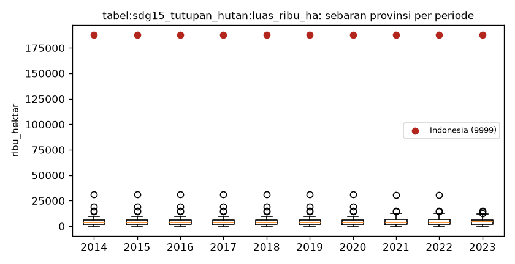
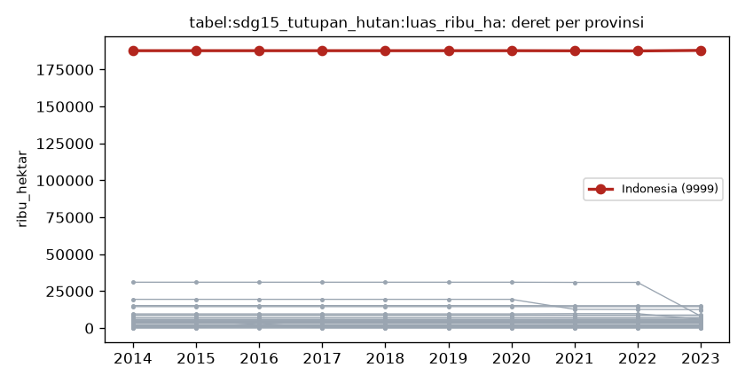
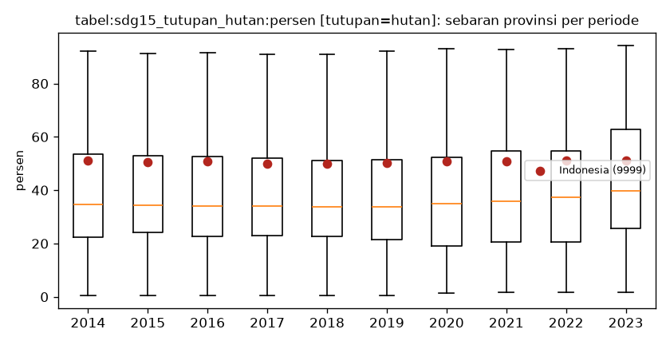
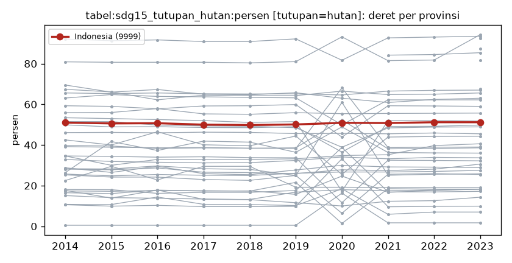
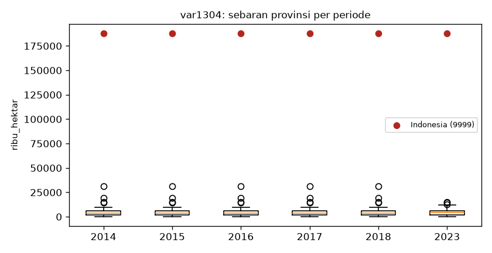
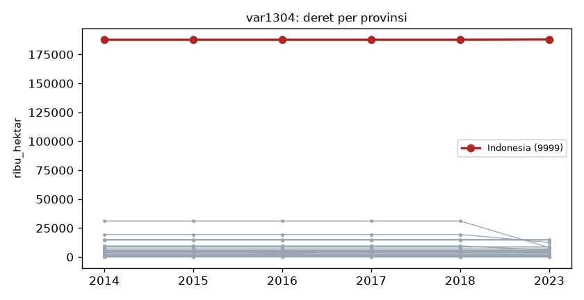
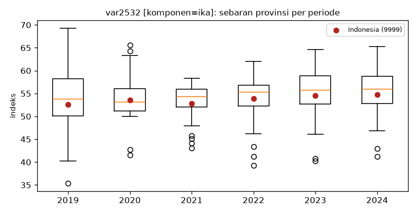
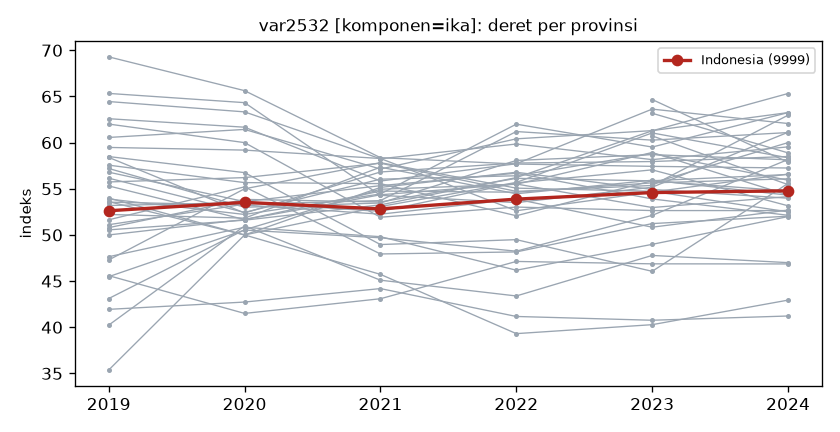
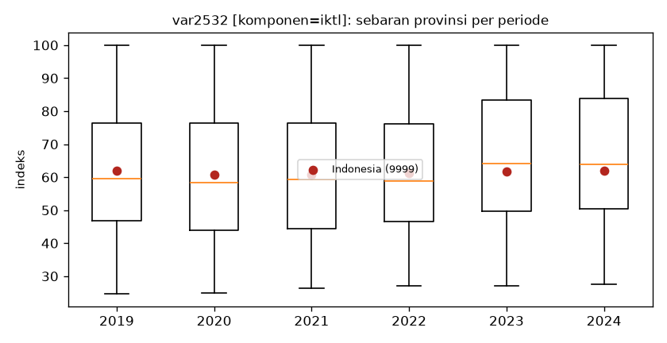
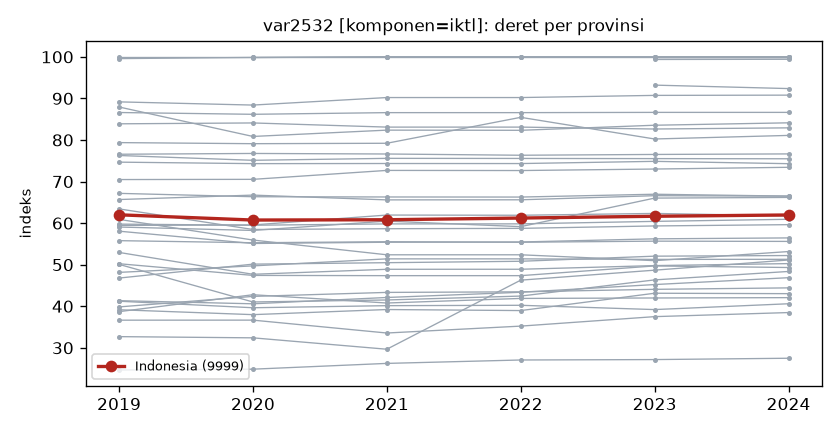
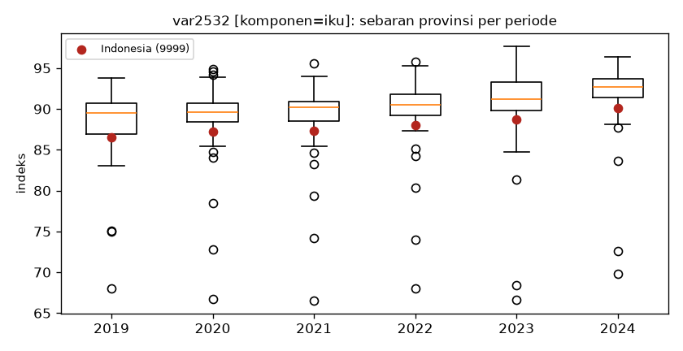
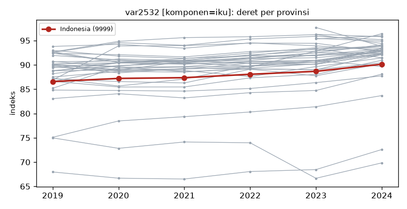
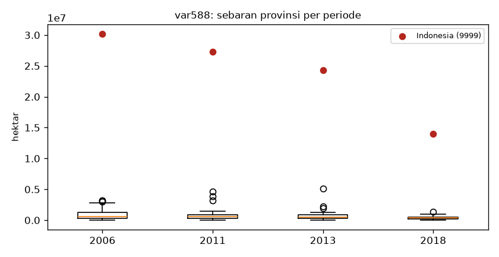
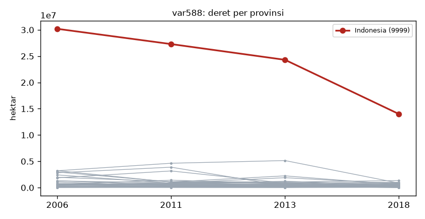
