# Profil dan calon anomali seri utama

Dihasilkan `python pipeline.py` (`src/silver/profil.py`). Hanya baris provinsi deret utama (rincian `total`, atau rincian yang didaftar di `DERET` untuk seri yang terbit per rincian; label `kode [rincian]`); baris Indonesia ditampilkan terpisah dan tidak ikut statistik antarprovinsi.

## Banyak periode per provinsi (menentukan arah pembanding)

| seri_kode | min_periode_per_provinsi | maks_periode_per_provinsi |
|---|---|---|
| var1311 | 1 | 10 |
| var1312 | 1 | 4 |
| var1410 | 2 | 11 |
| var1831 | 4 | 9 |
| var2738 | 1 | 2 |
| var2740 | 1 | 5 |

- var1311: tiga arah (periode per provinsi 1–10)
- var1312: hanya arah ke bawah dan perubahan (periode per provinsi 1–4)
- var1410: tiga arah (periode per provinsi 2–11)
- var1831: tiga arah (periode per provinsi 4–9)
- var2738: hanya arah ke bawah dan perubahan (periode per provinsi 1–2)
- var2740: hanya arah ke bawah dan perubahan (periode per provinsi 1–5)

Metode: IQR dengan pengali 1.5; arah ke samping hanya bila satu provinsi punya paling sedikit 6 periode. Sel yang ditandai lebih dari satu arah ditulis satu baris. Provinsi yang di luar batas ke bawah pada ≥ 50% periode diberi tanda `berulang`: itu perbedaan struktural antarprovinsi, bukan kejadian satu tahun. Lihat log untuk alasan memilih IQR.

## Statistik deskriptif per seri per periode (provinsi)

| seri_kode | periode | n | rerata | simpangan | minimum | q1 | median | q3 | maksimum |
|---|---|---|---|---|---|---|---|---|---|
| var1311 | 2015 | 34 | 0.06 | 0.04 | 0.00 | 0.03 | 0.06 | 0.09 | 0.18 |
| var1311 | 2016 | 34 | 0.08 | 0.05 | 0.01 | 0.04 | 0.07 | 0.10 | 0.21 |
| var1311 | 2017 | 34 | 0.11 | 0.07 | 0.01 | 0.06 | 0.09 | 0.14 | 0.30 |
| var1311 | 2018 | 34 | 0.09 | 0.05 | 0.01 | 0.06 | 0.08 | 0.12 | 0.25 |
| var1311 | 2019 | 34 | 0.06 | 0.05 | 0.00 | 0.03 | 0.06 | 0.08 | 0.29 |
| var1311 | 2020 | 27 | 0.06 | 0.05 | 0.02 | 0.04 | 0.05 | 0.07 | 0.25 |
| var1311 | 2021 | 20 | 0.04 | 0.02 | 0.02 | 0.02 | 0.04 | 0.04 | 0.12 |
| var1311 | 2022 | 22 | 0.04 | 0.02 | 0.01 | 0.02 | 0.04 | 0.06 | 0.08 |
| var1311 | 2023 | 16 | 0.04 | 0.04 | 0.01 | 0.02 | 0.03 | 0.04 | 0.18 |
| var1311 | 2024 | 20 | 0.05 | 0.04 | 0.01 | 0.03 | 0.05 | 0.06 | 0.18 |
| var1312 | 2014 | 33 | 73.20 | 4.88 | 61.42 | 69.79 | 73.96 | 76.53 | 81.68 |
| var1312 | 2017 | 34 | 54.23 | 8.48 | 34.28 | 48.82 | 53.73 | 58.73 | 73.43 |
| var1312 | 2020 | 34 | 64.58 | 8.55 | 40.17 | 59.21 | 65.25 | 69.96 | 81.90 |
| var1312 | 2025 | 38 | 83.58 | 7.31 | 53.50 | 82.19 | 85.60 | 88.05 | 91.92 |
| var1410 | 2015 | 34 | 69.08 | 15.40 | 33.80 | 60.98 | 71.07 | 79.51 | 92.98 |
| var1410 | 2016 | 34 | 69.22 | 15.50 | 30.71 | 61.49 | 70.87 | 78.60 | 94.15 |
| var1410 | 2017 | 34 | 70.32 | 15.08 | 31.55 | 61.72 | 73.02 | 79.90 | 94.78 |
| var1410 | 2018 | 34 | 69.47 | 15.18 | 29.53 | 60.84 | 72.62 | 78.01 | 93.84 |
| var1410 | 2019 | 34 | 72.50 | 13.87 | 34.12 | 64.53 | 75.07 | 80.93 | 95.24 |
| var1410 | 2020 | 34 | 75.40 | 13.31 | 36.77 | 70.02 | 78.12 | 83.21 | 95.78 |
| var1410 | 2021 | 34 | 75.31 | 13.41 | 36.79 | 72.51 | 78.83 | 83.16 | 94.41 |
| var1410 | 2022 | 34 | 79.81 | 11.36 | 46.36 | 77.19 | 82.16 | 87.31 | 95.98 |
| var1410 | 2023 | 34 | 81.44 | 11.43 | 47.60 | 79.36 | 84.60 | 87.44 | 97.17 |
| var1410 | 2024 | 38 | 79.84 | 15.70 | 17.44 | 75.36 | 85.22 | 89.20 | 97.70 |
| var1410 | 2025 | 38 | 82.18 | 13.99 | 28.19 | 79.62 | 86.31 | 90.16 | 97.25 |
| var1831 | 2015 | 34 | 79.30 | 12.18 | 38.60 | 72.37 | 81.20 | 87.40 | 95.98 |
| var1831 | 2016 | 34 | 80.97 | 11.82 | 40.54 | 75.20 | 83.63 | 87.74 | 97.30 |
| var1831 | 2017 | 34 | 82.74 | 11.09 | 44.50 | 77.30 | 86.28 | 89.49 | 97.29 |
| var1831 | 2018 | 34 | 83.03 | 11.86 | 36.32 | 77.50 | 85.81 | 90.39 | 97.40 |
| var1831 | 2019 | 34 | 85.67 | 10.37 | 45.88 | 80.77 | 89.02 | 91.90 | 97.95 |
| var1831 | 2020 | 38 | 78.46 | 28.74 | 0.00 | 82.08 | 89.83 | 93.18 | 98.36 |
| var1831 | 2021 | 38 | 78.89 | 29.01 | 0.00 | 84.29 | 90.37 | 93.35 | 98.14 |
| var1831 | 2022 | 38 | 80.50 | 29.13 | 0.00 | 87.55 | 92.06 | 94.76 | 98.17 |
| var1831 | 2023 | 38 | 81.55 | 29.54 | 0.00 | 87.87 | 92.94 | 95.11 | 98.78 |
| var2738 | 2014 | 33 | 58.01 | 9.79 | 40.93 | 51.13 | 56.65 | 65.94 | 75.98 |
| var2738 | 2020 | 34 | 52.49 | 10.41 | 34.37 | 46.06 | 51.25 | 57.38 | 81.66 |
| var2740 | 2020 | 31 | 56.96 | 17.06 | 33.70 | 44.34 | 53.50 | 68.19 | 100.00 |
| var2740 | 2021 | 22 | 60.25 | 18.40 | 32.49 | 45.99 | 56.70 | 72.79 | 100.00 |
| var2740 | 2022 | 22 | 60.91 | 20.85 | 26.14 | 42.77 | 61.89 | 75.71 | 96.48 |
| var2740 | 2023 | 26 | 64.64 | 29.03 | 0.35 | 44.88 | 68.59 | 89.72 | 100.00 |
| var2740 | 2024 | 29 | 53.57 | 22.55 | 8.70 | 34.58 | 54.05 | 70.54 | 98.49 |

## Baris Indonesia

| seri_kode | periode | nilai | rujukan_tahun |
|---|---|---|---|
| var1311 | 2015 | 0.05 | <NA> |
| var1311 | 2016 | 0.06 | <NA> |
| var1311 | 2017 | 0.09 | <NA> |
| var1311 | 2018 | 0.08 | <NA> |
| var1311 | 2019 | 0.06 | <NA> |
| var1311 | 2020 | 0.04 | <NA> |
| var1311 | 2021 | 0.03 | <NA> |
| var1311 | 2022 | 0.03 | <NA> |
| var1311 | 2023 | 0.02 | <NA> |
| var1311 | 2024 | 0.04 | <NA> |
| var1312 | 2014 | 73.57 | <NA> |
| var1312 | 2017 | 53.32 | <NA> |
| var1312 | 2020 | 62.62 | <NA> |
| var1312 | 2025 | 85.47 | <NA> |
| var2738 | 2014 | 54.80 | <NA> |
| var2738 | 2020 | 48.80 | <NA> |
| var2740 | 2020 | 52.43 | <NA> |
| var2740 | 2021 | 46.71 | <NA> |
| var2740 | 2022 | 57.75 | <NA> |
| var2740 | 2023 | 48.88 | <NA> |
| var2740 | 2024 | 39.25 | <NA> |
| var1410 | 2015 | 72.65 | <NA> |
| var1410 | 2016 | 72.54 | <NA> |
| var1410 | 2017 | 73.18 | <NA> |
| var1410 | 2018 | 71.92 | <NA> |
| var1410 | 2019 | 74.36 | <NA> |
| var1410 | 2020 | 77.20 | <NA> |
| var1410 | 2021 | 77.04 | <NA> |
| var1410 | 2022 | 81.34 | <NA> |
| var1410 | 2023 | 83.44 | <NA> |
| var1410 | 2024 | 85.07 | <NA> |
| var1410 | 2025 | 86.76 | <NA> |
| var1831 | 2015 | 79.92 | <NA> |
| var1831 | 2016 | 81.68 | <NA> |
| var1831 | 2017 | 83.33 | <NA> |
| var1831 | 2018 | 83.55 | <NA> |
| var1831 | 2019 | 86.01 | <NA> |
| var1831 | 2020 | 88.11 | <NA> |
| var1831 | 2021 | 88.42 | <NA> |
| var1831 | 2022 | 90.41 | <NA> |
| var1831 | 2023 | 91.79 | <NA> |

## Calon anomali (115)

Daftar lengkap di `reports/calon-anomali.csv`; kategorinya di `reports/anomali.csv`.

| seri_kode | wilayah_kode | nama_wilayah | periode | nilai | arah | alasan | berulang |
|---|---|---|---|---|---|---|---|
| var1311 | 9100 | Papua Barat | 2015 | 0.18 | ke bawah | di luar [-0.06, 0.17] (IQR x 1.5) dibanding 34 provinsi tahun itu | True |
| var1311 | 1200 | Sumatera Utara | 2016 | 0.11 | perubahan | perubahan 2015→2016 sebesar +0.08 di luar [-0.04, 0.07] | False |
| var1311 | 1900 | Kepulauan Bangka Belitung | 2016 | 0.01 | perubahan | perubahan 2015→2016 sebesar -0.05 di luar [-0.04, 0.07] | False |
| var1311 | 2100 | Kepulauan Riau | 2016 | 0.19 | perubahan + ke samping | perubahan 2015→2016 sebesar +0.15 di luar [-0.04, 0.07]; di luar [-0.03, 0.17] dibanding 6 tahun di provinsi ini | False |
| var1311 | 7500 | Gorontalo | 2016 | 0.17 | perubahan | perubahan 2015→2016 sebesar +0.08 di luar [-0.04, 0.07] | False |
| var1311 | 9100 | Papua Barat | 2016 | 0.21 | ke bawah | di luar [-0.05, 0.19] (IQR x 1.5) dibanding 34 provinsi tahun itu | True |
| var1311 | 9400 | Papua | 2016 | 0.20 | ke bawah | di luar [-0.05, 0.19] (IQR x 1.5) dibanding 34 provinsi tahun itu | True |
| var1311 | 2100 | Kepulauan Riau | 2017 | 0.10 | perubahan | perubahan 2016→2017 sebesar -0.09 di luar [-0.04, 0.09] | False |
| var1311 | 3200 | Jawa Barat | 2017 | 0.09 | ke samping | di luar [0.01, 0.08] dibanding 10 tahun di provinsi ini | False |
| var1311 | 3400 | DI Yogyakarta | 2017 | 0.18 | perubahan + ke samping | perubahan 2016→2017 sebesar +0.11 di luar [-0.04, 0.09]; di luar [0.02, 0.17] dibanding 8 tahun di provinsi ini | False |
| var1311 | 5200 | Nusa Tenggara Barat | 2017 | 0.20 | perubahan + ke samping | perubahan 2016→2017 sebesar +0.11 di luar [-0.04, 0.09]; di luar [-0.05, 0.17] dibanding 10 tahun di provinsi ini | False |
| var1311 | 7200 | Sulawesi Tengah | 2017 | 0.23 | perubahan + ke samping | perubahan 2016→2017 sebesar +0.13 di luar [-0.04, 0.09]; di luar [-0.05, 0.21] dibanding 7 tahun di provinsi ini | False |
| var1311 | 7400 | Sulawesi Tenggara | 2017 | 0.25 | perubahan + ke samping | perubahan 2016→2017 sebesar +0.18 di luar [-0.04, 0.09]; di luar [-0.01, 0.12] dibanding 10 tahun di provinsi ini | False |
| var1311 | 7500 | Gorontalo | 2017 | 0.13 | perubahan | perubahan 2016→2017 sebesar -0.04 di luar [-0.04, 0.09] | False |
| var1311 | 8200 | Maluku Utara | 2017 | 0.19 | perubahan + ke samping | perubahan 2016→2017 sebesar +0.11 di luar [-0.04, 0.09]; di luar [-0.03, 0.16] dibanding 7 tahun di provinsi ini | False |
| var1311 | 9100 | Papua Barat | 2017 | 0.27 | ke bawah | di luar [-0.06, 0.25] (IQR x 1.5) dibanding 34 provinsi tahun itu | True |
| var1311 | 9400 | Papua | 2017 | 0.30 | ke bawah + perubahan | di luar [-0.06, 0.25] (IQR x 1.5) dibanding 34 provinsi tahun itu; perubahan 2016→2017 sebesar +0.10 di luar [-0.04, 0.09] | True |
| var1311 | 1400 | Riau | 2018 | 0.10 | ke samping | di luar [0.01, 0.10] dibanding 8 tahun di provinsi ini | False |
| var1311 | 7400 | Sulawesi Tenggara | 2018 | 0.07 | perubahan | perubahan 2017→2018 sebesar -0.18 di luar [-0.13, 0.10] | False |
| var1311 | 8200 | Maluku Utara | 2018 | 0.05 | perubahan | perubahan 2017→2018 sebesar -0.14 di luar [-0.13, 0.10] | False |
| var1311 | 9100 | Papua Barat | 2018 | 0.25 | ke bawah | di luar [-0.03, 0.20] (IQR x 1.5) dibanding 34 provinsi tahun itu | True |
| var1311 | 9400 | Papua | 2018 | 0.23 | ke bawah | di luar [-0.03, 0.20] (IQR x 1.5) dibanding 34 provinsi tahun itu | True |
| var1311 | 9100 | Papua Barat | 2019 | 0.29 | ke bawah | di luar [-0.05, 0.16] (IQR x 1.5) dibanding 34 provinsi tahun itu | True |
| var1311 | 8100 | Maluku | 2020 | 0.17 | ke bawah + perubahan | di luar [-0.01, 0.12] (IQR x 1.5) dibanding 27 provinsi tahun itu; perubahan 2019→2020 sebesar +0.09 di luar [-0.10, 0.08] | False |
| var1311 | 9100 | Papua Barat | 2020 | 0.25 | ke bawah | di luar [-0.01, 0.12] (IQR x 1.5) dibanding 27 provinsi tahun itu | True |
| var1311 | 8100 | Maluku | 2021 | 0.06 | perubahan | perubahan 2020→2021 sebesar -0.11 di luar [-0.07, 0.03] | False |
| var1311 | 9100 | Papua Barat | 2021 | 0.12 | ke bawah + perubahan | di luar [-0.01, 0.08] (IQR x 1.5) dibanding 20 provinsi tahun itu; perubahan 2020→2021 sebesar -0.13 di luar [-0.07, 0.03] | True |
| var1311 | 9100 | Papua Barat | 2022 | 0.07 | perubahan | perubahan 2021→2022 sebesar -0.05 di luar [-0.03, 0.04] | True |
| var1311 | 1700 | Bengkulu | 2023 | 0.04 | perubahan | perubahan 2022→2023 sebesar -0.04 di luar [-0.03, 0.03] | False |
| var1311 | 8100 | Maluku | 2023 | 0.02 | perubahan | perubahan 2022→2023 sebesar -0.04 di luar [-0.03, 0.03] | False |
| var1311 | 9400 | Papua | 2023 | 0.18 | ke bawah + perubahan | di luar [-0.01, 0.07] (IQR x 1.5) dibanding 16 provinsi tahun itu; perubahan 2022→2023 sebesar +0.12 di luar [-0.03, 0.03] | True |
| var1311 | 9400 | Papua | 2024 | 0.18 | ke bawah | di luar [-0.02, 0.11] (IQR x 1.5) dibanding 20 provinsi tahun itu | True |
| var1312 | 2100 | Kepulauan Riau | 2017 | 71.43 | perubahan | perubahan 2014→2017 sebesar -5.10 di luar [-33.37, -6.62] | False |
| var1312 | 5100 | Bali | 2017 | 73.43 | perubahan | perubahan 2014→2017 sebesar -3.63 di luar [-33.37, -6.62] | False |
| var1312 | 9400 | Papua | 2017 | 58.69 | perubahan | perubahan 2014→2017 sebesar -6.03 di luar [-33.37, -6.62] | False |
| var1312 | 3100 | DKI Jakarta | 2020 | 40.17 | ke bawah + perubahan | di luar [43.09, 86.08] (IQR x 1.5) dibanding 34 provinsi tahun itu; perubahan 2017→2020 sebesar -10.40 di luar [-1.83, 23.89] | False |
| var1312 | 3100 | DKI Jakarta | 2025 | 81.52 | perubahan | perubahan 2020→2025 sebesar +41.35 di luar [7.02, 34.74] | False |
| var1312 | 5100 | Bali | 2025 | 86.74 | perubahan | perubahan 2020→2025 sebesar +4.84 di luar [7.02, 34.74] | False |
| var1312 | 7500 | Gorontalo | 2025 | 69.02 | ke bawah | di luar [73.41, 96.84] (IQR x 1.5) dibanding 38 provinsi tahun itu | False |
| var1312 | 9200 | Papua Barat Daya | 2025 | 69.15 | ke bawah | di luar [73.41, 96.84] (IQR x 1.5) dibanding 38 provinsi tahun itu | False |
| var1312 | 9600 | Papua Tengah | 2025 | 53.50 | ke bawah | di luar [73.41, 96.84] (IQR x 1.5) dibanding 38 provinsi tahun itu | False |
| var1410 | 5300 | Nusa Tenggara Timur | 2016 | 30.71 | ke bawah | di luar [35.83, 104.26] (IQR x 1.5) dibanding 34 provinsi tahun itu | True |
| var1410 | 1100 | Aceh | 2017 | 78.10 | perubahan | perubahan 2016→2017 sebesar +7.46 di luar [-3.36, 5.88] | False |
| var1410 | 2100 | Kepulauan Riau | 2017 | 86.14 | perubahan | perubahan 2016→2017 sebesar -4.04 di luar [-3.36, 5.88] | False |
| var1410 | 5300 | Nusa Tenggara Timur | 2017 | 31.55 | ke bawah | di luar [34.44, 107.17] (IQR x 1.5) dibanding 34 provinsi tahun itu | True |
| var1410 | 5300 | Nusa Tenggara Timur | 2018 | 32.89 | ke bawah | di luar [35.07, 103.77] (IQR x 1.5) dibanding 34 provinsi tahun itu | True |
| var1410 | 9400 | Papua | 2018 | 29.53 | ke bawah + perubahan | di luar [35.07, 103.77] (IQR x 1.5) dibanding 34 provinsi tahun itu; perubahan 2017→2018 sebesar -10.28 di luar [-6.90, 5.35] | False |
| var1410 | 5300 | Nusa Tenggara Timur | 2019 | 34.12 | ke bawah | di luar [39.93, 105.53] (IQR x 1.5) dibanding 34 provinsi tahun itu | True |
| var1410 | 8100 | Maluku | 2019 | 51.60 | perubahan | perubahan 2018→2019 sebesar +8.36 di luar [-2.27, 8.35] | False |
| var1410 | 9400 | Papua | 2019 | 40.53 | perubahan | perubahan 2018→2019 sebesar +11.00 di luar [-2.27, 8.35] | False |
| var1410 | 5300 | Nusa Tenggara Timur | 2020 | 36.77 | ke bawah | di luar [50.24, 102.99] (IQR x 1.5) dibanding 34 provinsi tahun itu | True |
| var1410 | 7200 | Sulawesi Tengah | 2020 | 66.14 | perubahan | perubahan 2019→2020 sebesar +7.98 di luar [-1.03, 6.50] | False |
| var1410 | 9400 | Papua | 2020 | 42.02 | ke bawah | di luar [50.24, 102.99] (IQR x 1.5) dibanding 34 provinsi tahun itu | False |
| var1410 | 5300 | Nusa Tenggara Timur | 2021 | 39.34 | ke bawah | di luar [56.54, 99.12] (IQR x 1.5) dibanding 34 provinsi tahun itu | True |
| var1410 | 8100 | Maluku | 2021 | 53.08 | ke bawah | di luar [56.54, 99.12] (IQR x 1.5) dibanding 34 provinsi tahun itu | False |
| var1410 | 9100 | Papua Barat | 2021 | 54.49 | ke bawah | di luar [56.54, 99.12] (IQR x 1.5) dibanding 34 provinsi tahun itu | False |
| var1410 | 9400 | Papua | 2021 | 36.79 | ke bawah | di luar [56.54, 99.12] (IQR x 1.5) dibanding 34 provinsi tahun itu | False |
| var1410 | 5300 | Nusa Tenggara Timur | 2022 | 46.36 | ke bawah | di luar [62.00, 102.50] (IQR x 1.5) dibanding 34 provinsi tahun itu | True |
| var1410 | 9100 | Papua Barat | 2022 | 60.14 | ke bawah | di luar [62.00, 102.50] (IQR x 1.5) dibanding 34 provinsi tahun itu | False |
| var1410 | 9400 | Papua | 2022 | 50.26 | ke bawah + perubahan | di luar [62.00, 102.50] (IQR x 1.5) dibanding 34 provinsi tahun itu; perubahan 2021→2022 sebesar +13.47 di luar [-3.16, 11.66] | False |
| var1410 | 5300 | Nusa Tenggara Timur | 2023 | 51.10 | ke bawah | di luar [67.24, 99.56] (IQR x 1.5) dibanding 34 provinsi tahun itu | True |
| var1410 | 8100 | Maluku | 2023 | 66.32 | ke bawah | di luar [67.24, 99.56] (IQR x 1.5) dibanding 34 provinsi tahun itu | False |
| var1410 | 9100 | Papua Barat | 2023 | 60.35 | ke bawah | di luar [67.24, 99.56] (IQR x 1.5) dibanding 34 provinsi tahun itu | False |
| var1410 | 9400 | Papua | 2023 | 47.60 | ke bawah | di luar [67.24, 99.56] (IQR x 1.5) dibanding 34 provinsi tahun itu | False |
| var1410 | 5300 | Nusa Tenggara Timur | 2024 | 57.29 | perubahan | perubahan 2023→2024 sebesar +6.19 di luar [-2.90, 6.08] | True |
| var1410 | 9400 | Papua | 2024 | 68.71 | perubahan + ke samping | perubahan 2023→2024 sebesar +21.11 di luar [-2.90, 6.08]; di luar [21.54, 65.36] dibanding 11 tahun di provinsi ini | False |
| var1410 | 9500 | Papua Selatan | 2024 | 47.27 | ke bawah | di luar [54.60, 109.95] (IQR x 1.5) dibanding 38 provinsi tahun itu | True |
| var1410 | 9700 | Papua Pegunungan | 2024 | 17.44 | ke bawah | di luar [54.60, 109.95] (IQR x 1.5) dibanding 38 provinsi tahun itu | True |
| var1410 | 5300 | Nusa Tenggara Timur | 2025 | 55.24 | ke bawah | di luar [63.81, 105.98] (IQR x 1.5) dibanding 38 provinsi tahun itu | True |
| var1410 | 9400 | Papua | 2025 | 70.61 | ke samping | di luar [21.54, 65.36] dibanding 11 tahun di provinsi ini | False |
| var1410 | 9500 | Papua Selatan | 2025 | 57.77 | ke bawah + perubahan | di luar [63.81, 105.98] (IQR x 1.5) dibanding 38 provinsi tahun itu; perubahan 2024→2025 sebesar +10.50 di luar [-3.21, 7.21] | True |
| var1410 | 9600 | Papua Tengah | 2025 | 62.03 | ke bawah | di luar [63.81, 105.98] (IQR x 1.5) dibanding 38 provinsi tahun itu | False |
| var1410 | 9700 | Papua Pegunungan | 2025 | 28.19 | ke bawah + perubahan | di luar [63.81, 105.98] (IQR x 1.5) dibanding 38 provinsi tahun itu; perubahan 2024→2025 sebesar +10.75 di luar [-3.21, 7.21] | True |
| var1831 | 3400 | DI Yogyakarta | 2015 | 95.98 | ke samping | di luar [95.99, 99.48] dibanding 9 tahun di provinsi ini | False |
| var1831 | 9400 | Papua | 2015 | 38.60 | ke bawah | di luar [49.82, 109.95] (IQR x 1.5) dibanding 34 provinsi tahun itu | True |
| var1831 | 1700 | Bengkulu | 2016 | 86.47 | perubahan | perubahan 2015→2016 sebesar -1.45 di luar [-1.15, 4.44] | False |
| var1831 | 5200 | Nusa Tenggara Barat | 2016 | 73.25 | perubahan | perubahan 2015→2016 sebesar +4.91 di luar [-1.15, 4.44] | False |
| var1831 | 5300 | Nusa Tenggara Timur | 2016 | 53.66 | ke bawah | di luar [56.39, 106.54] (IQR x 1.5) dibanding 34 provinsi tahun itu | True |
| var1831 | 9400 | Papua | 2016 | 40.54 | ke bawah | di luar [56.39, 106.54] (IQR x 1.5) dibanding 34 provinsi tahun itu | True |
| var1831 | 5300 | Nusa Tenggara Timur | 2017 | 56.65 | ke bawah | di luar [59.00, 107.79] (IQR x 1.5) dibanding 34 provinsi tahun itu | True |
| var1831 | 9400 | Papua | 2017 | 44.50 | ke bawah | di luar [59.00, 107.79] (IQR x 1.5) dibanding 34 provinsi tahun itu | True |
| var1831 | 1300 | Sumatera Barat | 2018 | 85.35 | perubahan | perubahan 2017→2018 sebesar +5.28 di luar [-3.11, 3.83] | False |
| var1831 | 2100 | Kepulauan Riau | 2018 | 92.95 | ke samping | di luar [93.05, 96.12] dibanding 9 tahun di provinsi ini | False |
| var1831 | 5200 | Nusa Tenggara Barat | 2018 | 79.65 | perubahan | perubahan 2017→2018 sebesar +4.99 di luar [-3.11, 3.83] | False |
| var1831 | 9400 | Papua | 2018 | 36.32 | ke bawah + perubahan | di luar [58.16, 109.72] (IQR x 1.5) dibanding 34 provinsi tahun itu; perubahan 2017→2018 sebesar -8.18 di luar [-3.11, 3.83] | True |
| var1831 | 5300 | Nusa Tenggara Timur | 2019 | 61.08 | ke bawah | di luar [64.06, 108.61] (IQR x 1.5) dibanding 34 provinsi tahun itu | True |
| var1831 | 9400 | Papua | 2019 | 45.88 | ke bawah + perubahan | di luar [64.06, 108.61] (IQR x 1.5) dibanding 34 provinsi tahun itu; perubahan 2018→2019 sebesar +9.56 di luar [-2.08, 6.82] | True |
| var1831 | 5300 | Nusa Tenggara Timur | 2020 | 63.33 | ke bawah | di luar [65.42, 109.84] (IQR x 1.5) dibanding 38 provinsi tahun itu | True |
| var1831 | 7200 | Sulawesi Tengah | 2020 | 83.37 | perubahan | perubahan 2019→2020 sebesar +5.35 di luar [-1.03, 4.77] | False |
| var1831 | 9200 | Papua Barat Daya | 2020 | 0.00 | ke bawah | di luar [65.42, 109.84] (IQR x 1.5) dibanding 38 provinsi tahun itu | True |
| var1831 | 9400 | Papua | 2020 | 50.40 | ke bawah | di luar [65.42, 109.84] (IQR x 1.5) dibanding 38 provinsi tahun itu | True |
| var1831 | 9500 | Papua Selatan | 2020 | 0.00 | ke bawah | di luar [65.42, 109.84] (IQR x 1.5) dibanding 38 provinsi tahun itu | True |
| var1831 | 9600 | Papua Tengah | 2020 | 0.00 | ke bawah | di luar [65.42, 109.84] (IQR x 1.5) dibanding 38 provinsi tahun itu | True |
| var1831 | 9700 | Papua Pegunungan | 2020 | 0.00 | ke bawah | di luar [65.42, 109.84] (IQR x 1.5) dibanding 38 provinsi tahun itu | True |
| var1831 | 5300 | Nusa Tenggara Timur | 2021 | 65.66 | ke bawah | di luar [70.71, 106.93] (IQR x 1.5) dibanding 38 provinsi tahun itu | True |
| var1831 | 9200 | Papua Barat Daya | 2021 | 0.00 | ke bawah | di luar [70.71, 106.93] (IQR x 1.5) dibanding 38 provinsi tahun itu | True |
| var1831 | 9400 | Papua | 2021 | 45.19 | ke bawah + perubahan | di luar [70.71, 106.93] (IQR x 1.5) dibanding 38 provinsi tahun itu; perubahan 2020→2021 sebesar -5.21 di luar [-3.82, 5.07] | True |
| var1831 | 9500 | Papua Selatan | 2021 | 0.00 | ke bawah | di luar [70.71, 106.93] (IQR x 1.5) dibanding 38 provinsi tahun itu | True |
| var1831 | 9600 | Papua Tengah | 2021 | 0.00 | ke bawah | di luar [70.71, 106.93] (IQR x 1.5) dibanding 38 provinsi tahun itu | True |
| var1831 | 9700 | Papua Pegunungan | 2021 | 0.00 | ke bawah | di luar [70.71, 106.93] (IQR x 1.5) dibanding 38 provinsi tahun itu | True |
| var1831 | 5300 | Nusa Tenggara Timur | 2022 | 69.47 | ke bawah | di luar [76.74, 105.58] (IQR x 1.5) dibanding 38 provinsi tahun itu | True |
| var1831 | 6400 | Kalimantan Timur | 2022 | 95.24 | ke samping | di luar [90.75, 94.95] dibanding 9 tahun di provinsi ini | False |
| var1831 | 9200 | Papua Barat Daya | 2022 | 0.00 | ke bawah | di luar [76.74, 105.58] (IQR x 1.5) dibanding 38 provinsi tahun itu | True |
| var1831 | 9400 | Papua | 2022 | 53.77 | ke bawah + perubahan | di luar [76.74, 105.58] (IQR x 1.5) dibanding 38 provinsi tahun itu; perubahan 2021→2022 sebesar +8.58 di luar [-3.18, 5.90] | True |
| var1831 | 9500 | Papua Selatan | 2022 | 0.00 | ke bawah | di luar [76.74, 105.58] (IQR x 1.5) dibanding 38 provinsi tahun itu | True |
| var1831 | 9600 | Papua Tengah | 2022 | 0.00 | ke bawah | di luar [76.74, 105.58] (IQR x 1.5) dibanding 38 provinsi tahun itu | True |
| var1831 | 9700 | Papua Pegunungan | 2022 | 0.00 | ke bawah | di luar [76.74, 105.58] (IQR x 1.5) dibanding 38 provinsi tahun itu | True |
| var1831 | 5300 | Nusa Tenggara Timur | 2023 | 73.94 | ke bawah + perubahan | di luar [76.99, 105.98] (IQR x 1.5) dibanding 38 provinsi tahun itu; perubahan 2022→2023 sebesar +4.47 di luar [-1.54, 3.56] | True |
| var1831 | 6400 | Kalimantan Timur | 2023 | 96.38 | ke samping | di luar [90.75, 94.95] dibanding 9 tahun di provinsi ini | False |
| var1831 | 9200 | Papua Barat Daya | 2023 | 0.00 | ke bawah | di luar [76.99, 105.98] (IQR x 1.5) dibanding 38 provinsi tahun itu | True |
| var1831 | 9400 | Papua | 2023 | 50.85 | ke bawah + perubahan | di luar [76.99, 105.98] (IQR x 1.5) dibanding 38 provinsi tahun itu; perubahan 2022→2023 sebesar -2.92 di luar [-1.54, 3.56] | True |
| var1831 | 9500 | Papua Selatan | 2023 | 0.00 | ke bawah | di luar [76.99, 105.98] (IQR x 1.5) dibanding 38 provinsi tahun itu | True |
| var1831 | 9600 | Papua Tengah | 2023 | 0.00 | ke bawah | di luar [76.99, 105.98] (IQR x 1.5) dibanding 38 provinsi tahun itu | True |
| var1831 | 9700 | Papua Pegunungan | 2023 | 0.00 | ke bawah | di luar [76.99, 105.98] (IQR x 1.5) dibanding 38 provinsi tahun itu | True |
| var2738 | 5300 | Nusa Tenggara Timur | 2020 | 81.66 | ke bawah | di luar [29.10, 74.34] (IQR x 1.5) dibanding 34 provinsi tahun itu | False |

## Gambar

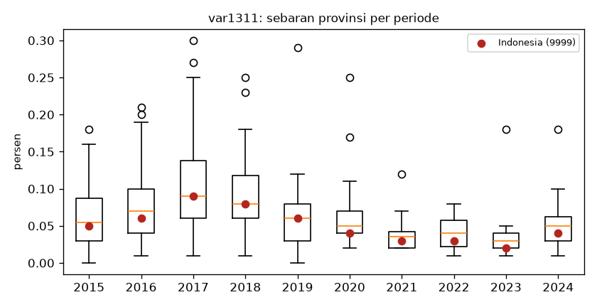
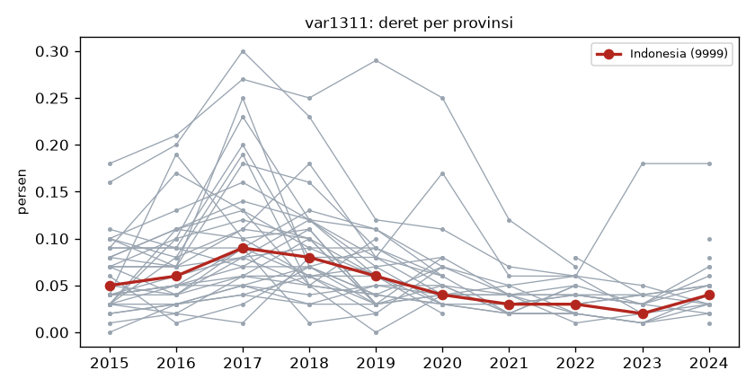
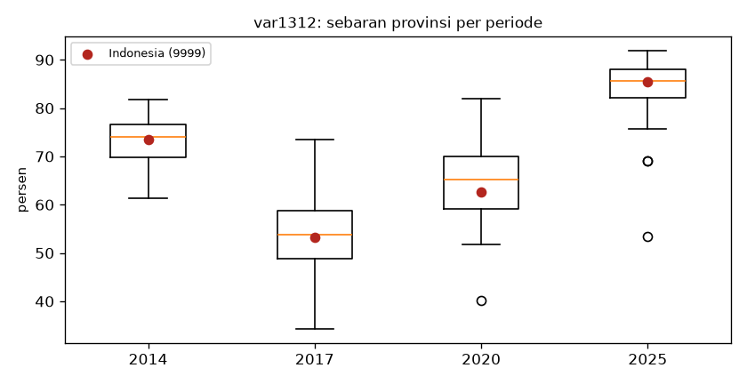
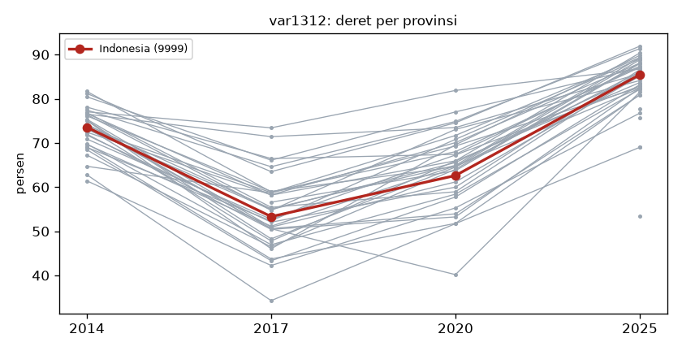
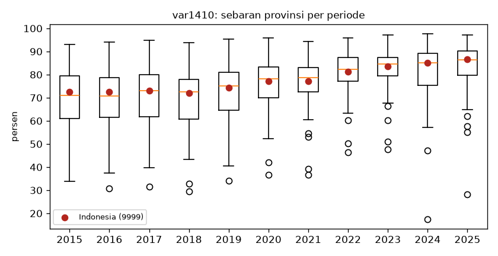
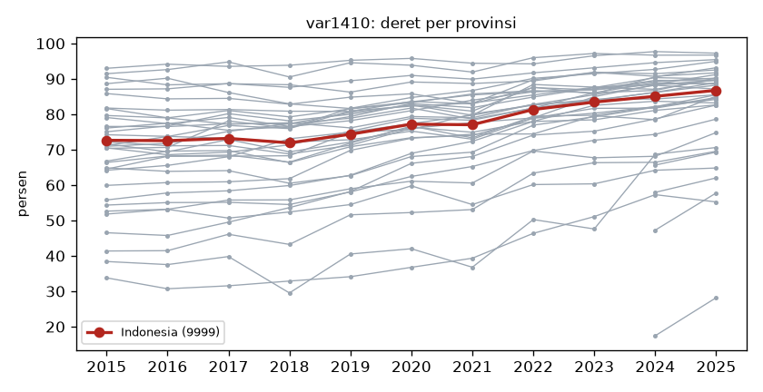
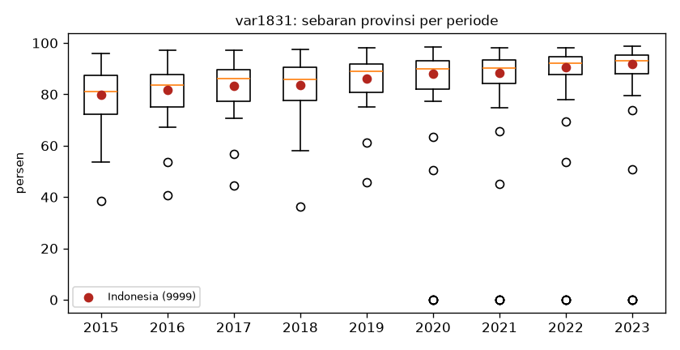
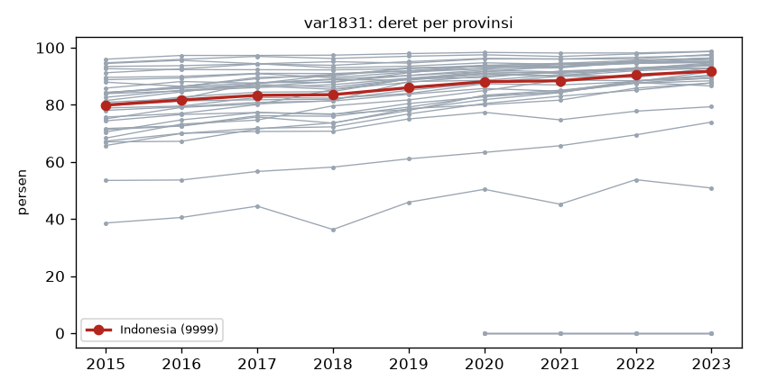
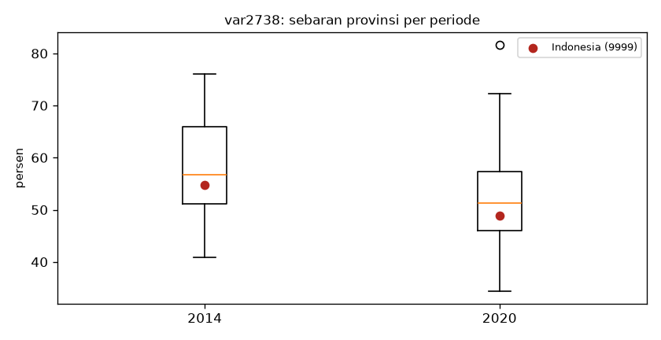
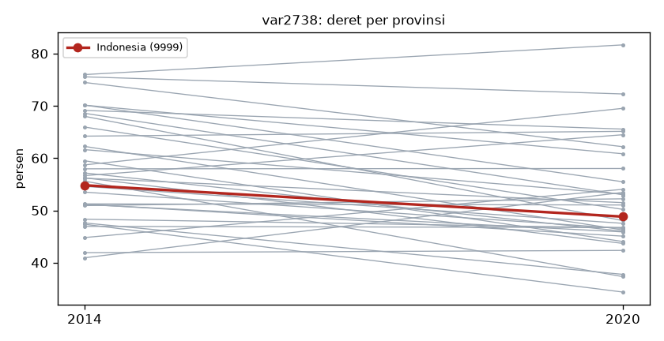
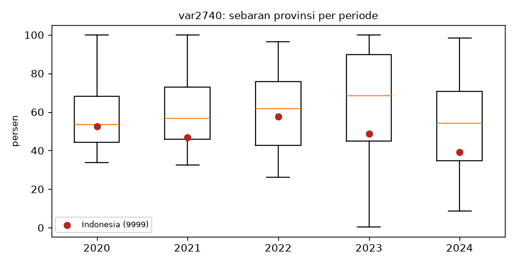
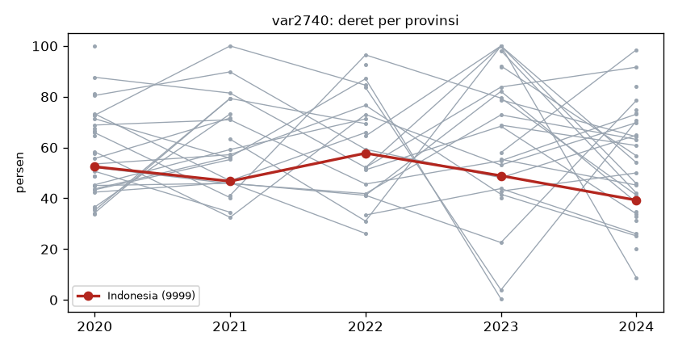
