# Profil dan calon anomali seri utama

Dihasilkan `python pipeline.py` (`src/silver/profil.py`). Hanya baris provinsi deret utama (rincian `total`, atau rincian yang didaftar di `DERET` untuk seri yang terbit per rincian; label `kode [rincian]`); baris Indonesia ditampilkan terpisah dan tidak ikut statistik antarprovinsi.

## Banyak periode per provinsi (menentukan arah pembanding)

| seri_kode | min_periode_per_provinsi | maks_periode_per_provinsi |
|---|---|---|
| jumlah_penduduk | 1 | 1 |
| kejadian [jumlah] | 16 | 16 |
| korban_hilang [jumlah] | 2 | 4 |
| korban_luka_sakit [jumlah] | 2 | 4 |
| korban_mengungsi [jumlah] | 2 | 2 |
| korban_mengungsi_per_100rb [jumlah] | 1 | 1 |
| korban_meninggal [jumlah] | 2 | 4 |
| korban_meninggal_hilang_per_100rb [jumlah] | 1 | 1 |
| korban_terdampak [jumlah] | 2 | 2 |
| korban_terdampak_mengungsi [jumlah] | 2 | 2 |

- jumlah_penduduk: hanya arah ke bawah dan perubahan (periode per provinsi 1–1)
- kejadian [jumlah]: tiga arah (periode per provinsi 16–16)
- korban_hilang [jumlah]: hanya arah ke bawah dan perubahan (periode per provinsi 2–4)
- korban_luka_sakit [jumlah]: hanya arah ke bawah dan perubahan (periode per provinsi 2–4)
- korban_mengungsi [jumlah]: hanya arah ke bawah dan perubahan (periode per provinsi 2–2)
- korban_mengungsi_per_100rb [jumlah]: hanya arah ke bawah dan perubahan (periode per provinsi 1–1)
- korban_meninggal [jumlah]: hanya arah ke bawah dan perubahan (periode per provinsi 2–4)
- korban_meninggal_hilang_per_100rb [jumlah]: hanya arah ke bawah dan perubahan (periode per provinsi 1–1)
- korban_terdampak [jumlah]: hanya arah ke bawah dan perubahan (periode per provinsi 2–2)
- korban_terdampak_mengungsi [jumlah]: hanya arah ke bawah dan perubahan (periode per provinsi 2–2)

Metode: IQR dengan pengali 1.5 pada skala log(1 + nilai) (cacah sangat menceng; batas ditulis kembali dalam satuan asli); arah ke samping hanya bila satu provinsi punya paling sedikit 6 periode. Sel yang ditandai lebih dari satu arah ditulis satu baris. Provinsi yang di luar batas ke bawah pada ≥ 50% periode diberi tanda `berulang`: itu perbedaan struktural antarprovinsi, bukan kejadian satu tahun. Lihat log untuk alasan memilih IQR.

## Statistik deskriptif per seri per periode (provinsi)

| seri_kode | periode | n | rerata | simpangan | minimum | q1 | median | q3 | maksimum |
|---|---|---|---|---|---|---|---|---|---|
| jumlah_penduduk | 2025 | 38 | 7,485,226.32 | 11,416,685.67 | 549,700.00 | 1,531,675.00 | 3,775,000.00 | 6,586,975.00 | 50,759,000.00 |
| kejadian [jumlah] | 2010 | 38 | 51.24 | 97.85 | 0.00 | 3.50 | 20.50 | 42.00 | 450.00 |
| kejadian [jumlah] | 2011 | 38 | 42.68 | 87.71 | 0.00 | 8.25 | 19.00 | 32.75 | 467.00 |
| kejadian [jumlah] | 2012 | 38 | 46.87 | 69.48 | 0.00 | 8.00 | 15.50 | 62.25 | 341.00 |
| kejadian [jumlah] | 2013 | 38 | 43.87 | 60.67 | 0.00 | 11.50 | 28.00 | 51.50 | 278.00 |
| kejadian [jumlah] | 2014 | 38 | 51.68 | 105.28 | 0.00 | 8.25 | 18.50 | 49.25 | 553.00 |
| kejadian [jumlah] | 2015 | 38 | 44.58 | 82.63 | 0.00 | 6.25 | 17.50 | 41.50 | 390.00 |
| kejadian [jumlah] | 2016 | 38 | 60.74 | 121.82 | 0.00 | 11.25 | 19.00 | 41.75 | 600.00 |
| kejadian [jumlah] | 2017 | 38 | 75.47 | 185.48 | 0.00 | 11.25 | 28.50 | 58.25 | 1,071.00 |
| kejadian [jumlah] | 2018 | 38 | 89.66 | 128.68 | 0.00 | 10.25 | 33.00 | 111.75 | 585.00 |
| kejadian [jumlah] | 2019 | 38 | 100.58 | 200.78 | 0.00 | 18.25 | 32.50 | 69.50 | 926.00 |
| kejadian [jumlah] | 2020 | 38 | 122.34 | 220.43 | 0.00 | 19.25 | 54.50 | 102.00 | 1,021.00 |
| kejadian [jumlah] | 2021 | 38 | 142.18 | 234.78 | 0.00 | 39.25 | 84.00 | 140.75 | 1,358.00 |
| kejadian [jumlah] | 2022 | 38 | 93.37 | 157.57 | 0.00 | 23.00 | 45.00 | 92.25 | 825.00 |
| kejadian [jumlah] | 2023 | 38 | 142.24 | 178.69 | 1.00 | 39.25 | 89.00 | 171.75 | 844.00 |
| kejadian [jumlah] | 2024 | 38 | 91.45 | 113.64 | 3.00 | 22.25 | 55.50 | 97.75 | 457.00 |
| kejadian [jumlah] | 2025 | 38 | 124.42 | 131.96 | 1.00 | 38.25 | 86.50 | 144.00 | 586.00 |
| korban_hilang [jumlah] | 2021 | 34 | 2.56 | 8.23 | 0.00 | 0.00 | 0.00 | 1.00 | 47.00 |
| korban_hilang [jumlah] | 2022 | 34 | 1.09 | 2.38 | 0.00 | 0.00 | 0.00 | 1.75 | 12.00 |
| korban_hilang [jumlah] | 2024 | 38 | 1.66 | 4.37 | 0.00 | 0.00 | 0.00 | 1.00 | 21.00 |
| korban_hilang [jumlah] | 2025 | 38 | 5.63 | 13.82 | 0.00 | 0.00 | 0.00 | 3.00 | 70.00 |
| korban_luka_sakit [jumlah] | 2021 | 34 | 438.68 | 1,904.69 | 0.00 | 3.50 | 7.50 | 85.25 | 11,126.00 |
| korban_luka_sakit [jumlah] | 2022 | 34 | 256.85 | 1,355.14 | 0.00 | 1.00 | 5.00 | 14.75 | 7,913.00 |
| korban_luka_sakit [jumlah] | 2024 | 38 | 303.45 | 1,723.66 | 0.00 | 1.25 | 3.50 | 17.75 | 10,645.00 |
| korban_luka_sakit [jumlah] | 2025 | 38 | 178.92 | 876.91 | 0.00 | 1.00 | 4.50 | 21.75 | 5,419.00 |
| korban_mengungsi [jumlah] | 2024 | 38 | 13,908.24 | 25,450.20 | 0.00 | 204.25 | 2,615.00 | 13,504.25 | 109,647.00 |
| korban_mengungsi [jumlah] | 2025 | 38 | 30,389.55 | 153,012.36 | 0.00 | 332.25 | 1,807.00 | 9,998.50 | 947,399.00 |
| korban_mengungsi_per_100rb [jumlah] | 2025 | 38 | 585.64 | 2,735.30 | 0.00 | 9.46 | 39.91 | 128.10 | 16,839.66 |
| korban_meninggal [jumlah] | 2021 | 34 | 21.41 | 41.18 | 0.00 | 2.00 | 5.50 | 12.00 | 190.00 |
| korban_meninggal [jumlah] | 2022 | 34 | 25.24 | 109.75 | 0.00 | 1.00 | 3.50 | 10.00 | 645.00 |
| korban_meninggal [jumlah] | 2024 | 38 | 14.21 | 23.62 | 0.00 | 2.00 | 4.00 | 17.00 | 119.00 |
| korban_meninggal [jumlah] | 2025 | 38 | 43.84 | 114.55 | 0.00 | 3.00 | 6.00 | 16.75 | 566.00 |
| korban_meninggal_hilang_per_100rb [jumlah] | 2025 | 38 | 0.85 | 1.97 | 0.00 | 0.06 | 0.19 | 0.46 | 10.59 |
| korban_terdampak [jumlah] | 2024 | 38 | 200,204.16 | 315,689.58 | 7.00 | 16,291.25 | 57,149.00 | 247,192.75 | 1,589,398.00 |
| korban_terdampak [jumlah] | 2025 | 38 | 288,297.76 | 538,114.79 | 1,170.00 | 21,959.50 | 68,423.00 | 285,436.25 | 2,614,072.00 |
| korban_terdampak_mengungsi [jumlah] | 2021 | 34 | 243,101.82 | 372,522.08 | 479.00 | 23,744.50 | 57,270.50 | 287,657.25 | 1,470,484.00 |
| korban_terdampak_mengungsi [jumlah] | 2022 | 34 | 179,055.24 | 300,917.25 | 5,893.00 | 24,091.50 | 61,304.00 | 170,643.75 | 1,500,814.00 |

## Baris Indonesia

| seri_kode | periode | nilai | rujukan_tahun |
|---|---|---|---|
| kejadian [jumlah] | 2025 | 4,727.00 | <NA> |
| kejadian [jumlah] | 2010 | 1,945.00 | <NA> |
| kejadian [jumlah] | 2011 | 1,619.00 | <NA> |
| kejadian [jumlah] | 2012 | 1,780.00 | <NA> |
| kejadian [jumlah] | 2013 | 1,666.00 | <NA> |
| kejadian [jumlah] | 2014 | 1,961.00 | <NA> |
| kejadian [jumlah] | 2015 | 1,694.00 | <NA> |
| kejadian [jumlah] | 2016 | 2,306.00 | <NA> |
| kejadian [jumlah] | 2017 | 2,866.00 | <NA> |
| kejadian [jumlah] | 2018 | 3,397.00 | <NA> |
| kejadian [jumlah] | 2019 | 3,814.00 | <NA> |
| kejadian [jumlah] | 2020 | 4,649.00 | <NA> |
| kejadian [jumlah] | 2021 | 5,402.00 | <NA> |
| kejadian [jumlah] | 2022 | 3,544.00 | <NA> |
| kejadian [jumlah] | 2023 | 5,400.00 | <NA> |
| kejadian [jumlah] | 2024 | 3,472.00 | <NA> |
| korban_meninggal [jumlah] | 2025 | 1,666.00 | <NA> |
| korban_meninggal [jumlah] | 2024 | 540.00 | <NA> |
| korban_hilang [jumlah] | 2025 | 214.00 | <NA> |
| korban_hilang [jumlah] | 2024 | 63.00 | <NA> |
| korban_hilang [jumlah] | 2010 | 277.00 | <NA> |
| korban_hilang [jumlah] | 2011 | 69.00 | <NA> |
| korban_hilang [jumlah] | 2012 | 38.00 | <NA> |
| korban_hilang [jumlah] | 2013 | 44.00 | <NA> |
| korban_hilang [jumlah] | 2014 | 72.00 | <NA> |
| korban_hilang [jumlah] | 2015 | 57.00 | <NA> |
| korban_hilang [jumlah] | 2016 | 96.00 | <NA> |
| korban_hilang [jumlah] | 2017 | 69.00 | <NA> |
| korban_hilang [jumlah] | 2018 | 725.00 | <NA> |
| korban_hilang [jumlah] | 2019 | 111.00 | <NA> |
| korban_hilang [jumlah] | 2020 | 42.00 | <NA> |
| korban_hilang [jumlah] | 2021 | 87.00 | <NA> |
| korban_hilang [jumlah] | 2022 | 37.00 | <NA> |
| korban_hilang [jumlah] | 2023 | 33.00 | <NA> |
| korban_luka_sakit [jumlah] | 2025 | 6,799.00 | <NA> |
| korban_luka_sakit [jumlah] | 2024 | 11,531.00 | <NA> |
| korban_luka_sakit [jumlah] | 2010 | 35,730.00 | <NA> |
| korban_luka_sakit [jumlah] | 2011 | 692.00 | <NA> |
| korban_luka_sakit [jumlah] | 2012 | 1,198.00 | <NA> |
| korban_luka_sakit [jumlah] | 2013 | 3,410.00 | <NA> |
| korban_luka_sakit [jumlah] | 2014 | 2,104.00 | <NA> |
| korban_luka_sakit [jumlah] | 2015 | 370.00 | <NA> |
| korban_luka_sakit [jumlah] | 2016 | 2,675.00 | <NA> |
| korban_luka_sakit [jumlah] | 2017 | 1,042.00 | <NA> |
| korban_luka_sakit [jumlah] | 2018 | 21,171.00 | <NA> |
| korban_luka_sakit [jumlah] | 2019 | 3,421.00 | <NA> |
| korban_luka_sakit [jumlah] | 2020 | 619.00 | <NA> |
| korban_luka_sakit [jumlah] | 2021 | 14,915.00 | <NA> |
| korban_luka_sakit [jumlah] | 2022 | 8,733.00 | <NA> |
| korban_luka_sakit [jumlah] | 2023 | 5,795.00 | <NA> |
| korban_mengungsi [jumlah] | 2025 | 1,154,803.00 | <NA> |
| korban_mengungsi [jumlah] | 2024 | 528,513.00 | <NA> |
| korban_mengungsi [jumlah] | 2010 | 892,261.00 | <NA> |
| korban_mengungsi [jumlah] | 2011 | 228,696.00 | <NA> |
| korban_mengungsi [jumlah] | 2012 | 135,483.00 | <NA> |
| korban_mengungsi [jumlah] | 2013 | 507,183.00 | <NA> |
| korban_mengungsi [jumlah] | 2014 | 860,615.00 | <NA> |
| korban_mengungsi [jumlah] | 2015 | 184,254.00 | <NA> |
| korban_mengungsi [jumlah] | 2016 | 438,925.00 | <NA> |
| korban_mengungsi [jumlah] | 2017 | 324,996.00 | <NA> |
| korban_mengungsi [jumlah] | 2018 | 852,369.00 | <NA> |
| korban_mengungsi [jumlah] | 2019 | 436,234.00 | <NA> |
| korban_mengungsi [jumlah] | 2020 | 922,367.00 | <NA> |
| korban_mengungsi [jumlah] | 2021 | 684,215.00 | <NA> |
| korban_mengungsi [jumlah] | 2022 | 595,422.00 | <NA> |
| korban_mengungsi [jumlah] | 2023 | 150,469.00 | <NA> |
| korban_terdampak [jumlah] | 2025 | 10,955,315.00 | <NA> |
| korban_terdampak [jumlah] | 2024 | 7,607,758.00 | <NA> |
| korban_terdampak [jumlah] | 2010 | 770,842.00 | <NA> |
| korban_terdampak [jumlah] | 2011 | 246,833.00 | <NA> |
| korban_terdampak [jumlah] | 2012 | 818,758.00 | <NA> |
| korban_terdampak [jumlah] | 2013 | 3,385,803.00 | <NA> |
| korban_terdampak [jumlah] | 2014 | 1,953,650.00 | <NA> |
| korban_terdampak [jumlah] | 2015 | 1,043,675.00 | <NA> |
| korban_terdampak [jumlah] | 2016 | 2,723,566.00 | <NA> |
| korban_terdampak [jumlah] | 2017 | 3,349,373.00 | <NA> |
| korban_terdampak [jumlah] | 2018 | 9,524,726.00 | <NA> |
| korban_terdampak [jumlah] | 2019 | 5,693,171.00 | <NA> |
| korban_terdampak [jumlah] | 2020 | 5,873,967.00 | <NA> |
| korban_terdampak [jumlah] | 2021 | 7,581,247.00 | <NA> |
| korban_terdampak [jumlah] | 2022 | 5,492,456.00 | <NA> |
| korban_terdampak [jumlah] | 2023 | 8,340,819.00 | <NA> |
| korban_mengungsi_per_100rb [jumlah] | 2025 | 405.99 | <NA> |
| korban_meninggal_hilang_per_100rb [jumlah] | 2025 | 0.66 | <NA> |
| jumlah_penduduk | 2025 | 284,438,800.00 | <NA> |

## Calon anomali (119)

Daftar lengkap di `reports/calon-anomali.csv`; kategorinya di `reports/anomali.csv`.

| seri_kode | wilayah_kode | nama_wilayah | periode | nilai | arah | alasan | berulang |
|---|---|---|---|---|---|---|---|
| kejadian [jumlah] | 1900 | Kepulauan Bangka Belitung | 2010 | 0.00 | ke samping | di luar [0.74, 289.88] dibanding 16 tahun di provinsi ini | False |
| kejadian [jumlah] | 2100 | Kepulauan Riau | 2011 | 4.00 | perubahan | perubahan 2010→2011 x5.00 di luar [x0.28, x3.49] (pada 1+x) | False |
| kejadian [jumlah] | 3300 | Jawa Tengah | 2011 | 467.00 | ke bawah | di luar [0.32, 234.54] (IQR x 1.5 pada log(1+x)) dibanding 38 provinsi tahun itu | False |
| kejadian [jumlah] | 3500 | Jawa Timur | 2011 | 278.00 | ke bawah | di luar [0.32, 234.54] (IQR x 1.5 pada log(1+x)) dibanding 38 provinsi tahun itu | False |
| kejadian [jumlah] | 6500 | Kalimantan Utara | 2011 | 0.00 | ke bawah | di luar [0.32, 234.54] (IQR x 1.5 pada log(1+x)) dibanding 38 provinsi tahun itu | False |
| kejadian [jumlah] | 7400 | Sulawesi Tenggara | 2011 | 13.00 | perubahan | perubahan 2010→2011 x0.16 di luar [x0.28, x3.49] (pada 1+x) | False |
| kejadian [jumlah] | 9500 | Papua Selatan | 2011 | 0.00 | ke bawah | di luar [0.32, 234.54] (IQR x 1.5 pada log(1+x)) dibanding 38 provinsi tahun itu | True |
| kejadian [jumlah] | 9700 | Papua Pegunungan | 2011 | 0.00 | ke bawah | di luar [0.32, 234.54] (IQR x 1.5 pada log(1+x)) dibanding 38 provinsi tahun itu | False |
| kejadian [jumlah] | 1900 | Kepulauan Bangka Belitung | 2012 | 0.00 | ke samping | di luar [0.74, 289.88] dibanding 16 tahun di provinsi ini | False |
| kejadian [jumlah] | 7400 | Sulawesi Tenggara | 2012 | 99.00 | perubahan | perubahan 2011→2012 x7.14 di luar [x0.23, x5.74] (pada 1+x) | False |
| kejadian [jumlah] | 1900 | Kepulauan Bangka Belitung | 2013 | 15.00 | perubahan | perubahan 2012→2013 x16.00 di luar [x0.30, x4.06] (pada 1+x) | False |
| kejadian [jumlah] | 7400 | Sulawesi Tenggara | 2013 | 29.00 | perubahan | perubahan 2012→2013 x0.30 di luar [x0.30, x4.06] (pada 1+x) | False |
| kejadian [jumlah] | 9200 | Papua Barat Daya | 2013 | 0.00 | ke bawah | di luar [0.44, 452.29] (IQR x 1.5 pada log(1+x)) dibanding 38 provinsi tahun itu | False |
| kejadian [jumlah] | 6300 | Kalimantan Selatan | 2014 | 13.00 | perubahan | perubahan 2013→2014 x0.22 di luar [x0.22, x2.88] (pada 1+x) | False |
| kejadian [jumlah] | 2100 | Kepulauan Riau | 2015 | 5.00 | perubahan | perubahan 2014→2015 x0.15 di luar [x0.18, x5.08] (pada 1+x) | False |
| kejadian [jumlah] | 5100 | Bali | 2015 | 6.00 | ke samping | di luar [6.81, 200.60] dibanding 16 tahun di provinsi ini | False |
| kejadian [jumlah] | 3100 | DKI Jakarta | 2016 | 43.00 | perubahan | perubahan 2015→2016 x7.33 di luar [x0.34, x4.71] (pada 1+x) | False |
| kejadian [jumlah] | 3200 | Jawa Barat | 2016 | 306.00 | ke bawah | di luar [0.88, 277.02] (IQR x 1.5 pada log(1+x)) dibanding 38 provinsi tahun itu | False |
| kejadian [jumlah] | 3300 | Jawa Tengah | 2016 | 600.00 | ke bawah | di luar [0.88, 277.02] (IQR x 1.5 pada log(1+x)) dibanding 38 provinsi tahun itu | False |
| kejadian [jumlah] | 3500 | Jawa Timur | 2016 | 406.00 | ke bawah | di luar [0.88, 277.02] (IQR x 1.5 pada log(1+x)) dibanding 38 provinsi tahun itu | False |
| kejadian [jumlah] | 8100 | Maluku | 2016 | 5.00 | perubahan | perubahan 2015→2016 x0.32 di luar [x0.34, x4.71] (pada 1+x) | False |
| kejadian [jumlah] | 9400 | Papua | 2016 | 1.00 | perubahan | perubahan 2015→2016 x0.33 di luar [x0.34, x4.71] (pada 1+x) | False |
| kejadian [jumlah] | 9500 | Papua Selatan | 2016 | 0.00 | ke bawah + perubahan | di luar [0.88, 277.02] (IQR x 1.5 pada log(1+x)) dibanding 38 provinsi tahun itu; perubahan 2015→2016 x0.33 di luar [x0.34, x4.71] (pada 1+x) | True |
| kejadian [jumlah] | 1800 | Lampung | 2017 | 9.00 | ke samping | di luar [9.63, 184.94] dibanding 16 tahun di provinsi ini | False |
| kejadian [jumlah] | 3300 | Jawa Tengah | 2017 | 1,071.00 | ke bawah | di luar [0.16, 624.40] (IQR x 1.5 pada log(1+x)) dibanding 38 provinsi tahun itu | False |
| kejadian [jumlah] | 6500 | Kalimantan Utara | 2017 | 2.00 | perubahan | perubahan 2016→2017 x0.19 di luar [x0.20, x7.91] (pada 1+x) | False |
| kejadian [jumlah] | 9500 | Papua Selatan | 2017 | 0.00 | ke bawah | di luar [0.16, 624.40] (IQR x 1.5 pada log(1+x)) dibanding 38 provinsi tahun itu | True |
| kejadian [jumlah] | 1900 | Kepulauan Bangka Belitung | 2018 | 117.00 | perubahan | perubahan 2017→2018 x13.11 di luar [x0.14, x9.80] (pada 1+x) | False |
| kejadian [jumlah] | 5300 | Nusa Tenggara Timur | 2018 | 185.00 | perubahan | perubahan 2017→2018 x13.29 di luar [x0.14, x9.80] (pada 1+x) | False |
| kejadian [jumlah] | 9600 | Papua Tengah | 2018 | 0.00 | ke samping | di luar [0.08, 11.52] dibanding 16 tahun di provinsi ini | False |
| kejadian [jumlah] | 1900 | Kepulauan Bangka Belitung | 2019 | 22.00 | perubahan | perubahan 2018→2019 x0.19 di luar [x0.23, x5.36] (pada 1+x) | False |
| kejadian [jumlah] | 3100 | DKI Jakarta | 2019 | 6.00 | perubahan | perubahan 2018→2019 x0.21 di luar [x0.23, x5.36] (pada 1+x) | False |
| kejadian [jumlah] | 3200 | Jawa Barat | 2019 | 699.00 | ke bawah | di luar [1.75, 492.43] (IQR x 1.5 pada log(1+x)) dibanding 38 provinsi tahun itu | False |
| kejadian [jumlah] | 3300 | Jawa Tengah | 2019 | 926.00 | ke bawah | di luar [1.75, 492.43] (IQR x 1.5 pada log(1+x)) dibanding 38 provinsi tahun itu | False |
| kejadian [jumlah] | 3500 | Jawa Timur | 2019 | 622.00 | ke bawah | di luar [1.75, 492.43] (IQR x 1.5 pada log(1+x)) dibanding 38 provinsi tahun itu | False |
| kejadian [jumlah] | 5300 | Nusa Tenggara Timur | 2019 | 38.00 | perubahan | perubahan 2018→2019 x0.21 di luar [x0.23, x5.36] (pada 1+x) | False |
| kejadian [jumlah] | 6500 | Kalimantan Utara | 2019 | 21.00 | perubahan | perubahan 2018→2019 x11.00 di luar [x0.23, x5.36] (pada 1+x) | False |
| kejadian [jumlah] | 9200 | Papua Barat Daya | 2019 | 1.00 | ke bawah | di luar [1.75, 492.43] (IQR x 1.5 pada log(1+x)) dibanding 38 provinsi tahun itu | False |
| kejadian [jumlah] | 9500 | Papua Selatan | 2019 | 0.00 | ke bawah | di luar [1.75, 492.43] (IQR x 1.5 pada log(1+x)) dibanding 38 provinsi tahun itu | True |
| kejadian [jumlah] | 9700 | Papua Pegunungan | 2019 | 5.00 | perubahan | perubahan 2018→2019 x6.00 di luar [x0.23, x5.36] (pada 1+x) | False |
| kejadian [jumlah] | 9700 | Papua Pegunungan | 2020 | 0.00 | ke bawah + perubahan | di luar [0.77, 1179.24] (IQR x 1.5 pada log(1+x)) dibanding 38 provinsi tahun itu; perubahan 2019→2020 x0.17 di luar [x0.30, x6.61] (pada 1+x) | False |
| kejadian [jumlah] | 3200 | Jawa Barat | 2021 | 1,358.00 | ke bawah | di luar [5.13, 926.05] (IQR x 1.5 pada log(1+x)) dibanding 38 provinsi tahun itu | False |
| kejadian [jumlah] | 9200 | Papua Barat Daya | 2021 | 0.00 | ke bawah + perubahan | di luar [5.13, 926.05] (IQR x 1.5 pada log(1+x)) dibanding 38 provinsi tahun itu; perubahan 2020→2021 x0.14 di luar [x0.32, x6.81] (pada 1+x) | False |
| kejadian [jumlah] | 9500 | Papua Selatan | 2021 | 0.00 | ke bawah | di luar [5.13, 926.05] (IQR x 1.5 pada log(1+x)) dibanding 38 provinsi tahun itu | True |
| kejadian [jumlah] | 9600 | Papua Tengah | 2021 | 4.00 | ke bawah | di luar [5.13, 926.05] (IQR x 1.5 pada log(1+x)) dibanding 38 provinsi tahun itu | False |
| kejadian [jumlah] | 9700 | Papua Pegunungan | 2021 | 3.00 | ke bawah | di luar [5.13, 926.05] (IQR x 1.5 pada log(1+x)) dibanding 38 provinsi tahun itu | False |
| kejadian [jumlah] | 1500 | Jambi | 2022 | 9.00 | perubahan | perubahan 2021→2022 x0.10 di luar [x0.11, x3.22] (pada 1+x) | False |
| kejadian [jumlah] | 2100 | Kepulauan Riau | 2022 | 11.00 | perubahan | perubahan 2021→2022 x0.11 di luar [x0.11, x3.22] (pada 1+x) | False |
| kejadian [jumlah] | 3200 | Jawa Barat | 2022 | 825.00 | ke bawah | di luar [2.13, 711.24] (IQR x 1.5 pada log(1+x)) dibanding 38 provinsi tahun itu | False |
| kejadian [jumlah] | 9200 | Papua Barat Daya | 2022 | 8.00 | perubahan | perubahan 2021→2022 x9.00 di luar [x0.11, x3.22] (pada 1+x) | False |
| kejadian [jumlah] | 9500 | Papua Selatan | 2022 | 0.00 | ke bawah | di luar [2.13, 711.24] (IQR x 1.5 pada log(1+x)) dibanding 38 provinsi tahun itu | True |
| kejadian [jumlah] | 9600 | Papua Tengah | 2022 | 0.00 | ke bawah + ke samping | di luar [2.13, 711.24] (IQR x 1.5 pada log(1+x)) dibanding 38 provinsi tahun itu; di luar [0.08, 11.52] dibanding 16 tahun di provinsi ini | False |
| kejadian [jumlah] | 9700 | Papua Pegunungan | 2022 | 1.00 | ke bawah | di luar [2.13, 711.24] (IQR x 1.5 pada log(1+x)) dibanding 38 provinsi tahun itu | False |
| kejadian [jumlah] | 9500 | Papua Selatan | 2023 | 2.00 | ke bawah | di luar [3.52, 1532.67] (IQR x 1.5 pada log(1+x)) dibanding 38 provinsi tahun itu | True |
| kejadian [jumlah] | 9600 | Papua Tengah | 2023 | 1.00 | ke bawah | di luar [3.52, 1532.67] (IQR x 1.5 pada log(1+x)) dibanding 38 provinsi tahun itu | False |
| kejadian [jumlah] | 9700 | Papua Pegunungan | 2023 | 2.00 | ke bawah | di luar [3.52, 1532.67] (IQR x 1.5 pada log(1+x)) dibanding 38 provinsi tahun itu | False |
| kejadian [jumlah] | 1600 | Sumatera Selatan | 2024 | 271.00 | ke samping | di luar [32.35, 173.28] dibanding 16 tahun di provinsi ini | False |
| kejadian [jumlah] | 6300 | Kalimantan Selatan | 2024 | 26.00 | perubahan | perubahan 2023→2024 x0.05 di luar [x0.10, x6.23] (pada 1+x) | False |
| kejadian [jumlah] | 1400 | Riau | 2025 | 396.00 | perubahan | perubahan 2024→2025 x5.75 di luar [x0.33, x4.82] (pada 1+x) | False |
| kejadian [jumlah] | 6300 | Kalimantan Selatan | 2025 | 276.00 | perubahan | perubahan 2024→2025 x10.26 di luar [x0.33, x4.82] (pada 1+x) | False |
| kejadian [jumlah] | 9500 | Papua Selatan | 2025 | 1.00 | ke bawah | di luar [4.53, 1026.97] (IQR x 1.5 pada log(1+x)) dibanding 38 provinsi tahun itu | True |
| kejadian [jumlah] | 9600 | Papua Tengah | 2025 | 4.00 | ke bawah | di luar [4.53, 1026.97] (IQR x 1.5 pada log(1+x)) dibanding 38 provinsi tahun itu | False |
| korban_hilang [jumlah] | 1200 | Sumatera Utara | 2021 | 5.00 | ke bawah | di luar [-0.65, 4.66] (IQR x 1.5 pada log(1+x)) dibanding 34 provinsi tahun itu | True |
| korban_hilang [jumlah] | 2100 | Kepulauan Riau | 2021 | 6.00 | ke bawah | di luar [-0.65, 4.66] (IQR x 1.5 pada log(1+x)) dibanding 34 provinsi tahun itu | False |
| korban_hilang [jumlah] | 3500 | Jawa Timur | 2021 | 11.00 | ke bawah | di luar [-0.65, 4.66] (IQR x 1.5 pada log(1+x)) dibanding 34 provinsi tahun itu | False |
| korban_hilang [jumlah] | 5300 | Nusa Tenggara Timur | 2021 | 47.00 | ke bawah | di luar [-0.65, 4.66] (IQR x 1.5 pada log(1+x)) dibanding 34 provinsi tahun itu | False |
| korban_hilang [jumlah] | 7600 | Sulawesi Barat | 2021 | 7.00 | ke bawah | di luar [-0.65, 4.66] (IQR x 1.5 pada log(1+x)) dibanding 34 provinsi tahun itu | False |
| korban_hilang [jumlah] | 1300 | Sumatera Barat | 2022 | 3.00 | perubahan | perubahan 2021→2022 x4.00 di luar [x0.18, x2.83] (pada 1+x) | True |
| korban_hilang [jumlah] | 2100 | Kepulauan Riau | 2022 | 0.00 | perubahan | perubahan 2021→2022 x0.14 di luar [x0.18, x2.83] (pada 1+x) | False |
| korban_hilang [jumlah] | 3200 | Jawa Barat | 2022 | 12.00 | ke bawah + perubahan | di luar [-0.78, 11.10] (IQR x 1.5 pada log(1+x)) dibanding 34 provinsi tahun itu; perubahan 2021→2022 x13.00 di luar [x0.18, x2.83] (pada 1+x) | True |
| korban_hilang [jumlah] | 3400 | DI Yogyakarta | 2022 | 2.00 | perubahan | perubahan 2021→2022 x3.00 di luar [x0.18, x2.83] (pada 1+x) | False |
| korban_hilang [jumlah] | 3500 | Jawa Timur | 2022 | 0.00 | perubahan | perubahan 2021→2022 x0.08 di luar [x0.18, x2.83] (pada 1+x) | False |
| korban_hilang [jumlah] | 3600 | Banten | 2022 | 2.00 | perubahan | perubahan 2021→2022 x3.00 di luar [x0.18, x2.83] (pada 1+x) | False |
| korban_hilang [jumlah] | 5300 | Nusa Tenggara Timur | 2022 | 2.00 | perubahan | perubahan 2021→2022 x0.06 di luar [x0.18, x2.83] (pada 1+x) | False |
| korban_hilang [jumlah] | 7300 | Sulawesi Selatan | 2022 | 6.00 | perubahan | perubahan 2021→2022 x3.50 di luar [x0.18, x2.83] (pada 1+x) | False |
| korban_hilang [jumlah] | 1300 | Sumatera Barat | 2024 | 21.00 | ke bawah | di luar [-0.65, 4.66] (IQR x 1.5 pada log(1+x)) dibanding 38 provinsi tahun itu | True |
| korban_hilang [jumlah] | 3200 | Jawa Barat | 2024 | 9.00 | ke bawah | di luar [-0.65, 4.66] (IQR x 1.5 pada log(1+x)) dibanding 38 provinsi tahun itu | True |
| korban_hilang [jumlah] | 7500 | Gorontalo | 2024 | 16.00 | ke bawah + perubahan | di luar [-0.65, 4.66] (IQR x 1.5 pada log(1+x)) dibanding 38 provinsi tahun itu; perubahan 2022→2024 x17.00 di luar [x0.08, x13.61] (pada 1+x) | False |
| korban_hilang [jumlah] | 1100 | Aceh | 2025 | 30.00 | perubahan | perubahan 2024→2025 x31.00 di luar [x0.19, x15.59] (pada 1+x) | False |
| korban_hilang [jumlah] | 1200 | Sumatera Utara | 2025 | 42.00 | ke bawah + perubahan | di luar [-0.88, 31.00] (IQR x 1.5 pada log(1+x)) dibanding 38 provinsi tahun itu; perubahan 2024→2025 x43.00 di luar [x0.19, x15.59] (pada 1+x) | True |
| korban_hilang [jumlah] | 1300 | Sumatera Barat | 2025 | 70.00 | ke bawah | di luar [-0.88, 31.00] (IQR x 1.5 pada log(1+x)) dibanding 38 provinsi tahun itu | True |
| korban_hilang [jumlah] | 7500 | Gorontalo | 2025 | 0.00 | perubahan | perubahan 2024→2025 x0.06 di luar [x0.19, x15.59] (pada 1+x) | False |
| korban_hilang [jumlah] | 9700 | Papua Pegunungan | 2025 | 15.00 | perubahan | perubahan 2024→2025 x16.00 di luar [x0.19, x15.59] (pada 1+x) | False |
| korban_luka_sakit [jumlah] | 7600 | Sulawesi Barat | 2021 | 11,126.00 | ke bawah | di luar [-0.95, 7405.00] (IQR x 1.5 pada log(1+x)) dibanding 34 provinsi tahun itu | False |
| korban_luka_sakit [jumlah] | 1300 | Sumatera Barat | 2022 | 465.00 | ke bawah | di luar [-0.91, 346.73] (IQR x 1.5 pada log(1+x)) dibanding 34 provinsi tahun itu | False |
| korban_luka_sakit [jumlah] | 3200 | Jawa Barat | 2022 | 7,913.00 | ke bawah | di luar [-0.91, 346.73] (IQR x 1.5 pada log(1+x)) dibanding 34 provinsi tahun itu | True |
| korban_luka_sakit [jumlah] | 7600 | Sulawesi Barat | 2022 | 37.00 | perubahan | perubahan 2021→2022 x0.00 di luar [x0.01, x26.56] (pada 1+x) | False |
| korban_luka_sakit [jumlah] | 3200 | Jawa Barat | 2024 | 10,645.00 | ke bawah | di luar [-0.91, 460.99] (IQR x 1.5 pada log(1+x)) dibanding 38 provinsi tahun itu | True |
| korban_luka_sakit [jumlah] | 7500 | Gorontalo | 2024 | 235.00 | perubahan | perubahan 2022→2024 x236.00 di luar [x0.03, x51.24] (pada 1+x) | False |
| korban_luka_sakit [jumlah] | 1100 | Aceh | 2025 | 5,419.00 | ke bawah + perubahan | di luar [-0.95, 861.13] (IQR x 1.5 pada log(1+x)) dibanding 38 provinsi tahun itu; perubahan 2024→2025 x1806.67 di luar [x0.02, x46.14] (pada 1+x) | False |
| korban_luka_sakit [jumlah] | 3200 | Jawa Barat | 2025 | 148.00 | perubahan | perubahan 2024→2025 x0.01 di luar [x0.02, x46.14] (pada 1+x) | True |
| korban_luka_sakit [jumlah] | 7500 | Gorontalo | 2025 | 1.00 | perubahan | perubahan 2024→2025 x0.01 di luar [x0.02, x46.14] (pada 1+x) | False |
| korban_luka_sakit [jumlah] | 9700 | Papua Pegunungan | 2025 | 222.00 | perubahan | perubahan 2024→2025 x223.00 di luar [x0.02, x46.14] (pada 1+x) | False |
| korban_mengungsi [jumlah] | 1900 | Kepulauan Bangka Belitung | 2025 | 0.00 | ke bawah | di luar [1.07, 1583803.49] (IQR x 1.5 pada log(1+x)) dibanding 38 provinsi tahun itu | False |
| korban_mengungsi [jumlah] | 9500 | Papua Selatan | 2025 | 0.00 | ke bawah | di luar [1.07, 1583803.49] (IQR x 1.5 pada log(1+x)) dibanding 38 provinsi tahun itu | False |
| korban_mengungsi [jumlah] | 9600 | Papua Tengah | 2025 | 0.00 | ke bawah | di luar [1.07, 1583803.49] (IQR x 1.5 pada log(1+x)) dibanding 38 provinsi tahun itu | False |
| korban_mengungsi_per_100rb [jumlah] | 1100 | Aceh | 2025 | 16,839.66 | ke bawah | di luar [-0.76, 5574.03] (IQR x 1.5 pada log(1+x)) dibanding 38 provinsi tahun itu | False |
| korban_meninggal [jumlah] | 5300 | Nusa Tenggara Timur | 2021 | 190.00 | ke bawah | di luar [-0.67, 116.27] (IQR x 1.5 pada log(1+x)) dibanding 34 provinsi tahun itu | False |
| korban_meninggal [jumlah] | 3200 | Jawa Barat | 2022 | 645.00 | ke bawah | di luar [-0.84, 140.89] (IQR x 1.5 pada log(1+x)) dibanding 34 provinsi tahun itu | False |
| korban_meninggal [jumlah] | 5300 | Nusa Tenggara Timur | 2022 | 5.00 | perubahan | perubahan 2021→2022 x0.03 di luar [x0.06, x11.10] (pada 1+x) | False |
| korban_meninggal [jumlah] | 7600 | Sulawesi Barat | 2022 | 3.00 | perubahan | perubahan 2021→2022 x0.04 di luar [x0.06, x11.10] (pada 1+x) | False |
| korban_meninggal [jumlah] | 3200 | Jawa Barat | 2024 | 51.00 | perubahan | perubahan 2022→2024 x0.08 di luar [x0.09, x16.98] (pada 1+x) | False |
| korban_meninggal [jumlah] | 6300 | Kalimantan Selatan | 2024 | 0.00 | perubahan | perubahan 2022→2024 x0.08 di luar [x0.09, x16.98] (pada 1+x) | False |
| korban_meninggal [jumlah] | 7500 | Gorontalo | 2024 | 29.00 | perubahan | perubahan 2022→2024 x30.00 di luar [x0.09, x16.98] (pada 1+x) | False |
| korban_meninggal [jumlah] | 1100 | Aceh | 2025 | 566.00 | ke bawah + perubahan | di luar [-0.57, 164.80] (IQR x 1.5 pada log(1+x)) dibanding 38 provinsi tahun itu; perubahan 2024→2025 x56.70 di luar [x0.07, x29.73] (pada 1+x) | False |
| korban_meninggal [jumlah] | 1200 | Sumatera Utara | 2025 | 384.00 | ke bawah | di luar [-0.57, 164.80] (IQR x 1.5 pada log(1+x)) dibanding 38 provinsi tahun itu | False |
| korban_meninggal [jumlah] | 1300 | Sumatera Barat | 2025 | 270.00 | ke bawah | di luar [-0.57, 164.80] (IQR x 1.5 pada log(1+x)) dibanding 38 provinsi tahun itu | False |
| korban_meninggal_hilang_per_100rb [jumlah] | 1100 | Aceh | 2025 | 10.59 | ke bawah | di luar [-0.35, 1.38] (IQR x 1.5 pada log(1+x)) dibanding 38 provinsi tahun itu | False |
| korban_meninggal_hilang_per_100rb [jumlah] | 1200 | Sumatera Utara | 2025 | 2.70 | ke bawah | di luar [-0.35, 1.38] (IQR x 1.5 pada log(1+x)) dibanding 38 provinsi tahun itu | False |
| korban_meninggal_hilang_per_100rb [jumlah] | 1300 | Sumatera Barat | 2025 | 5.75 | ke bawah | di luar [-0.35, 1.38] (IQR x 1.5 pada log(1+x)) dibanding 38 provinsi tahun itu | False |
| korban_meninggal_hilang_per_100rb [jumlah] | 9100 | Papua Barat | 2025 | 3.40 | ke bawah | di luar [-0.35, 1.38] (IQR x 1.5 pada log(1+x)) dibanding 38 provinsi tahun itu | False |
| korban_meninggal_hilang_per_100rb [jumlah] | 9700 | Papua Pegunungan | 2025 | 1.89 | ke bawah | di luar [-0.35, 1.38] (IQR x 1.5 pada log(1+x)) dibanding 38 provinsi tahun itu | False |
| korban_terdampak [jumlah] | 5100 | Bali | 2024 | 7.00 | ke bawah | di luar [268.56, 14800281.55] (IQR x 1.5 pada log(1+x)) dibanding 38 provinsi tahun itu | False |
| korban_terdampak [jumlah] | 5100 | Bali | 2025 | 33,540.00 | perubahan | perubahan 2024→2025 x4192.62 di luar [x0.06, x30.98] (pada 1+x) | False |
| korban_terdampak [jumlah] | 9700 | Papua Pegunungan | 2025 | 164,982.00 | perubahan | perubahan 2024→2025 x54.59 di luar [x0.06, x30.98] (pada 1+x) | False |
| korban_terdampak_mengungsi [jumlah] | 9100 | Papua Barat | 2021 | 479.00 | ke bawah | di luar [551.08, 12269674.00] (IQR x 1.5 pada log(1+x)) dibanding 34 provinsi tahun itu | False |
| korban_terdampak_mengungsi [jumlah] | 5100 | Bali | 2022 | 23,492.00 | perubahan | perubahan 2021→2022 x19.32 di luar [x0.10, x11.12] (pada 1+x) | False |
| korban_terdampak_mengungsi [jumlah] | 6300 | Kalimantan Selatan | 2022 | 103,051.00 | perubahan | perubahan 2021→2022 x0.09 di luar [x0.10, x11.12] (pada 1+x) | False |
| korban_terdampak_mengungsi [jumlah] | 9100 | Papua Barat | 2022 | 7,674.00 | perubahan | perubahan 2021→2022 x15.99 di luar [x0.10, x11.12] (pada 1+x) | False |

## Gambar

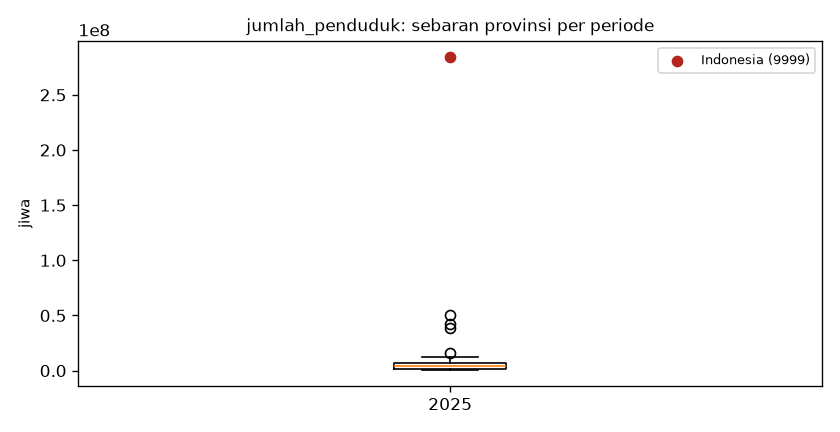
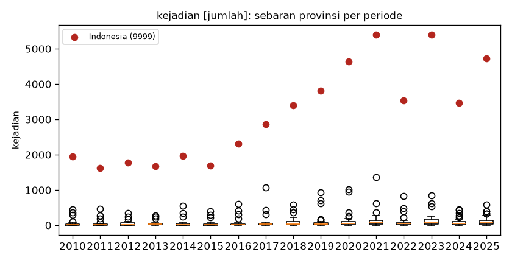
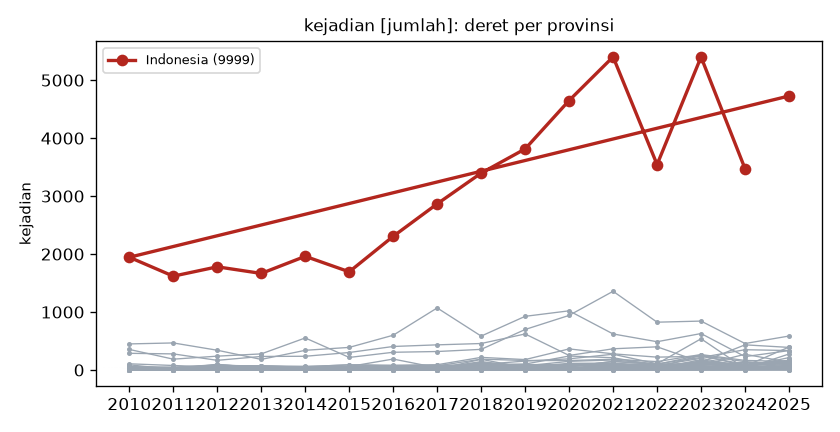
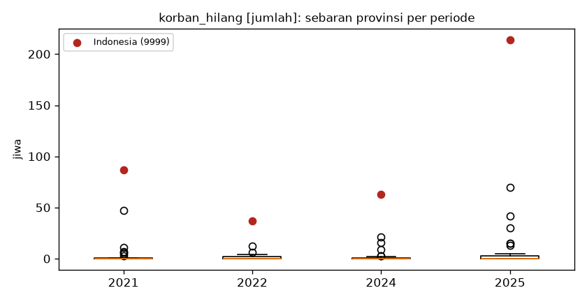
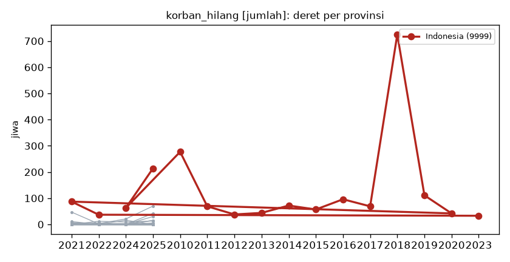
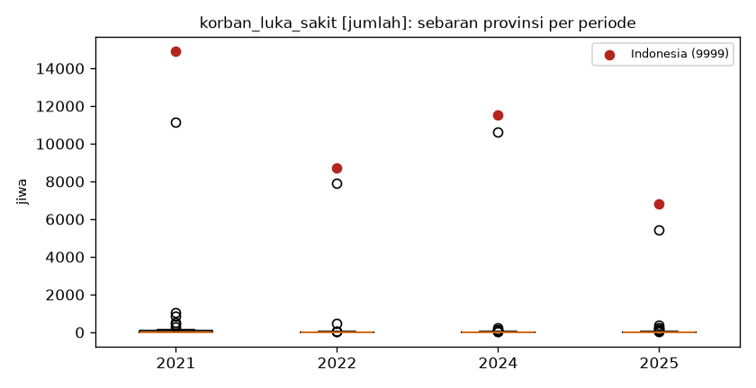
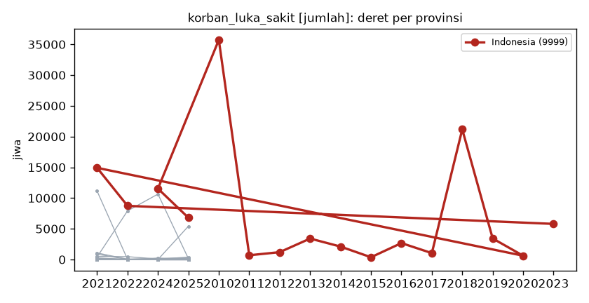
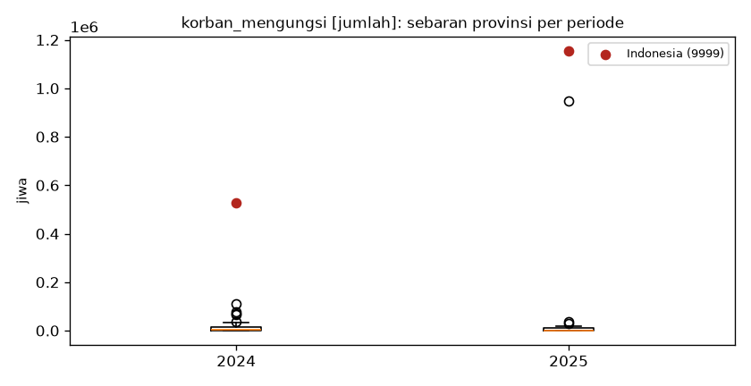
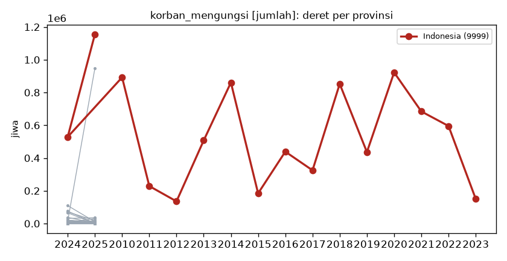
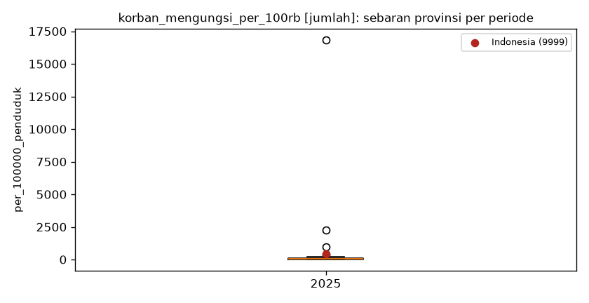
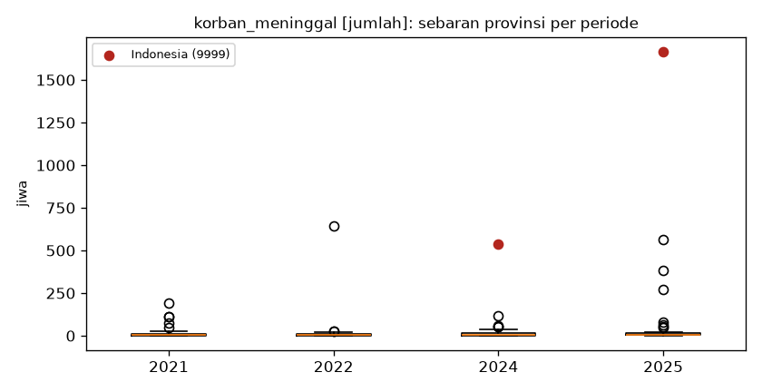
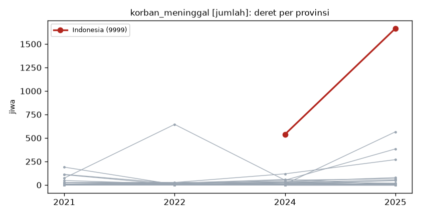
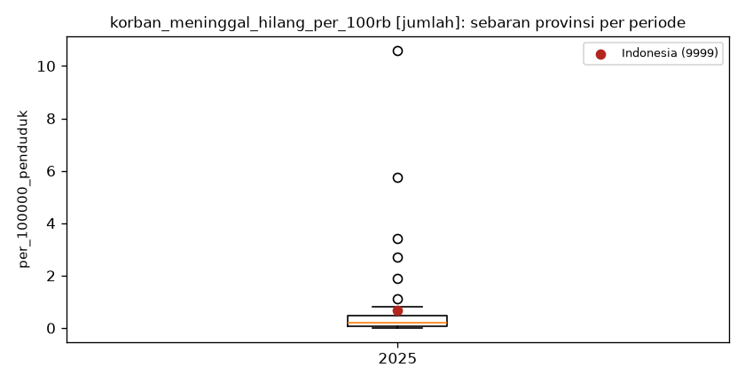
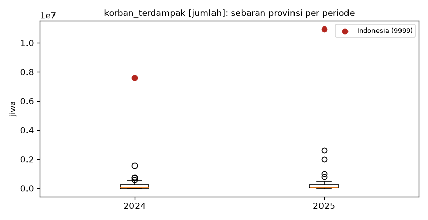
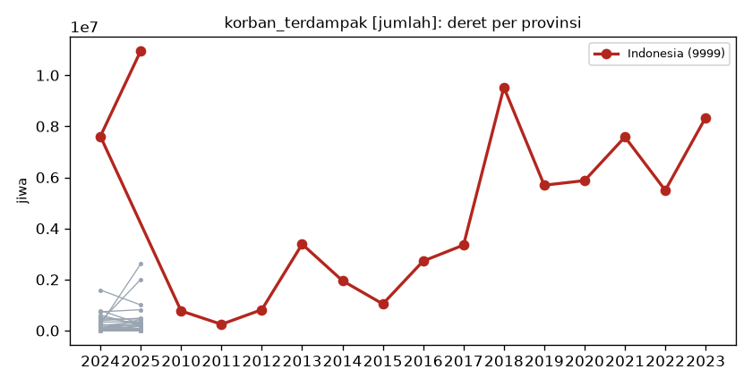
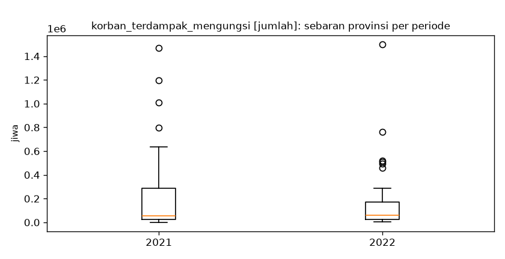
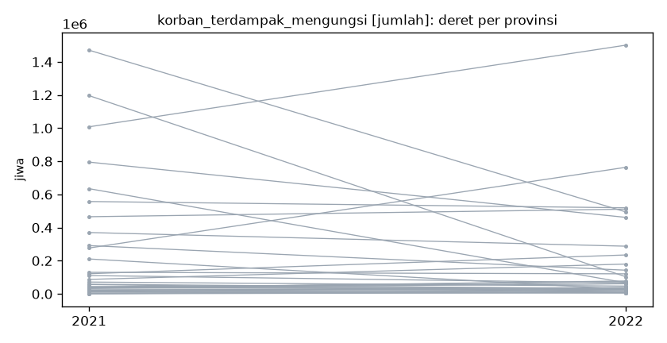
